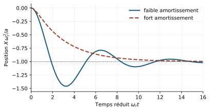
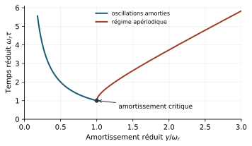
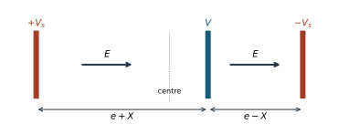
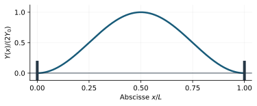
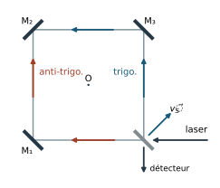

# X-ENS MP 2014 — Physique · Corrigé guidé

*Corrigé rédigé par IA, non officiel. Signalez toute erreur.*

**Lecture du rapport du jury** · GPT-6.2 Astra Ultra · vitesse non renseignée

**Rédaction** · GPT-6.2 Astra Ultra · vitesse non renseignée

## Centrale inertielle

## I — Accéléromètre pendulaire

### Question 1 — Accélérations d’une manette

**Indication.** Choisir la distance parcourue entre les deux extrêmes et la durée d’un aller-retour. Dans un modèle sinusoïdal, distinguer l’amplitude de la distance entre extrêmes.

Modélisons un aller-retour par $x=A\cos(2\pi f t)$. L’accélération maximale a pour module $A(2\pi f)^2$. Une amplitude de $0{,}1\ \mathrm m$ et un aller-retour en trois secondes environ ($f=0{,}3\ \mathrm{Hz}$) donnent $0{,}4\ \mathrm{m\,s^{-2}}$, soit $0{,}04g$. Avec la même amplitude et trois allers-retours par seconde, on obtient environ $4g$. Ces hypothèses sur le geste explicitent les ordres de grandeur.

Le geste lent dépasse déjà la résolution de $0{,}01g$, le geste rapide approche la limite de mesure de $5g$. Un geste plus vif peut saturer la mesure. Les $10^4g$ annoncés caractérisent la résistance aux chocs.

### Question 2 — Mouvement relatif de la masse

**Indication.** Écrire la position de la masse dans le laboratoire avant d’exprimer les forces qui dépendent du mouvement relatif.

Si $x_b$ est l’abscisse du centre du boîtier, la masse se trouve à $x_b+X$. La projection horizontale de la deuxième loi de Newton donne $m(\ddot x_b+\ddot X)=-kX-2m\gamma\dot X$. Comme $\ddot x_b=a(t)$ et $k/m=\omega_r^2$,
$$\ddot X+2\gamma\dot X+\omega_r^2X=-a(t).$$
Une accélération positive du boîtier fait d’abord reculer la masse dans celui-ci.

### Question 3 — Deux régimes d’amortissement

**Indication.** Soustraire la solution constante puis chercher les racines de l’équation homogène. Le signe du discriminant détermine la forme du transitoire.

Pour $t>0$, une solution particulière constante est $X_s=-a/\omega_r^2$. La différence $X-X_s$ a pour équation caractéristique $r^2+2\gamma r+\omega_r^2=0$.

Pour $\gamma<\omega_r$, posons $\omega_d=\sqrt{\omega_r^2-\gamma^2}$. Alors
$$X=X_s+e^{-\gamma t}\big[A\cos(\omega_dt)+B\sin(\omega_dt)\big].$$
Pour $\gamma>\omega_r$, posons $h=\sqrt{\gamma^2-\omega_r^2}$. On trouve
$$X=X_s+D e^{(-\gamma+h)t}+F e^{(-\gamma-h)t}.$$
Les deux constantes de chaque solution sont fixées par $X(0)=\dot X(0)=0$. L’échelon d’accélération a une amplitude finie, ce qui assure la continuité de la position et de la vitesse.

### Question 4 — Déplacement stationnaire

**Indication.** Contrôler le signe de la partie réelle des deux racines, puis interpréter le résultat en termes de force.

Pour $\gamma>0$, l’enveloppe du régime oscillant décroît. Dans le régime apériodique, $h<\gamma$ garantit que les deux exponentielles décroissent également. Ainsi,
$$X(\infty)=-\frac{a}{\omega_r^2}=-\frac{ma}{k}.$$
La force du ressort $-kX$ fournit alors exactement l’accélération $a$ à la masse dans le laboratoire.

### Question 5 — Tracés après un échelon

**Indication.** Placer d’abord la position finale et la tangente initiale. Un échelon de l’accélération ne crée aucun saut de position.

Pour $a>0$, les deux courbes partent de l’origine avec une tangente horizontale et une concavité négative car $\ddot X(0^+)=-a$. Dans le régime faiblement amorti, $X$ traverse plusieurs fois $X_s$ en oscillant sous une enveloppe exponentielle. Dans le régime fortement amorti il atteint $X_s$ de façon monotone. En effet, pour $h$ défini à la question 3, $\dot X=-a\,e^{-\gamma t}\sinh(ht)/h<0$ pour $t>0$. La droite pointillée de la figure représente la valeur stationnaire.

### Question 6 — Temps caractéristique de réponse

**Indication.** Dans une somme d’exponentielles décroissantes, chercher celle dont l’exposant est le plus proche de zéro.

En prenant pour convention le temps d’amortissement d’un facteur $e$ du mode le plus lent, le régime oscillant donne $\tau=1/\gamma$. Dans le régime apériodique, le terme en $e^{-(\gamma-h)t}$ domine à long terme, d’où
$$\tau=\frac{1}{\gamma-\sqrt{\gamma^2-\omega_r^2}}
=\frac{\gamma+\sqrt{\gamma^2-\omega_r^2}}{\omega_r^2}.$$
Au point critique le transitoire a la forme $(A+Bt)e^{-\omega_r t}$, avec un temps caractéristique $1/\omega_r$. Un délai défini avec une tolérance de stabilisation particulière peut comporter un autre facteur numérique.

### Question 7 — Influence de l’amortissement

**Indication.** Tracer les deux expressions de la question 6 sur les mêmes axes réduits et vérifier leurs limites au point critique.

Posons $u=\gamma/\omega_r$. Pour $0<u<1$, le temps réduit $\omega_r\tau=1/u$ décroît de l’infini à 1. Pour $u>1$, $\omega_r\tau=u+\sqrt{u^2-1}$ croît à partir de 1 et tend vers $2u$ aux grands amortissements. Les deux branches se rejoignent en $(1,1)$.

### Question 8 — Temps minimal

**Indication.** Identifier le point de raccordement des deux branches du graphe.

Pour $\omega_r$ fixée, la branche oscillante décroît jusqu’à $\gamma=\omega_r$, où la branche apériodique prend le relais en croissant. Le minimum caractéristique est donc
$$\tau_{\min}=\frac{1}{\omega_r}\qquad(\gamma=\omega_r).$$

### Question 9 — Application au capteur de la manette

**Indication.** Employer le facteur de qualité tel qu’il est défini dans le cahier et convertir la fréquence en pulsation avant de la mettre au carré.

Avec la définition $Q=\omega_r/\gamma=5$ adoptée dans l’énoncé, $\gamma<\omega_r$ et
$$\tau=\frac{5}{2\pi\times5500}\ \mathrm{s}\simeq 1{,}45\times10^{-4}\ \mathrm{s}.$$
Pour $a=g=10\ \mathrm{m\,s^{-2}}$, on a $X_s=-10/(2\pi\times5500)^2\ \mathrm m$, soit environ $-8\ \mathrm{nm}$. Le temps de réponse est de l’ordre de $10^{-4}\ \mathrm s$.

### Question 10 — Sensibilité et rapidité

**Indication.** Comparer, à amortissement optimal, les deux expressions qui dépendent de la même pulsation mécanique.

La sensibilité statique en déplacement est $S_X=|\partial X_s/\partial a|=1/\omega_r^2$. Pour obtenir un grand déplacement par unité d’accélération, il faut diminuer $\omega_r$. Même si l’amortissement est optimisé, le temps caractéristique minimal $1/\omega_r=\sqrt{S_X}$ augmente alors. Un ressort plus souple rend le déplacement plus facile à détecter et ralentit le retour à l’équilibre.

### Question 11 — Grandeur mesurée lorsque l’axe est incliné

**Indication.** Conserver le sens vectoriel du champ de pesanteur. Le cas de la chute libre permet de contrôler le signe final.

Pour une orientation fixe, la projection du poids rajoute $m\vec g\cdot\vec u$ au second membre du bilan des forces. À l’équilibre relatif,
$$-kX_s+m\vec g\cdot\vec u=m\vec a\cdot\vec u.$$
Le capteur étalonné horizontalement affiche ainsi $-\omega_r^2 X_s=(\vec a-\vec g)\cdot\vec u$. À l’arrêt, un axe vertical orienté vers le haut indique $+g$. En chute libre, $\vec a=\vec g$ et l’indication s’annule.

## II — Détection électrostatique

### Question 12 — Champ entre les armatures

**Indication.** Établir séparément la direction du champ, son uniformité dans le vide, puis sa valeur à partir de la tension imposée.

Prenons $\vec u$ de l’armature fixe vers l’armature mobile et $U=V_{\rm fixe}-V_{\rm mobile}$. L’invariance par translation dans le plan des armatures et la symétrie par tout plan perpendiculaire aux armatures passant par le point étudié imposent $\vec E=E(x)\vec u$. Dans l’entrefer vide, $\nabla\cdot\vec E=0$ donne $\mathrm dE/\mathrm dx=0$. L’intégration de $\vec E=-\nabla V$ entre les conducteurs donne donc
$$\vec E=\frac{U}{e+X}\,\vec u.$$

### Question 13 — Capacité d’une paire d’électrodes

**Indication.** Passer du champ à la densité de charge sur la face du conducteur, puis à la charge totale.

Pour une surface utile $S$ assez grande devant le carré de l’entrefer, les effets de bord sont négligeables. La condition à la surface du conducteur fixe donne $\sigma=\varepsilon_0 E$. Sa charge vaut donc $q=\varepsilon_0 S U/(e+X)$. On en tire
$$C_1=\frac{q}{U}=\frac{\varepsilon_0 S}{e+X}
=C\,\frac{e}{e+X},\qquad C=\frac{\varepsilon_0S}{e}.$$

### Question 14 — Force exercée par une électrode

**Indication.** Dans le calcul de la force, employer le champ produit par l’autre électrode. Chacune des deux nappes contribue pour moitié au champ total de l’entrefer.

Les deux faces en regard portent des densités opposées. Le champ créé par la seule nappe fixe à l’emplacement de la mobile vaut $\sigma/(2\varepsilon_0)$ dans le sens de $\vec u$. En le multipliant par la charge $-\sigma S$ de la face mobile, on trouve
$$\vec F=-\frac{\varepsilon_0 S}{2}\left(\frac{U}{e+X}\right)^2\vec u
=-\frac{Ce\,U^2}{2(e+X)^2}\vec u.$$
L’attraction réduit la séparation, quel que soit le signe de la tension. Le facteur $1/2$ provient de l’exclusion du champ propre de la face mobile.

### Question 15 — Influence de la force de mesure

**Indication.** Comparer deux forces sur la même masse. Un microgramme représente un milliardième de kilogramme.

À $X=0$, $|\vec F|=CU^2/(2e)=(10^{-13}\times1)/(2\times10^{-6})=5\times10^{-8}\ \mathrm N$. La force d’inertie à $1g$ sur $1\ \mathrm{\mu g}=10^{-9}\ \mathrm{kg}$ vaut $10^{-8}\ \mathrm N$. L’attraction électrique représente donc cinq fois la force que l’on cherche à mesurer. Avec ces paramètres, elle décale fortement la position et rend la lecture directe à une seule électrode inadaptée.

### Question 16 — Potentiel de l’armature mobile isolée

**Indication.** La neutralité porte sur la somme des charges des deux faces de l’électrode mobile.

Les deux capacités sont $C_1=\varepsilon_0 S/(e+X)$ et $C_2=\varepsilon_0 S/(e-X)$. Les charges sur les deux faces de l’électrode mobile valent $C_1(V-V_s)$ et $C_2(V+V_s)$. Leur somme est nulle. Il vient
$$V=V_s\frac{C_1-C_2}{C_1+C_2}=-V_s\frac Xe,\qquad |X|<e.$$
Au centre, le potentiel est nul. Pour $X>0$ l’électrode est plus près de l’armature à $-V_s$, ce qui explique le signe.

### Question 17 — Forces sur les deux faces

**Indication.** Calculer séparément les deux chutes de tension plutôt que de supposer chaque chute égale à $V_s$ après le déplacement.

Les deux champs ont même sens et même valeur algébrique,
$$E_1=\frac{V_s-V}{e+X}=\frac{V_s}{e},\qquad
E_2=\frac{V+V_s}{e-X}=\frac{V_s}{e}.$$
La pression électrostatique vaut $\varepsilon_0E_i^2/2$ sur chaque face. Les forces attractives sont dirigées en sens opposés, donc leur somme est nulle pour tout $|X|<e$. Cette compensation suppose des surfaces identiques, l’absence d’effets de bord et une armature mobile neutre.

### Question 18 — Avantages de la lecture différentielle

**Indication.** Rapprocher la loi de mesure obtenue en 16 et le bilan de forces obtenu en 17.

La tension à mesurer est proportionnelle au déplacement avec une pente constante $-V_s/e$, alors que $C_1(X)$ seule varie comme $1/(e+X)$. En outre la somme des forces électriques est nulle sur toute la course idéale. Le gain peut donc être réglé par $V_s$ tout en préservant l’équilibre mécanique dans ce modèle.

## III — Accéléromètre à lames vibrantes

### Question 19 — Décalage différentiel des pulsations

**Indication.** Écrire l’équilibre avec des tensions algébriques. La différence des deux tensions est fixée par cet équilibre, quel que soit leur partage.

Appelons $T_g$ et $T_d$ les tensions des lames gauche et droite, positives en traction. Elles exercent sur la masse $-T_g\vec e_x$ et $+T_d\vec e_x$. Dans le boîtier la masse reste centrée, d’où $F_e-T_g+T_d=0$. Avec $\omega=\omega_0+\alpha T$, on obtient
$$\omega_g-\omega_d=\alpha(T_g-T_d)=\alpha F_e.$$
Dans la configuration symétrique sans précontrainte, chaque lame subit en valeur absolue $|F_e|/2$. Leurs écarts de pulsation sont opposés, ce qui explique le résultat différentiel.

### Question 20 — Étendue de mesure d’un capteur vibrant

**Indication.** Distinguer la grandeur mécanique qui limite la course et la grandeur électrique ou fréquentielle réellement lue.

Dans le capteur pendulaire, la lecture exige un déplacement détectable et la course disponible limite l’accélération. Ici une structure rigide maintient la masse presque centrée. Le changement de fréquence des lames permet de détecter l’effort même quand la course est infime. On peut ainsi conserver une réponse mécanique rapide et mesurer de fortes accélérations sans que la masse arrive en butée. La résistance des lames, leur stabilité en compression et le domaine de la loi linéaire limitent encore l’étendue de mesure. La précision et la durée d’une mesure de fréquence conditionnent, elles aussi, la réponse effective.

### Question 21 — Énergie cinétique du mode

**Indication.** Intégrer une densité d’énergie cinétique. La masse linéique du profil uniforme est $M/L$.

Un élément de longueur $\mathrm dx$ porte la masse $\mathrm dm=(M/L)\mathrm dx$. Sa vitesse transverse est $\partial_t y=-\omega Y(x)\sin(\omega t)$. À l’ordre quadratique en amplitude, l’énergie cinétique totale est
$$E_c(t)=\frac{M\omega^2}{2L}\sin^2(\omega t)\int_0^L Y(x)^2\,\mathrm dx.$$
Elle s’annule aux extrema de la déformation.

### Question 22 — Allongement géométrique

**Indication.** Former d’abord la longueur à l’aide du théorème de Pythagore, puis développer la racine carrée.

Entre deux sections voisines la longueur curviligne devient $\mathrm ds=\sqrt{1+(\partial_x y)^2}\,\mathrm dx$. Pour une petite pente, le premier terme de l’allongement est quadratique,
$$\delta(x)=\mathrm ds-\mathrm dx\simeq \tfrac12(\partial_x y)^2\,\mathrm dx.$$
En sommant les contributions élémentaires, on obtient
$$\Delta(t)=\frac{\cos^2(\omega t)}{2}\int_0^L [Y'(x)]^2\,\mathrm dx.$$
Le signe de la déflexion ne change pas l’allongement.

### Question 23 — Énergie de la tension axiale

**Indication.** La tension donnée est la précontrainte constante. La tension supplémentaire proportionnelle à l’allongement contribuerait à une énergie d’ordre quatre en amplitude.

La déformation transversale allonge la ligne moyenne de $\Delta(t)$. L’accroissement d’énergie dû à la tension déjà présente s’obtient en intégrant $T\,\mathrm d\Delta$ depuis la position droite. Comme $T$ est constante à cet ordre,
$$E_{\rm tension}(t)=T\Delta(t)=\frac T2\cos^2(\omega t)\int_0^L[Y'(x)]^2\,\mathrm dx.$$
L’énergie est comptée à partir de l’état droit sous la même charge. La traction stabilise l’état droit, tandis qu’une compression diminue sa raideur transverse.

### Question 24 — Énergie d’un élément courbé

**Indication.** La longueur d’un arc est son rayon multiplié par son angle. Comparer la fibre située à la cote $u$ et la fibre centrale de même angle.

Soit $u$ la distance algébrique d’une fibre à la ligne moyenne. Deux sections qui tournent l’une par rapport à l’autre de $\mathrm d\theta$ imposent à cette fibre un allongement de module $|u\,\mathrm d\theta|$. Les fibres de signes opposés s’étirent et se compriment. La contribution d’une tranche de largeur $b$ et d’épaisseur $\mathrm du$ est $\tfrac12(Eb\,\mathrm du/\mathrm dx)(u\,\mathrm d\theta)^2$. Ainsi
$$\mathrm dE_{\rm courbure}=
\frac{Eb(\mathrm d\theta)^2}{2\,\mathrm dx}\int_{-h/2}^{h/2}u^2\,\mathrm du
=\frac{Ebh^3}{24}\frac{(\mathrm d\theta)^2}{\mathrm dx}.$$

### Question 25 — Rigidité de flexion

**Indication.** Exprimer la variation de l’angle de la tangente au moyen de la dérivée seconde du profil.

À petite pente, l’angle de la tangente vaut $\theta\simeq\partial_x y$. Les deux sections voisines tournent donc l’une par rapport à l’autre de $\mathrm d\theta=(\partial_x^2 y)\,\mathrm dx$. L’intégrale de l’expression précédente donne
$$E_{\rm courbure}(t)=\frac B2\int_0^L(\partial_x^2 y)^2\,\mathrm dx,
\qquad B=\frac{Ebh^3}{12}.$$
Le facteur $bh^3/12$ est le moment quadratique de la section autour de sa ligne médiane. $B$ s’exprime en $\mathrm{N\,m^2}$.

### Question 26 — Énergie conservée et pulsation propre

**Indication.** Comparer l’énergie à un instant de vitesse nulle et un quart de période plus tard. Développer la pulsation seulement après avoir isolé son carré.

Posons $I_0=\int_0^LY^2\,\mathrm dx$, $I_1=\int_0^L(Y')^2\,\mathrm dx$ et $I_2=\int_0^L(Y'')^2\,\mathrm dx$. Lors d’une oscillation libre, l’énergie totale vaut
$$E=\frac12\frac ML\omega^2 I_0\sin^2(\omega t)+\frac12(T I_1+B I_2)\cos^2(\omega t).$$
Aux instants $0$ et $\pi/(2\omega)$, elle est successivement toute potentielle et toute cinétique. L’égalité des deux valeurs impose
$$\omega^2=\omega_0^2+\beta T,\qquad
\omega_0^2=\frac{LB I_2}{M I_0},\qquad
\beta=\frac{L I_1}{M I_0}.$$
Pour une forme modale $Y$ supposée inchangée et $|\beta T|\ll\omega_0^2$, la racine carrée donne $\omega\simeq\omega_0+\alpha T$ avec $\alpha=\beta/(2\omega_0)$. Une compression trop forte détruit la stabilité lorsque le carré de la pulsation s’annule.

### Question 27 — Profil approché du fondamental

**Indication.** Garder le terme constant de $Y$ dans le calcul de $I_0$. Il disparaît seulement lorsqu’on dérive le profil.

Écrivons $k=2\pi/L$ et $Y=Y_0(1-\cos kx)$. Cette forme respecte $Y=Y'=0$ aux deux extrémités. Sur une période spatiale, les moyennes de $\sin^2(kx)$ et $\cos^2(kx)$ valent $1/2$, celle de $\cos(kx)$ est nulle. Ainsi
$$I_0=\tfrac32 LY_0^2,\qquad I_1=\tfrac12 L k^2Y_0^2,\qquad I_2=\tfrac12 L k^4Y_0^2.$$
Les amplitudes disparaissent dans les rapports. On trouve
$$\omega_0=4\pi^2\sqrt{\frac{B}{3ML^3}},\qquad
\beta=\frac{4\pi^2}{3ML},\qquad
\alpha=\frac{1}{2\sqrt3}\sqrt{\frac L{MB}}.$$

### Question 28 — Fréquence de la lame en quartz

**Indication.** Distinguer la masse $M$ de la lame de la masse d’épreuve $m$, puis convertir les écarts de pulsation en hertz.

Avec $M=10^{-8}\ \mathrm{kg}$, $L=2\times10^{-3}\ \mathrm m$ et $B=5{,}4\times10^{-8}\ \mathrm{N\,m^2}$, les expressions précédentes donnent $\omega_0\simeq5{,}9\times10^5\ \mathrm{rad\,s^{-1}}$. Au chiffre significatif demandé,
$$f_0=\frac{\omega_0}{2\pi}\simeq9\times10^4\ \mathrm{Hz},\qquad
\alpha\simeq6\times10^5\ \mathrm{rad\,s^{-1}\,N^{-1}}.$$
La masse d’épreuve $m=10\ \mathrm{mg}=10^{-5}\ \mathrm{kg}$ sous $1g$ exerce un effort $mg=10^{-4}\ \mathrm N$. Pour une lame soumise à cet effort entier, $\Delta f=\alpha mg/(2\pi)\simeq9\ \mathrm{Hz}$ en traction et l’opposé en compression. Si les deux lames symétriques de la question 19 partagent l’effort, chacune se décale d’environ $4\ \mathrm{Hz}$ en sens opposé, pour une différence d’environ $9\ \mathrm{Hz}$, calculée avant arrondi.

## IV — Gyromètre laser

### Question 29 — Rencontre du second front avec le miroir

**Indication.** Écrire la distance initiale et les deux vitesses sur un même axe, celui de la normale au miroir.

Prenons la normale sortante dirigée du miroir vers le faisceau incident, comme sur la figure 6. Notons $v_\perp$ la vitesse algébrique du miroir selon cette normale, positive lorsque le miroir s’avance vers la lumière. À $t_1=0$, la distance de $A_2$ au plan du miroir mesurée selon la normale vaut $d\cos\theta$. Le point $A_2$ se rapproche selon cette normale à $c\cos\theta$ tandis que le miroir avance de $v_\perp$. La fermeture de l’écart donne
$$t_2=\frac{d\cos\theta}{c\cos\theta+v_\perp}.$$
Pour un miroir immobile et une incidence non rasante, on retrouve $d/c$.

### Question 30 — Écart entre les fronts réfléchis

**Indication.** Comparer les positions au même instant $t_2$. Les deux rayons réfléchis sont parallèles et la distance entre leurs fronts se mesure par projection sur leur direction commune.

Soient $P_1$ et $P_2$ les points de réflexion de $A_1$ et $A_2$, et $\vec i,\vec r$ les directions unitaires incidente et réfléchie. Les deux points initiaux sont sur le même rayon incident, avec $A_2(0)=P_1-d\vec i$. Il vient $\overrightarrow{P_1P_2}=(ct_2-d)\vec i$. À l’instant $t_2$, le premier front réfléchi est passé par $P_1+ct_2\vec r$, le second passe par $P_2$. Leur distance normale est la projection de la différence de ces points sur $\vec r$. Or $\vec i\cdot\vec r=1-2\cos^2\theta$. Ainsi, avec la direction de réflexion supposée par le sujet,
$$d'=ct_2-(ct_2-d)(1-2\cos^2\theta)
=d\left(1-\frac{2v_\perp\cos^2\theta}{c\cos\theta+v_\perp}\right).$$
Le premier front gagne moins d’avance pour un miroir qui s’approche qu’il n’en gagnerait avec un miroir fixe.

### Question 31 — Longueur d’onde après réflexion

**Indication.** Identifier la longueur d’onde à la distance entre deux fronts de même phase successifs.

Deux fronts successifs de même phase sont distants de $\lambda$ avant la réflexion et de $\lambda'$ après. Pour $d=\lambda$, on obtient
$$\lambda'=\lambda\left(1-\frac{2v_\perp\cos^2\theta}{c\cos\theta+v_\perp}\right)
\simeq \lambda\left(1-2\frac{v_\perp}{c}\cos\theta\right).$$
Le développement en $v_\perp/c$ s’entend à angle d’incidence fixé, loin de l’incidence rasante. En incidence normale, l’expression avant développement vaut $\lambda(c-v_\perp)/(c+v_\perp)$.

### Question 32 — Pulsation de l’onde réfléchie

**Indication.** Utiliser la célérité commune des deux ondes. Pour une petite variation, les variations relatives de pulsation et de longueur d’onde ont des signes opposés.

Dans le vide, $\lambda\omega_\ell=\lambda'\omega'=2\pi c$. En inversant la variation relative de longueur d’onde de la question précédente au premier ordre, on obtient
$$\omega'=\omega_\ell\left(1+2\frac{v_\perp}{c}\cos\theta\right)
+O\!\left(\omega_\ell\frac{v_\perp^2}{c^2}\right).$$
Une surface qui avance vers le faisceau augmente la pulsation de l’onde réfléchie.

### Question 33 — Exemples d’effet Doppler

**Indication.** Distinguer un effet perceptible au quotidien et un emploi quantitatif qui déduit une vitesse d’une fréquence.

Il s’agit de l’effet Doppler, appelé Doppler-Fizeau pour la lumière. La sirène d’une ambulance paraît plus aiguë pendant son approche et plus grave lorsqu’elle s’éloigne. En échographie Doppler, la variation de fréquence des ultrasons rétrodiffusés par les globules rouges renseigne sur la composante de vitesse du sang selon le faisceau.

### Question 34 — Interférences sur la sortie du détecteur

**Indication.** Suivre chacun des deux chemins jusqu’à chacune des sorties. Sur la voie de retour vers le laser, les deux amplitudes ont la même phase. Utiliser ensuite la conservation de la puissance.

Les deux ondes parcourent le même carré en sens opposés. En l’absence de rotation, leurs phases de propagation sont égales. Chaque onde arrivant seule sur le détecteur fournirait $I_0/4$ après les deux divisions. Il reste à additionner leurs amplitudes, en tenant compte de la phase de la séparatrice.

Sur la figure 7, un trajet aboutit au détecteur par deux transmissions et l’autre par deux réflexions, l’une sur chaque face. Pour une séparatrice idéale 50/50 réciproque et sans pertes, ces deux amplitudes sont opposées. On peut par exemple prendre pour amplitudes de transmission $t=1/\sqrt2$ et de réflexion $r=i/\sqrt2$ entre modes symétriques. Alors $t^2=1/2$ et $r^2=-1/2$. Le détecteur reçoit **une intensité nulle** et la puissance retourne vers le laser. On retrouve le même résultat en observant que les deux trajets vers le laser ont chacun une réflexion sur la même face et une transmission. Ils y interfèrent constructivement et épuisent toute la puissance incidente.

### Question 35 — Éléments mobiles responsables du décalage

**Indication.** Tracer la vitesse de chaque sommet perpendiculairement au rayon issu de $O$, puis la projeter sur la normale à la surface optique.

En rotation rigide, la vitesse de chaque sommet est tangentielle au cercle de centre $O$. Aux miroirs $M_1$, $M_2$ et $M_3$, les normales sont radiales. La vitesse normale est nulle et la réflexion ne change pas la fréquence à l’ordre étudié. Au sommet de la séparatrice, en bas à droite, la normale est au contraire tangente au cercle. Sa vitesse normale a pour module $|\Omega|a/\sqrt2$. **Seules les réflexions sur la séparatrice** créent ici un décalage au premier ordre. Une transmission conserve la direction de l’onde dans le modèle d’une lame mince.

### Question 36 — Pulsations des deux trajets

**Indication.** Repérer sur la figure 7 lequel des deux trajets commence par une réflexion. Pour fixer le signe, regarder si la surface avance vers le rayon incident ou s’en éloigne.

Dans le repère de la figure, une rotation trigonométrique $\Omega>0$ donne à la séparatrice $S$ la vitesse $\vec v_S=(\Omega a/2)(\vec e_x+\vec e_y)$. L’onde incidente va vers la gauche. La composante transmise poursuit sa route vers $M_1$ et parcourt le carré dans le sens anti-trigonométrique. La composante réfléchie monte vers $M_3$ et parcourt le carré dans le sens trigonométrique. Pour cette première réflexion la séparatrice avance vers l’onde, avec $v_\perp=\Omega a/\sqrt2$ et $\cos\theta=1/\sqrt2$. Par la question 32,
$$\omega_a=\omega_L,\qquad \omega_t=\omega_L\left(1+\frac{\Omega a}{c}\right)$$
au premier ordre. Les trois miroirs conservent ensuite chacune de ces pulsations.

### Question 37 — Différence de phase autour du carré

**Indication.** Multiplier la longueur de la boucle par le nombre d’onde de chaque faisceau. La différence porte sur un petit terme, si bien qu’une même longueur peut être employée ici.

Adoptons pour phase accumulée la quantité positive $k\ell$ et prenons la longueur commune $\ell=4a$ dans l’approximation demandée. Avec $k=\omega/c$,
$$\phi_t=\frac{4a\omega_L}{c}\left(1+\frac{\Omega a}{c}\right),\qquad
\phi_a=\frac{4a\omega_L}{c}.$$
Les phases communes des trois miroirs s’éliminent dans la différence. En posant $\lambda=2\pi c/\omega_L$ à la précision requise, on trouve
$$\Delta\phi=\phi_t-\phi_a=\frac{4\omega_La^2\Omega}{c^2}
=\frac{8\pi a^2\Omega}{\lambda c}.$$
Renverser la rotation inverse le signe du déphasage.

### Question 38 — Pulsations à la sortie et intensité détectée

**Indication.** Examiner d’abord les fréquences après la deuxième rencontre avec la séparatrice. Ajouter ensuite les amplitudes complexes sur la même voie en conservant la phase relative au repos.

Au retour, le faisceau anti-trigonométrique venant de $M_3$ se transmet vers le détecteur et conserve $\omega_L$. Le faisceau trigonométrique arrive de $M_1$ suivant $+\vec e_x$ et se réfléchit vers $-\vec e_y$ sur l’autre face de la séparatrice. Celle-ci s’éloigne cette fois du rayon incident. Le facteur Doppler vaut $1-\Omega a/c$, qui compense le facteur initial $1+\Omega a/c$ au premier ordre. Les deux ondes vers le détecteur ont ainsi la même pulsation $\omega_L$ et peuvent produire une figure d’interférence stationnaire.

Avec les phases de la question 34, le champ résultant est proportionnel à $(e^{i\phi_a}-e^{i\phi_t})/2$. L’intensité est donc
$$I_D=\frac{I_0}{2}(1-\cos\Delta\phi)
=I_0\sin^2\!\left(\frac{4\pi a^2\Omega}{\lambda c}\right).$$
L’autre sortie porte $I_0-I_D$. Les deux sorties échangent leurs maxima et leurs minima.

### Question 39 — Translation de tout le dispositif

**Indication.** Faire la somme des corrections de durée sur les quatre côtés du chemin fermé, en tenant compte du sens de parcours.

Considérons dans le laboratoire une translation uniforme de vitesse $\vec V$. Pour un côté de longueur $\ell$ orienté suivant $\vec n$, le point d’arrivée se déplace pendant le passage de la lumière. Le temps de parcours vérifie $c\,\mathrm dt=|\ell\vec n+\vec V\,\mathrm dt|$. Au premier ordre,
$$\mathrm dt=\frac{\ell}{c}+\frac{\vec V\cdot(\ell\vec n)}{c^2}.$$
Pour chaque tour complet, la somme des vecteurs $\ell\vec n$ est nulle. Les deux durées sont donc égales et les deux champs reçus à un même instant correspondent au même instant d’émission. Par exemple, en translation vers la droite, le retard pris sur le côté parcouru vers la droite est exactement compensé sur le côté parcouru vers la gauche. Le déphasage de propagation est nul. On retrouve l’intensité au repos de la question 34.

### Question 40 — Aire cumulée d’une fibre enroulée

**Indication.** Réécrire le résultat du carré avec son aire. Un enroulement de dix tours de même orientation fait parcourir dix fois la même aire.

Le carré intervient dans la différence de phase par son aire $a^2$. Pour le voir sur un contour quelconque en rotation, la correction de durée entre sens opposés s’écrit $(2/c^2)\oint\vec v\cdot\mathrm d\vec\ell$. Avec $\vec v=\vec\Omega\times\vec r$ et un contour plan, $\oint\vec v\cdot\mathrm d\vec\ell=2\Omega A$ pour l’aire orientée $A$. Pour $N$ tours coplanaires de même sens, les aires s’ajoutent. Dans la formule de Sagnac, cela donne
$$|\Delta\phi|=\frac{8\pi|\Omega|}{\lambda c}\,N\pi R^2$$
pour des spires de rayon $R$, avec $\lambda$ dans le vide. Le facteur $N$ permet donc de mesurer une rotation beaucoup plus petite pour une même précision de phase, en conservant le diamètre d’une spire. Une fibre longue et rectiligne n’apporterait pas ce gain d’aire.

### Question 41 — Valeur du déphasage dans la fibre

**Indication.** Déduire le nombre de spires de la circonférence de chacune, puis calculer l’aire cumulée avant de remplacer les données dans la formule optique.

La longueur totale $\ell=2\pi R N$ correspond à environ $1{,}6\times10^3$ tours. L’aire cumulée est $N\pi R^2=\ell R/2=50\ \mathrm{m^2}$. On en déduit
$$|\Delta\phi|=\frac{4\pi\ell R|\Omega|}{\lambda c}
=\frac{4\pi\times10^3\times0{,}1\times1}{800\times10^{-9}\times3\times10^8}
\simeq 5\ \mathrm{rad}.$$
C’est un déphasage de l’ordre d’un tour de phase. Son signe dépend du sens choisi pour orienter la rotation et la fibre.
