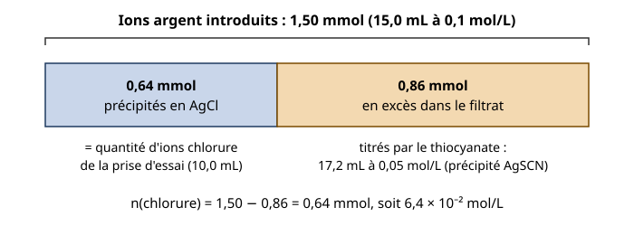
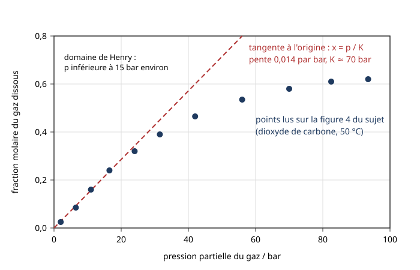
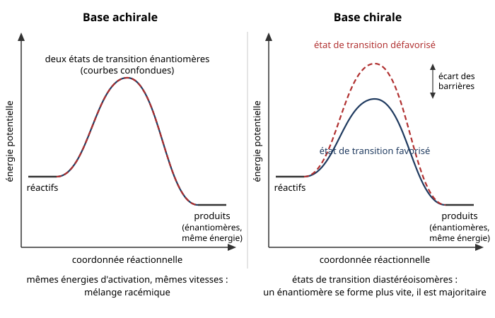

# X-ENS PC — Chimie A 2014 · Corrigé brut

*Corrigé rédigé par IA, non officiel. Signalez toute erreur.*

**Rédaction** · modèle exact non renseigné (famille Claude) · effort non renseigné · vitesse non renseignée

**Révision (tour 2)** · modèle exact non renseigné (famille Claude) · effort non renseigné · vitesse non renseignée · 28 novembre 2026

## Première partie — Dissolution des gaz dans les liquides ioniques

## 1.1 Dosages dans les liquides ioniques

### Question 1.1.1 — Nature du solide blanc

Le liquide ionique apporte des ions chlorure et la solution ajoutée des ions argent(I). Le solide blanc est le **chlorure d'argent** $\mathrm{AgCl(s)}$, très peu soluble ($\mathrm{p}K_s = 9{,}75$) :

$$\mathrm{Ag^+(aq) + Cl^-(aq) \longrightarrow AgCl(s)} \qquad K = 10^{9{,}75}.$$

Le cation organique et l'ion nitrate restent en solution.

### Question 1.1.2 — Réaction de titrage, constante, verrerie

Les ions argent étant en excès, tous les chlorures ont précipité et le filtrat contient l'excès d'ions $\mathrm{Ag^+}$. C'est cet excès que titre le thiocyanate :

$$\mathrm{Ag^+(aq) + SCN^-(aq) \longrightarrow AgSCN(s)}$$

$$\boxed{K = \frac{1}{K_s(\mathrm{AgSCN})} = 10^{11{,}9}}$$

La constante est très grande : la réaction est quantitative, condition nécessaire pour un titrage (elle est par ailleurs rapide). Il s'agit d'un **titrage indirect, en retour** : on ne dose pas les chlorures, mais l'argent qu'ils n'ont pas consommé.

La quantité d'ions argent introduite intervient directement dans le résultat : les $15{,}0\ \mathrm{mL}$ doivent être mesurés avec de la verrerie de précision, **une pipette jaugée** (ou, à défaut de pipette de ce volume, une burette graduée). Une éprouvette ne convient pas, et une fiole jaugée sert à préparer une solution, pas à prélever.

### Question 1.1.3 — Détection de l'équivalence

Tant qu'il reste des ions argent, le thiocyanate versé précipite sous forme de $\mathrm{AgSCN}$ blanc ($K = 10^{11{,}9}$). Dès que l'argent est épuisé, la première goutte de thiocyanate en excès réagit avec le fer(III) :

$$\mathrm{Fe^{3+}(aq) + SCN^-(aq) \rightleftharpoons [Fe(SCN)]^{2+}(aq)}$$

L'équivalence est repérée par **l'apparition d'une coloration rouge sang persistante**, due au complexe $\mathrm{[Fe(SCN)]^{2+}}$. Le fer(III) joue le rôle d'indicateur de fin de réaction. Le milieu est acidifié par l'acide nitrique pour éviter la précipitation de l'hydroxyde de fer(III).

L'énoncé écrit « $\beta = 2{,}2$ ». Nous lisons $\log\beta = 2{,}2$, ordre de grandeur des valeurs tabulées pour ce complexe : c'est une interprétation de la donnée, non la donnée elle-même. Lue à la lettre, elle conduirait ici à la même conclusion qualitative. Avec cette lecture, la constante de formation du complexe ($10^{2{,}2}$) est très inférieure à celle de la précipitation de $\mathrm{AgSCN}$ ($10^{11{,}9}$), si bien que le complexe ne se forme qu'une fois l'argent consommé.

### Question 1.1.4 — Concentration résiduelle en ions chlorure

Les ions argent introduits se partagent entre le précipité de chlorure d'argent et le titrage par le thiocyanate :

$$n(\mathrm{Cl^-}) = C_{\mathrm{Ag}}V_{\mathrm{Ag}} - C_{\mathrm{SCN}}V_{\text{éq}}$$

Numériquement :

$$C_{\mathrm{Ag}}V_{\mathrm{Ag}} = 0{,}1 \times 15{,}0\cdot 10^{-3} = 1{,}50\cdot 10^{-3}\ \mathrm{mol}$$

$$C_{\mathrm{SCN}}V_{\text{éq}} = 0{,}05 \times 17{,}2\cdot 10^{-3} = 0{,}86\cdot 10^{-3}\ \mathrm{mol}$$

$$n(\mathrm{Cl^-}) = 0{,}64\cdot 10^{-3}\ \mathrm{mol}$$

Rapportée à la prise d'essai $V_0 = 10{,}0\ \mathrm{mL}$ :

$$\boxed{[\mathrm{Cl^-}] = \frac{C_{\mathrm{Ag}}V_{\mathrm{Ag}} - C_{\mathrm{SCN}}V_{\text{éq}}}{V_0} = 6{,}4\cdot 10^{-2}\ \mathrm{mol\cdot L^{-1}}}$$

Les ions argent étaient bien en excès ($1{,}50 > 0{,}64\ \mathrm{mmol}$), ce qui valide l'hypothèse de la question 1.1.2.

### Question 1.1.5 — Nécessité de la filtration

Le thiocyanate d'argent est moins soluble que le chlorure d'argent ($\mathrm{p}K_s = 11{,}9$ contre $9{,}75$, même stœchiométrie). En présence du précipité, le thiocyanate versé peut donc le transformer :

$$\mathrm{AgCl(s) + SCN^-(aq) \rightleftharpoons AgSCN(s) + Cl^-(aq)}$$

$$\boxed{K' = \frac{[\mathrm{Cl^-}]}{[\mathrm{SCN^-}]} = \frac{K_s(\mathrm{AgCl})}{K_s(\mathrm{AgSCN})} = 10^{11{,}9-9{,}75} = 10^{2{,}15} \approx 1{,}4\cdot 10^{2}}$$

Cette réaction est favorable ($K' \gg 1$). Sans filtration, une partie du thiocyanate serait consommée par le chlorure d'argent solide après la disparition des ions argent libres : la coloration rouge apparaîtrait trop tard (et s'estomperait au cours du temps), le volume équivalent serait trop grand, l'excès d'argent serait surestimé et, par différence, **la quantité d'ions chlorure serait sous-estimée**.

### Question 1.1.6 — Influence de la quantité d'indicateur

La couleur est perçue quand $[\mathrm{[Fe(SCN)]^{2+}}]$ atteint un seuil de visibilité $c_{\text{vis}}$ (de l'ordre de $10^{-5}$ à $10^{-6}\ \mathrm{mol\cdot L^{-1}}$). Il faut pour cela une concentration de thiocyanate libre

$$[\mathrm{SCN^-}] = \frac{c_{\text{vis}}}{\beta\,[\mathrm{Fe^{3+}}]}$$

alors qu'à l'équivalence exacte $[\mathrm{SCN^-}] = \sqrt{K_s(\mathrm{AgSCN})} \approx 10^{-6}\ \mathrm{mol\cdot L^{-1}}$.

- Avec trop peu de fer(III), il faut un excès notable de thiocyanate pour voir la teinte : l'équivalence est détectée en retard, $V_{\text{éq}}$ est surestimé et la quantité de chlorure sous-estimée.
- Avec beaucoup de fer(III), la teinte apparaît pour un excès infime de thiocyanate ; mais la couleur jaune-orangé propre des ions fer(III) gêne l'observation, et si la concentration était très grande le complexe commencerait à se former avant la fin de la précipitation.

Comme la constante de formation du complexe ($10^{2{,}2}$, avec la lecture $\log\beta = 2{,}2$ retenue à la question 1.1.3) est très petite devant celle du titrage ($10^{11{,}9}$), le complexe ne concurrence pas la précipitation, et la quantité de thiocyanate immobilisée dans le complexe au virage (de l'ordre de $c_{\text{vis}} \times V \sim 10^{-7}\ \mathrm{mol}$) est négligeable devant $0{,}86\ \mathrm{mmol}$. **Quelques gouttes suffisent et l'erreur systématique reste très faible** ; l'essentiel est d'en mettre toujours la même quantité, modérée. Cette conclusion dépend de la lecture retenue : avec $\beta = 2{,}2$ pris à la lettre et $[\mathrm{Fe^{3+}}] \sim 10^{-3}\ \mathrm{mol\cdot L^{-1}}$, il faudrait $[\mathrm{SCN^-}] \sim 10^{-3}\ \mathrm{mol\cdot L^{-1}}$ pour voir la teinte, soit un excès de titrant de quelques pour cent, et l'erreur ne serait plus négligeable.

### Question 1.1.7 — Réaction de Karl Fischer et constante d'équilibre

Le diiode ($E^\circ = 0{,}62\ \mathrm{V}$) oxyde le dioxyde de soufre ($E^\circ(\mathrm{SO_3/SO_2}) = 0{,}17\ \mathrm{V}$). L'eau n'est ni oxydée ni réduite : elle fournit l'atome d'oxygène.

$$\mathrm{I_2 + 2\,e^- = 2\,I^-}$$

$$\mathrm{SO_2 + H_2O = SO_3 + 2\,H^+ + 2\,e^-}$$

$$\boxed{\mathrm{SO_2 + I_2 + H_2O \longrightarrow SO_3 + 2\,H^+ + 2\,I^-}}$$

soit, en écriture moléculaire, $\mathrm{SO_2 + I_2 + H_2O \longrightarrow SO_3 + 2\,HI}$.

À l'équilibre les potentiels de Nernst des deux couples sont égaux, d'où, avec deux électrons échangés :

$$\log K = \frac{2\,\big(E^\circ(\mathrm{I_2/I^-}) - E^\circ(\mathrm{SO_3/SO_2})\big)}{0{,}06} = \frac{2 \times 0{,}45}{0{,}06} = 15$$

$$\boxed{K = 10^{15}}$$

La réaction est quantitative. Une mole d'eau consomme une mole de diiode : c'est cette stœchiométrie 1:1 qui permet le dosage de l'eau.

### Question 1.1.8 — Action de la pyridine sur les produits

La pyridine porte sur l'azote un doublet non liant situé dans le plan du cycle (hors du système aromatique) : elle est base de Brønsted et base de Lewis.

- Avec l'iodure d'hydrogène, acide de Brønsted fort, elle donne l'**iodure de pyridinium** $\mathrm{C_5H_5NH^+,\ I^-}$ : l'azote, lié au proton, porte la charge positive.

$$\mathrm{C_5H_5N + HI \longrightarrow C_5H_5NH^+ + I^-}$$

- Avec le trioxyde de soufre, acide de Lewis (soufre déficitaire en électrons), elle forme l'**adduit pyridine–trioxyde de soufre** $\mathrm{C_5H_5N^+{-}SO_3^-}$ : liaison N–S formée par le doublet de l'azote, charge formelle positive sur l'azote et négative répartie sur les atomes d'oxygène.

$$\mathrm{C_5H_5N + SO_3 \longrightarrow C_5H_5N^+{-}SO_3^-}$$

Bilan : $\mathrm{SO_2 + I_2 + H_2O + 3\,C_5H_5N \longrightarrow 2\,C_5H_5NH^+I^- + C_5H_5N^+SO_3^-}$. En captant les produits acides, la pyridine déplace la réaction dans le sens direct.

### Question 1.1.9 — Détection de l'équivalence, calcul des quantités

Quantités de matière introduites dans le réactif :

$$n(\mathrm{SO_2}) = \frac{\rho V}{M} = \frac{2{,}77\cdot 10^{-3} \times 45}{64{,}1} = \frac{0{,}125}{64{,}1} \approx 1{,}9\cdot 10^{-3}\ \mathrm{mol}$$

$$n(\mathrm{I_2}) = \frac{m}{M} = \frac{85\cdot 10^{-3}}{2 \times 126{,}7} \approx 3{,}4\cdot 10^{-4}\ \mathrm{mol}$$

$$n(\text{pyridine}) = \frac{0{,}978 \times 270}{79{,}0} \approx 3{,}3\ \mathrm{mol} \qquad n(\text{méthanol}) = \frac{0{,}791 \times 670}{32{,}0} \approx 17\ \mathrm{mol}$$

Le dioxyde de soufre est près de six fois plus abondant que le diiode, et la pyridine est en très large excès : **le diiode est le réactif limitant du réactif de Karl Fischer**, et c'est lui qui en fixe le titre.

Le diiode est la seule espèce colorée (solution brune). Tant qu'il reste de l'eau dans la prise d'essai, le diiode versé est réduit en iodure incolore et la teinte disparaît. Lorsque toute l'eau est consommée, le diiode n'est plus réduit : **l'équivalence est repérée par la persistance de la coloration jaune-brun du diiode**.

Le réactif étant très dilué en diiode, la première goutte en excès colore peu : on rend le virage plus net en ajoutant, près de l'équivalence, **de l'empois d'amidon** (ou du thiodène), qui donne avec le diiode une coloration bleu-noir intense. On peut aussi suivre le titrage par potentiométrie.

### Question 1.1.10 — Concentration en eau du liquide ionique

Concentration du réactif en diiode (volume de solution obtenu $V_{\text{sol}} = 940\ \mathrm{mL}$) :

$$C_{\mathrm{I_2}} = \frac{m}{M(\mathrm{I_2})\,V_{\text{sol}}} = \frac{85\cdot 10^{-3}}{253{,}4 \times 0{,}940} = 3{,}6\cdot 10^{-4}\ \mathrm{mol\cdot L^{-1}}$$

À l'équivalence $n(\mathrm{H_2O}) = n(\mathrm{I_2})_{\text{versé}}$ :

$$n(\mathrm{H_2O}) = C_{\mathrm{I_2}}V_{\text{éq}} = 3{,}57\cdot 10^{-4} \times 14{,}9\cdot 10^{-3} = 5{,}3\cdot 10^{-6}\ \mathrm{mol}$$

$$\boxed{[\mathrm{H_2O}] = \frac{C_{\mathrm{I_2}}V_{\text{éq}}}{V_0} = 5{,}3\cdot 10^{-4}\ \mathrm{mol\cdot L^{-1}}}$$

soit environ $10\ \mathrm{mg}$ d'eau par litre de liquide ionique : la méthode atteint bien le domaine des traces (quelques ppm en masse).

### Question 1.1.11 — Instabilité du réactif de Karl Fischer

Le réactif est conçu pour réagir quantitativement avec la moindre trace d'eau, et sa concentration en diiode est très faible ($3{,}6\cdot 10^{-4}\ \mathrm{mol\cdot L^{-1}}$). Or le méthanol et la pyridine sont hygroscopiques : **l'humidité de l'air, celle de la verrerie et l'eau résiduelle des solvants consomment peu à peu le diiode**. S'y ajoutent la perte de dioxyde de soufre, gaz dissous volatil, et des réactions parasites lentes entre les constituants. Le titre en diiode diminue donc au cours du temps et ne peut pas être déduit de la préparation : on l'étalonne avant usage avec une solution de teneur en eau connue (eau dans le méthanol).

### Question 1.1.12 — Bandes d'élongation O–H de l'eau, vapeur et liquide

En phase vapeur les molécules sont isolées. Les deux liaisons O–H, couplées, donnent deux modes d'élongation : l'élongation antisymétrique ($3756\ \mathrm{cm^{-1}}$) et l'élongation symétrique ($3657\ \mathrm{cm^{-1}}$), en bandes fines.

En phase liquide, chaque molécule est engagée dans des **liaisons hydrogène** avec ses voisines.

- *Abaissement du nombre d'onde.* L'hydrogène, partagé entre l'oxygène qui le porte et celui du voisin, est moins fortement lié : la constante de force $k$ de la liaison O–H diminue. D'après la loi de Hooke, $\sigma = \dfrac{1}{2\pi c}\sqrt{\dfrac{k}{\mu}}$, le nombre d'onde diminue (de $3700$ vers $3300\ \mathrm{cm^{-1}}$).
- *Élargissement et fusion.* Dans le liquide, le nombre, la longueur et la géométrie des liaisons hydrogène varient d'une molécule à l'autre et fluctuent dans le temps. Il existe donc toute une distribution de constantes de force, c'est-à-dire de nombres d'onde : chaque bande s'élargit sur plusieurs centaines de $\mathrm{cm^{-1}}$, bien plus que les $100\ \mathrm{cm^{-1}}$ qui séparent les deux modes, et elles se recouvrent en une bande unique.

### Question 1.1.13 — État de l'eau dans le liquide ionique et évolution à l'air

*Lecture de la figure 1.* Le spectre du liquide ionique présente, entre $3500$ et $3700\ \mathrm{cm^{-1}}$, **deux petites bandes distinctes et fines**, vers $3640$ et $3560\ \mathrm{cm^{-1}}$, et aucune bande large vers $3300\ \mathrm{cm^{-1}}$. (Les bandes vers $3100$–$3170\ \mathrm{cm^{-1}}$ et $2870$–$2970\ \mathrm{cm^{-1}}$ sont les élongations C–H du cycle imidazolium et des chaînes alkyles.)

Deux bandes séparées, antisymétrique et symétrique, sont la signature de molécules d'eau **isolées les unes des autres, à l'état de monomères dispersés** dans le liquide ionique : **il n'y a pas de liaisons hydrogène entre molécules d'eau**, sinon on observerait la bande large de l'eau liquide. L'eau n'est pas pour autant « à l'état vapeur » : elle est dissoute, et le léger abaissement des deux nombres d'onde par rapport à la vapeur (environ $100\ \mathrm{cm^{-1}}$) traduit une interaction faible avec les ions du solvant (liaisons hydrogène O–H···F avec les anions $\mathrm{BF_4^-}$).

*Figure 2.* Les deux bandes croissent avec la durée d'exposition : le liquide ionique est **hygroscopique** et absorbe progressivement la vapeur d'eau de l'air ; la concentration d'eau dissoute augmente avec le temps.

### Question 1.1.14 — Allure des bandes et concentrations d'eau

Les trois courbes ont la même allure : mêmes positions des deux maxima (environ $3640$ et $3560\ \mathrm{cm^{-1}}$), mêmes largeurs, même rapport des deux intensités ; seule l'absorbance augmente. **L'état d'agrégation de l'eau ne change donc pas** : les molécules restent isolées, et seule leur concentration croît.

Loi de Beer-Lambert au maximum de la bande : $A = \varepsilon\,\ell\,c$, avec

$$\varepsilon\,\ell = 100 \times 1{,}1\cdot 10^{-4} = 1{,}1\cdot 10^{-2}\ \mathrm{L\cdot mol^{-1}} \qquad (\ell = 1{,}1\ \mathrm{\mu m} = 1{,}1\cdot 10^{-4}\ \mathrm{cm})$$

Les absorbances au maximum sont lues sur le quadrillage de la figure 2 (une graduation verticale vaut $0{,}001$) :

| Courbe | Durée | $A$ lue à $3640\ \mathrm{cm^{-1}}$ | $c = A/(\varepsilon\ell)$ |
|---|---|---|---|
| (a) | 1 h | $0{,}0046$ | $0{,}4\ \mathrm{mol\cdot L^{-1}}$ |
| (b) | 5 h | $0{,}0165$ | $1{,}5\ \mathrm{mol\cdot L^{-1}}$ |
| (c) | 8 h | $0{,}0243$ | $2{,}2\ \mathrm{mol\cdot L^{-1}}$ |

**Les concentrations d'eau valent environ $0{,}4$, $1{,}5$ et $2{,}2\ \mathrm{mol\cdot L^{-1}}$** après 1 h, 5 h et 8 h. Elles restent inférieures au seuil de $3{,}2\ \mathrm{mol\cdot L^{-1}}$ cité ensuite, ce qui est cohérent avec des molécules encore isolées.

### Question 1.1.15 — Fusion des bandes à saturation

Sur la figure 3, les deux bandes fines ont laissé place à une seule bande large, dont le maximum (absorbance $0{,}083$) se situe vers $3400$–$3420\ \mathrm{cm^{-1}}$, nettement plus bas : c'est l'allure du spectre de l'eau liquide. Au-delà de la concentration seuil, les molécules d'eau sont assez nombreuses pour se rencontrer : **elles s'associent entre elles par liaisons hydrogène** (dimères, puis agrégats de type eau liquide). L'état d'agrégation change : on passe de monomères isolés à de l'eau associée, avec l'abaissement et l'élargissement décrits à la question 1.1.12. L'épaulement résiduel vers $3600$–$3650\ \mathrm{cm^{-1}}$ signale les O–H encore libres.

En ordre de grandeur, $c \approx 0{,}083 / (1{,}1\cdot 10^{-2}) \approx 7{,}5\ \mathrm{mol\cdot L^{-1}}$, bien au-dessus du seuil de $3{,}2\ \mathrm{mol\cdot L^{-1}}$ (estimation indicative, le coefficient d'absorption n'étant donné que pour la bande à $3640\ \mathrm{cm^{-1}}$).

### Question 1.1.16 — Effet de la température sur la solubilité de l'eau

Pour l'équilibre de dissolution $\mathrm{H_2O(g) \rightleftharpoons H_2O(dissoute)}$, de constante $K^\circ$, la loi de Van't Hoff s'écrit

$$\frac{\mathrm{d}\ln K^\circ}{\mathrm{d}T} = \frac{\Delta H^\circ_{\text{diss}}}{RT^2} < 0 \qquad \text{car } \Delta H^\circ_{\text{diss}} = -30{,}0\ \mathrm{kJ\cdot mol^{-1}}.$$

La dissolution est exothermique : $K^\circ$ diminue quand $T$ augmente, donc, à pression partielle d'eau fixée, **la solubilité de l'eau diminue quand la température augmente** (une élévation de température déplace l'équilibre dans le sens endothermique, celui du dégazage).

**Technique d'élimination** : chauffer le liquide ionique, de préférence sous vide ou sous balayage de gaz sec pour abaisser en même temps la pression partielle d'eau. Le procédé est d'autant plus commode que le liquide ionique lui-même n'est pas volatil.

### Question 1.1.17 — Signe de l'entropie de dissolution, facteur moteur

*Signe de l'entropie.* La dissolution fait passer l'eau de l'état gazeux (vapeur de l'atmosphère), très désordonné, à l'état dissous, où les molécules sont confinées dans une phase condensée et retenues par les ions : le désordre diminue, d'où $\Delta S^\circ_{\text{diss}} = -53{,}2\ \mathrm{J\cdot K^{-1}\cdot mol^{-1}} < 0$.

*Facteur moteur.* À $298\ \mathrm{K}$ :

$$-T\Delta S^\circ = -298 \times (-53{,}2\cdot 10^{-3}) = +15{,}9\ \mathrm{kJ\cdot mol^{-1}}$$

$$\boxed{\Delta G^\circ = \Delta H^\circ - T\Delta S^\circ = -30{,}0 + 15{,}9 = -14{,}1\ \mathrm{kJ\cdot mol^{-1}} < 0}$$

Le terme entropique ($+15{,}9\ \mathrm{kJ\cdot mol^{-1}}$) est défavorable ; le terme enthalpique ($-30{,}0\ \mathrm{kJ\cdot mol^{-1}}$) est favorable et l'emporte. **La dissolution de l'eau est due au facteur enthalpique**, c'est-à-dire aux interactions attractives entre l'eau et les ions. La constante correspondante, $K^\circ = \exp(-\Delta G^\circ/RT)$, est très supérieure à 1.

## 1.2 Solubilité des gaz dans les liquides ioniques

### Question 1.2.1 — Rôle du vide initial

Le liquide ionique contient au départ des espèces dissoutes : gaz de l'air, et surtout eau (partie 1.1). La mesure reposant sur une variation de masse, il faut partir d'un solvant pur. **Le vide poussé dégaze et sèche le liquide ionique** ; la masse diminue tant que des espèces volatiles s'échappent, et **une masse constante indique que le dégazage est terminé**. Cette masse stabilisée est celle du solvant pur (lui-même non volatil, il ne s'évapore pas sous vide) : elle sert de référence, et toute prise de masse ultérieure est attribuée au seul gaz étudié. Le vide garantit aussi que la phase gazeuse ne contient ensuite que ce gaz, dont la pression mesurée est alors la pression partielle.

### Question 1.2.2 — Deux régimes, fugacité, constante de Henry du dioxyde de carbone

*Basse pression : régime linéaire.* Le soluté est très dilué : chaque molécule de dioxyde de carbone n'est entourée que d'ions du solvant et les molécules dissoutes s'ignorent. L'environnement du soluté ne dépend pas de sa concentration, et sa fraction molaire à l'équilibre est proportionnelle à sa pression partielle : c'est la **loi de Henry** (solution idéale diluée). C'est un comportement d'équilibre thermodynamique, sans rapport avec la cinétique de dissolution.

*Haute pression : écart à la linéarité.* La fraction molaire atteint $0{,}6$ : la solution n'est plus du tout diluée. Les molécules de soluté interagissent entre elles, les sites d'accueil autour des ions se saturent, et la courbe s'infléchit vers un palier. De plus, au-delà de quelques dizaines de bars, le gaz n'est plus parfait (le dioxyde de carbone est proche de son point critique) : sa fugacité s'écarte de sa pression.

*Fugacité et coefficient d'activité.* Lorsque $x_B \to 0$, la pression tend vers zéro et le gaz devient parfait : **la fugacité s'identifie à la pression partielle**, $f_B \to p_B$. Avec $f_B = \gamma\,p_B$, **le coefficient d'activité (de fugacité) du gaz tend vers 1**.

*Méthode.* On en déduit

$$K_H = \lim_{x_B \to 0}\frac{p_B}{x_B}$$

**$K_H$ est l'inverse de la pente à l'origine de la courbe $x_B = f(p_B)$**, et s'exprime en bar.

*Application.* Les premiers points de la figure 4 sont pratiquement alignés avec l'origine : on lit environ $x_B \approx 0{,}085$ pour $p_B \approx 6{,}7\ \mathrm{bar}$ et $x_B \approx 0{,}16$ pour $p_B \approx 11{,}5\ \mathrm{bar}$, soit une pente de $1{,}3$ à $1{,}4\cdot 10^{-2}\ \mathrm{bar^{-1}}$, c'est-à-dire $K_H$ entre $70$ et $80\ \mathrm{bar}$.

$$\boxed{K_H(\mathrm{CO_2},\ 50\ ^\circ\mathrm{C}) \approx \frac{11{,}5}{0{,}16} \approx 7\cdot 10^{1}\ \mathrm{bar}}$$

La lecture graphique ne donne qu'un chiffre significatif : la figure 5, plus dilatée, conduit pour $50\ ^\circ\mathrm{C}$ à une valeur un peu plus élevée (de l'ordre de $90$ à $100\ \mathrm{bar}$), du même ordre de grandeur. Dans tous les cas $K_H$ est supérieure à la valeur du tableau 1 à $298\ \mathrm{K}$ ($53{,}4\ \mathrm{bar}$), comme attendu à température plus haute (question 1.2.4).

### Question 1.2.3 — Solubilité et constante de Henry

Dans le domaine de Henry, $x_B = \dfrac{p_B}{K_H}$ : à pression partielle donnée, **la solubilité est inversement proportionnelle à la constante de Henry**. Plus $K_H$ est grande, moins le gaz est soluble.

### Question 1.2.4 — Influence de la température, cohérence avec l'enthalpie de dissolution

Sur la figure 5, à pression donnée, la fraction molaire dissoute décroît quand la température croît : à $13\ \mathrm{bar}$ on lit environ $x_B \approx 0{,}26$ à $10\ ^\circ\mathrm{C}$, $0{,}20$ à $25\ ^\circ\mathrm{C}$ et $0{,}135$ à $50\ ^\circ\mathrm{C}$. **La solubilité du dioxyde de carbone diminue quand la température augmente** ; de façon équivalente, $K_H$ (inverse de la pente) augmente avec $T$.

C'est cohérent avec une dissolution exothermique. La constante de l'équilibre $\mathrm{CO_2(g) \rightleftharpoons CO_2(dissous)}$ est $K^\circ = \dfrac{x_B\,p^\circ}{p_B} = \dfrac{p^\circ}{K_H}$, et la loi de Van't Hoff donne

$$\frac{\mathrm{d}\ln K^\circ}{\mathrm{d}T} = -\frac{\mathrm{d}\ln K_H}{\mathrm{d}T} = \frac{\Delta H^\circ_{\text{diss}}}{RT^2} < 0$$

avec $\Delta H^\circ_{\text{diss}} = -16{,}1\ \mathrm{kJ\cdot mol^{-1}}$ : $K_H$ croît avec $T$, donc la solubilité décroît. **L'observation est cohérente avec le signe de l'enthalpie standard de dissolution.**

*Contrôle d'ordre de grandeur.* En intégrant entre $T_1 = 283\ \mathrm{K}$ et $T_2 = 323\ \mathrm{K}$ :

$$\ln\frac{K_H(T_2)}{K_H(T_1)} = -\frac{\Delta H^\circ_{\text{diss}}}{R}\left(\frac{1}{T_1} - \frac{1}{T_2}\right) = \frac{16{,}1\cdot 10^{3}}{8{,}31} \times 4{,}4\cdot 10^{-4} \approx 0{,}85$$

soit un rapport d'environ $2{,}3$. Les pentes à l'origine de la figure 5 (à $2\ \mathrm{bar}$ : $x_B \approx 0{,}050$ à $10\ ^\circ\mathrm{C}$ contre $0{,}022$ à $50\ ^\circ\mathrm{C}$) sont dans un rapport voisin de $2{,}3$ : l'accord est aussi quantitatif.

### Question 1.2.5 — Cas particulier de l'eau et du dioxyde de carbone

Pour l'éthylène, le méthane, le dioxygène, le diazote et le dihydrogène, la constante de Henry est nettement plus grande dans le liquide ionique que dans l'heptane, le cyclohexane ou le benzène : ces gaz y sont **moins solubles** (méthane : $1690\ \mathrm{bar}$ contre $290$ à $490\ \mathrm{bar}$ ; dioxygène : $8000\ \mathrm{bar}$ contre $470$ à $1240\ \mathrm{bar}$).

**L'eau et le dioxyde de carbone font exception** : leur constante de Henry est plus faible dans le liquide ionique que dans les solvants organiques ($0{,}17\ \mathrm{bar}$ contre $10$ à $97\ \mathrm{bar}$ pour l'eau ; $53{,}4\ \mathrm{bar}$ contre $84$ à $133\ \mathrm{bar}$ pour le dioxyde de carbone). Ce sont les seuls gaz du tableau plus solubles dans le liquide ionique que dans les solvants organiques, et ce sont aussi les deux gaz les plus solubles dans le liquide ionique, l'eau l'étant de très loin.

### Question 1.2.6 — Solubilité des autres gaz, paramètre pertinent

Ces cinq gaz sont apolaires ($\mu = 0$). Ils n'interagissent avec le solvant que par des interactions faibles faisant intervenir leur dipôle induit : interactions ion–dipôle induit et de dispersion (London), d'autant plus fortes que la molécule est polarisable. De fait, dans le liquide ionique, la solubilité suit globalement la polarisabilité :

| Gaz | $\mathrm{C_2H_4}$ | $\mathrm{CH_4}$ | $\mathrm{O_2}$ | $\mathrm{N_2}$ | $\mathrm{H_2}$ |
|---|---|---|---|---|---|
| $\alpha\ /\ 10^{-24}\ \mathrm{cm^3}$ | 4,25 | 2,6 | 1,58 | 1,74 | 0,81 |
| $K_H$ / bar | 173 | 1690 | 8000 | > 20000 | > 15000 |

L'éthylène, le plus polarisable, est le plus soluble ; le dihydrogène, le moins polarisable, est quasiment insoluble (seule l'inversion entre dioxygène et diazote, de polarisabilités voisines, échappe à cette règle). **Le paramètre pertinent est la polarisabilité**, le moment dipolaire étant nul pour tous.

*Comparaison des solvants.* Dans un solvant organique apolaire, les interactions solvant–solvant, soluté–solvant et soluté–soluté sont toutes de même nature (dispersion) et de même ordre : le gaz s'insère sans coût notable. Dans le liquide ionique, la cohésion est assurée par de fortes interactions coulombiennes entre ions ; loger une molécule apolaire oblige à écarter des ions, et ce coût n'est pas compensé par les faibles interactions avec le dipôle induit. D'où une solubilité plus faible dans le liquide ionique.

### Question 1.2.7 — Hydrogénation de l'éthène en liquide ionique, procédé industriel

L'hydrogénation $\mathrm{C_2H_4 + H_2 \longrightarrow C_2H_6}$ en solution exige que les deux gaz soient dissous. L'éthène est assez soluble dans le liquide ionique ($K_H = 173\ \mathrm{bar}$), mais **le dihydrogène y est pratiquement insoluble** ($K_H > 15000\ \mathrm{bar}$, soit $x_{\mathrm{H_2}} < 10^{-4}$ sous $1\ \mathrm{bar}$) : sa concentration en solution, donc la vitesse de réaction, serait infime. **Le liquide ionique n'est pas un solvant envisageable** ; parmi les solvants du tableau, l'heptane est le moins défavorable (éthène : $44\ \mathrm{bar}$, dihydrogène : $1477\ \mathrm{bar}$), sans être vraiment bon pour le dihydrogène.

Industriellement, les deux réactifs et le produit étant gazeux, on opère **en phase gazeuse, au contact d'un catalyseur solide** (nickel, palladium ou platine, catalyse hétérogène). On s'affranchit ainsi du problème de solubilité du dihydrogène, on évite l'achat, la séparation et le recyclage d'un solvant, et le produit se sépare sans peine du catalyseur.

### Question 1.2.8 — Singularité de l'eau, cas du dioxyde de carbone

**L'eau est la seule molécule polaire** du tableau ($\mu = 1{,}86\ \mathrm{D}$). Elle établit avec les ions du liquide ionique des interactions ion–dipôle, bien plus fortes que les interactions avec un dipôle induit, auxquelles s'ajoutent des liaisons hydrogène avec les anions (mises en évidence en infrarouge à la question 1.1.13). Ces interactions fortes, de nature électrostatique comme la cohésion du solvant, expliquent sa très grande solubilité ($K_H = 0{,}17\ \mathrm{bar}$) et l'enthalpie de dissolution nettement négative. Dans les solvants apolaires, au contraire, l'eau perd ses liaisons hydrogène sans compensation : elle y est peu soluble.

**Cet argument ne s'applique pas au dioxyde de carbone**, qui est apolaire ($\mu = 0$, molécule linéaire symétrique). Sa polarisabilité ($2{,}64$) ne suffit pas non plus : elle est égale à celle du méthane ($2{,}6$), pourtant trente fois moins soluble. Il faut invoquer une autre propriété : les deux liaisons C=O sont fortement polarisées (les moments de liaison se compensent, mais la molécule garde des charges partielles, positive sur le carbone et négatives sur les oxygènes, c'est-à-dire un moment quadripolaire), ce qui permet des interactions électrostatiques locales avec les ions, notamment une interaction de type acide–base de Lewis entre le carbone électrophile et l'anion.

## 1.3 Modélisation des interactions soluté-solvant

### Question 1.3.1 — Mélange idéal

Un mélange est **idéal** si, pour toute composition, le potentiel chimique de chaque constituant s'écrit

$$\mu_i(T,P,x_i) = \mu_i^*(T,P) + RT\ln x_i$$

où $\mu_i^*$ est le potentiel chimique du corps pur $i$ dans le même état physique, à la même température et à la même pression.

*Énergies de paire.* À l'échelle microscopique, cela suppose qu'une molécule ne distingue pas énergétiquement ses voisines : les interactions A–B sont équivalentes aux interactions A–A et B–B,

$$V_{AB} \approx V_{AA} \approx V_{BB} \qquad \text{(plus précisément } 2V_{AB} = V_{AA} + V_{BB}\text{)}.$$

Il ne s'agit pas d'interactions nulles : un mélange idéal liquide est cohésif, ses interactions sont seulement identiques.

*Conditions structurales.* Les deux constituants doivent avoir des molécules **de taille, de forme et de nature chimique voisines** (même type d'interactions, mêmes groupes fonctionnels), par exemple le benzène et le toluène, ou deux alcanes homologues.

### Question 1.3.2 — Potentiels chimiques et enthalpie libre de mélange

Avec $n_A = n(1-x_B)$ et $n_B = n\,x_B$, les potentiels chimiques dans le mélange idéal sont

$$\mu_A = \mu_A^* + RT\ln(1-x_B)$$

$$\mu_B = \mu_B^* + RT\ln x_B$$

Avant mélange, les deux corps purs sont séparés :

$$G_I = n(1-x_B)\,\mu_A^* + n\,x_B\,\mu_B^*$$

Après mélange, $G_F = n_A\mu_A + n_B\mu_B$ :

$$G_F = n(1-x_B)\,\mu_A^* + n\,x_B\,\mu_B^* + nRT\big[(1-x_B)\ln(1-x_B) + x_B\ln x_B\big]$$

D'où

$$\boxed{\Delta_{\text{mél}}G = G_F - G_I = nRT\big[(1-x_B)\ln(1-x_B) + x_B\ln x_B\big]}$$

Les deux logarithmes portent sur des nombres compris entre 0 et 1 : $\Delta_{\text{mél}}G < 0$, le mélange est spontané à toute composition.

### Question 1.3.3 — Entropie de mélange

De $\mathrm{d}G = -S\,\mathrm{d}T + V\,\mathrm{d}P + \sum\mu_i\,\mathrm{d}n_i$, appliquée à l'état final et à l'état initial :

$$\Delta_{\text{mél}}S = -\left(\frac{\partial\,\Delta_{\text{mél}}G}{\partial T}\right)_{P,\,n_A,\,n_B}$$

$$\boxed{\Delta_{\text{mél}}S = -nR\big[(1-x_B)\ln(1-x_B) + x_B\ln x_B\big] > 0}$$

Le crochet est négatif (logarithmes de nombres inférieurs à 1), donc $\Delta_{\text{mél}}S > 0$ : le mélange augmente le désordre, chaque espèce disposant après mélange de tout le volume et le nombre de configurations accessibles augmentant. L'entropie de mélange est maximale pour $x_B = 1/2$ et ne dépend pas de la nature des constituants.

### Question 1.3.4 — Enthalpie de mélange du modèle idéal

À température constante, $\Delta_{\text{mél}}H = \Delta_{\text{mél}}G + T\,\Delta_{\text{mél}}S$, soit

$$\boxed{\Delta_{\text{mél}}H = 0}$$

*Prévisible ?* Oui : les interactions A–A, B–B et A–B étant équivalentes, remplacer des paires A–A et B–B par des paires A–B ne change pas l'énergie du système ; le mélange est athermique, et seule l'entropie le favorise.

*Cohérence avec ce qui précède ?* Non. Les dissolutions étudiées s'accompagnent d'effets thermiques notables ($-30{,}0\ \mathrm{kJ\cdot mol^{-1}}$ pour l'eau, $-16{,}1\ \mathrm{kJ\cdot mol^{-1}}$ pour le dioxyde de carbone), la solubilité dépend de la température, et les constantes de Henry varient de cinq ordres de grandeur d'un gaz à l'autre, alors qu'un modèle idéal donnerait à tous le même comportement vis-à-vis du solvant. **Le modèle idéal ne décrit pas les mélanges liquide ionique/gaz.**

### Question 1.3.5 — Le mélange réel ne remplit pas les conditions structurales

C'était prévisible : les deux constituants sont **structurellement très différents**. Le solvant est formé d'ions volumineux (cation organique et anion), dont la cohésion est assurée par des interactions coulombiennes fortes ; le soluté est une petite molécule neutre, souvent apolaire, qui n'établit que des interactions de Van der Waals (ou des liaisons hydrogène pour l'eau). Tailles, formes et natures d'interactions diffèrent : $V_{AA}$, $V_{BB}$ et $V_{AB}$ n'ont aucune raison d'être voisins.

### Question 1.3.6 — Signification du nombre z dans un solide ordonné

Dans un solide ordonné, le nombre de plus proches voisins d'un atome ou d'une molécule est fixé par la structure cristalline : **$z$ est la coordinence** du réseau (12 pour une structure compacte, 8 pour une cubique centrée, par exemple), la miscibilité totale imposant que A et B occupent les mêmes sites.

### Question 1.3.7 — Nombres de paires avant mélange

Avant mélange, les $N_A = N(1-x_B)$ molécules de A sont entre elles : chacune a $z$ voisins A. En sommant sur les molécules, chaque paire A–A est comptée deux fois (une fois par partenaire) :

$$\boxed{N_{AA} = \frac{z\,N\,(1-x_B)}{2}}$$

De même, pour les $N_B = N\,x_B$ molécules de B :

$$\boxed{N_{BB} = \frac{z\,N\,x_B}{2}}$$

Les deux corps étant séparés et l'interface négligée, il n'existe aucune paire mixte :

$$\boxed{N_{AB} = 0}$$

### Question 1.3.8 — Énergie d'interaction avant mélange

$$U_I = N_{AA}V_{AA} + N_{BB}V_{BB}$$

$$\boxed{U_I = \frac{zN}{2}\big[(1-x_B)\,V_{AA} + x_B\,V_{BB}\big]}$$

### Question 1.3.9 — Voisins d'une molécule A après mélange

Dans le mélange, la répartition est aléatoire : chacun des $z$ sites voisins d'une molécule quelconque est occupé par B avec la probabilité $x_B$ et par A avec la probabilité $1-x_B$. En moyenne, **une molécule A a $z(1-x_B)$ voisins A et $z\,x_B$ voisins B**.

### Question 1.3.10 — Nombres de paires après mélange

Paires A–A : $N(1-x_B)$ molécules A ayant chacune $z(1-x_B)$ voisins A, chaque paire comptée deux fois :

$$\boxed{N'_{AA} = \frac{z\,N\,(1-x_B)^2}{2}}$$

Paires B–B, de la même façon (une molécule B a $z\,x_B$ voisins B) :

$$\boxed{N'_{BB} = \frac{z\,N\,x_B^2}{2}}$$

Paires A–B : $N(1-x_B)$ molécules A ayant chacune $z\,x_B$ voisins B ; en comptant depuis les seules molécules A, chaque paire mixte est comptée une seule fois :

$$\boxed{N'_{AB} = z\,N\,x_B\,(1-x_B)}$$

Vérification : $N'_{AA} + N'_{BB} + N'_{AB} = \dfrac{zN}{2}\big[(1-x_B) + x_B\big]^2 = \dfrac{zN}{2}$, nombre total de paires, le même qu'avant mélange.

### Question 1.3.11 — Énergie d'interaction après mélange

$$U_F = N'_{AA}V_{AA} + N'_{BB}V_{BB} + N'_{AB}V_{AB}$$

$$\boxed{U_F = \frac{zN}{2}\big[(1-x_B)^2\,V_{AA} + x_B^2\,V_{BB} + 2\,x_B(1-x_B)\,V_{AB}\big]}$$

### Question 1.3.12 — Enthalpie de mélange des solutions régulières

$$\Delta_{\text{mél}}H = U_F - U_I = \frac{zN}{2}\Big[\big((1-x_B)^2 - (1-x_B)\big)V_{AA} + \big(x_B^2 - x_B\big)V_{BB} + 2\,x_B(1-x_B)\,V_{AB}\Big]$$

Or $(1-x_B)^2 - (1-x_B) = -x_B(1-x_B)$ et $x_B^2 - x_B = -x_B(1-x_B)$, d'où

$$\Delta_{\text{mél}}H = \frac{zN}{2}\,x_B(1-x_B)\,\big[2V_{AB} - V_{AA} - V_{BB}\big]$$

Avec $N = n\,\mathcal{N}_A$ :

$$\boxed{\Delta_{\text{mél}}H = K\,n\,x_B\,(1-x_B) \qquad K = z\,\mathcal{N}_A\left(V_{AB} - \frac{V_{AA} + V_{BB}}{2}\right)}$$

$K$ est une énergie molaire ($\mathrm{J\cdot mol^{-1}}$) : c'est, par mole, le bilan du remplacement d'une demi-paire A–A et d'une demi-paire B–B par une paire A–B, multiplié par le nombre de voisins.

### Question 1.3.13 — Cas où l’interaction mixte est la moyenne des deux autres

Si $2V_{AB} = V_{AA} + V_{BB}$, alors $K = 0$ et **$\Delta_{\text{mél}}H = 0$ quelle que soit la composition**. L'entropie de mélange étant par hypothèse celle du modèle idéal, **on retrouve le mélange idéal** : l'interaction mixte est la moyenne des interactions entre molécules identiques (question 1.3.1).

### Question 1.3.14 — Cas des corps purs

Pour $x_B = 0$ ou $x_B = 1$, le produit $x_B(1-x_B)$ est nul : **$\Delta_{\text{mél}}H = 0$**. C'était prévisible : le système ne contient alors qu'un seul corps pur (A seul ou B seul), il n'y a pas de mélange, aucune paire A–B n'est créée et l'état final est identique à l'état initial. Entre les deux, $|\Delta_{\text{mél}}H|$ est maximale pour $x_B = 1/2$.

### Question 1.3.15 — Signe de l'enthalpie de mélange

Comme $n\,x_B(1-x_B) \geqslant 0$, $\Delta_{\text{mél}}H$ a le signe de $K$, c'est-à-dire de $2V_{AB} - (V_{AA} + V_{BB})$. Les $V$ sont des énergies potentielles d'interactions attractives, donc négatives : une paire est d'autant plus stable que son énergie est basse.

- Si $2V_{AB} < V_{AA} + V_{BB}$ ($K < 0$) : les interactions mixtes sont plus stabilisantes que la moyenne des interactions entre molécules identiques ; le mélange est **exothermique**, $\Delta_{\text{mél}}H < 0$.
- Si $2V_{AB} > V_{AA} + V_{BB}$ ($K > 0$) : les molécules identiques « se préfèrent » ; le mélange est **endothermique**, $\Delta_{\text{mél}}H > 0$.

**Le facteur enthalpique favorise le mélange lorsque $2V_{AB} < V_{AA} + V_{BB}$**, puisque $\Delta_{\text{mél}}G = \Delta_{\text{mél}}H - T\Delta_{\text{mél}}S$ est alors rendue plus négative. Dans le cas contraire, l'enthalpie s'oppose au mélange, qui reste possible grâce au terme entropique tant que $K$ n'est pas trop grand devant $RT$ ; au-delà, il y a démixtion.

### Question 1.3.16 — Enthalpie libre du système final

Par définition, $G_F = G_I + \Delta_{\text{mél}}G$, et à température constante $\Delta_{\text{mél}}G = \Delta_{\text{mél}}H - T\,\Delta_{\text{mél}}S$ :

$$G_F = n(1-x_B)\,\mu_A^* + n\,x_B\,\mu_B^* + \Delta_{\text{mél}}H - T\,\Delta_{\text{mél}}S$$

Avec l'enthalpie de mélange des solutions régulières et l'entropie de mélange idéale :

$$\boxed{G_F = n(1-x_B)\,\mu_A^* + n\,x_B\,\mu_B^* + K\,n\,x_B(1-x_B) + nRT\big[(1-x_B)\ln(1-x_B) + x_B\ln x_B\big]}$$

### Question 1.3.17 — Potentiels chimiques dans la solution régulière

On exprime $G_F$ avec les variables indépendantes $n_A$ et $n_B$ ($n = n_A + n_B$, $x_B = n_B/n$) :

$$G_F = n_A\mu_A^* + n_B\mu_B^* + K\,\frac{n_A n_B}{n_A + n_B} + RT\left[n_A\ln\frac{n_A}{n_A+n_B} + n_B\ln\frac{n_B}{n_A+n_B}\right]$$

Par définition $\mu_A = \left(\dfrac{\partial G_F}{\partial n_A}\right)_{T,P,n_B}$. Terme par terme :

$$\frac{\partial}{\partial n_A}\left(\frac{n_A n_B}{n_A+n_B}\right) = \frac{n_B(n_A+n_B) - n_A n_B}{(n_A+n_B)^2} = \frac{n_B^2}{n^2} = x_B^2$$

$$\frac{\partial}{\partial n_A}\left[n_A\ln\frac{n_A}{n} + n_B\ln\frac{n_B}{n}\right] = \ln\frac{n_A}{n} + 1 - \frac{n_A}{n} - \frac{n_B}{n} = \ln(1-x_B)$$

D'où

$$\boxed{\mu_A = \mu_A^* + RT\ln(1-x_B) + K\,x_B^2}$$

et, par symétrie des rôles de A et B ($x_A = 1-x_B$) :

$$\boxed{\mu_B = \mu_B^* + RT\ln x_B + K\,(1-x_B)^2}$$

Vérification : $n_A\mu_A + n_B\mu_B$ redonne $G_F$, car $(1-x_B)x_B^2 + x_B(1-x_B)^2 = x_B(1-x_B)$.

### Question 1.3.18 — Coefficient d'activité de A

En référence corps pur, $\mu_A = \mu_A^* + RT\ln(\Gamma_A\,x_A)$ avec $x_A = 1-x_B$. Par identification, $RT\ln\Gamma_A = K\,x_B^2$ :

$$\boxed{\Gamma_A = \exp\left(\frac{K\,x_B^2}{RT}\right)}$$

$\Gamma_A \to 1$ quand $x_B \to 0$ : le solvant presque pur a un comportement idéal.

### Question 1.3.19 — Coefficient d'activité de B

De même, $\mu_B = \mu_B^* + RT\ln(\Gamma_B\,x_B)$ donne $RT\ln\Gamma_B = K(1-x_B)^2$ :

$$\boxed{\Gamma_B = \exp\left(\frac{K\,(1-x_B)^2}{RT}\right)}$$

Pour $K < 0$ (interactions mixtes favorables), $\Gamma_B < 1$ : le soluté est stabilisé par rapport au cas idéal.

### Question 1.3.20 — Solutions régulières diluées

Pour $x_B \ll 1$ :

- pour le solvant, le terme $K\,x_B^2$ est du second ordre et se néglige :

$$\boxed{\mu_A \approx \mu_A^* + RT\ln(1-x_B) = \mu_A^* + RT\ln x_A}$$

Le solvant se comporte comme dans un mélange idéal ($\Gamma_A \approx 1$).

- pour le soluté, $(1-x_B)^2 = 1 - 2x_B + x_B^2 \approx 1$ puisque $2x_B \ll 1$ :

$$\boxed{\mu_B \approx \mu_B^* + K + RT\ln x_B}$$

Le soluté garde une dépendance logarithmique en $x_B$, mais avec un potentiel de référence décalé de $K$ ($\Gamma_B \approx \mathrm{e}^{K/RT}$, constant) : c'est le comportement d'un soluté en solution idéale diluée, en référence « soluté infiniment dilué ».

### Question 1.3.21 — Équilibre liquide-vapeur de A, loi de Raoult

La vapeur est assimilée à un gaz parfait : $\mu_A^{\text{vap}} = \mu_A^{\circ,\text{gaz}}(T) + RT\ln\dfrac{p_A}{p^\circ}$.

*A pur.* L'équilibre liquide–vapeur se traduit par l'égalité des potentiels chimiques de A dans les deux phases, la pression de la vapeur étant alors la pression de vapeur saturante $p_A^*$ :

$$\mu_A^*(\ell) = \mu_A^{\circ,\text{gaz}} + RT\ln\frac{p_A^*}{p^\circ}$$

*A dans le mélange dilué.* Avec le résultat de la question 1.3.20 :

$$\mu_A^*(\ell) + RT\ln x_A = \mu_A^{\circ,\text{gaz}} + RT\ln\frac{p_A}{p^\circ}$$

Par différence (en négligeant l'influence de la pression sur $\mu_A^*$ du liquide) : $RT\ln x_A = RT\ln\dfrac{p_A}{p_A^*}$, soit

$$\boxed{p_A = x_A\,p_A^*}$$

C'est la **loi de Raoult** : la pression partielle du solvant est proportionnelle à sa fraction molaire dans le liquide.

### Question 1.3.22 — Pression partielle de B

*B pur* (liquide en équilibre avec sa vapeur à la pression $p_B^*$) :

$$\mu_B^*(\ell) = \mu_B^{\circ,\text{gaz}} + RT\ln\frac{p_B^*}{p^\circ}$$

*B dans le mélange dilué* :

$$\mu_B^*(\ell) + K + RT\ln x_B = \mu_B^{\circ,\text{gaz}} + RT\ln\frac{p_B}{p^\circ}$$

Par différence : $K + RT\ln x_B = RT\ln\dfrac{p_B}{p_B^*}$, d'où

$$\boxed{p_B = K_1\,x_B \qquad K_1 = p_B^*\,\exp\left(\frac{K}{RT}\right)}$$

La pression partielle du soluté est proportionnelle à sa fraction molaire, avec une constante différente de $p_B^*$ dès que $K \neq 0$ ; pour $K = 0$ on retrouve la loi de Raoult.

### Question 1.3.23 — Identification à la constante de Henry, domaine de validité

Dans la limite $x_B \to 0$, la pression partielle de B tend vers zéro, la vapeur est un gaz parfait et la fugacité s'identifie à la pression partielle ($f_B = p_B$). Alors

$$K_H = \lim_{x_B\to 0}\frac{f_B}{x_B} = \lim_{x_B\to 0}\frac{p_B}{x_B} = K_1$$

$$\boxed{K_H = p_B^*\,\exp\left(\frac{K}{RT}\right)}$$

Le modèle rend compte des observations : $K_H$ est d'autant plus petite (gaz plus soluble) que $K$ est négatif, c'est-à-dire que les interactions soluté–solvant sont plus stabilisantes que la moyenne des interactions entre molécules identiques (cas de l'eau) ; un gaz qui interagit peu avec les ions ($K > 0$, il faut rompre des interactions ion–ion sans compensation) a une constante de Henry très grande (dihydrogène, diazote).

*Conditions de validité.* Le mélange liquide ionique/gaz dissous est modélisable par une solution régulière diluée si :

- le soluté est **très dilué** ($x_B \ll 1$), ce qui correspond aux **basses pressions partielles**, domaine linéaire des figures 4 et 5 ;
- la phase gazeuse est assimilable à un **gaz parfait** (basse pression) ;
- la **répartition du soluté est aléatoire** : pas d'association entre molécules de soluté ni d'ordre local imposé par des interactions spécifiques fortes (ce qui exclut l'eau au-delà du seuil d'agrégation, question 1.1.15), et $|K|$ pas trop grand devant $RT$ ;
- le volume ne varie pas au cours du mélange, et les seules interactions sont entre plus proches voisins.

## Deuxième partie — Les PPAPS

## 2.1 Préparation du synthon précurseur de la (±)-clusianone

### Question 2.1.1 — Nom de la réaction

Il s'agit d'une **acylation de Friedel et Crafts**, substitution électrophile aromatique : un atome d'hydrogène du cycle est remplacé par le groupe benzoyle $\mathrm{C_6H_5{-}CO{-}}$.

### Question 2.1.2 — Mécanisme de l'acylation

*Étape 1 — formation de l'électrophile.* Le chlorure d'aluminium, acide de Lewis (lacune électronique sur l'aluminium), accepte un doublet non liant du chlore du chlorure de benzoyle :

$$\mathrm{Ph{-}CO{-}Cl + AlCl_3 \rightleftharpoons Ph{-}CO{-}\overset{+}{Cl}{-}\overset{-}{Al}Cl_3}$$

La liaison C–Cl ainsi affaiblie se rompt et libère l'ion benzoylium (acylium), stabilisé par mésomérie :

$$\mathrm{Ph{-}CO{-}\overset{+}{Cl}{-}\overset{-}{Al}Cl_3 \rightleftharpoons \big[\,Ph{-}\overset{+}{C}{=}O \;\longleftrightarrow\; Ph{-}C{\equiv}\overset{+}{O}\,\big] + AlCl_4^-}$$

Dans la première forme, le carbone porte une lacune et l'oxygène deux doublets non liants ; dans la seconde, tous les atomes vérifient la règle de l'octet et l'oxygène ne garde qu'un doublet.

*Étape 2 — addition électrophile (étape cinétiquement déterminante).* Un doublet $\pi$ du phloroglucinol attaque le carbone électrophile de l'acylium. Les trois positions libres du cycle sont équivalentes (chacune est en ortho de deux groupes OH et en para du troisième). Il se forme un intermédiaire de Wheland, cation non aromatique dont le carbone attaqué, devenu tétraédrique, porte H et le groupe benzoyle. La charge positive est délocalisée sur les deux carbones en ortho et le carbone en para du carbone attaqué, d'où trois formes limites :

$$\mathrm{\overset{+}{C}_{ortho} \;\longleftrightarrow\; \overset{+}{C}_{para} \;\longleftrightarrow\; \overset{+}{C}_{ortho'}}$$

Ces trois carbones sont précisément ceux qui portent les groupes OH : dans chaque forme, un doublet non liant de l'oxygène voisin peut se rabattre vers le carbone lacunaire (formes oxonium $\mathrm{C{=}\overset{+}{O}H}$, où tous les atomes respectent l'octet). L'intermédiaire est donc particulièrement stabilisé, ce qui explique la très grande réactivité du phloroglucinol.

*Étape 3 — réaromatisation.* Un ion chlorure de $\mathrm{AlCl_4^-}$ arrache le proton porté par le carbone tétraédrique ; le doublet de la liaison C–H reconstitue le sextet aromatique :

$$\mathrm{[Ar(H)(COPh)]^+ + AlCl_4^- \longrightarrow Ar{-}CO{-}Ph + HCl + AlCl_3}$$

*Étape 4 — complexation puis hydrolyse.* La cétone formée, base de Lewis par les doublets de son oxygène, se lie au chlorure d'aluminium ($\mathrm{Ar(Ph)C{=}\overset{+}{O}{-}\overset{-}{Al}Cl_3}$). L'hydrolyse acide finale détruit ce complexe et libère **[2]**, la 2,4,6-trihydroxybenzophénone $\mathrm{(HO)_3C_6H_2{-}CO{-}C_6H_5}$, de formule $\mathrm{C_{13}H_{10}O_4}$, conforme à l'énoncé.

### Question 2.1.3 — Quantité de chlorure d'aluminium

Le chlorure d'aluminium est régénéré à l'étape 3, mais il est aussitôt piégé par la cétone formée, base de Lewis, sous forme d'un complexe stable qui ne se dissocie pas dans le milieu : il n'est pas disponible pour un nouveau cycle. **Il faut donc l'employer en quantité au moins stœchiométrique, en pratique en excès** (plus d'un équivalent). Ici l'excès doit être d'autant plus large que les trois groupes hydroxyle du substrat, bases de Lewis eux aussi, se lient également à l'aluminium. Seule l'hydrolyse finale libère le produit ; elle détruit du même coup le chlorure d'aluminium.

### Question 2.1.4 — Le toluène comme solvant

Le toluène est un composé aromatique et pourrait en principe être acylé lui aussi. Mais son seul substituant, le groupe méthyle, est faiblement donneur (effet inductif et hyperconjugaison), alors que le phloroglucinol porte trois groupes hydroxyle fortement donneurs par effet mésomère, dont les effets convergent vers les mêmes positions (chaque carbone libre est en ortho ou para des trois OH). **Le phloroglucinol est incomparablement plus réactif que le toluène en substitution électrophile** : l'acylium, introduit à raison d'un seul équivalent, réagit sélectivement avec lui. Le toluène est donc inerte dans ces conditions, et il est aprotique et sans doublet basique, donc sans action sur le chlorure d'aluminium.

### Question 2.1.5 — Addition de l'acide bromhydrique sur l'isoprène

En l'absence d'initiateur de radicaux et d'irradiation, le mécanisme est ionique : addition électrophile en deux étapes.

*Étape 1 — protonation.* Un doublet $\pi$ de l'isoprène capte le proton de HBr. Le proton se fixe sur le carbone terminal $\mathrm{C_1}$ (le $\mathrm{CH_2}$ lié au carbone qui porte le méthyle), ce qui conduit au carbocation le plus stable, à la fois **tertiaire et allylique**, stabilisé par mésomérie :

$$\mathrm{CH_2{=}C(CH_3){-}CH{=}CH_2 + H{-}Br \longrightarrow \big[(CH_3)_2\overset{+}{C}{-}CH{=}CH_2 \;\longleftrightarrow\; (CH_3)_2C{=}CH{-}\overset{+}{C}H_2\big] + Br^-}$$

La première forme (lacune sur un carbone tertiaire) est la plus représentative ; la seconde place la lacune sur un carbone primaire. La protonation de l'autre extrémité donnerait un carbocation allylique seulement secondaire, moins stable : elle n'est pas observée (règle de Markovnikov).

*Étape 2 — attaque nucléophile.* L'ion bromure, par l'un de ses quatre doublets non liants, attaque le carbone primaire (seconde forme limite) :

$$\mathrm{(CH_3)_2C{=}CH{-}\overset{+}{C}H_2 + Br^- \longrightarrow (CH_3)_2C{=}CH{-}CH_2{-}Br}$$

On obtient le **bromure de prényle** (1-bromo-3-méthylbut-2-ène), produit d'addition 1,4 : c'est le produit le plus stable (double liaison trisubstituée), favorisé sous contrôle thermodynamique.

### Question 2.1.6 — Structure de l'isomère par RMN

L'isomère a pour formule $\mathrm{C_5H_9Br}$ (9 H, en accord avec l'intégration $1+1+1+6$).

- Le singulet à $1{,}2\ \mathrm{ppm}$ intégrant pour 6 H correspond à **deux groupes méthyle équivalents portés par un carbone sans hydrogène** (aucun couplage) : motif $\mathrm{(CH_3)_2C}$.
- Les trois signaux à $5{,}0$–$5{,}5\ \mathrm{ppm}$, de 1 H chacun, sont dans la zone des protons éthyléniques ($4{,}9$–$6{,}0\ \mathrm{ppm}$) : trois protons vinyliques non équivalents, couplés deux à deux, soit un **groupe vinyle** $\mathrm{{-}CH{=}CH_2}$.

D'où la structure : **3-bromo-3-méthylbut-1-ène**, $\mathrm{(CH_3)_2CBr{-}CH{=}CH_2}$.

Attribution, en notant $\mathrm{H_a}$ le proton de $\mathrm{{=}CH{-}}$, $\mathrm{H_b}$ le proton terminal en trans de $\mathrm{H_a}$ et $\mathrm{H_c}$ le proton terminal en cis de $\mathrm{H_a}$ :

| Signal | Proton | Justification |
|---|---|---|
| $5{,}0\ \mathrm{ppm}$, dd, $J = 16$ et $10\ \mathrm{Hz}$ | $\mathrm{H_a}$ ($\mathrm{{-}CH{=}}$) | couplé à $\mathrm{H_b}$ en trans ($12$–$18\ \mathrm{Hz}$) et à $\mathrm{H_c}$ en cis ($6$–$12\ \mathrm{Hz}$) |
| $5{,}5\ \mathrm{ppm}$, dd, $J = 16$ et $3\ \mathrm{Hz}$ | $\mathrm{H_b}$ | trans de $\mathrm{H_a}$ ($16\ \mathrm{Hz}$) et géminé de $\mathrm{H_c}$ ($0$–$3\ \mathrm{Hz}$) |
| $5{,}5\ \mathrm{ppm}$, dd, $J = 10$ et $3\ \mathrm{Hz}$ | $\mathrm{H_c}$ | cis de $\mathrm{H_a}$ ($10\ \mathrm{Hz}$) et géminé de $\mathrm{H_b}$ ($3\ \mathrm{Hz}$) |
| $1{,}2\ \mathrm{ppm}$, s, 6 H | $\mathrm{(CH_3)_2C}$ | aucun H sur le carbone voisin |

Chaque constante de couplage se retrouve dans deux signaux, ce qui valide l'attribution. Le bromure de prényle lui-même est exclu : il présenterait un seul proton éthylénique (triplet), un $\mathrm{CH_2Br}$ en doublet vers $4\ \mathrm{ppm}$ et deux méthyles non équivalents.

### Question 2.1.7 — Formation de l'isomère

L'étape 1 est commune : protonation de l'isoprène en carbocation allylique

$$\mathrm{(CH_3)_2\overset{+}{C}{-}CH{=}CH_2 \;\longleftrightarrow\; (CH_3)_2C{=}CH{-}\overset{+}{C}H_2}$$

Ce cation possède deux sites électrophiles. Si l'ion bromure attaque le **carbone tertiaire**, celui qui porte la charge dans la forme limite la plus représentative, on obtient le produit d'addition 1,2 :

$$\mathrm{(CH_3)_2\overset{+}{C}{-}CH{=}CH_2 + Br^- \longrightarrow (CH_3)_2CBr{-}CH{=}CH_2}$$

C'est le 3-bromo-3-méthylbut-1-ène identifié à la question précédente. Il se forme vite (attaque sur le site le plus chargé, à proximité immédiate du lieu de protonation), mais sa double liaison monosubstituée le rend moins stable que le bromure de prényle : c'est le produit cinétique, minoritaire lorsque l'équilibre entre les deux bromures, via le carbocation, peut s'établir.

### Question 2.1.8 — Polymérisation de l'isoprène

L'acide est un amorceur : le carbocation allylique formé par protonation peut, au lieu de capter un ion bromure, être attaqué par la double liaison d'une autre molécule d'isoprène, ce qui régénère un carbocation allylique en bout de chaîne, et ainsi de suite. C'est une **polymérisation cationique** (polymérisation en chaîne, par addition).

Motif, pour un enchaînement 1,4 :

$$\mathrm{{-}\big[CH_2{-}C(CH_3){=}CH{-}CH_2\big]_n{-}}$$

Chaque motif conserve une double liaison dont les deux carbones portent des substituants différents : elle peut être de **configuration Z** (motif « cis », celui du caoutchouc naturel) **ou E** (motif « trans », celui de la gutta-percha). On peut donc obtenir le polyisoprène tout-Z, tout-E, ou un enchaînement irrégulier des deux. (Des enchaînements 1,2 ou 3,4, minoritaires, créeraient en outre des carbones asymétriques dans la chaîne.)

### Question 2.1.9 — Rôle de l'hydroxyde de potassium

L'hydroxyde de potassium est une **base** : il déprotone les fonctions phénol de **[2]** (acides, $\mathrm{p}K_a$ voisin de 10, abaissé ici par le groupe benzoyle attracteur) pour former un ion phénolate :

$$\mathrm{Ar{-}OH + HO^- \longrightarrow Ar{-}O^- + H_2O}$$

Le phénolate est un **nucléophile bien meilleur** que le phénol ; sa charge négative est délocalisée sur l'oxygène et sur les carbones en ortho et en para (nucléophile ambident). La base neutralise en outre l'acide bromhydrique libéré.

### Question 2.1.10 — Réaction concurrente : O-alkylation

On pourrait attendre l'alkylation de l'atome d'oxygène, c'est-à-dire une **synthèse de Williamson** conduisant à un éther d'aryle et de prényle.

*Mécanisme.* Après déprotonation du phénol par l'ion hydroxyde (question 2.1.9), le phénolate attaque par un doublet non liant de l'oxygène le carbone $\mathrm{CH_2}$ du bromure de prényle, à l'opposé de la liaison C–Br, qui se rompt simultanément : substitution nucléophile bimoléculaire $\mathrm{S_N2}$, en une seule étape, favorisée par le caractère primaire et allylique de l'halogénure.

$$\mathrm{Ar{-}\overset{-}{O} + CH_2(Br){-}CH{=}C(CH_3)_2 \longrightarrow Ar{-}O{-}CH_2{-}CH{=}C(CH_3)_2 + Br^-}$$

Dans la formule de Lewis, l'oxygène du phénolate porte trois doublets non liants et la charge négative ; dans l'éther, il n'en porte plus que deux.

### Question 2.1.11 — Mécanisme de formation de [A]

**[A]** résulte de deux C-alkylations successives, sur les deux positions du cycle encore porteuses d'un hydrogène. En milieu basique, le nucléophile est le phénolate, qui réagit ici par un carbone.

*Étape 1 — déprotonation.* $\mathrm{Ar{-}OH + HO^- \longrightarrow Ar{-}O^- + H_2O}$.

*Étape 2 — formes mésomères du phénolate.* Un doublet non liant de l'oxygène se délocalise vers le cycle : la charge négative apparaît sur les carbones en ortho et en para de $\mathrm{C{-}O^-}$, l'oxygène étant alors engagé dans une liaison C=O.

$$\mathrm{\overset{-}{O}{-}C{=}C(H) \;\longleftrightarrow\; O{=}C{-}\overset{-}{C}(H)}$$

Les deux carbones porteurs d'un hydrogène sont en ortho ou para de tous les groupes oxygénés : ce sont les sites carbonés nucléophiles.

*Étape 3 — substitution nucléophile.* Le carbone nucléophile attaque le $\mathrm{CH_2}$ du bromure de prényle ($\mathrm{S_N2}$, départ de l'ion bromure). On obtient une cyclohexadiénone, non aromatique, dont le carbone alkylé est tétraédrique et porte H et le groupe prényle :

$$\mathrm{O{=}C{-}\overset{-}{C}(H) + CH_2(Br){-}CH{=}C(CH_3)_2 \longrightarrow O{=}C{-}C(H)\big(CH_2{-}CH{=}C(CH_3)_2\big) + Br^-}$$

*Étape 4 — réaromatisation.* L'hydrogène porté par ce carbone, en $\alpha$ du carbonyle, est très acide puisque son départ restaure l'aromaticité : l'ion hydroxyde l'arrache, redonnant un phénolate, cette fois prénylé (c'est la tautomérie cétone–énol, déplacée vers le phénol).

*Étapes 5 à 7.* La même séquence (forme mésomère carbanionique, $\mathrm{S_N2}$ sur un second équivalent de bromure de prényle, réaromatisation) fixe le second groupe prényle sur l'autre position libre. L'acidification finale reprotone les phénolates et donne **[A]**.

La C-alkylation l'emporte sur la O-alkylation car, dans le solvant protique eau/éthanol, l'oxygène du phénolate est fortement solvaté par liaisons hydrogène, donc peu disponible. Le rendement modeste (45 %) reflète la concurrence de la O-alkylation et des polyalkylations.

## 2.2 Synthèse de la (±)-clusianone

### Question 2.2.1 — Sites électrophiles de l'aldéhyde [B]

**[B]** s'écrit $\mathrm{CH_2{=}C(CHO){-}C(CH_3)_2{-}O{-}CO{-}CH_3}$ : un aldéhyde conjugué avec une double liaison C=C terminale, et un ester (acétate) d'alcool tertiaire en position allylique.

L'oxygène étant plus électronégatif que le carbone ($\chi_{\mathrm O} = 3{,}5 > \chi_{\mathrm C} = 2{,}2$), le groupe carbonyle est polarisé, et la conjugaison transmet le caractère électrophile au carbone $\beta$ :

$$\mathrm{CH_2{=}C(R){-}CH{=}O \;\longleftrightarrow\; CH_2{=}C(R){-}\overset{+}{C}H{-}\overset{-}{O} \;\longleftrightarrow\; \overset{+}{C}H_2{-}C(R){=}CH{-}\overset{-}{O}}$$

Les sites électrophiles sont donc :

- **le carbone du groupe aldéhyde** (addition 1,2) ;
- **le carbone $\beta$, c'est-à-dire le $\mathrm{CH_2}$ terminal** de la double liaison (addition 1,4, conjuguée) ; il est de plus peu encombré ;
- **le carbone du carbonyle de l'ester**, moins électrophile (l'oxygène voisin est donneur mésomère) ;
- dans une moindre mesure, le carbone tertiaire lié au groupe acétate, celui-ci étant un groupe partant.

### Question 2.2.2 — Structure de l'intermédiaire [I]

*Lecture de* **[A'']**. Un des carbones du cycle qui portait un groupe allyle (celui situé entre le carbone hydroxylé voisin du benzoyle et le carbone méthoxylé) est devenu **quaternaire et tétraédrique** : il porte toujours son groupe allyle et a formé une liaison avec le $\mathrm{CH_2}$ terminal de **[B]**. Le fragment issu de **[B]** est $\mathrm{{-}CH_2{-}C(CHO){=}C(CH_3)_2}$ : la double liaison a migré et le groupe acétate est parti. Le cycle n'est plus aromatique : c'est une cyclohexadiénone (un carbonyle de cycle, un énol conjugué avec le benzoyle, un éther d'énol méthylique).

*Transposition.* **[I]** a la même structure, les groupes allyle étant remplacés par des groupes prényle et le groupe méthoxy par un groupe hydroxy :

- un cycle à six carbones désaromatisé de type cyclohexadiénone ;
- un carbone quaternaire portant un groupe prényle et la chaîne $\mathrm{{-}CH_2{-}C(CHO){=}C(CH_3)_2}$ (aldéhyde $\alpha,\beta$-éthylénique) ;
- de part et d'autre de ce carbone, deux carbones oxygénés engagés dans des énols : d'un côté $\mathrm{C(OH){=}C(COPh)}$, de l'autre $\mathrm{C(OH){=}C(R)}$ (R = prényle) ;
- un carbonyle de cycle entre le carbone qui porte le benzoyle et celui qui porte le second prényle.

Avec le groupe méthoxy, l'énol $\mathrm{C(OH){=}C}$ voisin du carbone quaternaire est bloqué sous forme d'éther d'énol, non déprotonable : la réaction s'arrête à **[A'']**. Avec le groupe hydroxy, **[I]** peut encore être déprotoné en énolate, et la transformation se poursuit jusqu'à **[3]**.

### Question 2.2.3 — Mécanisme de l'étape [A] + [B] → [I]

*Étape 1 — déprotonation.* L'amidure $\mathrm{[(CH_3)_3Si]_2N^-}$, base forte et encombrée (donc non nucléophile), arrache le proton d'un groupe phénol de **[A]** :

$$\mathrm{Ar{-}OH + (Me_3Si)_2N^- \longrightarrow Ar{-}O^- + (Me_3Si)_2NH}$$

*Étape 2 — forme mésomère carbanionique.* Comme à la question 2.1.11, la charge du phénolate se délocalise sur les carbones en ortho et en para ; on retient la forme limite où elle est portée par un carbone qui porte un groupe prényle :

$$\mathrm{\overset{-}{O}{-}C{=}C(R) \;\longleftrightarrow\; O{=}C{-}\overset{-}{C}(R)} \qquad \mathrm{R = pr\acute{e}nyle}$$

*Étape 3 — addition conjuguée (1,4).* Ce carbone nucléophile attaque le $\mathrm{CH_2}$ terminal de **[B]**, site électrophile peu encombré ; le doublet $\pi$ de C=C bascule vers la liaison C–C voisine et celui de C=O vers l'oxygène : il se forme un énolate, et le cycle perd son aromaticité (le carbone attaquant devient quaternaire).

$$\mathrm{\overset{-}{C}(R) + CH_2{=}C(CH{=}O){-}C(CH_3)_2{-}OAc \longrightarrow C(R){-}CH_2{-}C\big({=}CH{-}O^-\big){-}C(CH_3)_2{-}OAc}$$

*Étape 4 — élimination de l'ion acétate.* Le doublet de l'oxygène de l'énolate reforme le carbonyle ; le doublet $\pi$ de l'énolate se rabat vers le carbone tertiaire et expulse l'ion acétate, bon groupe partant situé en $\beta$ (élimination de type E1cB) :

$$\mathrm{C(R){-}CH_2{-}C\big({=}CH{-}O^-\big){-}C(CH_3)_2{-}OAc \longrightarrow C(R){-}CH_2{-}C(CHO){=}C(CH_3)_2 + AcO^-}$$

On obtient **[I]** (sous forme déprotonée dans le milieu). Le bilan est une substitution avec transposition allylique ($\mathrm{S_N2'}$) de l'acétate par le carbone du cycle. Le carbone attaquant n'ayant plus d'hydrogène, le cycle ne peut pas se réaromatiser, contrairement à ce qui se passait à la question 2.1.11.

### Question 2.2.4 — Sites électrophiles et nucléophiles de [I]

*Sites électrophiles* (carbones appauvris par un oxygène, $\chi_{\mathrm O} > \chi_{\mathrm C}$, directement ou par conjugaison) :

- le carbone du groupe aldéhyde ;
- **le carbone $\beta$ de l'aldéhyde conjugué, $\mathrm{C(CH_3)_2}$**, d'après la forme limite $\mathrm{\overset{-}{O}{-}CH{=}C{-}\overset{+}{C}(CH_3)_2}$ ;
- les carbones des groupes carbonyle du cycle et du benzoyle, ainsi que les carbones en $\beta$ des énones du cycle.

*Sites nucléophiles* :

- les atomes d'oxygène des groupes énol (doublets non liants) ;
- **les carbones en $\alpha$ des énols**, d'après la forme limite $\mathrm{H\overset{+}{O}{=}C{-}\overset{-}{C}}$, et bien davantage une fois l'énol déprotoné en énolate : en particulier **le carbone du cycle qui porte le second groupe prényle** ;
- accessoirement les doubles liaisons C=C des groupes prényle.

Le carbone nucléophile porteur du prényle et le carbone électrophile $\mathrm{C(CH_3)_2}$ sont à bonne distance pour fermer un cycle à six chaînons.

### Question 2.2.5 — Mécanisme de la cyclisation [I] → [3]

*Étape 1 — déprotonation.* La base (présente en excès) déprotone l'énol $\mathrm{C(OH){=}C(R)}$ (R = prényle) voisin du carbone quaternaire : on obtient un énolate, dont la charge est délocalisée entre l'oxygène et le carbone porteur du prényle :

$$\mathrm{\overset{-}{O}{-}C{=}C(R) \;\longleftrightarrow\; O{=}C{-}\overset{-}{C}(R)}$$

*Étape 2 — addition de Michael intramoléculaire (addition 1,4).* Le carbone nucléophile de l'énolate attaque le carbone $\beta$ de l'aldéhyde $\alpha,\beta$-éthylénique, $\mathrm{C(CH_3)_2}$ ; les doublets basculent jusqu'à l'oxygène de l'aldéhyde, qui devient un énolate :

$$\mathrm{O{=}C{-}\overset{-}{C}(R) + (CH_3)_2C{=}C(CH_2{-}){-}CH{=}O \longrightarrow O{=}C{-}C(R){-}C(CH_3)_2{-}C(CH_2{-}){=}CH{-}\overset{-}{O}}$$

Le cycle créé comporte six atomes : le carbone quaternaire, le $\mathrm{CH_2}$, le carbone porteur de l'aldéhyde, le carbone $\mathrm{C(CH_3)_2}$, le carbone porteur du second prényle, et le carbone oxygéné situé entre les deux, qui est maintenant un groupe carbonyle. Ce carbonyle forme le pont à un carbone, et les deux carbones porteurs des prényles sont les têtes de pont : c'est le squelette bicyclo[3.3.1]nonane, le second pont à trois carbones étant le fragment $\mathrm{C({=}O){-}C(COPh){=}C(OH)}$ issu de l'ancien cycle aromatique.

*Étape 3 — hydrolyse acide.* L'énolate de l'aldéhyde est protoné sur le carbone (ou sur l'oxygène, puis tautomérie énol–aldéhyde), ce qui crée le centre $\mathrm{CH{-}CHO}$ ; la $\beta$-dicétone est protonée sous sa forme énol, stabilisée par conjugaison avec le benzoyle et par liaison hydrogène intramoléculaire. On obtient **[3]**.

La formation d'un cycle à six chaînons, intramoléculaire, est rapide. Le carbone qui porte le benzoyle fermerait lui aussi un cycle à six chaînons ; la structure de **[3]** montre que c'est le carbone porteur du prényle qui réagit, ce qui peut s'expliquer par la moindre nucléophilie et l'encombrement du premier, placé entre trois groupes carbonyle.

### Question 2.2.6 — Formation de l'organomagnésien

$$\boxed{\mathrm{CH_2{=}CH{-}Br + Mg \xrightarrow{\ THF\ } CH_2{=}CH{-}MgBr}}$$

Le magnésium métallique s'insère dans la liaison C–Br : on obtient le bromure de vinylmagnésium, stabilisé par les doublets de l'oxygène du solvant (THF, base de Lewis) qui complètent l'environnement du magnésium.

### Question 2.2.7 — Action de l'eau sur un organomagnésien

La liaison C–Mg est fortement polarisée, $\mathrm{C^{\delta-}{-}Mg^{\delta+}}$ : le carbone a un caractère de carbanion, donc de **base très forte** (le $\mathrm{p}K_a$ du couple alcène/carbanion vinylique dépasse 40, contre 14 pour l'eau). L'eau, acide de Brønsted, protone quantitativement et irréversiblement l'organomagnésien :

$$\mathrm{CH_2{=}CH{-}MgBr + H_2O \longrightarrow CH_2{=}CH_2 + \tfrac12\,Mg(OH)_2 + \tfrac12\,MgBr_2}$$

L'organomagnésien est détruit et transformé en éthène.

### Question 2.2.8 — Éviter l'humidité

- **Verrerie** séchée à l'étuve (ou à la flamme) et montée encore chaude.
- **Solvant anhydre** : THF fraîchement distillé sur un desséchant, ou conservé sur tamis moléculaire ; réactifs secs, magnésium décapé.
- **Montage isolé de l'air humide** : réfrigérant surmonté d'une **garde à chlorure de calcium anhydre** (desséchant), ampoule de coulée fermée ; mieux, travail sous atmosphère inerte et sèche (diazote ou argon).

### Question 2.2.9 — Action du dioxyde de carbone

Le carbone du dioxyde de carbone est électrophile. L'organomagnésien, nucléophile, s'y additionne pour donner un carboxylate de magnésium, qui conduit après hydrolyse acide à un acide carboxylique (ici l'acide propénoïque) :

$$\mathrm{CH_2{=}CH{-}MgBr + CO_2 \longrightarrow CH_2{=}CH{-}CO_2MgBr \xrightarrow{\ H_3O^+\ } CH_2{=}CH{-}CO_2H}$$

Le dioxyde de carbone de l'air **consomme donc le réactif** et introduit un sous-produit : il faut l'exclure, comme l'eau et le dioxygène.

Remarque sur l'étape **[4]** → **[5]** : l'organomagnésien s'additionne sélectivement sur le groupe aldéhyde, carbonyle le plus électrophile et le moins encombré de **[4]**, et l'hydrolyse donne l'alcool secondaire allylique **[5]**, $\mathrm{R{-}CH(OH){-}CH{=}CH_2}$.

### Question 2.2.10 — Formation de l'ester [6], rôle de la DMAP

On note $\mathrm{R{-}OH}$ l'alcool **[5]**.

*Étape 1 — activation de l'anhydride par la DMAP.* L'azote du cycle pyridinique de la DMAP porte un doublet non liant dans le plan du cycle ; il est rendu très nucléophile par le groupe diméthylamino en para, donneur mésomère. Il s'additionne sur un carbone électrophile de l'anhydride (le doublet $\pi$ de C=O bascule sur l'oxygène : intermédiaire tétraédrique), puis l'ion acétate est éliminé par reformation de C=O :

$$\mathrm{DMAP + CH_3CO{-}O{-}COCH_3 \longrightarrow CH_3CO{-}\overset{+}{N}C_5H_4{-}N(CH_3)_2 + CH_3CO_2^-}$$

L'ion N-acétylpyridinium obtenu est stabilisé par mésomérie (la charge positive se délocalise jusqu'à l'azote du groupe diméthylamino, forme $\mathrm{{=}\overset{+}{N}(CH_3)_2}$), tout en étant bien plus électrophile que l'anhydride.

*Étape 2 — addition de l'alcool.* Un doublet non liant de l'oxygène de l'alcool attaque le carbone du groupe acétyle de l'acétylpyridinium ; le doublet $\pi$ de C=O bascule sur l'oxygène (intermédiaire tétraédrique).

*Étape 3 — élimination.* Un doublet de l'oxygène chargé négativement reforme la liaison C=O et la DMAP, bon groupe partant, est expulsée. On obtient l'ester protoné sur l'oxygène provenant de l'alcool.

*Étape 4 — déprotonation.* La di*iso*propyléthylamine, base encombrée donc non nucléophile, capte ce proton :

$$\mathrm{R{-}OH + CH_3CO{-}DMAP^+ + (iPr)_2NEt \longrightarrow R{-}O{-}CO{-}CH_3 + DMAP + (iPr)_2\overset{+}{N}HEt}$$

Bilan : $\mathrm{R{-}OH + Ac_2O + (iPr)_2NEt \longrightarrow R{-}OAc + (iPr)_2NHEt^+ + AcO^-}$.

**La DMAP est un catalyseur nucléophile** : elle transforme l'anhydride en un agent d'acylation plus réactif et elle est régénérée en fin de réaction ; elle permet d'acyler rapidement un alcool secondaire encombré. L'emploi de l'anhydride, plutôt que de l'acide, rend la réaction totale.

### Question 2.2.11 — Demi-équations d'oxydoréduction

Entre **[6]** et **[7]**, la liaison C–O de l'ester allylique est remplacée par une liaison C–H : c'est une réduction. On note $\mathrm{R{-}CH(OAc){-}CH{=}CH_2}$ le composé **[6]**.

*Oxydation du réducteur* (couple $\mathrm{CO_2/HCO_2^-}$, le carbone passe du degré $+\mathrm{II}$ à $+\mathrm{IV}$) :

$$\boxed{\mathrm{HCO_2^- = CO_2 + H^+ + 2\,e^-}}$$

*Réduction de l'oxydant* (couple **[6]**/**[7]**) :

$$\boxed{\mathrm{R{-}CH(OAc){-}CH{=}CH_2 + H^+ + 2\,e^- = R{-}CH_2{-}CH{=}CH_2 + CH_3CO_2^-}}$$

Bilan, l'ion ammonium étant spectateur :

$$\mathrm{HCO_2^- + R{-}CH(OAc){-}CH{=}CH_2 \longrightarrow CO_2 + R{-}CH_2{-}CH{=}CH_2 + CH_3CO_2^-}$$

Les deux demi-équations sont équilibrées en atomes et en charges (charge $-1$ de chaque côté dans chacune).

### Question 2.2.12 — Interactions entre le DMSO et le chlorure de lithium

Le chlorure de lithium est un **solide ionique**. Sa dissolution dans le DMSO, solvant très polaire ($\mu = 4{,}05\ \mathrm{D}$) et dissociant ($\varepsilon = 46{,}9$), met en jeu des **interactions électrostatiques ion–dipôle, de forte intensité**, capables de compenser l'énergie de cohésion du cristal, d'où la solubilité élevée (environ $2{,}4\ \mathrm{mol\cdot L^{-1}}$).

Les deux ions ne sont pas solvatés de la même façon :

- **le cation lithium**, petit et de forte densité de charge, interagit très fortement avec l'extrémité négative du dipôle, l'atome d'oxygène du DMSO (charge partielle négative, doublets non liants accessibles) : plusieurs molécules de solvant se lient à lui par leur oxygène ;
- **l'anion chlorure** n'interagit que faiblement avec le solvant : l'extrémité positive du dipôle, le soufre, est masquée par les deux groupes méthyle, et le DMSO, aprotique, ne peut pas donner de liaison hydrogène.

La forte constante diélectrique affaiblit en outre l'attraction entre cation et anion : les paires d'ions sont dissociées.

### Question 2.2.13 — Conséquences sur la réactivité des ions

- **L'ion lithium, fortement solvaté, voit son caractère électrophile (acide de Lewis) diminué** : entouré de molécules de DMSO, il n'est plus disponible pour se lier à d'autres bases, et en particulier il ne retient plus l'ion chlorure.
- **L'ion chlorure, peu solvaté et séparé de son cation (anion « nu »), voit son caractère nucléophile exalté**, bien au-delà de ce qu'il est en solvant protique, où des liaisons hydrogène le stabilisent.

### Question 2.2.14 — Mécanisme de la déméthylation

*Étape 1 — substitution nucléophile $\mathrm{S_N2}$.* L'ion chlorure, nucléophile exalté dans le DMSO, attaque par un doublet non liant le carbone du groupe méthyle de l'éther d'énol (carbone non encombré), à l'opposé de la liaison C–O, qui se rompt simultanément :

$$\mathrm{Cl^- + CH_3{-}O{-}C{=}C{-}C{=}O \longrightarrow CH_3{-}Cl + \big[\overset{-}{O}{-}C{=}C{-}C{=}O \;\longleftrightarrow\; O{=}C{-}\overset{-}{C}{-}C{=}O \;\longleftrightarrow\; O{=}C{-}C{=}C{-}\overset{-}{O}\big]}$$

Le groupe partant est un énolate de $\beta$-dicétone, dont la charge est délocalisée sur les deux carbonyles du cycle (et sur celui du benzoyle) : c'est un très bon groupe partant, base faible, ce qui rend possible la coupure d'un éther par un simple ion chlorure. Le chlorométhane, gazeux, s'échappe du milieu et rend la transformation irréversible. L'ion lithium accompagne l'énolate.

*Étape 2 — hydrolyse.* L'énolate est protoné sur l'oxygène lors de l'hydrolyse acide :

$$\mathrm{\overset{-}{O}{-}C{=}C{-}C{=}O + H_3O^+ \longrightarrow HO{-}C{=}C{-}C{=}O + H_2O}$$

On obtient l'énol de la (±)-clusianone, stabilisé par conjugaison et par liaison hydrogène intramoléculaire.

## 2.3 Synthèse de la (−)-hyperibone K

### Question 2.3.1 — Base chirale et énantiosélectivité

Dans les deux cas, les réactifs sont les mêmes pour les deux voies, et les deux produits possibles sont énantiomères, donc de même énergie. Sous contrôle cinétique, c'est la différence d'énergie des états de transition de l'étape qui crée les centres stéréogènes (la base, ou son acide conjugué, y est associée au substrat) qui fixe les proportions.

*Base achirale* (**[A]** + **[B]** → **[3]**). Les deux états de transition qui mènent aux deux énantiomères sont images l'un de l'autre dans un miroir : ils sont **énantiomères, donc de même énergie**. Les deux énergies d'activation sont égales, les deux constantes de vitesse aussi : les deux énantiomères se forment à la même vitesse et l'on obtient le **mélange racémique**.

*Base chirale énantiopure* (**[A]** + **[B']** → **[9]**). La base, de configuration fixée, est présente dans les deux états de transition (paire d'ions avec l'énolate dans les conditions de transfert de phase). Ceux-ci ne sont plus images l'un de l'autre : ils sont **diastéréoisomères, donc d'énergies différentes**. Les énergies d'activation diffèrent de $\Delta\Delta E^{\ddagger}$ et, d'après la loi d'Arrhenius,

$$\frac{k_1}{k_2} = \exp\left(\frac{\Delta\Delta E^{\ddagger}}{RT}\right)$$

L'énantiomère issu de l'état de transition le plus bas se forme plus vite et devient très majoritaire. Un excès énantiomérique de 90 % correspond à des proportions 95 : 5, soit $k_1/k_2 = 19$ et $\Delta\Delta E^{\ddagger} = RT\ln 19 \approx 7\ \mathrm{kJ\cdot mol^{-1}}$ à température ambiante : un écart modeste suffit.

Le contrôle cinétique est indispensable : les deux produits ayant la même énergie, un contrôle thermodynamique redonnerait le racémique.

### Question 2.3.2 — Modification stéréochimique entre [3] et [9]

*Comparaison des structures.* **[9]** possède un cycle de plus que **[3]** : le carbone de l'ancien groupe aldéhyde, devenu $\mathrm{CH{-}OH}$, est lié au carbone qui porte le groupe benzoyle (carbone central du système $\beta$-dicarbonylé), ce qui ferme un squelette tricyclique de type adamantane. **[9]** résulte donc d'une **aldolisation intramoléculaire** qui suit l'addition de Michael.

*Mécanisme, à partir de* **[I]**.

- *Étapes 1 et 2* : comme à la question 2.2.5, déprotonation de l'énol puis addition de Michael intramoléculaire du carbone de l'énolate sur le carbone $\mathrm{C(CH_3)_2}$, ce qui crée le bicycle et un énolate d'aldéhyde.
- *Étape 3* : protonation de cet énolate sur le carbone, qui crée le centre stéréogène $\mathrm{CH{-}CHO}$.
- *Étape 4* : le fragment $\beta$-dicarbonylé du bicycle, déprotoné, est un énolate dont le carbone central (porteur du benzoyle) est nucléophile :

$$\mathrm{O{=}C{-}\overset{-}{C}(COPh){-}C{=}O \;\longleftrightarrow\; \overset{-}{O}{-}C{=}C(COPh){-}C{=}O}$$

Ce carbone attaque le carbone électrophile du groupe aldéhyde (addition nucléophile, le doublet $\pi$ de C=O bascule sur l'oxygène) : formation de la liaison C–C et d'un alcoolate, protoné ensuite en alcool secondaire.

$$\mathrm{\overset{-}{C}(COPh) + H{-}C(R){=}O \longrightarrow (PhCO)C{-}CH(R){-}\overset{-}{O} \xrightarrow{\ H^+\ } (PhCO)C{-}CH(R){-}OH}$$

*Modification stéréochimique.* Cette aldolisation n'est possible que si le groupe aldéhyde est orienté **vers le pont dicarbonylé**, du même côté du cycle que le carbone nucléophile (position axiale). Dans **[3]**, le groupe aldéhyde pointe à l'opposé : le carbone qui le porte y a la configuration relative inverse, et l'aldolisation est géométriquement impossible. **La différence entre les deux transformations est donc la configuration du carbone lié à la fonction aldéhyde**, inversée par rapport aux têtes de pont (épimère en ce centre), ce qui place l'aldéhyde à portée de l'énolate et permet la fermeture du troisième cycle.

### Question 2.3.3 — Action du diisopropylamidure de lithium sur [9]

*Réaction acide–base.* **[9]** ne possède aucun hydrogène en $\alpha$ de ses carbonyles (tous les carbones voisins sont quaternaires, tête de pont comprise) : le seul hydrogène acide est celui du groupe hydroxyle. Le di*iso*propylamidure de lithium, base très forte ($\mathrm{p}K_a$ voisin de 36 contre 16 à 18 pour un alcool), le déprotone quantitativement :

$$\boxed{\mathrm{R{-}OH + (iPr)_2N^-\,Li^+ \longrightarrow R{-}O^-\,Li^+ + (iPr)_2NH}}$$

**[9']** est l'**alcoolate de lithium** de **[9]** : même squelette tricyclique, le groupe $\mathrm{CH{-}OH}$ étant remplacé par $\mathrm{CH{-}O^-\,Li^+}$ (forme céto-alcoolate).

*Isomère* **[9'']**. **[9']** est l'alcoolate d'un $\beta$-cétol (aldol). Il peut subir une **rétroaldolisation** : un doublet de l'oxygène chargé reforme la liaison C=O, et la liaison C–C entre le carbone $\mathrm{CH{-}O^-}$ et le carbone porteur du benzoyle se rompt, le doublet restant sur ce dernier.

$$\mathrm{(PhCO)C{-}CH(R){-}\overset{-}{O} \;\rightleftharpoons\; \overset{-}{C}(COPh) + R{-}CH{=}O}$$

**[9'']** est donc la forme **aldéhyde–énolate** : le bicyclo[3.3.1]nonane ouvert, portant un groupe aldéhyde $\mathrm{CH{-}CHO}$ sur le carbone voisin de $\mathrm{C(CH_3)_2}$, et dont le pont à trois carbones est l'énolate de lithium de la $\beta$-dicétone benzoylée, très stabilisé par délocalisation sur trois carbonyles :

$$\mathrm{\overset{-}{O}{-}C{=}C(COPh){-}C{=}O \;\longleftrightarrow\; O{=}C{-}\overset{-}{C}(COPh){-}C{=}O \;\longleftrightarrow\; O{=}C{-}C(COPh){=}C{-}\overset{-}{O}}$$

### Question 2.3.4 — Addition de l'organomagnésien

**L'espèce réagissante est [9'']**, qui possède un groupe aldéhyde, électrophile réactif et accessible. **[9']** ne présente pas de groupe aldéhyde ; ses carbonyles sont des cétones très encombrées, et dans **[9'']** les cétones du pont sont de plus engagées dans un énolate, donc non électrophiles. L'aldéhyde étant consommé, l'équilibre **[9']** ⇌ **[9'']** se déplace entièrement vers **[9'']**.

*Étape 1 — addition nucléophile.* Le carbone lié au magnésium, porteur d'une charge partielle négative ($\mathrm{C^{\delta-}{-}Mg^{\delta+}}$), attaque le carbone électrophile de l'aldéhyde ; le doublet $\pi$ de C=O bascule sur l'oxygène, qui se lie au magnésium :

$$\mathrm{(CH_3)_2C{=}CH{-}MgBr + R{-}CH{=}O \longrightarrow R{-}CH(O^-\,{}^+MgBr){-}CH{=}C(CH_3)_2}$$

L'aldéhyde étant plan, l'attaque a lieu sur ses deux faces : le nouveau centre stéréogène n'est pas contrôlé, d'où la liaison ondulée du dessin (deux épimères).

*Étape 2 — hydrolyse acide.* L'alcoolate est protoné en alcool secondaire allylique, et l'énolate de la $\beta$-dicétone est protoné :

$$\mathrm{R{-}CH(O^-){-}CH{=}C(CH_3)_2 + H_3O^+ \longrightarrow R{-}CH(OH){-}CH{=}C(CH_3)_2 + H_2O}$$

On isole **[10]**.

### Question 2.3.5 — Centres stéréogènes de [10] et descripteurs

*Nombre de centres stéréogènes.* **[10]**, tel qu'il est dessiné (forme tricétone), compte **cinq atomes de carbone asymétriques** :

- les deux têtes de pont étoilées, $\mathrm{C_a}$ et $\mathrm{C_b}$ ;
- le carbone du cycle qui porte la chaîne latérale (lié à $\mathrm{C_1}$, à $\mathrm{C_5}$, à un H et au carbone du carbinol) ;
- le carbone du carbinol $\mathrm{CH(OH)}$, de configuration non fixée (liaison ondulée) ;
- le carbone qui porte le groupe benzoyle, lié à H, à COPh et à deux carbonyles non équivalents ; ce centre, situé entre trois carbonyles, est toutefois labile (il disparaît dans la forme énol).

Aucune double liaison C=C n'est stéréogène : chacune porte deux groupes méthyle sur un même carbone.

*Descripteur de* $\mathrm{C_a}$ (voisins : $\mathrm{C_1}$, $\mathrm{C_2}$, $\mathrm{C_3}$, $\mathrm{C_4}$). Substituants de premier rang : $\mathrm{C_1}$ (C, C, C) ; $\mathrm{C_2}$ (C, H, H) ; $\mathrm{C_3}$ (O, O, C) ; $\mathrm{C_4}$ (O, O, C), la double liaison C=O comptant pour deux oxygènes. $\mathrm{C_3}$ et $\mathrm{C_4}$ sont à égalité ; on les départage au rang suivant en comparant leurs branches carbonées : $\mathrm{C_3}$ est lié à $\mathrm{C_b}$, de substituants (C, C, C), alors que $\mathrm{C_4}$ est lié au carbone porteur du benzoyle, de substituants (C, C, H). Donc

$$\mathrm{C_3 > C_4 > C_1 > C_2}$$

Sur le dessin, $\mathrm{C_2}$ (rang le plus faible) part vers la gauche, $\mathrm{C_1}$ vers le haut, $\mathrm{C_3}$ vers la droite en avant (il rejoint $\mathrm{C_b}$ par une liaison en gras) et $\mathrm{C_4}$ vers la droite en arrière. En regardant depuis la droite, à l'opposé de $\mathrm{C_2}$, la séquence $\mathrm{C_3 \to C_4 \to C_1}$ tourne dans le sens inverse des aiguilles d'une montre :

$$\boxed{\mathrm{C_a} : S}$$

*Descripteur de* $\mathrm{C_b}$ (voisins : $\mathrm{C_3}$, $\mathrm{C_5}$, $\mathrm{C_6}$, $\mathrm{C_7}$). Premier rang : $\mathrm{C_3}$ (O, O, C) ; $\mathrm{C_6}$ (O, O, C) ; $\mathrm{C_5}$ (C, H, H) ; $\mathrm{C_7}$ (C, H, H). Deux égalités à lever :

- $\mathrm{C_3}$ contre $\mathrm{C_6}$ : $\mathrm{C_3}$ est lié à $\mathrm{C_a}$ (C, C, C), $\mathrm{C_6}$ au carbone porteur du benzoyle (C, C, H), donc $\mathrm{C_3 > C_6}$ ;
- $\mathrm{C_5}$ contre $\mathrm{C_7}$ : le carbone suivant $\mathrm{C_5}$ porte (C, C, H), le carbone suivant $\mathrm{C_7}$ (le CH éthylénique, dont la double liaison compte pour deux carbones) porte aussi (C, C, H) ; on explore plus loin en commençant par la branche prioritaire : du côté de $\mathrm{C_5}$ on rencontre le carbone du carbinol (O, C, H), du côté de $\mathrm{C_7}$ le carbone $\mathrm{C(CH_3)_2}$ éthylénique (C, C, C). L'oxygène l'emporte : $\mathrm{C_5 > C_7}$.

$$\mathrm{C_3 > C_6 > C_5 > C_7}$$

Sur le dessin, $\mathrm{C_b}$ est l'atome le plus en avant (trois liaisons en gras vers $\mathrm{C_3}$, $\mathrm{C_5}$ et $\mathrm{C_6}$, qui partent vers l'arrière) : la quatrième liaison, vers $\mathrm{C_7}$, pointe vers l'observateur. Vue de face, la séquence $\mathrm{C_3}$ (à gauche) $\to \mathrm{C_6}$ (à droite) $\to \mathrm{C_5}$ (en haut) tourne en sens inverse des aiguilles d'une montre ; le substituant de plus faible rang étant dirigé vers l'observateur, il faut inverser :

$$\boxed{\mathrm{C_b} : R}$$

Les deux têtes de pont ont des descripteurs opposés, ce qui est attendu : la géométrie du bicycle lie leurs configurations, et leurs environnements sont presque images l'un de l'autre.

### Question 2.3.6 — Structure et stabilité du carbocation [10']

Le triflate de scandium, acide de Lewis, se lie à un doublet non liant de l'oxygène du groupe hydroxyle de **[10]** ; la liaison C–O ainsi affaiblie se rompt et le groupe hydroxyle part (sous forme d'hydroxyde lié au scandium). Il reste le carbocation **[10']**, dont la lacune est portée par l'ancien carbone du carbinol :

$$\mathrm{R{-}\overset{+}{C}H{-}CH{=}C(CH_3)_2 \;\longleftrightarrow\; R{-}CH{=}CH{-}\overset{+}{C}(CH_3)_2}$$

où R désigne le squelette bicyclique.

Sa stabilité particulière tient à deux éléments structuraux :

- il est **allylique** : la lacune est conjuguée avec la double liaison C=C voisine, et la charge est délocalisée sur deux carbones (deux formes mésomères) ;
- dans la seconde forme limite, la charge est portée par un **carbone tertiaire**, stabilisé par les effets donneurs (inductif et hyperconjugaison) des deux groupes méthyle ; dans la première, par un carbone secondaire.

Les deux épimères de **[10]** conduisent au même carbocation : la configuration non contrôlée du carbinol est sans conséquence.

### Question 2.3.7 — Réactivité requise et isomère réactif

Le carbocation est un électrophile : **le carbone qui réagit avec lui doit être nucléophile**. La comparaison de **[10]** et de l'hyperibone K montre que la nouvelle liaison unit le carbone cationique au carbone porteur du groupe benzoyle, situé entre deux carbonyles du pont. Sous forme cétone, ce carbone n'est pas nucléophile ; il le devient dans la **forme énol** du système $\beta$-dicarbonylé.

L'isomère de **[10']** à considérer est donc son **tautomère énol** : l'hydrogène du carbone porteur du benzoyle est passé sur l'oxygène d'un carbonyle voisin, et ce carbone est engagé dans une double liaison C=C riche en électrons :

$$\mathrm{O{=}C{-}CH(COPh){-}C{=}O \;\rightleftharpoons\; HO{-}C{=}C(COPh){-}C{=}O}$$

Le carbone $\alpha$ de l'énol attaque le carbone secondaire du cation allylique, ce qui referme le cycle à six chaînons du squelette adamantane ; l'oxonium formé perd son proton (d'où la mention d'une hydrolyse) et redonne le carbonyle :

$$\mathrm{H\overset{..}{O}{-}C{=}C(COPh) + \overset{+}{C}H(R'){-}CH{=}C(CH_3)_2 \longrightarrow O{=}C{-}C(COPh){-}CH(R'){-}CH{=}C(CH_3)_2 + H^+}$$

On retrouve bien, dans l'hyperibone K, le carbone $\mathrm{CH}$ porteur du groupe $\mathrm{{-}CH{=}C(CH_3)_2}$ lié au carbone quaternaire benzoylé. L'attaque a lieu sur le carbone secondaire du cation allylique, et non sur le carbone tertiaire, car elle seule ferme un cycle à six chaînons.

### Question 2.3.8 — Géométrie du carbocation et stéréosélectivité

*Géométrie.* Le carbone cationique est trigonal plan (type $\mathrm{AX_3}$, hybridation $\mathrm{sp^2}$, orbitale p vacante perpendiculaire au plan). Cette orbitale étant conjuguée avec la double liaison voisine, **l'ensemble du système allylique est plan** : les trois carbones du cation allylique et leurs substituants directs sont coplanaires.

*Origine de la stéréosélectivité.* Un cation plan peut a priori être attaqué sur ses deux faces. Mais ici la réaction est intramoléculaire, au sein d'un squelette bicyclique rigide et chiral dont les centres stéréogènes sont déjà fixés : les deux faces du cation sont **diastéréotopiques**. Le carbone nucléophile de l'énol ne peut atteindre le carbone cationique que d'un seul côté, celui du pont dicarbonylé, et le cation, libre de tourner autour de la liaison simple qui le relie au cycle, peut lui présenter l'une ou l'autre de ses faces. Les deux états de transition correspondants sont diastéréoisomères, donc d'énergies différentes.

Dans l'état de transition le plus stable, le substituant volumineux du carbone cationique, le groupe $\mathrm{{-}CH{=}C(CH_3)_2}$, se place du côté le moins encombré, à l'opposé des groupes qui le gêneraient (le groupe benzoyle et le carbonyle du pont d'un côté, le groupe gem-diméthyle de l'autre), tandis que le petit atome d'hydrogène occupe la position encombrée ; l'orientation relative du groupe benzoyle et de la cétone voisine dans l'énol, ainsi que d'éventuelles interactions secondaires stabilisantes entre le cation allylique et ces groupes, renforcent cette préférence. **Un seul diastéréoisomère est donc formé** : la configuration du nouveau centre est imposée par celles des centres déjà présents (contrôle par le substrat, gêne stérique), et non par la configuration, quelconque, du carbinol de départ. La réaction est stéréoconvergente : les deux épimères de **[10]** donnent la même (−)-hyperibone K.
