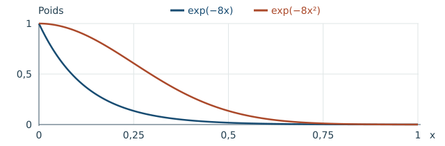
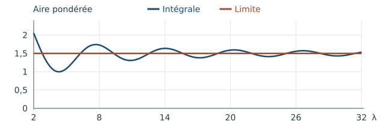

# X-ENS · PC · Mathématiques 2014 — corrigé brut

*Corrigé rédigé par IA, non officiel. Signalez toute erreur.*

**Rédaction** · GPT-6.2 Astra Ultra · vitesse non renseignée · 25 novembre 2026

Les trois parties étudient des intégrales dont le paramètre modifie la concentration ou l'oscillation. On conserve les conventions de Fourier du sujet, avec le facteur $1/(2\pi)$ dans les coefficients. Les majorations uniformes sont indiquées avec les constantes dont elles dépendent.

## Partie 1 · Intégrales à phase réelle

### Question 1a · Échelle linéaire

Poser $u=tx$. Alors $t\int_0^d e^{-tx}g(x)\,dx=\int_0^\infty e^{-u}g_t(u)\,du$, avec $g_t(u)=g(u/t)$ pour $0\le u\le td$ et zéro au-delà. À $u$ fixé, $g_t(u)\to g(0)$ et $|e^{-u}g_t(u)|\le\|g\|_\infty e^{-u}\in L^1$. La limite vaut $g(0)$ ; sa non-nullité donne l'équivalent $g(0)/t$.

### Question 1b · Échelle quadratique

Le changement $u=\sqrt t\,x$ donne la même démonstration avec $e^{-u^2}$ et l'indicatrice de $[0,\sqrt t\,d]$. Le majorant est $\|g\|_\infty e^{-u^2}$. Comme l'intégrale de la gaussienne sur la demi-droite vaut $\sqrt\pi/2$,
\[
\int_0^d e^{-tx^2}g(x)\,dx\sim\frac{\sqrt\pi\,g(0)}{2\sqrt t}.
\]

### Question 2a · Inversion de la phase croissante

$\Phi(x)=\phi(x)-\phi(a)$ est $C^1$ de dérivée strictement positive. Elle est continue et strictement croissante, donc bijective de $[a,b]$ sur $[0,\beta]$, $\beta=\phi(b)-\phi(a)>0$. L'inverse est $C^1$ avec dérivée $1/\phi'(\Phi^{-1}(u))$, aux bornes au sens unilatéral.

### Question 2b · Minimum à dérivée non nulle

Avec $u=\Phi(x)$,
\[
F(t)=e^{-t\phi(a)}\int_0^\beta e^{-tu}
\frac{f(\Phi^{-1}(u))}{\phi'(\Phi^{-1}(u))}\,du .
\]
L'amplitude est continue et vaut $f(a)/\phi'(a)\ne0$ en zéro. La question 1a donne $F(t)\sim e^{-t\phi(a)}f(a)/(t\phi'(a))$.

### Question 3a · Régularité d'une racine au bord

La croissance assure $\phi(x)-\phi(a)>0$ pour $x>a$, donc $\psi=\sqrt{\phi-\phi(a)}$ y est $C^1$. Si $h\downarrow0$ et $k=\phi''(a)>0$, Taylor donne $\phi(a+h)-\phi(a)=kh^2/2+o(h^2)$ et $\phi'(a+h)=kh+o(h)$. Ainsi $\psi(a+h)/h\to\sqrt{k/2}$ et
\[
\psi'(a+h)=\frac{\phi'(a+h)}{2\sqrt{\phi(a+h)-\phi(a)}}\longrightarrow\sqrt{k/2}.
\]
La dérivée à droite existe en $a$ et s'y raccorde continûment.

### Question 3b · Nouvelle variable bijective

$\psi$ est strictement croissante et continue sur $[a,b]$. Elle envoie cet intervalle sur $[0,\beta]$ avec $\beta=\sqrt{\phi(b)-\phi(a)}$. Sa dérivée est positive sur tout l'intervalle par 3a et par $\phi'>0$ à l'intérieur, donc l'inverse est $C^1$.

### Question 3c · Minimum quadratique au bord

Avec $u=\psi(x)$, on a $\phi(x)=\phi(a)+u^2$. L'amplitude transformée est $(f/\psi')\circ\psi^{-1}$, de valeur $f(a)\sqrt{2/\phi''(a)}$ en zéro. Par 1b,
\[
F(t)\sim e^{-t\phi(a)}\frac{f(a)}{\sqrt t}
\sqrt{\frac{\pi}{2\phi''(a)}}.
\]

### Question 4a · Récurrence de Gamma

$\Gamma(1)=\int_0^\infty e^{-x}dx=1$. L'intégration par parties donne $\Gamma(n+1)=n\Gamma(n)$ car $x^ne^{-x}$ s'annule en zéro et tend vers zéro à l'infini pour $n\ge1$. Les intégrales convergent par domination exponentielle à l'infini. Donc $\Gamma(n)=(n-1)!$.

### Question 4b · Formule de Stirling

Par $u=nx$, $\Gamma(n+1)=n^{n+1}\int_0^\infty e^{-n(x-\log x)}dx$. La phase $\phi(x)=x-\log x$ a pour unique point critique $1$, avec $\phi(1)=\phi''(1)=1$. L'amplitude constante vaut $1$ et $e^{-\phi(x)}=xe^{-x}$ est intégrable sur la demi-droite. Le résultat admis donne $\int e^{-n\phi}\sim e^{-n}\sqrt{2\pi/n}$. Ainsi $n!\sim\sqrt{2\pi}\,n^{n+1/2}e^{-n}$.

## Partie 2 · Moyenne d'une fonction périodique oscillante

### Question 5a · Dérivée des coefficients de Fourier

Intégrer $e^{-inx}\phi'(x)$ par parties sur $[0,2\pi]$. Le terme de bord est nul par périodicité et $e^{-2\pi \mathrm in}=1$. Ainsi $c_n(\phi')=\mathrm in c_n(\phi)$, d'où la formule pour $n\ne0$.

### Question 5b · Sommabilité absolue

Cauchy-Schwarz et Parseval appliqué à $\phi'$ donnent
\[
\sum_{n\ne0}|c_n(\phi)|
\le\left(\sum_{n\ne0}\frac1{n^2}\right)^{1/2}
\left(\frac1{2\pi}\int_0^{2\pi}|\phi'(x)|^2dx\right)^{1/2}<\infty.
\]
Le terme $n=0$ est fini.

### Question 5c · Contrôle uniforme

Par 5b la série de Fourier converge absolument et uniformément vers une fonction continue ; elle représente $\phi$, par le théorème de convergence de Fourier pour une fonction périodique $C^1$ (ou par unicité des coefficients). Pour tout $x$, $|\phi(x)|\le\sum_{n\in\mathbb Z}|c_n(\phi)|$, donc la même borne vaut pour le supremum.

### Question 6a · Erreur sous des hypothèses régulières

Écrivons la série absolument uniforme de $\psi(x/\varepsilon)$ et intégrons contre $f$. Le terme constant donne $c_0(\psi)\int_a^b f$. Pour $n\ne0$, une intégration par parties sans terme de bord, puisque $f$ est nulle près des extrémités, donne
\[
\left|\int_a^b e^{\mathrm inx/\varepsilon}f(x)\,dx\right|
\le\frac{\varepsilon}{|n|}(b-a)\|f'\|_\infty .
\]
Sommer avec les poids $|c_n(\psi)|$ donne l'inégalité annoncée.

### Question 6b · Limite dans le premier cas

La série $\sum_{n\ne0}|c_n(\psi)|/|n|$ converge par 5b. La borne en 6a est donc une constante fois $\varepsilon$ qui tend vers zéro. Ainsi $J_\varepsilon\to c_0(\psi)\int_a^b f$.

### Question 7a · Dernier nœud de la subdivision

Notons $h=2\pi\varepsilon$, $N=\lfloor(b-a)/h\rfloor$ et $x_k=a+kh$. Alors $0\le b-x_N<h$, d'où $x_N\to b$ lorsque $\varepsilon\downarrow0$.

### Question 7b · Dernière période incomplète

La continuité périodique borne $\psi$ et la continuité de $f$ sur $[a,b]$ borne $f$. Ainsi $\big|\int_{x_N}^b\psi(x/\varepsilon)f(x)dx\big|\le(b-x_N)\|\psi\|_\infty\|f\|_\infty\to0$.

### Question 7c · Oscillation locale du poids

Pour $x\in[x_k,x_{k+1}]$, le théorème des accroissements finis donne $|f(x)-f(x_k)|\le\|f'\|_\infty|x-x_k|\le 2\pi\varepsilon\|f'\|_\infty$.

### Question 7d · Contribution du poids figé

En posant $y=x/\varepsilon$, chaque cellule devient un intervalle de longueur $2\pi$ et $\int_{x_k}^{x_{k+1}}\psi(x/\varepsilon)dx=\varepsilon\int_0^{2\pi}\psi$. La périodicité rend le décalage $a/\varepsilon+2k\pi$ sans effet. Ainsi la somme pondérée vaut $(\int_0^{2\pi}\psi)\varepsilon\sum_{k=0}^{N-1}f(x_k)$.

### Question 7e · Erreur de remplacement

Par 7c, la somme des modules des erreurs est majorée par $h\|f'\|_\infty\sum_k \int_{x_k}^{x_{k+1}}|\psi(x/\varepsilon)|dx$. Cette somme d'intégrales vaut $N\varepsilon\int_0^{2\pi}|\psi|$. Puisque $Nh\le b-a$, l'erreur est au plus $\varepsilon(b-a)\|f'\|_\infty\int_0^{2\pi}|\psi|$.

### Question 7f · Théorème de moyennisation

Le reste final tend vers zéro par 7b et l'erreur de remplacement tend aussi vers zéro par 7e. Par 7d le terme principal vaut
\[
\frac1{2\pi}\int_0^{2\pi}\psi(y)\,dy\ \left(h\sum_{k=0}^{N-1}f(x_k)\right).
\]
La parenthèse tend vers $\int_a^b f$ par les sommes de Riemann, la cellule finale de longueur $<h$ étant négligeable. Ainsi $J_\varepsilon\to c_0(\psi)\int_a^b f$.

### Question 8a · Équation forcée globale

Avec $V=(u,u')$, on obtient $V'=AV+(0,g(t/\varepsilon))$ où $A=\left(\begin{smallmatrix}0&1\\-1&0\end{smallmatrix}\right)$. Le second membre imposé est continu sur $\mathbb R$ et les coefficients sont constants ; le théorème de Cauchy linéaire donne une unique solution globale pour $V(0)=(\alpha,0)$, donc pour $u$.

### Question 8b · Variation des constantes

La matrice d'évolution du système homogène est $\left(\begin{smallmatrix}\cos t&\sin t\\-\sin t&\cos t\end{smallmatrix}\right)$. Multiplier la donnée initiale puis intégrer l'action de cette matrice au temps $t-s$ sur $(0,g(s/\varepsilon))$ donne en première coordonnée
\[
u_\varepsilon(t)=\alpha\cos t+\int_0^t \sin(t-s)g(s/\varepsilon)\,ds.
\]

### Question 8c · Limite de la réponse forcée

À $t$ fixé, appliquer 7f à $s\mapsto\sin(t-s)$ et $\psi=g$ sur l'intervalle entre $0$ et $t$, en inversant l'orientation si $t<0$. Comme $\int_0^t\sin(t-s)ds=1-\cos t$, la limite est $\alpha\cos t+c_0(g)(1-\cos t)$, y compris pour $t=0$.

## Partie 3 · Intégrales oscillantes

### Question 9ai · Fonctions fixes de l'opérateur

$Lg=g$ équivaut à $g'=\mathrm i\lambda\phi'g$. Donc $(ge^{-\mathrm i\lambda\phi})'=0$ et les solutions sont exactement $g=C e^{\mathrm i\lambda\phi}$, $C\in\mathbb C$.

### Question 9aii · Identité d'intégration par parties

Pour $h$ à support compact dans $]a,b[$,
\[
\int_a^b h Lg=\frac1\lambda\int_a^b\frac{h}{\mathrm i\phi'}g'
=-\frac1\lambda\int_a^b g\left(\frac{h}{\mathrm i\phi'}\right)'
=\frac1\lambda\int_a^b gMh .
\]
Le terme de bord est nul car $h$ s'annule près des deux bornes.

### Question 9b · Décroissance à tout ordre

Pour $g=e^{\mathrm i\lambda\phi}$, on a $Lg=g$. L'opérateur $M$ conserve la régularité $C^\infty$ et le support intérieur. Par itération de 9aii,
\[
I(\lambda)=\lambda^{-N}\int_a^b e^{\mathrm i\lambda\phi(x)}(M^N f)(x)\,dx .
\]
Prendre $\gamma_N=\int_a^b|M^Nf|$ ; elle est finie et indépendante de $\lambda$.

### Question 10a · Phase monotone loin d'un point stationnaire

Avec $v=1/\phi'$, intégrer par parties donne $\int e^{\mathrm i\lambda\phi}=(\mathrm i\lambda)^{-1}([e^{\mathrm i\lambda\phi}v]_a^b-\int e^{\mathrm i\lambda\phi}v')$. La fonction $v$ est monotone, de signe fixe et de module au plus $1$. Le module est donc borné par
\[
\lambda^{-1}(|v(a)|+|v(b)|+|v(b)-v(a)|)\le 2/\lambda .
\]
La constante universelle $c_1=2$ convient.

### Question 10b · Seuil arbitraire de dérivée

Remplacer $\phi$ par $\phi/\delta$ et $\lambda$ par $\lambda\delta$. La phase de l'exponentielle ne change pas, la dérivée ainsi normalisée est de module au moins un et reste monotone. Par 10a, la borne est $c_1/(\lambda\delta)$.

### Question 11a · Point de pente minimale

Par continuité, $\phi''$ garde un signe et $|\phi''|\ge1$, donc $\phi'$ est strictement monotone. Si elle s'annule, son unique zéro minimise $|\phi'|$. Sinon elle a signe constant et $|\phi'|$ est strictement monotone : son minimum est atteint à une unique extrémité. Dans tous les cas il existe un unique $c$.

### Question 11b · Éloignement du minimum

Puisque $\phi''$ garde un signe et $|\phi''|\ge1$, $|\phi'(x)-\phi'(c)|\ge|x-c|$. Si $\phi'(c)=0$ c'est le résultat. Sinon $\phi'(x)$ et $\phi'(c)$ ont le même signe et $|\phi'(x)|\ge|\phi'(c)|$, donc $|\phi'(x)-\phi'(c)|=|\phi'(x)|-|\phi'(c)|\le|\phi'(x)|$.

### Question 11c · Découpage autour du point critique

Découper $[a,b]$ par $|x-c|<\delta$ en tronquant aux bornes. Sur le morceau central, la longueur donne au plus $2\delta$. Les morceaux extérieurs, au plus deux, ont $|\phi'|\ge\delta$ par 11b et une dérivée de phase monotone. La question 10b y donne au total au plus $2c_1/(\lambda\delta)$. La somme est la borne annoncée.

### Question 11d · Ordre un demi

Choisir $\delta=\lambda^{-1/2}$ dans 11c donne $|\int_a^b e^{\mathrm i\lambda\phi}|\le (2c_1+2)\lambda^{-1/2}$. La constante $c_2=2c_1+2$ ne dépend ni de la phase ni des bornes.

### Question 11e · Ajout d'un poids

Poser $H(x)=\int_a^x e^{\mathrm i\lambda\phi(s)}ds$. La question 11d sur tout sous-intervalle $[a,x]$ donne $\|H\|_\infty\le c_2\lambda^{-1/2}$. Une intégration par parties dans $\int H'f$ donne $H(b)f(b)-\int_a^b H f'$, donc
\[
|I(\lambda)|\le c_2\lambda^{-1/2}
\left(|f(b)|+\int_a^b|f'(x)|\,dx\right).
\]
