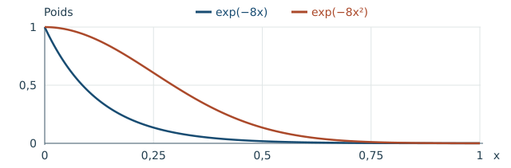
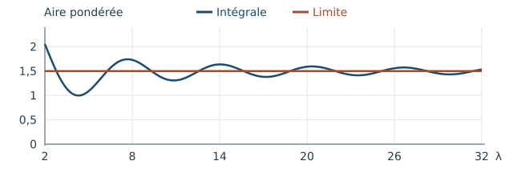

# X-ENS · PC · Mathématiques 2014 — corrigé guidé

*Corrigé rédigé par IA, non officiel. Signalez toute erreur.*

**Rédaction** · GPT-6.2 Astra Ultra · vitesse non renseignée · 25 novembre 2026

Une phase réelle concentre le poids près de son minimum. Une fonction périodique rapide se moyenne sur de petites cellules. Enfin, pour une phase imaginaire, les compensations entre oscillations remplacent la concentration. Chaque partie conserve ses propres hypothèses.

## Partie 1 · Intégrales à phase réelle

### Question 1a · Échelle linéaire

La partie significative de l'intégrale se resserre près de zéro. Dilatez l'axe par $t$ et prolongez la fonction obtenue par zéro après $td$. Vous gardez une intégrale sur un domaine fixe. La continuité en zéro donne la limite ponctuelle, et l'exponentielle assure un majorant intégrable indépendant de $t$. Il reste à rétablir le facteur $1/t$ du différentiel.

### Question 1b · Échelle quadratique

Choisissez cette fois la dilatation qui rend $tx^2$ indépendant de $t$, donc $u=\sqrt t\,x$. Le facteur de largeur est $1/\sqrt t$, visible sur la figure. Après prolongement par zéro, la convergence dominée fournit le produit de $g(0)$ par l'aire d'une demi-gaussienne.

### Question 2a · Inversion de la phase croissante

Soustraire $\phi(a)$ ramène l'image du bord gauche à zéro. La dérivée garde un signe strict, d'où la monotonie et l'unicité d'un antécédent ; la continuité donne l'existence pour toute valeur intermédiaire. La dérivée inverse est bien définie jusque sur les bords.

### Question 2b · Minimum à dérivée non nulle

Isolez la valeur minimale de la phase dans un facteur exponentiel constant. Le reste de la phase devient la nouvelle variable. Le jacobien de l'inverse modifie l'amplitude et, au bord dominant, il vaut $1/\phi'(a)$. Appliquez le modèle linéaire de 1a.

### Question 3a · Régularité d'une racine au bord

Deux points sont à vérifier au bord : l'existence d'une dérivée et la continuité de la dérivée déjà calculée à l'intérieur. Le développement quadratique de la phase donne d'abord $\psi(a+h)\sim h\sqrt{\phi''(a)/2}$. Puis le développement linéaire de $\phi'$ dans la formule de dérivation du radical fournit la même limite pour $\psi'(a+h)$.

### Question 3b · Nouvelle variable bijective

Le radical préserve l'ordre sur les valeurs non négatives de $\phi-\phi(a)$. Ses valeurs extrêmes donnent l'intervalle image. La question précédente traite exactement la seule difficulté pour dériver l'inverse, celle du bord gauche.

### Question 3c · Minimum quadratique au bord

Le changement de variable précédent a transformé exactement la phase en un carré. Appliquez donc le modèle gaussien au bord, en multipliant son coefficient $\sqrt\pi/2$ par le jacobien $1/\psi'(a)$ et par $f(a)$. Le facteur constant $e^{-t\phi(a)}$ reste devant.

### Question 4a · Récurrence de Gamma

Le facteur polynomial doit être dérivé et l'exponentielle intégrée. Après justification des bords de l'intégrale impropre, le degré descend d'une unité et fournit le multiplicateur $n$. Partez de $\Gamma(1)=1$ pour obtenir la factorielle au bon indice.

### Question 4b · Formule de Stirling

Faites apparaître le paramètre $n$ devant une phase unique en posant $u=nx$. Le logarithme absorbe le terme $x^n$. Vérifiez les hypothèses de la formule de Laplace intérieure : unique minimum en $1$, courbure unitaire, amplitude non nulle et intégrabilité de $xe^{-x}$. Multipliez ensuite l'équivalent par $n^{n+1}$.

## Partie 2 · Moyenne d'une fonction périodique oscillante

### Question 5a · Dérivée des coefficients de Fourier

Dans un coefficient de Fourier, transférer la dérivée de la fonction vers l'exponentielle fait apparaître le facteur $\mathrm in$. Les deux contributions aux extrémités s'annulent car $\phi$ est périodique et $n$ entier.

### Question 5b · Sommabilité absolue

Servez-vous du facteur $1/n$ obtenu en 5a. Lui-même n'est pas sommable en module, mais ses carrés le sont. La seconde suite de carrés est celle des coefficients de la dérivée, contrôlée par Parseval. Leur produit se somme par Cauchy-Schwarz.

### Question 5c · Contrôle uniforme

Chaque exponentielle de Fourier a module un, indépendamment de $x$. La majoration par la somme des modules est donc uniforme. Pour l'appliquer à $\phi$ elle-même, précisez que la série représente cette fonction : la régularité $C^1$ suffit.

### Question 6a · Erreur sous des hypothèses régulières

Soustrayez d'abord la moyenne de $\psi$. Dans la série restante toutes les fréquences sont non nulles et l'on peut intégrer chaque exponentielle explicitement. Sa primitive apporte le petit facteur $\varepsilon/(\mathrm in)$. Le bord disparaît grâce au support de $f$ et seule sa dérivée reste à estimer. La sommation terme à terme est permise par la convergence uniforme.

### Question 6b · Limite dans le premier cas

L'estimation précédente isole toute la dépendance en $\varepsilon$ dans un facteur linéaire. Les hautes fréquences sont sommables et leur contribution totale disparaît. Il reste le mode constant multiplié par l'intégrale du poids.

### Question 7a · Dernier nœud de la subdivision

La partie entière retient toutes les périodes complètes que contient l'intervalle. La portion non couverte est plus courte qu'une seule période de longueur $2\pi\varepsilon$. Son extrémité gauche tend donc vers $b$.

### Question 7b · Dernière période incomplète

Il est inutile d'exploiter l'oscillation sur la dernière portion. Elle est de longueur tendant vers zéro et les deux facteurs sont uniformément bornés, même si leur produit varie en signe.

### Question 7c · Oscillation locale du poids

Le poids varie d'au plus sa pente maximale multipliée par la largeur de la cellule. Cette largeur vaut une période de la fonction rapide et tend vers zéro.

### Question 7d · Contribution du poids figé

Remplacez $f$ sur chaque cellule par sa valeur au bord gauche. Elle sort de l'intégrale. La fonction rapide parcourt alors une période complète, avec une phase initiale arbitraire ; l'aire sur une période est indépendante de cette phase. Toutes les cellules produisent donc le même facteur.

### Question 7e · Erreur de remplacement

Prenez les modules avant de sommer pour ne dépendre d'aucune compensation incertaine. L'erreur sur le poids est au plus $h\|f'\|_\infty$. L'intégrale du module de la fonction rapide est la même sur chaque période après changement d'échelle. La somme des largeurs de cellules ne dépasse pas $b-a$.

### Question 7f · Théorème de moyennisation

Découpez en trois contributions : dernière cellule incomplète, erreur commise sur les cellules pleines, puis somme avec poids figé. Les deux premières disparaissent. Dans la dernière, regroupez le pas $h=2\pi\varepsilon$ avec la somme des $f(x_k)$. C'est une somme de Riemann qui converge vers l'intégrale de $f$, tandis que le facteur restant est la moyenne de $\psi$.

### Question 8a · Équation forcée globale

Convertissez l'équation d'ordre deux en deux équations d'ordre un. Les coefficients sont continus et le terme extérieur reste continu pour chaque $\varepsilon>0$. La théorie linéaire donne existence et unicité sur toute la droite avec les deux données prescrites.

### Question 8b · Variation des constantes

Les deux solutions homogènes sont $\cos t$ et $\sin t$. À l'instant $s$, le terme imposé agit sur la vitesse avec une propagation ultérieure pendant $t-s$. La première composante de cette propagation est $\sin(t-s)$. L'intégrale donne la solution particulière à données nulles, à laquelle on ajoute $\alpha\cos t$.

### Question 8c · Limite de la réponse forcée

Pendant le passage à la limite en $\varepsilon$, le temps d'observation reste fixe. Le sinus est un poids $C^1$ et la force rapide se remplace par sa moyenne. Son intégrale contre le sinus vaut cette moyenne multipliée par $1-\cos t$. La partie homogène ne dépend pas de $\varepsilon$.

## Partie 3 · Intégrales oscillantes

### Question 9ai · Fonctions fixes de l'opérateur

L'hypothèse $\phi'\ne0$ permet de multiplier par le dénominateur de $L$. Cherchez alors un facteur intégrant : l'exponentielle de $-\mathrm i\lambda\phi$ élimine le terme de droite et transforme l'équation en une dérivée nulle.

### Question 9aii · Identité d'intégration par parties

Le facteur $1/\lambda$ est constant. Déplacez la dérivée de $g$ vers le produit du poids et de l'inverse de $\mathrm i\phi'$. Le signe moins est exactement celui de l'opérateur $M$. Le support intérieur de $h$ supprime les évaluations de bord.

### Question 9b · Décroissance à tout ordre

Le facteur oscillant est reproduit par $L$. À chaque intégration par parties, une puissance de $1/\lambda$ sort et $M$ agit sur le poids. Cette opération reste licite autant de fois que voulu puisque $1/\phi'$ est lisse et qu'aucune dérivée ne crée du support près des bords. Le module de l'exponentielle vaut un à la dernière étape.

### Question 10a · Phase monotone loin d'un point stationnaire

Pour exploiter la dérivée de la phase, écrivez l'exponentielle comme sa propre dérivée divisée par $\mathrm i\lambda\phi'$. Les bords font apparaître $v(a),v(b)$ avec $v=1/\phi'$. L'intégrale restante est bornée par la variation totale de $v$, égale à $|v(b)-v(a)|$ par monotonie. Les deux extrémités ayant le même signe, la somme des trois contributions vaut au plus deux.

### Question 10b · Seuil arbitraire de dérivée

La seule échelle pertinente est le produit entre la fréquence $\lambda$ et la borne inférieure de pente $\delta$. Divisez la phase par cette pente, appliquez le cas normalisé à la fréquence multipliée par $\delta$ et obtenez le résultat.

### Question 11a · Point de pente minimale

Distinguons la pente de sa valeur absolue. La courbure de signe fixe impose que la pente varie strictement dans un seul sens. Sa distance à zéro est alors minimale soit à son unique zéro, soit au bord dont la pente est la plus proche de zéro.

### Question 11b · Éloignement du minimum

Une variation de position de longueur $|x-c|$ entraîne au moins autant de variation en pente, car la courbure a module au moins un et ne change pas de signe. Si le minimum est sur un bord avec pente non nulle, cette variation s'ajoute en valeur absolue à la pente minimale.

### Question 11c · Découpage autour du point critique

Près de $c$ la pente peut être trop faible pour intégrer efficacement par parties. Utilisez seulement la largeur de cette zone, au plus $2\delta$. Au-delà de cette distance, la pente est assez grande pour appliquer 10b sur chacun des intervalles restants. Si le minimum est sur un bord, l'un de ces intervalles est vide et l'estimation reste vraie.

### Question 11d · Ordre un demi

Le terme local de 11c augmente avec $\delta$, tandis que le terme extérieur diminue. Prenez $\delta$ de l'ordre de l'inverse de la racine de la fréquence pour équilibrer leurs puissances. La valeur exacte $\lambda^{-1/2}$ suffit à obtenir une constante universelle.

### Question 11e · Ajout d'un poids

La constante de 11d est uniforme en l'extrémité droite. Vous pouvez donc contrôler la primitive oscillante sur tout l'intervalle par le même nombre. Transférez la dérivée de cette primitive vers le poids : le bord gauche s'annule, le bord droit donne $|f(b)|$ et le reste fait intervenir la variation intégrée de $f$.
