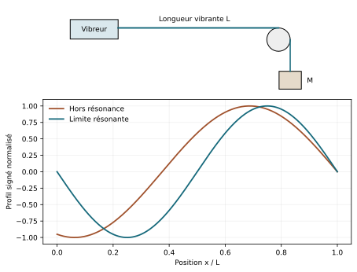
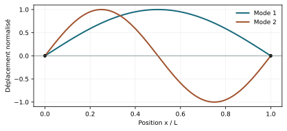
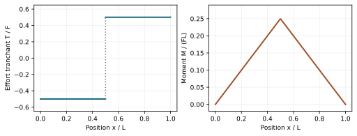
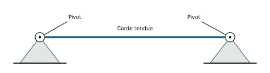

# X–ENS PC 2014 — Physique B (XEULC) · Corrigé guidé

*Corrigé rédigé par IA, non officiel. Signalez toute erreur.*

**Lecture du rapport du jury** · GPT-6.2 Astra Ultra · vitesse non renseignée

**Rédaction** · GPT-6.2 Astra Ultra · vitesse non renseignée

## Quelques propriétés des instruments de musique à lame et à corde

## I. Modes d’une corde souple

### Question 1 — Corde de Melde

**Indication.** Projeter sur la verticale les deux tensions d’un petit élément.

Une corde uniforme de masse linéique $\mu$, parfaitement flexible et sous tension uniforme $N$, oscille transversalement à petite pente. Les pertes, la flèche due au poids et les variations de tension sont négligées. Au premier ordre $\mu\,dx\,Y_{tt}=N[Y_x(x+dx)-Y_x(x)]$, d’où $Y_{tt}=c^2Y_{xx}$ et $c=\sqrt{N/\mu}$. Dans le montage représenté, le vibreur impose le mouvement à gauche. Une poulie guide l’autre extrémité et la masse suspendue fixe $N\simeq Mg$.

### Question 2 — Profils forcés et résonances

**Indication.** L’extrémité droite est toujours un nœud, l’extrémité gauche est imposée par le vibreur.

Pour $k=\omega/c$, le profil signé est proportionnel à $\sin[k(L-x)]$. À pulsation quelconque, sa valeur à gauche n’est pas nécessairement petite relativement au ventre. À résonance, le mouvement du vibreur est petit devant celui des ventres et le profil tend vers une suite de demi-longueurs d’onde entre deux nœuds. Alors $k_nL=n\pi$, soit $\omega_n=n\pi c/L$, $n\ge1$. Les pertes limitent l’amplitude effectivement atteinte.

### Question 3 — Élever la note fondamentale

**Indication.** Examiner les trois paramètres de $\nu_1=c/(2L)$.

La fréquence fondamentale vaut $(2L)^{-1}\sqrt{N/\mu}$. On peut raccourcir la longueur vibrante, augmenter la tension ou alléger la corde par unité de longueur.

### Question 4 — Douze demi-tons

**Indication.** À tension et masse linéique constantes, ajuster la longueur vibrante.

Prendre une corde accordée à $440\ \mathrm{Hz}$ sur une longueur $L_0$. Des frettes permettent de laisser vibrer $L_j=L_0\,2^{-j/12}$ avec $j=0,\ldots,12$. Les fréquences $440\,2^{j/12}\ \mathrm{Hz}$ couvrent les douze intervalles, donc treize notes de $440$ à $880\ \mathrm{Hz}$ inclus.

## II. Équation de la lame avec flexion

### Question 5 — Pente de la fibre moyenne

**Indication.** Le déplacement horizontal est négligé et la tangente fait l’angle $\alpha$ avec $x$.

On a $\tan\alpha=\partial_xY$. Pour une déformation de faible pente $\alpha\simeq Y_x$, en radians.

### Question 6 — Loi du moment fléchissant

**Indication.** Tester une rotation rigide $Y=ax+b$, qui conserve la rectitude de la lame.

Une tige droite inclinée ne subit aucune flexion. La loi en $Y_x$ lui attribuerait un couple dès que $a\ne0$. La courbure est $Y_{xx}$ aux petites pentes, donc $M=\gamma Y_{xx}$. Le coefficient a l’unité $\mathrm{N\,m^2}$ et vaut $EI$ en flexion élastique, avec $E$ le module d’Young et $I$ le moment quadratique de section autour de l’axe de flexion.

### Question 7 — Équilibre des moments

**Indication.** Effectuer le bilan des couples en prenant les moments au centre du tronçon.

Les couples transmis aux deux bords donnent $M(x+dx)-M(x)$. Les forces de cisaillement donnent chacune environ $T\,dx/2$ dans le même sens, tandis que les efforts axiaux ne contribuent pas à cet ordre. Le moment dynamique négligé impose $(M'+T)dx=0$, donc $T=-M'=-\gamma Y_{xxx}$.

### Question 8 — Dynamique transversale

**Indication.** La composante verticale de la résultante interne est $NY_x+T$ au premier ordre.

La différence des efforts sur les deux faces donne $\mu Y_{tt}=\partial_x(NY_x+T)$. Avec $N$ uniforme et $T=-\gamma Y_{xxx}$, on trouve $Y_{tt}-c^2Y_{xx}+AY_{xxxx}=0$, où $c^2=N/\mu$ et $A=\gamma/\mu$. La limite de flexion négligeable $A\to0$ redonne l’équation de Melde.

### Question 9 — Conditions aux bords

**Indication.** Compter l’ordre spatial de l’équation puis distinguer grandeurs géométriques et mécaniques.

L’ordre quatre en $x$ appelle quatre conditions spatiales, typiquement deux par extrémité. Elles peuvent porter sur $Y$, la pente, le moment $M$, l’effort transverse $NY_x+T$, ou sur des combinaisons suivant la liaison. Une résolution temporelle nécessite aussi le déplacement et la vitesse initiaux sur la lame.

## III. Instruments à lame vibrante

### Question 10 — Forme spatiale en flexion pure

**Indication.** Chercher $f=e^{sx}$ et distinguer les racines réelles et imaginaires.

Pour $N=0$ la substitution harmonique donne $Af^{(4)}=\omega^2 f$. Avec $K=(\omega^2/A)^{1/4}$, les racines sont $\pm K,\pm iK$. Leur combinaison donne $f=B_1\sin Kx+B_2\cos Kx+B_3\sinh Kx+B_4\cosh Kx$, où les coefficients complexes décrivent aussi les phases.

### Question 11 — Appuis du xylophone

**Indication.** Un appui ponctuel peut exercer une réaction verticale tout en laissant tourner la section.

Le contact permanent fixe $Y(0,t)=Y(L,t)=0$. L’appui simple idéal ne transmet aucun couple et n’impose aucune orientation, donc $M(0,t)=M(L,t)=0$, soit $Y_{xx}=0$ aux deux extrémités.

### Question 12 — Modes d’une lame posée

**Indication.** Utiliser les combinaisons $f+f''/K^2$ et $f-f''/K^2$ aux appuis.

À gauche $f=f''=0$ imposent $B_2=B_4=0$. À droite on obtient séparément $B_1\sin KL=0$ et $B_3\sinh KL=0$. Comme $K>0$, $B_3=0$. Les modes non triviaux sont $K_n=n\pi/L$, $f_n(x)=B_n\sin(n\pi x/L)$, $n\ge1$.

### Question 13 — Deux premiers profils

**Indication.** Garder la même longueur $L$ pour les deux modes.

Le premier mode a un ventre à $L/2$ et aucun nœud intérieur. Le second a un nœud supplémentaire à $L/2$ et deux ventres de signes opposés à $L/4$ et $3L/4$. Les deux profils normalisés sont représentés ci-dessous à la même échelle spatiale.

### Question 14 — Pulsations et série de Fourier

**Indication.** Ne pas confondre la suite des nombres d’onde avec celle des pulsations.

Comme $\omega=\sqrt A K^2$, $\omega_n=n^2\omega_1$ avec $\omega_1=\pi^2\sqrt A/L^2$. Tous les modes sont des multiples entiers du fondamental. Un mouvement libre superposé admet donc une série de Fourier temporelle de période $2\pi/\omega_1$, où les coefficients aux rangs non carrés sont nuls.

### Question 15 — Comparaison des timbres

**Indication.** Chercher si la fréquence $2\nu_1$ appartient aux deux suites.

Une corde souple admet tous les rangs entiers $1,2,3,\ldots$, dont les amplitudes dépendent de l’excitation. La lame uniforme posée admet les rangs $1,4,9,\ldots$ seulement. L’octave immédiate $2\nu_1$ manque au spectre de ce modèle, ce qui contribue à son timbre particulier.

### Question 16 — Étendue des longueurs

**Indication.** À matériau et section donnés, la fréquence de flexion varie comme $L^{-2}$.

Descendre du la3 au la2 divise la fréquence par deux et multiplie la longueur par $\sqrt2$, d’où $L_{\rm la2}=32{,}8\sqrt2\simeq46\ \mathrm{cm}$. Monter au la4 donne $L_{\rm la4}=32{,}8/\sqrt2\simeq23\ \mathrm{cm}$. Leur rapport est deux.

### Question 17 — Réactions sous une charge centrale

**Indication.** Faire le bilan de moment sur l’ensemble autour de l’appui gauche.

L’équilibre vertical donne $R_A+R_B=F$. Le bilan des moments autour de $A$ donne $R_BL-FL/2=0$, d’où $R_A=R_B=F/2$.

### Question 18 — Efforts internes par coupure

**Indication.** Isoler la portion à gauche de la section, en tenant compte de la force centrale si elle appartient à cette portion.

Pour $0<x<L/2$, l’équilibre vertical donne $T=-R_A=-F/2$ et celui des moments à la section $M=R_Ax=Fx/2$. Après le milieu on a $T=F-R_A=+F/2$ et $M=R_Ax-F(x-L/2)=F(L-x)/2$. On vérifie dans les deux intervalles $T=-M'$.

### Question 19 — Allure des efforts

**Indication.** Examiner ce qui peut présenter un saut à l’emplacement d’une force ponctuelle.

L’effort tranchant est constant par morceaux et saute de $+F$ en $x=L/2$. Le moment forme un triangle continu, nul aux extrémités et maximal en $M(L/2)=FL/4$. L’absence de couple appliqué au centre explique sa continuité.

### Question 20 — Conditions de la déformée statique

**Indication.** Distinguer les appuis, les raccords au centre et la symétrie.

Aux appuis $Y(0)=Y(L)=0$ et $Y''(0)=Y''(L)=0$. Au centre $Y,Y'$ sont continus par continuité de la lame et $Y''$ est continu car le moment l’est. La symétrie donne $Y'(L/2)=0$. Le saut de cisaillement impose $Y'''(L/2^+)-Y'''(L/2^-)=-F/\gamma$.

### Question 21 — Flèche au milieu

**Indication.** Intégrer $Y''=Fx/(2\gamma)$ sur la moitié gauche.

Avec $Y(0)=0$ et $Y'(L/2)=0$, il vient $Y=Fx^3/(12\gamma)-FL^2x/(16\gamma)$ sur la moitié gauche. L’autre moitié est obtenue par symétrie. Ainsi $Y(L/2)=-FL^3/(48\gamma)$ et $Y_M=|F|L^3/(48\gamma)$, une longueur.

### Question 22 — Masse équivalente du fondamental

**Indication.** Comparer l’énergie cinétique distribuée à celle d’une masse qui se déplacerait à la vitesse du ventre.

La vitesse est nulle aux extrémités et inférieure à la vitesse centrale sur presque toute la lame. En écrivant $Y=q(t)\phi(x)$ avec $\max|\phi|=1$, on a $K=\dot q^2\int\mu\phi^2dx/2$, donc $m_{\rm eff}=\int\mu\phi^2dx<m$. Pour une sinusoïde ce calcul donne $m/2$, proche du $48m/\pi^4$ du modèle statique équivalent.

### Question 23 — Raideur et pulsation équivalentes

**Indication.** Identifier la relation force–flèche à celle d’un ressort linéaire.

Pour $F>0$, $k_1=F/Y_M=48\gamma/L^3$. L’équation $m_1\ddot q+k_1q=0$ donne $\omega_1=\sqrt{k_1/m_1}$, soit $\pi^2\sqrt{\gamma/\mu}/L^2$ avec la masse dynamique fournie.

### Question 24 — Énergie d’une oscillation

**Indication.** Évaluer l’énergie à l’instant d’élongation maximale.

L’énergie $U=m_1\dot q^2/2+k_1q^2/2$ est constante pour l’oscillateur idéal. Quand $|q|=Y_M$, $\dot q=0$. Donc $U=k_1Y_M^2/2=m_1\omega_1^2Y_M^2/2$.

### Question 25 — Amplitude par l’énergie rayonnée

**Indication.** Passer du niveau sonore à une intensité, puis à la puissance d’une sphère entière.

À $60\ \mathrm{dB}$ l’intensité est $10^{-12}10^6=10^{-6}\ \mathrm{W\,m^{-2}}$. À $5\ \mathrm m$, la puissance isotrope vaut $4\pi(5)^2 I\simeq3\times10^{-4}\ \mathrm W$. Sur une seconde on estime $U_0\sim3\times10^{-4}\ \mathrm J$, à un facteur près dépendant de l’enveloppe temporelle. L’amplitude initiale vaut $Y_M=\sqrt{2U_0/m_1}/(2\pi\nu_1)\simeq\sqrt{U_0/m}/(\pi\nu_1)$ puisque $m_1\simeq m/2$.

### Question 26 — Amplitude du la3

**Indication.** Faire le calcul avec la masse dynamique et la pulsation en radians par seconde.

Avec $m_1\simeq0{,}13\ \mathrm{kg}$, $\omega_1=2\pi\times440\ \mathrm{s^{-1}}$ et l’énergie estimée ci-dessus, $Y_M\simeq2{,}5\times10^{-5}\ \mathrm m$. La déformation maximale est de quelques dizaines de micromètres.

### Question 27 — Facteur de qualité acoustique

**Indication.** Employer la définition énergétique et le temps caractéristique de perte d’énergie.

Par définition $Q\simeq\omega_1 U/P_{\rm pertes}$. En assimilant la persistance d’une seconde au temps caractéristique d’énergie, $Q\sim2\pi\times440\times1\sim3\times10^3$. Un temps d’enveloppe d’amplitude introduirait un facteur deux. Cet ordre est supérieur aux quelques dizaines souvent obtenues dans un circuit RLC passif courant.

### Question 28 — Maintien du contact

**Indication.** Un appui simple peut pousser vers le haut, mais sa réaction doit rester positive.

Dans le modèle quasistatique équivalent, la charge oscillante transmise a pour amplitude $k_1Y_M=m_1\omega_1^2Y_M\sim25\ \mathrm N$. Par symétrie, la réaction minimale estimée de chaque appui est $(mg-k_1Y_M)/2$. Or $mg\simeq2{,}6\ \mathrm N$. La réaction requise deviendrait négative, ce qui prévoit un décollement pour ces valeurs. Le modèle de contact permanent cesse alors de s’appliquer.

### Question 29 — Encastrement et extrémité libre

**Indication.** Énumérer ce qu’impose la liaison de gauche et ce qu’elle laisse libre à droite.

À gauche, l’encastrement bloque la position et la rotation de la section, donc $f(0)=f'(0)=0$. À droite aucune force ni aucun couple n’est appliqué, soit $T(L)=M(L)=0$, d’où $f'''(L)=f''(L)=0$.

### Question 30 — Racines de l’équation caractéristique

**Indication.** À grand argument, $1/\cosh u$ tend vers zéro exponentiellement.

Les solutions de $\cos u=-1/\cosh u$ sont proches des zéros du cosinus. Pour $n$ grand, $K_nL\sim(n-1/2)\pi$ avec $n\ge1$. L’écart est de l’ordre de $e^{-(n-1/2)\pi}$.

### Question 31 — Spectre de la lame encastrée

**Indication.** Former les rapports de pulsations au moyen de $\omega\propto K^2$.

Les rapports $\omega_2/\omega_1\simeq6{,}25$, $\omega_3/\omega_1\simeq17{,}556$ et $\omega_4/\omega_1\simeq34{,}340$ ne sont pas des rangs entiers. En général les modes ne forment pas une série harmonique et leur superposition ne possède pas la période du fondamental. On peut toutefois décrire le mouvement comme somme de modes propres.

## IV. Anharmonicité des cordes de piano

### Question 32 — Équation spatiale avec tension et flexion

**Indication.** Remplacer $Y_{tt}$ par $-\omega^2Y$ avant de diviser par $c^2$.

La substitution donne $Af^{(4)}-c^2 f''-\omega^2 f=0$. Avec $D=A/c^2$ et $k=\omega/c$ elle devient $Df^{(4)}-f''-k^2 f=0$.

### Question 33 — Nombres d’onde réel et imaginaire

**Indication.** Résoudre le polynôme caractéristique comme une équation du second degré en $s^2$.

Les valeurs de $s^2$ sont $[1\pm\sqrt{1+4Dk^2}]/(2D)$. La racine positive définit $K_R=\sqrt{(1+\sqrt{1+4Dk^2})/(2D)}$. L’opposé de la négative définit $K_I=\sqrt{(\sqrt{1+4Dk^2}-1)/(2D)}$. D’où les deux types de fonctions, hyperboliques et trigonométriques.

### Question 34 — Fixation sans couple

**Indication.** Associer une liaison qui fixe l’emplacement à une liberté angulaire.

On peut fixer chaque extrémité tendue dans une chape articulée par un axe perpendiculaire au plan des vibrations. Le pivot reprend l’effort de tension et immobilise la position, tout en laissant la corde tourner librement dans ce plan. Il impose ainsi $f=0$ et $M=\gamma f''=0$. Le schéma de la figure suivante indique les axes des deux articulations.

### Question 35 — Quantification des modes de la corde raide

**Indication.** Appliquer les valeurs nulles de $f$ et $f''$ aux deux bouts.

À gauche $F_2+F_4=0$ et $-K_I^2F_2+K_R^2F_4=0$ imposent $F_2=F_4=0$. À droite de même $F_3\sinh(K_RL)=F_1\sin(K_IL)=0$. On a donc $F_3=0$, $K_I=n\pi/L$ et $f=F_1\sin(n\pi x/L)$.

### Question 36 — Coefficient d’anharmonicité

**Indication.** Insérer $f=\sin(n\pi x/L)$ dans la relation de dispersion.

Avec $K=n\pi/L$, $\omega_n^2=c^2K^2+AK^4$. Donc $\nu_n=n\nu_0\sqrt{1+Bn^2}$, $\nu_0=c/(2L)$ et $B=\pi^2 A/(c^2L^2)$. En employant $A=r^2E/(4\rho)$ et $c^2=N/(\pi r^2\rho)$, on obtient $B=\pi^3Er^4/(4NL^2)=\pi^2Er^2/(16\rho\nu_0^2L^4)$. Le coefficient est sans dimension.

### Question 37 — Réduire la dispersion

**Indication.** Comparer les termes de tension et de flexion pour un mode de rang donné.

Pour un même matériau et une même note, augmenter $L$ et diminuer $r$ réduisent $B\propto r^2/L^4$, en adaptant la tension pour conserver la fréquence. À géométrie fixée une tension plus grande réduit aussi $B$. Lorsque $Bn^2\ll1$ pour les partiels audibles, le terme de flexion y devient faible et la corde approche la corde de Melde.

### Question 38 — Dixième partiel du piano droit

**Indication.** Tenir compte de la distinction entre le fondamental réel $\nu_1$ et $\nu_0$ si la corde est accordée.

Pour $\nu_1=220\ \mathrm{Hz}$, $\nu_{10}=2200\sqrt{(1+100B)/(1+B)}\simeq2238\ \mathrm{Hz}$ avec $B=3{,}5\times10^{-4}$. Il se situe entre $2200\ \mathrm{Hz}$ et $2200\times1{,}059\simeq2330\ \mathrm{Hz}$. L’excès est d’environ $38\ \mathrm{Hz}$, soit environ $0{,}3$ demi-ton. Prendre $220\ \mathrm{Hz}$ pour $\nu_0$ change le calcul de moins d’un hertz.

### Question 39 — Influence de la longueur du piano à queue

**Indication.** Pour le même acier et la même note employer la loi en $r^2/L^4$.

Le rapport $B_{\rm queue}/B_{\rm droit}\simeq(0{,}79/0{,}96)^2(67{,}7/170{,}1)^4\simeq0{,}017$. Le coefficient est divisé par environ $60$ et vaut environ $6\times10^{-6}$. Les partiels sont donc sensiblement plus proches des multiples entiers du fondamental.

### Question 40 — Effort total sur le cadre

**Indication.** Déduire la tension d’une corde de sa masse linéique et de sa célérité.

Avec $N=\rho\pi(d/2)^2(2L\nu_0)^2$ et $\nu_0\simeq220\ \mathrm{Hz}$, les tensions sont d’environ $5{,}1\times10^2\ \mathrm N$ par corde droite et $2{,}2\times10^3\ \mathrm N$ par corde de piano à queue. En sommant les tensions des $3\times88=264$ cordes, le cadre reprend près de $1{,}4\times10^5\ \mathrm N$ et $5{,}8\times10^5\ \mathrm N$ respectivement dans ce modèle.
