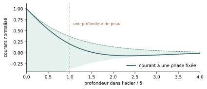
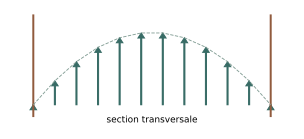
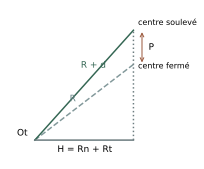
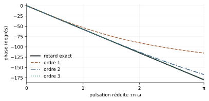
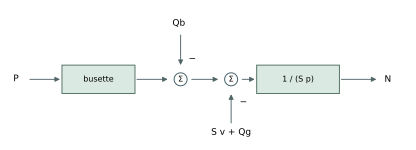

# X-ENS PSI · Modélisation 2014 · Corrigé guidé

*Corrigé rédigé par IA, non officiel. Signalez toute erreur.*

**Rédaction** · GPT-6.2 Astra Ultra · vitesse non renseignée · 25 novembre 2026

**Régulation du niveau en coulée continue.** Les débits sont volumétriques. Le niveau $N$ est mesuré dans la lingotière, la position $P$ règle l’admission par la busette et la vitesse $v$ règle l’extraction. La variable de Laplace est $p$.

## Repères

Suivre le débit qui entre, celui qui sort et celui que le gonflement stocke temporairement. Pour l’identification et l’observation, conserver le même ordre des états et des commandes dans toutes les matrices. Distinguer le retard de transport et la constante de temps de l’actionneur.

## I · Modéliser la coulée et sa mesure

### Question 1 · Conservation de la masse

**Indication.** Faire le bilan de masse à travers la surface d’un petit volume fixe.

#### Solution

L’équation locale de continuité est $\partial_t\rho+\operatorname{div}(\rho\mathbf v)=0$, ou $D\rho/Dt+\rho\operatorname{div}\mathbf v=0$. L’acier est modélisé comme homogène incompressible, de masse volumique constante et non nulle. On obtient $\operatorname{div}\mathbf v=0$.

### Question 2 · Variation locale et transport

**Indication.** Comparer un observateur immobile et un observateur porté par le fluide.

#### Solution

Pour une grandeur scalaire $X$, $DX/Dt=\partial_t X+\mathbf v\cdot\nabla X$. Le premier terme mesure l’évolution au point fixe. Le second mesure la variation due au déplacement de la particule dans un champ spatialement non uniforme. Pour la vitesse, la relation s’applique à chaque composante et fournit l’accélération de la particule.

### Question 3 · Force de frottement volumique

**Indication.** Vérifier le sens de la force, ses unités et la dépendance à la distance à la paroi.

#### Solution

Le modèle est $\mathbf f_p=-\rho (0{,}3164/8)\operatorname{Re}^{-1/4}\|\mathbf v\|\mathbf v/\delta x$. La force s’oppose au mouvement et dissipe de la puissance puisque $\mathbf f_p\cdot\mathbf v\leq0$. La pression dynamique est proportionnelle à $\rho\|\mathbf v\|^2$ et sa division par une longueur donne une force par unité de volume. Le facteur $1/\delta x$ concentre le freinage près de la paroi. Le facteur numérique et la loi de frottement en Reynolds sont empiriques. Cette expression décrit une zone de fluide à distance positive de la paroi.

### Question 4 · Équation du mouvement

**Indication.** Exprimer les contributions de pression, de pesanteur et de viscosité par unité de volume.

#### Solution

Pour une particule de volume $dV$, la masse vaut $\rho dV$. La pression exerce $-\nabla p\,dV$, la pesanteur $\rho\mathbf g\,dV$, les efforts visqueux $\eta\Delta\mathbf v\,dV$ dans le modèle newtonien incompressible et le terme de paroi $\mathbf f_p\,dV$. En divisant le bilan de quantité de mouvement par $\rho dV$ on obtient

$$
\partial_t\mathbf v+(\mathbf v\cdot\nabla)\mathbf v
=-\frac{\nabla p}{\rho}+\nu_v\Delta\mathbf v+\mathbf g+\frac{\mathbf f_p}{\rho},
\qquad \nu_v=\frac{\eta}{\rho}.
$$

### Question 5 · Ordre de grandeur du nombre de Reynolds

**Indication.** Relever une vitesse par comparaison avec la flèche étalon de la figure 6, puis préciser la longueur et la masse volumique retenues.

#### Solution

$\operatorname{Re}=UL/\nu_v=\rho UL/\eta$ compare le transport inertiel à la diffusion visqueuse. La figure 6 donne une flèche étalon de $0{,}1\ \mathrm{m\,s^{-1}}$ et une demi-largeur de l’ordre de $0{,}4\ \mathrm m$. Pour fixer l’ordre de grandeur, prenons $U\simeq0{,}1\ \mathrm{m\,s^{-1}}$, $L\simeq0{,}4\ \mathrm m$, $\rho\simeq7\times10^3\ \mathrm{kg\,m^{-3}}$ pour l’acier liquide et la valeur imposée $\eta=10^{-3}\ \mathrm{Pa\,s}$. Il vient $\operatorname{Re}\simeq2{,}8\times10^5$. Le choix de la largeur entière double cette estimation sans changer la conclusion. Au cœur d’un écoulement avec gradients répartis sur $L$, la diffusion moléculaire est petite devant l’inertie. Loin des parois, le frottement modélisé y est également moins important. En régime stationnaire, le terme local $\partial_t\mathbf v$ est nul. Les couches limites, la turbulence, les recirculations et les fluctuations de surface imposent de conserver des modèles adaptés dans les zones concernées. À lui seul, un grand Reynolds ne permet pas de supprimer la pesanteur ou la pression.

### Question 6 · Tourbillons à l’interface

**Indication.** Relier le cisaillement de surface à l’entraînement d’une phase dans l’autre.

#### Solution

Une forte rotation locale cisaille et déforme l’interface acier–laitier. Du laitier peut être entraîné dans le métal, y créer des inclusions et dégrader la qualité de la barre. Une surface moins agitée préserve le rôle de couverture protectrice du laitier ainsi que la fiabilité de la mesure de niveau. Le signe de la composante selon l’orientation choisie ne change pas ce risque.

### Question 7 · Choisir la zone de mesure

**Indication.** Lire les deux cartes ensemble. Il faut un biais local faible et une dispersion faible pour estimer le niveau moyen.

#### Solution

La figure 6 montre deux jets obliques quittant la busette, puis des cellules de recirculation au-dessus et au-dessous. La carte supérieure de la figure 7 indique des niveaux moyens locaux différents selon la position et des valeurs marquées près des bords. La carte inférieure montre en outre une dispersion variable, localement forte près de la busette et sur certains bords. Une mesure isolée y confondrait fluctuations locales et déplacement global. On privilégie, dans l’une des deux demi-largeurs, une zone intermédiaire où les contours de niveau moyen passent près de zéro et où l’écart-type reste faible, à distance du jet, de la busette et des extrémités. Les larges plages relativement claires de la seconde carte guident cette sélection. La régulation évite qu’une dérive du niveau ne se traduise en défauts pendant la solidification.

### Question 8 · Évolution du niveau moyen

**Indication.** Écrire le volume du métal en fonction de sa hauteur.

#### Solution

Pour la section constante $S$ et le fluide incompressible, $V=SN$. Le débit volumique net est $Q_{\rm in}-Q_{\rm out}$. Ainsi $S\dot N(t)=Q_{\rm in}(t)-Q_{\rm out}(t)$. La positivité d’un écart de débit fait monter le niveau.

### Question 9 · Transfert de la lingotière

**Indication.** Travailler sur des variations autour d’un point de fonctionnement et annuler la condition initiale.

#### Solution

Avec $\Delta Q=Q_{\rm in}-Q_{\rm out}$ et une condition initiale nulle pour la variation de niveau, la transformée de Laplace donne $SpN(p)=\Delta Q(p)$. La fonction de transfert est $H_{\rm lingotière}(p)=1/(Sp)$. Une hauteur initiale non nulle ajoute $N(0)/p$ à la sortie. Le modèle utilise la section constante et un niveau moyen unique.

### Question 10 · Équations de Maxwell et dispersion

**Indication.** Comparer courant de conduction et courant de déplacement avant de simplifier la relation de propagation.

#### Solution

Dans l’acier homogène conducteur, $\nabla\cdot\mathbf E=\rho_e/\varepsilon_0$, $\nabla\cdot\mathbf B=0$, $\nabla\times\mathbf E=-\partial_t\mathbf B$ et $\nabla\times\mathbf B=\mu_0(\gamma\mathbf E+\varepsilon_0\partial_t\mathbf E)$. Dans le volume électriquement neutre $\rho_e=0$. En prenant le rotationnel de l’équation de Faraday, on obtient $\Delta\mathbf E=\mu_0\gamma\partial_t\mathbf E+\mu_0\varepsilon_0\partial_t^2\mathbf E$. Avec la convention $e^{j\omega t-j k y}$, la dispersion est

$$
k^2=\mu_0\varepsilon_0\omega^2-j\mu_0\gamma\omega .
$$

Si $\omega\varepsilon_0\ll\gamma$, soit $f\ll\gamma/(2\pi\varepsilon_0)$, le courant de déplacement est négligeable devant la conduction. Pour $\gamma\sim10^6\ \mathrm{S\,m^{-1}}$, cette limite est de l’ordre de $10^{16}\ \mathrm{Hz}$. On retient $k^2\simeq-j\mu_0\gamma\omega$.

### Question 11 · Densité de courant et profondeur de peau

**Indication.** Choisir la racine complexe qui atténue le champ lorsque l’on s’enfonce dans l’acier.

#### Solution

Prenons $y\geq0$ comme profondeur mesurée depuis la surface métallique. Posons $\delta_y=\sqrt{2/(\mu_0\gamma\omega)}$. Dans la convention précédente, la racine atténuée est $k=(1-j)/\delta_y$. Si l’amplitude complexe tangentielle du champ à la surface est $\mathbf E_0$, la loi d’Ohm donne

$$
\mathbf J(y,t)=\operatorname{Re}\!\left[\gamma\mathbf E_0
  e^{-y/\delta_y} e^{j(\omega t-y/\delta_y)}\right].
$$

À une profondeur $\delta_y$ l’amplitude du courant est divisée par $e$ et sa phase retardée d’un radian. Cette expression locale suppose le conducteur assimilable à un demi-espace et le champ tangentiel à variation principalement normale.

### Question 12 · Épaisseur nécessaire pour la mesure

**Indication.** Comparer l’épaisseur de métal à la profondeur de peau, puis regarder ce qui se passe sur la face opposée.

#### Solution

Si l’épaisseur métallique $h$ dans la direction de pénétration est grande devant $\delta_y$, l’amplitude à la face opposée est proportionnelle à $e^{-h/\delta_y}$ et cette face modifie très peu la mesure. À $h=5\delta_y$ l’amplitude résiduelle est inférieure à $1\%$. La profondeur de métal en coulée continue et un choix adéquat de fréquence permettent ce régime. La mesure dépend alors surtout de la distance à la surface conductrice et peu de l’épaisseur totale du bain.

### Question 13 · Couplage et séparation des échelles de temps

**Indication.** Une période électrique doit être courte devant la durée caractéristique d’une variation du niveau.

#### Solution

Le couplage magnétique dépend principalement de la distance entre la bobine et la surface conductrice, donc du niveau du métal pour un support de bobine fixe. Il croît lorsque cette distance diminue. Si $1/f\ll\tau$, le niveau et $k$ évoluent peu pendant une période d’excitation. On peut alors traiter $k$ comme constant lorsque l’on établit les équations électriques en régime sinusoïdal.

### Question 14 · Impédance du capteur couplé

**Indication.** Écrire les deux mailles en utilisant une convention cohérente pour le signe de la mutuelle. L’impédance d’entrée dépend de son carré.

#### Solution

Pour des courants de référence donnant le même signe aux termes mutuels, $E=(R_e+j\omega L_e)I_e+j\omega M I_a$ et $0=(R_a+j\omega L_a)I_a+j\omega M I_e$. En éliminant $I_a$, on obtient

$$
E=\left(R_e+j\omega L_e+\frac{\omega^2M^2}{R_a+j\omega L_a}\right)I_e .
$$

Changer la convention de sens du courant secondaire change les deux signes mutuels simultanément et redonne la même impédance.

### Question 15 · Résistance et inductance apparentes

**Indication.** Multiplier la fraction de l’impédance réfléchie par le dénominateur conjugué puis identifier parties réelle et imaginaire.

#### Solution

Posons $D=R_a^2+(\omega L_a)^2$. La résistance ajoutée est $\omega^2 M^2R_a/D$ et l’inductance retranchée est $\omega^2 M^2L_a/D$. Lorsque $R_a\ll\omega L_a$, en conservant le premier terme dissipatif et avec $M^2=k^2L_eL_a$, on trouve

$$
R_{\rm capteur}\simeq R_e+k^2\frac{L_e}{L_a}R_a,\qquad
L_{\rm capteur}\simeq L_e(1-k^2).
$$

Le circuit d’excitation équivaut ainsi à une résistance et une inductance en série.

### Question 16 · Encadrement du coefficient de couplage

**Indication.** L’énergie magnétique du système à deux bobines est positive ou nulle pour toute paire de courants.

#### Solution

La positivité de l’énergie quadratique impose $M^2\leq L_eL_a$. Comme $k=|M|/\sqrt{L_eL_a}$, $0\leq k\leq1$. Une meilleure liaison avec le conducteur renforce l’effet du champ opposé par les courants induits et diminue l’inductance apparente. Dans le modèle approché elle passe de $L_e$ au couplage nul à zéro dans la limite idéale $k=1$. Un montage réel présente des fuites de flux et des pertes.

### Question 17 · Choix du capteur en coulée continue

**Indication.** Identifier la propriété du matériau qui fait naître les courants de Foucault et les conditions imposées par un bain en fusion.

#### Solution

La mesure est sans contact, peut s’effectuer au travers du laitier diélectrique et ne demande aucune pièce mobile au contact de l’acier. Elle utilise la conductivité de la cible et convient à l’acier liquide, dont on prend ici la perméabilité égale à $\mu_0$. Une mesure d’entrefer magnétique demanderait un circuit de retour et une cible de perméabilité appropriée, difficiles à réaliser sur cette surface mobile et chaude. Le conditionnement électronique compense la non-linéarité et la chaîne calibrée est modélisée par $N_m(p)/N(p)=1/(1+\tau_s p)$.

## I · Modéliser la busette

### Question 18 · Puissance transportée dans un tube de courant

**Indication.** Multiplier la charge de Bernoulli, exprimée par unité de volume, par le débit volumique élémentaire conservé.

#### Solution

Dans un tube de courant parfait en régime stationnaire, le débit $dQ=v_y\,dS$ est conservé, en prenant les vitesses traversantes avec la même orientation dans les deux sections. La puissance des efforts de pression entre entrée et sortie est $(p_1-p_2)dQ$. Elle fournit la variation du flux d’énergie mécanique, soit $\rho dQ[g(y_2-y_1)+(v_2^2-v_1^2)/2]$ avec les altitudes orientées vers le haut. On obtient le long du tube

$$
p\,dS\,v_y+\rho g y\,dS\,v_y+\tfrac12\rho\,dS\,v_y^3=\mathrm{constante}.
$$

Les trois termes sont des puissances en watts. Le dernier suppose une vitesse essentiellement axiale dans la section.

### Question 19 · Intégrer sur une section réelle

**Indication.** Les vitesses des particules d’une même section ne sont plus toutes égales. Intégrer leur contribution avant de définir une moyenne.

#### Solution

Dans une section d’un conduit visqueux sans glissement, la vitesse est nulle à la paroi et généralement plus élevée dans le cœur. Les flèches sont principalement axiales, avec des longueurs dépendant de la position transversale. La figure du corrigé montre un profil illustratif. Si $p$ et $y$ sont uniformes dans la section considérée, le flux mécanique intégré est

$$
(p+\rho gy)\int_S v_y\,dS+\frac{\rho}{2}\int_S v_y^3\,dS .
$$

Le premier moment du profil est le débit volumique $Q_{\rm in}=\int_S v_y\,dS=S v_{my}$. On choisit pour cette formule le sens traversant positif. Une perte de puissance visqueuse réelle peut s’ajouter entre deux sections. La correction du profil utilisée par le sujet intervient dans le terme cubique.

### Question 20 · Vitesse moyenne d’énergie cinétique

**Indication.** Le flux de masse est la masse volumique multipliée par le débit. Pour préserver la puissance cinétique il faut une moyenne pondérée par le débit local.

#### Solution

Par définition $\dot m=\rho Q_{\rm in}$ et $\dot E_c=\frac12\dot m v_c^2=\frac12\rho\int_S v_y^3\,dS$. Pour $Q_{\rm in}>0$, on obtient $v_c^2=(\int_S v_y^3\,dS)/Q_{\rm in}$. L’expression de la question 19 divisée par le débit devient alors

$$
p+\rho gy+\tfrac12\rho v_c^2=\mathrm{constante}
$$

dans le bilan simplifié proposé, où l’on tient compte du profil réel de vitesse. Dans un bilan intégrant aussi des pertes de charge réparties ou singulières, il faudrait ajouter le terme de perte entre les deux sections.

### Question 21 · Débit à travers la busette

**Indication.** Comparer la grande section amont à la section étroite de passage. Conserver la distinction entre vitesse moyenne et vitesse d’énergie.

#### Solution

Si la surface du répartiteur est grande, $v_{c1}$ est négligeable devant $v_{c2}$. En négligeant la différence de pression, $v_{c2}\simeq\sqrt{2g(y_1-y_2)}=\sqrt{2gN_{\rm répartiteur}}$. Or $Q_{\rm in}=A_v v_{m2}$. On en déduit

$$
Q_{\rm in}=\beta A_v\sqrt{2gN_{\rm répartiteur}},\qquad \beta=\frac{v_{m2}}{v_{c2}}.
$$

Pour un profil uniforme parfait $v_{m2}=v_{c2}$ et $\beta=1$. Pour des vitesses positives non uniformes, la convexité du cube donne $v_{c2}\geq v_{m2}$ et $\beta\leq1$ dans ce modèle.

### Question 22 · Aire du passage conique

**Indication.** Les deux rayons du tronc de cône se lisent en projetant sur le plan horizontal le rayon de la sphère puis la génératrice de longueur d.

#### Solution

La droite des centres de la figure 13 fait l’angle $\alpha$ avec la verticale. Le rayon du petit cercle de passage est donc $r_1=R_s\sin\alpha$ et celui du grand cercle $r_2=(R_s+d)\sin\alpha$. Une bande de la surface latérale, à distance $u$ de la petite base le long de la génératrice, a une aire $2\pi(R_s+u)\sin\alpha\,du$. En intégrant de 0 à $d$ on obtient

$$
A_s=2\pi(R_sd+d^2/2)\sin\alpha .
$$

Ainsi $C_0=2\pi$. La même expression se lit sous la forme $\pi(r_1+r_2)d$.

### Question 23 · Position géométrique au contact

**Indication.** Joindre les centres des deux arrondis. La distance horizontale entre eux reste constante.

#### Solution

Posons $H=R_n+R_t$ et $R=R_s+R_t$. Au contact, la distance des centres vaut $R$. Ses projections horizontale et verticale sont $H$ et $a+R_s$ d’après la figure 13, où $a$ mesure la cote entre le bas de la sphère fermée et la horizontale du centre $O_t$. Ainsi

$$
H^2+(a+R_s)^2=R^2,\qquad
a=\sqrt{(R_s+R_t)^2-(R_n+R_t)^2}-R_s .
$$

La racine correspond à la position du centre de la sphère au-dessus de celui de l’arrondi. La cote $a$ est algébrique avec l’origine utilisée dans cette construction.

### Question 24 · Gain géométrique à faible levée

**Indication.** Dériver la distance entre les centres par rapport à P avant d’approximer l’aire.

#### Solution

Après une levée $P$, la distance entre centres vaut $D(P)=\sqrt{H^2+(a+R_s+P)^2}=R+d$. Posons $Z=a+R_s=\sqrt{R^2-H^2}$. On lit $\sin\alpha=H/D(P)$, et $d=D(P)-R=(Z/R)P+O(P^2)$. Dans la formule de la question 22, les termes d’ordre au moins deux ne contribuent pas à la pente initiale. Ainsi

$$
A_s=2\pi\frac{R_s(R_n+R_t)}{(R_s+R_t)^2}
\sqrt{(R_s+R_t)^2-(R_n+R_t)^2}\,P+O(P^2).
$$

On trouve $C_1=2\pi$. Ce modèle est linéaire autour de l’obturation.

### Question 25 · Saturation de la section

**Indication.** Comparer l’ouverture autour de la sphère à la section du col de la busette.

#### Solution

Quand la quenouille monte suffisamment, l’ouverture autour d’elle cesse d’être la section minimale. Le col cylindrique de rayon $R_n$ limite alors le passage. Dans le modèle idéal l’aire effective est $\min(A_s(P),\pi R_n^2)$, et pour $P\geq P_0$ elle vaut $\pi R_n^2$, avec $A_s(P_0)=\pi R_n^2$ à la transition. L’extension de la loi linéarisée au-delà de ce seuil donnerait une croissance artificielle du débit.

### Question 26 · Fonction de transfert du retard

**Indication.** Effectuer un changement de variable dans la transformée de Laplace d’un signal causal décalé.

#### Solution

Avec $P(t)=0$ avant l’instant d’origine, $Q_{\rm in}(t)=G_nP(t-\tau_n)$ donne $Q_{\rm in}(p)=G_ne^{-\tau_n p}P(p)$. Ainsi $H_{\rm busette}(p)=G_ne^{-\tau_n p}$. Le gain relie débit à position et le retard $\tau_n$ est exprimé en secondes.

## II · Identifier les paramètres

### Question 27 · Période de la séquence d’excitation

**Indication.** Lire le bit de droite avant le décalage. Le nouveau bit de gauche est le XOR des deux bits de droite précédents.

#### Solution

Voici les états successifs, avec le bit effectivement émis à la transition qui y aboutit.

| Pas | Registre $b_3b_2b_1b_0$ | $P_b$ |
|---:|:---:|:---:|
| 0 | 1111 | — |
| 1 | 0111 | 1 |
| 2 | 0011 | 1 |
| 3 | 0001 | 1 |
| 4 | 1000 | 1 |
| 5 | 0100 | 0 |
| 6 | 0010 | 0 |
| 7 | 1001 | 0 |
| 8 | 1100 | 1 |
| 9 | 0110 | 0 |
| 10 | 1011 | 0 |
| 11 | 0101 | 1 |
| 12 | 1010 | 1 |
| 13 | 1101 | 0 |
| 14 | 1110 | 1 |
| 15 | 1111 | 0 |

On revient à l’état initial après les quinze états non nuls distincts. Les émissions de quatre pas successifs restituent les quatre bits du registre initial de ce bloc, donc une répétition de la suite émise impliquerait une répétition d’état. Sa période est aussi 15. Un bit 1 commande $+P_0$, un bit 0 commande $-P_0$.

### Question 28 · Approximants de Padé

**Indication.** Développer les petits polynômes de la somme donnée et regrouper leurs coefficients symétriques.

#### Solution

Pour $e^x$, la formule imprimée donne $F_q(x)=D_q(x)/D_q(-x)$ avec

$$
D_1(x)=1+x/2,\qquad
D_2(x)=1+x/2+x^2/12,\qquad
D_3(x)=1+x/2+x^2/10+x^3/120 .
$$

Ces trois quotients, avec le changement de signe de chaque terme impair au dénominateur, sont les approximations d’ordres 1, 2 et 3. Pour le retard, prendre $x=-\tau_n p$.

### Question 29 · Gain de l’approximation d’un retard

**Indication.** Sur l’axe imaginaire, deux polynômes à coefficients réels évalués en des arguments conjugués prennent des valeurs conjuguées.

#### Solution

Pour $p=j\omega$ et $z=\tau_n\omega$, le quotient approché est $D_q(-jz)/D_q(jz)$. Le numérateur est le conjugué du dénominateur, donc son module est 1, soit $0\ \mathrm{dB}$, là où la fraction est définie. C’est exactement le gain du retard pur $e^{-jz}$. L’approximation concerne ici la phase.

### Question 30 · Ordre nécessaire sur la bande utile

**Indication.** Au bord de bande, la phase exacte vaut moins pi. Un pour cent représente alors 1,8 degré.

#### Solution

La phase déroulée de l’approximant vaut $-2\arg D_q(jz)$ pour $0\leq z\leq\pi$. Au bord $z=\pi$, on trouve environ $-115{,}04^\circ$, $-167{,}10^\circ$ et $-178{,}86^\circ$ aux ordres 1, 2 et 3. L’écart du troisième ordre est $1{,}14^\circ$, soit environ $0{,}63\%$ de $180^\circ$, contre $7{,}16\%$ pour le deuxième. La figure 16 montre l’écart croissant jusqu’à cette extrémité. On peut aussi le vérifier sur toute la bande : pour $E_q(z)=z-2\arg D_q(jz)$, la dérivation donne $E_q'(z)=c_q z^{2q}/|D_q(jz)|^2$, avec $c_q$ égal au carré du coefficient dominant de $D_q$. Pour $q=1,2,3$ ce rapport est croissant sur $[0,\pi]$ (le dénominateur est un polynôme en $z^2$ à coefficients positifs). Ainsi $E_q(z)/z$ est croissant. L’ordre minimal satisfaisant le critère est **3**. Le sujet adopte ensuite, pour la réalisation d’état, le modèle plus simple d’ordre 1.

### Question 31 · Réalisation d’état de la chaîne identifiée

**Indication.** Décomposer le quotient de Padé en une transmission directe et un terme strictement propre.

#### Solution

Avec $Q_{\rm out}=Sv$, $SpN=G_ne^{-\tau_n p}P-Sv$. À l’ordre 1, le gain de la busette devient

$$
G_n\frac{2-\tau_n p}{2+\tau_n p}=-G_n+\frac{4G_n}{2+\tau_n p}.
$$

La variable imposée vérifie $x_1(p)=G_nP(p)/(2+\tau_n p)$ à condition initiale nulle. Ainsi $\dot N=(4x_1-G_nP)/S-v$. Pour $x=(N,x_1)^t$ et $u=(P,v)^t$,

$$
A=\begin{pmatrix}0&4/S\\0&-2/\tau_n\end{pmatrix},\qquad
B=\begin{pmatrix}-G_n/S&-1\\G_n/\tau_n&0\end{pmatrix}.
$$

Le terme direct négatif est celui de l’approximation rationnelle et son gain statique total vaut bien $G_n$.

### Question 32 · Minimiser l’écart entre mesure et modèle

**Indication.** Pour chaque paire candidate, rejouer les mêmes entrées mesurées et comparer les sorties aux mêmes instants.

#### Solution

Fixons $G_n,\tau_n>0$ et un état initial cohérent avec l’essai. Avec un pas $h$ et des commandes maintenues entre échantillons, calculer $x_{k+1}=F x_k+D u_k$, où $F=e^{Ah}$ et $D=\int_0^h e^{As}B\,ds$. Cette écriture accepte la matrice $A$ singulière du problème. On lit $N_{\rm état}(k)=(1,0)x_k$. Calculer ensuite $J=\sum_k(N_{\rm exp}(k)-N_{\rm état}(k))^2$.

Un algorithme consiste à choisir des bornes physiques et un point initial, estimer les deux composantes du gradient par différences finies de $J$, puis rechercher un pas décroissant qui diminue $J$ après projection sur les bornes. Rejouer la simulation et itérer jusqu’à un faible gradient projeté ou à une variation de coût et de paramètres inférieure aux tolérances. La convexité supposée assure qu’un minimum atteint est global. L’unicité requiert des données suffisamment informatives.

### Question 33 · Résumer l’identification

**Indication.** Distinguer la préparation de l’essai, la construction du modèle de calcul et la validation après ajustement.

#### Solution

Autour d’un régime donné, imposer à la position une excitation binaire d’amplitude compatible avec la zone de linéarisation. Échantillonner et synchroniser $P$, $v$ et $N$ pour plusieurs périodes et choisir un pas assez court pour le retard. Rejouer ces entrées dans la chaîne à section constante et Padé d’ordre 1, puis ajuster les deux paramètres avec l’erreur quadratique de la question 32. Sur un autre enregistrement, comparer niveaux prédits et mesurés ainsi que les résidus. Les paramètres décrivent le point de fonctionnement et la bande excités. Une ouverture saturée, un retard mal représenté, les perturbations non observées, le bruit de niveau ou un mauvais état initial peuvent biaiser les estimations.

## III · Modéliser et estimer les perturbations

### Question 34 · Introduire le bouchage

**Indication.** L’obstruction réduit le débit qui entre effectivement dans la lingotière. Placer la perturbation du bon côté de l’intégrateur.

#### Solution

Avec $Q_b\geq0$ défini comme le manque de débit, poser $Q_{\rm in}=Q_{\rm in,max}-Q_b$, où $Q_{\rm in,max}(p)=G_ne^{-\tau_n p}P(p)$. Ajouter un sommateur après le bloc busette, avec le débit théorique en entrée positive et $Q_b$ en entrée négative. Le bilan de niveau utilise ensuite $Q_{\rm in}-Q_{\rm out}$. Le détachement du dépôt réduit brusquement $Q_b$.

### Question 35 · Relier gonflement et débit soutiré

**Indication.** Un volume stocké entre deux rouleaux change le débit seulement s’il varie dans le temps. Identifier sur la figure les deux faces qui se déforment.

#### Solution

Sans perturbation, $Q_{\rm out,0}=Sv$. Sur **une** face, le volume triangulaire ajouté est $(\lambda_i B_i/2)E$. Pour les deux faces symétriques de la figure 17, avec $B_i$ la flèche d’une face, $V_{g,i}=E\lambda_i B_i$. Posons $B_i(t)=\overline B_i+B_{i,\max}\sin(2\pi f_i t+\phi_i)$. En comptant positif le volume supplémentaire appelé depuis la lingotière,

$$
Q_{g,i}=\dot V_{g,i}=2\pi f_i E\lambda_i B_{i,\max}\cos(2\pi f_i t+\phi_i).
$$

Si l’on appelle $B_i$ l’ouverture totale des deux faces au lieu de la flèche de chacune, le facteur géométrique devient $E\lambda_i/2$ devant $\dot B_i$. Un gonflement constant ne demande aucun débit supplémentaire en régime stationnaire.

### Question 36 · Modifier le bilan de sortie

**Indication.** Additionner les volumes supplémentaires des différentes zones, puis dériver.

#### Solution

Avec la convention précédente, $Q_g=\sum_iQ_{g,i}$ et $Q_{\rm out}=Sv+Q_g$. Ajouter un sommateur sur la branche de sortie qui additionne $Sv$ et $Q_g$. Ce débit entre avec un signe moins avant le bloc $1/(Sp)$. Le bilan complet est $S\dot N=Q_{\rm in,max}-Q_b-Sv-Q_g$. Une compression ultérieure d’une zone peut donner momentanément un débit $Q_g$ négatif.

### Question 37 · Écrire la matrice de commande

**Indication.** Reprendre l’état d’ordre un du retard et séparer les coefficients de P et de v dans chacune des quatre dérivées.

#### Solution

Pour $x=(N,Q_b,\dot Q_b,x_1)^t$ et $u=(P,v)^t$, les équations utiles sont $\dot N=(4x_1-G_nP-Q_b)/S-v$, $\dot Q_b=x_3$, $\ddot Q_b=0$ et $\dot x_1=-2x_1/\tau_n+G_nP/\tau_n$. La matrice recherchée est

$$
B=\begin{pmatrix}-G_n/S&-1\\0&0\\0&0\\G_n/\tau_n&0\end{pmatrix}.
$$

La première ligne du modèle de la question 31 est conservée pour les entrées, et le bouchage intervient comme nouvel état.

### Question 38 · Écrire la matrice d’observation

**Indication.** La sortie est déjà une composante de l’état.

#### Solution

Puisque le niveau $N$ est la première coordonnée de $x$, la relation $N=Cx$ impose $C=\begin{pmatrix}1&0&0&0\end{pmatrix}$.

### Question 39 · Tester l’observabilité

**Indication.** Calculer successivement les produits à gauche de A par C, puis empiler quatre lignes.

#### Solution

À partir de la matrice $A$ de la figure 18 et de $C$, on obtient

$$
\mathcal O=\begin{pmatrix}
1&0&0&0\\
0&-1/S&0&4/S\\
0&0&-1/S&-8/(S\tau_n)\\
0&0&0&16/(S\tau_n^2)
\end{pmatrix}.
$$

Elle est triangulaire et son déterminant vaut $16/(S^3\tau_n^2)\neq0$ pour $S>0,\tau_n>0$. Le rang vaut 4. La connaissance des entrées et de l’évolution du niveau permet théoriquement de reconstruire les quatre composantes de l’état. Cela établit l’observabilité du modèle idéal.

### Question 40 · Interpréter la simulation de l’observateur

**Indication.** Comparer le débit réel et son estimation sur les rampes lentes puis lors des ruptures de pente.

#### Solution

Sur la figure 20, $Q_b$ augmente progressivement lorsque le dépôt se forme puis retombe lors du débouchage. Le débit estimé suit les rampes du débit réel et rejoint la nouvelle valeur après un bref écart aux ruptures. En boucle fermée, $P$ augmente pendant le bouchage pour maintenir $Q_{\rm in}$ près de sa valeur habituelle malgré la perte. Au détachement du dépôt, le débit présente un transitoire, l’actionneur referme la quenouille et le niveau revient près de sa consigne de $-100\ \mathrm{mm}$. Le modèle $\ddot Q_b=0$ est bien adapté aux morceaux en rampe et décrit moins bien les discontinuités. Le graphique valide le suivi dans la simulation considérée.

## IV · Compenser le gonflement

### Question 41 · Propager l’estimation sur le temps de transport

**Indication.** Résoudre l’équation linéaire à coefficients constants par variation de la constante.

#### Solution

Posons $F=A_g-L_gC_g$. Multiplier l’équation par $e^{-Ft}$ donne la dérivée de $e^{-Ft}\widehat x_g(t)$ et il reste une entrée $e^{-Ft}B_g^a u_g^a(t)$. En intégrant entre $t$ et $t+\tau_n$ puis en revenant à l’état, on trouve

$$
\widehat x_g(t+\tau_n)=e^{F\tau_n}\widehat x_g(t)+
\int_t^{t+\tau_n}e^{F(t+\tau_n-s)}B_g^a u_g^a(s)\,ds .
$$

Ainsi $M_g=e^{(A_g-L_gC_g)\tau_n}$. L’intégrale est le terme $\widehat x_0(t)$ annoncé.

### Question 42 · Évaluer le terme d’entrée en série

**Indication.** Sous maintien de l’entrée, changer de variable pour intégrer l’exponentielle de matrice entre zéro et le retard.

#### Solution

Avec $r=t+\tau_n-s$ et l’entrée supposée égale à $u_g^a(t)$ sur l’intervalle,

$$
\widehat x_0(t)=\left(\int_0^{\tau_n}e^{Fr}\,dr\right)B_g^a u_g^a(t)
=\left(\sum_{k=0}^{\infty}\frac{F^k\tau_n^{k+1}}{(k+1)!}\right)B_g^a u_g^a(t).
$$

La série est convergente en norme, même pour $F$ singulière. Sous cette hypothèse de maintien, le facteur matriciel peut être précalculé, seule la multiplication par l’entrée actualisée est nécessaire en ligne.

### Question 43 · Prévoir le débit et sa dérivée

**Indication.** Les deux grandeurs sont des sorties linéaires de l’état prédit à la question 41.

#### Solution

Posons $z=M_g\widehat x_g(t)+\widehat x_0(t)$. Les estimateurs sont

$$
\widehat Q_g(t+\tau_n)=C_{g,Q_g}z,\qquad
\widehat{\dot Q}_g(t+\tau_n)=C_{g,\dot Q_g}z .
$$

Les deux lignes d’observation s’appliquent à la même prévision, au temps où la modification de commande produira son effet sur le débit entrant.

### Question 44 · Compenser le retard et le premier ordre de l’actionneur

**Indication.** Imposer que la correction de débit entrant soit égale au débit sortant perturbateur au même instant.

#### Solution

Pour l’action de compensation seule, la fonction de transfert donne $\tau_a\dot Q_{\rm in,g}(t)+Q_{\rm in,g}(t)=G_nP_g(t-\tau_n)$. Évaluons à l’instant futur $t+\tau_n$ et remplaçons le débit demandé et sa dérivée par les prévisions. La commande à ajouter maintenant est

$$
P_g(t)=\frac{\widehat Q_g(t+\tau_n)+\tau_a\widehat{\dot Q}_g(t+\tau_n)}{G_n}.
$$

Le signe est positif avec $Q_g$ défini comme un supplément de débit sortant. La compensation anticipée s’ajoute à la commande de retour du niveau.

### Question 45 · Lire l’essai avec activation intermittente

**Indication.** Repérer les deux intervalles où le signal de compensation est non nul. Comparer avec les intervalles voisins soumis eux aussi au gonflement.

#### Solution

À partir de $200\ \mathrm s$ le gonflement est visible dans le débit estimé. Entre 200 et 400 s, puis entre 600 et 800 s, la consigne de compensation $P_g$ est nulle. Les oscillations du niveau sont alors fortes autour de $200\ \mathrm{mm}$, avec des excursions de l’ordre de $\pm15\ \mathrm{mm}$, localement davantage. Entre 400 et 600 s puis entre 800 et 1 000 s, $P_g$ présente une oscillation de quelques millimètres et le mouvement $P$ de la quenouille est plus ample. Après chaque transitoire de commutation, le niveau reste proche de sa consigne, avec une dispersion de quelques millimètres. Le débit $\widehat Q_g$ continue d’osciller durant ces intervalles. La réduction de l’écart de niveau provient de l’action de compensation et demande plus de mouvement à l’actionneur.

## V · Synthèse

### Question 46 · Synthèse de la démarche

**Indication.** Rapprocher chaque niveau de modélisation de la donnée ou de l’expérience qui le valide.

#### Solution

1. L’objectif industriel est de maintenir un niveau d’acier stable afin de limiter les défauts de solidification.
2. Les cartes de vitesse et de niveau localisent les recirculations et guident le choix de la zone de mesure.
3. Le bilan volumique fournit un modèle de niveau intégrateur, plus simple à employer dans la commande.
4. La physique du capteur à courants de Foucault explique sa mesure sans contact au travers du laitier.
5. L’hydrodynamique et la géométrie donnent un débit approximativement proportionnel à la petite levée de la quenouille.
6. Le modèle de busette associe ce gain à un retard, et l’actionneur est représenté par un premier ordre.
7. Une excitation binaire et des mesures synchronisées de position, vitesse et niveau permettent d’identifier les paramètres.
8. L’approximation de Padé fournit une réalisation d’état dont la bande de validité doit être contrôlée.
9. Le bouchage réduit le débit entrant, tandis que le gonflement crée un débit sortant variable.
10. Un observateur reconstruit les perturbations dans les conditions du modèle et permet de les prévoir au terme du retard.
11. La compensation anticipée augmente le mouvement de la quenouille pour réduire les oscillations du niveau.
12. Les essais avec activation alternée confirment cet effet sur la coulée observée.
