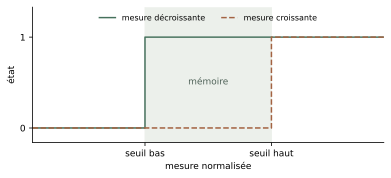
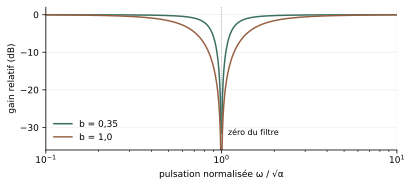

# X-ENS PSI · Sciences industrielles 2014 · Corrigé partiel brut

*Corrigé rédigé par IA, non officiel. Signalez toute erreur.*

**Rédaction** · GPT-6.2 Astra Ultra · vitesse non renseignée · 25 novembre 2026

**Périmètre.** Le cahier CX4614 compte 53 questions sur le SPRAT. Cette édition explique les principes de roulement et d’hystérésis des questions 2.1 et 2.8, ainsi que le calcul d’aire de 5.6 et la réponse fréquentielle de 6.10 dans des exemples civils. Les sous-questions de dimensionnement et de validation du véhicule, les paramètres de mise en œuvre et les feuilles-réponses sont hors couverture.

### Question 2.1 · Roulement d’une roue idéale

Sur un sol immobile, le roulement sans glissement impose que la vitesse du **point matériel de la roue** momentanément en contact avec le sol soit nulle dans le repère du sol. Pour une roue de centre $O$ et de point de contact $P$,

$$
\mathbf v(P)=\mathbf v(O)+\boldsymbol\omega\times\overrightarrow{OP}=\mathbf0 .
$$

Sur un vélo roulant droit avec sa roue verticale, la vitesse du centre est dans le plan de la roue et aucun mouvement transversal n’a lieu. Si le rayon vaut $R$, on retrouve $|v(O)|=R|\omega|$. En virage, dans la cinématique plane du vélo, la roue librement orientable est tangente à la trajectoire de son point de contact projeté sur le sol. Pour un centre instantané de rotation fini, son axe horizontal est porté par la direction radiale. Si la roue est à l’arrêt, la seule équation de vitesse n’impose aucune orientation.

### Question 2.8 · Commutation à hystérésis

Soient deux seuils $s_{\rm bas}<s_{\rm haut}$. Un thermostat peut enclencher une sortie au franchissement du seuil haut, la couper au franchissement du seuil bas et conserver son état entre les deux. Une petite fluctuation près d’un seul seuil peut provoquer une première commutation, mais elle ne peut provoquer la commutation inverse sans traverser toute la bande. On limite ainsi le claquement d’un relais ou des ordres successifs contradictoires. À l’intérieur de la bande, la valeur du signal seule ne détermine pas la sortie, il faut connaître son dernier état.

### Question 5.6 · Aire d’un profil de vitesse

Pour une bande transporteuse qui accélère linéairement de 0 à $v$ pendant $t_a$, maintient cette vitesse pendant $t_p$ puis décélère linéairement jusqu’à zéro pendant $t_a$, le déplacement est l’intégrale de la vitesse. Les deux triangles et le rectangle donnent

$$
d=\tfrac12 vt_a+v t_p+\tfrac12 vt_a=v(t_a+t_p).
$$

Donc $t_p=d/v-t_a$ pour $v>0$. Les durées doivent vérifier $0\leq t_a\leq d/v$ pour que le plateau ait une durée positive ou nulle. La même intégration sur une vitesse angulaire s’exprime en radians.

### Question 6.10 · Réponse fréquentielle d’un filtre coupe-bande

Considérons comme exercice de filtrage audio le modèle $H(p)=K(p^2+\alpha)/(p^2+\beta p+\alpha)$ avec $K,\alpha,\beta>0$. Son module est

$$
|H(j\omega)|=K\,\frac{|\alpha-\omega^2|}
{\sqrt{(\alpha-\omega^2)^2+\beta^2\omega^2}} .
$$

Aux deux extrémités de la bande, le gain tend vers $K$. À $\omega_0=\sqrt\alpha$, le numérateur s’annule, le gain idéal vaut zéro et sa phase est indéfinie. Juste en dessous, la phase tend vers $-90^\circ$, juste au-dessus vers $+90^\circ$, puis elle revient vers zéro. $K$ fixe la hauteur des deux plateaux, $\alpha$ fixe la pulsation du creux et $\beta$ règle sa largeur. Aux deux pulsations à $-3\ \mathrm{dB}$ par rapport au plateau, $|\alpha-\omega^2|=\beta\omega$ et leur différence vaut $\beta$. Il s’agit d’un filtre qui atténue une bande de fréquences autour de $\omega_0$.

