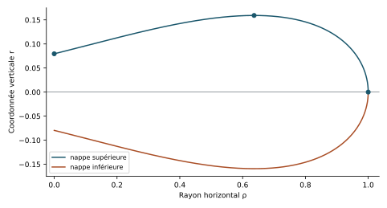

# École polytechnique MP — Mathématiques B 2014 · Corrigé guidé

*Corrigé rédigé par IA, non officiel. Signalez toute erreur.*

**Rédaction** · GPT-6.2 Astra Ultra · vitesse non renseignée · 25 novembre 2026

**Révision** · GPT-6.2 Astra Ultra · vitesse non renseignée · 26 novembre 2026

**Groupe de Heisenberg et chemins de Carnot.** Les coordonnées $(p,q,r)$ sont celles de la matrice dans l’exponentielle. Le coefficient supérieur droit de son exponentielle est $r+pq/2$.

## I. Groupe de Heisenberg

### Question 1

> [!INDICATION]
> Calculer le carré, puis le cube de la matrice strictement triangulaire.

#### Solution

Notons $E_{ij}$ la matrice élémentaire. On a $M^2=pqE_{13}$ et $M^3=0$. Donc
$$\exp M=I+M+\tfrac12M^2=I+M_{p,q,r+pq/2}.$$

### Question 2.a

> [!INDICATION]
> Tout produit de trois matrices strictement triangulaires supérieures de taille trois est nul.

#### Solution

Pour $M,N\in L$, $[M,N]\in\mathbb RE_{13}$ et cette droite a produit nul avec $L$. La loi est donc interne et, en développant les parenthèses,
$$(M*N)*P=M+N+P+\tfrac12([M,N]+[M,P]+[N,P])=M*(N*P).$$
Le neutre est la matrice nulle et l’inverse de $M_{p,q,r}$ est $-M=M_{-p,-q,-r}$ car $[M,-M]=0$.

### Question 2.b

> [!INDICATION]
> Tester la commutation séparément avec les matrices E12 et E23.

#### Solution

Pour $N=M_{a,b,c}$, $[M,N]=(pb-aq)E_{13}$. Ainsi $M*N=N*M$ pour tout $N$ exactement lorsque $p=q=0$. Le centre vaut $\mathbb RE_{13}$ et le groupe n’est pas commutatif, par exemple $[E_{12},E_{23}]=E_{13}$.

### Question 3

> [!INDICATION]
> Développer les deux exponentielles et éliminer tous les produits de longueur trois.

#### Solution

Le produit vaut $I+M+N+(M^2+N^2)/2+MN$. Pour $P=M*N$, on a $P^2=(M+N)^2$ puisque le commutateur multiplie à zéro les éléments de $L$. Donc $I+P+P^2/2$ redonne exactement l’expression précédente. Par Q1 c’est $\exp P$.

### Question 4

> [!INDICATION]
> Effectuer le commutateur avec la loi étoile en utilisant la centralité du crochet.

#### Solution

Posons $C=[M,N]$. La loi de groupe associe d’abord $M$ et $N$, puis $(M*N)*(-M)=N+C$ car $[M+N+C/2,-M]=C$. Enfin $(N+C)*(-N)=C$. Par trois applications de Q3, l’exponentielle de ce résultat est le produit de quatre exponentielles demandé.

### Question 5

> [!INDICATION]
> Lire l’inverse de l’exponentielle sur les trois coefficients au-dessus de la diagonale.

#### Solution

La formule de Q1 donne la bijection $M_{p,q,r}\mapsto I+M_{p,q,r+pq/2}$ de $L$ sur $H$, d’inverse $I+M_{p,q,s}\mapsto M_{p,q,s-pq/2}$. Elle est multiplicative par Q3. Ainsi $H$ contient l’identité, est stable par produit et inversion, et toutes ses matrices triangulaires ont déterminant 1. C’est un sous-groupe de $SL_3(\mathbb R)$ et la bijection est un isomorphisme.

## II. Exponentielles de matrices

### Question 6.a

> [!INDICATION]
> Établir le commutateur avec une puissance de B, puis sommer sa série.

#### Solution

Notons $C=[A,B]$. La règle $[A,UV]=[A,U]V+U[A,V]$ donne par récurrence $[A,B^k]=k B^{k-1}C$ pour $k\ge1$, car $B$ commute avec $C$. Le commutateur avec $A$ est linéaire continu en dimension finie. En sommant la série absolument convergente de l’exponentielle, on obtient $[A,e^B]=e^BC$.

### Question 6.b

> [!INDICATION]
> Différencier le produit dans son ordre initial et commuter B avec la première exponentielle.

#### Solution

Pour $F(t)=e^{tA}e^{tB}$, $F'=AF+e^{tA}Be^{tB}$. La question 6.a appliquée à $B,tA$ donne $Be^{tA}-e^{tA}B=-t e^{tA}C$. Comme $C$ commute avec tout le produit, $F'=(A+B+tC)F$ et $F(0)=I$.

### Question 6.c

> [!INDICATION]
> Le coefficient de l’équation différentielle commute avec sa primitive.

#### Solution

Posons $U(t)=t(A+B)+t^2 C/2$. Les matrices $U(t)$ et $U'(t)=A+B+tC$ commutent. En dérivant la série localement uniformément, $G=e^U$ vérifie $G'=U'G$ et $G(0)=I$. Par unicité du problème linéaire de Q6.b, $G=F$. Prendre $t=1$ donne $e^Ae^B=\exp(A+B+[A,B]/2)$.

### Question 7.a

> [!INDICATION]
> Développer bilinéairement le crochet sur les trois générateurs.

#### Solution

Pour $M=pA+qB+rC$ et $N=aA+bB+cC$ avec $C=[A,B]$, on a $[M,N]=(pb-qa)C$. Tout multiple de $C$ commute avec les trois générateurs, donc avec $M$ et $N$.

### Question 7.b

> [!INDICATION]
> Vérifier que l’application linéaire sur les paramètres préserve le crochet, même si les trois images sont liées.

#### Solution

Écrivons $T(M_{p,q,r})=pA+qB+rC$. Les formules de 2.b et 7.a donnent $T([M,N])=[T(M),T(N)]$. La Q6.c appliquée aux images donne $e^{TM}e^{TN}=e^{T(M*N)}$. L’image $G$ contient $I$, est stable par produit et par inversion ($e^{-TM}$). La Q5 garantit que chaque élément de $H$ a un unique paramètre dans $L$, donc $\Phi(e^M)=e^{TM}$ est bien définie. L’égalité précédente et Q3 donnent le morphisme. Aucune indépendance de $A,B,C$ n’est nécessaire.

### Question 8.a

> [!INDICATION]
> Pour le binôme, séparer les indices de degré fixé de la queue uniformément dominée par une série exponentielle.

#### Solution

Pour $n\ge k$, le rapport est $c_{n,k}=\prod_{j=0}^{k-1}(1-j/n)$, produit vide 1 si $k=0$. Chaque facteur est dans $[0,1]$ et tend vers 1 à $k$ fixé. Ainsi $0\le1-c_{n,k}\le1$ et $c_{n,k}\to1$. Le binôme est permis puisque $I$ commute avec $D_n$. La norme de la différence demandée est majorée par $\sum_{k=1}^n(1-c_{n,k})\lambda^k/k!$. La queue après $K$ est majorée uniformément par $\sum_{k>K}\lambda^k/k!$, arbitrairement petite pour $K$ grand. Les $K$ premiers termes tendent vers zéro. La différence tend donc vers zéro.

### Question 8.b

> [!INDICATION]
> Employer un télescopage qui respecte l’ordre des facteurs.

#### Solution

Le développement par annulations adjacentes donne
$$D_n^k-D^k=\sum_{j=0}^{k-1}D_n^j(D_n-D)D^{k-1-j}.$$
Par continuité de la norme, $\|D\|\le\lambda$. Par sous-multiplicativité, chaque produit a norme au plus $\lambda^{k-1}\|D_n-D\|$, en omettant les facteurs d’exposant nul. La somme donne la borne $k\lambda^{k-1}\|D_n-D\|$.

### Question 8.c

> [!INDICATION]
> Intercaler la série exponentielle tronquée à l’ordre n évaluée en D.

#### Solution

Par Q8.b, la différence entre les deux polynômes tronqués évalués en $D_n,D$ a norme au plus $\|D_n-D\|\sum_{k=1}^n\lambda^{k-1}/(k-1)!\le e^\lambda\|D_n-D\|$. Elle tend vers zéro. La troncature en $D$ tend vers $e^D$ et Q8.a contrôle l’autre différence. D’où $(I+D_n/n)^n\to e^D$.

### Question 9.a

> [!INDICATION]
> Majorer les termes de degré au moins deux par une série scalaire.

#### Solution

Pour $\|D\|\le1$, $\|e^D-I-D\|\le\sum_{j\ge2}\|D\|^j/j!\le(e-2)\|D\|^2$. La constante $\mu=e-2$ convient.

### Question 9.b

> [!INDICATION]
> Développer chacun des deux facteurs à l’ordre un et absorber les premiers indices dans la constante.

#### Solution

Pour $n$ assez grand, Q9.a donne $e^{A/n}=I+A/n+R_n$, $e^{B/n}=I+B/n+S_n$ avec $\|R_n\|,\|S_n\|=O(n^{-2})$. Leur produit dans cet ordre vaut $I+(A+B)/n+C_n$, où $C_n=R_n+S_n+(A/n+R_n)(B/n+S_n)$. Sa norme est $O(n^{-2})$. Pour les premiers indices, définir $C_n$ par l’identité demandée et augmenter la constante en prenant le maximum des $n^2\|C_n\|$ correspondants. On obtient une même borne $\nu/n^2$ pour tout $n\ge1$.

### Question 10

> [!INDICATION]
> Ramener les deux exponentielles à un seul facteur de la forme de Q8.c.

#### Solution

Avec $D_n=A+B+nC_n$, Q9.b donne $e^{A/n}e^{B/n}=I+D_n/n$ et $D_n\to A+B$. La Q8.c donne donc $(e^{A/n}e^{B/n})^n\to e^{A+B}$, sans supposer $A$ et $B$ commutantes.

## III. Chemins et sphère de Carnot

### Question 11.a

> [!INDICATION]
> Voir l’équation comme un système linéaire à neuf inconnues sur tout l’intervalle.

#### Solution

L’équation $\gamma'=\gamma(uE_{12}+vE_{23})$ est linéaire sur $M_3(\mathbb R)$. Son coefficient dépend continûment de $t$ sur le segment $[0,T]$. Le théorème d’existence et d’unicité pour les systèmes linéaires à coefficients continus donne une solution $C^1$ sur tout ce segment, de valeur initiale $I$.

### Question 11.b

> [!INDICATION]
> Résoudre d’abord pour les trois coefficients de la matrice, puis convertir le coin supérieur droit en coordonnée exponentielle.

#### Solution

Posons $p(t)=\int_0^t u$, $q(t)=\int_0^t v$, $w(t)=\int_0^t p(s)v(s)\,ds$. La matrice $I+M_{p,q,w}$ a pour dérivée $u E_{12}+v E_{23}+pvE_{13}$, qui est exactement son produit à droite par $uE_{12}+vE_{23}$. Par Q11.a elle égale $\gamma(t)$ et est dans $H$. En coordonnées exponentielles,
$$r(t)=w(t)-p(t)q(t)/2=\tfrac12\int_0^t(pv-qu)(s)\,ds,$$
la deuxième égalité venant de la dérivée de $pq$.

### Question 12.a

> [!INDICATION]
> Intégrer les deux contrôles puis simplifier la vitesse verticale avec la formule de différence des cosinus.

#### Solution

Lorsque $\phi\ne0$,
$$p(t)=\frac{\cos(\theta-\phi t)-\cos\theta}{\phi},\qquad
q(t)=\frac{\sin\theta-\sin(\theta-\phi t)}{\phi}.$$
En les substituant dans $2r'=p\cos(\theta-\phi t)-q\sin(\theta-\phi t)$, on obtient $(1-\cos(\phi t))/\phi$. Comme $r(0)=0$, il vient $r(t)=(\phi t-\sin(\phi t))/(2\phi^2)$.

### Question 12.b

> [!INDICATION]
> Pour deux contrôles constants la vitesse horizontale reste dans une direction fixe.

#### Solution

Si $\phi=0$, $p=t\sin\theta$, $q=t\cos\theta$, et $pv-qu=0$. Ainsi $r=0$ et $\gamma_{\theta,0}(t)=\exp(M_{t\sin\theta,t\cos\theta,0})=I+M_{t\sin\theta,t\cos\theta,t^2\sin\theta\cos\theta/2}$.

### Question 13

> [!INDICATION]
> Écrire la racine de f comme un sinus cardinal et factoriser le numérateur de la dérivée de g.

#### Solution

À l’origine $f(s)=1-s^2/12+O(s^4)$ et $g(s)=s/12+O(s^3)$. Les extensions vérifient $f(0)=1$, $g(0)=0$. On a $\sqrt{f(s)}=\sin(s/2)/(s/2)$ sur $[0,2\pi]$. Or $h(u)=\sin u-u\cos u$ vérifie $h(0)=0$ et $h'(u)=u\sin u>0$ pour $0<u<\pi$. Le sinus cardinal décroît strictement jusqu’à zéro, donc $f$ est continue bijective de $[0,2\pi]$ sur $[0,1]$. Enfin
$$g'(s)=\frac{-s(1+\cos s)+2\sin s}{2s^3}
=\frac{\cos(s/2)[2\sin(s/2)-s\cos(s/2)]}{s^3}.$$
Le crochet est positif pour $s>0$. Ainsi $g$ croît jusqu’à $\pi$, décroît ensuite et a maximum $g(\pi)=1/(2\pi)$.

### Question 14

> [!INDICATION]
> À t = 1, isoler le rayon indépendant de θ et l’angle qui parcourt tout le cercle.

#### Solution

Pour $\phi\ne0$ au temps 1, les identités d’angle moitié donnent
$$(p,q)=\frac{2\sin(\phi/2)}{\phi}\big(\sin(\theta-\phi/2),\cos(\theta-\phi/2)\big).$$
Le rayon $\rho=\sqrt{p^2+q^2}$ vérifie $\rho^2=f(|\phi|)$ et $r=\operatorname{sgn}(\phi)g(|\phi|)$. Pour $\phi=0$, on a $\rho=1,r=0$. Par conséquent la partie $r\ge0$ est exactement le graphe $r=g(f^{-1}(\rho^2))$ pour $0\le\rho\le1$. En effet, pour tout tel rayon, choisir $\phi=f^{-1}(\rho^2)$ et faire varier $\theta$ sur un intervalle de longueur $2\pi$ parcourt tout le cercle voulu, y compris le cercle réduit au point lorsque $\rho=0$. L’autre nappe est sa symétrique.

Pour les tangentes, paramétrons par $s=|\phi|$, $\rho=2\sin(s/2)/s$. À $s=2\pi$, $\rho'=-1/(2\pi)$ et $g'=-1/(4\pi^2)$, donc la pente au rayon zéro vaut $1/(2\pi)$ depuis la hauteur $1/(4\pi)$. À $s=0$, $\rho=1-s^2/24+O(s^4)$ et $g=s/12+O(s^3)$, donc la tangente en $(1,0)$ est verticale.

Les deux tangentes figurées ont donc pour équations $r=1/(4\pi)+\rho/(2\pi)$ à l’axe et $\rho=1$ à l’équateur. Au point le plus haut, $s=\pi$ donne $(\rho,r)=(2/\pi,1/(2\pi))$ et la tangente est horizontale.

### Question 15

> [!INDICATION]
> Chercher les extrema d’une fonction continue positive sur une image compacte.

#### Solution

La sphère est compacte comme image continue du rectangle de paramètres, avec les prolongements de Q12–13. L’origine n’y appartient pas : lorsque $\rho=0$, $|\phi|=2\pi$ et $|r|=1/(4\pi)$. Donc $p^2+q^2+|r|$ y a un minimum $m>0$ et un maximum $M<\infty$. Le choix $c_1=\max(1,1/m,M)$ convient.

### Question 16.a

> [!INDICATION]
> Le quotient entre hauteur absolue et rayon au carré est invariant sous la dilatation.

#### Solution

Écrivons $R=\sqrt{p^2+q^2}$. Si $R=0$ et $r\ne0$, il faut et suffit que $\lambda^2|r|=1/(4\pi)$, d’où unicité. Si $R>0$, examinons sur la sphère le rapport
$$H(s)=\frac{g(s)}{f(s)}=\frac{s-\sin s}{4(1-\cos s)},\qquad 0<s<2\pi.$$
Il croît strictement de 0 à $+\infty$. En effet le numérateur de sa dérivée, après multiplication par le facteur positif $4(1-\cos s)^2$, vaut $2(1-\cos s)-s\sin s=2\sin(s/2)[2\sin(s/2)-s\cos(s/2)]>0$ par Q13. Les limites suivent du développement à zéro et de la valeur du numérateur en $2\pi$. Choisir l’unique $s\in[0,2\pi[$ avec $H(s)=|r|/R^2$, en posant $H(0)=0$. Alors $\lambda=\sqrt{f(s)}/R$ est imposé et convient par Q14 et la symétrie en $r$.

### Question 16.b

> [!INDICATION]
> Dilater le temps et compenser par une dilatation de la fréquence de rotation.

#### Solution

Pour $A=\exp M_{p,q,r}\ne I$, Q16.a donne $(\lambda p,\lambda q,\lambda^2r)$ sur la sphère au temps 1 pour des paramètres $(\theta,\psi)$. Les formules Q12 montrent que, au temps $T$, avec fréquence $\phi=\psi/T$, la position horizontale est multipliée par $T$ et la coordonnée $r$ par $T^2$ par rapport au temps 1 avec $\psi$. Prendre $T=1/\lambda$ donne exactement $A$. Pour $A=I$ prendre $T(I)=0$, en prolongeant naturellement le parcours au segment réduit à son point initial. Si « positif » était imposé au sens strict même pour $I$, Q16.c le contredirait et les formules Q12 excluraient également ce retour à temps strictement positif.

### Question 16.c

> [!INDICATION]
> Appliquer la borne sur la sphère au point normalisé par le temps.

#### Solution

Pour $A\ne I$, le point $(p/T,q/T,r/T^2)$ appartient à la sphère, où $T=T(A)$ choisi en 16.b. Par Q15,
$$c_1^{-1}\le\frac{p^2+q^2+|r|}{T^2}\le c_1.$$
En prenant les racines et en réarrangeant, on obtient l’encadrement demandé avec $c_2=\sqrt{c_1}$. Pour $A=I$, les deux côtés sont nuls et $T(I)=0$.
