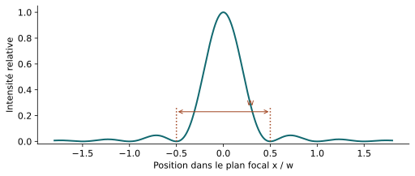
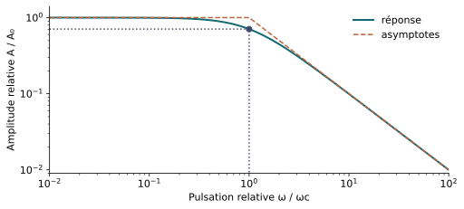

# École polytechnique et ESPCI PC 2014 — Physique A · Corrigé brut

*Corrigé rédigé par IA, non officiel. Signalez toute erreur.*

**Lecture du rapport du jury** · GPT-6.2 Astra Ultra · vitesse non renseignée

**Rédaction** · GPT-6.2 Astra Ultra · vitesse non renseignée

## Pièges optiques

## 1. Forces optiques sur une particule

### Question 1 — Moment du doublet

$\mathbf p=q\overrightarrow{BA}=q\mathbf a$. Il s’exprime en coulombs-mètres.

### Question 2 — Résultante et moment

La résultante exacte est $q[\mathbf E(\mathbf a/2)-\mathbf E(-\mathbf a/2)]$. Le premier terme non nul du développement au voisinage de $O$ donne $\mathbf F\simeq(\mathbf p\cdot\nabla)\mathbf E(O)$. Le moment en $O$ est $q\mathbf a\times[\mathbf E(\mathbf a/2)+\mathbf E(-\mathbf a/2)]/2\simeq\mathbf p\times\mathbf E(O)$. Dans la somme des champs, les termes du premier ordre s’annulent.

### Question 3 — Orientation

Le couple tend à aligner $\mathbf p$ sur $\mathbf E$. L’énergie $-\mathbf p\cdot\mathbf E$ a un minimum pour des vecteurs de même sens et un maximum pour des vecteurs opposés. La deuxième orientation annule aussi le couple mais est instable.

### Question 4 — Cas unidirectionnel

Pour $\mathbf p=p\mathbf e_x$ et $\mathbf E=E\mathbf e_x$ de direction fixe, $\mathbf F=p(\partial_xE)\mathbf e_x$. La force est nulle dans un champ spatialement uniforme.

### Question 5 — Effet d’un gradient

Pour un dipôle aligné avec le champ, l’extrémité située du côté où le champ est plus intense l’emporte. Le dipôle se déplace vers une région de champ plus fort. Pour un dipôle maintenu en opposition, la résultante change de sens.

### Question 6 — Dimension de la polarisabilité définie dans le sujet

$[\varepsilon_0a^3E]=\mathrm{C\,m^{-2}\,m^3}=\mathrm{C\,m}=[p]$. Le facteur $\alpha$ de la relation $\mathbf p=\varepsilon_0a^3\alpha\mathbf E$ est donc sans dimension.

### Question 7 — Force de gradient

En régime électrostatique, $\nabla\times\mathbf E=0$. L’identité donnée devient $(\mathbf E\cdot\nabla)\mathbf E=\tfrac12\nabla E^2$. Par substitution, $\mathbf F=(\varepsilon_0a^3\alpha/2)\nabla E^2$. Pour un champ sinusoïdal de crête $E_0$, la moyenne de $\cos^2\omega t$ est $1/2$, d’où le coefficient $\varepsilon_0a^3\alpha/4$ de la force moyenne admise ensuite.

### Question 8 — Équilibre au maximum de champ

Posons $K=\varepsilon_0a^3\alpha/4$ et $S=E_0^2$. $F_z=KS'$, donc $F_z(z_m)=0$. Pour $\alpha>0$, la force ramène vers le maximum des deux côtés et l’équilibre est stable. Pour $\alpha<0$, elle éloigne la bille et le maximum est instable. Pour $\alpha=0$ cette force ne piège pas la particule.

### Question 9 — Dimension de la force de diffusion

$\varepsilon_0 E_0^2$ est une densité d’énergie, donc une pression. Le produit $a^6(\omega/c)^4$ a la dimension d’une aire. Leur produit avec $\alpha^2/(12\pi)$ est bien une force.

### Question 10 — Équilibre avec diffusion

Avec $H=\varepsilon_0\alpha^2a^6\omega^4/(12\pi c^4)$, la résultante axiale est $F_z=KS'+HS$. L’équilibre $z_{\rm eq}$ impose $S'/S=-H/K$ si $S>0$ et $K\ne0$, soit $(\ln E_0)'=-H/(2K)$.

### Question 11 — Déplacement axial

La diffusion pousse vers $+z$. Si $\alpha>0$, il faut pour la compenser $S'<0$ et donc, sur le flanc descendant, $z_{\rm eq}>z_m$. Le point stable se déplace en aval du maximum tant qu’une pente suffisante existe.

### Question 12 — Critère local de stabilité

$F_z=S[2K(\ln E_0)'+H]$. À l’équilibre le crochet s’annule, donc $F_z'(z_{\rm eq})=2KS(z_{\rm eq})(\ln E_0)''(z_{\rm eq})$. La condition de rappel linéaire est $F_z'<0$. Pour le piège attractif de $\alpha>0$, elle équivaut à $(\ln E_0)''<0$ au point d’équilibre. Une pente nulle de la force imposerait un examen d’ordre supérieur.

## 2. Focalisation et raideur transverse

### Question 13 — Diffraction par la fente

Sous illumination uniforme et en diffraction lointaine, l’amplitude est la somme cohérente des contributions. Avec $k=2\pi/\lambda$ et $s=kD\sin\theta/2$,

$$
A(\theta)\propto\int_{-D/2}^{D/2}e^{iku\sin\theta}\,du=D\frac{\sin s}{s}.
$$

La limite en $s=0$ vaut $D$, comme le donne l’addition en phase de toute la pupille.

### Question 14 — Intensité angulaire

$I(\theta)=I(0)(\sin s/s)^2$. Les premiers zéros de part et d’autre de l’axe correspondent à $s=\pm\pi$, soit $\sin\theta=\pm\lambda/D$.

### Question 15 — Position dans le plan focal

Le faisceau parallèle incliné converge dans le plan $z=f$ en $x=f\tan\theta$, $y=0$ (avec l’orientation positive vers l’inclinaison). Dans l’approximation paraxiale $x\simeq f\theta$.

### Question 16 — Diamètre du lobe central

$w=2f\tan[\arcsin(\lambda/D)]\simeq2f\lambda/D=2N_o\lambda$. Pour $N_o=0,4$ et $\lambda=1,06\,\mathrm{\mu m}$, on trouve $w\simeq0,85\,\mathrm{\mu m}$, soit de l’ordre du micromètre. Le modèle de fente donne une échelle pour le diamètre de la tache réelle.

### Question 17 — Flux d’énergie au foyer

Les lobes secondaires, dont l’enveloppe décroît comme $1/s^2$ en intensité, reçoivent une fraction minoritaire de la puissance. Pour une tache de surface de l’ordre de $w^2$, le module moyen du vecteur de Poynting est donc $I\sim P/w^2$ en $\mathrm{W\,m^{-2}}$. On peut prendre $I\sim4P/(\pi w^2)$ pour un disque uniforme de diamètre $w$.

### Question 18 — Raideur d’une bille de 400 nm

Avec $I=\varepsilon_0cE_0^2/2$, $F_x=\alpha a^3 I'(x)/(2c)$. Au foyer, $I'(0)=0$ et $I''(0)<0$. La raideur est $k_p=-\alpha a^3 I''(0)/(2c)$. Comme $|I''(0)|\sim I(0)/w^2$ et $I(0)\sim P/w^2$, on obtient $k_p\sim\alpha a^3P/(c w^4)$ à des facteurs géométriques près. La forme de fente confirme la courbure puisque $I/I(0)\simeq1-(2\pi x/w)^2/3$.

Avec $a=2\times10^{-7}\,\mathrm m$ et $\alpha\sim1$, l’échelle $a^3/(cw^4)$ vaut environ $5\times10^{-5}\,\mathrm{N\,m^{-1}\,W^{-1}}$. Il faut multiplier ce coefficient par la puissance en watts. Le rapport du jury confirme que la puissance manque dans l’énoncé, donc une raideur numérique unique ne peut en être déduite.

## 3. Calibration par les fluctuations

### Question 19 — Nombre de Reynolds

$\mathrm{Re}=\rho_e v(2a)/\eta$ compare transport inertiel et diffusion visqueuse de quantité de mouvement. L’excursion de $10\,\mathrm{nm}$ en $10^{-2}\,\mathrm s$ donne $v\sim10^{-6}\,\mathrm{m\,s^{-1}}$. Pour la bille de diamètre $2\,\mathrm{\mu m}$ de la figure 2, $\mathrm{Re}\sim2\times10^{-6}$. Même avec le diamètre de 400 nm de la question 18, on resterait très en dessous de l’unité.

### Question 20 — Traînée de Stokes

À très petit Reynolds, la contrainte est de l’ordre de $\eta v/a$. Intégrée sur une aire de l’ordre de $a^2$, elle donne une force proportionnelle à $\eta av$. La traînée s’oppose à la vitesse relative, donc $\mathbf F_T=-C\eta a\mathbf v$. Le facteur sans dimension vaut $6\pi$ pour une sphère à adhérence dans un fluide non borné.

### Question 21 — Justification du bilan suramorti

Dans l’axe latéral, le poids et la poussée sont sans composante. On a $m\ddot x=f_e-k_px-\gamma\dot x$ avec $m=4\pi\rho_pa^3/3$ et $\gamma=C\eta a$. Le rapport de l’inertie au frottement sur la durée $t_e$ est $m/(\gamma t_e)$. Pour $a=1\,\mathrm{\mu m}$ et $C=6\pi$, $m/\gamma\simeq2,4\times10^{-7}\,\mathrm s\ll10^{-2}\,\mathrm s$. On obtient ainsi $f_e=k_px+\gamma\dot x$ dans le domaine considéré.

### Question 22 — Fonction de réponse

Pour $x(t)=\Re(Xe^{i\omega t})$ et une force d’amplitude $f_0$, $X=f_0/(k_p+i\gamma\omega)$. Ainsi $A=|X|=A_0/\sqrt{1+(\omega/\omega_c)^2}$, avec $A_0=|f_0|/k_p$ et $\omega_c=k_p/\gamma$.

### Question 23 — Asymptotes du spectre

Pour $\omega\ll\omega_c$, $A\simeq A_0$ (pente 0). Pour $\omega\gg\omega_c$, $A\simeq A_0\omega_c/\omega$ (pente $-1$). Les asymptotes se coupent en $\omega_c$ et la courbe y vaut $A_0/\sqrt2$. La figure 2 du sujet montre un plateau bruité puis une chute proche d’une décade d’amplitude par décade de fréquence. Un spectre de force brownienne approximativement plat dans cette bande permet de retrouver la forme de la réponse en amplitude.

### Question 24 — Raideur du dispositif mesuré

Le plateau est proche de $1,5$ à $1,8\times10^{-3}$ en unités arbitraires. Le passage vers $1,1$ à $1,3\times10^{-3}$ se situe à une fréquence de l’ordre de $f_c\sim(1$ à $2)\times10^2\,\mathrm{Hz}$. Le bruit limite la lecture. Par conséquent $\omega_c=2\pi f_c\sim10^3\,\mathrm{rad\,s^{-1}}$. Avec $a=1\,\mathrm{\mu m}$ dans cette expérience, $k_p=6\pi\eta a\omega_c\sim2\times10^{-5}\,\mathrm{N\,m^{-1}}$. La mesure porte sur un piège distinct de celui de la question 18.

### Question 25 — Analogie électrique

Dans un circuit $RC$ série alimenté par une tension sinusoïdale, la tension mesurée aux bornes du condensateur a pour fonction de transfert $1/(1+i\omega RC)$. Sa pulsation de coupure est $1/(RC)$ et le module présente les mêmes deux asymptotes.

## 4. Élasticité d’une chaîne

### Question 26 — Distance quadratique des extrémités

Le vecteur entre extrémités est $\mathbf r=\sum_{i=1}^N\mathbf r_i$. Dans $\langle r^2\rangle=\sum_i\langle r_i^2\rangle+2\sum_{i<j}\langle\mathbf r_i\cdot\mathbf r_j\rangle$, le modèle de chaîne libre isotrope rend nuls tous les produits croisés. Chaque segment a longueur $\ell$, d’où $\langle r^2\rangle=N\ell^2=\ell L$ avec $L=N\ell$.

### Question 27 — Force extérieure d’extension

L’énergie donnée est $U=U_0+3k_BT x^2/(2\ell L)$. Le rappel de la chaîne vaut $-dU/dx$. La force extérieure requise pour la maintenir à $x$ est opposée au rappel et vaut donc en module $f=3k_BT x/(\ell L)$. La pente de $f$ en fonction de $x/L$ est $3k_BT/\ell$.

### Question 28 — Longueur du segment effectif

Près de $f=0,08\,\mathrm{pN}$, la figure 4 place $x/L$ vers $0,45$. La longueur effective vaut $\ell=3k_BT(x/L)/f\simeq3\times4\times10^{-21}\times0,45/(8\times10^{-14})\simeq7\times10^{-8}\,\mathrm m$. Une lecture vers $f=0,10\,\mathrm{pN}$, $x/L\simeq0,50$, donne 60 nm. Ces estimations placent le segment effectif autour de $60$ à $70\,\mathrm{nm}$.

### Question 29 — Déviation de la bille

À l’équilibre la traction est compensée par $k_p|\Delta x_b|$. Avec le piège calibré en 24, $|\Delta x_b|=10^{-13}/(2\times10^{-5})\sim5\times10^{-9}\,\mathrm m$, soit quelques nanomètres. Pour le piège de la partie 2, seul $f/k_p(P)$ peut être donné sans la puissance laser.

### Question 30 — Ce que permet de mesurer le piège

Au voisinage de $0,1\,\mathrm{pN}$, l’extension moléculaire atteint environ $L/2\sim15\,\mathrm{\mu m}$ alors que le décalage de la bille dans le piège est de quelques nanomètres. On règle la distance entre l’ancrage et le centre du piège pour étirer la chaîne et l’on mesure le petit décalage de la bille pour en déduire la force. La bille reste ainsi dans le domaine de rappel linéaire. Une lecture instantanée est bruitée puisque les excursions thermiques annoncées sont de l’ordre de 10 nm. Une détection nanométrique et une moyenne sur plusieurs fluctuations rendent ce piège utilisable dans le domaine des faibles forces. L’extrapolation linéaire aux dizaines de piconewtons de la figure sortirait de la zone centrale du piège et demanderait une nouvelle calibration.
