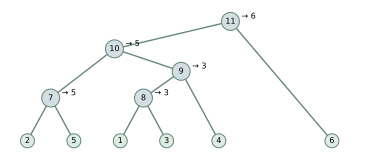
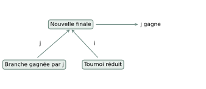
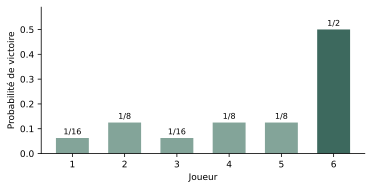

# École polytechnique · PSI et PT · Informatique 2014 · Corrigé brut

*Corrigé rédigé par IA, non officiel. Signalez toute erreur.*

**Rédaction** · GPT-6.2 Astra Ultra · vitesse non renseignée · 25 novembre 2026

**Tournois et pronostics.** Le langage choisi est Python. Pour respecter les numéros du sujet, les vecteurs de joueurs et de rencontres réservent une case 0 inutilisée. Une ligne réelle de T est un couple Python dont les deux membres occupent les positions 0 et 1. Les matrices O et P réservent aussi leur colonne 0. Le nombre de joueurs n est global.

## I · Tournois

### Question 1 · Interpréter les conditions d’un tournoi

La condition (3) impose deux protagonistes distincts dans toute rencontre réelle. La condition (4) permet uniquement un joueur déjà numéroté ou le vainqueur d’une rencontre antérieure. La condition (5) engage chaque joueur, ou chaque vainqueur d’une rencontre autre que la finale, dans exactement une rencontre ultérieure. Le vainqueur de la dernière rencontre remporte le tournoi. Pour $n=1$, la seule ligne désigne déjà ce vainqueur.

### Question 2 · Tester l’unicité du successeur

```python
def EstVraiCondition5(T, k):
    trouve = False
    for h in range(k + 1, 2 * n):
        a, b = T[h]
        if a == k or b == k:
            if trouve:
                return False
            trouve = True
    return trouve
```

Le test `or` compte une ligne une seule fois, même si elle contient $k$ deux fois. La condition demandée porte sur l’unicité de $h$. On visite au plus $2n-1-k$ lignes et utilise un booléen, d’où un temps maximal $\Theta(2n-1-k)$ et un espace constant.

### Question 3 · Vérifier simultanément les cinq conditions

```python
def EstUnTournoi(T):
    utilisations = [0] * (2 * n)
    for k in range(1, n + 1):
        a, b = T[k]
        if a != k or b != k:
            return False
    for k in range(n + 1, 2 * n):
        a, b = T[k]
        if not (1 <= a < b < k):
            return False
        utilisations[a] += 1
        utilisations[b] += 1
    for k in range(1, 2 * n - 1):
        if utilisations[k] != 1:
            return False
    return True
```

Pour les lignes de joueurs, la forme $(k,k)$ entraîne aussi la condition d’ordre. Pour les rencontres réelles, l’inégalité composée réunit les conditions (1), (3) et (4) et valide les indices avant de s’en servir. Les compteurs vérifient (5) pour toutes les lignes autres que la finale. Temps et espace supplémentaires dans le pire cas sont $\Theta(n)$.

### Question 4 · Reconnaître un oracle

```python
def EstUnOracle(O):
    for i in range(1, n + 1):
        if not O[i][i]:
            return False
        for j in range(i + 1, n + 1):
            if O[i][j] == O[j][i]:
                return False
    return True
```

Le sujet garantit une matrice de booléens. La diagonale doit valoir vrai, et un demi-tableau suffit pour vérifier les confrontations dans les deux sens. Sur un oracle valide, on teste $n$ cases diagonales et $n(n-1)/2$ paires, soit $\Theta(n^2)$ en temps et $O(1)$ en mémoire auxiliaire.

### Question 5 · Trouver le vainqueur du tableau fixé

```python
def Vainqueur(T, O):
    gagnant = [0] * (2 * n)
    for i in range(1, n + 1):
        gagnant[i] = i
    for k in range(n + 1, 2 * n):
        a, b = T[k]
        i, j = gagnant[a], gagnant[b]
        gagnant[k] = i if O[i][j] else j
    return gagnant[2 * n - 1]
```

Par induction, `gagnant[k]` est le vainqueur de la branche de racine $k$. Avec le tableau et l’oracle des figures 1 et 2, les lignes 7 à 11 désignent successivement **5, 3, 3, 5, 6**. Le joueur 6 gagne. Le calcul utilise $n-1$ confrontations, $\Theta(n)$ opérations et $O(n)$ cases.



## II · Vainqueurs potentiels

### Question 6 · Un ou plusieurs vainqueurs potentiels

Posons $O[i][j]$ vrai exactement lorsque $i\leqslant j$. Le joueur 1 bat tous les autres. Il ne peut être éliminé, quel que soit le tableau, et constitue l’unique vainqueur potentiel.

Pour trois joueurs, prenons les victoires $1\succ2$, $2\succ3$, $3\succ1$, et une diagonale vraie. Pour faire gagner 1, on oppose d’abord 2 à 3. Le vainqueur 2 perd ensuite contre 1. La rotation des étiquettes fait gagner de même 2 ou 3. Cet oracle a donc trois vainqueurs potentiels.

### Question 7 · Construire un premier vainqueur potentiel

```python
def UnVainqueur(O):
    champion = 1
    for j in range(2, n + 1):
        if O[j][champion]:
            champion = j
    return champion
```

Après le passage du joueur $j$, la variable contient le champion de l’épreuve disputée par $1,\ldots,j$. Les adversaires sont introduits un par un. Ce tableau est un tournoi autorisé, indépendamment de son déséquilibre éventuel. Il faut $n-1$ consultations et un espace constant. Pour $n=1$ la réponse est 1.

### Question 8 · Promouvoir un joueur qui bat un vainqueur potentiel

Soit un tournoi gagné par $i$. Si $j=i$, le résultat est immédiat. Sinon, $j$ y est éliminé. Considérons la rencontre où il perd contre un joueur $h$. Ses deux branches sont une branche $B_j$ gagnée par $j$ et une branche $B_h$ gagnée par $h$.

Dans le tableau initial, remplaçons cette rencontre et ses deux branches par $B_h$ seule. Le vainqueur transmis à la rencontre suivante reste $h$. Tous les résultats situés au-dessus de ce remplacement sont donc conservés. Le tableau réduit est toujours gagné par $i$. À présent organisons une nouvelle finale entre ce tableau réduit et la branche conservée $B_j$. Chacun des joueurs figure exactement une fois dans le nouveau tournoi. La finale oppose $i$ à $j$. Comme $j$ bat $i$, le nouveau champion est $j$. La numérotation des rencontres peut toujours être refaite des feuilles vers la racine.



### Question 9 · Un ensemble qui bat son complément

Soit $X$ non vide et dominant tous les joueurs extérieurs. Toute branche contenant au moins un élément de $X$ donne un vainqueur appartenant à $X$. C’est vrai pour une feuille. Si c’est vrai pour les deux branches filles, une rencontre avec un vainqueur de branche dans $X$ donne encore un gagnant dans $X$, que l’autre vainqueur y appartienne ou soit extérieur. La racine contient tous les joueurs et donc au moins un élément de $X$. Son gagnant appartient à $X$ pour tout tableau.

### Question 10 · Trouver exactement tous les vainqueurs potentiels

```python
def VainqueursPotentiels(O):
    atteint = [False] * (n + 1)
    depart = UnVainqueur(O)
    atteint[depart] = True
    pile = [depart]
    while pile:
        i = pile.pop()
        for j in range(1, n + 1):
            if not atteint[j] and O[j][i]:
                atteint[j] = True
                pile.append(j)
    return atteint
```

La question 8 justifie chaque ajout. À l’arrêt, aucun joueur extérieur ne bat un joueur atteint. Par la propriété de l’oracle, chaque atteint bat donc chaque joueur extérieur. La question 9, appliquée à l’ensemble atteint non vide, y place tous les vainqueurs potentiels. Les deux inclusions prouvent l’égalité. Chaque joueur est empilé au plus une fois et son dépilement coûte $O(n)$. Le pire temps est $O(n^2)$ et l’espace auxiliaire $O(n)$.

## III · Pronostics

### Question 11 · Déterminer les premiers protagonistes possibles

```python
def joueursDuCote(T, k, cote):
    possibles = [False] * (n + 1)
    pile = [T[k][cote]]
    while pile:
        u = pile.pop()
        if u <= n:
            possibles[u] = True
        else:
            a, b = T[u]
            pile.append(a)
            pile.append(b)
    return possibles

def PremierJoueurPossible(T, k):
    return joueursDuCote(T, k, 0)
```

Si $k\leqslant n$, le tableau marque seulement le joueur $k$ et aucun appel ne boucle sur la feuille $(k,k)$. Pour une rencontre réelle, tout joueur de la première branche peut théoriquement l’emporter dans celle-ci, et aucun joueur extérieur ne peut être son premier protagoniste. La fonction demandée dépend seulement du tableau du tournoi. L’initialisation et le parcours coûtent $O(n)$. Le second côté s’obtient avec `cote = 1`.

### Question 12 · Actualiser les probabilités d’un match

```python
def MiseAJour(T, P, k, V):
    premier = PremierJoueurPossible(T, k)
    second = joueursDuCote(T, k, 1)
    gauche = [i for i in range(1, n + 1) if premier[i]]
    droite = [j for j in range(1, n + 1) if second[j]]
    avant = V.copy()
    for i in gauche:
        V[i] = 0.0
    for j in droite:
        V[j] = 0.0
    for i in gauche:
        for j in droite:
            rencontre = avant[i] * avant[j]
            V[i] += rencontre * P[i][j]
            V[j] += rencontre * P[j][i]
```

Dans le modèle probabiliste du sujet, les résultats des deux branches disjointes sont indépendants. Le produit des probabilités anciennes est donc la probabilité que $i$ et $j$ s’affrontent. On partage cette masse suivant le pronostic du match. Comme $P[i][j]+P[j][i]=1$, toute la masse des confrontations est distribuée exactement une fois. Les joueurs hors de cette rencontre conservent leur valeur. Si les côtés ont $a$ et $b$ feuilles, le coût est $O(n+ab)$ avec les vecteurs demandés.

### Question 13 · Calculer les chances finales

```python
def ChancesDeVictoire(T, P):
    V = [0.0] + [1.0] * n
    for k in range(n + 1, 2 * n):
        MiseAJour(T, P, k, V)
    return V
```

Après chaque rencontre traitée, $V[i]$ est la probabilité que le joueur $i$ demeure en course. À la fin, seul le champion subsiste, et les $n$ valeurs utiles somment à 1. Dans le tableau de la figure 1, si toutes les véritables rencontres sont équiprobables, les chances, dans l’ordre des joueurs 1 à 6, sont $(1/16,1/8,1/16,1/8,1/8,1/2)$. Le joueur 6 n’a qu’une finale à gagner.

Le calcul complet prend $O(n^2)$ opérations avec l’implémentation de la question 12. Les parcours et les vecteurs de taille $n$ coûtent au total $O(n^2)$. Chaque paire non ordonnée de joueurs appartient à deux branches opposées pour une seule rencontre, leur premier ancêtre commun. Le total des produits $ab$ sur les rencontres vaut donc $n(n-1)/2$. Pour $n=1$, la boucle est vide et l’unique joueur a probabilité 1.


