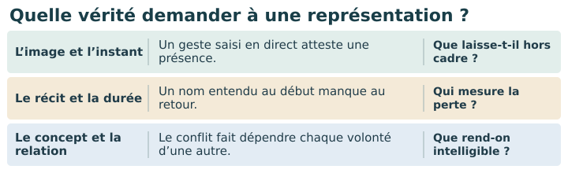

# Banque PT — Français B 2015 · Corrigé brut

*Corrigé rédigé par IA, non officiel. Signalez toute erreur.*

**Rédaction** · GPT-6.2 Astra Ultra · vitesse non renseignée

**Révision (tour 1)** · GPT-6.2 Astra Ultra · vitesse non renseignée

[Énoncé officiel](https://www.banquept.fr/documents/2015/fr_b_2015_pt.pdf) · [Rapport du jury](https://www.banquept.fr/documents/ecrit/rapport/2015/rapport_fra_b_ecrit_2015.pdf) · [Programme officiel](https://www.education.gouv.fr/bo/14/Hebdo24/MENS1401052A.htm) · [Grille de la session](https://www.banquept.fr/documents/livret/2015/Livret_PT_2015.pdf#page=12)

Épreuve de quatre heures sur « La guerre ». Eschyle, Les Perses (traduction de Danielle Sonnier) · Henri Barbusse, Le Feu · Carl von Clausewitz, De la guerre, livre I (traduction de Nicolas Waquet, pages 17 à 114).

## Sujet

Hélène Puiseux, « La guerre encadrée », L’Homme et la société, nos 107-108, 1993, p. 51-62. Extrait daté de septembre 1992.

Le texte à résumer occupe les pages 2 à 4 du sujet, de « La pratique même de la télévision » à « la mort brutale et présente ». La note sur Gadamer éclaire la notion de contingence.

Vous ferez de ce texte un résumé en 190 mots (+ ou – 10%). (8 points)

## Résumé

La guerre télévisée entre chez nous au milieu des repas et des conversations. Le présentateur semble nous parler et choisit ce que nous pouvons supporter. Chacun prélève à son gré des fragments de conflit. Les gros plans et le direct nous rendent proches des inconnus dont les gestes ordinaires survivent au danger.

Pour comprendre ces visions dispersées, il faut les inscrire dans une histoire. Une interprétation prête gouvernait les images du Golfe. En Yougoslavie, les rapprochements historiques éclairent les reportages, mais les ruines évoquent les catastrophes naturelles et les nuits rappellent la fiction. Des dates relatives entretiennent une répétition que peut interrompre une autre actualité.

Que voyons-nous donc ? Ce rite quotidien banalise et consacre la guerre. Il lui donne des visages tout en la rendant abstraite. Montrer davantage de morts ne suffit pas à expliquer. Nos attentes et les moyens de la télévision façonnent des images propres à chaque conflit. Le récit épique ordonne ce que le montage fragmentaire révèle de contingent. Tous deux laissent affleurer la confusion entre vivre et mourir. Pour nous, le même écran révèle et protège, jusqu’à brouiller la distinction entre représentation et expérience.

*190 mots.*

La tragédie d’Eschyle, l’essai de Clausewitz et le roman de Barbusse parviennent-ils à nous rendre compte de la réalité de la guerre d’une façon plus véridique que les images télévisuelles ?

## Dissertation

Au milieu d’une ville en guerre, une main balaie les débris tombés sur un rebord de fenêtre. Hélène Puiseux retient de la télévision ce geste que son insignifiance même aurait pu livrer à l’oubli. Une image aussi précise fait voir ce qui a eu lieu. Que pourraient donc nous apprendre de « plus véridique » un chœur de tragédie, un traité et un roman ? Le comparatif est exigeant. Une tragédie peut inventer une scène, une théorie simplifier son objet, un roman composer un dialogue. Pourtant le spectateur qui a vu la main ne sait encore ni ce qui a conduit à la destruction ni ce que signifie, pour cette personne, recommencer le lendemain le même geste. Une représentation devient véridique lorsqu’elle peut répondre de la part de réel à laquelle elle prétend nous donner accès. Il faut donc examiner ce que l’enregistrement atteste, ce que la construction des œuvres rend intelligible et ce qui, dans toute mise en forme, résiste au désir de conclure.

La force propre d’un plan télévisé tient d’abord au caractère singulier de ce qui entre dans son champ. Devant la caméra survient un geste que personne n’avait besoin d’inventer pour rendre la scène éloquente. Dans les images de Sarajevo analysées par Puiseux, une vieille dame adresse un signe à celui qui la filme. La catastrophe ne suspend ni les usages de politesse ni la conscience d’être regardé. Une explication sur l’effondrement de la vie civile aurait pu affirmer trop vite que tout lien ordinaire est détruit. L’image atteste ici une conduite qui lui oppose un démenti. On aurait tort d’attribuer par principe à l’écrit le souci de la singularité ou à la télévision la seule recherche du spectaculaire.

Eschyle donne d’ailleurs à un témoin oculaire une place décisive. À Suse, les vieillards imaginent d’abord ce qui se passe loin d’eux. Atossa interroge, un songe a déjà donné forme à son angoisse. Quand paraît le messager, chacun attend de lui quelque chose que l’intelligence ni le pressentiment ne peuvent fournir, la nouvelle de ceux qui sont morts et de celui qui a survécu. Sa présence fait autorité dans la fiction parce qu’il revient de là-bas. À travers lui, la tragédie reconnaît ce que la télévision revendiquera lorsqu’elle dépêchera un reporter sur place. Mais le messager d’Eschyle est un personnage. Aucun spectateur ne peut invoquer sa parole comme une archive sonore de Salamine. La vérité dramatique doit se mesurer à une autre exigence.

Cette exigence apparaît lorsque le chœur, après avoir nommé les hommes partis, demande au roi ce qu’ils sont devenus. Entre les deux listes s’est écoulée la durée d’une attente. Au dénouement, un nom déjà entendu fait mesurer un vide. Une nouvelle de journal peut établir un bilan de pertes en quelques secondes. La mesure collective du deuil demande que le dernier nom garde l’écho du premier. La composition possède ici une efficacité qui lui est propre. Eschyle donne également à la défaite perse la durée d’une représentation entière devant des Athéniens. Le public doit habiter la position de ceux que la victoire de sa cité a endeuillés. Ce changement de place peut faire connaître un événement familier sous un jour que l’habitude publique en a détourné.

Le roman de Barbusse construit une autre durée. Les soldats qu’on voit disparaître ont d’abord parlé de bien d’autres choses. Ils ont eu un métier, des attachements, une façon de prendre la parole et de plaisanter. Le chapitre des *Gros Mots* va jusqu’à mettre en scène la discussion de Barque avec celui qui écrira leur histoire. Comment reconnaître ces hommes dans des phrases soigneusement débarrassées de tout ce qui choque l’oreille du lecteur ? Le roman inclut l’objection et rend sensible la responsabilité de celui qui choisit les mots. Le journal télévisé dispose lui aussi du gros plan et de la voix personnelle. Le regard du présentateur dans la caméra crée même une intimité apparente avec chacun de ses destinataires. Le rythme du repas, le passage à la rubrique suivante et la faculté de détourner les yeux laissent en revanche au spectateur toute liberté de négliger la suite d’un destin. *Le Feu* organise le retour des mêmes voix pour que leur disparition engage la mémoire du lecteur.

Il est enfin une vérité dont l’objet même échappe en grande partie à la caméra. Deux événements successifs peuvent avoir des causes différentes. Les ruines d’un cyclone et les ruines d’une ville assiégée se ressemblent assez pour que des images des unes puissent être prises pour les autres. Le premier livre de *De la guerre* cherche la relation grâce à laquelle certaines violences deviennent intelligibles comme guerre. Deux volontés interviennent, chacune s’ajuste à l’existence de l’autre, chacune poursuit une fin politique dont la valeur peut varier. Un plan montre les effets d’une action. Pour expliquer ce que les acteurs prétendaient obtenir, il faut articuler les faits, les motifs et les limites du savoir disponible. Une émission de mise en perspective peut fort bien accomplir ce travail, comme le reconnaît Puiseux. L’essai en conduit l’exigence jusqu’à interroger le modèle dont il se sert.

Reste précisément à savoir ce que coûte cette organisation du sens. Le récit peut transformer une succession contingente en nécessité rétrospective. Le traité pourrait, lui aussi, laisser croire que des hommes réels se conduisent comme les éléments d’une démonstration. Clausewitz introduit dans le livre I la friction, l’incertitude des nouvelles et le danger éprouvé par les personnes. Ces éléments bornent la portée des déductions et rendent nécessaire le retour à l’expérience. Chez Eschyle, l’explication de Darios ne dispense aucun des survivants de se lamenter. Chez Barbusse, le projet commun de *L’Aube* naît au milieu d’hommes épuisés dont les souvenirs restent différents. Chacune de ces œuvres maintient une distance entre la possibilité d’expliquer et la prétention de tout expliquer.

C’est sur ce point que l’image fragmentaire retrouve sa valeur. Le montage des nouvelles peut brouiller la chronologie et rendre toutes les catastrophes semblables. Un plan qui demeure difficile à relier au reste peut aussi conserver quelque chose de la contingence de l’expérience. Puiseux oppose à ce titre le récit déjà disponible pour le Golfe au défilement d’images venues de l’ex-Yougoslavie. Ni la rareté ni l’abondance d’images n’assure une juste compréhension. Ce qui importe est de pouvoir demander à une image où et quand elle a été prise, à une explication sur quoi elle s’appuie et à un récit de qui il accepte d’entendre la voix.

La tragédie, l’essai et le roman peuvent donc rendre compte de la guerre plus véridiquement qu’une succession de nouvelles lorsque la question porte sur la durée du deuil, le rapport des volontés ou la fidélité envers les personnes. La télévision garde le pouvoir d’attester un détail qui dérange un récit déjà composé. La main qui nettoie la fenêtre n’explique aucune guerre. Une représentation qui aurait expliqué le conflit au point de rendre ce geste invisible aurait pourtant perdu, elle aussi, quelque chose de sa réalité.

