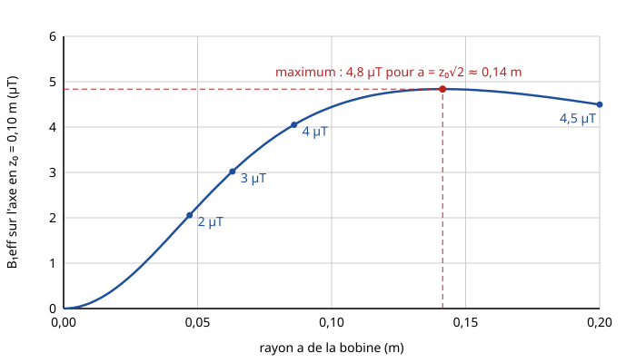
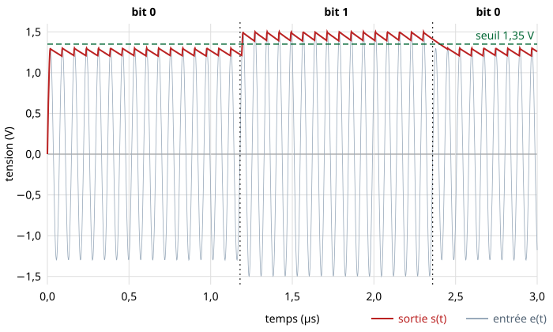

# Banque PT PT — Informatique et modélisation 2015 · Corrigé guidé

*Corrigé rédigé par IA, non officiel. Signalez toute erreur.*

**Rédaction** · modèle exact non renseigné (famille Claude) · effort non renseigné · vitesse non renseignée

**Révision (tour 2)** · modèle exact non renseigné (famille Claude) · effort non renseigné · vitesse non renseignée · 28 novembre 2026

## Présentation du sujet

Épreuve de quatre heures, sans calculatrice, sur l'identification par radiofréquence (RFID) appliquée aux titres de transport sans contact. Le sujet compte 40 questions en deux parties indépendantes.

- **Première partie, modélisation (1 h 30 conseillée).** La section I.A (questions I.A1 à I.A5) pose cinq questions qualitatives sur les ondes électromagnétiques et les bandes de fréquences. La section I.B (questions I.B1 à I.B13) modélise le couplage magnétique entre la bobine du lecteur et celle de la carte : champ sur l'axe lu sur une carte de courbes de niveau, flux, inductances propre et mutuelle, circuits couplés en notation complexe, résonance du transpondeur, puis transmission des données par modulation de la charge.
- **Seconde partie, informatique (2 h 30 conseillée).** Quatre sous-parties indépendantes : simulation numérique d'un détecteur d'enveloppe par la méthode d'Euler (questions Q1 à Q8), bit de parité et code de Hamming (7,4) (questions Q9 à Q15), lecture d'un fichier texte et règles d'autorisation de passage (questions Q16 à Q20), deux requêtes SQL (questions Q21 et Q22). Le candidat choisit Python ou Scilab et s'y tient ; ce corrigé est rédigé en Python.

Les questions I.A1 à I.B4, Q1 à Q3, Q9 à Q12, Q16, Q18 et Q19 sont proches du cours ou très guidées. Les plus sélectives sont les questions I.B9 à I.B13 (circuits couplés résonants), Q4, Q5, Q7 et Q8 (changement d'état de la diode et critique des simulations), Q14, Q15 et Q20. Le poids de chaque partie dans la note est proportionnel à la durée conseillée.

Les valeurs lues sur la figure 3 de la première partie et sur les figures 3 à 5 de la seconde sont signalées à leur place. Tout le code Python et SQL a été exécuté et testé ; aucune version Scilab n'est proposée, faute d'interpréteur pour la vérifier.

> [!JURY]
> Le rapport 2015 indique que la plupart des candidats ont abordé les deux parties, mais de façon inégale : la modélisation a été assez mal traitée et très partiellement, avec des réponses qualitatives vagues, un manque de rigueur dans la mise en œuvre des modèles et des applications numériques rarement faites. La partie informatique a été plus réussie, malgré des confusions sur le typage des données, sur les entrées et sorties des fonctions et sur la manipulation des listes. Presque tous les candidats ont choisi Python. Le rapport précise qu'une réponse illisible ou une justification confuse, voire contradictoire, ne rapporte aucun point, pas plus qu'une formule de cours récitée à la place de la réponse à la question posée.

Documents officiels : [sujet](https://www.banquept.fr/documents/2015/info_mod_2015_pt.pdf) et [rapport du jury](https://www.banquept.fr/documents/ecrit/rapport/2015/rapport_info_model_ecrit_2015.pdf).

## Première partie — Système RFID à 13,56 MHz en couplage magnétique

**I.A Les fréquences utilisées en RFID (questions I.A1 à I.A5).**

### Question I.A1 — L'expérience de Hertz

> [!INDICATION]
> Penser aux ondes prévues par Maxwell une vingtaine d'années plus tôt : qui les a produites et détectées le premier ?

#### Solution

Hertz a mis en évidence expérimentalement, en 1887 et 1888, les ondes électromagnétiques prévues par la théorie de Maxwell. Un circuit oscillant à étincelles (l'émetteur) rayonnait une onde, détectée à distance par une boucle ouverte (le résonateur) entre les bornes de laquelle jaillissait une étincelle. Il a montré que ces ondes se réfléchissent, se réfractent, se polarisent et interfèrent comme la lumière, et qu'elles se propagent à la même célérité.

**Hertz est resté célèbre pour la première production et détection d'ondes électromagnétiques (ondes « hertziennes »), qui a validé la théorie de Maxwell.**

> [!JURY]
> Le rapport 2015 rappelle que ces questions qualitatives de début de sujet permettaient de gagner des points assez facilement, à condition de répondre de façon concise, avec le vocabulaire approprié. Il ajoute que, quand on ne sait pas, mieux vaut ne pas répondre que d'écrire des inexactitudes.

### Question I.A2 — Bandes HF et UHF, micro-ondes

> [!INDICATION]
> Ce sont des sigles anglais. Les situer par leur plage de fréquences.

> [!INDICATION]
> Calculer la longueur d'onde $\lambda = c/f$ à 2,45 GHz et la comparer au domaine des micro-ondes.

#### Solution

HF signifie *High Frequency*, hautes fréquences : c'est la bande de 3 à 30 MHz, de longueurs d'onde dans le vide comprises entre 10 et 100 m. UHF signifie *Ultra High Frequency*, ultra hautes fréquences : de 300 MHz à 3 GHz, soit des longueurs d'onde de 10 cm à 1 m.

Pour $f = 2{,}45\ \mathrm{GHz}$,

$$\lambda = \frac{c}{f} = \frac{3{,}0\times 10^{8}}{2{,}45\times 10^{9}}\ \mathrm{m} \approx 12\ \mathrm{cm} .$$

**On appelle micro-ondes les ondes dont la longueur d'onde va du millimètre à quelques dizaines de centimètres (fréquences de l'ordre de 1 à 300 GHz) : 2,45 GHz, de longueur d'onde 12 cm, en fait partie. C'est d'ailleurs la fréquence des fours à micro-ondes.**

### Question I.A3 — Portée des ondes UHF

> [!INDICATION]
> L'énoncé donne la loi de variation de la puissance rayonnée avec la longueur d'onde : l'exploiter.

> [!INDICATION]
> Comparer la taille de l'antenne à la longueur d'onde dans chaque bande : en BF et HF, le TAG est-il atteint par une onde qui se propage ou par le champ proche de la bobine ?

#### Solution

L'énoncé précise que la puissance rayonnée par l'antenne d'émission croît avec la fréquence, comme $1/\lambda^4$, c'est-à-dire comme $f^4$. Une antenne de quelques centimètres ou dizaines de centimètres est très petite devant la longueur d'onde en BF ($\lambda = 2{,}4\ \mathrm{km}$ à 125 kHz) et en HF ($\lambda = 22\ \mathrm{m}$ à 13,56 MHz) : elle ne rayonne presque pas. Le TAG se trouve alors dans la zone de champ proche de l'antenne, où le champ magnétique, quasi stationnaire, décroît très vite avec la distance (en $1/r^3$ loin de la bobine) : la communication se fait par couplage magnétique, à quelques centimètres ou dizaines de centimètres.

En UHF ($\lambda \approx 33\ \mathrm{cm}$ à 900 MHz), l'antenne a une taille comparable à la longueur d'onde et rayonne efficacement. Le TAG reçoit une onde progressive dont l'amplitude ne décroît qu'en $1/r$.

**Les ondes UHF portent plus loin parce que l'antenne rayonne une puissance beaucoup plus grande (en $f^4$) sous forme d'une onde qui se propage, alors qu'en BF et HF la liaison repose sur le champ proche, qui s'effondre dès qu'on s'éloigne de l'antenne.**

> [!JURY]
> Le rapport 2015 regrette que les réponses aux questions qualitatives soient souvent de simples paraphrases vagues.

> [!PIEGE]
> Répondre sans utiliser la loi en $1/\lambda^4$ fournie par l'énoncé : c'est elle qui porte l'argument.

### Question I.A4 — Pénétration dans un conducteur

> [!INDICATION]
> Quel phénomène limite la pénétration d'une onde dans un conducteur ? Quelle longueur le caractérise ?

> [!INDICATION]
> Écrire l'épaisseur de peau $\delta = \sqrt{2/(\mu_0\gamma\omega)}$ et regarder sa dépendance en fréquence.

#### Solution

Dans un conducteur de conductivité $\gamma$, une onde de pulsation $\omega$ est amortie sur une distance caractéristique, l'épaisseur de peau :

$$\delta = \sqrt{\frac{2}{\mu_0\,\gamma\,\omega}} .$$

Elle varie comme $1/\sqrt{f}$ : plus la fréquence est basse, plus l'onde pénètre profondément. Physiquement, le champ variable crée dans le conducteur des courants induits qui s'opposent à lui (loi de Lenz) ; la force électromotrice d'induction, donc ces courants, sont proportionnels à la fréquence.

Ordres de grandeur dans le cuivre ($\gamma \approx 6\times 10^{7}\ \mathrm{S\cdot m^{-1}}$) : $\delta \approx 0{,}2\ \mathrm{mm}$ à 125 kHz, $18\ \mathrm{\mu m}$ à 13,56 MHz, $1{,}3\ \mathrm{\mu m}$ à 2,45 GHz.

**Le pouvoir de pénétration augmente quand la fréquence baisse parce que l'épaisseur de peau varie comme $1/\sqrt{f}$.**

### Question I.A5 — Une fréquence unique, 13,56 MHz

> [!INDICATION]
> Penser à la réglementation des fréquences radio et à la compatibilité entre matériels.

> [!INDICATION]
> La suite du sujet accorde les circuits par $LC\omega_0^2 = 1$ : que se passe-t-il hors de la fréquence d'accord ?

#### Solution

Trois raisons se complètent.

- Le spectre radioélectrique est réglementé. La bande centrée sur 13,56 MHz fait partie des bandes dites ISM (industrielles, scientifiques et médicales), utilisables sans licence dans le monde entier : c'est l'une des très rares fréquences de la bande HF librement accessibles à ces systèmes.
- Une fréquence commune, fixée par des normes, rend compatibles les lecteurs et les étiquettes de tous les fabricants.
- Le lecteur et le TAG sont des circuits accordés ($L C \omega_0^2 = 1$, étudiés en I.B) de facteur de qualité élevé : ils ne fonctionnent correctement qu'au voisinage de leur fréquence de résonance, qui doit donc être la même partout.

**Tous les systèmes RFID HF travaillent à 13,56 MHz parce que c'est une fréquence réservée et normalisée, sur laquelle tous les circuits résonants sont accordés.**

**I.B Modélisation d'un système RFID à 13,56 MHz : la carte à puce sans contact (questions I.B1 à I.B13).**

On note $\omega_0 = 2\pi f_0 \approx 8{,}5\times 10^{7}\ \mathrm{rad\cdot s^{-1}}$. Les grandeurs efficaces sont notées en majuscules, les amplitudes complexes sont soulignées.

### Question I.B1 — Approximation des régimes quasi stationnaires

> [!INDICATION]
> Comparer la durée de propagation à travers le système à la période du signal.

> [!INDICATION]
> Calculer la longueur d'onde à 13,56 MHz et la comparer aux dimensions indiquées par l'énoncé (10 cm).

#### Solution

L'ARQS consiste à négliger le temps de propagation des champs devant leur durée caractéristique de variation. Si $D$ est la taille du système et $T = 1/f$ la période, il faut

$$\frac{D}{c} \ll T \quad\Longleftrightarrow\quad D \ll \lambda = \frac{c}{f} .$$

Dans l'ARQS magnétique, le courant de déplacement est négligé : le champ magnétique se calcule à chaque instant comme en magnétostatique, avec le courant $i_1(t)$, et l'intensité est la même en tout point d'une branche.

Ici,

$$\lambda = \frac{3{,}0\times 10^{8}}{13{,}56\times 10^{6}}\ \mathrm{m} \approx 22\ \mathrm{m} ,$$

et les dimensions caractéristiques sont de l'ordre de $D \approx 10\ \mathrm{cm}$, soit $D/\lambda \approx 5\times 10^{-3}$.

**L'ARQS s'applique : $D \approx 0{,}1\ \mathrm{m} \ll \lambda \approx 22\ \mathrm{m}$.**

Remarque : le critère porte ici sur les distances $a$ et $OM$, comme l'indique l'énoncé. La longueur du fil de la bobine ($2\pi a N_1 \approx 60\ \mathrm{m}$) n'est pas petite devant $\lambda$ ; l'uniformité du courant le long du bobinage est une hypothèse du modèle.

> [!JURY]
> Le rapport 2015 constate que les applications numériques sont rarement faites, alors qu'un ordre de grandeur correct suffisait à obtenir les points, la calculatrice étant interdite.

### Question I.B2 — Champ sur l'axe et lecture des courbes de niveau

> [!INDICATION]
> Pour la direction : chercher les plans de symétrie ou d'antisymétrie des courants qui contiennent $M$.

> [!INDICATION]
> Pour la courbe : suivre la droite $z = z_0$ sur la figure 3 et noter à quelles abscisses $a$ elle rencontre chaque courbe de niveau. La courbe $5\ \mathrm{\mu T}$ est-elle traversée ?

#### Solution

**Direction.** Tout plan contenant l'axe $(Oz)$ est un plan d'antisymétrie de la distribution de courants. En un point d'un plan d'antisymétrie, le champ magnétique est contenu dans ce plan. Le point $M$ appartient à tous ces plans, donc

$$\boxed{\vec B_1(M,t) = B_1(z,t)\,\vec u_z}$$

**Lecture de la figure 3.** On suit la droite horizontale $z = z_0 = 0{,}10\ \mathrm{m}$ et on relève les abscisses où elle coupe les courbes de niveau :

| $a$ (m) | 0 | $\approx 0{,}035$ | $\approx 0{,}05$ | $\approx 0{,}075$ | $\approx 0{,}14$ | $0{,}20$ |
|---|---|---|---|---|---|---|
| $B_{1\mathrm{eff}}$ ($\mathrm{\mu T}$) | 0 | 2 | 3 | 4 | $\approx 5$ (maximum) | entre 4 et 5 |

Toutes ces valeurs sont lues sur la carte, à quelques millimètres près : la courbe $2\ \mathrm{\mu T}$ est coupée aux deux tiers de l'intervalle $[0 ; 0{,}05]$, la courbe $3\ \mathrm{\mu T}$ presque sur la graduation $0{,}05$, la courbe $4\ \mathrm{\mu T}$ au milieu de l'intervalle $[0{,}05 ; 0{,}10]$. La droite $z = z_0$ ne franchit pas la courbe $5\ \mathrm{\mu T}$ : elle vient l'effleurer vers $a \approx 0{,}14\ \mathrm{m}$, puis reste entre les courbes 4 et 5 $\mathrm{\mu T}$ jusqu'au bord du graphe. Le champ part donc de zéro pour $a = 0$ (une spire de rayon nul ne crée aucun champ), croît, passe par un maximum d'environ $5\ \mathrm{\mu T}$, puis décroît lentement (il tend vers zéro quand $a \to \infty$).



**Application numérique.** La carte est tracée pour la bobine complète ($N_1 = 100$ spires, $I_1 = 20\ \mathrm{mA}$) : la valeur se lit directement, sans la multiplier ni la diviser par $N_1$.

$$\boxed{B_{1\mathrm{eff,max}} \approx 5\ \mathrm{\mu T} \quad\text{pour}\quad a \approx 0{,}14\ \mathrm{m}}$$

Contrôle (non demandé) par la formule du champ sur l'axe d'une bobine plate circulaire :

$$B_{1\mathrm{eff}}(a,z) = \frac{\mu_0 N_1 I_1}{2}\,\frac{a^2}{(a^2+z^2)^{3/2}} .$$

Elle est maximale pour $a = z_0\sqrt 2 \approx 0{,}14\ \mathrm{m}$ et vaut alors

$$B_{1\mathrm{eff,max}} = \frac{\mu_0 N_1 I_1}{3\sqrt 3\, z_0} = \frac{4\pi\times 10^{-7}\times 100\times 0{,}020}{3\sqrt 3\times 0{,}10}\ \mathrm{T} \approx 4{,}8\ \mathrm{\mu T} ,$$

en accord avec le maximum lu sur la carte.

L'accord est moins bon sur la partie montante. La formule place les passages par 2, 3 et $4\ \mathrm{\mu T}$ en $a \approx 0{,}046$, $0{,}063$ et $0{,}085\ \mathrm{m}$, alors que la carte les donne en $a \approx 0{,}035$, $0{,}05$ et $0{,}075\ \mathrm{m}$, soit environ un centimètre plus à gauche. Les abscisses du tableau sont celles de la carte, seules demandées (« sans calcul supplémentaire »). Sur la figure 1, la courbe est celle de la formule et les trois cercles sont les points relevés sur la carte : l'écart entre les deux y est visible.

> [!METHODE]
> Lire une coupe dans une carte de courbes de niveau : on se déplace sur la droite imposée, chaque courbe traversée donne un point (abscisse, valeur). Une courbe seulement effleurée signale un extremum, dont la valeur est celle de cette courbe.

> [!JURY]
> Le rapport 2015 signale que la carte du champ produit par la bobine était fournie et que, la bobine comptant cent spires, beaucoup de candidats ont multiplié ou divisé par cent la valeur lue pour le champ maximal.

### Question I.B3 — Flux propre de la bobine

> [!INDICATION]
> Le flux propre est le flux du champ créé par la bobine à travers elle-même. Combien de spires ce flux traverse-t-il ?

> [!INDICATION]
> Le champ dans le plan de la bobine ne dépend que de la distance $r$ à l'axe : découper le disque en couronnes de surface $2\pi r\,\mathrm{d}r$.

#### Solution

Le flux propre $\Phi_1$ est le flux, à travers les $N_1$ spires de $b_1$, du champ $\vec B_1$ créé par $b_1$ elle-même. Les spires sont confondues : chacune s'appuie sur le disque de rayon $a$ du plan $z = 0$, orienté par $\vec u_z$ (sens lié à celui de $i_1$ par la règle du tire-bouchon). Dans ce plan, par symétrie de révolution et parce que le plan de la bobine est un plan de symétrie des courants, le champ est porté par $\vec u_z$ et ne dépend que de la distance $r$ à l'axe. En découpant le disque en couronnes de surface $2\pi r\,\mathrm{d}r$ :

$$\boxed{\Phi_1 = N_1 \int_0^{a} B_{1z}(r, z=0, t)\; 2\pi r\,\mathrm{d}r}$$

où $B_{1z}$ est le champ créé par l'ensemble des $N_1$ spires. L'intégrale double sur le disque se ramène ainsi à une intégrale simple.

> [!JURY]
> Le rapport 2015 relève que le flux est souvent confondu avec une circulation, et le flux d'une spire avec celui de la bobine. Il rappelle qu'une intégrale double se ramène à une intégrale simple après intégration par rapport à une première variable.

### Question I.B4 — Inductance propre

> [!INDICATION]
> Le flux propre est proportionnel au courant : l'inductance propre est le coefficient de proportionnalité.

#### Solution

Dans l'ARQS, le champ $\vec B_1$ est proportionnel au courant $i_1$ qui le crée, donc le flux propre aussi. L'inductance propre est le coefficient de proportionnalité :

$$\boxed{\Phi_1 = L_1\, i_1 \quad\Longleftrightarrow\quad L_1 = \frac{\Phi_1}{i_1}}$$

Elle est positive (le flux propre est orienté par le courant), ne dépend que de la géométrie de la bobine et du milieu, et s'exprime en henrys.

### Question I.B5 — Inductance mutuelle et rayon optimal

> [!INDICATION]
> $M$ est définie par le flux, à travers $b_2$, du champ créé par $b_1$. La petite taille de $b_2$ permet de considérer ce champ comme uniforme.

> [!INDICATION]
> $M$ est proportionnelle à $B_{1\mathrm{eff}}(a, d)$ : le rayon optimal est celui du maximum de la courbe tracée en I.B2.

#### Solution

L'inductance mutuelle est définie par le flux de $\vec B_1$ à travers $b_2$ : $\Phi_{1\to 2} = M\, i_1$.

Comme $b \ll a$ et $b \ll d$, le champ $\vec B_1$ est quasi uniforme sur la petite bobine $b_2$ et égal à sa valeur sur l'axe en $z = d$. Avec l'expression du champ sur l'axe,

$$\Phi_{1\to 2} = N_2\, S_2\, B_1(a, d, t) = N_2 S_2\,\frac{\mu_0 N_1 a^2}{2\,(a^2+d^2)^{3/2}}\; i_1 ,$$

d'où

$$\boxed{M \approx \frac{N_2\, S_2\, B_{1\mathrm{eff}}(a,d)}{I_1} = \frac{\mu_0 N_1 N_2 S_2\, a^2}{2\,(a^2+d^2)^{3/2}}}$$

À $N_1$, $N_2$, $d$ fixés, $M$ est proportionnelle à $B_{1\mathrm{eff}}(a, d)$ : elle est maximale pour le rayon qui rend maximal le champ sur l'axe à la distance $d$. D'après la question I.B2 (avec $z_0 = d = 10\ \mathrm{cm}$), ce maximum est atteint pour $a \approx 0{,}14\ \mathrm{m}$. Le calcul le confirme :

$$\frac{\mathrm{d}}{\mathrm{d}a}\left[\frac{a^2}{(a^2+d^2)^{3/2}}\right] = \frac{a\,(2d^2 - a^2)}{(a^2+d^2)^{5/2}} = 0 \quad\Longleftrightarrow\quad a = d\sqrt 2 .$$

$$\boxed{a_{\mathrm{opt}} = d\sqrt 2 \approx 14\ \mathrm{cm}}$$

Remarque. Avec les données ($N_2 = 4$, $S_2 = 30\ \mathrm{cm^2}$) et $B_{1\mathrm{eff}} \approx 5\ \mathrm{\mu T}$, ce modèle donne $M \approx N_2 S_2 B_{1\mathrm{eff}}/I_1 \approx 3\ \mathrm{\mu H}$ pour le rayon optimal, alors que l'énoncé impose $M = 0{,}1\ \mathrm{\mu H}$ pour les applications numériques, soit trente fois moins. L'énoncé ne chiffre pas le rayon $a$ : la valeur imposée n'est donc pas contredite par une autre donnée, mais elle ne correspond pas au rayon optimal (le modèle ne redonne $0{,}1\ \mathrm{\mu H}$ que pour $a \approx 1\ \mathrm{cm}$, ce qui contredit $b \ll a$ puisque $b = \sqrt{S_2/\pi} \approx 3\ \mathrm{cm}$, ou pour un rayon de plusieurs mètres). Elle est en revanche cohérente avec le coefficient de couplage donné, $k\sqrt{L_1L_2} = 0{,}0063\times\sqrt{40\times 6{,}3}\ \mathrm{\mu H} \approx 0{,}1\ \mathrm{\mu H}$, et c'est elle qui conduit au seuil de 4,6 V des questions I.B9 et I.B10 : on l'utilise dans toute la suite.

> [!JURY]
> Le rapport 2015 indique que la notion d'inductance mutuelle a posé beaucoup de problèmes, qu'un grand nombre de candidats ne sont pas allés au-delà des questions qui la font intervenir, et que les copies contiennent toutes sortes de relations fausses et inhomogènes.

> [!PIEGE]
> Vérifier l'homogénéité : $\mu_0$ est en $\mathrm{H\cdot m^{-1}}$, donc $M$ doit être $\mu_0$ fois une longueur. Ici $S_2\,a^2/(a^2+d^2)^{3/2}$ est bien une longueur.

### Question I.B6 — Tensions aux bornes des deux bobines

> [!INDICATION]
> Chaque bobine réelle est une résistance en série avec une inductance qui embrasse deux flux : le sien et celui de l'autre bobine.

> [!INDICATION]
> Regarder les flèches de la figure 4 : $b_1$ est en convention récepteur ; dans le circuit du TAG, écrire la loi des mailles avec $u_2$ fléchée aux bornes de $R_L$.

#### Solution

Bobine $b_1$ : la tension $u_1$ et le courant $i_1$ sont fléchés en convention récepteur. La bobine réelle est l'association série de $R_1$ et de l'inductance, qui embrasse le flux total $L_1 i_1 + M i_2$ :

$$\boxed{u_1 = R_1\, i_1 + L_1\,\frac{\mathrm{d}i_1}{\mathrm{d}t} + M\,\frac{\mathrm{d}i_2}{\mathrm{d}t}}$$

Bobine $b_2$ : sur la figure 4, le courant $i_2$ traverse la résistance $R_L$ du bas vers le haut alors que la flèche de $u_2$ pointe vers le bas. La résistance $R_L$ est donc en convention récepteur ($u_2 = R_L i_2$) et la bobine $b_2$ en convention générateur. La loi des mailles dans le circuit du transpondeur s'écrit

$$R_2\, i_2 + L_2\,\frac{\mathrm{d}i_2}{\mathrm{d}t} + M\,\frac{\mathrm{d}i_1}{\mathrm{d}t} + u_2 = 0 ,$$

soit

$$\boxed{u_2 = -R_2\, i_2 - L_2\,\frac{\mathrm{d}i_2}{\mathrm{d}t} - M\,\frac{\mathrm{d}i_1}{\mathrm{d}t}}$$

> [!PIEGE]
> Le signe de $u_2$ dépend de l'orientation relative de $i_2$ et de $u_2$. On le contrôle avec le résultat fourni à la question I.B8 : le signe moins de $\underline{Z_{21}}$ n'apparaît que si $u_2 = R_L i_2$, donc si la bobine $b_2$ est en convention générateur.

### Question I.B7 — Équations en notation complexe

> [!INDICATION]
> Remplacer chaque dérivée temporelle par une multiplication par $j\omega$, et ne pas oublier la relation imposée par $R_L$.

#### Solution

En régime sinusoïdal forcé, la dérivation devient une multiplication par $j\omega$. Les deux équations précédentes et la loi d'Ohm pour $R_L$ donnent :

$$\boxed{\begin{aligned}
\underline{U_1} &= (R_1 + jL_1\omega)\,\underline{I_1} + jM\omega\,\underline{I_2} \\
\underline{U_2} &= -(R_2 + jL_2\omega)\,\underline{I_2} - jM\omega\,\underline{I_1} \\
\underline{U_2} &= R_L\,\underline{I_2}
\end{aligned}}$$

### Question I.B8 — Impédances $\underline{Z_{11}}$ et $\underline{Z_{21}}$

> [!INDICATION]
> Éliminer $\underline{U_2}$ entre les deux équations du TAG pour exprimer $\underline{I_2}$ en fonction de $\underline{I_1}$.

> [!INDICATION]
> Pour l'application numérique, comparer $L_2\omega_0$ et $R_2$ à $R_L$ avant de calculer le module.

#### Solution

En éliminant $\underline{U_2}$ entre les deux dernières équations :

$$(R_L + R_2 + jL_2\omega)\,\underline{I_2} = -jM\omega\,\underline{I_1}
\quad\Longrightarrow\quad
\underline{I_2} = \frac{-jM\omega}{R_L + R_2 + jL_2\omega}\,\underline{I_1} .$$

Alors $\underline{U_2} = R_L\,\underline{I_2}$ donne

$$\boxed{\underline{Z_{21}} = \frac{\underline{U_2}}{\underline{I_1}} = \frac{-jMR_L\omega}{R_L + R_2 + jL_2\omega}}$$

En reportant $\underline{I_2}$ dans la première équation, avec $jM\omega \times (-jM\omega) = (M\omega)^2$ :

$$\boxed{\underline{Z_{11}} = \frac{\underline{U_1}}{\underline{I_1}} = R_1 + jL_1\omega + \frac{(M\omega)^2}{R_L + R_2 + jL_2\omega}
\quad\text{avec}\quad a = R_1,\quad b = L_1\omega}$$

Le dernier terme est l'impédance ramenée au primaire par le couplage : c'est par lui que le lecteur « voit » la charge du TAG.

**Application numérique.** À $f_0$ :

$$L_2\omega_0 = 6{,}3\times 10^{-6}\times 8{,}5\times 10^{7}\ \Omega \approx 5{,}4\times 10^{2}\ \Omega \ll R_L = 30\ \mathrm{k\Omega} , \qquad R_2 \ll R_L .$$

Le dénominateur se réduit à $R_L$ et $|\underline{Z_{21}}| \approx M\omega_0$ :

$$U_{2\mathrm{eff}} \approx M\omega_0\, I_1 = 0{,}1\times 10^{-6}\times 8{,}5\times 10^{7}\times 20\times 10^{-3}\ \mathrm{V} ,$$

$$\boxed{U_{2\mathrm{eff}} \approx 0{,}17\ \mathrm{V} \approx 0{,}2\ \mathrm{V}}$$

C'est la force électromotrice induite dans $b_2$ (le TAG est presque à vide). Elle est très inférieure aux quelques volts nécessaires à l'alimentation d'une puce.

> [!METHODE]
> Sans calculatrice, on calcule une fois pour toutes $\omega_0 = 2\pi\times 13{,}56\times 10^{6} \approx 8{,}5\times 10^{7}\ \mathrm{rad\cdot s^{-1}}$, puis $M\omega_0 \approx 8{,}5\ \Omega$ et $L_2\omega_0 \approx 540\ \Omega$ : ces trois nombres servent jusqu'à la fin de la partie.

### Question I.B9 — Effet du condensateur d'accord $C_2$

> [!INDICATION]
> Remplacer $R_L$ par l'impédance de $R_L$ en parallèle avec $C_2$ dans la maille du TAG, puis développer le dénominateur en utilisant $L_2C_2\omega_0^2 = 1$.

> [!INDICATION]
> Mettre la partie imaginaire du dénominateur en facteur pour faire apparaître $1 + jQ_T(\omega/\omega_0 - \omega_0/\omega)$. Les inverses des facteurs de qualité s'ajoutent.

#### Solution

La charge du TAG devient $R_L$ en parallèle avec $C_2$ :

$$\underline{Z_L} = \frac{R_L}{1 + jR_LC_2\omega} .$$

La maille du TAG donne $(\underline{Z_L} + R_2 + jL_2\omega)\,\underline{I_2} = -jM\omega\,\underline{I_1}$ et $\underline{U_2} = \underline{Z_L}\,\underline{I_2}$, donc

$$\underline{Z'_{21}} = \frac{-jM\omega\,\underline{Z_L}}{\underline{Z_L} + R_2 + jL_2\omega}
= \frac{-jM\omega R_L}{R_L + (R_2 + jL_2\omega)(1 + jR_LC_2\omega)} .$$

On développe le dénominateur, avec $L_2C_2 = 1/\omega_0^2$ :

$$R_L + R_2 - R_L\frac{\omega^2}{\omega_0^2} + j\omega\,(L_2 + R_2R_LC_2)
\;\approx\; R_L\left(1 - \frac{\omega^2}{\omega_0^2}\right) + j\omega\,(L_2 + R_2R_LC_2) ,$$

en négligeant $R_2$ devant $R_L$. On met $j\omega\,(L_2 + R_2R_LC_2)$ en facteur :

$$\underline{Z'_{21}} \approx \frac{-\dfrac{MR_L}{L_2 + R_2R_LC_2}}{1 + j\,\dfrac{R_L}{\omega_0\,(L_2 + R_2R_LC_2)}\left(\dfrac{\omega}{\omega_0} - \dfrac{\omega_0}{\omega}\right)} ,$$

car $\dfrac{R_L(1-\omega^2/\omega_0^2)}{j\omega} = j\,\dfrac{R_L}{\omega_0}\left(\dfrac{\omega}{\omega_0} - \dfrac{\omega_0}{\omega}\right)$. On identifie :

$$\frac{1}{Q_T} = \frac{L_2\omega_0}{R_L} + R_2C_2\omega_0 = \frac{1}{Q_L} + \frac{1}{Q_2} .$$

Pour $R_{21}$, on utilise $R_2R_LC_2/L_2 = (R_2C_2\omega_0)\,(R_L/L_2\omega_0) = Q_L/Q_2$ :

$$R_{21} = \frac{M}{L_2}\,\frac{R_L}{1 + Q_L/Q_2} = \frac{M}{L_2}\,R_L\,\frac{Q_T}{Q_L} .$$

$$\boxed{Q_T = \frac{Q_L\,Q_2}{Q_L + Q_2} \qquad\text{et}\qquad R_{21} = \frac{M R_L}{L_2}\,\frac{Q_2}{Q_L+Q_2} = M\omega_0\,Q_T}$$

**Intérêt de $C_2$.** Le circuit du TAG est un circuit résonant accordé sur la fréquence du lecteur. À $\omega = \omega_0$, $|\underline{Z'_{21}}| = R_{21} = Q_T\,M\omega_0$ : la tension disponible aux bornes de la puce est multipliée par $Q_T$ par rapport à la force électromotrice induite $M\omega_0 I_1$ (surtension à la résonance). Le TAG devient de plus sélectif : il ne répond qu'aux signaux de fréquence voisine de $f_0$, dans une bande de largeur $f_0/Q_T$.

**Application numérique.**

$$Q_T = \frac{53{,}3\times 55{,}9}{53{,}3 + 55{,}9} \approx 27 , \qquad R_{21} = M\omega_0 Q_T \approx 8{,}5\times 27\ \Omega \approx 2{,}3\times 10^{2}\ \Omega .$$

$$\boxed{U_{2\mathrm{eff}} = R_{21}\, I_1 \approx 230\times 0{,}020\ \mathrm{V} \approx 4{,}6\ \mathrm{V} \approx 5\ \mathrm{V}}$$

Le courant $i_2$ dans la bobine $b_2$ vérifie $\underline{I_2} = \underline{U_2}/\underline{Z_L} = \underline{U_2}\,(1 + jQ_L)/R_L$ à $\omega_0$ (car $R_LC_2\omega_0 = Q_L$). Comme $Q_L \gg 1$, l'essentiel du courant passe par le condensateur :

$$\boxed{I_{2\mathrm{eff}} \approx \frac{Q_L\,U_{2\mathrm{eff}}}{R_L} = \frac{U_{2\mathrm{eff}}}{L_2\omega_0} \approx \frac{4{,}6}{540}\ \mathrm{A} \approx 9\ \mathrm{mA} \approx 10\ \mathrm{mA}}$$

La tension passe de 0,17 V sans condensateur à 4,6 V avec lui, soit juste le seuil d'alimentation de la puce indiqué par l'énoncé.

> [!PIEGE]
> Le courant $i_2$ est celui de la bobine, pas celui de $R_L$ : à la résonance, il vaut environ $Q_L$ fois le courant dans $R_L$, car il circule surtout dans le condensateur.

### Question I.B10 — Champ minimal au niveau du TAG

> [!INDICATION]
> Champ uniforme sur la petite bobine : écrire le flux à travers ses $N_2$ spires, puis la valeur efficace de sa dérivée.

> [!INDICATION]
> Relier la tension aux bornes de la puce à la force électromotrice induite : que vaut leur rapport à la résonance (question I.B9) ? À quel moment du sujet le seuil de 4,6 V est-il introduit ?

#### Solution

Le champ $\vec B_1$ est quasi uniforme sur $b_2$ ($b \ll a$, $b \ll d$) et dirigé selon l'axe. Le flux à travers $b_2$ est $\Phi = N_2 S_2 B_1(t)$ et la loi de Faraday donne une force électromotrice $e = -\mathrm{d}\Phi/\mathrm{d}t$, de valeur efficace

$$E_{\mathrm{eff}} = N_2\, S_2\, \omega_0\, B_{\mathrm{eff}} .$$

L'énoncé est ambigu sur le lien entre cette force électromotrice et la tension $U_{2\mathrm{eff}}$ soumise au seuil de 4,6 V, et le rapport du jury ne commente pas cette question. Deux lectures sont possibles ; on retient celle du circuit accordé, seule cohérente avec les données, et on donne l'autre pour comparaison.

**Avec le circuit accordé (lecture retenue).** Le seuil de 4,6 V est introduit après l'insertion de $C_2$, et c'est exactement la tension obtenue à la question I.B9. À la résonance, la tension aux bornes de la puce vaut $Q_T$ fois la force électromotrice induite ($U_{2\mathrm{eff}} = R_{21} I_1 = Q_T\,M\omega_0 I_1$, où $M\omega_0 I_1$ est la force électromotrice) : $U_{2\mathrm{eff}} \approx Q_T\,E_{\mathrm{eff}}$. Les approximations sont celles déjà faites : champ uniforme sur $b_2$, $R_2 \ll R_L$, pulsation égale à $\omega_0$. La condition $U_{2\mathrm{eff}} > 4{,}6\ \mathrm{V}$ impose

$$B_{\min} \approx \frac{U_{2\mathrm{eff,min}}}{Q_T\,N_2 S_2\,\omega_0} = \frac{4{,}6}{27\times 4\times 30\times 10^{-4}\times 8{,}5\times 10^{7}}\ \mathrm{T} \approx \frac{4{,}6}{2{,}8\times 10^{7}}\ \mathrm{T} ,$$

$$\boxed{B_{\min} \approx 0{,}17\ \mathrm{\mu T} \approx 0{,}2\ \mathrm{\mu T}}$$

Contrôle : avec $M = 0{,}1\ \mathrm{\mu H}$ et $I_1 = 20\ \mathrm{mA}$, le champ au niveau de $b_2$ vaut $M I_1/(N_2 S_2) = 10^{-7}\times 0{,}020/(1{,}2\times 10^{-2})\ \mathrm{T} \approx 0{,}17\ \mathrm{\mu T}$, et la question I.B9 donne alors juste 4,6 V : les deux résultats se recoupent.

**Sans accord (pour comparaison).** Si l'on assimile la tension aux bornes de la puce à la force électromotrice, $U_{2\mathrm{eff}} \approx E_{\mathrm{eff}}$, il faut

$$B_{\min} \approx \frac{U_{2\mathrm{eff,min}}}{N_2 S_2 \omega_0} = \frac{4{,}6}{4\times 30\times 10^{-4}\times 8{,}5\times 10^{7}}\ \mathrm{T} = \frac{4{,}6}{1{,}0\times 10^{6}}\ \mathrm{T} \approx 4{,}5\ \mathrm{\mu T} \approx 5\ \mathrm{\mu T} ,$$

soit $Q_T \approx 27$ fois plus. Cette valeur est de l'ordre du champ maximal lu à la question I.B2, mais elle ne tient pas compte du condensateur $C_2$, pourtant branché à ce stade du sujet, et elle ne s'accorde pas avec $M = 0{,}1\ \mathrm{\mu H}$ (question I.B5).

L'ordre de grandeur retenu est donc quelques dixièmes de microtesla ; l'accord du TAG divise par $Q_T$ le champ nécessaire.

### Question I.B11 — Bilan de puissance

> [!INDICATION]
> Reconnaître dans $\underline{Z_L}$ l'association de $R_L$ et de $C_2$ en parallèle.

> [!INDICATION]
> Multiplier l'équation de chaque maille par son courant et additionner : les termes en $L_1$, $L_2$, $M$ et $C_2$ se regroupent en la dérivée d'une énergie.

#### Solution

L'impédance $\underline{Z_L} = \dfrac{R_L}{1 + jQ_L\,\omega/\omega_0}$ est celle de $R_L$ en parallèle avec $C_2$, puisque $Q_L/\omega_0 = R_LC_2$. On note toujours $u_2$ la tension à ses bornes et $i_2$ le courant dans $b_2$.

On multiplie l'équation de $b_1$ par $i_1$ et la loi des mailles du TAG par $i_2$ :

$$\begin{aligned}
u_1 i_1 &= R_1 i_1^2 + L_1 i_1\frac{\mathrm{d}i_1}{\mathrm{d}t} + M i_1\frac{\mathrm{d}i_2}{\mathrm{d}t} \\
0 &= R_2 i_2^2 + L_2 i_2\frac{\mathrm{d}i_2}{\mathrm{d}t} + M i_2\frac{\mathrm{d}i_1}{\mathrm{d}t} + u_2 i_2
\end{aligned}$$

La puissance reçue par la charge est $u_2 i_2 = \dfrac{u_2^2}{R_L} + C_2 u_2\dfrac{\mathrm{d}u_2}{\mathrm{d}t}$ (courant dans $R_L$ plus courant dans $C_2$). En sommant :

$$\boxed{u_1 i_1 = R_1 i_1^2 + R_2 i_2^2 + \frac{u_2^2}{R_L} + \frac{\mathrm{d}}{\mathrm{d}t}\left(\frac12 L_1 i_1^2 + \frac12 L_2 i_2^2 + M i_1 i_2 + \frac12 C_2 u_2^2\right)}$$

La puissance fournie par le lecteur à la bobine $b_1$ se répartit entre l'effet Joule dans les deux bobines, la puissance utile absorbée par la puce ($R_L$), et la variation de l'énergie emmagasinée : énergie magnétique des deux bobines couplées et énergie électrique du condensateur.

En régime sinusoïdal, l'énergie emmagasinée est périodique et sa dérivée est nulle en moyenne :

$$\boxed{\langle u_1 i_1\rangle = R_1 I_1^2 + R_2 I_{2\mathrm{eff}}^2 + \frac{U_{2\mathrm{eff}}^2}{R_L}}$$

L'énergie est transmise sans contact du lecteur au TAG par l'intermédiaire du terme de couplage $M$. Ordres de grandeur à $\omega_0$ avec les valeurs de la question I.B9 : $U_{2\mathrm{eff}}^2/R_L \approx 4{,}6^2/(3\times 10^{4})\ \mathrm{W} \approx 0{,}7\ \mathrm{mW}$ reçus par la puce et $R_2 I_{2\mathrm{eff}}^2 \approx 10\times(9\times 10^{-3})^2\ \mathrm{W} \approx 0{,}8\ \mathrm{mW}$ dissipés dans $b_2$.

### Question I.B12 — Impédance ramenée à la résonance

> [!INDICATION]
> Identifier $u_0$ sur la figure 5 : c'est la tension aux bornes de $C_1$ en série avec la bobine $b_1$. Utiliser $\underline{Z_{11}}$ en y remplaçant $R_L$ par $R_L$ en parallèle avec $C_2$.

> [!INDICATION]
> Pour $R_L \to \infty$, il reste $C_2$ seul, dont l'impédance à $\omega_0$ compense celle de $L_2$.

#### Solution

Sur la figure 5, $u_0$ est la tension aux bornes de l'ensemble série formé par $C_1$ et la bobine $b_1$. Avec $\underline{U_1} = \underline{Z_{11}}\,\underline{I_1}$, où $R_L$ est remplacée par $\underline{Z_L} = R_L/(1 + jR_LC_2\omega)$ :

$$\underline{U_0} = \left[\frac{1}{jC_1\omega} + jL_1\omega + R_1 + \frac{(M\omega)^2}{\underline{Z_L} + R_2 + jL_2\omega}\right]\underline{I_1} .$$

À $\omega = \omega_0$, la condition $L_1C_1\omega_0^2 = 1$ donne $\dfrac{1}{jC_1\omega_0} + jL_1\omega_0 = 0$, d'où

$$\boxed{\underline{U_0} = \big(R_1 + \underline{Z}(\omega_0)\big)\,\underline{I_1}
\quad\text{avec}\quad
\underline{Z}(\omega_0) = \frac{(M\omega_0)^2}{\dfrac{R_L}{1 + j\omega_0R_LC_2} + R_2 + jL_2\omega_0}}$$

**Application numérique.** $(M\omega_0)^2 \approx 8{,}5^2 \approx 73\ \Omega^2$ et $L_2\omega_0 \approx 540\ \Omega$.

- $R_L = 0$ : la charge et le condensateur sont court-circuités.

$$\underline{Z} = \frac{(M\omega_0)^2}{R_2 + jL_2\omega_0} \approx \frac{73}{j\,540}\ \Omega
\quad\Longrightarrow\quad
\boxed{|\underline{Z}| \approx 0{,}14\ \Omega , \qquad \arg \underline{Z} \approx -\frac{\pi}{2}}$$

(plus précisément $-\arctan(L_2\omega_0/R_2) \approx -89^\circ$).

- $R_L \to \infty$ : il reste $C_2$ seul, d'impédance $\dfrac{1}{jC_2\omega_0} = -jL_2\omega_0$, qui compense exactement $jL_2\omega_0$.

$$\underline{Z} = \frac{(M\omega_0)^2}{R_2} \approx \frac{73}{10}\ \Omega
\quad\Longrightarrow\quad
\boxed{|\underline{Z}| \approx 7\ \Omega , \qquad \arg \underline{Z} = 0}$$

L'impédance ramenée est environ cinquante fois plus grande ($Q_2 \approx 53$) quand la charge est déconnectée.

**Réalisation.** On utilise des interrupteurs électroniques commandés par la puce (transistors fonctionnant en commutation). Un interrupteur placé en parallèle sur $R_L$ réalise $R_L = 0$ quand il est fermé. Un interrupteur placé en série avec $R_L$ réalise $R_L = \infty$ quand il est ouvert, le condensateur $C_2$ restant branché sur la bobine.

### Question I.B13 — Rétro-modulation

> [!INDICATION]
> Écrire la maille du lecteur à $\omega_0$ : $\underline{U_0}$ est donnée par un pont diviseur entre $R_G$ et $R_1 + \underline{Z}(\omega_0)$.

> [!INDICATION]
> Comparer les deux valeurs de $\underline{Z}(\omega_0)$ trouvées à la question précédente.

#### Solution

À $\omega_0$, la maille du lecteur s'écrit $\underline{E_G} = R_G\,\underline{I_1} + \underline{U_0}$, donc

$$\underline{I_1} = \frac{\underline{E_G}}{R_G + R_1 + \underline{Z}(\omega_0)}
\qquad\text{et}\qquad
\underline{U_0} = \frac{R_1 + \underline{Z}(\omega_0)}{R_G + R_1 + \underline{Z}(\omega_0)}\;\underline{E_G} .$$

Selon l'état imposé par la puce :

$$\begin{aligned}
R_L = 0 &: \quad U_0 \approx \frac{R_1}{R_G + R_1}\,E_G \quad (\underline{Z} \approx -j\,0{,}14\ \Omega,\ \text{négligeable}) \\
R_L = \infty &: \quad U_0 = \frac{R_1 + 7{,}3}{R_G + R_1 + 7{,}3}\,E_G \quad (\text{résistances en ohms})
\end{aligned}$$

La fonction $x \mapsto x/(R_G + x)$ est strictement croissante : l'amplitude de $u_0$ est plus grande quand $R_L = \infty$ que quand $R_L = 0$. À courant $I_1 = 20\ \mathrm{mA}$ donné, l'écart est de l'ordre de $|\underline{Z}|\,I_1 \approx 7{,}3\times 0{,}020\ \mathrm{V} \approx 0{,}15\ \mathrm{V}$ efficace.

**L'amplitude de $u_0$ prend donc deux valeurs distinctes selon que la puce ouvre ou court-circuite sa charge : en commutant $R_L$ au rythme des bits à transmettre, le TAG module en amplitude la tension aux bornes de l'antenne du lecteur (rétro-modulation, ou modulation de charge).**

Conclusion : le même couplage magnétique sert à alimenter le TAG, qui ne possède pas de source d'énergie, et à faire remonter l'information vers le lecteur sans que le TAG émette lui-même. Le lecteur n'a plus qu'à extraire l'enveloppe de $u_0$ (démodulation d'amplitude) pour retrouver le message binaire, ce qui fait l'objet de la deuxième partie.

## Deuxième partie — Informatique : modélisation d'un système de titres de transport sans contact

**Langage choisi : Python**, pour toute la partie (les requêtes des questions Q21 et Q22 sont en SQL). Tout le code ci-dessous a été exécuté et testé ; aucune version Scilab n'est proposée, faute d'interpréteur pour la vérifier. On suppose importés `sin` et `pi` du module `math`.

**Simulation numérique de la démodulation d'amplitude par le lecteur (questions Q1 à Q8).**

### Question Q1 — Liste des instants

> [!INDICATION]
> Combien de pas faut-il pour couvrir $T_{\max}$ si la division ne tombe pas juste ? Le nombre d'instants vaut le nombre de pas plus un.

> [!INDICATION]
> L'argument de `range` doit être un entier : convertir explicitement, et arrondir au pas supérieur si nécessaire.

#### Solution

Il faut $n$ pas de temps, où $n$ est le plus petit entier tel que $n\,\mathrm{d}t \geqslant T_{\max}$, donc $n+1$ instants de $0$ à $n\,\mathrm{d}t$.

```python
def init_T(Tmax, dt):
    n = int(Tmax / dt)             # nombre de pas entiers contenus dans Tmax
    if Tmax - n * dt > 1e-9 * dt:  # Tmax n'est pas multiple de dt
        n = n + 1                  # on arrondit au multiple superieur
    T = []
    for i in range(n + 1):         # n pas, donc n + 1 instants
        T.append(i * dt)
    return T
```

Vérifications : `init_T(3e-6, 1e-7)` renvoie 31 instants, de 0 à $3\times 10^{-6}$ ; `init_T(1.0, 0.3)` renvoie 5 instants, le dernier valant 1,2. La tolérance `1e-9 * dt` évite qu'une erreur d'arrondi sur les flottants ajoute un pas de trop : en Python, `3e-6 / 1e-7` vaut `30.000000000000004`.

> [!JURY]
> Le rapport 2015 note que la liste a été correctement construite dans l'ensemble, mais que trop de candidats oublient que les arguments de `range` doivent être entiers, et que `Tmax/dt` et `Tmax//dt` ne sont pas synonymes. Il signale aussi des confusions entre les fonctions `arange` et `linspace` de `numpy` chez ceux qui les utilisent sans les maîtriser.

> [!PIEGE]
> Avec `ceil(Tmax / dt)`, plus court, l'appel `init_T(3e-6, 1e-7)` renvoie 32 instants au lieu de 31, parce que le quotient flottant vaut `30.000000000000004`. Sur une copie, la version avec `ceil` reste acceptable ; la tolérance est un raffinement.

### Question Q2 — Tension d'entrée modulée

> [!INDICATION]
> Un bit dure 16 périodes, soit $16/f$ : en déduire le numéro du bit en cours à l'instant $t$.

> [!INDICATION]
> L'amplitude vaut $E_{\max}$ pendant le deuxième bit seulement ; la multiplier par $\sin(2\pi f t)$.

#### Solution

Un bit dure 16 périodes de la porteuse, soit $16/f$. À l'instant $t$, le numéro du bit en cours est la partie entière de $t f/16$.

```python
def init_E(T, f):
    Emin = 1.3
    Emax = 1.5
    bits = [0, 1, 0]                 # message transmis
    E = []
    for t in T:
        k = int(t * f / 16)          # numero du bit en cours
        if k < len(bits) and bits[k] == 1:
            E0 = Emax
        else:
            E0 = Emin
        E.append(E0 * sin(2 * pi * f * t))
    return E
```

Le test `k < len(bits)` évite un dépassement d'indice si la liste `T` va un peu au-delà des 48 périodes du message.

> [!JURY]
> Le rapport 2015 juge cette question correctement traitée, malgré des réponses incomplètes ou fausses, avec notamment des confusions entre la période de la porteuse et le pas de temps, que le graphe fourni permettait d'éviter.

### Question Q3 — Schéma d'Euler explicite, diode bloquée

> [!INDICATION]
> Euler explicite : la dérivée en $t_i$ est remplacée par le taux d'accroissement entre $t_i$ et $t_{i+1}$.

> [!INDICATION]
> Reporter cette approximation dans l'équation de la diode bloquée, écrite à l'instant $t_i$.

#### Solution

La formule d'Euler explicite approche la dérivée par le taux d'accroissement vers l'avant :

$$\boxed{\frac{\mathrm{d}s}{\mathrm{d}t}(t_i) \approx \frac{s(t_{i+1}) - s(t_i)}{\Delta t}}$$

Diode bloquée à l'instant $t_i$ : $\dfrac{\mathrm{d}s}{\mathrm{d}t}(t_i) + \dfrac{1}{\tau}s(t_i) = 0$, donc $\dfrac{s(t_{i+1}) - s(t_i)}{\Delta t} = -\dfrac{s(t_i)}{\tau}$ et

$$\boxed{s(t_{i+1}) = \left(1 - \frac{\Delta t}{\tau}\right) s(t_i)}$$

C'est la décharge du condensateur dans la résistance : une suite géométrique de raison $1 - \Delta t/\tau$, qui approche $\mathrm{e}^{-\Delta t/\tau}$ si $\Delta t \ll \tau$.

> [!JURY]
> D'après le rapport 2015, la méthode d'Euler explicite est connue de tous les candidats ; c'est la suite (questions Q4 et Q5) qui est moins bien traitée.

### Question Q4 — Condition de blocage de la diode

> [!INDICATION]
> Le test se fait à l'instant $t_{i+1}$ : quelle valeur de $s$ la formule explicite demanderait-elle ?

> [!INDICATION]
> Écrire la condition de l'état passant en $t_{i+1}$ avec la dérivée approchée par $(s(t_{i+1}) - s(t_i))/\Delta t$, et prendre sa négation.

#### Solution

Quand la diode est passante à l'instant $t_i$, on calcule $s(t_{i+1}) = e(t_{i+1})$, puis il faut tester à l'instant $t_{i+1}$ la condition $\dfrac{\mathrm{d}s}{\mathrm{d}t}(t_{i+1}) + \dfrac{1}{\tau}s(t_{i+1}) > 0$. La formule d'Euler explicite écrite en $t_{i+1}$ ferait intervenir $s(t_{i+2})$, qui n'est pas encore calculé, et dont le calcul dépend justement de l'état de la diode que l'on cherche à déterminer.

Avec la formule d'Euler arrière,

$$\frac{\mathrm{d}s}{\mathrm{d}t}(t_{i+1}) \approx \frac{s(t_{i+1}) - s(t_i)}{\Delta t} ,$$

toutes les valeurs sont connues. La diode reste passante si $\dfrac{s(t_{i+1}) - s(t_i)}{\Delta t} + \dfrac{s(t_{i+1})}{\tau} > 0$. Elle se bloque donc à l'instant $t_{i+1}$ si

$$\boxed{\frac{s(t_{i+1}) - s(t_i)}{\Delta t} + \frac{s(t_{i+1})}{\tau} \leqslant 0
\quad\Longleftrightarrow\quad
\left(1 + \frac{\Delta t}{\tau}\right) s(t_{i+1}) \leqslant s(t_i)}$$

Physiquement, le courant dans la diode, $C\,\dfrac{\mathrm{d}s}{\mathrm{d}t} + \dfrac{s}{R}$, s'annule : l'entrée décroît plus vite que ne peut le faire le condensateur en se déchargeant dans $R$.

> [!JURY]
> Le rapport 2015 indique que moins de 20 % des candidats parviennent à appliquer la formule d'Euler pour obtenir une condition de changement d'état correcte.

### Question Q5 — Fonction de résolution

> [!INDICATION]
> Une variable booléenne mémorise l'état de la diode. À chaque pas : calculer la nouvelle valeur avec l'équation de l'état courant, puis tester la condition de cet état.

> [!INDICATION]
> État passant : $s(t_{i+1}) = e(t_{i+1})$ puis test de la question Q4. État bloqué : récurrence de la question Q3 puis test $s > e$.

#### Solution

```python
def solve(T, E, tau):
    S = [0]                    # condition initiale nulle
    passante = True            # etat initial de la diode
    for i in range(len(T) - 1):
        dt = T[i + 1] - T[i]
        if passante:
            s = E[i + 1]                         # la sortie suit l'entree
            if (s - S[i]) / dt + s / tau <= 0:   # test d'Euler arriere
                passante = False                 # la diode se bloque
        else:
            s = S[i] * (1 - dt / tau)            # decharge de C dans R
            if s <= E[i + 1]:                    # s > e n'est plus verifie
                passante = True                  # la diode redevient passante
        S.append(s)
    return S
```

La variable booléenne `passante` porte l'état de la diode. À chaque pas, on calcule d'abord $s(t_{i+1})$ avec l'équation de l'état courant, puis on teste la condition de cet état avec la valeur obtenue, comme le demande l'énoncé. Exécutée avec $\tau = 1\ \mathrm{\mu s}$ et un pas de 10 ns, cette fonction donne pour premières valeurs 0 ; 0,98 ; 1,29 ; 0,72 ; 0,71 ; … ; 0,68 ; 1,02 ; 0,07, ce qui reproduit le zoom de la figure 4 du sujet.

> [!JURY]
> Le rapport 2015 relève que moins de 20 % des candidats programment correctement l'algorithme proposé, et que très peu utilisent une variable interne pour l'état de la diode, alors que l'énoncé le demandait explicitement. Il rappelle aussi qu'on ne peut pas affecter une valeur à un élément d'une liste vide (`T = []` puis `T[0] = 10`) : il faut l'ajouter avec `append`.

> [!METHODE]
> Automate à deux états : une variable d'état, une branche par état, et dans chaque branche le calcul puis le test de sortie de l'état. On vérifie le code sur les premiers pas en le déroulant à la main et en comparant aux zooms des figures 4 et 5.

### Question Q6 — Identification des pas de temps

> [!INDICATION]
> Calculer la période de la porteuse, puis compter sur chaque figure l'écart entre deux sommets successifs des lignes brisées.

#### Solution

La période de la porteuse est $T_p = 1/f \approx 74\ \mathrm{ns}$ et la simulation dure $3\ \mathrm{\mu s}$.

- Figure 3 : la courbe est une ligne brisée dont les sommets sont espacés de $0{,}1\ \mathrm{\mu s}$ (cinq segments par graduation de $0{,}5\ \mathrm{\mu s}$, trente en tout). Le pas dépasse la période de la porteuse, que l'on ne reconnaît plus.
- Figure 4 : sur le zoom, les sommets sont espacés de $0{,}1\times 10^{-7}\ \mathrm{s}$, soit environ sept points par période ; les sinusoïdes sont anguleuses.
- Figure 5 : les courbes sont lisses, même sur le zoom ; il y a environ 74 points par période.

$$\boxed{\Delta t_1 = 100\ \mathrm{ns} , \qquad \Delta t_2 = 10\ \mathrm{ns} , \qquad \Delta t_3 = 1\ \mathrm{ns}}$$

> [!JURY]
> Le rapport 2015 indique que les pas de temps sont correctement identifiés par les candidats.

### Question Q7 — Origine des différences

> [!INDICATION]
> Le pas de temps intervient deux fois : dans l'échantillonnage de l'entrée et dans la détection des changements d'état.

> [!INDICATION]
> Décrire d'abord ce que fait le circuit réel pendant une période de la porteuse, puis chercher sur chaque zoom à quels instants la sortie quitte l'entrée et la rejoint.

#### Solution

Les trois simulations ne diffèrent que par le pas de temps. Celui-ci agit de deux façons.

**Sur l'entrée.** La liste `E` n'est qu'un échantillonnage de $e(t)$. Avec $\Delta t_1 = 100\ \mathrm{ns} > T_p$, on prend moins d'un point par période : le signal échantillonné n'a plus rien de commun avec la porteuse (repliement de spectre, on voit une fausse oscillation de période voisine de trois pas). Avec 10 ns, sept points par période ne tombent presque jamais sur les maximums. Avec 1 ns, l'entrée est fidèlement décrite.

**Sur les changements d'état.** Le circuit réel fonctionne ainsi : la diode se bloque juste après chaque maximum de $e$, la sortie décroît lentement (de $\mathrm{e}^{-T_p/\tau} \approx 0{,}93$ par période), et la diode redevient passante un peu avant le maximum suivant, quand $e$ rattrape $s$. Dans la simulation, un changement d'état ne peut être détecté qu'à un instant de calcul, donc avec un retard pouvant atteindre un pas, et la sortie continue pendant ce pas à suivre l'équation de l'ancien état.

- Figure 5 (1 ns) : sur le zoom du sujet, $s$ quitte $e$ vers $0{,}2\times 10^{-7}\ \mathrm{s}$, juste après le premier maximum ($T_p/4 \approx 18\ \mathrm{ns}$), et la rejoint vers $0{,}9\times 10^{-7}\ \mathrm{s}$, juste avant le maximum suivant. Ces instants sont lus sur la figure ; la simulation exécutée les confirme (blocage à 20 ns, remise en conduction à 88 ns, nouveau blocage à 93 ns, puis de même à chaque période). La diode ne conduit que quelques nanosecondes autour de chaque maximum : c'est le comportement attendu, et $s$ suit l'enveloppe.
- Figure 4 (10 ns) : sur le zoom du sujet, la diode se bloque à $0{,}3\times 10^{-7}\ \mathrm{s}$, redevient passante vers $0{,}9\times 10^{-7}\ \mathrm{s}$ et se bloque de nouveau à $1{,}1\times 10^{-7}\ \mathrm{s}$ (instants lus sur la figure, confirmés par la simulation exécutée). Le blocage est constaté un pas trop tard, alors que $s$ a déjà suivi $e$ dans sa descente : $s$ monte à 1,3 V puis retombe à 0,7 V avant de se figer ; à la période suivante, elle se fige à 0,1 V. Le palier retenu dépend de la position des points de calcul par rapport au maximum, qui glisse d'une période à l'autre car $T_p$ n'est pas multiple de 10 ns : les paliers sont irréguliers, entre 0,1 et 1 V environ, sous des pics qui atteignent 1,3 à 1,5 V.
- Figure 3 (100 ns) : les changements d'état se produisent à des instants sans rapport avec les maximums de la porteuse, et $s$ prend même des valeurs négatives, ce qui est impossible pour le montage réel, dont la sortie reste positive.

**Constat : les instants de changement d'état de la diode ne sont correctement repérés (juste après et juste avant chaque maximum de la porteuse) que si le pas est petit devant la période de la porteuse ; sinon ils sont décalés et la sortie calculée est fausse, alors que le schéma numérique lui-même reste stable ($\Delta t/\tau \leqslant 0{,}1$).**

> [!JURY]
> Le rapport 2015 juge l'interprétation des différences entre les trois résultats souvent vague et peu rigoureuse, car peu de candidats font le lien avec l'objectif de la simulation : savoir si le dispositif retrouve les deux niveaux d'amplitude de la sinusoïde modulée.

### Question Q8 — Seuil de décision et critère sur le pas de temps

> [!INDICATION]
> Pour chaque figure, se demander si les valeurs de $s$ pendant le bit 1 se distinguent de celles prises pendant les bits 0.

> [!INDICATION]
> Comparer chaque pas de temps à la période de la porteuse, et compter les points par période.

#### Solution

- Figure 3 ($\Delta t_1 = 100\ \mathrm{ns}$) : $s$ oscille entre $-1{,}5$ et $1{,}3\ \mathrm{V}$ sans faire apparaître deux niveaux. Aucun seuil possible.
- Figure 4 ($\Delta t_2 = 10\ \mathrm{ns}$) : les paliers varient de 0,1 à 1 V environ, sous des pics de 1,3 à 1,5 V, de la même façon pendant les trois bits. Aucun seuil ne sépare le bit 1 des bits 0.
- Figure 5 ($\Delta t_3 = 1\ \mathrm{ns}$) : $s$ reste comprise entre 1,2 et 1,3 V pendant les bits 0 et entre 1,4 et 1,5 V pendant le bit 1 (l'ondulation correspond à la décharge sur une période, $1{,}3\times 0{,}93 \approx 1{,}21$ et $1{,}5\times 0{,}93 \approx 1{,}39$). Un seuil placé vers 1,35 V sépare les deux niveaux : le message 0, 1, 0 est récupérable.



**En se fiant à la figure 3 ou à la figure 4, on conclurait à tort que le détecteur d'enveloppe ne permet pas de retrouver le message : c'est la simulation qui est en défaut, pas le montage.**

**Critère.** Le pas de temps doit être petit devant le plus petit temps caractéristique du phénomène simulé, ici la période de la porteuse (74 ns), et pas seulement devant la constante de temps $\tau$ du circuit. Le critère de Shannon (plus de deux points par période) est nécessaire mais ne suffit pas : il faut plusieurs dizaines de points par période pour restituer les maximums de la sinusoïde, donc son enveloppe. En pratique, on vérifie que le résultat ne change plus quand on réduit encore le pas.

> [!JURY]
> Le rapport 2015 précise que le théorème de Shannon, parfois invoqué, est ici nécessaire mais non suffisant : il faut clairement plus de deux points par période pour représenter une sinusoïde de façon à en extraire précisément l'enveloppe. Il rappelle qu'un ingénieur doit s'assurer que les données d'entrée d'une simulation sont suffisamment réalistes au regard de l'objectif visé.

**Vérification de l'intégrité des données et correction des erreurs (questions Q9 à Q15).**

### Question Q9 — Bits de parité de 5, 16 et 37

> [!INDICATION]
> Écrire chaque entier en base 2 et compter les 1.

#### Solution

| Entier | Écriture binaire | Nombre de 1 | Bit de parité |
|---|---|---|---|
| 5 | 101 | 2 | **0** |
| 16 | 10000 | 1 | **1** |
| 37 | 100101 | 3 | **1** |

($37 = 32 + 4 + 1$.)

> [!JURY]
> Le rapport 2015 indique que le principe du bit de parité a été compris de presque tous les candidats.

### Question Q10 — Fonction `parite`

> [!INDICATION]
> Le bit de parité est le reste de la division par 2 de la somme des bits.

#### Solution

```python
def parite(bits):
    s = 0
    for b in bits:
        s = s + b        # somme des bits = nombre de 1
    return s % 2         # 0 si la somme est paire, 1 sinon
```

> [!JURY]
> Le rapport 2015 insiste sur la différence entre renvoyer une valeur (`return`) et l'afficher à l'écran (`print`), trop souvent confondus.

> [!PIEGE]
> Terminer la fonction par `print` : ici, elle doit retourner l'entier.

### Question Q11 — Limites du bit de parité

> [!INDICATION]
> Que devient la parité d'un bloc si deux de ses bits sont inversés ?

> [!INDICATION]
> Un test de parité qui échoue renseigne-t-il sur la position du bit faux ?

#### Solution

Exemple d'erreur non détectée : deux bits faux dans le même bloc. La donnée 1011001 contient quatre 1, son bit de parité est 0. Si les deux premiers bits sont inversés pendant la transmission, on reçoit 0111001, qui contient encore quatre 1 : le bit de parité recalculé est 0, identique à celui transmis. Plus généralement, tout nombre pair d'erreurs dans un bloc (bit de parité compris) passe inaperçu.

**Si une erreur est détectée, on ne peut pas la corriger : le test dit qu'un nombre impair de bits est faux, mais pas lequel. Il faut redemander la transmission du bloc.**

> [!JURY]
> Le rapport 2015 note que peu de candidats répondent précisément, alors qu'il suffisait de donner un exemple avec un nombre pair d'erreurs, puis de remarquer que, même avec une seule erreur, le test ne donne pas sa position.

### Question Q12 — Encodage de Hamming (7,4)

> [!INDICATION]
> Calculer les trois bits de parité avec `parite`, puis ranger les sept bits dans l'ordre $(p_1, p_2, d_1, p_3, d_2, d_3, d_4)$.

#### Solution

```python
def encode_hamming(donnee):
    d1, d2, d3, d4 = donnee
    p1 = parite([d1, d2, d4])
    p2 = parite([d1, d3, d4])
    p3 = parite([d2, d3, d4])
    return [p1, p2, d1, p3, d2, d3, d4]
```

> [!JURY]
> Le rapport 2015 indique que le codage de Hamming est programmé correctement par plus de la moitié des candidats.

### Question Q13 — Décodage et correction

> [!INDICATION]
> Attention au décalage d'indice : le bit $m_k$ de l'énoncé est `message[k - 1]` en Python.

> [!INDICATION]
> Le mot $(c_1, c_2, c_3)$ est l'écriture binaire de la position de l'erreur : la convertir en entier plutôt que d'énumérer les cas.

#### Solution

Le bit $m_k$ du message est `message[k - 1]` en Python. Le mot de contrôle $(c_1, c_2, c_3)$ est l'écriture binaire de la position de l'erreur, $c_1$ étant le bit de poids fort : la position vaut $4c_1 + 2c_2 + c_3$.

```python
def decode_hamming(message):
    m = list(message)                          # copie : l'argument n'est pas modifie
    c1 = parite([m[3], m[4], m[5], m[6]])      # m4, m5, m6, m7
    c2 = parite([m[1], m[2], m[5], m[6]])      # m2, m3, m6, m7
    c3 = parite([m[0], m[2], m[4], m[6]])      # m1, m3, m5, m7
    position = 4 * c1 + 2 * c2 + c3            # conversion binaire -> decimal
    if position != 0:
        print("Attention : erreur sur le bit numero", position)
        m[position - 1] = 1 - m[position - 1]  # inversion du bit fautif
    return [m[2], m[4], m[5], m[6]]            # d1, d2, d3, d4
```

Test exhaustif effectué : pour les 16 données possibles, le message encodé a un mot de contrôle nul et est décodé sans avertissement ; pour chacune des $16\times 7 = 112$ erreurs uniques possibles, la fonction signale la bonne position et renvoie la donnée d'origine.

> [!JURY]
> Le rapport 2015 relève que la correction pose davantage de problèmes que le décodage : certains candidats testent tous les cas possibles et y perdent un temps précieux (ou des points s'ils n'en traitent qu'un), au lieu de convertir simplement en décimal la position du bit faux, que l'algorithme donne directement en binaire.

### Question Q14 — Double erreur sur la donnée 1011

> [!INDICATION]
> Encoder 1011 à la main, inverser les deux premiers bits du message, puis calculer $(c_1, c_2, c_3)$.

> [!INDICATION]
> Regarder quels bits étaient faux et quel bit l'algorithme modifie : la donnée était-elle altérée avant la correction ?

#### Solution

**Encodage.** $(d_1, d_2, d_3, d_4) = (1, 0, 1, 1)$.

$$\begin{aligned}
p_1 &= \text{parité}(d_1, d_2, d_4) = \text{parité}(1, 0, 1) = 0 \\
p_2 &= \text{parité}(d_1, d_3, d_4) = \text{parité}(1, 1, 1) = 1 \\
p_3 &= \text{parité}(d_2, d_3, d_4) = \text{parité}(0, 1, 1) = 0
\end{aligned}$$

$$\boxed{\text{message encodé} : (p_1, p_2, d_1, p_3, d_2, d_3, d_4) = (0, 1, 1, 0, 0, 1, 1)}$$

**Réception avec les deux premiers bits faux.** Message reçu : $(m_1, \dots, m_7) = (1, 0, 1, 0, 0, 1, 1)$.

$$\begin{aligned}
c_1 &= \text{parité}(m_4, m_5, m_6, m_7) = \text{parité}(0, 0, 1, 1) = 0 \\
c_2 &= \text{parité}(m_2, m_3, m_6, m_7) = \text{parité}(0, 1, 1, 1) = 1 \\
c_3 &= \text{parité}(m_1, m_3, m_5, m_7) = \text{parité}(1, 1, 0, 1) = 1
\end{aligned}$$

Le mot de contrôle $(0, 1, 1)$ désigne le bit numéro 3, c'est-à-dire $d_1$. L'algorithme l'inverse et obtient le message $(1, 0, 0, 0, 0, 1, 1)$.

$$\boxed{\text{donnée décodée} : 0011 \quad\text{au lieu de}\quad 1011}$$

**Effet de la « correction ».** Les deux erreurs portaient sur les bits de parité $p_1$ et $p_2$ : les quatre bits de données étaient arrivés intacts. La correction, conçue pour une erreur unique, a inversé un bit juste et a donc introduit une erreur dans la donnée, sans que rien ne le signale (l'avertissement annonce une erreur unique corrigée). Un essai exhaustif des $16\times 21$ doubles erreurs possibles montre que la donnée décodée est fausse dans tous les cas.

> [!JURY]
> Le rapport 2015 indique que l'étude du comportement de l'algorithme en cas de double erreur est rarement menée jusqu'à la conclusion.

### Question Q15 — Distinguer une erreur double d'une erreur unique

> [!INDICATION]
> Ajouter un bit de parité portant sur l'ensemble du message : quelle est sa valeur attendue à la réception après une erreur, après deux erreurs ?

> [!INDICATION]
> Croiser les deux informations : mot de contrôle nul ou non, parité globale respectée ou non.

#### Solution

On ajoute au message de sept bits un huitième bit $p_0$, bit de parité de l'ensemble des sept autres : le message transmis contient alors toujours un nombre pair de 1. À la réception, on calcule le mot de contrôle $(c_1, c_2, c_3)$ sur les sept premiers bits, comme avant, et la parité globale $g$ des huit bits reçus.

| Mot de contrôle | Parité globale $g$ | Diagnostic | Action |
|---|---|---|---|
| nul | 0 | aucune erreur | on garde la donnée |
| non nul | 1 | erreur unique (le nombre de bits faux est impair) | on corrige le bit désigné |
| nul | 1 | erreur sur le bit $p_0$ seul | rien à corriger dans la donnée |
| non nul | 0 | erreur double (nombre pair de bits faux, mais contrôle non nul) | pas de correction, on redemande la transmission |

Dans l'exemple de la question Q14, le mot de contrôle vaut $(0, 1, 1)$ mais deux inversions laissent la parité globale inchangée : $g = 0$. On reconnaît une erreur double, on ne « corrige » pas, et on évite de fabriquer une donnée fausse en la croyant bonne.

**Conclusion sur ces techniques.** Un bit de parité détecte un nombre impair d'erreurs sans les localiser. Le code de Hamming (7,4) combine trois bits de parité portant sur des sous-ensembles qui se recoupent : il localise et corrige une erreur unique, mais se trompe en cas d'erreur double. Un quatrième bit de parité lui permet de détecter les erreurs doubles tout en corrigeant les erreurs simples. Chaque progrès se paie en redondance : un bit de contrôle pour sept bits de données dans le premier cas, quatre pour quatre dans le dernier. Aucun de ces codes ne traite les erreurs plus nombreuses.

> [!JURY]
> Le rapport 2015 juge les propositions souvent laconiques et incomplètes, voire fantaisistes.

> [!METHODE]
> Une réponse complète décrit le bit ajouté, puis la règle de décision à la réception.

**Utilisation des données de la puce pour autoriser ou non le passage (questions Q16 à Q20).**

### Question Q16 — Types et valeurs des premières variables

> [!INDICATION]
> Dérouler les instructions une à une sur le fichier donné en notant, à chaque étape, le type obtenu (chaîne, liste de chaînes, entier).

#### Solution

| Variable | Type | Valeur |
|---|---|---|
| `id_titre` | entier (`int`) | `49987654` |
| `zones` | liste de deux entiers | `[1, 3]` |
| `date_fin` | liste de trois entiers | `[2015, 8, 31]` |

`lignes[0]` est la chaîne `'49987654\n'`, que `int` convertit en entier. La deuxième ligne, privée de son retour à la ligne puis découpée aux virgules, donne la liste de chaînes `['1', ' 3', ' 2015-08-31']` ; `int` ignore les espaces en tête. La chaîne de date est enfin découpée aux tirets et chaque morceau converti (`int('08')` vaut 8).

> [!JURY]
> Le rapport 2015 juge l'identification des types et des valeurs globalement correcte ; il déplore par ailleurs, sur l'ensemble de la partie, des confusions sur le typage des données.

### Question Q17 — Construction du tableau `passages`

> [!INDICATION]
> S'inspirer du bloc fourni : `rstrip`, `split(',')`, puis `split('-')` pour la date et `split(':')` pour l'heure.

> [!INDICATION]
> Chaque morceau est une chaîne : le convertir avec `int` avant de le ranger dans la ligne du tableau.

#### Solution

```python
passages = []
for i in range(2, 5):                            # lignes 3, 4 et 5 du fichier
    champs = lignes[i].rstrip('\n').split(',')   # [date, heure, point]
    ch_date = champs[0].split('-')               # ['2014', '10', '29']
    ch_heure = champs[1].split(':')              # [' 08', '34', '15']
    passage = []
    for ch in ch_date:
        passage.append(int(ch))                  # annee, mois, jour
    for ch in ch_heure:
        passage.append(int(ch))                  # heures, minutes, secondes
    passage.append(int(champs[2]))               # point de passage
    passages.append(passage)
```

Exécuté sur le fichier de l'énoncé, ce bloc donne

```python
[[2014, 10, 29, 8, 34, 15, 4568],
 [2014, 10, 28, 20, 21, 48, 365],
 [2014, 10, 28, 18, 47, 54, 987]]
```

> [!JURY]
> Le rapport 2015 note que de nombreux candidats ont oublié de convertir les chaînes de caractères en entiers, ou l'ont mal fait, alors que c'était explicitement demandé et que l'exemple fourni montrait comment procéder.

### Question Q18 — Comparaison de deux dates

> [!INDICATION]
> Comparer d'abord les années ; ne regarder les mois que si les années sont égales, et les jours que si les mois le sont aussi.

> [!INDICATION]
> Python compare les listes dans l'ordre lexicographique.

#### Solution

Les dates sont rangées de l'élément le plus significatif (année) au moins significatif (jour) : l'ordre chronologique est l'ordre lexicographique, que Python applique quand on compare deux listes.

```python
def estAvant(date1, date2):
    return date1 <= date2
```

Version explicite équivalente, qui ne compare les mois que si les années sont égales, et les jours que si les mois le sont aussi :

```python
def estAvant(date1, date2):
    if date1[0] != date2[0]:           # annees differentes
        return date1[0] < date2[0]
    if date1[1] != date2[1]:           # meme annee, mois differents
        return date1[1] < date2[1]
    return date1[2] <= date2[2]        # meme annee et meme mois
```

Les deux versions ont été comparées sur 20 000 couples de dates tirés au hasard : résultats identiques.

> [!JURY]
> Le rapport 2015 s'étonne du nombre de candidats dont la fonction compare les mois alors que les années sont différentes. Il signale que la comparaison de listes donnait le résultat attendu en deux lignes.

### Question Q19 — Écart en secondes entre deux horaires

> [!INDICATION]
> Convertir la différence terme à terme : 3600 s par heure, 60 s par minute.

#### Solution

```python
def nbSecondesEntre(heure1, heure2):
    return (3600 * (heure1[0] - heure2[0])
            + 60 * (heure1[1] - heure2[1])
            + heure1[2] - heure2[2])
```

Le résultat est positif si `heure1` est postérieure à `heure2`. Par exemple `nbSecondesEntre([8, 41, 45], [8, 34, 15])` renvoie 450.

> [!JURY]
> Le rapport 2015 indique que cette question est mieux réussie que la précédente.

### Question Q20 — Fonction `testPassage`

> [!INDICATION]
> Arguments : les données du titre. Les données du lecteur sont des variables globales. Tester les quatre motifs de refus dans l'ordre de priorité des messages.

> [!INDICATION]
> Dès qu'un motif est rencontré : afficher le message puis `return False`. Le `return True` final n'est atteint que si aucun test n'a échoué.

#### Solution

Les arguments sont les données lues sur le titre : `id_titre`, `zones`, `date_fin` et `passages`. Les données du lecteur (`Zone`, `Id_Point`, `Liste_noire`, `Maintenant`) sont des variables globales, comme l'énoncé le permet. Les tests sont faits dans l'ordre de priorité des messages et la fonction s'arrête au premier refus.

```python
def testPassage(id_titre, zones, date_fin, passages):
    # 1. Titre en liste noire
    if id_titre in Liste_noire:
        print("Titre refusé")
        return False
    # 2. Lecteur hors de l'intervalle de zones du titre
    if Zone < zones[0] or Zone > zones[1]:
        print("Non valide dans cette zone")
        return False
    # 3. Date de fin de validite depassee
    if not estAvant(Maintenant[0:3], date_fin):
        print("Titre expiré")
        return False
    # 4. Titre deja valide au meme point depuis 450 s ou moins
    for p in passages:
        if p[6] == Id_Point and p[0:3] == Maintenant[0:3]:
            if nbSecondesEntre(Maintenant[3:6], p[3:6]) <= 450:
                print("Titre déjà validé")
                return False
    return True
```

Choix faits et limites :

- le titre est accepté jusqu'au jour de fin de validité inclus (« expiré » si la date du jour est strictement postérieure à `date_fin`) ;
- l'énoncé autorise le passage si la validation précédente date de « plus de 450 secondes » : on refuse donc jusqu'à 450 s incluses ;
- les trois derniers passages sont antérieurs à l'instant présent : seule une validation du même jour est examinée. Une validation faite juste avant minuit suivie d'un passage juste après minuit n'est pas vue ; la traiter demanderait de savoir calculer la veille d'une date.

Tests effectués avec le fichier de l'énoncé : passage accepté en zone 2 au point 4568 le 29 octobre 2014 à 8 h 50 ; « Titre refusé » si l'identifiant est en liste noire, même quand les autres conditions sont aussi violées ; « Non valide dans cette zone » en zone 4 ; « Titre expiré » le 1er septembre 2015 mais passage accepté le 31 août 2015 ; « Titre déjà validé » au point 4568 le 29 octobre 2014 à 8 h 41 min 45 s (450 s après la validation de 8 h 34 min 15 s), accepté une seconde plus tard.

> [!JURY]
> Le rapport 2015 précise que cette question était fortement rétribuée, qu'elle est bien menée par un petit nombre de candidats, et que les autres réponses sont partielles (un ou deux cas de refus seulement) ou fausses (confusion entre retour et affichage à l'écran, contresens sur certains cas). Il regrette plus généralement que les questions de synthèse de fin de sous-partie soient délaissées alors qu'elles pouvaient souvent être traitées indépendamment des précédentes.

> [!METHODE]
> Sortie anticipée : placer les tests dans l'ordre de priorité et quitter la fonction au premier refus garantit qu'un seul message est affiché, le plus prioritaire, sans imbriquer les conditions.

**Exploitation des données enregistrées par le système (questions Q21 et Q22).**

### Question Q21 — Passages de l'été sur la ligne 1

> [!INDICATION]
> La ligne figure dans la table `points`, la date et l'heure dans `passages` : il faut une jointure sur l'identifiant du point.

> [!INDICATION]
> Les dates au format aaaa-mm-jj se comparent comme des chaînes.

#### Solution

La ligne n'est connue que dans la table `points` : il faut une jointure entre `passages.id_point` et la clé primaire `points.id`. Les dates au format aaaa-mm-jj se comparent comme des chaînes, dans l'ordre chronologique.

```sql
SELECT passages.date, passages.heure
FROM passages JOIN points ON passages.id_point = points.id
WHERE points.ligne = 1
  AND passages.date >= '2014-07-01' AND passages.date <= '2014-08-31'
```

> [!JURY]
> Le rapport 2015 indique que cette partie a été peu abordée et que peu de requêtes sont correctes, sur la syntaxe comme sur le fond ; les jointures (`JOIN ... ON ...`) ne semblent maîtrisées que par une minorité de candidats.

### Question Q22 — Nombre de passages dézonés le 31 décembre 2014

> [!INDICATION]
> Trois tables sont nécessaires : la zone du point est dans `points`, l'intervalle de validité dans `titres`.

> [!INDICATION]
> Un passage est dézoné si la zone du point est strictement inférieure à `zone_min` ou strictement supérieure à `zone_max` ; compter avec `COUNT(*)`.

#### Solution

Il faut cette fois deux jointures : avec `points` pour connaître la zone du point de passage, avec `titres` pour connaître l'intervalle de validité du titre.

```sql
SELECT COUNT(*)
FROM passages
JOIN points ON passages.id_point = points.id
JOIN titres ON passages.id_titre = titres.id
WHERE passages.date = '2014-12-31'
  AND (points.zone < titres.zone_min OR points.zone > titres.zone_max)
```

Les deux requêtes ont été exécutées sur une petite base d'essai (SQLite) contenant des passages aux bornes des intervalles : la première retient bien le 1er juillet et le 31 août et écarte le 30 juin, le 1er septembre et les autres lignes ; la seconde compte uniquement les passages du 31 décembre faits hors de l'intervalle de zones du titre.

> [!PIEGE]
> Les parenthèses autour de la condition `OR` sont indispensables : `AND` est prioritaire sur `OR`, et sans elles le filtre sur la date ne s'appliquerait qu'à la première moitié de la condition.

## Bilan

**Ce que le sujet demandait de savoir faire.**

- Raisonner en ordres de grandeur sans calculatrice : longueur d'onde, pulsation, réactances $M\omega_0$ et $L_2\omega_0$, puis tensions et courants.
- Lire une carte de courbes de niveau pour en tirer une coupe et un maximum, sans refaire le calcul du champ.
- Écrire les équations de deux circuits couplés par mutuelle en respectant les conventions du schéma, passer en complexes, et reconnaître une résonance sous la forme $1 + jQ(\omega/\omega_0 - \omega_0/\omega)$.
- Programmer un schéma d'Euler pour un système à deux états, avec une variable d'état et un test de changement d'état, puis juger la validité d'une simulation d'après son pas de temps.
- Manipuler des listes de bits (parité, code de Hamming), découper des chaînes de caractères et convertir les types, respecter l'en-tête d'une fonction.
- Écrire une requête SQL avec une ou deux jointures.

**Résultats à retenir.**

- Champ maximal sur l'axe à 10 cm : environ $5\ \mathrm{\mu T}$, pour un rayon $a = d\sqrt 2 \approx 14\ \mathrm{cm}$, qui est aussi le rayon rendant la mutuelle maximale.
- Sans condensateur d'accord, la carte ne reçoit que $U_{2\mathrm{eff}} \approx 0{,}17\ \mathrm{V}$ ; l'accord multiplie cette tension par $Q_T = Q_LQ_2/(Q_L+Q_2) \approx 27$ et l'amène à 4,6 V.
- L'impédance ramenée au primaire passe d'environ $0{,}14\ \Omega$ (charge court-circuitée) à $7\ \Omega$ (charge déconnectée) : c'est ce qui module l'amplitude de la tension du lecteur.
- Seule la simulation au pas de 1 ns (74 points par période de la porteuse) restitue l'enveloppe ; un seuil vers 1,35 V sépare alors les deux niveaux.
- La donnée 1011 est encodée en 0110011 ; une double erreur conduit le décodeur de Hamming (7,4) à fabriquer une donnée fausse, ce qu'un bit de parité global permet de détecter.

**Erreurs à éviter.**

- Multiplier ou diviser par le nombre de spires une valeur lue sur une carte déjà tracée pour la bobine complète.
- Se tromper de signe dans l'équation de la bobine du transpondeur faute d'avoir regardé les flèches du schéma.
- Confondre `return` et `print`, oublier de convertir une chaîne en entier, passer un flottant à `range`.
- Invoquer le critère de Shannon comme une garantie de validité d'une simulation temporelle.
- Oublier la jointure quand l'information demandée est répartie sur plusieurs tables.
