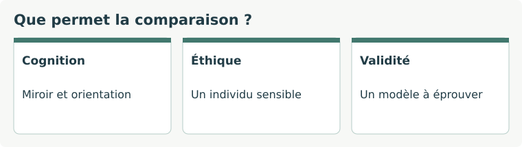
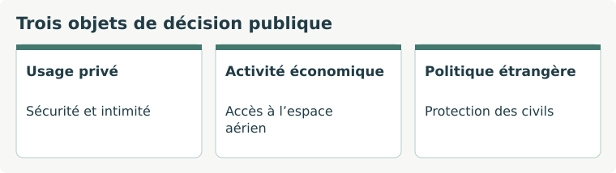
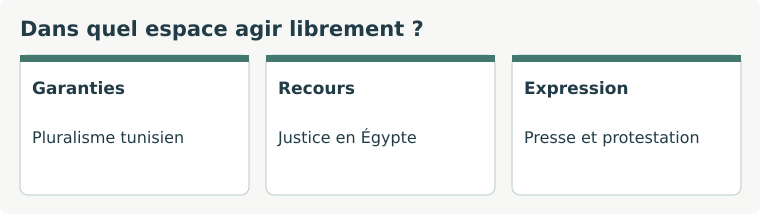

# Banque PT — Langue vivante A 2015 · Corrigé brut

*Corrigé rédigé par IA, non officiel.*

**Rédaction** · GPT-6.2 Astra Ultra · vitesse non renseignée

**Révision** · GPT-6.2 Astra Ultra · vitesse non renseignée

L’épreuve dure trois heures. Chaque candidat compose dans la langue choisie à l’inscription. Ce fascicule présente les cinq synthèses de 450 à 500 mots. Les feuillets demandent un titre et le nombre de mots à la fin de la copie. Les deux décomptes indiqués, avec et sans titre, respectent la fourchette.

[Sujet et supports](https://www.banquept.fr/documents/2015/lv_a_2015_pt.pdf) · [Rapport du jury](https://www.banquept.fr/documents/ecrit/rapport/2015/rapport_lv_a_ecrit_2015.pdf) · [Grille du livret](https://www.banquept.fr/documents/livret/2015/Livret_PT_2015.pdf#page=12)

## Allemand

*Tierische Intelligenz und Tierversuche: ein Paradox?*

**Was Tiere über sich und über uns erkennen lassen**

Garfield sitzt einem kleinen Spielzeug gegenüber und findet, dass Intelligenz vor allem von der Wahl des Gegenübers abhänge. Der Witz trifft einen empfindlichen Punkt der Forschung. Menschen bestimmen, welche Aufgabe ein Tier lösen soll, und legen anschließend fest, welche Schlüsse seine Leistung erlaubt. Dasselbe Tier kann dabei als denkendes Gegenüber oder als Modell für einen menschlichen Organismus erscheinen. Gerade der Wechsel zwischen diesen Rollen macht die Frage nach dem Sinn von Tierversuchen so schwierig.

Lange galt vernünftiges Denken als Vorrecht der Menschen. Doch ein Kind erkennt sein Gesicht im Spiegel ebenfalls erst im Lauf seiner Entwicklung. Wenn ein Elefant nach einem Blick auf sein Spiegelbild gezielt eine Markierung am eigenen Kopf berührt, lässt sich sein Verhalten kaum auf einen einfachen Reflex reduzieren. Ein Wellensittich dagegen kann einen vermeintlichen Artgenossen im Glas sehen und immer wieder vergeblich versuchen, ihn zu füttern. Beide Beobachtungen verlangen eine sorgfältige Interpretation. Aus dem unterschiedlichen Abschneiden bei einer einzigen Aufgabe folgt keine Rangordnung sämtlicher geistiger Fähigkeiten. Garfields selbstzufriedener Blick gewinnt gerade dadurch seinen Sinn, dass der selbst gewählte Vergleichspartner ihm unmöglich widersprechen kann.

Auch Orientierungsleistungen von Wüstenameisen und Brieftauben sprechen dafür, nach unterschiedlichen Formen des Denkens zu fragen. Was ein Tier in seiner Umgebung leisten muss, kann für einen Menschen ohne Hilfsmittel ausgesprochen schwierig sein. Umstritten bleibt, ob abstraktes Denken und Selbstbewusstsein eine Sprache voraussetzen. Die fehlende menschliche Sprache erschwert jedenfalls die Verständigung über eine Erfahrung. Sie liefert keinen unmittelbaren Beweis dafür, dass das Tier diese Erfahrung gar nicht machen kann.

Gerade Versuche haben dazu beigetragen, die ältere Vorstellung vom vernunftlosen Tier zu korrigieren. Auf dem Foto der Schweizer Versuchsgegner erscheint aber ein Affe mit verbundenem Kopf, dessen Gesicht die Folgen eines Eingriffs sichtbar macht. Das einzelne Tier erhält damit eine Bedeutung, die in einer allgemeinen Aussage über den Nutzen der Forschung leicht verloren geht. Der Betrachter soll sich fragen, was es heißt, einem Wesen Wahrnehmungsfähigkeit zuzuschreiben und zugleich sein Leiden für fremde Zwecke in Kauf zu nehmen. Die Aufnahme vertritt einen erkennbaren Standpunkt, während die Untersuchung an Mäusen eine andere Art von Einwand erhebt.

Bei bestimmten Entzündungsreaktionen unterschieden sich die Befunde an Mäusen erheblich von jenen an Menschen. Was im Tiermodell schwächer ausfiel und rascher abklang, konnte beim Menschen lange andauern. Die Übertragbarkeit eines Ergebnisses muss also für die jeweilige Frage belegt werden. Eine pauschale Aussage über die Nutzlosigkeit jedes Tierversuchs lässt sich aus diesem Vergleich ebenso wenig gewinnen wie eine allgemeine Rechtfertigung.

Das Paradox liegt schließlich darin, dass Forschung Ähnlichkeiten sichtbar macht, aus denen sowohl neue Erkenntnisse als auch neue Verpflichtungen entstehen. Ähnliches Verhalten kann Anlass sein, einem Tier mehr zuzutrauen und seine Behandlung kritisch zu prüfen. Ob es darüber hinaus ein geeignetes Modell für eine bestimmte Erkrankung ist, bleibt eine eigenständige wissenschaftliche Frage. Die Antwort hängt auch hier davon ab, was eigentlich miteinander verglichen wird.

**(471 Wörter, einschließlich Titel · 462 ohne Titel)**

## Anglais

*Given the recent advances in the area of unmanned aircraft, what kind of challenges do governments have to face regarding drones and their different uses?*

**Who gets to use the sky, and on what terms?**

A cartoon places an American aviation official with a stop sign between a control tower and an unlikely assortment of would-be pilots. Even a parcel of books appears ready to fly. Bringing such different users under the same authority is more complicated than the gesture suggests. Aircraft that once seemed to belong mainly to the military are becoming affordable to individuals and attractive to businesses. Governments must decide what activities to permit, whose interests need protection and how to account for their own use of the technology.

For hobbyists, taking pictures from above offers a fresh perspective on familiar surroundings. Yet the person in the picture may have had no reason to expect to be observed. The same aircraft can therefore represent a harmless pastime to its owner and an intrusion to a neighbour. Existing rules and expectations about photography, private life and air traffic do not necessarily give those people a clear answer. The Los Angeles Times describes this uncertainty as ownership spreads beyond the comparatively small community of experienced model aircraft enthusiasts.

Public safety raises a related question even when nobody's picture is taken. Reports of unidentified drones above French nuclear facilities led authorities to investigate. The uncertainty over who was responsible and what was intended mattered in its own right. A government has to take reports near sensitive sites seriously without assuming that every unidentified flight is hostile. The episode illustrates the difference between writing a restriction and being able to attribute a particular incident to a particular operator.

Meanwhile, firms see opportunities in aerial photography, surveying and deliveries. Entrepreneurs trying to plan an investment need to know under what conditions a service will be lawful. American aviation authorities face competing demands to open the market and to protect other users of the airspace. Moving slowly can delay legitimate projects, while giving permission without workable safety requirements could expose others to risks they have not chosen. The cartoon turns this dilemma into comedy by lining up radically different users before a single stop sign. Its humour depends on the distance between a blanket answer and the distinctions a regulator actually needs to make.

When governments themselves use drones abroad, accountability takes a different form. In an American survey about military strikes, 53 percent of respondents were very concerned that civilians might be endangered. Respondents also expressed concern about legality, possible retaliation and damage to the country's reputation. These answers describe public anxieties about state action overseas. They cannot be read as measurements of the danger that hobby aircraft present to Americans at home.

A workable public response must thus connect the kind of flight to the people who may bear its consequences. Predictable rules matter to a business and to a neighbour for different reasons. Transparent justification matters just as much when the authority setting limits on private operators is itself responsible for decisions that put others at risk.

**(492 words, title included · 482 without the title)**

## Arabe

*ماذا تقول الوثائق الخمس التالية عن أوضاع الحريات الفردية والجماعية في الدول العربية عامة وفي تونس ومصر والبحرين خاصة؟*

**من إعلان الحريات إلى ضمان ممارستها**

قد يخرج معارض من السجن ويظل غير واثق من أن كلامه لن يعيده إليه. وقد يتقدم بلد في جدول حرية الصحافة مع بقاء ترتيبه العالمي متأخرا. وتكشف هذه المفارقات أن تقدير حال الحريات الفردية والجماعية في البلدان العربية يتطلب النظر في المؤسسات التي تحمي الحق، وفي ما يستطيع المواطن أن يفعله بالفعل. وتجارب تونس ومصر والبحرين، كما تعرضها الوثائق، تتيح المقارنة بين مسارات لم تفض إلى النتيجة نفسها.

في تونس تشكلت بعد الثورة مساحة أوسع للتعبير والمشاركة. وأتيح لقوى مختلفة أن تتنافس وأن تتفاوض على قواعد مشتركة، في حين كان من الممكن أن يؤدي خلافها إلى تعطيل بناء المؤسسات. وما يمنح التجربة معناها في المقال هو أن من تولوا المسؤولية تباعا جعلوا استمرار المسار الديمقراطي أولوية، حتى حين لم تكن مصلحتهم المباشرة تقتضي التنازل. فالمواطن الذي يختار ممثليه يحتاج أيضا إلى قبول هؤلاء بإمكان تداول السلطة. ومن هنا تأتي أهمية الفرق بين الاعتراف بالحق في خطاب رسمي وبين وجود إجراءات تسمح بممارسته عند وقوع خلاف حقيقي.

أما في مصر فتخشى منظمات حقوقية أن تؤدي الإجراءات المتخذة باسم حماية المنشآت العامة إلى تضييق مجال الاحتجاج. وقد طالبت خمس عشرة منظمة الرئيس بسحب القانون المعني، معتبرة أن آثاره تمس وضع المدنيين وضمانات المحاكمة. وهكذا يصبح الخلاف على حدود السلطة في حالة الاحتجاج خلافا على حرية جماعية وعلى مصير الفرد الذي يشارك فيه في آن واحد. فوجود مؤسسات تحمل اسم القانون لا يحسم مسألة ما إذا كان المعترض يستطيع أن يعلن موقفه وأن يدافع عن نفسه أمام القضاء الذي يختص عادة بشؤون المدنيين.

وتظهر تجربة الناشط البحريني نبيل رجب حدود الاستنتاج من خبر واحد. فالإفراج عنه يتيح له العودة إلى الحديث عن نشاطه السلمي، لكنه لا يوفر في حد ذاته ضمانة دائمة لمن ينتقد الحكومة. وينطبق التمييز نفسه على الأرقام المتعلقة بحرية الصحافة. فقد تقدمت البحرين مرتبتين في تصنيف منظمة «مراسلون بلا حدود»، لكنها بقيت في المرتبة الثالثة والستين بعد المئة عالميا. وتباين مراتب البلدان العربية لا يلغي ضعف موقع كثير منها في المقارنة الدولية. وتحسن ترتيب نسبي لا يخبرنا وحده إن كان الصحفي أقل عرضة للملاحقة مما كان عليه من قبل.

ويجمع الرسم الساخر عناصر هذا التناقض في مشهد واحد. فالرجل الذي يرتدي تاجا وحذاء عسكريا يبدو كأنه يهب الطائر حريته حين يفتح له قفصا صغيرا. لكن اتجاه الطيران يقوده إلى قفص أكبر، ويبقى صاحب التاج ممسكا بشروط الخروج. وبهذا تتغير مساحة الحركة في الصورة من دون أن يملك الطائر اختيار وجهته. ويعطي الرسم لعبارة إطلاق الحريات معنى يختبره القارئ على ضوء خبر الإفراج عن الناشط أو الإعلان عن تقدم في ترتيب دولي.

وتظل الفوارق بين البلدان أساسية لفهم ما جرى. فالتفاوض والتداول في تونس، وتقييد الاحتجاج في مصر، والتباعد في البحرين بين بعض المؤشرات ووضع المنتقدين، لا تمثل مراحل متعاقبة من قصة واحدة. والمعيار الذي يصل بينها هو قدرة الأفراد والجماعات على استعمال حقوقهم ومساءلة من يقيدها، حتى عندما يكون صوتهم مخالفا لصوت السلطة القائمة.

**(460 كلمة، بما فيها العنوان · 454 دون العنوان)**

## Espagnol

*¿En qué medida tiene la política española de urbanización consecuencias a la vez sobre el medioambiente y sobre la economía del país?*

**La costa española, entre el negocio inmediato y su valor duradero**

Una fotografía aérea de Magaluf muestra lo que una estadística sobre urbanización no alcanza a transmitir. Desde el agua se distingue una estrecha banda de arena, detrás de la cual se suceden grandes edificios y calles. En otra imagen, unos activistas han instalado una playa delante del ministerio para denunciar su posible privatización. Las dos fotografías abren una pregunta que atraviesa tres artículos sobre el litoral español. ¿Qué sucede con el propio negocio turístico cuando las construcciones ocupan el espacio que los visitantes venían a disfrutar?

El proceso lleva décadas. Según el informe de Greenpeace recogido por El País, en los primeros quinientos metros de costa la superficie construida pasó de unas cincuenta y ocho mil hectáreas en 1987 a unas setenta y dos mil en 2005. La comparación procede de imágenes de satélite y revela diferencias considerables entre regiones. En la Comunidad Valenciana estaba urbanizada más de la mitad de esa franja, frente a menos de una décima parte en Asturias. La foto mallorquina permite imaginar cómo se experimenta esa concentración desde la playa. Por sí sola no autoriza a suponer que toda España presenta el mismo paisaje.

La revisión de las reglas sobre los chiringuitos vuelve tangible el conflicto. En las playas urbanas los establecimientos podrán ocupar hasta trescientos metros cuadrados, el doble que antes, y situarse más cerca unos de otros. De este modo es posible servir a más clientes y ampliar una actividad de la que viven empresarios y trabajadores. También aumenta el espacio destinado a quien paga por una consumición. En las playas naturales se prevén locales desmontables de hasta setenta metros cuadrados. Los manifestantes de Greenpeace, con sus tumbonas frente al ministerio, convierten esa discusión sobre superficies en una pregunta sobre quién puede disponer de un bien público.

Desde Andalucía, el responsable de urbanismo propone considerar el paisaje como parte del capital económico del destino. Los hoteles y los servicios pueden reproducirse en otro lugar. La combinación de naturaleza, cultura y entorno costero difícilmente puede trasladarse. Una estación con demasiadas construcciones corre así el riesgo de desanimar al visitante del que depende. Tampoco bastaría conservar un paraje excepcional sin ofrecer ningún servicio. El plan andaluz para los primeros quinientos metros pretende graduar la protección, preservando íntegramente los tramos más valiosos y permitiendo actividades compatibles en otros.

El dilema no se reduce por tanto a escoger entre puestos de trabajo y naturaleza. La ampliación de un negocio puede producir ingresos pronto, mientras que el deterioro de una costa se acumula y resulta difícil de deshacer. Las diferencias regionales aconsejan mirar qué queda por proteger y qué tipo de desarrollo admite cada tramo. De esa decisión depende tanto el acceso de los ciudadanos a la playa como la capacidad del turismo de seguir generando actividad en el futuro.

**(473 palabras, incluido el título · 462 sin el título)**

## Italien

*In riferimento ai dati ed agli argomenti forniti, tracciate un quadro della situazione economica e sociale degli italiani di fronte alla crisi.*

**Quando il bilancio familiare cambia anche i rapporti con gli altri**

Un ristorante al quale si rinuncia, una marca sostituita al supermercato, un’offerta che non si riesce più a fare. Considerati separatamente, questi gesti sembrano piccole decisioni private. I dati sui consumi e le indagini sulla solidarietà mostrano invece come la crisi abbia modificato insieme il tenore di vita, le aspettative e i rapporti tra gli italiani. Il luogo in cui si vive contribuisce a determinare quanto margine rimanga per scegliere.

Le famiglie descritte da la Repubblica tengono d’occhio sia il prezzo sia la possibilità che il reddito venga a mancare. Chi teme di perdere il lavoro può rimandare un acquisto anche prima di subire una riduzione dello stipendio. Altri hanno già esaurito quel margine e devono contenere le spese abituali. Mangiare a casa anziché in pizzeria oppure cercare prodotti meno cari consente di continuare a soddisfare alcune esigenze spendendo meno. Ma una scelta dettata dall’incertezza può diventare una rinuncia durevole. Il pessimismo alimenta così una contrazione degli acquisti che si ripercuote anche su chi vive delle vendite.

Il grafico sul carrello della spesa aiuta a capire perché un aumento modesto della spesa osservata non sia necessariamente una buona notizia. L’inflazione resta positiva, mentre l’effetto dovuto alla composizione degli acquisti è negativo. Nel primo trimestre del 2013, a un’inflazione del due e mezzo per cento corrisponde una variazione dei prezzi del carrello molto più contenuta. Le famiglie cambiano ciò che comprano. Il dato medio nasconde peraltro forti differenze territoriali. In Sicilia una famiglia su cinque vive con meno di mille euro al mese. Anche l’occupazione femminile e le prospettive dei diplomati e dei laureati risultano peggiori nel Mezzogiorno che nel Centro e nel Nord. Una stessa spesa imprevista pesa diversamente dove sono più scarse le opportunità di trovare un reddito.

A risentirne è anche la solidarietà. In un’indagine sulla carità molti dichiarano di non avere più le risorse per aiutare altri. Tra il 2005 e la rilevazione successiva diminuiscono sia i donatori sia quanti fanno spesso l’elemosina. Il volontariato nelle associazioni, però, arretra di poco. È dunque possibile che una persona riduca le offerte in denaro e continui a dedicare tempo a chi ha bisogno. Accanto alla difficoltà economica emerge un cambiamento di atteggiamento. Alcuni intervistati dichiarano più apertamente di un tempo di disinteressarsi della povertà. Sarebbe quindi riduttivo spiegare ogni rinuncia con lo stesso motivo o attribuire indistintamente a tutti una perdita di generosità.

La crisi appare infine come una redistribuzione dei margini di scelta. Dove un impiego e una rete di sostegno sono più accessibili resta possibile adattare i consumi. Dove le risorse erano già scarse, il risparmio si traduce più facilmente in isolamento. Letti insieme, gli indicatori suggeriscono perché la tenuta dei legami sociali non si possa dedurre dalla sola variazione dei prezzi.

**(466 parole, titolo compreso · 455 senza titolo)**

