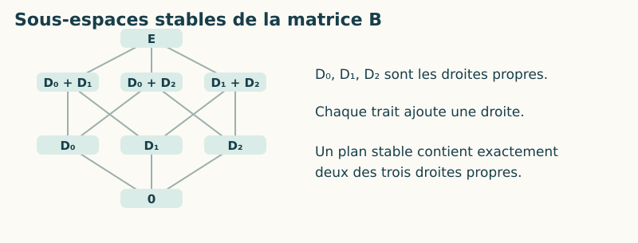
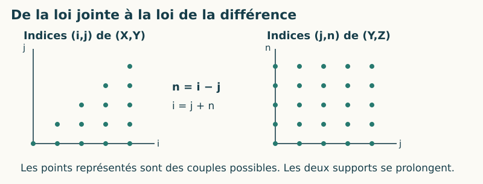

# Banque PT — Mathématiques A 2015 · Corrigé brut

*Corrigé rédigé par IA, non officiel. Signalez toute erreur.*

**Rédaction** · GPT-6.2 Astra Ultra · vitesse non renseignée · 26 novembre 2026

Le calendrier du livret fixe l’épreuve au lundi 11 mai 2015, de 14 h à 18 h. La garde porte le code 032. La calculatrice est interdite. Les questions occupent les pages 2 à 4 du PDF de cinq pages. La dernière page est sans question. Le problème passe d’une matrice de dimension quatre aux sous-espaces engendrés par des itérés, puis aux sous-espaces stables d’un endomorphisme diagonalisable. L’exercice indépendant reconstruit deux comptages de Poisson. [Sujet de la Banque PT](https://www.banquept.fr/documents/2015/math_a_2015_pt.pdf) · [Rapport du jury](https://www.banquept.fr/documents/ecrit/rapport/2015/rapport_math_a_ecrit_2015.pdf) · [Livret annuel, p. 8–9](https://www.banquept.fr/documents/livret/2015/Livret_PT_2015.pdf)

## I. Un endomorphisme de dimension quatre

### Question I.1.a

Les coordonnées sont données dans la base canonique de $\mathbb R^4$. Posons $u=f(e_1)=(-7,9,7,-4)$. Le produit de $A$ par cette colonne donne $f^2(e_1)=(-30,-90,-70,40)$. Par exemple, la première coordonnée résulte de $49-144+49+16=-30$.

### Question I.1.b

La somme $f^2(e_1)+10f(e_1)$ vaut $(-100,0,0,0)$. On obtient la relation $f^2(e_1)+10f(e_1)+100e_1=0$, dont le coefficient du second itéré est un. La famille est liée.

### Question I.2

On lit $v=f(e_2)=(-16,-3,-4,-7)$. Un produit par $A$ donne $f^2(e_2)=(160,-70,40,70)$. Ainsi $f^2(e_2)+10f(e_2)=(0,-100,0,0)=-100e_2$. La relation avec coefficients $(100,10,1)$ prouve la dépendance demandée.

### Question I.3

Supposons $a e_1+b u+c e_2+d v=0$. Les deux dernières coordonnées donnent $7b-4d=0$ et $-4b-7d=0$. Le déterminant de ce système vaut $-65$, donc $b=d=0$. Les deux premières coordonnées imposent alors $a=c=0$. Cette famille libre de quatre vecteurs de $\mathbb R^4$ constitue, dans l’ordre $(e_1,u,e_2,v)$, la base $\mathcal B$.

### Question I.4

Posons $T=f^2+10f+100\,\mathrm{Id}$. Les questions précédentes donnent $T(e_1)=T(e_2)=0$. Puisque $Tf=fT$, on a aussi $T(u)=fT(e_1)=0$ et $T(v)=fT(e_2)=0$. Par linéarité, $T$ s’annule sur tout l’espace grâce à la base $\mathcal B$. Cela donne $f^2(x)+10f(x)+100x=0$ pour tout $x$.

### Question I.5

Les images successives sont $u$, $-100e_1-10u$, $v$ et $-100e_2-10v$. Elles donnent, colonne par colonne,
$$[f]_{\mathcal B}=\begin{pmatrix}0&-100&0&0\\1&-10&0&0\\0&0&0&-100\\0&0&1&-10\end{pmatrix}.$$

### Question I.6

Si $f(x)=t x$ pour un réel $t$ et un vecteur non nul, I.4 donne $t^2+10t+100=0$. Or $(t+5)^2+75>0$ sur $\mathbb R$. Il n’existe donc aucun vecteur propre réel et $A$ n’est pas diagonalisable sur $\mathbb R$.

## II. Sous-espace engendré par les itérés

### Question II.1

Avec $x_0=x\ne0$ et $x_{n+1}=f(x_n)$, posons $E_x=\operatorname{Vect}(x_n:n\ge0)$. Si $y=\sum_{i=0}^m c_ix_i$, alors $f(y)=\sum_{i=0}^m c_i x_{i+1}\in E_x$. Donc $f(E_x)\subset E_x$.

### Question II.2

Soit $F$ stable par $f$ et contenant $x$. Par récurrence, $x_n=f^n(x)$ appartient à $F$ pour tout $n$. Comme $F$ est un sous-espace, il contient toutes leurs combinaisons linéaires finies et $E_x\subset F$.

### Question II.3.a

La famille $(x_0)$ est libre puisque $x\ne0$. Une famille libre de $\mathbb R^d$ a au plus $d$ vecteurs. Les entiers $k$ tels que $(x_0,\ldots,x_{k-1})$ soit libre forment donc une partie non vide de $\{1,\ldots,d\}$ et admettent un maximum $p$.

### Question II.3.b

Par maximalité, $(x_0,\ldots,x_p)$ est liée. Dans une relation non triviale, le coefficient de $x_p$ est non nul, sinon les $p$ premiers vecteurs seraient liés. En divisant par ce coefficient, on obtient des réels $a_i$ tels que $x_p=\sum_{i=0}^{p-1}a_i x_i$. Ils sont uniques par indépendance de la famille précédente.

### Question II.3.c

Dans $E'_x=\operatorname{Vect}(x_0,\ldots,x_{p-1})$, l’image de $x_i$ pour $i<p-1$ est le générateur suivant. L’image de $x_{p-1}$ est $x_p$, qui appartient au même espace par II.3.b. Par linéarité, $E'_x$ est stable. Cette vérification traite aussi $p=1$.

### Question II.3.d

Tous les générateurs de $E'_x$ appartiennent à $E_x$, d’où $E'_x\subset E_x$. Comme $E'_x$ est stable et contient $x_0=x$, II.2 donne $E_x\subset E'_x$. Les espaces coïncident. La famille libre $(x_0,\ldots,x_{p-1})$ est donc une base $\mathcal B_p$ de $E_x$.

### Question II.4

Soit $\widehat f=f|_{E_x}$. Dans $\mathcal B_p$, ses $p-1$ premières colonnes ont un unique coefficient un juste sous la diagonale. Sa dernière colonne vaut $(a_0,a_1,\ldots,a_{p-1})^{\mathsf T}$. Autrement dit pour $1\le i,j\le p$, l’entrée est $\delta_{i,j+1}$ si $j<p$ et $a_{i-1}$ si $j=p$. C’est aussi la formule correcte pour $p=1$, où la matrice est $(a_0)$.

### Question II.5

Si $\sum_{i=0}^{p-1}c_i\widehat f^i=0$ comme endomorphisme de $E_x$, son évaluation sur $x_0$ donne $\sum_i c_i x_i=0$. Puisque ces vecteurs forment une base, tous les $c_i$ sont nuls. La famille des endomorphismes $\mathrm{Id},\widehat f,\ldots,\widehat f^{p-1}$ est libre.

### Question II.6.a

L’égalité $\widehat f^p(x_0)=\sum_{i=0}^{p-1}a_i\widehat f^i(x_0)$ résulte de II.3.b. En appliquant $\widehat f^k$ et en commutant les puissances d’une même application, il vient $\widehat f^p(x_k)=\sum_{i=0}^{p-1}a_i\widehat f^i(x_k)$. Cela vaut pour tout $k\ge0$, en particulier pour $k<p$.

### Question II.6.b

D’après II.6.a, l’endomorphisme $\widehat f^p-a_{p-1}\widehat f^{p-1}-\cdots-a_1\widehat f-a_0\mathrm{Id}$ annule $x_k$ pour chacun des indices $0\le k<p$. Il est donc nul sur tout $E_x$ par II.3.d. Pour $p=1$, la relation se lit $\widehat f=a_0\mathrm{Id}$.

## III. Composantes propres et sous-espaces stables

### Question III.1.a

La diagonalisabilité réelle donne $E=E_1\oplus\cdots\oplus E_p$, les $E_i$ correspondant aux valeurs propres distinctes $\lambda_i$. Il existe donc pour $x$ une décomposition $x=\sum_{i=1}^p x_i$ avec $x_i\in E_i$. Elle est unique par le caractère direct de la somme.

### Question III.1.b

Notons $q$ le nombre de composantes non nulles et plaçons-les aux premiers indices comme dans le sujet. Si $\sum_{i=1}^q c_i x_i=0$, l’unicité précédente donne $c_i x_i=0$ pour tout $i$. Chacun de ces $x_i$ étant non nul, $c_i=0$. Ainsi $(x_1,\ldots,x_q)$ est libre.

### Question III.1.c

Pour $x_i\in E_i$, $f^k(x_i)=\lambda_i^k x_i$ pour $k\ge1$, par récurrence. Les composantes d’indice supérieur à $q$ sont nulles, donc $f^k(x)=\sum_{i=1}^q\lambda_i^k x_i$ pour $1\le k<q$. À l’ordre zéro, on retrouve $x=\sum_i x_i$.

### Question III.1.d

Avec $P(T)=\sum_{k=0}^{q-1}\alpha_{k+1}T^k$, la relation de l’énoncé se récrit $0=\sum_{k=0}^{q-1}\alpha_{k+1}f^k(x)=\sum_{i=1}^qP(\lambda_i)x_i$. La liberté démontrée en III.1.b impose $P(\lambda_i)=0$ pour tout $i\le q$.

### Question III.1.e

Un polynôme de degré au plus $q-1$ ayant les $q$ racines distinctes $\lambda_1,\ldots,\lambda_q$ est nul. En III.1.d, tous les $\alpha_k$ s’annulent. Ainsi $(x,f(x),\ldots,f^{q-1}(x))$ est libre. Lorsque $q=1$, cette conclusion revient à $x\ne0$.

### Question III.1.f

Posons $V=\operatorname{Vect}(x_1,\ldots,x_q)$, de dimension $q$. Pour chaque $k\ge0$, la formule des puissances donne $f^k(x)\in V$. Donc $E_x\subset V$. Les $q$ premiers itérés forment une famille libre contenue dans $E_x$ et $\dim V=q$. Leur espace engendré, $E_x$ et $V$ sont donc égaux. L’adjonction des composantes nulles d’indices $q+1,\ldots,p$ laisse cette égalité vraie.

### Question III.2

Pour $x\in F$ non nul, la stabilité donne $E_x\subset F$ par II.2. Selon III.1.f, chaque composante $x_i$ appartient à $E_x$, donc à $F\cap E_i=F_i$. Lorsque $x=0$, ses composantes sont toutes nulles et la conclusion subsiste. En décomposant tous les vecteurs de $F$, on obtient $F=\bigoplus_i(F\cap E_i)$.

### Question III.3.a

La matrice $B$ envoie $(x,y,z)$ sur $(x+y-z,x+y+z,x+y+z)$. Pour $tI-B$, retranchons la deuxième ligne à la troisième. Cette dernière devient $(0,-t,t)$. Le développement selon cette ligne donne $t[(t-1)^2-1]+t[-(t-1)+1]=t(t-1)(t-2)$, en calculant les deux mineurs avant simplification. Plus directement, les trois vecteurs propres indépendants de III.3.b donnent ce même polynôme. Ses trois racines réelles distinctes en dimension trois assurent que $f$ est diagonalisable.

### Question III.3.b

Pour $t=0$, l’addition et la différence des deux premières équations donnent $x+y=0$ et $z=0$. On obtient $D_0=\mathbb R(-1,1,0)$. Pour $t\ne0$, les deux dernières lignes imposent $y=z$. Alors la première ligne donne $x=tx$ et la deuxième $x+2y=ty$. Pour $t=1$, $x=-y$, d’où $D_1=\mathbb R(-1,1,1)$. Pour $t=2$, $x=0$, d’où $D_2=\mathbb R(0,1,1)$. Ces trois générateurs sont bien envoyés sur les multiples annoncés.

### Question III.3.c

Par III.2, tout sous-espace stable est la somme directe de ses intersections avec $D_0,D_1,D_2$. Chaque intersection est nulle ou égale à la droite entière. Réciproquement, chacune de ces sommes est stable car $f$ multiplie par un scalaire sur chaque droite propre. Il y a donc le sous-espace nul, les trois droites $D_0,D_1,D_2$, les trois plans $D_0\oplus D_1$, $D_0\oplus D_2$, $D_1\oplus D_2$, et $\mathbb R^3$. Ces huit choix sont distincts par unicité des composantes.

## P. Deux comptages issus d’une loi de Poisson

### Question P.1

Écrivons $a=\alpha$, $b=1-\alpha$. Pour $i\ge0$, la loi jointe du sujet donne
$$\mathbb P(X=i)=e^{-\lambda}\frac{\lambda^i}{i!}\sum_{j=0}^i\binom ij a^j b^{i-j}=e^{-\lambda}\frac{\lambda^i}{i!},$$
car $a+b=1$. Ainsi $X$ suit la loi de Poisson de paramètre $\lambda$.

### Question P.2

Pour $j\ge0$, les seuls $i$ de masse non nulle vérifient $i=j+n$, $n\ge0$. En sommant,
$$\mathbb P(Y=j)=e^{-\lambda}\frac{(\lambda a)^j}{j!}\sum_{n=0}^\infty\frac{(\lambda b)^n}{n!}=e^{-\lambda a}\frac{(\lambda a)^j}{j!}.$$
On reconnaît la loi de Poisson de paramètre $\lambda a$.

### Question P.3

Le support de la loi jointe impose $Y\le X$, donc $\mathbb P(X=0,Y=1)=0$. Mais $\mathbb P(X=0)=e^{-\lambda}>0$ et $\mathbb P(Y=1)=\lambda a e^{-\lambda a}>0$ car $\lambda a>0$. La loi jointe ne se factorise pas et $X,Y$ sont dépendantes.

### Question P.4

Posons $Z=X-Y$, à valeurs entières positives ou nulles. Pour $n\ge0$, les événements $\{Y=j,X=j+n\}$ sont disjoints et leur réunion est $\{Z=n\}$. On en déduit
$$\mathbb P(Z=n)=e^{-\lambda}\frac{(\lambda b)^n}{n!}\sum_{j\ge0}\frac{(\lambda a)^j}{j!}=e^{-\lambda b}\frac{(\lambda b)^n}{n!}.$$
Ainsi $Z$ suit la loi de Poisson de paramètre $\lambda b$.

### Question P.5

Pour $j,n\ge0$,
$$\mathbb P(Y=j,Z=n)=\mathbb P(X=j+n,Y=j)=e^{-\lambda}\frac{(\lambda a)^j}{j!}\frac{(\lambda b)^n}{n!}.$$
La probabilité $\mathbb P(Z=n)$ est strictement positive. En divisant par sa valeur obtenue en P.4, on trouve $\mathbb P(Y=j\mid Z=n)=e^{-\lambda a}(\lambda a)^j/j!$.

### Question P.6

La dernière expression est $\mathbb P(Y=j)$ et vaut pour tout $n\ge0$. On a donc la factorisation $\mathbb P(Y=j,Z=n)=\mathbb P(Y=j)\mathbb P(Z=n)$ sur tout le support, ce qui prouve que $Y$ et $Z$ sont indépendantes.

### Question P.7

Écrivons $X$ pour le nombre d’enfants et $Y$ pour le nombre de garçons dans le modèle de l’énoncé. Sachant $X=i$, les $i$ naissances indépendantes de probabilité $1/2$ donnent $Y\sim\mathcal B(i,1/2)$. Pour $0\le j\le i$,
$$\mathbb P(X=i,Y=j)=e^{-2{,}2}\frac{(2{,}2)^i}{i!}\binom ij2^{-i}
=e^{-2{,}2}\frac{(1{,}1)^i}{j!(i-j)!}.$$
La probabilité est nulle pour les autres couples. Dans la première fraction, la puissance porte sur le réel $2,2$. On retrouve la loi initiale avec $\lambda=2,2$ et $\alpha=1/2$.
