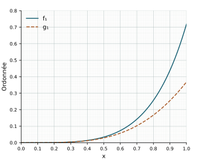
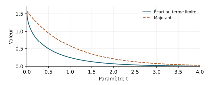

# Banque PT — Mathématiques C 2015 · Corrigé guidé

*Corrigé rédigé par IA, non officiel. Signalez toute erreur.*

**Rédaction** · GPT-6.2 Astra Ultra · vitesse non renseignée · 26 novembre 2026

Le calendrier du livret fixe l’épreuve au mardi 5 mai 2015, de 14 h à 18 h. La garde porte le code 034 et interdit la calculatrice. Les questions occupent les pages 2 à 4 du PDF de cinq pages. La garde demande de rendre une feuille de papier millimétré. Le PDF institutionnel ne fournit aucune grille préimprimée. Le tracé est reproduit sur une grille originale. [Sujet de la Banque PT](https://www.banquept.fr/documents/2015/math_c_2015_pt.pdf) · [Rapport du jury](https://www.banquept.fr/documents/ecrit/rapport/2015/rapport_math_c_ecrit_2015.pdf) · [Livret annuel, p. 8 et 9](https://www.banquept.fr/documents/livret/2015/Livret_PT_2015.pdf)

## I. Encadrement de la gaussienne

### Question I.1

> [!INDICATION]
> Identifier la variable qui intervient dans les deux exponentielles.

#### Solution

Pour $n\ge1$, posons $s=x^2/n$. Les fonctions du sujet sont $f_n(x)=e^s-s-1$ et $g_n(x)=e^{-s}+s-1$. Leur valeur dépend seulement de $x^2$ et elles sont définies sur $\mathbb R$. Elles sont paires. Il suffit de les étudier sur $[0,\infty)$ et de compléter leurs graphes par symétrie par rapport à l’axe des ordonnées.

### Question I.2.a

> [!INDICATION]
> Regrouper les exponentielles d’arguments opposés.

#### Solution

À $n=1$, $f_1(x)-g_1(x)=e^{x^2}-e^{-x^2}-2x^2=2[\sinh(x^2)-x^2]$, par définition du sinus hyperbolique.

### Question I.2.b

> [!INDICATION]
> Étudier la dérivée de la différence entre sinh(t) et t.

#### Solution

La fonction $t\mapsto\sinh(t)-t$ s’annule en zéro et sa dérivée vaut $\cosh t-1=(e^{t/2}-e^{-t/2})^2/2\ge0$. Elle est donc positive ou nulle pour $t\ge0$ et strictement positive pour $t>0$. Appliquée à $t=x^2$, cette inégalité donne $f_1(x)\ge g_1(x)$ avec égalité seulement en zéro.

### Question I.2.c

> [!INDICATION]
> Placer les valeurs aux bornes et déterminer la tangente commune en zéro.

#### Solution

Les deux courbes partent de $(0,0)$ avec une tangente horizontale et sont croissantes. Cela résulte de $f'_1(x)=2x(e^{x^2}-1)$ et $g'_1(x)=2x(1-e^{-x^2})$. À droite, les ordonnées sont $f_1(1)=e-2$ et $g_1(1)=e^{-1}$. Leur ordre est celui de I.2.b. Le tracé conserve une unité de 10 cm dans les deux directions à l’impression en taille réelle.

### Question I.3.a

> [!INDICATION]
> Appliquer la dérivation en chaîne à s = x²/n.

#### Solution

Pour tout réel $x$, $f'_n(x)=(2x/n)(e^{x^2/n}-1)$ et $g'_n(x)=(2x/n)(1-e^{-x^2/n})$.

### Question I.3.b

> [!INDICATION]
> Examiner séparément les facteurs de chaque dérivée.

#### Solution

Pour $x>0$, les deux facteurs dans chacune des expressions de I.3.a sont strictement positifs. Les fonctions croissent donc strictement sur $[0,\infty)$ depuis leur valeur zéro. Elles tendent toutes deux vers $+\infty$, la première par domination exponentielle et la seconde par son terme $x^2/n$.

### Question I.3.c

> [!INDICATION]
> Comparer chaque valeur à celle de la fonction à l’origine.

#### Solution

La croissance et $f_n(0)=g_n(0)=0$ donnent $f_n(x)\ge0$, $g_n(x)\ge0$ pour $x\ge0$. Les inégalités sont strictes pour $x>0$.

### Question I.3.d

> [!INDICATION]
> Vérifier le signe avant d’élever une inégalité à la puissance n ou de prendre un inverse.

#### Solution

Avec $s=x^2/n$, $g_n(x)\ge0$ donne $1-s\le e^{-s}$. Sur $0\le x\le\sqrt n$, $1-s\ge0$ et la puissance $n$ conserve l’ordre. D’autre part, $f_n(x)\ge0$ donne $e^s\ge1+s>0$, donc $e^{-s}\le (1+s)^{-1}$. On obtient
$$(1-x^2/n)^n\le e^{-x^2}\le(1+x^2/n)^{-n}.$$
La seconde inégalité subsiste pour tout $x\ge0$ puisque $1+s$ reste strictement positif.

### Question I.3.e

> [!INDICATION]
> Pour un grand entier n, prendre les logarithmes des expressions.

#### Solution

Pour $x$ fixé et $n>x^2$, $\log(1\pm x^2/n)=\pm x^2/n+O(n^{-2})$. Ainsi $n\log(1-x^2/n)$ et $-n\log(1+x^2/n)$ tendent tous deux vers $-x^2$. Par continuité de l’exponentielle, les deux limites valent $e^{-x^2}$. À $x=0$, les deux suites sont constantes égales à un.

### Question I.4.a

> [!INDICATION]
> Conserver les deux premiers termes du développement binomial.

#### Solution

Le binôme donne $(1+x^2/n)^n\ge1+n(x^2/n)=1+x^2$ pour $x\ge0$ et $n\ge1$ car les termes omis sont positifs ou nuls. Les quantités étant strictement positives, l’inversion donne $(1+x^2/n)^{-n}\le1/(1+x^2)$.

### Question I.4.b

> [!INDICATION]
> Intégrer d’abord sur un segment.

#### Solution

L’intégrande est continue sur la demi-droite. Pour $R>0$, $\int_0^R dx/(1+x^2)=\arctan R$. Cette quantité tend vers $\pi/2$ lorsque $R$ croît indéfiniment. L’intégrale converge donc et vaut $\pi/2$.

### Question I.4.c

> [!INDICATION]
> Combiner les deux majorations sur toute la demi-droite.

#### Solution

D’après I.3.d et I.4.a, $0<e^{-x^2}\le(1+x^2)^{-1}$ pour tout $x\ge0$. La comparaison à l’intégrale convergente de I.4.b donne $0<I=\int_0^\infty e^{-x^2}\,dx\le\pi/2$. La stricte positivité résulte déjà de l’intégration sur $[0,1]$.

## II. Valeur de l’intégrale de Gauss

### Question II.1

> [!INDICATION]
> Trouver un majorant intégrable indépendant du paramètre, y compris en t = 0.

#### Solution

Pour $t\ge0$ et $x\ge0$, $0\le e^{-tx^2}/(1+x^2)\le(1+x^2)^{-1}$. Cette dernière fonction est intégrable par I.4.b. L’intégrande est continue en $x$ et en $t$. Pour toute suite $t_m\to t$ dans $[0,\infty)$, la convergence ponctuelle et ce majorant permettent d’appliquer la convergence dominée. L’intégrale définissant $h(t)$ existe et $h(t_m)\to h(t)$, même à droite de zéro.

### Question II.2

> [!INDICATION]
> Évaluer le noyau de l’intégrale au paramètre nul.

#### Solution

Lorsque $t=0$, $e^{-tx^2}=1$. Ainsi $h(0)=\int_0^\infty(1+x^2)^{-1}\,dx=\pi/2$.

### Question II.3.a

> [!INDICATION]
> Sur t ≥ a, dominer la dérivée en paramètre par une gaussienne fixe.

#### Solution

Fixons $a>0$. La dérivée partielle par rapport à $t$ est $-x^2e^{-tx^2}/(1+x^2)$, continue. Pour $t\ge a$, sa valeur absolue est majorée par $e^{-a x^2}$. Cette fonction est intégrable, d’intégrale $I/\sqrt a$ par substitution. Avec l’existence de II.1, le théorème de dérivation sous l’intégrale donne $h'(t)=-\int_0^\infty x^2e^{-tx^2}/(1+x^2)\,dx$ pour $t>a$ et pour la dérivée à droite en $a$.

### Question II.3.b

> [!INDICATION]
> Entourer chaque t strictement positif par un intervalle restant loin de zéro.

#### Solution

Pour $t>0$, choisir par exemple $a=t/2$. II.3.a s’applique dans un voisinage de $t$ et donne la même formule pour $h'(t)$. Donc $h$ est dérivable sur $(0,\infty)$.

### Question II.4

> [!INDICATION]
> Étudier le signe de l’intégrale puis exploiter la continuité en zéro.

#### Solution

Pour $t>0$, l’intégrande dans $-h'(t)$ est strictement positif pour $x>0$. Ainsi $h'(t)<0$. La continuité en zéro et l’inégalité stricte des intégrandes pour des paramètres ordonnés montrent que $h$ décroît strictement sur $[0,\infty)$. Comme l’intégrande de $h$ est positive, $0<h(t)\le h(0)=\pi/2$.

### Question II.5

> [!INDICATION]
> Soustraire les deux intégrales pour simplifier le dénominateur.

#### Solution

Pour $t>0$, $h'(t)-h(t)=-\int_0^\infty e^{-t x^2}\,dx$. La substitution $s=\sqrt t\,x$, valable aussi après passage à la limite aux bornes, donne $h'(t)-h(t)=-I/\sqrt t$.

### Question II.6.a

> [!INDICATION]
> Multiplier l’équation homogène par le facteur e⁻ᵗ.

#### Solution

L’équation $y'-y=0$ équivaut à $(e^{-t}y)'=0$ sur $(0,\infty)$. Les solutions homogènes y sont $y(t)=c e^t$ avec $c\in\mathbb R$.

### Question II.6.b

> [!INDICATION]
> Fixer l’une des bornes au point où la primitive doit s’annuler.

#### Solution

Le réel $t_0$ est strictement positif. Le théorème fondamental appliqué à la fonction continue $u\mapsto e^{-u}/\sqrt u$ donne la primitive $F(t)=\int_{t_0}^t e^{-u}/\sqrt u\,du$. Elle s’annule en $t_0$ et cette valeur la détermine sur l’intervalle.

### Question II.6.c

> [!INDICATION]
> Intégrer la dérivée de h(t)e⁻ᵗ entre t₀ et t.

#### Solution

Par II.5, $(e^{-t}h(t))'=-I e^{-t}/\sqrt t$. L’intégration donne
$$h(t)=e^t\left(k-I\int_{t_0}^t\frac{e^{-u}}{\sqrt u}\,du\right),\qquad k=e^{-t_0}h(t_0).$$

### Question II.7.a

> [!INDICATION]
> Effectuer le changement de variable à partir d’une borne inférieure positive.

#### Solution

Près de zéro, $0\le e^{-u}/\sqrt u\le u^{-1/2}$, intégrable en cette borne. Pour $0<\varepsilon<t$, la substitution $u=x^2$ donne $\int_\varepsilon^t e^{-u}/\sqrt u\,du=2\int_{\sqrt\varepsilon}^{\sqrt t}e^{-x^2}\,dx$. En faisant décroître $\varepsilon$ vers zéro, on obtient l’identité demandée. À $t=0$, les deux membres valent zéro.

### Question II.7.b

> [!INDICATION]
> Utiliser la continuité de h en zéro et l’intégrale orientée.

#### Solution

Lorsque $t\downarrow0$, II.6.c donne $\pi/2=k+I\int_0^{t_0}e^{-u}/\sqrt u\,du$. Donc $k=\pi/2-I\int_0^{t_0}e^{-u}/\sqrt u\,du$. Par additivité des intégrales puis II.7.a,
$$h(t)=e^t\left(\frac{\pi}{2}-2I\int_0^{\sqrt t}e^{-x^2}\,dx\right)\qquad(t\ge0).$$

### Question II.8

> [!INDICATION]
> Multiplier les deux bornes de II.4 par la même quantité positive.

#### Solution

D’après II.7.b, le terme demandé vaut $e^{-t}h(t)$. Comme $0<h(t)\le\pi/2$, on a $0\le\pi/2-2I\int_0^{\sqrt t}e^{-x^2}\,dx\le (\pi/2)e^{-t}$.

### Question II.9

> [!INDICATION]
> Passer à la limite dans l’encadrement quand t tend vers l’infini.

#### Solution

Le majorant en II.8 tend vers zéro et l’intégrale tronquée tend vers $I$ par définition. On obtient $\pi/2-2I^2=0$. Puisque $I>0$ par I.4.c, $I=\sqrt\pi/2$.

## III. Approximation sur le segment unité

### Question III.1

> [!INDICATION]
> Majorer le module par un terme de la série exponentielle.

#### Solution

On a $|(-1)^n/[n!(2n+1)]|\le1/n!$. Puisque $\sum1/n!=e$, la série demandée converge absolument.

### Question III.2

> [!INDICATION]
> Substituer −t² dans la série entière de l’exponentielle.

#### Solution

La série exponentielle converge pour tout réel. L’identité $e^{-t^2}=\sum_{n\ge0}(-1)^nt^{2n}/n!$ est donc valable sur $D=\mathbb R$. Pour tout $R>0$, les modules sont majorés sur $[-R,R]$ par $R^{2n}/n!$, de somme finie.

### Question III.3

> [!INDICATION]
> Justifier la permutation par convergence uniforme sur le segment.

#### Solution

La majoration de III.2 pour $R=1$ assure la convergence normale, donc uniforme, sur $[0,1]$. L’intégration terme à terme est permise et $\int_0^1 t^{2n}\,dt=1/(2n+1)$. D’où $\int_0^1 e^{-t^2}\,dt=\sum_{n\ge0}(-1)^n/[n!(2n+1)]$.

### Question III.4.a

> [!INDICATION]
> Choisir le rang à partir de la majoration du reste fournie dans le sujet.

#### Solution

Pour $\varepsilon>0$, augmenter $n$ à partir de zéro jusqu’à ce que $1/[(n+1)!(2n+3)]\le\varepsilon$. L’arrêt est assuré puisque ce majorant tend vers zéro. Le rationnel $r_n=\sum_{k=0}^n(-1)^k/[k!(2k+1)]$ diffère alors de l’intégrale d’au plus $\varepsilon$. Si une erreur strictement inférieure est souhaitée, utiliser le test strict.

### Question III.4.b

> [!INDICATION]
> Comparer les majorants successifs à 1/1000.

#### Solution

Pour $n=3$, le majorant vaut $1/216$. Pour $n=4$, il vaut $1/(5!\cdot11)=1/1320<10^{-3}$. Un choix certifié est donc $r=1-1/3+1/10-1/42+1/216$. La majoration du reste suffit à certifier ce rationnel.
