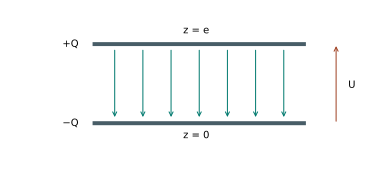
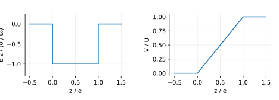
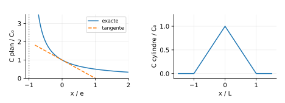
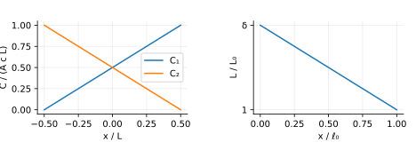
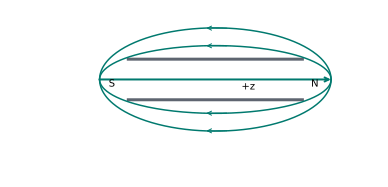
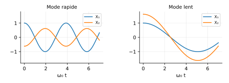
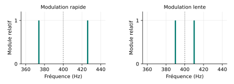
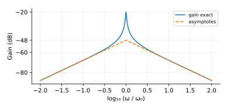
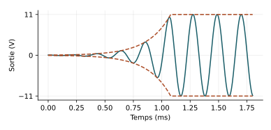

# Banque PT — Physique A 2015 · Corrigé guidé

*Corrigé rédigé par IA, non officiel. Signalez toute erreur.*

**Rédaction** · GPT-6.2 Astra Ultra · vitesse non renseignée · 26 novembre 2026

La Banque PT a programmé cet écrit le mercredi 6 mai 2015, de 8 h à 12 h. La garde interdit la calculatrice. Le code imprimé est 040. Le verso final est blanc. Les questions figurent aux pages 2 à 11 du PDF de 12 pages. En admissibilité, le coefficient de Physique A est de 3 pour chacune des ENS de Cachan et de Rennes et de 6 pour l’École polytechnique. [Sujet](https://www.banquept.fr/documents/2015/ph_a_2015_pt.pdf) · [Rapport du jury](https://www.banquept.fr/documents/ecrit/rapport/2015/rapport_phys_a_ecrit_2015.pdf) · [Livret de la Banque PT, p. 8, 9 et 12](https://www.banquept.fr/documents/livret/2015/Livret_PT_2015.pdf)

## A. Capteurs capacitifs (30 %)

### Question A.1.a

> [!INDICATION]
> Annuler les dérivées temporelles dans les quatre équations locales.

#### Solution

Pour des charges de densité volumique $\rho$ et des courants stationnaires de densité $\mathbf j$, les champs vérifient dans le vide $\operatorname{div}\mathbf E=\rho/\varepsilon_0$, $\operatorname{rot}\mathbf E=\mathbf0$, $\operatorname{div}\mathbf B=0$ et $\operatorname{rot}\mathbf B=\mu_0\mathbf j$.

### Question A.1.b

> [!INDICATION]
> Orienter la surface fermée vers l’extérieur.

#### Solution

Pour toute surface fermée $\Sigma$ qui ne porte pas de charge singulière, le flux sortant vaut $\oint_\Sigma\mathbf E\cdot d\mathbf S=Q_{\rm int}/\varepsilon_0$. Une charge extérieure peut modifier le champ local mais sa contribution au flux total est nulle.

### Question A.1.c

> [!INDICATION]
> Intégrer la divergence sur le volume intérieur.

#### Solution

Le théorème de la divergence transforme $\int_V\operatorname{div}\mathbf E\,dV$ en flux sortant. L’autre membre devient $\int_V\rho\,dV/\varepsilon_0=Q_{\rm int}/\varepsilon_0$, d’où la formule.

### Question A.2.a

> [!INDICATION]
> Placer la pointe de la flèche de tension au potentiel le plus élevé.

#### Solution

On repère la plaque inférieure par $-Q$ et la supérieure par $+Q$ pour $U>0$. La tension $U=V_+-V_-$ est fléchée de bas en haut. Dans l’entrefer, le champ va de la plaque positive à la plaque négative.

### Question A.2.b

> [!INDICATION]
> Utiliser la charge algébrique de la plaque où aboutit la flèche.

#### Solution

En convention précédente $Q=CU$, où $C>0$, exprimée en farads. L’autre plaque porte la charge opposée.

### Question A.2.c

> [!INDICATION]
> Suivre les lignes de champ aboutissant aux charges négatives.

#### Solution

Les charges mobiles se redistribuent jusqu’à annuler le champ dans le métal. Les charges opposées s’attirent et les lignes partent principalement d’une face en regard pour atteindre l’autre. Dans le modèle de plaques infinies, le champ extérieur s’annule et les faces extérieures ne portent pas de charge. Des effets de bord subsistent pour des plaques finies.

### Question A.3.a

> [!INDICATION]
> Repérer la plaque portant le signe moins sur la figure 1.

#### Solution

Entre $z=0$ (plaque négative) et $z=e$ (plaque positive), les lignes sont droites, parallèles à $Oz$, orientées vers les $z$ décroissants. Elles coupent perpendiculairement les conducteurs équipotentiels.

### Question A.3.b

> [!INDICATION]
> Superposer les champs de deux nappes planes.

#### Solution

Une boîte de Gauss coupant une nappe donne par symétrie un champ de module $\sigma/(2\varepsilon_0)$ de chaque côté, sortant pour la nappe positive. En superposant les deux champs, $E_z=0$ pour $z<0$ et $z>e$, et $E_z=-\sigma/\varepsilon_0$ pour $0<z<e$. Les sauts sur les surfaces sont prescrits par leurs charges. Le graphe montre les limites latérales.

### Question A.3.c

> [!INDICATION]
> Intégrer le champ en partant de la plaque négative.

#### Solution

Puisque $dV/dz=-E_z$ et $V(0)=0$, on a $V=0$ sous le condensateur, $V=\sigma z/\varepsilon_0$ dans l’entrefer et $V=\sigma e/\varepsilon_0$ au-dessus. Le potentiel est continu jusque sur les plaques.

### Question A.3.d

> [!INDICATION]
> Relier les deux plateaux par une droite continue.

#### Solution

Le graphe de A.3.b donne, sous forme réduite, le palier nul jusqu’à $z=0$, la rampe de pente $\sigma/\varepsilon_0$ jusqu’à $e$, puis le palier $U=\sigma e/\varepsilon_0$.

### Question A.3.e

> [!INDICATION]
> Remplacer la charge par sa densité multipliée par l’aire.

#### Solution

Avec $Q=\sigma S$ et $U=\sigma e/\varepsilon_0$, leur quotient donne $C_{p0}=\varepsilon_0S/e$. L’approximation néglige le champ de bord.

### Question A.3.f.i

> [!INDICATION]
> Seul l’entrefer change.

#### Solution

La distance devient $e+x>0$. Donc $C_p(x)=\varepsilon_0 S/(e+x)=C_{p0}/(1+x/e)$.

### Question A.3.f.ii

> [!INDICATION]
> Chercher les limites au contact et à grande distance.

#### Solution

La capacité décroît, de $+\infty$ au voisinage de $-e$ à $0$ à l’infini, et vaut $C_{p0}$ pour $x=0$. Les axes réduits du tracé repèrent ces trois limites. La divergence idéale précède un contact où le modèle de condensateur cesse de s’appliquer.

### Question A.3.f.iii

> [!INDICATION]
> Développer l’inverse au voisinage de zéro.

#### Solution

Pour $|x|\ll e$, $C_p(x)=C_{p0}(1-x/e)+O(C_{p0}x^2/e^2)$. La sensibilité locale vaut $-C_{p0}/e$.

### Question A.3.f.iv

> [!INDICATION]
> Reporter la pente locale et l’ordonnée à l’origine.

#### Solution

La droite tiretée du graphe de A.3.f.ii passe par $(0,C_{p0})$ et $(e,0)$. Seul le voisinage de l’origine correspond au développement. La courbe exacte reste positive au-delà.

### Question A.4.a

> [!INDICATION]
> Employer l’axe commun des deux cylindres.

#### Solution

Les coordonnées cylindriques $(r,\theta,z)$ suivent la symétrie de révolution des deux armatures. Le rayon $r$ mesure la distance à l’axe commun.

### Question A.4.b

> [!INDICATION]
> Croiser deux plans de symétrie passant par le point.

#### Solution

Le plan méridien et le plan normal à l’axe passant par le point sont plans de symétrie du système illimité. Le champ appartient à leur intersection, la droite radiale. L’invariance par rotation et translation impose $E_r=E_r(r)$. Dans l’intervalle entre les conducteurs, il pointe vers l’armature intérieure négative.

### Question A.4.c

> [!INDICATION]
> Choisir un cylindre coaxial de longueur arbitraire.

#### Solution

Le flux à travers les bases est nul. Le flux latéral vaut $2\pi rhE_r$. Pour une longueur $h$, les charges enfermées sont respectivement $0,-Qh/L,0$ selon les trois zones. Le tableau des composantes radiales est donc
$$
\begin{array}{c|ccc}r &(0,R_1)&(R_1,R_2)&(R_2,\infty)\\ \hline E_r&0&-Q/(2\pi\varepsilon_0 Lr)&0\end{array}.
$$

### Question A.4.d

> [!INDICATION]
> Fixer la constante de la primitive logarithmique.

#### Solution

Pour $r<R_1$, $V=0$. Dans l’entrefer, $-dV/dr=E_r$ donne $V(r)=Q\ln(r/R_1)/(2\pi\varepsilon_0 L)$. À partir de $R_2$, le potentiel reste égal à $U=V(R_2)-V(R_1)=Q\ln(R_2/R_1)/(2\pi\varepsilon_0 L)>0$.

### Question A.4.e

> [!INDICATION]
> Former le quotient de la charge par la tension.

#### Solution

On obtient $C_{c0}=A_c L$ avec $A_c=2\pi\varepsilon_0/\ln(R_2/R_1)$ en farads par mètre. En négligeant les bords, seule la longueur en regard intervient.

### Question A.4.f

> [!INDICATION]
> Calculer l’intersection de deux intervalles de même longueur.

#### Solution

Initialement les deux armatures de longueur $L$ se recouvrent entièrement. Pour $|x|\leq L$, la longueur commune vaut $L-|x|$, donc $C_c(x)=C_{c0}(1-|x|/L)$. Au-delà il n’y a plus de recouvrement et ce modèle donne zéro. Au ras d’un bord, les champs de fuite limitent la précision.

### Question A.4.g

> [!INDICATION]
> Distinguer les deux signes du déplacement.

#### Solution

Entre $-L$ et $0$ la pente vaut $+C_{c0}/L$ ; entre $0$ et $L$ elle vaut $-C_{c0}/L$. Le sommet est $(0,C_{c0})$ et le prolongement idéal est nul hors de cet intervalle. Voir le panneau cylindrique du graphe A.3.f.ii.

### Question A.4.h

> [!INDICATION]
> Étudier l’injectivité de chaque relation.

#### Solution

La capacité plane est strictement décroissante et identifie un déplacement signé, mais sa pente varie. La capacité coaxiale est affine sur chaque demi-course, avec une même sensibilité en valeur absolue. Deux déplacements opposés donnant la même capacité, un second signal est nécessaire pour lever l’ambiguïté.

### Question A.5.a

> [!INDICATION]
> Écrire le diviseur complexe avec la sortie aux bornes de la capacité.

#### Solution

Avec $Z_C=1/(j\omega C)$, $\underline u/\underline e=Z_C/(R+Z_C)=1/(1+j\omega RC)$. En posant $v=\omega RC$, le module et l’argument fournissent $U=E/\sqrt{1+v^2}$ et $\varphi=-\arctan v$.

### Question A.5.b

> [!INDICATION]
> Dériver en chaîne par rapport à la position.

#### Solution

À excitation fixée $v'=\omega R C'(x)$. Ainsi $\alpha_U=-E v\omega R C'(x)/(1+v^2)^{3/2}$, tandis que $\alpha_\varphi=-\omega R C'(x)/(1+v^2)$. Les unités respectives sont volt par mètre et radian par mètre.

### Question A.5.c.i

> [!INDICATION]
> Examiner le facteur où se trouve la capacité elle-même.

#### Solution

Sur chaque demi-course le capteur cylindrique a une pente constante non nulle, mais $v$ varie avec $|x|$. Les deux sensibilités dépendent donc de la position et changent de signe d’une branche à l’autre. La dérivée bilatérale en zéro n’existe pas dans ce modèle.

### Question A.5.c.ii

> [!INDICATION]
> Identifier la dépendance explicite en amplitude d’entrée.

#### Solution

Une variation relative de $E$ produit la même variation relative de $\alpha_U$. La phase et sa sensibilité $\alpha_\varphi$ sont indépendantes de $E$ avec un circuit linéaire et un signal mesurable.

### Question A.5.c.iii

> [!INDICATION]
> Chercher la grandeur robuste aux fluctuations de la source.

#### Solution

La phase est préférable si l’excitation fluctue, car sa conversion en position est insensible à cette fluctuation. Il faut toujours connaître la branche de la course et étalonner la relation non linéaire.

### Question A.6.a

> [!INDICATION]
> Sur la figure 4, identifier C1 à droite et C2 à gauche.

#### Solution

Pour $|x|\le L/2$, la longueur à droite est $L_1=L/2+x$, celle à gauche $L_2=L/2-x$. Il suit $C_1=A_c(L/2+x)$ et $C_2=A_c(L/2-x)$.

### Question A.6.b

> [!INDICATION]
> Additionner les capacités à une position arbitraire.

#### Solution

Leurs graphes sont deux droites de pentes opposées $\pm A_c$ qui se croisent à la valeur $A_cL/2$. Leur somme est constante et vaut $A_c L$ sur la course centrale.

### Question A.7.i

> [!INDICATION]
> Calculer séparément les potentiels des points milieux.

#### Solution

Le milieu résistif est à $E/2$ et le milieu capacitif à $EZ_2/(Z_1+Z_2)=EC_1/(C_1+C_2)$. La flèche de la figure 5 pointe vers le milieu capacitif, donc $\underline U=E(C_1-C_2)/[2(C_1+C_2)]$, réel signé avec la phase d’entrée nulle.

### Question A.7.ii

> [!INDICATION]
> Distinguer la tension signée de son amplitude positive.

#### Solution

La somme des capacités vaut $A_cL$ et leur différence $2A_cx$, d’où $\underline U=Ex/L$. L’amplitude au sens de module est $U=E|x|/L$.

### Question A.7.iii

> [!INDICATION]
> Indiquer la convention de sortie choisie.

#### Solution

La sensibilité de la sortie démodulée signée est constante, $E/L$ en V/m. Celle du module vaut $(E/L)\operatorname{sgn}x$ hors de zéro. Elle conserve la même valeur absolue sur toute la course et le module présente un point anguleux à zéro.

### Question A.7.iv

> [!INDICATION]
> Examiner le signe de l’amplitude complexe.

#### Solution

En déplaçant l’armature vers la droite, $x>0$ et la sortie est en phase avec l’entrée. Pour $x<0$ le déphasage vaut $\pi$ modulo $2\pi$. À l’équilibre la sortie est nulle et sa phase indéfinie.

## B. Capteur inductif (12 %)

### Question B.1.a

> [!INDICATION]
> Fixer l’orientation du contour et de la surface.

#### Solution

En magnétostatique $\oint_\Gamma\mathbf B\cdot d\mathbf l=\mu_0 I_{\rm enlacé}$, avec l’orientation de la normale définie par la règle de la main droite à partir du parcours de $\Gamma$.

### Question B.1.b

> [!INDICATION]
> Refermer les lignes à l’extérieur.

#### Solution

La circulation du courant indiquée sur la face avant de la figure 6 donne, par la règle de la main droite, un champ intérieur dirigé vers $+z$. Les lignes se resserrent et sont sensiblement parallèles dans la zone centrale. Elles ressortent à droite et reviennent à gauche par l’extérieur, car le flux magnétique est conservatif.

### Question B.1.c

> [!INDICATION]
> Traverser la couche de courant avec un contour rectangulaire.

#### Solution

La symétrie des courants et l’invariance par translation imposent un champ axial dont l’intensité dépend au plus de $r$. Un rectangle d’une longueur $h$ parallèle à l’axe, avec un grand côté sur l’axe et l’autre à l’extérieur, enlace $Nh/\ell_0$ spires. Ampère donne $h(B_{\rm axe}-B_{\rm ext})=\mu_0 INh/\ell_0$. Puisque $B_{\rm axe}=\mu_0 NI/\ell_0$ est fourni, $B_{\rm ext}=0$.

### Question B.1.d

> [!INDICATION]
> Déplacer le côté intérieur du rectangle.

#### Solution

En mettant le grand côté intérieur au rayon $r<R$, le rectangle coupe le même courant. Le côté extérieur ne contribue pas, donc $\mathbf B(r)=\mu_0 NI\,\mathbf e_z/\ell_0$ partout à l’intérieur, dans l’approximation du solénoïde illimité.

### Question B.1.e

> [!INDICATION]
> Distinguer le flux d’une spire et le flux total couplé.

#### Solution

La définition est $\Phi_{\rm lié}=L_0 I$. Chaque spire enlace $B\pi R^2$, donc $\Phi_{\rm lié}=NB\pi R^2$ et $L_0=\mu_0 N^2\pi R^2/\ell_0$ en henrys.

### Question B.2.a

> [!INDICATION]
> Utiliser la densité de spires uniforme.

#### Solution

La densité vaut $n=N/\ell_0$. Dans la partie d’air $N_1=nx$, dans la partie avec noyau $N_2=n(\ell_0-x)$, de sorte que leur somme vaut $N$.

### Question B.2.b

> [!INDICATION]
> Écrire chaque inductance avec le nombre de spires du tronçon.

#### Solution

La première vaut $L_1=\mu_0 n^2\pi R^2 x$, la seconde $L_2=\delta\mu_0 n^2\pi R^2(\ell_0-x)$. Dans l’association en série admise, $L(x)=L_0[\delta+(1-\delta)x/\ell_0]$.

### Question B.2.c

> [!INDICATION]
> Déterminer les deux valeurs limites.

#### Solution

Le segment relie $(0,\delta L_0)$ à $(\ell_0,L_0)$. Sa pente $-(\delta-1)L_0/\ell_0$ est négative lorsque le noyau augmente l’inductance.

## C. Oscillateur mécanique (25 %)

### Question C.1.a

> [!INDICATION]
> Commencer par la masse qui porte le seul ressort de droite.

#### Solution

À l’équilibre la force horizontale sur $M_2$ est nulle, donc le second ressort a sa longueur libre $\ell_{R0}$. L’équilibre de $M_1$ impose alors la même chose au premier. D’où $x_{10}=\ell_{R0}$ et $x_{20}=2\ell_{R0}$.

### Question C.1.b

> [!INDICATION]
> Comparer la longueur instantanée à la longueur à vide.

#### Solution

La longueur des deux ressorts est respectivement $x_1$ et $x_2-x_1$. Les modules demandés sont $T_1=k|x_1-\ell_{R0}|$ et $T_2=k|x_2-x_1-\ell_{R0}|$. Pour écrire les forces projetées, il faut conserver le signe des allongements.

### Question C.2.a

> [!INDICATION]
> Projeter le rappel du ressort de droite.

#### Solution

La loi de Newton donne $m\ddot x_2=-k(x_2-x_1-\ell_{R0})$. En posant $\omega_0^2=k/m$, on identifie $A=B=\omega_0^2$ et $C=\omega_0^2\ell_{R0}$.

### Question C.2.b

> [!INDICATION]
> Additionner les deux forces avec leur orientation.

#### Solution

Le premier ressort exerce $-k(x_1-\ell_{R0})$, le second $+k(x_2-x_1-\ell_{R0})$. Après sommation, $\ddot x_1+2\omega_0^2 x_1=\omega_0^2 x_2$. Les coefficients sont $D=2\omega_0^2$, $E=\omega_0^2$ et $F=0$.

### Question C.3.a

> [!INDICATION]
> Translater les positions puis chercher une oscillation harmonique.

#### Solution

Notons $X_i=x_i-x_{i0}=XX_i$ et $\widehat X_i$ son amplitude complexe. En substituant $\ddot X_i=-\Omega^2 X_i$, on obtient $(2\omega_0^2-\Omega^2)\widehat X_1-\omega_0^2\widehat X_2=0$ et $-\omega_0^2\widehat X_1+(\omega_0^2-\Omega^2)\widehat X_2=0$.

### Question C.3.b

> [!INDICATION]
> Annuler le déterminant et calculer aussi le rapport des amplitudes.

#### Solution

En posant $\lambda=\Omega^2/\omega_0^2$, il faut $(2-\lambda)(1-\lambda)-1=0$. Les racines sont $(3\pm\sqrt5)/2$. Avec $\phi=(1+\sqrt5)/2$, les pulsations ordonnées sont $\Omega_1=\phi\omega_0$ et $\Omega_2=\omega_0/\phi$, de rapport $\phi^2\simeq2,62$. Le rapport $X_2/X_1=2-\lambda$ vaut $r_1=-1/\phi$ pour le mode rapide et $r_2=\phi$ pour le lent. La formule fournie en C.4 utilise au contraire les rapports $+1$ et $-1$. Elle ne résout pas ce système. Les réponses suivantes distinguent le calcul avec cette formule imprimée et le mouvement des masses décrit en C.2.

### Question C.4.a

> [!INDICATION]
> Dériver les deux lois avant d’évaluer en zéro.

#### Solution

Dans la formule fournie, les deux vitesses nulles imposent $A_1\Omega_1\sin\varphi_1+A_2\Omega_2\sin\varphi_2=0$ et $A_1\Omega_1\sin\varphi_1-A_2\Omega_2\sin\varphi_2=0$. Pour un mode présent $\sin\varphi_i=0$. On peut prendre les phases nulles en autorisant des amplitudes signées ; la phase d’un mode absent est libre. La même conclusion vaut pour les vrais modes, leurs vecteurs étant indépendants.

### Question C.4.b.i.1

> [!INDICATION]
> Soustraire les positions d’équilibre avant de projeter.

#### Solution

Posons $h=\ell_{R0}/2$ ; ici $(X_1(0),X_2(0))=(h,h)$. La formule imprimée donne $A_1+A_2=h$ et $A_1-A_2=h$, donc $A_1=h,A_2=0$. Pour les modes de C.3, les amplitudes sur $X_1$ satisfont $a_1+a_2=h$ et $r_1a_1+r_2a_2=h$, soit $a_1=h(r_2-1)/(r_2-r_1)$ et $a_2=h(1-r_1)/(r_2-r_1)$.

### Question C.4.b.i.2

> [!INDICATION]
> Repérer les modes de coefficient non nul.

#### Solution

La formule admise prévoit une vibration à $\Omega_1/(2\pi)$ des deux masses. Dans cette hypothèse le second ressort garde même sa longueur, car $X_2-X_1=0$. Pour la dynamique réelle, les deux coefficients calculés sont non nuls ; les élongations des deux ressorts contiennent les deux fréquences $\Omega_1/(2\pi)$ et $\Omega_2/(2\pi)$.

### Question C.4.b.i.3

> [!INDICATION]
> Comparer les déplacements tout au long du temps.

#### Solution

Sous l’hypothèse de C.4, $X_2=X_1$ à tout instant, mouvement en phase que la formule présente comme un mode symétrique. La matrice de C.3 appliquée à $(1,1)$ donne $(1,0)$ ; cette direction initiale ne peut donc pas constituer un mode propre du système physique.

### Question C.4.b.i.4

> [!INDICATION]
> Reporter la projection dans la deuxième composante.

#### Solution

La formule demandée sur le feuillet est $XX_2=h\cos(\Omega_1t)$. La loi compatible avec Newton est $XX_2=r_1a_1\cos(\Omega_1t)+r_2a_2\cos(\Omega_2t)$, avec les coefficients du premier départ calculés en C.4.b.i.1. À $t=0$, l’accélération réelle de $M_2$ est nulle, ce qui distingue immédiatement les deux lois.

### Question C.4.b.ii.1

> [!INDICATION]
> Modifier le signe du déplacement initial de la seconde masse.

#### Solution

Le vecteur initial est $(h,-h)$. La formule imprimée donne $A_1+A_2=h$ et $A_1-A_2=-h$, donc $A_1=0$ et $A_2=h$. Dans les vrais modes, $a_1=h(r_2+1)/(r_2-r_1)$ et $a_2=-h(1+r_1)/(r_2-r_1)$ par projection de ces mêmes positions.

### Question C.4.b.ii.2

> [!INDICATION]
> Vérifier les deux coefficients modaux.

#### Solution

La loi imprimée donne la fréquence unique $\Omega_2/(2\pi)$ aux deux ressorts. La solution de C.2 possède les deux fréquences car les deux coefficients du départ physique sont non nuls.

### Question C.4.b.ii.3

> [!INDICATION]
> Comparer les deux composantes d’abord sous la loi admise.

#### Solution

La formule de C.4 prédit $X_2=-X_1$, mouvement en opposition de phase, dit antisymétrique. La matrice de C.3 envoie $(1,-1)$ sur $(3,-2)$, de sorte que ce vecteur initial n’est pas non plus un vecteur propre.

### Question C.4.b.ii.4

> [!INDICATION]
> Conserver le signe initial dans la loi temporelle.

#### Solution

Avec la formule imprimée, $XX_2=-h\cos(\Omega_2 t)$. Avec les équations de Newton, $XX_2=r_1a_1\cos(\Omega_1t)+r_2a_2\cos(\Omega_2t)$, en prenant ici les coefficients de C.4.b.ii.1. Les deux lois conduisent bien à $XX_2(0)=-h$ et à une vitesse nulle.

## D. Analyse à l’oscilloscope (13 %)

### Question D.1.a

> [!INDICATION]
> Distinguer la fréquence rapide et le facteur multiplicatif lent.

#### Solution

Pour chacun des signaux prescrits dans cette partie, $u(t)=\pm Bh\cos(\Omega_i t)\cos(\omega t)$ avec $\Omega_i\ll\omega$. L’amplitude algébrique de la porteuse est $\pm Bh\cos(\Omega_i t)$. Ses enveloppes géométriques supérieure et inférieure sont $\pm|Bh\cos(\Omega_i t)|$.

### Question D.1.b

> [!INDICATION]
> Transformer le produit de deux cosinus en somme.

#### Solution

Le spectre unilatéral en amplitude crête comporte deux raies de hauteur $|B|h/2$ aux pulsations positives $\omega-\Omega_1$ et $\omega+\Omega_1$, car les coefficients des cosinus valent $Bh/2$. Il n’y a aucune raie isolée à la porteuse. En représentation bilatérale chaque raie est partagée également entre les fréquences opposées.

### Question D.1.c

> [!INDICATION]
> Suivre l’effet du signe devant le produit.

#### Solution

Les raies sont à $\omega-\Omega_2$ et $\omega+\Omega_2$, de même module $|B|h/2$, et plus rapprochées. Le coefficient de chaque cosinus vaut $-Bh/2$. Le signe supplémentaire introduit un déphasage de $\pi$ par rapport à un produit de signe positif.

### Question D.2.a.i

> [!INDICATION]
> Compter plusieurs oscillations rapides loin d’un nœud.

#### Solution

Sur le panneau a, environ huit périodes rapides occupent $0,020\ {\rm s}$. La fréquence électrique est donc $f_e\simeq8/0,020=400\ {\rm Hz}$.

### Question D.2.a.ii

> [!INDICATION]
> Deux maximums consécutifs du module sont séparés d’une demi-période.

#### Solution

Les maxima de l’enveloppe en valeur absolue sont espacés d’environ $0,050\ {\rm s}$. Le cosinus mécanique a pour période le double, soit $0,10\ {\rm s}$, d’où $f_m\simeq10\ {\rm Hz}$.

### Question D.2.b

> [!INDICATION]
> Mesurer plusieurs intervalles entre maximums de l’enveloppe.

#### Solution

Le pas rapide reste proche de $2,5\ {\rm ms}$, donc $f_e\simeq400\ {\rm Hz}$. Cinq intervalles de maxima du module occupent environ $0,096\ {\rm s}$, donnant $T_m\simeq2(0,096/5)=0,0384\ {\rm s}$ et $f_m\simeq26\ {\rm Hz}$.

### Question D.2.c

> [!INDICATION]
> Multiplier chaque fréquence mécanique lue par deux pi.

#### Solution

L’enregistrement a correspond à environ $20\pi\simeq63\ {\rm rad\,s^{-1}}$ et b à $52\pi\simeq163\ {\rm rad\,s^{-1}}$. Par ordre décroissant de C.3, ce sont respectivement $\Omega_2$ et $\Omega_1$. Les indices des légendes de la figure 9 attribuent les deux valeurs dans l’ordre inverse.

### Question D.2.d

> [!INDICATION]
> Comparer le rapport ordonné des valeurs plutôt que les seuls indices.

#### Solution

L’expérience graphique donne $26/10\simeq2,6$, en accord avec $(3+\sqrt5)/2\simeq2,62$ pour le rapport des deux pulsations ordonnées. Leur affectation aux panneaux par les légendes est incompatible avec $\Omega_2<\Omega_1$. Ce constat sur les fréquences est indépendant de l’incohérence des formes modales en C.4.

## E. Conditionnement par oscillateur (20 %)

### Question E.1.a

> [!INDICATION]
> Prendre le module des termes dominants pour x petit puis grand.

#### Solution

Pour $x=\omega/\omega_0\ll1$, $|H|\simeq A_0 x/Q$ ; pour $x\gg1$, $|H|\simeq A_0/(Qx)$. Avec $A_0=0,1$ et $Q=25$, les asymptotes du gain en dB sont $-48+20\log_{10}x$ et $-48-20\log_{10}x$, au dixième près.

### Question E.1.b

> [!INDICATION]
> Placer le sommet réel indépendamment du croisement des asymptotes.

#### Solution

Le gain exact est $20\log_{10} A_0-10\log_{10}[1+Q^2(x-1/x)^2]$. Au centre $x=1$ il vaut $-20$ dB, tandis que les asymptotes s’y croisent vers $-48$ dB. La courbe est symétrique en $\log_{10}x$.

### Question E.1.c

> [!INDICATION]
> Comparer le comportement aux deux extrémités du spectre.

#### Solution

Le gain s’annule en continu et aux très hautes fréquences et culmine à $\omega_0$. C’est un filtre passe-bande du deuxième ordre, sélectif pour $Q=25$.

### Question E.1.d

> [!INDICATION]
> Additionner les admittances du dipôle parallèle.

#### Solution

Le dipôle de sortie a pour admittance $Y=1/R+j(\omega C-1/(\omega L))$. Le diviseur donne $H=1/(1+R_0Y)$. En factorisant $1+R_0/R$, on lit $A_0=R/(R+R_0)$, $\omega_0=1/\sqrt{LC}$ et $Q=(R_0R/(R_0+R))\sqrt{C/L}$. Le facteur de qualité est bien sans dimension.

### Question E.2.a

> [!INDICATION]
> Utiliser la contre-réaction et le diviseur résistif.

#### Solution

En fonctionnement linéaire de l’ALI idéal, $u_-=u_+=u_2$ et aucun courant n’entre dans les entrées. Le pont résistif donne $u_-=u_3R_1/(R_1+R_2)$. Ainsi $G=\underline u_3/\underline u_2=1+R_2/R_1$.

### Question E.2.b

> [!INDICATION]
> Déterminer le signe de la fonction de transfert.

#### Solution

Pour deux résistances positives, le gain est réel positif. Son module est donc $K=1+R_2/R_1$ et aucun déphasage n’est ajouté.

### Question E.3.a

> [!INDICATION]
> Multiplier le dénominateur du filtre par la fréquence complexe.

#### Solution

Posons $s$ la variable de Laplace. Le filtre s’écrit $H(s)=A_0(\omega_0/Q)s/[s^2+(\omega_0/Q)s+\omega_0^2]$. Après fermeture $u_1=u_3=Ku_2$. En revenant au temps, $\ddot u_3+(\omega_0/Q)(1-A_0K)\dot u_3+\omega_0^2u_3=0$ tant que l’ALI est linéaire.

### Question E.3.b.i

> [!INDICATION]
> Identifier le coefficient d’amortissement.

#### Solution

Une sinusoïde d’amplitude constante exige $A_0K=1$, condition d’entretien dans le modèle linéaire. En pratique on démarre avec un gain légèrement supérieur et la limitation non linéaire ramène le gain effectif à l’unité de boucle.

### Question E.3.b.ii

> [!INDICATION]
> Lire la pulsation quand l’amortissement s’annule.

#### Solution

L’équation devient $\ddot u_3+\omega_0^2u_3=0$, d’où $f_0=\omega_0/(2\pi)=1/(2\pi\sqrt{LC})$.

### Question E.3.c

> [!INDICATION]
> Exiger une partie réelle positive et une partie imaginaire non nulle.

#### Solution

Les racines ont pour partie réelle $\omega_0(A_0K-1)/(2Q)$ lorsqu’elles sont complexes. Leur discriminant est négatif si $|1-A_0K|<2Q$. L’amorçage oscillant à partir d’un bruit ou d’un écart initial demande donc $1<A_0K<1+2Q$. Un état initial strictement nul reste nul dans le modèle déterministe.

### Question E.4.a

> [!INDICATION]
> Résoudre le polynôme caractéristique du deuxième ordre.

#### Solution

L’équation imprimée donne $s^2-10^4s+9\,10^8=0$, soit $s=5000\pm j5000\sqrt{35}$ en $\rm s^{-1}$. La solution est $u_3(t)=e^{5000t}[a\cos(5000\sqrt{35}\,t)+b\sin(5000\sqrt{35}\,t)]$.

### Question E.4.b

> [!INDICATION]
> Regrouper la combinaison de sinus et cosinus.

#### Solution

On récrit le crochet sous la forme $A_i\cos(5000\sqrt{35}\,t+\varphi)$ avec $A_i=\sqrt{a^2+b^2}$. Pour toute perturbation initiale non nulle, l’enveloppe crête croît exponentiellement.

### Question E.4.c

> [!INDICATION]
> Lire le taux de croissance sur les racines.

#### Solution

Dans la zone linéaire $A(t)=A_i e^{5000t}$, d’où une constante de temps de $0,20\ {\rm ms}$. La branche croissante et sa limitation sont dessinées avec le signal en E.4.e.

### Question E.4.d

> [!INDICATION]
> Identifier la tension de saturation distincte de l’alimentation.

#### Solution

L’ALI alimenté sous $\pm12\ {\rm V}$ sature vers $\pm11\ {\rm V}$ selon la donnée. Les crêtes de $u_3$ sont donc limitées à $A_{\max}\simeq11\ {\rm V}$ ; la loi linéaire exponentielle cesse de s’appliquer. La forme exacte en régime limité dépend de la réponse non linéaire.

### Question E.4.e

> [!INDICATION]
> Dessiner une porteuse sous deux enveloppes opposées.

#### Solution

Le signal part d’un petit écart, oscille à environ $4,7$ kHz pendant l’amorçage et ses crêtes grandissent jusqu’aux limites de sortie. Le tracé illustre un exemple de stabilisation à $11$ V ; la phase et l’amplitude initiales sont libres.

### Question E.5.a

> [!INDICATION]
> Développer la puissance moins un demi.

#### Solution

En appliquant la loi donnée $f_{\rm osc}=D/\sqrt C$, on a $f_{\rm osc}=(D/\sqrt{C_0})(1-x/\ell)^{-1/2}$. Ainsi $b=f_{0r}=D/\sqrt{C_0}$ et $a=D/(2\ell\sqrt{C_0})$. La fréquence augmente lorsque la capacité diminue.

### Question E.5.b

> [!INDICATION]
> Diviser la plus petite variation de fréquence par la pente.

#### Solution

Pour $D=1\ {\rm H^{-1/2}}$, $C_0=10\ \mu{\rm F}$ et $\ell=10$ mm, $b\simeq316$ Hz, $a\simeq15,8$ Hz/mm. À l’ordre demandé $x_{\min}\simeq3/15,8=0,19$ mm, soit environ $1,9\,\%$ de la longueur de référence. La loi exacte donne environ $0,187$ mm.
