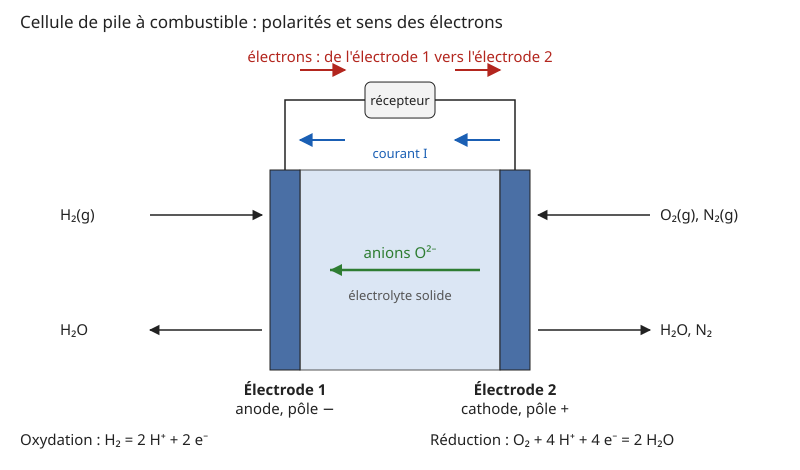
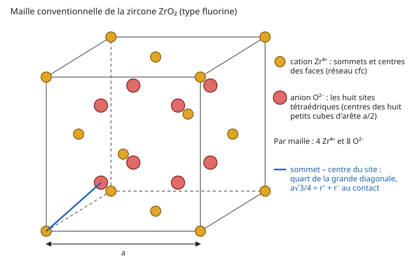
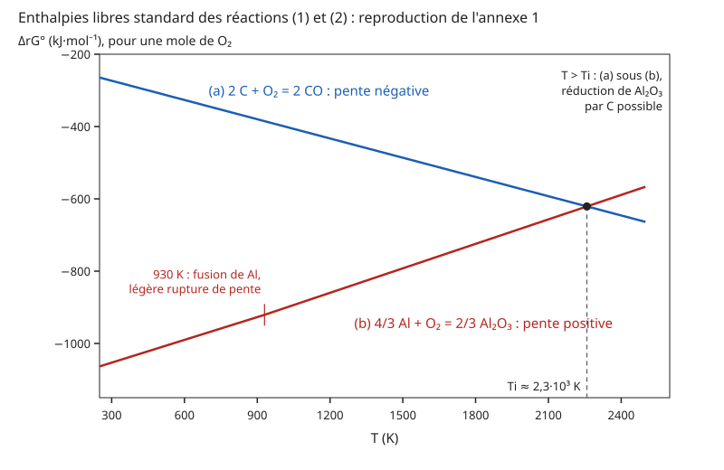
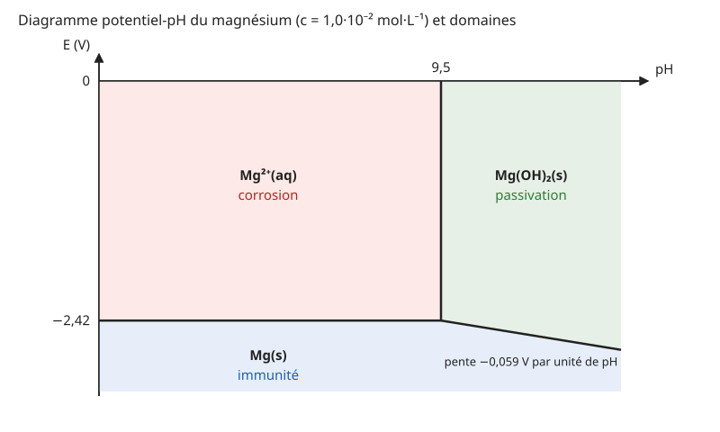

# Banque PT PT — Physique B - Chimie 2015 · Corrigé guidé

*Corrigé rédigé par IA, non officiel. Signalez toute erreur.*

**Rédaction** · modèle exact non renseigné (famille Claude) · effort non renseigné · vitesse non renseignée

**Révision (tour 2)** · modèle exact non renseigné (famille Claude) · effort non renseigné · vitesse non renseignée · 28 novembre 2026

## Présentation du sujet

**Thème.** Les céramiques, des matériaux traditionnels à l'énergie du futur : chimie de trois oxydes (zircone, alumine, magnésie). L'épreuve dure 2 heures, **sans calculatrice**, et comporte 40 questions réparties en trois parties indépendantes, avec deux annexes à exploiter (elles ne sont pas à rendre) et un tableau périodique.

- *Partie I (21 questions)* : pile à combustible à oxyde solide. Généralités (I.1.1 à I.1.7) : schémas de Lewis, électrodes, demi-équations, quantité de dihydrogène embarquée. Électrolyte (I.2.1 à I.2.11) : configurations électroniques du titane et du zirconium, maille cfc, sites tétraédriques, formule, coordinences et masse volumique de la zircone. Dopage à l'yttrium (I.3.1 à I.3.3) : électroneutralité et lacunes.
- *Partie II (14 questions)* : obtention de l'aluminium. Voie sèche (II.1.1 à II.1.9) : approximation d'Ellingham, attribution de deux courbes $\Delta_r G^\circ(T)$, réduction de l'alumine par le carbone. Électrolyse (II.2.1 à II.2.5) : réactions aux électrodes, bilan, enthalpie libre standard.
- *Partie III (5 questions)* : magnésium en solution aqueuse : diagramme potentiel-pH, potentiel standard, produit de solubilité, anode sacrificielle.

**Notions mobilisées.** Configuration électronique et classification périodique, schéma de Lewis, piles et électrolyses, cristaux métalliques et ioniques, enthalpie libre standard de réaction et constante d'équilibre, loi de Hess, relation de Nernst, diagrammes potentiel-pH, produit de solubilité, corrosion et protection, loi de Faraday.

**Difficulté.** Le sujet reste très proche du cours des deux années et les calculs sont courts. Les points se gagnent sur la précision des définitions et des justifications. D'après le rapport, la pile à combustible et le magnésium ont été bien traités ; les difficultés portent sur la famille du titane et du zirconium, les sites tétraédriques, la formule de la zircone, la consigne d'écriture pour une mole de dioxygène et surtout l'électrolyse de l'alumine, partie la moins réussie.

**Gestion du temps.** Environ 50 minutes pour la partie I, 45 minutes pour la partie II et 20 minutes pour la partie III, en gardant 5 minutes de relecture. Les parties sont indépendantes : la partie III, courte et classique, peut être traitée tôt.

> [!JURY]
> Le rapport 2015 constate que les consignes de présentation ont été bien suivies et que la rédaction est plutôt soignée, mais relève de nombreuses fautes d'orthographe et de syntaxe dans les réponses rédigées. Beaucoup de candidats peinent à expliquer et à commenter clairement leurs réponses : le jury recommande la rigueur, tant scientifique que rédactionnelle. Il observe aussi que les candidats ont cherché à répondre à presque toutes les questions, peut-être au détriment de la réflexion et de la rédaction.

[Sujet officiel](https://www.banquept.fr/documents/2015/ph_b_ch_2015_pt.pdf) · [Rapport du jury](https://www.banquept.fr/documents/ecrit/rapport/2015/rapport_phys_b_ecrit_2015.pdf)

*Mode d'emploi* : chercher chaque question seul, lire la première indication en cas de blocage, réessayer, puis la seconde, et seulement ensuite la solution.

## Partie I — Les piles à combustible à oxyde solide

**I.1 — Généralités**

### Question I.1.1

> [!INDICATION]
> Les réactifs sont le dihydrogène et le dioxygène, le produit est l'eau : deux éléments seulement sont à traiter. Leurs numéros atomiques se lisent dans le tableau périodique fourni.

> [!INDICATION]
> Pour chaque molécule, compter les électrons de valence, en déduire le nombre de doublets, puis les répartir pour que H respecte la règle du duet et O celle de l'octet.

#### Solution

Les réactifs sont $\mathrm{H_2}$ et $\mathrm{O_2}$, le produit est $\mathrm{H_2O}$ (le diazote de l'air ne réagit pas). Les atomes constitutifs sont donc l'hydrogène ($Z = 1$) et l'oxygène ($Z = 8$) :

$$\boxed{\mathrm{H} : 1s^1 \qquad \mathrm{O} : 1s^2\,2s^2\,2p^4}$$

L'hydrogène possède 1 électron de valence, l'oxygène 6 (couche $n = 2$).

| Molécule | Électrons de valence | Doublets | Schéma de Lewis |
|---|---|---|---|
| $\mathrm{H_2}$ | $2 \times 1 = 2$ | 1 | $\mathrm{H{-}H}$ |
| $\mathrm{O_2}$ | $2 \times 6 = 12$ | 6 | $\mathrm{\overline{\underline{O}}{=}\overline{\underline{O}}}$ |
| $\mathrm{H_2O}$ | $2 \times 1 + 6 = 8$ | 4 | $\mathrm{H{-}\overline{\underline{O}}{-}H}$ |

- $\mathrm{H_2}$ : une liaison simple, chaque hydrogène satisfait la règle du duet.
- $\mathrm{O_2}$ : une liaison double et deux doublets non liants sur chaque oxygène (octet respecté).
- $\mathrm{H_2O}$ : deux liaisons simples O–H et deux doublets non liants sur l'oxygène (octet pour O, duet pour H).

> [!JURY]
> Le rapport relève un nombre notable d'erreurs sur la structure électronique d'éléments aussi simples que l'hydrogène et l'oxygène.

> [!PIEGE]
> L'énoncé demande les schémas des **trois** molécules de la réaction ($\mathrm{H_2}$, $\mathrm{O_2}$, $\mathrm{H_2O}$) : ne pas oublier les doublets non liants de l'oxygène, et ne pas traiter le diazote, qui n'est ni réactif ni produit.

### Question I.1.2

> [!INDICATION]
> Repérer, sur le schéma, quel gaz arrive sur chaque électrode, puis dire si ce gaz est l'oxydant ou le réducteur de son couple.

> [!INDICATION]
> Anode = oxydation, cathode = réduction. Dans le circuit extérieur d'une pile, les électrons partent de l'électrode où ils sont libérés.

#### Solution

- L'électrode 1 est alimentée en dihydrogène, réducteur du couple $\mathrm{H^+/H_2}$ : il ne peut que s'oxyder. L'électrode 1 est le siège d'une oxydation : c'est l'**anode**.
- L'électrode 2 est alimentée en dioxygène (air), oxydant du couple $\mathrm{O_2/H_2O}$ : il ne peut que se réduire. L'électrode 2 est le siège d'une réduction : c'est la **cathode**.

Les électrons libérés par l'oxydation à l'anode traversent le circuit extérieur et sont consommés par la réduction à la cathode :

$$\boxed{\text{électrons : de l'électrode 1 (anode, pôle } -) \text{ vers l'électrode 2 (cathode, pôle } +)}$$

Le courant circule en sens inverse dans le circuit extérieur (de l'électrode 2 vers l'électrode 1). Dans l'électrolyte, le circuit est fermé par la migration des anions $\mathrm{O^{2-}}$, de la cathode vers l'anode.

> [!METHODE]
> Pour une pile comme pour un électrolyseur, la définition ne change pas : anode = oxydation, cathode = réduction. Seule la polarité change (anode négative dans une pile, positive dans un électrolyseur, voir la partie II.2).

### Question I.1.3

> [!INDICATION]
> Écrire chaque demi-équation dans le sens où elle se produit réellement : oxydation pour le dihydrogène, réduction pour le dioxygène, avec les couples donnés par l'énoncé.

#### Solution

Avec les couples de l'énoncé, quand la pile débite :

À l'anode (électrode 1), oxydation du dihydrogène :

$$\boxed{\mathrm{H_{2(g)}} = 2\,\mathrm{H^+} + 2\,e^-}$$

À la cathode (électrode 2), réduction du dioxygène :

$$\boxed{\mathrm{O_{2(g)}} + 4\,\mathrm{H^+} + 4\,e^- = 2\,\mathrm{H_2O}}$$

Remarque : dans une pile à oxyde solide, le porteur de charge de l'électrolyte est l'anion $\mathrm{O^{2-}}$ ; les mêmes transformations s'écrivent alors $\mathrm{O_2} + 4\,e^- = 2\,\mathrm{O^{2-}}$ à la cathode et $\mathrm{H_2} + \mathrm{O^{2-}} = \mathrm{H_2O} + 2\,e^-$ à l'anode. Le bilan est identique.

### Question I.1.4

> [!INDICATION]
> Le combustible est l'espèce oxydée : c'est donc un réducteur, consommé à l'anode.

#### Solution

L'espèce oxydée est le réducteur consommé à l'anode :

$$\boxed{\text{le combustible est le dihydrogène } \mathrm{H_2}}$$

Le dioxygène, qui est réduit, est le comburant.

### Question I.1.5

> [!INDICATION]
> Combiner les deux demi-équations de façon que le nombre d'électrons cédés soit égal au nombre d'électrons captés.

#### Solution

On ajoute deux fois la demi-équation d'oxydation à la demi-équation de réduction (4 électrons échangés) ; les ions $\mathrm{H^+}$ se simplifient :

$$\boxed{2\,\mathrm{H_{2(g)}} + \mathrm{O_{2(g)}} = 2\,\mathrm{H_2O}}$$

C'est l'équation de la combustion du dihydrogène, réalisée ici sans contact direct entre les réactifs.

### Question I.1.6

> [!INDICATION]
> La masse molaire à utiliser est celle de la molécule $\mathrm{H_2}$, pas celle de l'atome ; convertir la masse en grammes.

> [!INDICATION]
> Le volume molaire des gaz à 20 °C sous 1 atm est dans les données : 24 L/mol. Exprimer le résultat en mètres cubes pour pouvoir le commenter.

#### Solution

Masse molaire du dihydrogène : $M(\mathrm{H_2}) = 2 \times 1{,}0 = 2{,}0\ \mathrm{g\cdot mol^{-1}}$ (tableau périodique).

$$n(\mathrm{H_2}) = \frac{m}{M(\mathrm{H_2})}$$

$$n(\mathrm{H_2}) = \frac{1{,}5\cdot 10^{3}}{2{,}0} = 7{,}5\cdot 10^{2}\ \mathrm{mol}$$

$$\boxed{n(\mathrm{H_2}) \approx 7{,}5\cdot 10^{2}\ \mathrm{mol}}$$

Le gaz étant supposé parfait, avec $V_m = 24\ \mathrm{L\cdot mol^{-1}}$ à 20 °C sous une atmosphère :

$$V = n(\mathrm{H_2})\,V_m$$

$$V = 7{,}5\cdot 10^{2} \times 24 = 1{,}8\cdot 10^{4}\ \mathrm{L}$$

$$\boxed{V \approx 1{,}8\cdot 10^{4}\ \mathrm{L} = 18\ \mathrm{m^3}}$$

Ce volume, celui d'une petite pièce, est sans commune mesure avec celui d'un réservoir de voiture.

> [!JURY]
> Le rapport note que la notion de quantité de matière, pourtant élémentaire, reste une source d'erreurs dans cette partie.

> [!PIEGE]
> Deux fautes classiques : garder la masse en kilogrammes avec une masse molaire en grammes par mole, et prendre $1\ \mathrm{g\cdot mol^{-1}}$ (atome H) au lieu de $2\ \mathrm{g\cdot mol^{-1}}$ (molécule $\mathrm{H_2}$).

### Question I.1.7

> [!INDICATION]
> L'avantage se lit sur l'équation de la question I.1.5 (nature du produit). L'inconvénient se lit sur le résultat de la question I.1.6.

#### Solution

**Avantage.** Le seul produit de la réaction est l'eau : le véhicule n'émet à l'usage ni dioxyde de carbone (gaz à effet de serre), ni oxydes d'azote, ni particules, contrairement à la combustion d'un carburant carboné.

**Inconvénient majeur.** Le stockage du dihydrogène : 18 m³ de gaz à pression atmosphérique pour 250 km, ce qui impose de le comprimer très fortement (plusieurs centaines de bars) ou de le liquéfier, dans des réservoirs lourds et coûteux, alors que ce gaz est très inflammable et forme avec l'air des mélanges explosifs. On peut ajouter que le dihydrogène n'existe pas à l'état natif en quantité exploitable : il faut le produire, aujourd'hui surtout à partir d'hydrocarbures, ce qui émet du dioxyde de carbone en amont.

**I.2 — L'électrolyte**

### Question I.2.1

> [!INDICATION]
> Situer le titane dans le tableau périodique fourni : numéro de colonne et bloc. Le zirconium, juste en dessous, appartient à la même colonne.

#### Solution

Le titane ($Z = 22$) et le zirconium ($Z = 40$, juste en dessous) sont dans la colonne 4 de la classification, c'est-à-dire dans le bloc $d$ (colonnes 3 à 12) :

$$\boxed{\text{le zirconium est un métal de transition}}$$

Sa sous-couche $d$ est partiellement remplie (question I.2.2).

> [!JURY]
> Le rapport signale de grandes confusions sur le groupe auquel appartiennent le titane et le zirconium, avec des réponses incohérentes, voire fantaisistes, qu'il attribue à un manque de culture chimique.

### Question I.2.2

> [!INDICATION]
> Lire $Z$ dans le tableau périodique (22 et 40), puis remplir les sous-couches dans l'ordre $1s$, $2s$, $2p$, $3s$, $3p$, $4s$, $3d$, $4p$, $5s$, $4d$.

#### Solution

Titane, $Z = 22$ :

$$\boxed{\mathrm{Ti} : 1s^2\,2s^2\,2p^6\,3s^2\,3p^6\,4s^2\,3d^2}$$

Zirconium, $Z = 40$ :

$$\boxed{\mathrm{Zr} : 1s^2\,2s^2\,2p^6\,3s^2\,3p^6\,4s^2\,3d^{10}\,4p^6\,5s^2\,4d^2}$$

Contrôle : $2+2+6+2+6+2+2 = 22$ et $22 + 8 + 6 + 2 + 2 = 40$. Les deux éléments ont la même configuration de valence $ns^2\,(n-1)d^2$, soit 4 électrons de valence, ce qui confirme leur appartenance à la colonne 4 et explique l'existence de l'ion $\mathrm{Zr^{4+}}$.

### Question I.2.3

> [!INDICATION]
> L'une des règles fixe l'ordre de remplissage des sous-couches, l'autre le nombre maximal d'électrons par orbitale.

#### Solution

- **Règle de Klechkowski** : à l'état fondamental, les sous-couches se remplissent par valeurs croissantes de $n + \ell$ et, à $n + \ell$ égal, par valeurs croissantes de $n$.
- **Principe d'exclusion de Pauli** : deux électrons d'un même atome ne peuvent pas avoir leurs quatre nombres quantiques identiques ; une orbitale contient donc au plus deux électrons, de spins opposés (2 électrons en $s$, 6 en $p$, 10 en $d$).

La règle de Hund (dans une sous-couche incomplète, les électrons occupent le maximum d'orbitales avec des spins parallèles) précise la répartition dans la sous-couche $d$, mais ne sert pas à écrire la configuration elle-même.

### Question I.2.4

> [!INDICATION]
> Dans une maille cfc, les nœuds sont aux huit sommets et aux centres des six faces du cube.

> [!INDICATION]
> Un sommet est partagé entre huit mailles, un centre de face entre deux.

#### Solution

Les cations $\mathrm{Zr^{4+}}$ occupent les huit sommets du cube d'arête $a$ et les centres de ses six faces (cercles orangés de la figure 2).

Nombre de cations appartenant en propre à la maille :

$$N_+ = 8 \times \frac18 + 6 \times \frac12$$

$$\boxed{N_+ = 4 \text{ cations par maille}}$$

### Question I.2.5

> [!INDICATION]
> C'est un résultat de cours : fraction du volume de la maille occupée par des sphères identiques tangentes le long de la diagonale d'une face.

#### Solution

Pour un métal cristallisant en cfc (sphères identiques tangentes le long de la diagonale d'une face) :

$$\boxed{C = \frac{\pi\sqrt2}{6} \approx 0{,}74}$$

Commentaire : c'est la compacité maximale accessible à un empilement de sphères identiques (empilement compact). Il reste 26 % de vide, réparti dans les sites interstitiels octaédriques et tétraédriques, ce qui permet d'y loger d'autres ions. Cette valeur ne s'applique pas telle quelle à la zircone : dans un cristal ionique, les cations ne sont pas en contact entre eux.

### Question I.2.6

> [!INDICATION]
> Découper le cube en huit petits cubes d'arête $a/2$ et regarder quels nœuds entourent le centre de chacun.

#### Solution

Un site tétraédrique est le centre d'un tétraèdre régulier formé par un sommet de la maille et les centres des trois faces qui se coupent en ce sommet. Ces sites sont les centres des huit petits cubes d'arête $a/2$ obtenus en partageant la maille en huit ; ils sont situés au quart et aux trois quarts des grandes diagonales, aux positions $\left(\tfrac14\text{ ou }\tfrac34,\ \tfrac14\text{ ou }\tfrac34,\ \tfrac14\text{ ou }\tfrac34\right)$ en unité $a$ (cercles rouges de la figure 2).

Tous sont strictement à l'intérieur de la maille et lui appartiennent en propre :

$$\boxed{8 \text{ sites tétraédriques par maille}}$$

soit deux sites par nœud du réseau.

> [!JURY]
> D'après le rapport, la description des mailles est connue, mais celle des sites tétraédriques est souvent mal identifiée.

> [!PIEGE]
> Ne pas confondre avec les sites octaédriques (centre du cube et milieux des arêtes, 4 par maille).

### Question I.2.7

> [!INDICATION]
> Calculer la distance entre un sommet de la maille et le centre du petit cube d'arête $a/2$ dont il est un sommet.

> [!INDICATION]
> Cette distance vaut la demi-diagonale du petit cube. L'insertion se fait sans déformation tant que la somme des rayons ne la dépasse pas.

#### Solution

Le centre d'un site tétraédrique est à la distance $d$ de chacun de ses quatre cations voisins, égale à la demi-diagonale d'un petit cube d'arête $a/2$, c'est-à-dire au quart de la grande diagonale de la maille :

$$d = \frac12 \times \frac{a}{2}\sqrt3 = \frac{a\sqrt3}{4}$$

L'anion se loge sans écarter les cations si $r^+ + r^- \leqslant d$. Le rayon maximal correspond au contact anion-cation :

$$\boxed{r^-_{\max} = \frac{a\sqrt3}{4} - r^+}$$

Vérification : l'expression est homogène à une longueur, et elle diminue quand $r^+$ augmente (moins de place disponible). Dans le cas limite d'un empilement compact, où $4\,r^+ = a\sqrt2$, on retrouve le résultat classique $r^-_{\max} = \left(\sqrt{3/2} - 1\right) r^+ \approx 0{,}22\,r^+$.

### Question I.2.8

> [!INDICATION]
> Tous les sites tétraédriques sont occupés et tous sont intérieurs à la maille.

#### Solution

Les huit sites tétraédriques sont occupés et appartiennent en propre à la maille :

$$\boxed{N_- = 8 \text{ anions } \mathrm{O^{2-}} \text{ par maille}}$$

### Question I.2.9

> [!INDICATION]
> Rapporter le contenu de la maille (questions I.2.4 et I.2.8) au plus petit motif entier, puis vérifier l'électroneutralité.

#### Solution

La maille contient 4 cations $\mathrm{Zr^{4+}}$ et 8 anions $\mathrm{O^{2-}}$, soit le motif $\mathrm{Zr_4O_8}$, c'est-à-dire quatre unités formulaires :

$$\boxed{\mathrm{ZrO_2}}$$

Vérification par les charges : $4 \times (+4) + 8 \times (-2) = 0$, la maille est bien neutre.

> [!JURY]
> Le rapport indique que relativement peu de candidats ont su déduire des informations cristallographiques une écriture correcte de la formule de la zircone.

### Question I.2.10

> [!INDICATION]
> La coordinence est le nombre de plus proches voisins de signe opposé. Celle de l'anion découle de la nature du site qu'il occupe.

> [!INDICATION]
> Pour le cation, se placer au centre d'une face : il voit des anions dans la maille et dans la maille voisine.

#### Solution

- **Anion.** Un ion $\mathrm{O^{2-}}$ occupe le centre d'un tétraèdre de cations : il a 4 cations $\mathrm{Zr^{4+}}$ plus proches voisins, à la distance $a\sqrt3/4$.
- **Cation.** Un ion $\mathrm{Zr^{4+}}$ au centre d'une face est entouré de 4 anions dans la maille et de 4 anions dans la maille adjacente, tous à la distance $a\sqrt3/4$ : ces 8 anions forment un cube d'arête $a/2$ centré sur le cation.

$$\boxed{\text{coordinence de } \mathrm{O^{2-}} : 4 \qquad \text{coordinence de } \mathrm{Zr^{4+}} : 8}$$

Contrôle : le nombre de contacts compté depuis les cations ($4 \times 8$ par maille) est égal à celui compté depuis les anions ($8 \times 4$). C'est la structure de type fluorine.

### Question I.2.11

> [!INDICATION]
> Masse volumique = masse du contenu de la maille divisée par le volume de la maille. La masse d'un ion s'obtient en divisant la masse molaire par la constante d'Avogadro.

#### Solution

La maille, de volume $a^3$, contient 4 ions zirconium et 8 ions oxyde (la masse des électrons transférés est négligeable) :

$$\rho = \frac{m_{\text{maille}}}{V_{\text{maille}}}$$

$$m_{\text{maille}} = \frac{4\,M_{\mathrm{Zr}} + 8\,M_{\mathrm O}}{N_A}$$

$$\boxed{\rho = \frac{4\left(M_{\mathrm{Zr}} + 2\,M_{\mathrm O}\right)}{N_A\,a^3}}$$

Avec les masses molaires en $\mathrm{kg\cdot mol^{-1}}$ et $a$ en mètres, $\rho$ est en $\mathrm{kg\cdot m^{-3}}$.

> [!PIEGE]
> Le facteur 4 est le nombre d'unités formulaires $\mathrm{ZrO_2}$ par maille. L'oublier, ou oublier le 2 devant $M_{\mathrm O}$, sont les deux erreurs à éviter.

**I.3 — Dopage par l'oxyde d'yttrium**

### Question I.3.1

> [!INDICATION]
> L'oxyde est neutre et l'ion oxyde porte deux charges négatives.

#### Solution

L'oxyde $\mathrm{Y_2O_3}$ est neutre et contient trois ions $\mathrm{O^{2-}}$. Si $q$ est la charge du cation :

$$2\,q + 3 \times (-2) = 0$$

$$\boxed{q = +3 : \text{ion } \mathrm{Y^{3+}}}$$

C'est cohérent avec la position de l'yttrium ($Z = 39$, colonne 3) : il perd ses trois électrons de valence $5s^2\,4d^1$.

### Question I.3.2

> [!INDICATION]
> Compter la charge positive totale portée par une unité formulaire quand une fraction $x$ des $\mathrm{Zr^{4+}}$ est remplacée par des $\mathrm{Y^{3+}}$, le nombre d'anions restant inchangé.

#### Solution

Dans une unité formulaire, on remplace une fraction $x$ des cations $\mathrm{Zr^{4+}}$ par des cations $\mathrm{Y^{3+}}$, sans toucher aux deux anions $\mathrm{O^{2-}}$ :

$$q_+ = 4\,(1 - x) + 3\,x = 4 - x$$

$$q_- = 2 \times (-2) = -4$$

$$q_+ + q_- = -x \neq 0$$

Chaque substitution apporte une charge positive de moins : le solide $\mathrm{Zr_{1-x}Y_xO_2}$ porterait la charge $-x$ par unité formulaire. **L'électroneutralité n'est plus respectée** (excès de charge négative).

### Question I.3.3

> [!INDICATION]
> Laisser libre le nombre $y$ d'anions par unité formulaire et écrire que la charge totale est nulle.

#### Solution

On note $y$ le nombre d'ions $\mathrm{O^{2-}}$ par unité formulaire $\mathrm{Zr_{1-x}Y_xO_y}$. L'électroneutralité impose :

$$4\,(1 - x) + 3\,x - 2\,y = 0$$

$$y = 2 - \frac{x}{2}$$

$$\boxed{\mathrm{Zr_{1-x}Y_xO_{2-x/2}}}$$

Il faut donc retirer un anion $\mathrm{O^{2-}}$ pour deux cations $\mathrm{Y^{3+}}$ introduits. Rapporté à la maille (quatre unités formulaires), le nombre d'anions passe de 8 à $8 - 2x$ : une partie des sites tétraédriques reste vide. Ces lacunes d'oxygène permettent aux ions $\mathrm{O^{2-}}$ de sauter de site en site à haute température, ce qui rend la zircone dopée conductrice par ions oxyde : c'est la propriété recherchée pour l'électrolyte de la pile.

## Partie II — Obtention de l'aluminium à partir de l'alumine

**II.1 — Oxydation en voie sèche**

### Question II.1.1

> [!INDICATION]
> Écrire d'abord l'équation avec des coefficients entiers, puis diviser pour que le coefficient du dioxygène soit 1.

#### Solution

Avec des coefficients entiers, $4\,\mathrm{Al} + 3\,\mathrm{O_2} = 2\,\mathrm{Al_2O_3}$. En ramenant le coefficient du dioxygène à 1 :

$$\boxed{\tfrac43\,\mathrm{Al} + \mathrm{O_{2(g)}} = \tfrac23\,\mathrm{Al_2O_{3(s)}} \qquad (1)}$$

L'aluminium est solide pour $T < 930\ \mathrm K$ et liquide pour $T > 930\ \mathrm K$.

> [!JURY]
> Le rapport rappelle qu'une lecture attentive du sujet imposait d'écrire les équations pour une mole de dioxygène, et constate que de nombreux candidats n'ont pas respecté cette consigne.

### Question II.1.2

> [!INDICATION]
> Relation de définition entre les trois grandeurs standard de réaction, à la température $T$.

#### Solution

$$\boxed{\Delta_r G^\circ(T) = \Delta_r H^\circ(T) - T\,\Delta_r S^\circ(T)}$$

### Question II.1.3

> [!INDICATION]
> Si les deux grandeurs $\Delta_r H^\circ$ et $\Delta_r S^\circ$ sont des constantes, quelle est la nature de la fonction $T \mapsto \Delta_r G^\circ(T)$, et donc de son graphe ?

#### Solution

Dans cette approximation (dite d'Ellingham), $\Delta_r H^\circ$ et $\Delta_r S^\circ$ sont des constantes : $\Delta_r G^\circ$ est une fonction affine de $T$. Sa courbe représentative est donc

$$\boxed{\text{une droite (un segment de droite), de pente } -\Delta_r S^\circ \text{ et d'ordonnée à l'origine } \Delta_r H^\circ}$$

> [!JURY]
> Le rapport relève des confusions entre une fonction affine et sa représentation graphique : la fonction est affine, la courbe est une droite.

### Question II.1.4

> [!INDICATION]
> Le signe de $\Delta_r S^\circ$ se prévoit en comptant la variation du nombre de moles de gaz dans l'équation (1).

> [!INDICATION]
> Relier ce signe à la pente de la droite, puis regarder laquelle des deux courbes de l'annexe 1 monte. Contrôler avec l'ordonnée, proche de $\Delta_r H^\circ_1$ calculable avec les données.

#### Solution

Dans l'équation (1), le seul gaz est le dioxygène, consommé : la quantité de gaz varie de $\Delta\nu_{\text{gaz}} = -1$. Le désordre diminue fortement (un gaz disparaît, il ne reste que des phases condensées) :

$$\boxed{\Delta_r S^\circ_1 < 0}$$

La pente de la droite, $\dfrac{\mathrm d\,\Delta_r G^\circ_1}{\mathrm dT} = -\Delta_r S^\circ_1$, est donc positive : $\Delta_r G^\circ_1$ croît avec $T$. Sur l'annexe 1, la courbe croissante est la courbe (b) :

$$\boxed{\Delta_r G^\circ_1(T) \text{ est représentée par la courbe (b)}}$$

Contrôle par la loi de Hess avec les données :

$$\Delta_r H^\circ_1 = \tfrac23\,\Delta_f H^\circ(\mathrm{Al_2O_{3(s)}}) = \tfrac23 \times (-1674) = -1116\ \mathrm{kJ\cdot mol^{-1}}$$

La courbe (b) part d'environ $-1{,}06\cdot 10^{6}\ \mathrm{J\cdot mol^{-1}}$ à 250 K (lecture de l'annexe 1), valeur proche de $\Delta_r H^\circ_1$, alors que la courbe (a) part d'environ $-2{,}6\cdot 10^{5}\ \mathrm{J\cdot mol^{-1}}$.

### Question II.1.5

> [!INDICATION]
> L'approximation de la question II.1.3 vaut « en l'absence de changement d'état ». Chercher dans les données un changement d'état situé entre 250 K et 2 500 K.

> [!INDICATION]
> À 930 K l'aluminium fond : comparer $\Delta_r H^\circ$ et $\Delta_r S^\circ$ de part et d'autre de cette température à l'aide de l'enthalpie de fusion.

#### Solution

Non. L'intervalle $[250\ \mathrm K\,;\,2\,500\ \mathrm K]$ contient la température de fusion de l'aluminium, $T_{\text{fus}} = 930\ \mathrm K$. L'approximation d'Ellingham ne vaut que sur chaque intervalle sans changement d'état.

- Pour $T < 930\ \mathrm K$ : $\tfrac43\,\mathrm{Al_{(s)}} + \mathrm{O_{2(g)}} = \tfrac23\,\mathrm{Al_2O_{3(s)}}$, grandeurs $\Delta_r H^\circ_1$ et $\Delta_r S^\circ_1$.
- Pour $T > 930\ \mathrm K$ : $\tfrac43\,\mathrm{Al_{(l)}} + \mathrm{O_{2(g)}} = \tfrac23\,\mathrm{Al_2O_{3(s)}}$, obtenue en retranchant $\tfrac43$ fois la fusion $\mathrm{Al_{(s)}} = \mathrm{Al_{(l)}}$ :

$$\Delta_r H^{\circ\prime}_1 = \Delta_r H^\circ_1 - \tfrac43\,\Delta_{\text{fus}} H^\circ = -1116 - \tfrac43 \times 10{,}9 \approx -1131\ \mathrm{kJ\cdot mol^{-1}}$$

$$\Delta_r S^{\circ\prime}_1 = \Delta_r S^\circ_1 - \tfrac43\,\frac{\Delta_{\text{fus}} H^\circ}{T_{\text{fus}}} = \Delta_r S^\circ_1 - \tfrac43 \times \frac{10{,}9\cdot 10^{3}}{930} \approx \Delta_r S^\circ_1 - 16\ \mathrm{J\cdot K^{-1}\cdot mol^{-1}}$$

L'entropie standard de réaction est plus négative au-delà de 930 K (le réactif liquide est plus désordonné que le solide) : la pente $-\Delta_r S^\circ$ augmente.

$$\boxed{\text{La courbe (b) est formée de deux segments de droite, raccordés en } T = 930\ \mathrm K \text{ avec une rupture de pente}}$$

La courbe reste continue en 930 K, puisque $\Delta_{\text{fus}} G^\circ(T_{\text{fus}}) = 0$. La rupture est faible (16 $\mathrm{J\cdot K^{-1}\cdot mol^{-1}}$ sur une pente de l'ordre de 200) : on la devine à peine sur l'annexe 1, vers 930 K.

> [!PIEGE]
> Une fusion du **réactif** augmente la pente ; une fusion ou une vaporisation du **produit** la diminuerait. Raisonner sur le signe de la variation de $\Delta_r S^\circ$ plutôt que retenir une règle par cœur.

### Question II.1.6

> [!INDICATION]
> Écrire les deux équations avec un coefficient 1 pour le dioxygène, comme pour la réaction (1).

> [!INDICATION]
> Comparer, pour chacune, le nombre de moles de gaz à gauche et à droite : en déduire le signe de $\Delta_r S^\circ$, donc le sens de variation de la droite.

#### Solution

Pour une mole de dioxygène :

$$\boxed{\mathrm{C_{(s)}} + \mathrm{O_{2(g)}} = \mathrm{CO_{2(g)}}}$$

$$\boxed{2\,\mathrm{C_{(s)}} + \mathrm{O_{2(g)}} = 2\,\mathrm{CO_{(g)}}}$$

Nombres d'oxydation du carbone (l'oxygène étant à $-\mathrm{II}$) : $+\mathrm{IV}$ dans $\mathrm{CO_2}$, $+\mathrm{II}$ dans $\mathrm{CO}$.

Allure attendue :

- formation de $\mathrm{CO_2}$ : $\Delta\nu_{\text{gaz}} = 1 - 1 = 0$, donc $\Delta_r S^\circ \approx 0$ : droite quasi horizontale, voisine de $\Delta_r H^\circ = -393\ \mathrm{kJ\cdot mol^{-1}}$ ;
- formation de $\mathrm{CO}$ : $\Delta\nu_{\text{gaz}} = 2 - 1 = +1$, donc $\Delta_r S^\circ > 0$ : droite de pente $-\Delta_r S^\circ$ négative, donc décroissante.

La courbe restante, (a), est nettement décroissante : elle ne peut correspondre qu'à la formation du monoxyde de carbone.

$$\boxed{\text{courbe (a)} : 2\,\mathrm{C_{(s)}} + \mathrm{O_{2(g)}} = 2\,\mathrm{CO_{(g)}} \quad (2), \text{ carbone au degré } +\mathrm{II}, \text{ le plus faible}}$$

Contrôle : $\Delta_r H^\circ_2 = 2 \times (-110) = -220\ \mathrm{kJ\cdot mol^{-1}}$, compatible avec la valeur d'environ $-2{,}6\cdot 10^{5}\ \mathrm{J\cdot mol^{-1}}$ lue sur la courbe (a) à 250 K (la pente étant négative, la courbe est déjà un peu sous $\Delta_r H^\circ_2$).

### Question II.1.7

> [!INDICATION]
> Chercher la combinaison de (1) et (2) qui fait disparaître le dioxygène et place l'alumine du côté des réactifs.

> [!INDICATION]
> La constante d'équilibre est liée à $\Delta_r G^\circ$ par $\Delta_r G^\circ = -RT\ln K^\circ$.

#### Solution

On retranche (1) à (2), ce qui élimine le dioxygène :

$$\boxed{2\,\mathrm{C_{(s)}} + \tfrac23\,\mathrm{Al_2O_{3(s)}} = 2\,\mathrm{CO_{(g)}} + \tfrac43\,\mathrm{Al} \qquad (3) = (2) - (1)}$$

soit, avec des coefficients entiers (multiplication par $\tfrac32$), $\mathrm{Al_2O_3} + 3\,\mathrm{C} = 2\,\mathrm{Al} + 3\,\mathrm{CO}$.

$$\Delta_r G^\circ_3(T) = \Delta_r G^\circ_2(T) - \Delta_r G^\circ_1(T)$$

Comme $\Delta_r G^\circ_3 = -RT\ln K^\circ_3$ :

$$K^\circ_3 > 1 \iff \Delta_r G^\circ_3(T) < 0$$

$$\boxed{K^\circ_3 > 1 \iff \Delta_r G^\circ_2(T) < \Delta_r G^\circ_1(T)}$$

La courbe (a) du carbone doit se trouver sous la courbe (b) de l'aluminium.

### Question II.1.8

> [!INDICATION]
> La condition de la question II.1.7 se traduit par la position relative des deux courbes de l'annexe 1 : chercher leur point d'intersection.

> [!INDICATION]
> Lire l'abscisse de l'intersection en s'aidant des graduations 2 100 K et 2 400 K.

#### Solution

La courbe (a) est décroissante, la courbe (b) croissante : elles se coupent en un seul point, de température $T_i$. D'après la question II.1.7, la réduction est thermodynamiquement favorable ($K^\circ_3 > 1$) quand la courbe (a) passe sous la courbe (b), c'est-à-dire pour $T > T_i$.

Lecture de l'annexe 1 : l'intersection se situe entre les graduations 2 100 K et 2 400 K, un peu au-delà du milieu, vers 2 270 K, à l'ordonnée d'environ $-6{,}2\cdot 10^{5}\ \mathrm{J\cdot mol^{-1}}$.

$$\boxed{T_i \approx 2{,}3\cdot 10^{3}\ \mathrm K : \text{réduction possible pour } T > T_i}$$

Contrôle par le calcul, avec des pentes estimées sur l'annexe 1 (environ $-0{,}18\ \mathrm{kJ\cdot K^{-1}\cdot mol^{-1}}$ pour (a) et $+0{,}22\ \mathrm{kJ\cdot K^{-1}\cdot mol^{-1}}$ pour (b) au-delà de 930 K) et les ordonnées à l'origine $-220$ et $-1131\ \mathrm{kJ\cdot mol^{-1}}$ :

$$T_i \approx \frac{1131 - 220}{0{,}18 + 0{,}22} \approx 2{,}3\cdot 10^{3}\ \mathrm K$$

En dessous de $T_i$, c'est au contraire l'aluminium qui réduit le monoxyde de carbone.

> [!METHODE]
> Dans un diagramme tracé pour une mole de dioxygène, un réducteur réduit l'oxyde de tout couple dont la droite est située **au-dessus** de la sienne. Reproduire le croisement des deux droites et repérer la zone utile suffit à justifier la réponse.

### Question II.1.9

> [!INDICATION]
> Comparer la température de l'électrolyse (1 230 K) à celle trouvée à la question II.1.8.

#### Solution

La réduction par le carbone exige une température supérieure à $2{,}3\cdot 10^{3}\ \mathrm K$, presque le double de celle de l'électrolyse (1 230 K) : le coût énergétique et la tenue des matériaux à une telle température la rendent impraticable.

$$\boxed{\text{L'aluminium est produit industriellement par électrolyse de l'alumine}}$$

Remarque : c'est l'inverse pour les oxydes de fer, que le carbone et le monoxyde de carbone réduisent dès des températures bien plus basses (haut fourneau).

**II.2 — Électrolyse de l'alumine**

### Question II.2.1

> [!INDICATION]
> Partir des configurations électroniques de valence de l'aluminium ($Z = 13$) et de l'oxygène : quels ions leur donnent la configuration du gaz noble le plus proche ?

#### Solution

- Aluminium, $Z = 13$ : $1s^2\,2s^2\,2p^6\,3s^2\,3p^1$. Métal peu électronégatif, il perd ses trois électrons de valence pour acquérir la configuration du néon : ion $\mathrm{Al^{3+}}$.
- Oxygène, $Z = 8$ : $1s^2\,2s^2\,2p^4$. Très électronégatif, il gagne deux électrons pour acquérir la configuration du néon : ion $\mathrm{O^{2-}}$.

$$\boxed{\mathrm{Al_2O_3} \text{ est constituée d'ions } \mathrm{Al^{3+}} \text{ et } \mathrm{O^{2-}}}$$

L'électroneutralité est vérifiée : $2 \times (+3) + 3 \times (-2) = 0$. La dissociation dans le solvant fondu s'écrit $\mathrm{Al_2O_3} = 2\,\mathrm{Al^{3+}} + 3\,\mathrm{O^{2-}}$.

> [!JURY]
> Le rapport indique que la partie sur l'électrolyse de l'alumine est la moins bien traitée du sujet, peut-être parce qu'elle est moins connue des candidats.

### Question II.2.2

> [!INDICATION]
> Comparer le nombre d'oxydation du carbone dans le graphite et dans le dioxyde de carbone : est-ce une oxydation ou une réduction ?

> [!INDICATION]
> Seuls les ions de l'alumine sont disponibles pour équilibrer : l'oxygène du dioxyde de carbone vient des ions oxyde.

#### Solution

Le carbone passe du nombre d'oxydation 0 (graphite) à $+\mathrm{IV}$ (dioxyde de carbone) : c'est une oxydation. L'électrode de graphite, qui est consommée, est donc l'**anode** (reliée au pôle positif du générateur). Les ions $\mathrm{O^{2-}}$ y apportent l'oxygène :

$$\boxed{\mathrm{C_{(s)}} + 2\,\mathrm{O^{2-}} = \mathrm{CO_{2(g)}} + 4\,e^-}$$

Vérification des charges : $-4$ à gauche, $-4$ à droite.

> [!PIEGE]
> Dans un électrolyseur, l'anode est reliée au pôle **positif** du générateur : la polarité est inversée par rapport à la pile de la partie I, mais l'anode reste le lieu de l'oxydation.

### Question II.2.3

> [!INDICATION]
> L'aluminium métallique provient des ions $\mathrm{Al^{3+}}$ : gain ou perte d'électrons ?

#### Solution

L'aluminium passe de $+\mathrm{III}$ (ion $\mathrm{Al^{3+}}$) à 0 (métal) : c'est une réduction. L'électrode d'aluminium liquide est donc la **cathode** (reliée au pôle négatif du générateur) :

$$\boxed{\mathrm{Al^{3+}} + 3\,e^- = \mathrm{Al_{(l)}}}$$

### Question II.2.4

> [!INDICATION]
> Le plus petit multiple commun de 4 et de 3 électrons est 12.

#### Solution

On multiplie la demi-équation anodique par 3 et la demi-équation cathodique par 4 (12 électrons échangés) :

$$4\,\mathrm{Al^{3+}} + 6\,\mathrm{O^{2-}} + 3\,\mathrm{C_{(s)}} = 4\,\mathrm{Al_{(l)}} + 3\,\mathrm{CO_{2(g)}}$$

soit, en regroupant les ions en alumine :

$$\boxed{2\,\mathrm{Al_2O_3} + 3\,\mathrm{C_{(s)}} = 4\,\mathrm{Al_{(l)}} + 3\,\mathrm{CO_{2(g)}}}$$

### Question II.2.5

> [!INDICATION]
> Pour une réaction d'oxydoréduction échangeant $n$ électrons, $\Delta_r G^\circ$ vaut $n\,F$ fois une différence de potentiels standard. Bien compter $n$ pour l'équation écrite.

> [!INDICATION]
> Fixer le signe par un argument physique : une électrolyse est une transformation forcée, sa réaction n'est pas favorable thermodynamiquement.

#### Solution

L'équation de la question II.2.4 échange $n = 12$ électrons. L'électrolyse force la réaction entre l'oxydant du couple de plus bas potentiel ($\mathrm{Al^{3+}}$) et le réducteur du couple de plus haut potentiel (le carbone) : c'est le sens non spontané. En notant $\Delta E^\circ = E^\circ(\mathrm{CO_2/C}) - E^\circ(\mathrm{Al^{3+}/Al}) = 2{,}5\ \mathrm V$ :

$$\Delta_r G^\circ = -n\,F\left[E^\circ(\mathrm{Al^{3+}/Al}) - E^\circ(\mathrm{CO_2/C})\right] = +\,n\,F\,\Delta E^\circ$$

$$\Delta_r G^\circ = 12 \times 10^{5} \times 2{,}5 = 3{,}0\cdot 10^{6}\ \mathrm{J\cdot mol^{-1}}$$

$$\boxed{\Delta_r G^\circ(1230\ \mathrm K) \approx +3{,}0\cdot 10^{3}\ \mathrm{kJ\cdot mol^{-1}} \text{ pour } 2\,\mathrm{Al_2O_3} + 3\,\mathrm C = 4\,\mathrm{Al} + 3\,\mathrm{CO_2}}$$

Rapportée à une mole d'alumine (6 électrons), cette valeur devient $+1{,}5\cdot 10^{3}\ \mathrm{kJ\cdot mol^{-1}}$. Le signe positif traduit une constante d'équilibre très inférieure à 1 : la réaction n'a lieu que si le générateur fournit l'énergie, sous une tension au moins égale à 2,5 V.

Remarque sur l'ordre de grandeur : la même réaction s'obtient en combinant $\mathrm C + \mathrm{O_2} = \mathrm{CO_2}$ ($\Delta_r G^\circ \approx \Delta_f H^\circ(\mathrm{CO_2}) = -393\ \mathrm{kJ\cdot mol^{-1}}$, presque indépendant de $T$ puisque la quantité de gaz ne change pas) et la réaction (1), dont l'annexe 1 donne $\Delta_r G^\circ_1 \approx -855\ \mathrm{kJ\cdot mol^{-1}}$ à 1 230 K : $\Delta_r G^\circ \approx 3 \times (855 - 393) \approx 1{,}4\cdot 10^{3}\ \mathrm{kJ\cdot mol^{-1}}$, soit une différence de potentiels d'environ 1,2 V. La valeur de 2,5 V fournie par l'énoncé conduit donc à un résultat à peu près deux fois plus grand, sans que le sujet permette d'expliquer cet écart ; c'est elle qu'il faut utiliser ici, puisque la question demande d'en déduire $\Delta_r G^\circ$.

> [!PIEGE]
> La valeur de $\Delta_r G^\circ$ dépend de l'écriture de l'équation : toujours annoncer l'équation et le nombre d'électrons auxquels elle se rapporte.

## Partie III — Magnésium en solution aqueuse

### Question III.1

> [!INDICATION]
> Donner des définitions générales, valables pour n'importe quel métal, avant de les appliquer au magnésium.

> [!INDICATION]
> Dans le diagramme, chercher le domaine du métal lui-même, celui de l'ion dissous et celui du solide oxydé.

#### Solution

Définitions générales, pour un métal M :

- **Corrosion** : oxydation du métal en une espèce soluble (ion en solution) ; le métal est attaqué et se dissout. Elle concerne les domaines de prédominance des formes oxydées dissoutes.
- **Immunité** : le métal est la forme thermodynamiquement stable ; il ne peut pas être oxydé. Elle concerne le domaine d'existence du métal.
- **Passivation** : le métal est oxydé en un solide (oxyde ou hydroxyde) qui se dépose à sa surface et peut le protéger d'une attaque ultérieure. Elle concerne les domaines d'existence des formes oxydées solides. La protection n'est réelle que si la couche est adhérente et imperméable.

Application au magnésium (annexe 2, reproduite sur la figure 4) :

$$\boxed{\mathrm{Mg_{(s)}} : \text{immunité} \qquad \mathrm{Mg^{2+}_{(aq)}} : \text{corrosion} \qquad \mathrm{Mg(OH)_{2(s)}} : \text{passivation}}$$

- immunité : sous la frontière horizontale $E = -2{,}42\ \mathrm V$ (pH < 9,5) puis sous la frontière oblique (pH > 9,5) ;
- corrosion : au-dessus de $-2{,}42\ \mathrm V$ et pour pH < 9,5 ;
- passivation : au-dessus de la frontière oblique et pour pH > 9,5.

> [!JURY]
> Le rapport juge cette partie bien traitée, mais regrette que les définitions de corrosion, immunité et passivation aient rarement été précises : elles se limitaient très souvent au seul exemple du magnésium. Il ajoute que certains candidats, malgré des définitions convenables, n'ont pas su placer correctement les domaines sur le graphe.

### Question III.2

> [!INDICATION]
> Écrire la relation de Nernst du couple $\mathrm{Mg^{2+}/Mg}$ et l'appliquer sur la frontière horizontale, où la concentration de l'ion est égale à la concentration de travail.

> [!INDICATION]
> Le potentiel lu sur le diagramme n'est pas le potentiel standard : la concentration vaut $10^{-2}\ \mathrm{mol\cdot L^{-1}}$, et non $1\ \mathrm{mol\cdot L^{-1}}$.

#### Solution

Demi-équation : $\mathrm{Mg^{2+}} + 2\,e^- = \mathrm{Mg_{(s)}}$. Relation de Nernst à 25 °C, avec $c^\circ = 1\ \mathrm{mol\cdot L^{-1}}$ :

$$E = E^\circ(\mathrm{Mg^{2+}/Mg}) + \frac{0{,}059}{2}\log\frac{[\mathrm{Mg^{2+}}]}{c^\circ}$$

Sur la frontière, $[\mathrm{Mg^{2+}}] = c_{\text{tr}} = 1{,}0\cdot 10^{-2}\ \mathrm{mol\cdot L^{-1}}$ et $E = -2{,}42\ \mathrm V$ (lu sur l'annexe 2) :

$$-2{,}42 = E^\circ + \frac{0{,}059}{2} \times (-2) = E^\circ - 0{,}059$$

$$E^\circ = -2{,}42 + 0{,}059$$

$$\boxed{E^\circ(\mathrm{Mg^{2+}/Mg}) \approx -2{,}36\ \mathrm V}$$

Ce potentiel très bas fait du magnésium un métal très réducteur.

### Question III.3

> [!INDICATION]
> Sur la frontière verticale, le premier grain d'hydroxyde apparaît alors que la concentration en ions magnésium vaut encore la concentration de travail.

> [!INDICATION]
> Passer du pH à la concentration en ions hydroxyde grâce au produit ionique de l'eau, puis écrire le produit de solubilité.

#### Solution

Équilibre de dissolution : $\mathrm{Mg(OH)_{2(s)}} = \mathrm{Mg^{2+}} + 2\,\mathrm{HO^-}$, de constante

$$K_s = [\mathrm{Mg^{2+}}]\,[\mathrm{HO^-}]^2$$

(concentrations en $\mathrm{mol\cdot L^{-1}}$). Sur la frontière verticale, à pH = 9,5 (lu sur l'annexe 2), le solide commence à exister avec $[\mathrm{Mg^{2+}}] = c_{\text{tr}}$ :

$$[\mathrm{HO^-}] = \frac{K_e}{[\mathrm{H_3O^+}]} = 10^{-14 + 9{,}5} = 10^{-4{,}5}\ \mathrm{mol\cdot L^{-1}}$$

$$K_s = 1{,}0\cdot 10^{-2} \times \left(10^{-4{,}5}\right)^2 = 10^{-2} \times 10^{-9}$$

$$\boxed{K_s = 1{,}0\cdot 10^{-11} \qquad (\mathrm pK_s = 11)}$$

> [!PIEGE]
> Ne pas oublier le carré sur $[\mathrm{HO^-}]$ ni le facteur $c_{\text{tr}}$ : le pH de début de précipitation n'est pas directement le $\mathrm pK_s$.

### Question III.4

> [!INDICATION]
> Comparer les potentiels standard des couples du magnésium (question III.2) et du fer (données) : lequel des deux métaux est le meilleur réducteur ?

> [!INDICATION]
> Le métal qui s'oxyde joue le rôle d'anode ; l'autre, relié électriquement, reçoit les électrons et se trouve protégé.

#### Solution

$E^\circ(\mathrm{Mg^{2+}/Mg}) = -2{,}36\ \mathrm V$ est très inférieur à $E^\circ(\mathrm{Fe^{2+}/Fe}) = -0{,}44\ \mathrm V$ : le magnésium est un réducteur bien plus fort que le fer. Les deux métaux étant reliés électriquement et plongés dans le même milieu conducteur (sol humide), ils forment une pile dans laquelle c'est le magnésium qui s'oxyde à la place du fer.

$$\boxed{\text{L'électrode de magnésium est l'anode (anode sacrificielle)}}$$

En milieu acide (pH < 9,5), la forme oxydée stable est l'ion $\mathrm{Mg^{2+}}$ :

$$\boxed{\mathrm{Mg_{(s)}} = \mathrm{Mg^{2+}} + 2\,e^-}$$

Les électrons libérés rejoignent la canalisation, qui devient la cathode : l'oxydant du milieu s'y réduit (en milieu acide, $2\,\mathrm{H^+} + 2\,e^- = \mathrm{H_{2(g)}}$) sans que le fer soit attaqué. Le potentiel de la fonte est abaissé vers son domaine d'immunité ; la protection dure tant qu'il reste du magnésium.

### Question III.5

> [!INDICATION]
> Relier la charge totale débitée $I\,t$ à la quantité de matière d'électrons, puis celle-ci à la quantité de magnésium consommée grâce à la demi-équation de la question III.4.

#### Solution

L'électrode est hors d'usage quand toute la masse $m$ de magnésium est oxydée. D'après $\mathrm{Mg} = \mathrm{Mg^{2+}} + 2\,e^-$ :

$$n(e^-) = 2\,n(\mathrm{Mg}) = \frac{2\,m}{M(\mathrm{Mg})}$$

La charge débitée pendant la durée $t$ à intensité constante est :

$$Q = I\,t = n(e^-)\,F$$

$$\boxed{t = \frac{2\,m\,F}{M(\mathrm{Mg})\,I}}$$

Homogénéité : $\dfrac{\mathrm{g} \times \mathrm{C\cdot mol^{-1}}}{\mathrm{g\cdot mol^{-1}} \times \mathrm{A}} = \dfrac{\mathrm C}{\mathrm A} = \mathrm s$. La durée de vie est proportionnelle à la masse de l'électrode et inversement proportionnelle au courant de protection.

> [!PIEGE]
> Le facteur 2 (deux électrons par atome de magnésium) est l'oubli le plus courant ; $m$ et $M$ doivent être exprimées dans des unités cohérentes.

## Bilan

**Ce qu'il faut retenir.**

- *Piles et électrolyses* : anode = oxydation, cathode = réduction, dans les deux cas ; les électrons vont de l'anode à la cathode par le circuit extérieur ; seule la polarité s'inverse entre pile et électrolyseur.
- *Atomistique* : Klechkowski et Pauli pour écrire une configuration ; le bloc $d$ (colonnes 3 à 12) est celui des métaux de transition ; un schéma de Lewis se construit en comptant les doublets de valence.
- *Cristallographie* : maille cfc, 4 nœuds, compacité 0,74 ; 8 sites tétraédriques aux centres des petits cubes d'arête $a/2$, à la distance $a\sqrt3/4$ des nœuds voisins ; la formule d'un cristal ionique se déduit du contenu de la maille et se contrôle par l'électroneutralité.
- *Approximation d'Ellingham* : $\Delta_r G^\circ = \Delta_r H^\circ - T\,\Delta_r S^\circ$ est affine par morceaux ; le signe de la pente se prévoit avec la variation du nombre de moles de gaz ; chaque changement d'état donne une rupture de pente ; pour une mole de dioxygène, un réducteur réduit les oxydes dont la droite est au-dessus de la sienne.
- *Diagramme potentiel-pH* : immunité (métal), corrosion (ion dissous), passivation (solide oxydé) ; une frontière horizontale donne $E^\circ$ par la relation de Nernst à la concentration de travail, une frontière verticale donne $K_s$.
- *Loi de Faraday* : $I\,t = n(e^-)\,F$, avec le bon nombre d'électrons par atome.

**Résultats numériques.** $n(\mathrm{H_2}) \approx 7{,}5\cdot 10^{2}$ mol et $V \approx 18\ \mathrm{m^3}$ ; 4 cations et 8 anions par maille, formule $\mathrm{ZrO_2}$, coordinences 8 et 4 ; zircone dopée $\mathrm{Zr_{1-x}Y_xO_{2-x/2}}$ ; $\Delta_r H^\circ_1 = -1116\ \mathrm{kJ\cdot mol^{-1}}$ ; $T_i \approx 2{,}3\cdot 10^{3}$ K ; $\Delta_r G^\circ \approx +3{,}0\cdot 10^{3}\ \mathrm{kJ\cdot mol^{-1}}$ pour l'électrolyse écrite avec 12 électrons ; $E^\circ(\mathrm{Mg^{2+}/Mg}) \approx -2{,}36$ V ; $K_s = 10^{-11}$ ; $t = 2\,m\,F/(M\,I)$.

**Erreurs relevées par le jury.** Structure électronique de l'hydrogène et de l'oxygène ; calcul d'une quantité de matière ; famille du titane et du zirconium ; position des sites tétraédriques ; formule de la zircone ; équations non rapportées à une mole de dioxygène ; confusion entre fonction affine et droite ; électrolyse de l'alumine ; définitions de corrosion, immunité et passivation limitées au cas du magnésium, domaines mal placés.

**Pour s'entraîner.** Refaire sans aide les questions I.2.6 à I.2.11, puis l'enchaînement II.1.4 à II.1.8 en reproduisant le diagramme à main levée, enfin II.2.2 à II.2.5 en soignant le décompte des électrons.
