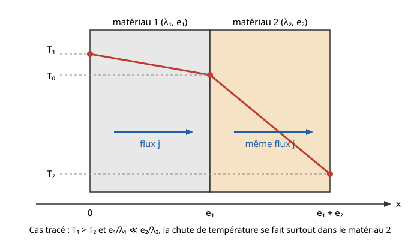
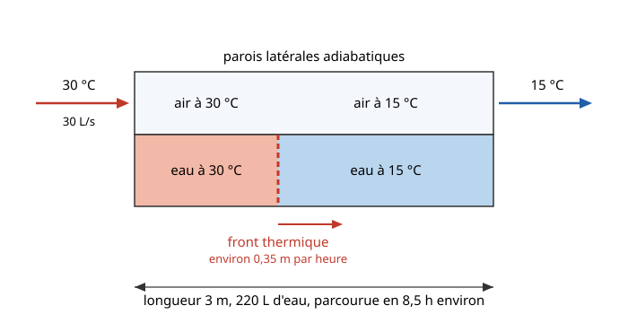

# Banque PT PT — Physique B - Thermodynamique 2015 · Corrigé guidé

*Corrigé rédigé par IA, non officiel. Signalez toute erreur.*

**Rédaction** · modèle exact non renseigné (famille Claude) · effort non renseigné · vitesse non renseignée

**Révision (tour 2)** · modèle exact non renseigné (famille Claude) · effort non renseigné · vitesse non renseignée · 28 novembre 2026

## Présentation du sujet

**Thème.** L'habitat : isolation thermique, alimentation en eau et rafraîchissement. L'épreuve dure 2 heures, **sans calculatrice**, et comporte 24 questions numérotées de 1 à 24, réparties en trois parties indépendantes.

- *Partie I (questions 1 à 9)* : conduction thermique. Loi de Fourier, équation de la chaleur et temps de diffusion, régime stationnaire, résistance thermique, mur à deux couches, ordres de grandeur, intérêt du polystyrène, échange conducto-convectif à une paroi.
- *Partie II (questions 10 à 16)* : mécanique des fluides. Château d'eau, formule de Torricelli, débit, pertes de charge mesurées par deux tubes piézométriques, puissance d'une pompe.
- *Partie III (questions 17 à 24)* : thermodynamique d'un « déphaseur », canal où l'air chaud cède de l'énergie à de l'eau immobile. Capacité thermique de l'air, bilan d'un écoulement stationnaire, durée de fonctionnement, efficacité, comparaison avec un réfrigérateur réversible.

**Notions mobilisées.** Loi de Fourier, bilan d'énergie local, résistances thermiques en série, loi de Newton ; conservation du débit, relation de Bernoulli et pertes de charge, bilan d'énergie mécanique avec pompe ; gaz parfait, relation de Mayer, premier principe en écoulement stationnaire, machines dithermes et second principe.

**Difficulté.** Le sujet est très proche du cours de PTSI et de PT. Les points se gagnent sur la rigueur des démonstrations (questions 2, 19 et 22), la connaissance des ordres de grandeur (questions 6, 7 et 22) et la capacité à mener une application numérique à la main, avec les bonnes unités. Les questions 7 et 21 demandent de l'initiative : choisir des valeurs, poser une hypothèse. Les figures du sujet sont des schémas de principe, sans valeur à y lire.

**Gestion du temps.** Environ 45 minutes pour la partie I, 30 minutes pour la partie II et 40 minutes pour la partie III, en gardant 5 minutes de relecture. Les parties sont indépendantes : on peut commencer par celle que l'on maîtrise le mieux, en traitant ensuite ses questions dans l'ordre.

> [!JURY]
> Le rapport 2015 constate qu'un grand nombre de candidats renoncent aux applications numériques, et que celles qui sont faites comportent beaucoup d'erreurs d'unités ou restent inachevées. Il recommande de poser l'application numérique avant de donner le résultat, rappelle que tout résultat doit être commenté, et insiste sur la présentation : encre lisible, résultats encadrés, questions traitées dans l'ordre du sujet, sans allers-retours entre les parties. Sa conclusion souligne que la seule connaissance de formules ne suffit pas : il faut comprendre les notions du cours de PTSI et de PT pour justifier clairement les raisonnements.

[Sujet officiel](https://www.banquept.fr/documents/2015/ph_b_th_2015_pt.pdf) · [Rapport du jury](https://www.banquept.fr/documents/ecrit/rapport/2015/rapport_phys_b_ecrit_2015.pdf)

*Mode d'emploi* : chercher chaque question seul, lire la première indication en cas de blocage, réessayer, puis la seconde, et seulement ensuite la solution.

## Partie I — Problème d'isolation

### Question 1 — Loi de Fourier

> [!INDICATION]
> La loi relie le vecteur densité de flux thermique au gradient de température. L'écrire sous forme vectorielle, pas seulement à une dimension.

> [!INDICATION]
> Pour les unités, partir de la définition du flux : une puissance par unité de surface. Pour le signe, se demander dans quel sens pointe un gradient et dans quel sens va la chaleur.

#### Solution

Dans un milieu où la température n'est pas uniforme, le vecteur densité de flux thermique est proportionnel au gradient de température :

$$\boxed{\vec{\jmath}_{th} = -\lambda\,\overrightarrow{\mathrm{grad}}\,T}$$

- $\vec{\jmath}_{th}$ : densité de flux thermique, en $\mathrm{W\cdot m^{-2}}$ (son flux à travers une surface est une puissance, en W) ;
- $T$ : température, en K, donc $\overrightarrow{\mathrm{grad}}\,T$ en $\mathrm{K\cdot m^{-1}}$ ;
- $\lambda$ : conductivité thermique du matériau, positive, en $\mathrm{W\cdot m^{-1}\cdot K^{-1}}$.

**Signe.** Le gradient de température est dirigé vers les températures croissantes. Or le transfert thermique spontané va des zones chaudes vers les zones froides (second principe). Le vecteur $\vec{\jmath}_{th}$ est donc opposé au gradient, ce que traduit le signe moins avec $\lambda > 0$. La loi est phénoménologique et linéaire : elle vaut pour des gradients modérés.

> [!JURY]
> Le rapport juge cette loi mal restituée : elle est donnée seulement dans le cas unidirectionnel, ou sans les vecteurs. La majorité des candidats ne connaît pas les unités des grandeurs. Le signe moins est très rarement justifié avec rigueur, alors qu'il suffit de dire que le gradient est orienté vers les températures croissantes.

### Question 2 — Équation de la chaleur et temps de diffusion

> [!INDICATION]
> Poser les hypothèses (problème à une dimension, pas de source interne, solide indéformable, $\mu$, $c$, $\lambda$ constants), puis faire un bilan d'énergie sur la tranche comprise entre $x$ et $x + \mathrm{d}x$ pendant $\mathrm{d}t$.

> [!INDICATION]
> Pour le temps caractéristique, raisonner en ordre de grandeur sur l'équation obtenue : $\partial T/\partial t \sim \Delta T/\tau$ et $\partial^2 T/\partial x^2 \sim \Delta T/L^2$.

#### Solution

**Hypothèses.** Le matériau est très étendu dans les directions transverses : la température ne dépend que de $x$ et de $t$, et $\vec{\jmath}_{th} = j(x,t)\,\vec{u}_x$. Le solide est indéformable et immobile (pas de travail), sans source interne d'énergie, et $\mu$, $c$, $\lambda$ sont uniformes et constants.

**Système.** La tranche de section $S$ comprise entre $x$ et $x + \mathrm{d}x$, de masse $\mu S\,\mathrm{d}x$.

**Bilan d'énergie entre $t$ et $t + \mathrm{d}t$.** La variation d'énergie interne de la tranche (phase condensée) est

$$\mathrm{d}U = \mu\,c\,S\,\mathrm{d}x\,\frac{\partial T}{\partial t}\,\mathrm{d}t$$

Le transfert thermique reçu est ce qui entre en $x$ moins ce qui sort en $x + \mathrm{d}x$ :

$$\delta Q = \big[j(x,t) - j(x+\mathrm{d}x,t)\big]\,S\,\mathrm{d}t = -\frac{\partial j}{\partial x}\,S\,\mathrm{d}x\,\mathrm{d}t$$

Le premier principe $\mathrm{d}U = \delta Q$ donne

$$\mu\,c\,\frac{\partial T}{\partial t} = -\frac{\partial j}{\partial x}$$

**Loi de Fourier.** Avec $j = -\lambda\,\partial T/\partial x$ :

$$\boxed{\frac{\partial T}{\partial t} = \frac{\lambda}{\mu\,c}\,\frac{\partial^2 T}{\partial x^2} = D\,\frac{\partial^2 T}{\partial x^2}}$$

où $D = \lambda/(\mu c)$ est la diffusivité thermique, en $\mathrm{m^2\cdot s^{-1}}$.

**Temps caractéristique.** Pour un écart de température $\Delta T$ qui s'établit sur une distance $L$ en une durée $\tau$, les deux membres sont d'ordres de grandeur $\Delta T/\tau$ et $D\,\Delta T/L^2$. D'où

$$\boxed{\tau \simeq \frac{L^2}{D} = \frac{\mu\,c\,L^2}{\lambda}}$$

Ce temps croît comme le carré de la distance : la diffusion est efficace sur de courtes distances, très lente sur de grandes. L'homogénéité est immédiate : $L^2/D$ est en $\mathrm{m^2/(m^2\cdot s^{-1})} = \mathrm{s}$.

> [!METHODE]
> Un bilan local se rédige toujours dans le même ordre : hypothèses, système élémentaire, variation de la grandeur stockée, échanges aux frontières, principe de conservation, puis loi phénoménologique. L'équation obtenue est aux dérivées partielles, du premier ordre en temps et du second ordre en espace.

> [!JURY]
> Le rapport parle d'une démonstration de cours souvent bâclée : hypothèses non posées, étapes non justifiées. Le temps caractéristique a très rarement été donné ; il est souvent confondu avec la diffusivité, et des candidats traitent l'équation comme une équation différentielle linéaire du premier ordre.

### Question 3 — Profil de température en régime stationnaire

> [!INDICATION]
> En régime stationnaire, la dérivée temporelle est nulle : que devient l'équation de la question 2 ?

> [!INDICATION]
> Une fonction dont la dérivée seconde est nulle est affine. Utiliser $T(0) = T_0$ et $T(e) = T_1$.

#### Solution

En régime stationnaire, $\partial T/\partial t = 0$, donc $\mathrm{d}^2T/\mathrm{d}x^2 = 0$ : la température est une fonction affine de $x$. Les conditions aux limites $T(0) = T_0$ et $T(e) = T_1$ (contact avec les deux sources) fixent les deux constantes :

$$\boxed{T(x) = T_0 + (T_1 - T_0)\,\frac{x}{e}}$$

La densité de flux est alors uniforme :

$$j = -\lambda\,\frac{\mathrm{d}T}{\mathrm{d}x} = \frac{\lambda\,(T_0 - T_1)}{e}$$

Elle est positive (dirigée selon $+\vec{u}_x$) si $T_0 > T_1$, comme attendu.

> [!JURY]
> D'après le rapport, cette question a été plutôt bien traitée.

### Question 4 — Résistance thermique

> [!INDICATION]
> Par analogie avec la loi d'Ohm $U = R\,I$, quelle grandeur thermique joue le rôle de la tension, et laquelle celui de l'intensité ?

> [!INDICATION]
> Le flux thermique à travers une surface $S$ vaut $\Phi = j\,S$ avec le $j$ de la question 3. Former le rapport $(T_0 - T_1)/\Phi$.

#### Solution

**Définition.** En régime stationnaire, le flux thermique $\Phi$ (puissance, en W) qui traverse la plaque de la face chaude vers la face froide est proportionnel à l'écart de température entre les faces. La résistance thermique est le coefficient de proportionnalité :

$$T_0 - T_1 = R_{th}\,\Phi$$

C'est l'analogue de la loi d'Ohm $V_A - V_B = R\,I$ : la température joue le rôle du potentiel, le flux thermique celui de l'intensité (flux de $\vec{\jmath}$ à travers une section). Une résistance thermique s'exprime en $\mathrm{K\cdot W^{-1}}$.

**Expression.** D'après la question 3, $\Phi = j\,S = \lambda\,S\,(T_0 - T_1)/e$. Pour une plaque de surface $S$ :

$$\boxed{r = \frac{e}{\lambda\,S}}$$

Pour une section de $1\ \mathrm{m^2}$, on obtient la résistance par unité de surface (résistance surfacique) :

$$\boxed{R = \frac{e}{\lambda} \qquad \text{et} \qquad r = \frac{R}{S}}$$

$R$ s'exprime en $\mathrm{K\cdot m^2\cdot W^{-1}}$ (c'est numériquement la résistance, en $\mathrm{K\cdot W^{-1}}$, d'un mètre carré de paroi) et $T_0 - T_1 = R\,j$. La résistance augmente avec l'épaisseur, diminue avec la conductivité et avec la surface offerte au flux, comme pour un conducteur ohmique ($R = \ell/(\gamma S)$).

> [!JURY]
> Le rapport regrette que les expressions soient souvent données sans la définition de la résistance, et indique qu'une analogie avec l'électricité serait appréciée.

### Question 5 — Température à l'interface de deux matériaux

> [!INDICATION]
> En régime permanent, sans accumulation d'énergie à l'interface, le flux qui traverse le matériau 1 est celui qui traverse le matériau 2.

> [!INDICATION]
> Écrire ce flux de deux façons avec les résistances $R_1 = e_1/\lambda_1$ et $R_2 = e_2/\lambda_2$, puis isoler $T_0$. Le résultat ressemble à un pont diviseur de tension.

#### Solution

En régime permanent, l'interface n'accumule pas d'énergie : la densité de flux $j$ est la même dans les deux matériaux (les deux résistances sont en série). Avec les résistances surfaciques $R_1 = e_1/\lambda_1$ et $R_2 = e_2/\lambda_2$ :

$$j = \frac{T_1 - T_0}{R_1} = \frac{T_0 - T_2}{R_2}$$

soit $R_2\,(T_1 - T_0) = R_1\,(T_0 - T_2)$, d'où

$$\boxed{T_0 = \frac{R_2\,T_1 + R_1\,T_2}{R_1 + R_2} = \frac{\dfrac{\lambda_1}{e_1}\,T_1 + \dfrac{\lambda_2}{e_2}\,T_2}{\dfrac{\lambda_1}{e_1} + \dfrac{\lambda_2}{e_2}}}$$

C'est un barycentre de $T_1$ et $T_2$, analogue au théorème de Millman (ou au pont diviseur) : $T_1 - T_0 = \dfrac{R_1}{R_1 + R_2}\,(T_1 - T_2)$.

**Discussion.**

- $T_0$ est proche de $T_1$ si $R_1 \ll R_2$, c'est-à-dire $e_1/\lambda_1 \ll e_2/\lambda_2$ : le matériau 1 est mince ou bon conducteur devant le matériau 2, et presque toute la chute de température a lieu dans le matériau 2.
- $T_0$ est proche de $T_2$ si $R_2 \ll R_1$, c'est-à-dire $e_2/\lambda_2 \ll e_1/\lambda_1$.

Contrôle : pour deux couches identiques, $T_0 = (T_1 + T_2)/2$.

> [!PIEGE]
> Dans cette question, $T_0$ désigne la température de l'interface et non plus celle de la face $x = 0$ comme aux questions 2 à 4. Le critère porte sur les rapports $e/\lambda$, pas sur les seules conductivités : une couche très conductrice mais très épaisse peut avoir la plus grande résistance.

> [!JURY]
> Le rapport note que très peu de candidats traitent correctement cette question : beaucoup se limitent à une discussion qualitative au lieu de conduire un raisonnement analytique justifié.

### Question 6 — Ordres de grandeur de conductivité thermique

> [!INDICATION]
> Penser à trois exemples de la vie courante : l'air, le verre ou l'eau, le cuivre.

> [!INDICATION]
> Les trois familles sont séparées d'un facteur de l'ordre de dix à cent à chaque fois.

#### Solution

| Milieu | Ordre de grandeur de $\lambda$ | Exemples |
|---|---|---|
| Gaz | $10^{-2}\ \mathrm{W\cdot m^{-1}\cdot K^{-1}}$ | air : $0{,}026$ |
| Corps condensé non conducteur | $0{,}1$ à $1\ \mathrm{W\cdot m^{-1}\cdot K^{-1}}$ | eau : $0{,}6$ ; verre, béton : environ $1$ ; bois : $0{,}15$ |
| Solide conducteur (métal) | $10^{2}\ \mathrm{W\cdot m^{-1}\cdot K^{-1}}$ | acier : $50$ ; aluminium : $240$ ; cuivre : $400$ |

Les bons conducteurs électriques sont aussi de bons conducteurs thermiques (les électrons de conduction transportent l'énergie). Les isolants du bâtiment (laine de verre, polystyrène expansé, $\lambda \approx 0{,}04\ \mathrm{W\cdot m^{-1}\cdot K^{-1}}$) emprisonnent de l'air immobile et s'approchent de la conductivité d'un gaz.

> [!JURY]
> Le rapport constate que la majorité des candidats ne connaît pas ces ordres de grandeur.

### Question 7 — Intérêt d'une couche de polystyrène expansé

> [!INDICATION]
> Comparer deux situations : un mur seul, puis le même mur doublé d'une couche de polystyrène. Il faut choisir soi-même des valeurs raisonnables d'épaisseur, de conductivité et d'écart de température.

> [!INDICATION]
> Les deux couches sont en série : leurs résistances surfaciques $e/\lambda$ s'ajoutent, et $j = \Delta T/R_{tot}$. Calculer $j$ dans les deux cas, puis le rapport.

#### Solution

On compare le flux thermique perdu en hiver à travers un mur, sans puis avec isolant, pour le même écart de température entre les faces. Valeurs choisies (ordres de grandeur) : écart $\Delta T = 20\ \mathrm{K}$ (intérieur à $20\ ^\circ\mathrm{C}$, extérieur à $0\ ^\circ\mathrm{C}$) ; mur en béton d'épaisseur $e_b = 20\ \mathrm{cm}$, $\lambda_b \approx 1\ \mathrm{W\cdot m^{-1}\cdot K^{-1}}$ ; polystyrène expansé d'épaisseur $e_p = 10\ \mathrm{cm}$, $\lambda_p \approx 0{,}04\ \mathrm{W\cdot m^{-1}\cdot K^{-1}}$.

**Situation 1 : mur nu.**

$$R_b = \frac{e_b}{\lambda_b} = \frac{0{,}20}{1} = 0{,}2\ \mathrm{K\cdot m^2\cdot W^{-1}}$$

$$j_1 = \frac{\Delta T}{R_b} = \frac{20}{0{,}2} = 1\cdot 10^{2}\ \mathrm{W\cdot m^{-2}}$$

**Situation 2 : mur doublé de polystyrène.** Les résistances sont en série :

$$R_p = \frac{e_p}{\lambda_p} = \frac{0{,}10}{0{,}04} = 2{,}5\ \mathrm{K\cdot m^2\cdot W^{-1}}$$

$$j_2 = \frac{\Delta T}{R_b + R_p} = \frac{20}{2{,}7} \approx 7\ \mathrm{W\cdot m^{-2}}$$

**Conclusion.**

$$\boxed{\frac{j_1}{j_2} = \frac{R_b + R_p}{R_b} = \frac{2{,}7}{0{,}2} \approx 14}$$

Dix centimètres de polystyrène divisent les pertes par plus de dix : pour $100\ \mathrm{m^2}$ de murs, on passe d'environ $10\ \mathrm{kW}$ à moins de $1\ \mathrm{kW}$ de chauffage nécessaire. L'isolant est équivalent, à lui seul, à $2{,}5\ \mathrm{m}$ de béton. C'est la couche de plus grande résistance qui fixe le flux, d'où l'intérêt d'un matériau de très faible conductivité même en faible épaisseur.

> [!JURY]
> Le rapport attendait un raisonnement quantitatif, avec application numérique, comparant les flux thermiques avec et sans polystyrène. Trop peu de candidats l'ont proposé : beaucoup se bornent à écrire que l'isolation est meilleure avec le polystyrène.

### Question 8 — Coefficient d'échange à la surface d'un solide

> [!INDICATION]
> La couche de gaz accrochée à la paroi est immobile : la chaleur la traverse par conduction, comme la plaque des questions 3 et 4.

> [!INDICATION]
> En régime stationnaire, le profil est affine entre $T_s$ et $T_e$ sur l'épaisseur $\delta$. Écrire la loi de Fourier, puis multiplier par $S$.

#### Solution

La couche de gaz d'épaisseur $\delta$ est accrochée à la paroi, donc immobile : le transfert s'y fait par conduction seule. La température n'y dépend que de $z$ ; en régime stationnaire, comme à la question 3, elle varie de façon affine de $T_s$ (paroi, en $z = 0$) à $T_e$ (en $z = \delta$) :

$$\frac{\mathrm{d}T}{\mathrm{d}z} = \frac{T_e - T_s}{\delta}$$

La loi de Fourier dans le gaz, de conductivité $\lambda_g$, donne la densité de flux du solide vers le gaz :

$$j = -\lambda_g\,\frac{\mathrm{d}T}{\mathrm{d}z} = \frac{\lambda_g}{\delta}\,(T_s - T_e)$$

La puissance transférée à travers la surface d'échange $S$ est $P = j\,S$, soit

$$\boxed{P = h\,S\,(T_s - T_e) \qquad \text{avec} \qquad h = \frac{\lambda_g}{\delta}}$$

C'est la loi de Newton. Le coefficient $h$ s'exprime en $\mathrm{W\cdot m^{-2}\cdot K^{-1}}$ : $\lambda_g/\delta$ est bien en $\mathrm{(W\cdot m^{-1}\cdot K^{-1})/m}$. Ordre de grandeur : avec $\lambda_g \approx 0{,}026\ \mathrm{W\cdot m^{-1}\cdot K^{-1}}$ et $\delta$ de quelques millimètres, $h \approx 5$ à $10\ \mathrm{W\cdot m^{-2}\cdot K^{-1}}$, valeur usuelle pour de l'air calme.

> [!JURY]
> Pour les questions 8 et 9, le rapport signale des réponses souvent mal traitées, avec des expressions non homogènes.

### Question 9 — Résistance associée et moyens de diminuer h

> [!INDICATION]
> Reprendre la définition de la question 4 : rapport d'un écart de température à une densité de flux.

> [!INDICATION]
> Dans $h = \lambda_g/\delta$, on peut agir sur l'épaisseur de la couche immobile ou sur la nature du gaz. Qu'est-ce qui amincit la couche limite ?

#### Solution

Par définition (question 4), la résistance thermique surfacique est le rapport de l'écart de température à la densité de flux :

$$\boxed{R_s = \frac{T_s - T_e}{j} = \frac{1}{h} = \frac{\delta}{\lambda_g}}$$

en $\mathrm{K\cdot m^2\cdot W^{-1}}$ ; pour une surface $S$, la résistance vaut $1/(hS)$, en $\mathrm{K\cdot W^{-1}}$. C'est la résistance d'une plaque de gaz immobile d'épaisseur $\delta$ ; elle s'ajoute en série à celle de la paroi.

**Diminuer $h$**, c'est augmenter cette résistance, donc mieux isoler. Deux leviers :

- augmenter $\delta$, en gardant le gaz le plus immobile possible près de la paroi : se protéger du vent et des courants d'air (haies, volets, rideaux, bardage), puisque la convection forcée amincit la couche limite ; ou emprisonner une lame de gaz immobile, comme dans un double vitrage ;
- diminuer $\lambda_g$, en remplaçant l'air par un gaz moins conducteur (argon ou krypton dans les doubles vitrages).

> [!PIEGE]
> Écrire $R = h$ ou $R = hS$ est inhomogène : $h$ est une conductance surfacique, la résistance est son inverse. Un contrôle d'unités suffit à l'éviter.

## Partie II — Étude de l'alimentation en eau d'une maison

### Question 10 — Vitesse de la surface libre

> [!INDICATION]
> L'eau est incompressible : que peut-on dire du débit volumique à travers la surface libre et à travers la section de la canalisation ?

> [!INDICATION]
> Former le rapport des deux vitesses, égal au rapport inverse des sections, et faire l'application numérique.

#### Solution

L'eau est un fluide incompressible : le débit volumique se conserve entre la surface libre du réservoir (section $S_0$, vitesse $V_0$) et la canalisation (section $s$, vitesse $v$) :

$$V_0\,S_0 = v\,s$$

$$\boxed{\frac{V_0}{v} = \frac{s}{S_0} = \frac{10^{-3}}{25} = 4\cdot 10^{-5} \ll 1}$$

La vitesse de la surface libre est donc négligeable devant celle de l'eau dans la canalisation (et $V_0^2/v^2 \approx 10^{-9}$ dans la relation de Bernoulli). Le niveau $h$ varie très lentement : l'écoulement peut être considéré comme quasi stationnaire.

> [!JURY]
> Le rapport reproche à beaucoup de candidats d'appliquer la conservation du débit volumique sans la justifier.

### Question 11 — Vitesse de sortie sans perte de charge

> [!INDICATION]
> Appliquer la relation de Bernoulli le long d'une ligne de courant allant de la surface libre à la sortie du robinet, en énonçant ses conditions de validité.

> [!INDICATION]
> Les deux points sont à la pression atmosphérique, et la vitesse en haut est négligeable (question 10). Sans calculatrice, remarquer que $2 \times 9{,}8 \times 20 = 392 \approx 400$, dont la racine est immédiate.

#### Solution

**Hypothèses.** Écoulement parfait (pertes de charge négligées), incompressible et homogène (masse volumique $\rho$), quasi stationnaire, dans le référentiel terrestre galiléen. La relation de Bernoulli s'applique le long d'une ligne de courant allant d'un point A de la surface libre à un point B de la sortie du robinet :

$$P_A + \rho\,g\,z_A + \tfrac{1}{2}\,\rho\,V_0^2 = P_B + \rho\,g\,z_B + \tfrac{1}{2}\,\rho\,v^2$$

Les deux points sont à l'air libre, $P_A = P_B = P_0$ ; la canalisation horizontale est au niveau du sol, $z_A - z_B = h$ ; et $V_0 \ll v$ (question 10). Il reste $g\,h = v^2/2$ :

$$\boxed{v = \sqrt{2\,g\,h}}$$

C'est la formule de Torricelli. Application numérique :

$$v = \sqrt{2 \times 9{,}8 \times 20} = \sqrt{392} \approx \sqrt{400}$$

$$\boxed{v \approx 20\ \mathrm{m\cdot s^{-1}}}$$

(valeur plus précise : $19{,}8\ \mathrm{m\cdot s^{-1}}$). Cela représente $72\ \mathrm{km\cdot h^{-1}}$ : c'est la vitesse d'une chute libre de $20\ \mathrm{m}$, très supérieure à ce qu'on observe à un robinet, ce qui annonce le rôle des pertes de charge.

> [!JURY]
> Pour les questions 11 et 12, le rapport relève beaucoup de bonnes réponses mais regrette le manque de justifications. Dans ses remarques générales, il cite aussi des calculs laissés inachevés, la racine carrée de 400 n'étant pas évaluée, et recommande de poser l'application numérique avant d'en donner le résultat.

### Question 12 — Débit volumique

> [!INDICATION]
> Le débit volumique est le produit de la section par la vitesse, supposée uniforme sur la section de sortie.

> [!INDICATION]
> Convertir le résultat en litres par seconde pour le commenter.

#### Solution

La vitesse étant uniforme sur la section de sortie $s$ :

$$D_v = s\,v = 10^{-3} \times 20$$

$$\boxed{D_v = 2\cdot 10^{-2}\ \mathrm{m^3\cdot s^{-1}} = 20\ \mathrm{L\cdot s^{-1}}}$$

soit $72\ \mathrm{m^3\cdot h^{-1}}$ et un débit massique de $20\ \mathrm{kg\cdot s^{-1}}$. C'est une valeur considérable pour une installation domestique (un robinet courant débite plutôt $0{,}2\ \mathrm{L\cdot s^{-1}}$) : elle correspond à une section de sortie de $10\ \mathrm{cm^2}$ entièrement ouverte et à un écoulement supposé sans aucune dissipation.

### Question 13 — Perte de charge et relation de Bernoulli généralisée

> [!INDICATION]
> La charge est la quantité que la relation de Bernoulli conserve le long d'une ligne de courant. Que devient-elle dans un fluide réel, visqueux ?

> [!INDICATION]
> Distinguer les pertes réparties le long des tuyaux et celles localisées aux accidents de parcours. Ajouter ensuite un terme positif du côté aval dans le bilan.

#### Solution

**Signification.** La charge d'un fluide en un point est son énergie mécanique par unité de volume, $P + \rho\,g\,z + \tfrac{1}{2}\rho\,v^2$ (en Pa). Pour un écoulement parfait, elle se conserve le long d'une ligne de courant. Dans un fluide réel, elle diminue dans le sens de l'écoulement : cette diminution est la perte de charge. Elle traduit la dissipation d'énergie mécanique en énergie interne par les forces de viscosité. Dans une canalisation horizontale de section constante, la vitesse et l'altitude ne changent pas : la perte de charge se manifeste par une chute de pression le long du tuyau.

**Causes.**

- Pertes régulières (ou linéiques) : frottements visqueux du fluide sur les parois et entre couches de fluide, tout le long des tuyaux. Elles croissent avec la longueur, la rugosité et la vitesse, d'autant plus que l'écoulement est turbulent, et diminuent quand le diamètre augmente.
- Pertes singulières : accidents géométriques (coudes, changements brusques de section, vannes, robinets, raccords), où se forment des tourbillons.

**Relation de Bernoulli généralisée.** Entre un point amont A et un point aval B d'une même ligne de courant, en écoulement stationnaire et incompressible :

$$\boxed{P_A + \rho\,g\,z_A + \tfrac{1}{2}\,\rho\,v_A^2 = P_B + \rho\,g\,z_B + \tfrac{1}{2}\,\rho\,v_B^2 + \Delta P_c \qquad \text{avec} \qquad \Delta P_c > 0}$$

$\Delta P_c$ est la perte de charge entre A et B, en Pa. On l'exprime aussi en hauteur de fluide, $\Delta h_c = \Delta P_c/(\rho\,g)$, en mètres, ou en énergie massique dissipée, $\Delta P_c/\rho = g\,\Delta h_c$, en $\mathrm{J\cdot kg^{-1}}$. Pour un tuyau régulier, on introduit la perte de charge linéique (par mètre de tuyau).

> [!JURY]
> Pour les questions 13 à 16, le rapport indique que la notion de perte de charge est mal maîtrisée par la majorité des candidats.

### Question 14 — Mesure de la perte de charge

> [!INDICATION]
> Chaque tube vertical est un manomètre : l'eau y est au repos, et sa hauteur mesure la pression dans la canalisation à son pied (loi de l'hydrostatique).

> [!INDICATION]
> Entre les deux prises, la canalisation est horizontale et de section constante : seules la pression et la perte de charge interviennent dans la relation de la question 13.

#### Solution

Dans chaque tube vertical, ouvert à l'atmosphère, l'eau est immobile. La loi de l'hydrostatique donne la pression dans la canalisation au pied du tube $i$, où l'eau monte à la hauteur $H_i$ :

$$P_i = P_0 + \rho\,g\,H_i$$

Entre les deux prises de pression, distantes de $d = 10\ \mathrm{m}$, la canalisation est horizontale ($z_1 = z_2$) et de section constante ($v_1 = v_2$ par conservation du débit). La relation de Bernoulli généralisée se réduit à

$$\Delta P_c = P_1 - P_2 = \rho\,g\,(H_1 - H_2)$$

Le niveau le plus haut est donc celui du tube amont. La perte de charge, exprimée en hauteur d'eau, est directement la différence de niveau : $2\ \mathrm{cm}$ d'eau pour $10\ \mathrm{m}$ de tuyau, soit

$$\Delta P_c(10\ \mathrm{m}) = 10^{3} \times 9{,}8 \times 2\cdot 10^{-2} \approx 2\cdot 10^{2}\ \mathrm{Pa}$$

La perte de charge linéique vaut donc

$$\boxed{\frac{\Delta h_c}{d} = \frac{2\cdot 10^{-2}}{10} = 2\cdot 10^{-3}\ \text{m d'eau par mètre} \qquad \text{soit} \qquad \frac{\Delta P_c}{d} \approx 20\ \mathrm{Pa\cdot m^{-1}}}$$

Pour le tuyau d'alimentation entier, de longueur $L = 1\ \mathrm{km}$ (donnée de la question 15), en supposant la perte uniforme le long du tuyau :

$$\boxed{\Delta h_c = 2\cdot 10^{-3} \times 10^{3} = 2\ \mathrm{m\ d'eau} \qquad \text{soit} \qquad \Delta P_c = \rho\,g\,\Delta h_c \approx 2\cdot 10^{4}\ \mathrm{Pa} = 0{,}2\ \mathrm{bar}}$$

La perte représente un dixième de la hauteur de charge disponible ($h = 20\ \mathrm{m}$).

> [!PIEGE]
> La longueur du tuyau n'est donnée qu'à la question 15. À la question 14, le résultat sûr est la perte linéique ; la perte totale s'obtient par proportionnalité, ce qui suppose un tuyau uniforme et une perte linéique indépendante des petites variations de vitesse.

### Question 15 — Vitesse de sortie avec perte de charge

> [!INDICATION]
> Reprendre le bilan de la question 11 entre la surface libre et la sortie, avec le terme de perte de charge de la question 13.

> [!INDICATION]
> La perte s'écrit commodément en hauteur d'eau : tout se passe comme si la hauteur du château d'eau était réduite de $\Delta h_c$. L'énoncé donne $\sqrt{3{,}6} = 1{,}9$.

#### Solution

Entre la surface libre (A) et la sortie du robinet (B), situé à $L = 1\ \mathrm{km}$, la relation de Bernoulli généralisée s'écrit, avec $P_A = P_B = P_0$, $V_0 \approx 0$ et $\Delta P_c = \rho\,g\,\Delta h_c$ :

$$\rho\,g\,h = \tfrac{1}{2}\,\rho\,v'^2 + \rho\,g\,\Delta h_c$$

$$\boxed{v' = \sqrt{2\,g\,(h - \Delta h_c)}}$$

Tout se passe comme si la hauteur utile était réduite à $h - \Delta h_c = 18\ \mathrm{m}$. Application numérique, avec $2 \times 9{,}8 \times 18 \approx 360 = 3{,}6\cdot 10^{2}$ et $\sqrt{3{,}6} = 1{,}9$ :

$$\boxed{v' \approx 19\ \mathrm{m\cdot s^{-1}}}$$

La vitesse, donc le débit, baisse d'environ $5\ \%$ : $v'/v = \sqrt{1 - \Delta h_c/h} = \sqrt{0{,}9} \approx 0{,}95$.

### Question 16 — Puissance de la pompe

> [!INDICATION]
> Ajouter dans le bilan d'énergie mécanique le travail massique utile $w_p$ fourni par la pompe au fluide, puis imposer que la vitesse de sortie soit celle de la question 11.

> [!INDICATION]
> La pompe doit exactement compenser la perte de charge. La puissance est le produit du débit massique par $w_p$, ou du débit volumique par $\Delta P_c$.

#### Solution

La pompe, supposée idéale, fournit au fluide un travail massique utile $w_p$. Le bilan d'énergie mécanique par unité de masse entre la surface libre et la sortie devient

$$g\,h + w_p = \tfrac{1}{2}\,v^2 + g\,\Delta h_c$$

On veut retrouver $v = \sqrt{2\,g\,h}$, soit $v^2/2 = g\,h$ : la pompe doit exactement compenser la perte de charge,

$$w_p = g\,\Delta h_c = \frac{\Delta P_c}{\rho}$$

La puissance est le produit du débit massique $D_m = \rho\,D_v = \rho\,s\,v$ par ce travail massique :

$$\boxed{P_{pompe} = D_m\,g\,\Delta h_c = D_v\,\Delta P_c}$$

Application numérique, avec le débit de la question 12 :

$$P_{pompe} = 2\cdot 10^{-2} \times 2\cdot 10^{4}$$

$$\boxed{P_{pompe} \approx 4\cdot 10^{2}\ \mathrm{W}}$$

Homogénéité : $\mathrm{m^3\cdot s^{-1} \times Pa = W}$. On a gardé la perte de charge mesurée à la question 14 ; en toute rigueur elle augmente un peu avec la vitesse (rapport $(20/19)^2 \approx 1{,}1$ en régime turbulent), et le rendement d'une pompe réelle est inférieur à 1 : il faut prévoir une puissance électrique sensiblement supérieure.

> [!PIEGE]
> Ne pas confondre la puissance de la pompe, qui compense seulement la perte de charge (0,4 kW), avec le débit d'énergie cinétique du jet, $D_m v^2/2 = 4\ \mathrm{kW}$, qui provient de l'énergie potentielle de pesanteur de l'eau du réservoir.

## Partie III — Un dispositif original de climatisation

### Question 17 — Capacité thermique massique de l'air

> [!INDICATION]
> L'air est assimilé à un gaz parfait diatomique (diazote et dioxygène). Quelle est sa capacité thermique molaire à volume constant aux températures usuelles ?

> [!INDICATION]
> La relation de Mayer $C_{p,m} - C_{v,m} = R$ donne $C_{p,m}$ ; diviser ensuite par la masse molaire, exprimée en $\mathrm{kg\cdot mol^{-1}}$.

#### Solution

**Hypothèses.** L'air, sous 1 bar et vers 300 K, est assimilé à un gaz parfait. Il est formé presque uniquement de molécules diatomiques ($\mathrm{N_2}$, $\mathrm{O_2}$) : aux températures usuelles, les trois degrés de liberté de translation et les deux de rotation sont actifs, la vibration est gelée. L'énergie interne molaire vaut donc $U_m = \tfrac{5}{2}RT$ et

$$C_{v,m} = \tfrac{5}{2}\,R$$

Pour un gaz parfait, $H_m = U_m + PV_m = U_m + RT$, d'où la relation de Mayer $C_{p,m} = C_{v,m} + R$ :

$$C_{p,m} = \tfrac{7}{2}\,R \qquad (\gamma = 7/5 = 1{,}4)$$

La capacité massique s'obtient en divisant par la masse molaire :

$$\boxed{c_p = \frac{7\,R}{2\,M} = \frac{\gamma\,R}{(\gamma - 1)\,M}}$$

Application numérique, avec $M = 30\cdot 10^{-3}\ \mathrm{kg\cdot mol^{-1}}$ :

$$c_p = \frac{3{,}5 \times 8{,}32}{30\cdot 10^{-3}} = \frac{29{,}1}{0{,}030}$$

$$\boxed{c_p \approx 9{,}7\cdot 10^{2}\ \mathrm{J\cdot K^{-1}\cdot kg^{-1}} \approx 1{,}0\ \mathrm{kJ\cdot K^{-1}\cdot kg^{-1}}}$$

en accord avec la valeur retenue par l'énoncé pour la suite.

> [!PIEGE]
> La masse molaire doit être convertie en $\mathrm{kg\cdot mol^{-1}}$ : avec $M = 30$, on trouve une valeur mille fois trop faible. Le résultat se contrôle avec la valeur connue de l'air, voisine de $1\ \mathrm{kJ\cdot K^{-1}\cdot kg^{-1}}$.

> [!JURY]
> Le rapport indique que ce calcul n'a pas abouti pour la majorité des candidats, par méconnaissance du cours ou par erreur d'unité, et rappelle qu'un résultat doit être démontré et non affirmé.

### Question 18 — Écart relatif de masse volumique

> [!INDICATION]
> Écrire la masse volumique d'un gaz parfait en fonction de $P$, $M$, $R$ et $T$. La pression reste égale à 1 bar.

> [!INDICATION]
> Une différence relative est un écart rapporté à une valeur de référence. Les températures doivent être en kelvins.

#### Solution

Pour un gaz parfait, $PV = nRT$ avec $n = m/M$, donc

$$\rho = \frac{m}{V} = \frac{P\,M}{R\,T}$$

À pression fixée ($1$ bar), $\rho$ est inversement proportionnelle à la température absolue. Entre $T_c = 30\ ^\circ\mathrm{C} = 303\ \mathrm{K}$ (entrée) et $T_f = 15\ ^\circ\mathrm{C} = 288\ \mathrm{K}$ (sortie), l'air le plus froid est le plus dense, et

$$\frac{\rho(T_f) - \rho(T_c)}{\rho(T_f)} = 1 - \frac{T_f}{T_c} = \frac{T_c - T_f}{T_c}$$

$$\boxed{\frac{\Delta\rho}{\rho} = \frac{15}{303} \approx 5\ \%}$$

(rapporté à $\rho(T_c)$, on trouve $15/288 \approx 5\ \%$ également).

**Commentaire.** L'écart est faible : on peut traiter l'air comme un fluide de masse volumique pratiquement constante dans le dispositif et utiliser une valeur unique de $\rho$, à quelques pour cent près, précision cohérente avec les un ou deux chiffres significatifs demandés. La loi des gaz parfaits donne $\rho = PM/(RT) \approx 1{,}2\ \mathrm{kg\cdot m^{-3}}$ ; la valeur $1\ \mathrm{kg\cdot m^{-3}}$ de l'énoncé en est l'ordre de grandeur. En régime stationnaire, c'est le débit massique qui se conserve : le débit volumique diminue de $5\ \%$ entre l'entrée et la sortie, d'où la précision « à l'entrée » de l'énoncé.

> [!JURY]
> Le rapport observe que la définition d'une différence relative n'est pas maîtrisée, que des erreurs d'unité entachent l'application numérique et que certains candidats ne commentent pas le résultat. Ses remarques générales rappellent que l'unité de base de température est le kelvin, pas le degré Celsius.

### Question 19 — Puissance thermique cédée par l'air

> [!INDICATION]
> L'air traverse le canal en écoulement stationnaire : appliquer le premier principe pour un système ouvert, en précisant les termes négligés.

> [!INDICATION]
> Pour un gaz parfait, $\Delta h = c_p\,\Delta T$. Le débit massique est $\rho\,D_v$ ; un écart de température est le même en kelvins et en degrés Celsius.

#### Solution

**Système.** L'air contenu dans le canal, système ouvert en écoulement stationnaire (tant que l'air ressort à $15\ ^\circ\mathrm{C}$). Le premier principe pour un fluide en écoulement stationnaire s'écrit, par unité de temps :

$$D_m\,\big[(h_s - h_e) + \Delta e_c + \Delta e_p\big] = P_u + P_{th}$$

Le canal ne contient aucune pièce mobile ($P_u = 0$), il est horizontal ($\Delta e_p = 0$) et la vitesse de l'air, faible, ne varie presque pas ($\Delta e_c$ négligeable). L'air est un gaz parfait : $h_s - h_e = c_p\,(T_s - T_e)$. La puissance thermique reçue par l'air est donc

$$P_{th} = D_m\,c_p\,(T_s - T_e) < 0$$

L'air cède à l'eau (seul échange possible, l'enveloppe étant adiabatique) la puissance

$$\boxed{P_{perdue} = D_m\,c_p\,(T_e - T_s) \qquad \text{avec} \qquad D_m = \rho\,D_v}$$

Application numérique : $D_m = 1 \times 30\cdot 10^{-3} = 3{,}0\cdot 10^{-2}\ \mathrm{kg\cdot s^{-1}}$ et $T_e - T_s = 15\ \mathrm{K}$,

$$P_{perdue} = 3{,}0\cdot 10^{-2} \times 1{,}0\cdot 10^{3} \times 15$$

$$\boxed{P_{perdue} = 4{,}5\cdot 10^{2}\ \mathrm{W}}$$

C'est la puissance de rafraîchissement du dispositif, de l'ordre de celle d'un petit climatiseur d'appoint.

> [!JURY]
> Le rapport déplore, ici encore, le manque de justification lors de l'emploi du premier principe pour un écoulement stationnaire. Ses remarques générales signalent aussi les confusions entre joule et kilojoule, et entre joule et watt.

### Question 20 — Durée maximale de fonctionnement

> [!INDICATION]
> Le régime décrit cesse quand l'eau ne peut plus refroidir l'air jusqu'à 15 °C. Dans quel état est alors l'eau, au mieux ?

> [!INDICATION]
> Calculer l'énergie que les 220 L d'eau peuvent stocker entre 15 °C et 30 °C, puis la diviser par la puissance de la question 19.

#### Solution

L'eau se réchauffe couche par couche : un front thermique sépare l'eau déjà portée à $30\ ^\circ\mathrm{C}$ (côté entrée) de l'eau encore à $15\ ^\circ\mathrm{C}$, et progresse vers la sortie. L'air ressort à $15\ ^\circ\mathrm{C}$ tant qu'il reste de l'eau froide ; au mieux, le régime dure jusqu'à ce que toute l'eau soit à $30\ ^\circ\mathrm{C}$.

L'eau (masse $m = 220\ \mathrm{kg}$ pour $220\ \mathrm{L}$) a alors stocké

$$Q_{max} = m\,c\,(T_e - T_s) = 220 \times 4{,}18\cdot 10^{3} \times 15 \approx 1{,}4\cdot 10^{7}\ \mathrm{J}$$

L'enveloppe étant adiabatique, cette énergie vient entièrement de l'air, à la puissance constante $P_{perdue}$ (la capacité thermique de l'air contenu dans le canal, $0{,}15\ \mathrm{kg} \times 1\ \mathrm{kJ\cdot K^{-1}\cdot kg^{-1}}$, est négligeable devant celle de l'eau) :

$$\boxed{\Delta t_{max} = \frac{m\,c\,(T_e - T_s)}{D_m\,c_p\,(T_e - T_s)} = \frac{m\,c}{D_m\,c_p}}$$

$$\Delta t_{max} = \frac{1{,}4\cdot 10^{7}}{4{,}5\cdot 10^{2}} \approx 3{,}1\cdot 10^{4}\ \mathrm{s}$$

$$\boxed{\Delta t_{max} \approx 8{,}5\ \mathrm{h}}$$

La durée ne dépend pas de l'écart de température. C'est une borne supérieure : en pratique le front n'est pas parfaitement raide, et l'air commence à sortir tiède un peu avant. Une durée de huit à neuf heures couvre toutefois largement un après-midi chaud.

> [!JURY]
> Pour les questions 20 et 21, le rapport note peu de bonnes réponses et un manque de rigueur dans les raisonnements.

### Question 21 — Puissance du ventilateur et efficacité

> [!INDICATION]
> Le ventilateur prend de l'air atmosphérique au repos et le met en mouvement. La section de passage de l'air se déduit du volume d'air par mètre de canal : en tirer la vitesse.

> [!INDICATION]
> La puissance minimale est le débit d'énergie cinétique $D_m v^2/2$. L'efficacité compare ce qui est utile (la puissance thermique extraite de l'air) à ce qui est dépensé.

#### Solution

**Vitesse de l'air.** Le canal contient $50\ \mathrm{L}$ d'air par mètre : la section de passage de l'air vaut $A = 50\cdot 10^{-3}\ \mathrm{m^3}/1\ \mathrm{m} = 5{,}0\cdot 10^{-2}\ \mathrm{m^2}$. La vitesse débitante est

$$v_a = \frac{D_v}{A} = \frac{30\cdot 10^{-3}}{5{,}0\cdot 10^{-2}} = 0{,}60\ \mathrm{m\cdot s^{-1}}$$

**Puissance du ventilateur.** Le ventilateur aspire de l'air atmosphérique au repos, sous 1 bar, et le refoule dans le canal, toujours sous 1 bar, à la vitesse $v_a$. Le premier principe en écoulement stationnaire, appliqué à l'air qui traverse le ventilateur supposé idéal (pas d'échange thermique, température inchangée, pertes de charge du canal négligées faute de données), donne

$$P_{vent} = D_m\,\Delta e_c = \tfrac{1}{2}\,D_m\,v_a^2$$

$$P_{vent} = \tfrac{1}{2} \times 3{,}0\cdot 10^{-2} \times (0{,}60)^2$$

$$\boxed{P_{vent} \approx 5\cdot 10^{-3}\ \mathrm{W}}$$

**Efficacité.** Par analogie avec une machine frigorifique, on définit l'efficacité comme le rapport de la puissance utile (puissance thermique prélevée à l'air qu'on veut rafraîchir) à la puissance dépensée (puissance mécanique du ventilateur) :

$$\boxed{e = \frac{P_{perdue}}{P_{vent}} = \frac{2\,c_p\,(T_e - T_s)}{v_a^2} = \frac{4{,}5\cdot 10^{2}}{5{,}4\cdot 10^{-3}} \approx 8\cdot 10^{4}}$$

**Commentaire.** La valeur est gigantesque, car le ventilateur ne fait que déplacer l'air : il ne « pompe » pas la chaleur, qui passe spontanément de l'air chaud à l'eau froide. Cette puissance est un minorant de la puissance réellement consommée, donc l'efficacité calculée est un majorant ; un ventilateur réel doit vaincre les pertes de charge du canal et a un rendement médiocre, il consomme plutôt quelques watts. L'efficacité reste alors de l'ordre de la centaine, très au-dessus de celle d'un climatiseur.

> [!PIEGE]
> Aucune perte de charge n'est donnée pour le canal : le seul calcul possible avec les données est celui de l'énergie cinétique communiquée à l'air. Il faut annoncer clairement cette hypothèse et présenter le résultat comme une borne inférieure de la puissance.

### Question 22 — Efficacité d'un réfrigérateur réversible

> [!INDICATION]
> Écrire les deux principes sur un cycle pour le fluide, qui échange $W$ avec l'extérieur, $Q_f$ avec la source froide et $Q_c$ avec la source chaude. Quel est le signe de chaque terme ?

> [!INDICATION]
> L'efficacité est $e = Q_f/W$. Éliminer $Q_c$ grâce à l'égalité de Clausius (cas réversible), puis faire l'application numérique en kelvins.

#### Solution

**Démonstration.** Le fluide du réfrigérateur décrit des cycles au contact d'une source froide (température $T_f$) et d'une source chaude ($T_c > T_f$). Sur un cycle, il reçoit algébriquement le travail $W > 0$, le transfert thermique $Q_f > 0$ de la source froide (effet utile) et $Q_c < 0$ de la source chaude. L'énergie interne et l'entropie étant des fonctions d'état :

$$\Delta U = W + Q_f + Q_c = 0$$

$$\Delta S = \frac{Q_f}{T_f} + \frac{Q_c}{T_c} + S_{créée} = 0 \qquad \text{avec} \qquad S_{créée} \geqslant 0$$

L'efficacité est le rapport du transfert utile au travail dépensé :

$$e = \frac{Q_f}{W} = \frac{Q_f}{-Q_c - Q_f}$$

Pour un cycle réversible, $S_{créée} = 0$, donc $Q_c = -Q_f\,T_c/T_f$ et

$$\boxed{e_{rév} = \frac{T_f}{T_c - T_f}}$$

Dans le cas général, $-Q_c = Q_f\,T_c/T_f + T_c\,S_{créée} \geqslant Q_f\,T_c/T_f$ : l'efficacité réelle est inférieure à cette valeur, qui est donc un maximum (théorème de Carnot).

**Application numérique.** Entre $T_f = 288\ \mathrm{K}$ et $T_c = 303\ \mathrm{K}$ :

$$\boxed{e_{rév} = \frac{288}{15} \approx 19}$$

**Machine réelle.** L'efficacité d'un réfrigérateur ou d'un climatiseur du commerce est de l'ordre de 3 à 5, plusieurs fois plus faible. Causes : les irréversibilités. Pour que les échanges thermiques se fassent à un rythme utile, le fluide doit être nettement plus froid que la source froide dans l'évaporateur et nettement plus chaud que la source chaude dans le condenseur (le cycle réel travaille donc entre des températures plus écartées) ; la détente se fait dans un détendeur, sans récupération de travail ; la compression n'est pas isentropique ; s'ajoutent les frottements, les pertes de charge et le rendement du moteur électrique.

> [!PIEGE]
> Une efficacité frigorifique n'est pas un rendement : elle peut dépasser 1, et c'est le cas dès que $T_f > T_c/2$. Trouver ici une valeur inférieure à 1 signale une inversion du rapport ou des températures laissées en degrés Celsius.

> [!JURY]
> Le rapport relève que beaucoup de candidats utilisent une formule d'efficacité non démontrée, souvent fausse, alors qu'une démonstration claire était attendue. Un grand nombre trouve une efficacité inférieure à 1. L'ordre de grandeur de l'efficacité réelle d'une machine frigorifique n'est pas connu, et les causes de l'écart entre les deux valeurs sont mal maîtrisées.

### Question 23 — Caractère cyclique et régénération

> [!INDICATION]
> Comparer l'état du dispositif au début et à la fin de la phase de rafraîchissement : est-il revenu à son état initial ?

> [!INDICATION]
> Pour refroidir l'eau, il faut de l'air frais : à quel moment de la journée en dispose-t-on ? Le ventilateur doit alors tourner une seconde fois.

#### Solution

**Fonctionnement non cyclique.** Pendant la phase décrite, l'état du dispositif évolue de façon monotone : l'eau, initialement à $15\ ^\circ\mathrm{C}$, se réchauffe couche après couche et ne revient pas à son état initial. Le fonctionnement n'est donc pas cyclique ; il s'arrête au bout de $\Delta t_{max}$, quand toute l'eau est à $30\ ^\circ\mathrm{C}$ (le régime est stationnaire pour l'air, pas pour l'eau).

**Régénération.** Pour ramener l'eau à $15\ ^\circ\mathrm{C}$, il faut lui faire céder l'énergie stockée, en faisant circuler dans le canal de l'air frais : celui de la nuit et de l'aube, voisin de $15\ ^\circ\mathrm{C}$ ou plus froid, qui ressort réchauffé pendant que l'eau se refroidit couche par couche. Avec le même débit et le même écart de température, l'énergie à évacuer est la même et la régénération dure au moins aussi longtemps que la phase de rafraîchissement (environ $8{,}5\ \mathrm{h}$).

**Conséquence sur l'efficacité.** Sur un cycle complet de vingt-quatre heures, l'énergie thermique utile est inchangée, mais le ventilateur a tourné deux fois plus longtemps : l'énergie dépensée double et

$$\boxed{e_{cycle} \approx \frac{e}{2} \approx 4\cdot 10^{4}}$$

L'efficacité est divisée par deux environ, et reste très supérieure à celle d'une machine frigorifique. Si l'air réchauffé pendant la nuit est soufflé dans l'habitation, il la réchauffe à l'heure la plus fraîche : la régénération devient elle-même utile.

### Question 24 — Justification du nom de déphaseur

> [!INDICATION]
> Comparer, au cours d'une journée, la température de l'air qui entre et celle de l'air qui sort : à quelle heure la chaleur de l'après-midi ressort-elle du dispositif ?

> [!INDICATION]
> La température extérieure est à peu près périodique, de période 24 heures. Un retard dans le temps correspond, pour un signal périodique, à un déphasage.

#### Solution

La température de l'air extérieur varie de façon à peu près périodique, avec une période de vingt-quatre heures : maximale en fin d'après-midi, minimale à l'aube. Le dispositif ne supprime pas la chaleur de l'après-midi : il la stocke dans l'eau et ne la restitue à l'air que plusieurs heures plus tard, lors de la régénération nocturne ; de même, la fraîcheur de l'aube, stockée dans l'eau, est restituée l'après-midi.

L'air qui sort présente donc les variations de température de l'air qui entre, mais **retardées** de la durée de traversée du front thermique, de l'ordre de $\Delta t_{max} \approx 8{,}5\ \mathrm{h}$. Pour un signal de période $T_j = 24\ \mathrm{h}$, ce retard est un déphasage

$$\boxed{\varphi \approx 2\pi\,\frac{\Delta t_{max}}{T_j} \approx 2{,}2\ \mathrm{rad}}$$

soit environ un tiers de période ; avec un débit un peu plus faible ou davantage d'eau, on approche l'opposition de phase (retard de douze heures), situation idéale où l'air soufflé est le plus frais quand l'air extérieur est le plus chaud. Le dispositif déphase l'onde thermique journalière sans consommer d'énergie pour produire du froid, d'où son nom.

> [!JURY]
> Pour les questions 23 et 24, le rapport signale beaucoup de raisonnements ou de justifications fantaisistes.

## Bilan

**Ce qu'il faut retenir.**

- *Conduction thermique* : loi de Fourier vectorielle avec ses unités et la justification du signe ; bilan sur une tranche pour établir l'équation de la chaleur ; temps de diffusion $\tau \simeq \mu c L^2/\lambda$, proportionnel au carré de la distance.
- *Résistance thermique* : définie par $\Delta T = R_{th}\,\Phi$ en régime stationnaire, égale à $e/(\lambda S)$ pour une plaque ; analogie électrique complète (série, pont diviseur) ; échange à une paroi modélisé par $1/(hS)$.
- *Écoulements* : conservation du débit volumique pour un fluide incompressible ; relation de Bernoulli avec ses hypothèses ; un fluide réel perd de la charge, ce qui s'écrit par un terme $\Delta P_c > 0$ côté aval ; une pompe apporte la puissance $D_v\,\Delta P$.
- *Systèmes ouverts* : premier principe en écoulement stationnaire, $D_m\,\Delta h = P_u + P_{th}$ lorsque les énergies cinétique et potentielle sont négligeables.
- *Machines dithermes* : l'efficacité se démontre à partir des deux principes ; pour un réfrigérateur réversible, $e = T_f/(T_c - T_f)$, températures en kelvins ; les machines réelles en sont loin (3 à 5).

**Résultats numériques.** $j \approx 100\ \mathrm{W\cdot m^{-2}}$ sans isolant et $7\ \mathrm{W\cdot m^{-2}}$ avec (valeurs choisies) ; $v \approx 20\ \mathrm{m\cdot s^{-1}}$ ; $D_v = 20\ \mathrm{L\cdot s^{-1}}$ ; perte de charge de $2\ \mathrm{mm}$ d'eau par mètre, soit $2\ \mathrm{m}$ d'eau pour $1\ \mathrm{km}$ ; $v' \approx 19\ \mathrm{m\cdot s^{-1}}$ ; $P_{pompe} \approx 0{,}4\ \mathrm{kW}$ ; $c_p \approx 1{,}0\ \mathrm{kJ\cdot K^{-1}\cdot kg^{-1}}$ ; $\Delta\rho/\rho \approx 5\ \%$ ; $P_{perdue} = 450\ \mathrm{W}$ ; $\Delta t_{max} \approx 8{,}5\ \mathrm{h}$ ; $P_{vent} \approx 5\ \mathrm{mW}$ (minorant) et $e \approx 8\cdot 10^{4}$ (majorant) ; $e_{rév} \approx 19$.

**Erreurs relevées par le jury.** Loi de Fourier sans vecteurs ni unités, signe non justifié ; démonstration de l'équation de la chaleur bâclée, temps caractéristique confondu avec la diffusivité ; résistances données sans définition ; question 5 réduite à une discussion ; ordres de grandeur inconnus ; absence de comparaison chiffrée à la question 7 ; expressions non homogènes aux questions 8 et 9 ; conservation du débit non justifiée ; pertes de charge mal maîtrisées ; capacité thermique affirmée sans démonstration ; températures en degrés Celsius, confusions entre joule, kilojoule et watt ; efficacité du réfrigérateur non démontrée ou inférieure à 1.

**Pour s'entraîner.** Refaire sans aide la démonstration de la question 2 en cinq minutes, l'enchaînement des questions 13 à 16, puis la question 22 en rédigeant complètement les deux principes.
