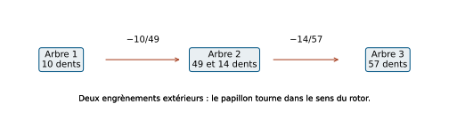
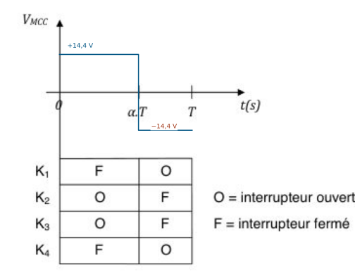
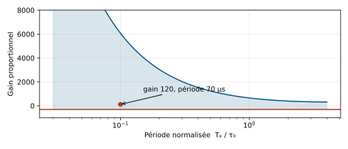
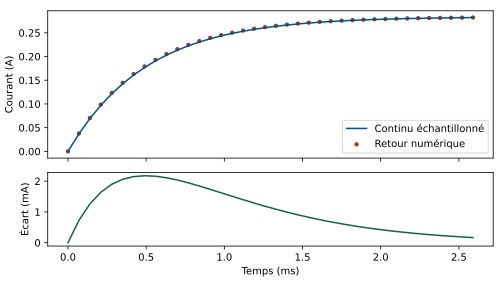
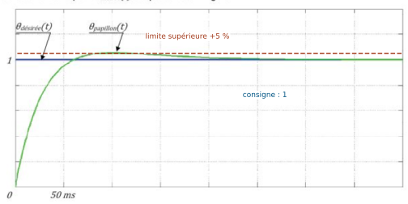
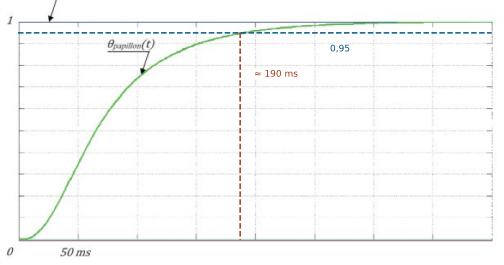
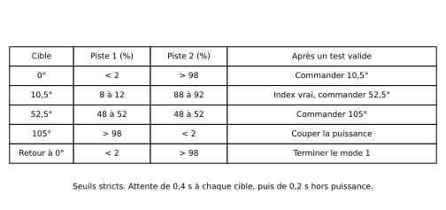

# Banque PT 2015 — Sciences industrielles A · Corrigé guidé

*Corrigé rédigé par IA, non officiel. Signalez toute erreur.*

**Rédaction** · GPT-6.2 Astra Ultra · vitesse non renseignée · 26 novembre 2026

**Révision (tour 1)** · GPT-6.2 Astra Ultra · vitesse non renseignée · 26 novembre 2026

Le papillon motorisé règle l’admission d’air d’un moteur essence. Deux engrenages relient son axe à la machine à courant continu. Le sujet officiel est distribué dans une archive contenant deux PDF. La numérotation de chaque renvoi ci-dessous compte depuis le début du fichier indiqué.

[Sujet et cahier officiels](https://www.banquept.fr/documents/2015/si_a_2015_pt.zip) · [Rapport du jury](https://www.banquept.fr/documents/ecrit/rapport/2015/rapport_si_a_ecrit_2015.pdf)

Le jury demande d’identifier les organes sur lesquels portent les mesures, insiste sur l’axe diamétral du papillon et relève les confusions entre rayon et diamètre primitif. Dans la partie commande, il distingue la réponse à la consigne et la réponse à un couple perturbateur. La dernière partie demande de suivre les gardes et les temporisations de la machine d’états.

## 1 — Gestion du couple moteur

### Question 1 — Classer les variables de gestion du couple

> [!INDICATION]
> Comparer leurs échelles de temps et les instants où le calculateur doit agir.

#### Solution

La dynamique impose deux traitements. Le remplissage en air, via l’angle du papillon et la pression du turbo, varie relativement lentement. L’allumage, la durée et la répartition d’injection ainsi que la coupure de cylindres doivent suivre le cycle moteur. La figure 3 leur affecte le traitement rapide.

[Sujet, partie 1 p. 6 du fichier · cahier, partie 2 p. 17](https://www.banquept.fr/documents/2015/si_a_2015_pt.zip)

### Question 2 — Localiser les informations mesurées

> [!INDICATION]
> Associer les entrées E1 à E10 de l’annexe 4 à leurs organes physiques.

#### Solution

Le conducteur agit sur la pédale d’accélérateur et la pression atmosphérique est prise à l’extérieur. Les périphériques instrumentés comprennent le circuit d’air suralimenté (pression turbo), l’alimentation de carburant (pression), le collecteur d’échappement (température), le catalyseur et sa ligne en amont et en aval (oxygène). Sur le moteur, le bloc fournit température et cliquetis, le vilebrequin vitesse et position, la distribution la position de l’avance variable. Le potentiomètre double piste mesure en outre l’angle du papillon dans la boucle locale.

## 2 — Inerties, ressort et dentures

### Question 3 — Calculer la rotation du rotor

> [!INDICATION]
> Deux engrènements extérieurs inversent deux fois le sens. Utiliser les quatre nombres de dents de l’annexe 3.

#### Solution

$k_1=-10/49$, $k_2=-14/57$, $k=k_1k_2=140/2793$. Il faut $\theta_e=105^\circ/k=2094,75^\circ$, soit 5,82 tours dans le même sens que le papillon. Le sujet prend ensuite $k=1/20$.

[Sujet, partie 1 p. 8 du fichier · cahier, partie 2 p. 18](https://www.banquept.fr/documents/2015/si_a_2015_pt.zip)

### Question 4 — Évaluer l’inertie du disque autour d’un diamètre

> [!INDICATION]
> L’axe de rotation traverse deux points du bord. Pour un disque mince, les deux moments diamétraux sont égaux.

#### Solution

La masse vaut $m_p=\rho_{vp}\pi D^2e_p/4$. Le moment diamétral d’un disque mince est $J_{\rm pap}=m_pD^2/16=\rho_{vp}\pi e_pD^4/64$. Pour une épaisseur finie, ajouter $m_pe_p^2/12$. Les moments sur le même axe s’ajoutent, $J_3=J_{\rm axe}+J_{\rm pap}$.

### Question 5 — Ramener les trois inerties au rotor

> [!INDICATION]
> Exprimer les trois vitesses absolues dans la somme des énergies.

#### Solution

$E_c=(J_1\omega_e^2+J_2\omega_i^2+J_3\omega_s^2)/2=J_{\rm eq}\omega_e^2/2$. Avec $\omega_i=k_1\omega_e$ et $\omega_s=k\omega_e$, on obtient $J_{\rm eq}=J_1+J_2k_1^2+J_3k^2=4,0024\,10^{-6}$ kg·m². Les termes rapportés ajoutent environ 0,061 % à $J_1$.

### Question 6 — Estimer la variation du couple de rappel

> [!INDICATION]
> Multiplier la raideur torsionnelle par le débattement en radians.

#### Solution

$\Delta C_R=0,1\times105\pi/180=0,183$ N·m, ou 0,20 N·m avec deux radians. Cela représente environ 11 % de la précharge de 1,7 N·m. L’hypothèse constante donne un modèle de premier dimensionnement dont la précision reste limitée.

### Question 7 — Appliquer le théorème énergie–puissance

> [!INDICATION]
> Les couples moteur et ressort agissent sur des arbres différents.

#### Solution

Les liaisons parfaites et les actions intérieures n’apportent aucune puissance nette. En ouverture, $dE_c/dt=C_m\omega_e-C_R\omega_s=(C_m-kC_R)\omega_e$. Ainsi $J_{\rm eq}\dot\omega_e=C_m-kC_R$, avec $C_R$ pris positif en module.

### Question 8 — Déduire le couple d’ouverture

> [!INDICATION]
> Sous un couple constant, intégrer deux fois l’accélération à partir du repos.

#### Solution

$\theta_s=k(C_m-kC_R)t^2/(2J_{\rm eq})$. Il faut donc $C_m=kC_R+2J_{\rm eq}\theta_s/(kt_{\rm ouverture}^2)$ pour atteindre l’angle à l’instant demandé. Cette manœuvre idéale atteint la position avec une vitesse encore positive.

### Question 9 — Vérifier la capacité du moteur

> [!INDICATION]
> Utiliser la limite de 200 ms du diagramme 1.

#### Solution

Avec $k=0,05$, $J_{\rm eq}=4\,10^{-6}$ kg·m² et $\theta_s\simeq2$ rad, $C_m=0,085+0,008=0,093$ N·m. C’est inférieur aux 0,21 N·m nominaux. L’ouverture est réalisable dans ce modèle.

### Question 10 — Établir le temps de retour naturel

> [!INDICATION]
> Au lâcher depuis le repos, le moteur n’exerce plus de couple.

#### Solution

L’accélération de retour en valeur absolue sur le moteur vaut $kC_R/J_{\rm eq}$. Le débattement de la sortie satisfait $\theta_s=k^2C_R t_{\rm retour}^2/(2J_{\rm eq})$. Ainsi $t_{\rm retour}=\sqrt{2J_{\rm eq}\theta_s/(k^2C_R)}$.

### Question 11 — Chiffrer le retour en butée

> [!INDICATION]
> Comparer la durée et la vitesse finale à celles d’une fermeture commandée.

#### Solution

Pour deux radians, le temps vaut 61 ms (59 ms pour 105° exacts). Le ressort accélère le papillon jusqu’à la butée. Un retour très rapide expose les dents, l’axe et la butée à un choc ou à une dégradation par répétition.

### Question 12 — Comparer énergie de choc et énergie de rupture

> [!INDICATION]
> La question demande seulement la contribution de l’ensemble 3. Le travail du ressort accélère les trois ensembles.

#### Solution

$C_R\theta_s=J_{\rm eq}\omega_e^2/2$ donne $\omega_s=k\sqrt{2C_R\theta_s/J_{\rm eq}}\simeq65,2$ rad/s. Pour $J_3=8,4\,10^{-7}$ kg·m², $E_{c3}=J_3\omega_s^2/2\simeq1,79$ mJ. La capacité indiquée vaut $13\,000\times0,008\times0,001=0,104$ J. La dent résiste suivant ce critère limité à l’ensemble 3. L’énergie cinétique totale des trois solides est 3,4 J dans la même approximation. Son transfert effectif au contact demanderait la dynamique du choc.

### Question 13 — Déterminer les efforts de denture

> [!INDICATION]
> Utiliser le rayon primitif égal au demi-produit du module par le nombre de dents.

#### Solution

Les efforts tangentiels valent $F_{t12}=2C_n/(mZ_{11})=42$ N et $F_{t23}=2C_n/[|k_1|mZ_{22}]=147$ N. L’effort normal réel est $F_{12}=42/\cos\phi$, $F_{23}=147/\cos\phi$, où $\phi$ est l’angle de pression. La fiche donne module et largeur mais aucun angle de pression. Avec la convention usuelle de 20°, on obtient 44,7 et 156 N. Si le modèle assimile la normale à la tangente primitive, les nombres à reporter sont 42 et 147 N.

### Question 14 — Vérifier la résistance en flexion

> [!INDICATION]
> Inverser la relation sur le module pour obtenir la résistance minimale requise.

#### Solution

$\sigma_{\rm adm}\ge5,5F/(bm)$. Avec la normale à 20° et $bm=8$ mm², il faut environ 30,7 et 107,6 MPa. Dans l’approximation tangentielle, les valeurs sont 28,9 et 101,1 MPa. Dans les deux évaluations, la limite de 130 MPa du polyamide PA6-6 GF30 dépasse la contrainte requise par le modèle.

## 3.1 — Hacheur et machine à courant continu

### Question 15 — Tracer la tension du pont en H

> [!INDICATION]
> Identifier laquelle des bornes du moteur est reliée au plus pendant chaque phase.

#### Solution

K1–K4 fermés donnent $+14,4$ V sur $[0,\alpha T[$, puis K2–K3 donnent $-14,4$ V sur $[\alpha T,T[$. La période à 5 kHz vaut 200 µs et la tension crête à crête vaut 28,8 V.

[Sujet, partie 1 p. 13 du fichier · cahier, partie 2 p. 24](https://www.banquept.fr/documents/2015/si_a_2015_pt.zip)

### Question 16 — Écrire les équations logiques

> [!INDICATION]
> Former les deux termes exclusifs des entrées numériques.

#### Solution

$K_1=K_4=IN1\land\neg IN2$ et $K_2=K_3=\neg IN1\land IN2$, où 1 signifie fermé. Pour des entrées égales, les quatre sorties sont nulles.

### Question 17 — Identifier le défaut de conduction croisée

> [!INDICATION]
> Suivre le trajet entre les deux rails le long d’une même branche du pont.

#### Solution

K1 et K2 fermés simultanément relient directement les deux rails. Le court-circuit fait circuler une surintensité dans le pont, même si la machine reste débranchée. Les commandes complémentaires prévoient un temps mort.

### Question 18 — Calculer la tension moyenne

> [!INDICATION]
> Pondérer chaque niveau par sa fraction de période.

#### Solution

$\overline V_{\rm MCC}=\alpha V_s-(1-\alpha)V_s=(2\alpha-1)V_s$. Pour $\alpha=1/2$, la moyenne est nulle.

### Question 19 — Linéariser autour d’une polarisation

> [!INDICATION]
> Prendre la différence entre deux valeurs du rapport cyclique à tension de bord constante.

#### Solution

$\delta\overline V_{\rm MCC}=2V_s\,\delta\alpha=28,8\,\delta\alpha$ V. Le sujet arrondit ce gain à 29 pour la suite.

### Question 20 — Introduire le retard de mise à jour

> [!INDICATION]
> Un retard pur multiplie la transformée par une exponentielle.

#### Solution

Le retard moyen supposé vaut $T/2=100$ µs. La transmittance aux variations est $V_{\rm MCCavg}(p)/\alpha(p)=29e^{-10^{-4}p}$.

### Question 21 — Comparer les constantes électrique et mécanique

> [!INDICATION]
> Lire séparément les deux blocs directs avant de fermer le retour de force contre-électromotrice.

#### Solution

$\tau_e=L/R=0,9\,10^{-3}/1,3=0,692$ ms et $\tau_m=J_{\rm eq}/f=4\,10^{-6}/(0,5\,10^{-3})=8,0$ ms. La vitesse évolue environ douze fois plus lentement que le courant. Elle peut être gelée sur le premier transitoire électrique.

### Question 22 — Modéliser la dynamique du courant

> [!INDICATION]
> Une vitesse momentanément constante rend constante la force contre-électromotrice.

#### Solution

Aux variations, $\delta e\simeq0$, donc $I(p)/V_{\rm MCCavg}(p)=1/(R+Lp)=(1/R)/(1+\tau_ep)$. Le gain continu vaut environ 0,769 A/V.

### Question 23 — Évaluer le courant avec le rotor immobile

> [!INDICATION]
> Au tout premier instant l’inductance interdit un saut. Chercher la valeur vers laquelle tend le premier ordre si la vitesse reste faible.

#### Solution

Le courant électrique à rotor bloqué tend vers $14,4/1,3=11,1$ A. Il part de zéro. La force contre-électromotrice réduira ce courant si le moteur accélère. La fiche donne 2,1 A nominaux, soit environ cinq fois moins. Elle ne chiffre pas de courant crête admissible distinct. Une limitation du courant se justifie.

## 3.2 — Boucle de courant continue

### Question 24 — Comparer trois modèles du retard

> [!INDICATION]
> Développer jusqu’au premier coefficient sur lequel les approximations diffèrent.

#### Solution

Posons $x=T_rp$. L’exact est $1-x+x^2/2-x^3/6+\cdots$. Le gain unité perd le terme en $x$. Le premier ordre $1/(1+x)=1-x+x^2+\cdots$ perd l’exactitude en $x^2$. Padé $(1-x/2)/(1+x/2)=1-x+x^2/2-x^3/4+\cdots$ coïncide jusqu’au second ordre, ce qui le rend le plus précis au voisinage de zéro.

[Sujet, partie 1 p. 15 du fichier · cahier, partie 2 p. 26](https://www.banquept.fr/documents/2015/si_a_2015_pt.zip)

### Question 25 — Choisir le modèle suffisant à la coupure

> [!INDICATION]
> Comparer la pulsation demandée aux trois limites données sur le feuillet.

#### Solution

Pour $T_r=100$ µs, les seuils sont $1/(5T_r)=2000$, $1/(2T_r)=5000$ et $2/T_r=20\,000$ rad/s. La pulsation visée, 2 000 rad/s, est juste à la limite admise du modèle unité. Ce modèle suffit dans la convention du sujet et conserve le seul premier ordre électrique.

### Question 26 — Fermer la boucle de courant continue

> [!INDICATION]
> Le prétraitement de la référence possède le même gain que le retour de mesure.

#### Solution

Posons $K_s=K_iK_{\rm CAN}K_{\rm CNA}K_0=0,0033$ et $q=K_sK_p$. La transmittance est $I/I_{\rm ref}=q/(1+q+\tau_0p)=[q/(1+q)]/[1+\tau_0p/(1+q)]$.

### Question 27 — Établir la condition de stabilité continue

> [!INDICATION]
> Localiser la racine du dénominateur.

#### Solution

Le pôle est $-(1+K_sK_p)/\tau_0$. Avec $\tau_0,K_s>0$, il faut $K_p>-1/K_s$. La borne est stricte, le pôle est nul à l’égalité.

### Question 28 — Lire le gain statique continu

> [!INDICATION]
> Évaluer le transfert en zéro, sous la condition de stabilité.

#### Solution

$G_{\rm SIC}=K_sK_p/(1+K_sK_p)$. Le simple retour proportionnel laisse un écart de consigne au régime permanent.

### Question 29 — Régler le gain pour la bande passante

> [!INDICATION]
> Le premier ordre stable décroît de 3 dB par rapport à son propre plateau à l’inverse de sa constante de temps.

#### Solution

$\omega_{\rm BF}=(1+K_sK_p)/\tau_0$ donne $K_p=(2000\times0,0007-1)/0,0033=121,2$. La réponse est apériodique. Le feuillet retient 120, soit 1 994 rad/s.

### Question 30 — Inverser le transfert fermé

> [!INDICATION]
> La réponse d’un premier ordre possède le même plateau que son gain statique pour un échelon unité.

#### Solution

$I/I_{\rm ref}=G_{\rm SIC}/(1+\tau_Fp)$, avec $\tau_F=\tau_0/(1+K_sK_p)$. Pour $t\ge0$, $i(t)=G_{\rm SIC}(1-e^{-t/\tau_F})$. À $K_p=120$, le plateau vaut 0,2837 A et $\tau_F\simeq0,501$ ms.

## 3.2 — Boucle de courant numérique

### Question 31 — Écrire l’équation du processus continu

> [!INDICATION]
> Revenir du domaine de Laplace au domaine temporel avant l’échantillonnage.

#### Solution

Le processus $I/\alpha=K_0/(1+\tau_0p)$ vérifie $\dot i+i/\tau_0=(K_0/\tau_0)\alpha$. Les deux coefficients demandés sont $1/\tau_0$ et $K_0/\tau_0$.

[Sujet, partie 1 p. 18 du fichier · cahier, partie 2 p. 29](https://www.banquept.fr/documents/2015/si_a_2015_pt.zip)

### Question 32 — Séparer régimes libre et forcé

> [!INDICATION]
> Traiter séparément l’état initial et la réponse à la commande constante.

#### Solution

Avec $i(0)=i_0$ et $\alpha(t)=\alpha_0$ pour $t\ge0$, $i(t)=i_0e^{-t/\tau_0}+K_0\alpha_0(1-e^{-t/\tau_0})$. Le premier terme subsiste avec la commande nulle et le second avec une condition initiale nulle.

### Question 33 — Discrétiser le processus sous bloqueur

> [!INDICATION]
> Pendant un intervalle, la commande reste à sa valeur au début du pas.

#### Solution

Notons $a=e^{-T_e/\tau_0}$. L’intégration exacte donne $i_{k+1}=a i_k+K_0(1-a)\alpha_k$. Dans la convention $i_{k+1}+f_0i_k=g_0\alpha_k$, $f_0=-a$, $g_0=K_0(1-a)$.

### Question 34 — Fermer la récurrence

> [!INDICATION]
> Remplacer le rapport cyclique du pas k par le gain du correcteur multiplié par l’écart échantillonné.

#### Solution

$\alpha_k=K_{\rm CNA}K_pK_iK_{\rm CAN}(i_{{\rm ref},k}-i_k)$. Avec $q=K_sK_p$, on obtient $i_{k+1}+f_Fi_k=g_Fi_{{\rm ref},k}$, où $f_F=-a+q(1-a)$ et $g_F=q(1-a)$.

### Question 35 — Résoudre la réponse indicielle numérique

> [!INDICATION]
> Rechercher d’abord un point fixe, puis soustraire ce point fixe à la récurrence.

#### Solution

Pour une consigne constante $I_d$ et une boucle stable, $i_\infty=g_F I_d/(1+f_F)$. La réponse complète est $i_k=(I_0-i_\infty)(-f_F)^k+i_\infty$. Elle rend bien $I_0$ pour $k=0$.

### Question 36 — Imposer la convergence

> [!INDICATION]
> Le terme transitoire doit disparaître pour toute condition initiale.

#### Solution

Il faut et il suffit que $|-f_F|<1$, soit $-1<f_F<1$. Les deux frontières conduisent, en général, respectivement à un écart persistant ou à une oscillation persistante.

### Question 37 — Délimiter la zone stable du plan période–gain

> [!INDICATION]
> Résoudre les deux inégalités en conservant le signe positif de un moins a.

#### Solution

À $T_e>0$, $0<a<1$ et $-1<-a+K_sK_p(1-a)<1$ donne $-1/K_s<K_p<(1+a)/[K_s(1-a)]$, où $a=e^{-T_e/\tau_0}$. La borne supérieure décroît lorsque la période augmente.

[Sujet, partie 2 p. 1 du fichier · cahier, partie 2 p. 31](https://www.banquept.fr/documents/2015/si_a_2015_pt.zip)

### Question 38 — Comparer stabilités continue et discrète

> [!INDICATION]
> Faire tendre la période vers zéro puis examiner une période finie.

#### Solution

La borne inférieure coïncide avec celle du continu. En discret apparaît une borne supérieure finie. Quand $T_e\to0$, elle croît comme $2\tau_0/(K_sT_e)$ et le domaine continu est retrouvé à gain fixé.

### Question 39 — Tester le gain retenu

> [!INDICATION]
> Calculer directement le pôle numérique pour la période imposée.

#### Solution

$T_e=\tau_0/10=70$ µs, $a=e^{-0,1}=0,90484$ et $q=0,396$. Le pôle $-f_F=0,86715$ est dans le disque unité. On trouve aussi $-303,0<120<6065,7$.

### Question 40 — Calculer le gain statique numérique

> [!INDICATION]
> À l’équilibre, deux échantillons successifs sont égaux.

#### Solution

$G_{\rm SIN}=g_F/(1+f_F)=q(1-a)/[(1-a)(1+q)]=q/(1+q)=G_{\rm SIC}$. Les deux modèles ont rigoureusement le même plateau.

### Question 41 — Confronter les réponses échantillon par échantillon

> [!INDICATION]
> Comparer les bases des deux puissances à la première période, avant d’en déduire une égalité générale.

#### Solution

La réponse continue échantillonnée contient $r_c^k$, avec $r_c=e^{-(1+q)T_e/\tau_0}=0,869706$. La fermeture numérique de Q34 donne $r_d=a-q(1-a)=0,867153$. Les deux bases diffèrent. Au premier pas pour une consigne unité, les courants valent 0,03696 et 0,03769 A. L’égalité exacte demandée ne découle donc pas des équations du feuillet. Ils ont le même plateau et le même développement au premier ordre en $T_e$. Si l’on discrétise après avoir fermé le système continu, on obtient exactement $r_c$, ce qui explique la transposition suggérée. L’implémentation avec retour échantillonné ferme la boucle après le bloqueur.

[Sujet, partie 2 p. 1 du fichier · cahier, partie 2 p. 33](https://www.banquept.fr/documents/2015/si_a_2015_pt.zip)

### Question 42 — Vérifier le critère de transposition

> [!INDICATION]
> Utiliser la constante de temps en boucle fermée pour le critère de la page 19.

#### Solution

$\tau_{\rm BF}=1/2000=0,50$ ms, donc $\tau_{\rm BF}/4=125$ µs. La période de 70 µs satisfait le critère.

### Question 43 — Conclure sur les performances de la commande numérique

> [!INDICATION]
> Examiner séparément la forme, le gain et la bande passante.

#### Solution

La réponse discrète est monotone du premier ordre et de bande voisine de 2 000 rad/s. Le gain statique vaut seulement 0,2837. Les trois propriétés demandées simultanément ne sont donc pas obtenues. Pour le véritable filtre discret, $H(z)=g_Fz^{-1}/(1-r_dz^{-1})$. À une atténuation relative de 3 dB, $\cos(\omega T_e)=1-(1-r_d)^2/(2r_d)$ donne environ 2 040 rad/s.

## 3.3 — Boucle de position

### Question 44 — Convertir l’angle du papillon en tension

> [!INDICATION]
> La piste IP1 parcourt cinq volts sur un débattement de 105 degrés.

#### Solution

$K_{\rm pot}=5/(105\pi/180)=60/(7\pi)$ V/rad. La piste IP1 est croissante.

[Sujet, partie 2 p. 3 du fichier · cahier, partie 2 p. 33](https://www.banquept.fr/documents/2015/si_a_2015_pt.zip)

### Question 45 — Ramener la mesure à des radians

> [!INDICATION]
> Le gain composé du capteur et de l’adaptation du retour doit être unité.

#### Solution

$K_{\rm comp}=1/K_{\rm pot}=7\pi/60$ rad/V. La comparaison s’effectue ainsi entre deux angles.

### Question 46 — Rapporter le couple de rappel

> [!INDICATION]
> Conserver la puissance virtuelle lorsque le couple change d’arbre.

#### Solution

$C_{\rm ressort,m}\omega_m=C_R\omega_s$, donc $K_{\rm per}=k=1/20$. Le sommateur soustrait cette perturbation en ouverture.

### Question 47 — Simplifier le modèle de position

> [!INDICATION]
> Comparer les temps de la boucle de courant et de la mécanique à celui du mouvement demandé.

#### Solution

Les constantes 0,5 et 8 ms sont courtes devant les 200 ms de réponse visés. À basse fréquence, $I/I_{\rm ref}\simeq K_F=1$ et $\Omega_m/C_{\rm net}\simeq1/f$. Ainsi $K_1=K_FK_t=0,1$ N·m/A, $K_2=k/f=100$, et la conversion vitesse–position conserve $1/p$. À la coupure de l’ordre de 15 rad/s, les deux produits avec les constantes valent 0,0075 et 0,12.

### Question 48 — Fermer le modèle à deux entrées

> [!INDICATION]
> Le ressort intervient au deuxième sommateur, après le gain de courant.

#### Solution

Posons $A=K_\theta K_1K_2$. L’équation est $(p+A)\Theta=A\Theta_d-K_2K_{\rm per}C_R$. En poursuite, $H_A=1/(1+p/A)$. En régulation, $H_R=-[K_{\rm per}/(K_\theta K_1)]/(1+p/A)$. Le signe correspond à un couple perturbateur qui ferme le papillon.

### Question 49 — Calculer l’écart de poursuite

> [!INDICATION]
> L’intégrateur de position donne un gain de boucle infini à fréquence nulle.

#### Solution

Avec $C_R=0$, le gain statique fermé de poursuite vaut 1. En régime établi sur un échelon unité, $\varepsilon_A=1-H_A(0)=0$ rad.

### Question 50 — Calculer l’écart en régulation

> [!INDICATION]
> Fixer la consigne à zéro et garder le signe de la perturbation jusqu’à l’écart.

#### Solution

À $C_R=1,7$ N·m, $\varepsilon_R=-H_R(0)C_R=K_{\rm per}C_R/(K_\theta K_1)=0,567$ rad pour $K_\theta=1,5$. Le moteur doit disposer d’une erreur permanente pour exercer son couple de maintien.

### Question 51 — Valider la correction proportionnelle

> [!INDICATION]
> Examiner séparément la rapidité, le dépassement et le rejet.

#### Solution

$A=15$ s⁻¹ et $t_{5\%}=\ln20/15=0,1997$ s. L’échelon est monotone et son erreur finale est nulle à charge nulle. Le couple constant du ressort produit toutefois l’écart de Q50. La précision exigée en fonctionnement chargé n’est pas assurée.

### Question 52 — Écrire le transfert de la correction PI

> [!INDICATION]
> Garder le zéro du numérateur lorsque l’on ferme la boucle.

#### Solution

Avec $A=K_\theta K_1K_2$, $H_A=A(1+T_ip)/(T_i p^2+A T_i p+A)=(1+T_ip)/[1+T_ip+(T_i/A)p^2]$. L’action intégrale donne aussi un rejet statique du couple constant lorsque la boucle est stable.

### Question 53 — Synthétiser un dénominateur sans oscillation

> [!INDICATION]
> Identifier le dénominateur à un second ordre puis régler le temps à 5 % de ce modèle de référence.

#### Solution

On a $\omega_n^2=A/T_i$ et $2\zeta/\omega_n=T_i$. Un choix rapide sans oscillation du dénominateur est $\zeta=1$. L’échelon du double pôle franchit 95 % à $\omega_n t=4,744$ car $(1+x)e^{-x}=0,05$. Pour 0,20 s, $\omega_n=23,72$ rad/s, $T_i=2/\omega_n=84,3$ ms et $K_\theta=2\omega_n/(K_1K_2)=4,74$. Ce réglage traite le dénominateur seul, comme demandé. Une plage de réglages convient si l’on impose une inégalité sur le temps. Le zéro effectivement présent affecte le dépassement.

### Question 54 — Analyser la réponse réelle du modèle PI

> [!INDICATION]
> Lire le sommet par rapport à l’échelon et le temps de retour dans la bande à 5 %.

#### Solution

La figure 21 franchit la consigne vers 60 ms et culmine vers 100 ms près de 1,05 à 1,06 pour une demande unité. Elle revient près de la consigne avant 200 ms, mais tout dépassement est interdit. Le gain final est unité. Le zéro de la correction PI explique que le seul réglage du dénominateur ne suffise pas.

[Sujet, partie 2 p. 5 du fichier · cahier, partie 2 p. 36](https://www.banquept.fr/documents/2015/si_a_2015_pt.zip)

### Question 55 — Filtrer la consigne

> [!INDICATION]
> Placer en amont un filtre stable à gain unité capable de compenser le zéro de poursuite.

#### Solution

$H_{\rm ref}(p)=1/(1+T_ip)$. Le transfert de la consigne devient $1/[1+T_ip+(T_i/A)p^2]$, de gain unité et à réponse monotone pour le réglage critique. Le chemin du couple perturbateur conserve le rejet statique assuré par l’intégrateur.

### Question 56 — Vérifier la courbe avec préfiltre

> [!INDICATION]
> Placer le niveau de 95 % et utiliser les graduations horizontales de 50 ms.

#### Solution

Sur la figure 23, l’angle monte jusqu’à l’unité sans dépassement visible. La bande à 5 % est atteinte vers 0,19–0,20 s. La valeur finale correspond à la consigne. Les trois critères de poursuite sont cohérents avec le tracé. Le zéro d’erreur en régulation sous couple constant découle séparément du modèle PI.

[Sujet, partie 2 p. 5 du fichier · cahier, partie 2 p. 37](https://www.banquept.fr/documents/2015/si_a_2015_pt.zip)

## 4 — Diagnostic embarqué

### Question 57 — Évaluer le courant de maintien

> [!INDICATION]
> Ramener le couple du ressort à l’arbre de la machine.

#### Solution

$K_t I_{\rm MCC}=kC_R$. Avec $1/20$, 1,7 N·m et 0,1 N·m/A, $I_{\rm MCC}=0,85$ A, à orienter pour s’opposer au ressort.

[Sujet, partie 2 p. 7 du fichier · cahier, partie 2 p. 38](https://www.banquept.fr/documents/2015/si_a_2015_pt.zip)

### Question 58 — Dérouler la séquence de préparation au démarrage

> [!INDICATION]
> Lire l’annexe 6 en conservant la cible de l’essai, les deux pistes et les temporisations d’établissement.

#### Solution

À l’événement Pp, le mode 1 mémorise $P_1=20\,IP1$ et $P_2=20\,IP2$ en pourcentage. Au repos, exiger $P_1<2$ et $P_2>98$, puis commander 10,5°. Attendre 0,4 s et relire. À l’index, exiger $8<P_1<12$, $88<P_2<92$ et Index vrai. Commander 52,5°, attendre 0,4 s et relire. Exiger les deux pistes entre 48 et 52, commander 105°, attendre encore 0,4 s puis exiger $P_1>98$, $P_2<2$. Passer à RefP=0, couper la puissance (CoupureP=1), laisser revenir le ressort 0,2 s, relire et exiger $P_1<2$, $P_2>98$. Le mode préparatoire se termine. Un échec à un test pose DéfautP=1 et conduit au traitement des défauts du superviseur. Les bornes sont strictes, y compris au retour. L’action d’entrée de « Mémorisation angle papillon » imprimée en annexe réécrit également RefP=0 à chaque passage, alors que les gardes suivantes consultent la cible non nulle. Pour exécuter la séquence décrite, il faut conserver cette consigne entre deux mesures et réserver l’initialisation à zéro au démarrage. À la lettre, le diagramme ne garantit pas le déroulement voulu.

[Sujet, partie 2 p. 7 du fichier · cahier, partie 2 p. 38](https://www.banquept.fr/documents/2015/si_a_2015_pt.zip)
