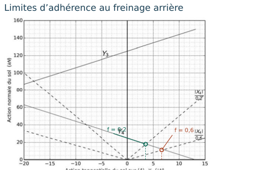
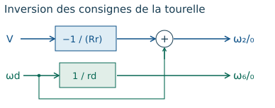
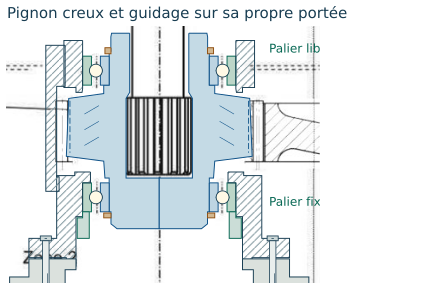
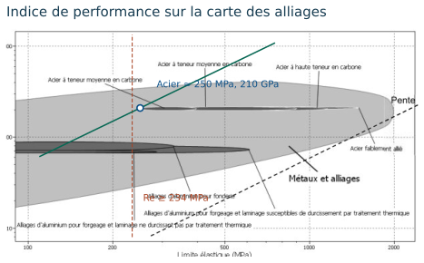
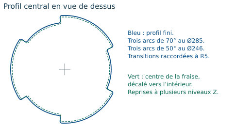

# Banque PT 2015 — Sciences industrielles C · Corrigé guidé

*Corrigé rédigé par IA, non officiel. Signalez toute erreur.*

**Rédaction** · GPT-6.2 Astra Ultra · vitesse non renseignée · 27 novembre 2026

**Révision (tour 1)** · GPT-6.2 Astra Ultra · vitesse non renseignée · 27 novembre 2026

**Chariot guidé de manutention de bobines de papier.** Épreuve de six heures. Le barème publié par partie est de 15 %, 15 %, 15 %, 30 % et 25 %. Le rapport ne donne pas les points individuels par question.

[Sujet et planches](https://www.banquept.fr/documents/2015/si_c_2015_pt.pdf) · [Rapport du jury](https://www.banquept.fr/documents/ecrit/rapport/2015/rapport_si_c_ecrit_2015.pdf)

## I · Consommation sur le cycle de manutention

### Q1 · Énergie cinétique du chariot

**Indication.** Identifier ce que l’on retire entre véhicule chargé et vide avant d’appliquer la formule d’énergie.

La masse totale en charge vaut 15 000 kg. À vide, retirer seulement les bobines de 4 200 kg donne 10 800 kg, puisque l’outil reste embarqué. À la vitesse maximale de 1,6 m/s, $E_c=Mv^2/2$ donne 19,2 kJ en charge et 13,82 kJ à vide. Avec l’approximation de l’énoncé, on obtient 18,75 et 13,5 kJ.

### Q2 · Énergie de levage

**Indication.** Faire la liste des pièces qui montent réellement de six mètres.

Seul l’ensemble mobile de 6 000 kg gagne de l’altitude. En montant de 0 à 6 m, $\Delta E_p=m_2g\Delta h=6000\times10\times6=360$ kJ. Les 15 000 kg interviendraient dans un changement d’altitude de tout le véhicule.

### Q3 · Consommation aux vitesses constantes

**Indication.** Associer à chaque plateau de vitesse à la fois sa durée, sa charge et sa puissance.

La figure 4 donne approximativement 1,6 kW à 0,5 m/s en charge, 4 kW à 1,6 m/s en charge et 3 kW à 1,6 m/s à vide. Sur la ressource 2, arrondir les paliers lents chargés à 100 s en tout, le palier rapide chargé à 80 s et le palier rapide à vide à 85–90 s. La somme $\sum P_i\Delta t_i$ vaut environ 0,74–0,75 MJ. Le ralentissement de 190 à 260 s est une rampe et ne se compte pas comme un palier complet à 0,5 m/s.

### Q4 · Énergie et puissance moyennes

**Indication.** Conserver les deux accélérations et ajouter le levage avant de diviser le bilan par 360 s.

Sans récupération, les accélérations du trajet chargé et du retour à vide coûtent ensemble environ 33 kJ d’énergie cinétique. Le levage de la charge et de l’outil coûte environ 360 kJ. En ajoutant les paliers de traction, le premier ordre de grandeur est 1,13–1,15 MJ sur 360 s, soit environ 3,2 kW. Pour affiner la traction sur la longue rampe, interpoler la courbe chargée entre 0,5 et 1,6 kW. À vitesse variant linéairement entre 0,5 et 0 m/s, le terme supplémentaire est de l’ordre de 70 kJ, soit environ 0,2 kW sur le cycle. Les rendements de levage et les consommations auxiliaires en attente ne sont pas chiffrés.

### Q5 · Énergies récupérables

**Indication.** Distinguer le sort des bobines et celui de l’outil au moment de la dépose.

Les ralentissements libèrent l’énergie cinétique de translation du chariot chargé puis du chariot vide. La descente de la partie mobile libère de l’énergie potentielle. Les bobines restent sur le rayonnage après dépose. Lors du retour vers le bas, la masse récupérable est donc essentiellement celle de l’outil mobile, environ 1 800 kg, soit au plus 108 kJ pour 6 m. Les pertes de roulement sont dissipées.

### Q6 · Budget de la batterie

**Indication.** Une batterie donnée en ampères-heures fournit une énergie après multiplication par la tension.

La capacité utile est $72\times620\times0{,}80=35\,712$ Wh. Répartie sur huit heures, elle représente 4,46 kW moyens. Si seuls les 80 % de temps actif consomment, le budget par heure active est de 5,58 kW. Le modèle du cycle donne environ 3,2 à 3,4 kW en activité. L’exigence peut donc être satisfaite sans récupération dans ces hypothèses. Une consommation de veille mesurée ou des rendements supplémentaires seraient à inclure dans un bilan de site.

### Q7 · Choix de récupérer au freinage

**Indication.** Rapporter l’énergie cinétique récupérable à l’énergie consommée sur un cycle.

L’énergie cinétique maximale disponible par cycle est de l’ordre de 33 kJ, soit environ 3 % du bilan. La récupération au freinage est donc un appoint. Le variateur réversible peut aussi assurer un ralentissement maîtrisé et réduire la sollicitation du frein mécanique en usage normal. Le gain réel dépend du rendement et de l’acceptation de courant par la batterie.

## II · Freinage et zone de détection

### Q8 · Position du centre de masse

**Indication.** Tenir compte du signe déjà attribué à la coordonnée du chargement.

Pour $M=m_1+m_2$, le barycentre des masses donne $x_G=(m_1x_1+m_2x_2)/M$ et $y_G=[m_1y_1+m_2(y(t)+y_2)]/M$ relativement au contact arrière $I_3$. Le signe de $x_2$ est déjà inclus dans cette coordonnée. Les masses et inerties des roues sont négligées.

### Q9 · Accélération du centre de masse

**Indication.** Écrire la position absolue de G avant de dériver deux fois.

Dans le repère du sol, l’abscisse absolue de G est $x(t)+x_G$. À masses et orientations constantes, $\mathbf a_G=\ddot x\,\mathbf x+(m_2/M)\ddot y\,\mathbf y$. Quand le mât se déplace à vitesse verticale constante, seule subsiste la composante longitudinale $\gamma\mathbf x$.

### Q10 · Condition d’adhérence

**Indication.** Combiner le bilan de résultante longitudinale avec le cône de frottement.

La roue arrière n’exerce pas d’effort longitudinal dans le modèle. Le bilan suivant $x$ donne $X_4=M\gamma$. L’adhérence exige $|X_4|\leq fY_4$ avec $Y_4\geq0$. Au freinage en marche arrière, $\gamma>0$ et donc $0\leq M\gamma\leq fY_4$. L’égalité caractérise le seuil de glissement.

### Q11 · Moment dynamique au contact arrière

**Indication.** Au contact arrière, les réactions de ce contact ont un moment nul, mais l’accélération de G a un bras vertical.

À l’instant considéré, prendre les moments au point du sol coïncidant avec $I_3$. Avec $\ddot y=0$, $LY_4-Mgx_G=-M\gamma y_G$. Le poids a pour bras $x_G$, la réaction avant normale a pour bras L et l’accélération longitudinale agit à la hauteur $y_G$. Le mouvement des solides est ici une translation pour les masses retenues.

### Q12 · Décélération maximale

**Indication.** Injecter la réaction avant dans l’inégalité de frottement et grouper les termes en accélération.

Remplacer $Y_4$ par $M(gx_G-\gamma y_G)/L$ dans l’inégalité d’adhérence. Il vient $\gamma\leq fgx_G/(L+fy_G)$. La borne de basculement est $gx_G/y_G$ si $y_G>0$. Avec un coefficient fini et $L>0$, le seuil d’adhérence arrive avant le décollement de la roue avant. Plus la charge est haute, plus la décélération admissible est faible.

### Q13 · Seuils sur le diagramme

**Indication.** Sur le demi-axe positif, repérer deux intersections avec la courbe de réaction de la roue motrice.

Sur la partie $X_4>0$, croiser la droite décroissante de la réaction avant $Y_4$ avec les droites $Y=X_4/f$. Pour $f=0{,}2$, lire environ $(3{,}5\ ;17{,}5)$ kN. Pour $f=0{,}6$, lire environ $(6{,}7\ ;11{,}2)$ kN. Selon la précision de lecture, 3,5 à 3,7 kN puis 6,5 à 7 kN sont cohérents. La courbe croissante correspond à la réaction arrière et ne dimensionne pas le patinage de la roue motrice.

### Q14 · Décélération garantie

**Indication.** Diviser le plus petit effort admissible par la masse totale en convertissant les kN en N.

Prendre le plus petit effort tangentiel du domaine d’adhérence, soit environ 3,5 kN. Avec $M=15\,000$ kg, $\gamma_m\simeq3500/15000=0{,}23\ \mathrm{m/s^2}$. Cette valeur est un ordre de grandeur graphique pour la configuration défavorable représentée.

### Q15 · Distance de freinage

**Indication.** Calculer le temps d’arrêt puis l’aire du triangle sous la courbe de vitesse.

Avec une décélération constante de module $\gamma_m$, une vitesse initiale de module V, un sol horizontal et une action de freinage instantanément établie, l’intégrale de la vitesse donne $d_m=V^2/(2\gamma_m)$. En marche arrière à 0,5 m/s, on trouve environ 0,54 m. Le temps de détection ne figure pas dans cette seule distance.

### Q16 · Réglage des scrutateurs

**Indication.** La distance parcourue avant la montée de l’effort de freinage s’ajoute à celle de l’arrêt.

Pour chaque plage de vitesse et de hauteur de charge, prévoir à partir de l’enveloppe balayée une profondeur au moins égale à $Vt_r+d_m$ augmentée des marges dimensionnelles et de détection. Le délai $t_r$ englobe acquisition, traitement et établissement du freinage. Le cas d’adhérence basse dimensionne la zone arrière. Les virages imposent aussi de couvrir latéralement la trajectoire des bobines.

## III · Moteur de traction et conversion électrique

### Q17 · Puissance de roulement

**Indication.** Relier le couple résistant à la vitesse angulaire de la roue.

Le couple résistant équivalent est $C_r=Mg\delta=15\,000\times10\times0{,}002=300$ N·m. Au rayon $R=0{,}20$ m, $\omega=1{,}6/0{,}20=8$ rad/s. La puissance mécanique à vitesse constante est donc $C_r\omega=2{,}4$ kW.

### Q18 · Puissance en accélération

**Indication.** Dans le théorème de l’énergie cinétique, retrancher la puissance dissipée en roulement.

En négligeant les inerties de rotation et les pertes d’engrenages, $P_{\rm roue}-C_rV/R=\mathrm d(MV^2/2)/\mathrm dt$. D’où $P_{\rm roue}=(M\gamma+C_r/R)V$. Pour l’accélération standard de 0,3 m/s², la force équivalente vaut $4500+1500=6000$ N et la puissance vaut $6000V$ en watts.

### Q19 · Couple au départ

**Indication.** Calculer le couple en mouvement et faire tendre la vitesse vers zéro.

Le rapport $P_{\rm roue}/\omega$ pour $V>0$, prolongé au démarrage, donne $C_{\rm roue}=M\gamma R+C_r=900+300=1200$ N·m. À vitesse nulle la puissance mécanique est nulle, alors que le couple d’accélération a déjà cette valeur.

### Q20 · Réduction

**Indication.** Énoncer le sens du rapport et garder l’approximation de π proposée pour ce dimensionnement.

Avec $\pi\simeq3$ comme demandé, la roue à 8 rad/s tourne à $60\times8/(2\pi)\simeq80$ tr/min. Le rapport sortie/entrée vaut donc $80/2000=1/25$. Le facteur de réduction entrée/sortie vaut 25. Avec la valeur exacte de $\pi$, ce facteur serait 26,2.

### Q21 · Choix du moteur

**Indication.** Comparer le couple nécessaire à chacune des quatre colonnes du tableau.

Dans le réducteur idéal, $C_m=C_{\rm roue}/25=48$ N·m. Le type A est limité à 30 N·m. Le premier modèle suffisant est le type B, 54 N·m et 11,3 kW à 2 000 tr/min. La puissance à la roue en fin d’accélération vaut 9,6 kW au modèle du sujet.

### Q22 · Les quatre quadrants

**Indication.** Dans le plan vitesse-couple, le signe du produit distingue traction et freinage.

Orienter la vitesse positivement en marche avant et le couple positivement dans le même sens. Les quadrants I et III correspondent à la traction avant et arrière, avec $C\omega>0$. Les quadrants II et IV ont $C\omega<0$ et correspondent respectivement au freinage en marche arrière et en marche avant. Une récupération électrique exige en outre une liaison réversible avec une source réceptive.

### Q23 · Enveloppes de couple et de puissance

**Indication.** Porter un plateau de couple et utiliser la puissance égale au produit du couple et de la vitesse.

Jusqu’au point coté, la représentation classique à courant limite constant est $C_{\max}=54$ N·m et $P_{\max}(N)=54\,2\pi N/60$. La droite issue de l’origine atteint 11,3 kW à 2 000 tr/min. En marche arrière, inverser le signe de la vitesse et du couple pour la traction. Le tableau ne donne aucune loi au-delà de la vitesse nominale. Un prolongement à puissance constante supposerait un domaine de défluxage spécifié.

### Q24 · Hacheur série

**Indication.** Exprimer la fraction de période pendant laquelle le moteur est relié à la source.

Durant la fraction $\alpha=T_{\rm on}/T$ de chaque période, le transistor conduit et $u=U_0$. Pendant le reste de la période, la diode de roue libre conduit tant que le courant reste positif et $u\simeq0$. Ainsi $\bar u=\alpha U_0$. À flux constant, $\omega\simeq(\bar u-R_ai)/K_e$, ce qui explique le réglage de vitesse par la durée de l’impulsion.

### Q25 · Rôle de la diode

**Indication.** Suivre le courant inductif juste après le blocage de l’interrupteur.

Le courant de l’inductance d’induit ne peut tomber instantanément. À l’ouverture du transistor, la diode referme son chemin à travers le moteur et limite la surtension. Elle se bloque lorsque le transistor réapplique la source au moteur.

### Q26 · Domaine du montage série

**Indication.** Déterminer séparément le signe de la tension et celui du courant que le montage autorise.

Avec la polarité et les conventions du dessin, la tension moyenne et le courant sont positifs. Le montage assure la marche avant motrice, quadrant I, avec roue libre au blocage. Il ne fournit pas à lui seul un freinage régénératif vers la batterie.

### Q27 · Commandes du pont

**Indication.** Suivre les diodes réellement conductrices pour chaque sens de courant en récupération.

Numérotation du sujet : 1 et 2 sont les interrupteurs hauts, 3 et 4 les bas. En traction avant, fermer 1 et 4, laisser 2 et 3 ouverts. En traction arrière, fermer 2 et 3, laisser 1 et 4 ouverts. En freinage avant, le courant moteur est négatif. Une séquence possible commande 3 pour accumuler le courant via la diode 4, puis ouvre 3 pour renvoyer le courant à la source par les diodes 1 et 4. En freinage arrière, commander 4 pendant l’accumulation via la diode 3, puis laisser les diodes 2 et 3 restituer l’énergie. Les autres transistors restent ouverts dans ces deux séquences. Les courants de diode dépendent du sens réel du courant, y compris quand les quatre transistors sont ouverts.

### Q28 · Variation de vitesse au pont

**Indication.** Comparer les tensions instantanées dans les deux états du pont.

En marche avant, maintenir 4 passant et moduler 1. Pendant la roue libre, la diode 3 et le transistor 4 referment le courant. La moyenne est voisine de $+\alpha U_0$. En marche arrière, maintenir 3 et moduler 2 pour obtenir $-\alpha U_0$. Une commande bipolaire alternant les deux diagonales appliquerait $(2\alpha-1)U_0$ en moyenne. Les deux interrupteurs d’une même branche ne doivent jamais conduire simultanément.

## IV · Tourelle et train roulant

### Q29 · Chaîne d’orientation

**Indication.** Les centres des deux roues sont fixés dans le châssis pour l’étude d’orientation.

Le petit pignon 6 engrène extérieurement avec la denture solidaire de la tourelle 1. Dans le châssis 0, les vitesses tangentielles au contact sont égales et les axes verticaux orientés pareil. On obtient $r_d=\omega_{1/0}/\omega_{6/0}=-Z_6/Z_1$.

### Q30 · Chaîne de traction

**Indication.** Se placer dans la tourelle et écrire une égalité de vitesses tangentielles pour chaque engrènement.

Se placer dans la tourelle. Le pignon 3 est entraîné en rotation par 2. Le train extérieur 3–4 donne $\omega_{4/1}=-(Z_3/Z_4)\omega_{2/1}$. Pour le renvoi conique dessiné, avec $+y$ vertical et $+z_1$ vers la gauche, l’égalité de vitesse au contact donne $\omega_{5/1}=-(Z'_4/Z_5)\omega_{4/1}$. Il en résulte $r=Z_3Z'_4/(Z_4Z_5)$ dans ces conventions.

### Q31 · Composition des mouvements

**Indication.** Exprimer la vitesse relative de l’arbre de traction par rapport à la tourelle.

Les orientations 0, 1 et 2 sont coaxiales sur la verticale. Par composition, $\omega_{2/1}=\omega_{2/0}-\omega_{1/0}$. La vitesse de roue autour de $z_1$ devient $\omega_{5/1}=r(\omega_{2/0}-r_d\omega_{6/0})$. Même à vitesse de l’arbre de traction donnée, changer la vitesse d’orientation modifie la vitesse relative du pignon.

### Q32 · Commandes des deux moteurs

**Indication.** Écrire le roulement sans glissement au point I avant d’inverser le modèle d’entraînement.

Au contact, $\mathbf 0=V\mathbf x_1+\omega_{5/1}\mathbf z_1\times(-R\mathbf y)$, d’où $\omega_{5/1}=-V/R$. À partir des consignes de déplacement et d’orientation, calculer $\omega_{6/0}=\omega_d/r_d$ et $\omega_{2/0}=\omega_d-V/(Rr)$. La branche d’orientation intervient donc aussi dans la consigne du moteur de traction.

### Q33 · Couple de maintien en orientation

**Indication.** Une consigne de vitesse d’orientation nulle peut nécessiter un couple de maintien non nul.

L’effort d’engrènement de traction exerce une réaction sur le porte-train, donc sur la tourelle. Le moteur d’orientation doit pouvoir maintenir la direction malgré le couple de traction et fournir ce maintien pendant une manœuvre d’orientation. À consigne de direction fixe, un moteur qui ne développe aucun couple laisserait la tourelle dériver.

### Q34 · Graphe de liaisons

**Indication.** La liaison qui transmet le couple entre le moteur et le pignon doit empêcher leur rotation relative utile.

Considérer la boucle 0–2–3–1–0. Les paires 0/2, 0/1 et 1/3 sont des pivots d’axe vertical commun dans la configuration idéale. La paire 2/3 est une glissière axiale transmettant le couple, matérialisable par des cannelures. Un pivot glissant entre ces deux pièces laisserait libre leur rotation relative et interromprait la transmission du couple moteur.

### Q35 · Hyperstatisme et adaptation

**Indication.** Compter les mobilités de la boucle fermée et chercher les contraintes de désalignement redondantes.

Trois pivots et une glissière imposent $4\times5=20$ contraintes scalaires. Les vitesses de traction et d’orientation restent deux mobilités indépendantes, tandis que la translation de la glissière est bloquée par la fermeture de la boucle. Ainsi $h=20-[6(4-1)-2]=4$. Conserver les trois pivots et remplacer la glissière 2/3 par un accouplement transmettant le seul couple axial supprime quatre contraintes. Un double joint à cardan avec élément télescopique cannelé est une réalisation de principe de cette fonction de compensation. Les articulations permettent le désalignement et la coulisse absorbe le décalage axial. Dans le modèle idéal réduit, seule l’égalité des rotations utiles est imposée. Des joints correctement phasés et des angles égaux préservent l’homocinétisme.

### Q36 · Liaison du moteur et de la bague fixe

**Indication.** Distinguer les deux bagues de la couronne avant de placer les fixations.

En zone 1, interposer un adaptateur annulaire solidaire de l’embase. L’appui plan et le centrage court du flasque moteur situent l’axe de traction. Une autre portée annulaire centre la bague extérieure sur cet adaptateur. Des fixations réparties tiennent séparément le flasque, l’adaptateur et la bague extérieure. La bague intérieure et la couronne dentée tournent avec la tourelle. Les portées courtes et la visserie restent à distance de la partie tournante.

### Q37 · Mise et maintien en position

**Indication.** Pour chaque arête du graphe, préciser la surface pilote, l’appui et l’élément qui serre.

Le graphe a pour centre l’adaptateur. Vers l’embase, appui de bride plan, centrage court et vissage dans des trous distincts. Vers le moteur, portée plane et diamètre pilote existant, serrage par les vis de flasque. Vers la bague extérieure, portée plane, épaulement cylindrique court et cercle de vis dans les perçages disponibles. Les appuis usinés retrouvent la coaxialité au remontage. Les vis produisent l’effort de serrage.

### Q38 · Architecture des deux paliers

**Indication.** Prévoir comment positionner axialement le pignon sans surcontraindre les deux roulements.

Le pignon possède un moyeu creux en prise avec le bout cannelé du moteur. Il tourne dans son propre boîtier sur deux roulements à billes disposés de part et d’autre de la denture. La charge radiale tourne relativement aux bagues intérieures, montées serrées et arrêtées par épaulements et retenues. Dans le boîtier, la bague extérieure d’un palier est arrêtée dans les deux sens. L’autre, montée glissante axialement, absorbe les variations de distance. Le boîtier est centré par un pilote court et appuyé par une bride sur le carter 1, puis vissé. Une fenêtre latérale ménage l’engrènement de 3 et 4.

### Q39 · Coupe de la zone 2

**Indication.** Retrouver les quatre croix de centres avant de dessiner les bagues et la portée creuse.

La coupe complétée place les centres des éléments roulants sur les croix imprimées. Elle conserve le bout de l’arbre moteur indépendant des portées des deux roulements. Le moyeu creux forme le pignon et reçoit les cannelures. L’épaulement du carter et le couvercle immobilisent la bague extérieure du palier fixe. Le palier opposé dispose d’un jeu axial. En bas, le centrage de la bride, son appui et ses vis rendent le boîtier démontable du carter de tourelle.

## V · Embase, matériau et fabrication

### Q40 · Poutre équivalente

**Indication.** Observer où l’embase prend appui et où s’exerce la résultante de la tourelle.

Assimiler l’embase à une poutre de longueur L, largeur équivalente et épaisseur h, entre deux appuis simples correspondant aux deux zones latérales. Un appui articulé bloque la translation longitudinale du modèle et un appui mobile la laisse libre. Les déplacements verticaux sont nuls aux deux points, les rotations de flexion sont libres. La charge verticale F de la tourelle est remplacée par sa résultante au milieu. Cette simplification explique les formules données ensuite.

### Q41 · Moment fléchissant

**Indication.** Les réactions sont égales par symétrie et le moment se calcule de chaque côté du milieu.

Les réactions verticales ont pour module $F/2$. En flexion simple, le diagramme du moment est triangulaire. Sur la demi-poutre gauche, $M_f=Fx/2$, puis sur la droite $M_f=F(L-x)/2$. Les moments sont nuls aux appuis. La section médiane est dimensionnante, avec $M_{\max}=FL/4$.

### Q42 · Recalage de la largeur

**Indication.** Écrire le moment quadratique du rectangle avec la largeur recherchée.

Avec $I=b_{\rm eq}h_p^3/12$, l’égalité $f_p=F_pL^3/(48E_pI)$ donne $b_{\rm eq}=F_pL^3/(4E_ph_p^3f_p)$. En N et mm, les données de simulation conduisent à environ 198 mm pour $L=500$ mm, d’où la valeur arrondie de 200 mm.

### Q43 · Concentration de contrainte

**Indication.** Distinguer la contrainte du modèle nominal et la contrainte locale issue du calcul numérique.

La contrainte du modèle nominal vaut $M_{\max}(h_p/2)/I=3F_pL/(2b_{\rm eq}h_p^2)$. Avec 200 mm et 50 mm, elle vaut 75 MPa. Le rapport à la contrainte locale donne $K=\sigma_p/\sigma_{\rm nom}=150/75=2$.

### Q44 · Limite élastique requise

**Indication.** Calculer une seule constante en N et mm puis diviser par le carré de chaque épaisseur.

La condition est $R_e\geq3KFL/(2b_{\rm eq}h^2)=375\,000/h^2$ en MPa avec h en mm. Pour 10, 20, 30, 40 et 50 mm, les minima respectifs valent 3 750, 937,5, 416,7, 234,4 et 150 MPa.

### Q45 · Familles compatibles

**Indication.** Lire la partie des domaines à droite de la résistance minimale et tenir compte du mode d’obtention.

Sur la carte, garder les matériaux à droite du seuil de chaque épaisseur. À 10 mm, 3,75 GPa sort du domaine métallique tracé. À 20 mm, seules les nuances métalliques très résistantes ou certains composites atteignent environ 940 MPa. À 30 mm, les aciers résistants et certaines nuances d’aluminium durcissables peuvent convenir. À 40 et 50 mm, le domaine métallique admissible s’élargit aux aciers usuels et à plusieurs alliages d’aluminium. Certains composites apparaissent aussi sur la carte générale mais la fabrication demandée à partir d’une tôle usinée conduit à privilégier les métaux. Chaque domaine de famille exige encore une vérification de la nuance choisie.

### Q46 · Flèche à la limite de résistance

**Indication.** Introduire d’abord la hauteur dans la flèche, puis l’éliminer par la condition de résistance.

Le modèle donne $f=FL^3/(4Eb_{\rm eq}h^3)$. À l’épaisseur minimale imposée par la résistance, $h^2=3KFL/(2b_{\rm eq}R_e)$. En substituant, $f=[FL^3/(4Eb_{\rm eq})][2b_{\rm eq}R_e/(3KFL)]^{3/2}$. Cette expression suppose que la contrainte maximale atteint la limite retenue.

### Q47 · Indice de performance

**Indication.** Repérer dans l’expression de la flèche le seul facteur qui dépend du matériau.

Pour F, L, K et largeur fixés, la dernière expression est proportionnelle à $R_e^{3/2}/E$. Minimiser la flèche parmi les sections juste dimensionnées en résistance revient à maximiser $E/R_e^{3/2}$. Si l’épaisseur est imposée exactement à 40 mm pour toutes les nuances, la comparaison directe des flèches se fait sur E après filtrage de résistance.

### Q48 · Lecture de la carte d’Ashby

**Indication.** Sur les axes logarithmiques, augmenter l’ordonnée à l’origine à pente fixée.

Sur la carte logarithmique, un indice constant donne $\log E=(3/2)\log R_e+\mathrm{constante}$. Tracer la verticale $R_e=234{,}4$ MPa et déplacer une droite de pente 3/2 vers le haut dans le domaine admissible. La meilleure zone est celle d’un acier à faible teneur en carbone près de la borne de résistance, avec par exemple $E\simeq210$ GPa et $R_e\simeq250$ MPa. Avec 40 mm, cette nuance respecte les 234,4 MPa demandés. La carte donne des domaines, pas une désignation de fourniture précise.

### Q49 · Cote entre deux plans

**Indication.** Regarder des deux côtés des faces s’il s’agit vraiment d’une dimension de taille.

Les 5 mm entre la face inférieure extérieure et le fond du lamage mesurent une profondeur de marche. Les deux faces sont orientées du même côté de la matière. Elles ne définissent pas un élément de taille constitué de deux surfaces opposées. Appliquer directement une classe d’ajustement JS13 sur cette distance ne définit donc pas correctement la spécification demandée.

### Q50 · Proposition de cotation

**Indication.** La cote théoriquement exacte donne la position de la médiane de la zone.

Désigner comme référence A le plan associé à la grande face inférieure d’appui. Porter la dimension théoriquement exacte 5 mm encadrée entre A et le plan nominal du fond de marche. Relier à la surface du fond un cadre de localisation de largeur 0,18 mm par rapport à A, sans signe de diamètre. Le cumul de part et d’autre de la position nominale restitue ±0,09 mm.

### Q51 · Zone de tolérance

**Indication.** Nommer élément réel, référence idéale, forme, largeur et position de la zone.

L’élément tolérancé est l’ensemble des points extraits de la surface plane décalée. A est le plan idéal associé à la surface réelle d’appui. La zone consiste en deux plans parallèles à A et distants de 0,18 mm, situés à 4,91 et 5,09 mm de A dans la direction du fond. La totalité de la surface spécifiée doit être comprise entre eux. Les translations et la rotation dans le plan de référence restent sans incidence.

### Q52 · Débit du brut

**Indication.** Vérifier à la fois le procédé adapté à la tôle et la compatibilité du brut avec le plan fini.

Pour une tôle métallique de 30 mm, trois procédés possibles sont le sciage à ruban, le jet d’eau abrasif et la découpe plasma pour un matériau électriquement conducteur. Le choix dépend de la qualité d’arête, de la surépaisseur et de la zone affectée thermiquement admissible. La question de débit donne 550 × 430 × 30 mm, alors que le plan ressource 5 porte une dimension hors tout de 580 mm. Si 580 mm est bien la longueur finie, la longueur de brut doit être corrigée avant fabrication.

### Q53 · Mise en position sur le centre trois axes

**Indication.** Commencer par un appui plan stable et libérer le passage des outils sous les évidements.

Poser la grande face de référence sur trois appuis non alignés. Deux butées sur un côté longitudinal puis une sur un côté adjacent fixent les trois degrés de liberté restants. Brider en regard des appuis, hors des trajectoires de l’outil. Des cales dégagent les perçages débouchants. Orienter la pièce pour placer les axes des alésages et le profil central suivant Z, et référencer l’origine XY sur des faces ou éléments précédemment usinés.

### Q54 · Trajectoires du profil central

**Indication.** Suivre la définition en vue de dessus et en coupe avant de choisir les diamètres des fraises.

Repérer sur la ressource 5 les arcs de diamètre 285 et 246, les interruptions angulaires, les raccordements R5 et le décrochement axial de la coupe B–B. Pointer et percer une entrée dans la matière à enlever, ou pénétrer en hélice avec une fraise adaptée. Ébaucher par poches ou par contournage intérieur en passes successives. Finir avec une fraise deux tailles de rayon au plus 5 mm, en interpolant les arcs et les raccordements dans XY à chaque profondeur utile. Pour la marche de 5 mm, interpoler le contour de lamage et dresser son fond depuis la face accessible. Si un noyau central est séparé par contournage débouchant, le soutenir ou le retenir avant la passe finale.

