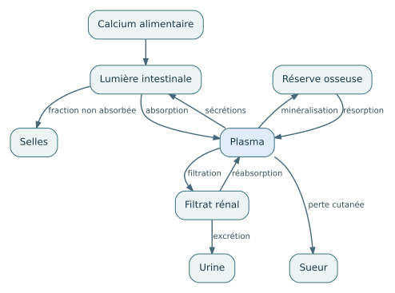
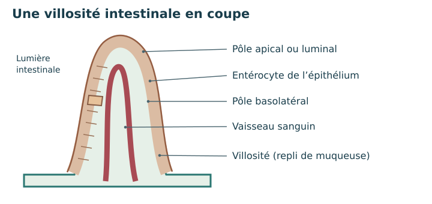
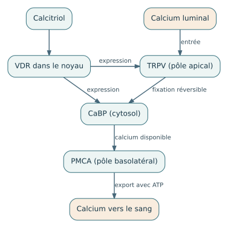
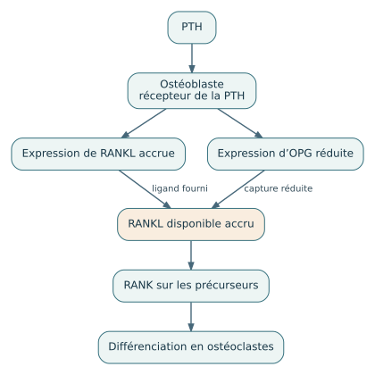
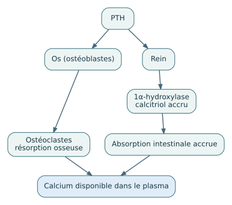
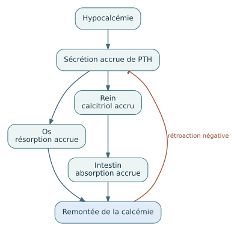
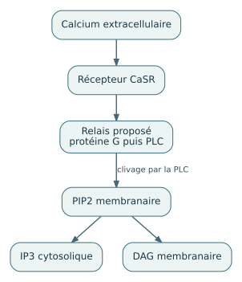
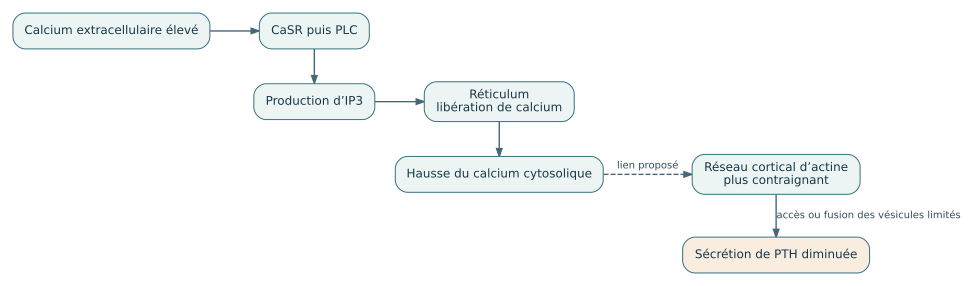

# ENS de Lyon — Second concours, Biologie-biochimie 2015 · Corrigé guidé

*Corrigé rédigé par IA, non officiel.*

**Rédaction (tour 1)** · GPT-6.2 Astra Ultra · vitesse non renseignée

Les deux éditions traitent entièrement 35 des 37 questions. À la question 32 sont développés le lien CaSR–IP3 et le modèle de transduction, à l’exclusion du bras expérimental qui fait intervenir une toxine. La question 36 couvre le sens de l’effet des états de l’actine sur la sécrétion, sans analyse pratique des substances qui perturbent le cytosquelette. Les lectures graphiques sont approximatives.

## I.A. Répartition et flux du calcium

### Question 1 — Une variable réglée

> [!INDICATION]
> Comparer les deux seuils du tableau à la valeur centrale, puis regrouper les symptômes par fonction.

#### Solution

Le plasma contient normalement environ 100 mg de calcium par litre, soit 2,5 mmol/L. Les limites données, autour de 89 et 104 mg/L, encadrent une plage étroite. Des variations modestes s’accompagnent de symptômes, ce qui suggère une régulation de la calcémie. Tétanie, crampes et tremblements orientent vers un rôle dans l’excitabilité neuromusculaire et la contraction. Les troubles du rythme suggèrent aussi une fonction dans l’activité du cœur.

### Question 2 — Réserves minérales et calcium dissous

> [!INDICATION]
> Comparer des masses dans le tableau et distinguer le calcium total du calcium ionisé libre.

#### Solution

L’essentiel du calcium se trouve dans les os et les dents, de 900 à 1 400 g, contre 10 à 15 g dans les liquides intracellulaires et 1 à 2 g dans les liquides extracellulaires. La fraction minérale de l’os et de la dent contient des cristaux de phosphate de calcium, principalement de l’hydroxyapatite. Dans les liquides, le calcium peut être dissous sous forme ionisée, complexé à des anions ou lié à des protéines. Dans une cellule, une partie est séquestrée dans les organites. Un faible stock extracellulaire peut ainsi avoir un rôle fonctionnel majeur.

### Question 3 — Cartographier les entrées, sorties et échanges

> [!INDICATION]
> Mettre le plasma au centre. Une perte dans les selles inclut la fraction alimentaire qui n’a jamais traversé l’épithélium.

#### Solution

L’intestin transfère vers le milieu intérieur une partie du calcium de la lumière digestive. La fraction non absorbée et les sécrétions digestives expliquent la sortie fécale de 350 à 1 000 mg/j. Le plasma échange du calcium avec l’os. La formation osseuse l’y dépose, la résorption en libère. Le rein filtre le calcium diffusible puis en réabsorbe une partie. Le bilan net urinaire est une perte de 150 à 300 mg/j. La sueur ajoute 100 à 200 mg/j. Les sorties du tableau totalisent 600 à 1 500 mg/j. À bilan corporel stable, les entrées alimentaires globales compensent les sorties, alors que la calcémie dépend de l’équilibre entre flux bien plus grands.

## I.B. Vitamine D et minéralisation

### Question 4 — Des os en croissance insuffisamment minéralisés

> [!INDICATION]
> Envisager successivement la disponibilité des matériaux et leur incorporation à la matrice.

#### Solution

La déformation des membres et la faible minéralisation suggèrent que la matrice osseuse en croissance reçoit ou incorpore insuffisamment de calcium et de phosphate. Le défaut peut concerner les apports, leur absorption intestinale, la conservation rénale de ces minéraux ou les cellules qui minéralisent la matrice. Une anomalie hormonale peut agir en amont de plusieurs de ces flux. La radiographie seule ne départage pas ces causes.

### Question 5 — Structure et origine de la vitamine D3

> [!INDICATION]
> Repérer la proportion du squelette hydrocarboné par rapport aux groupes polaires. Relier ensuite sa structure à une famille de lipides.

#### Solution

La vitamine D3 porte un seul hydroxyle face à une vaste partie hydrocarbonée. Sa liposolubilité explique sa présence dans l’huile de foie de morue. Son squelette évoque celui des stérols, dont le cholestérol circulant. Plus précisément, dans la peau, un stérol de cette voie métabolique, le 7-déhydrocholestérol, donne sous l’action des UVB la prévitamine D3 puis la vitamine D3. Le rapprochement avec le cholestérol indique ici une parenté structurale et métabolique.

### Question 6 — Identifier la forme biologiquement active

> [!INDICATION]
> Suivre le devenir du précurseur lorsque l’enzyme rénale de la dernière étape est déficiente.

#### Solution

La vitamine D3 est hydroxylée au foie en calcidiol, puis l’enzyme rénale 1α-hydroxylase produit le **calcitriol**, ou 1α,25-dihydroxyvitamine D3. Le rachitisme associé au défaut de cette dernière enzyme désigne le calcitriol comme la forme active requise pour la fonction étudiée.

### Question 7 — Portée endocrine du calcitriol

> [!INDICATION]
> Relever le lieu de production finale, la voie de transport et la spécificité des cellules qui répondent.

#### Solution

Le calcitriol est une **hormone liposoluble dérivée d’un stérol**. Sa production finale a lieu dans le rein, il circule dans le sang et agit sur des cellules éloignées dotées du récepteur VDR, notamment dans l’intestin, l’os et le rein.

### Question 8 — Deux explications du défaut osseux

> [!INDICATION]
> La présence de VDR dans plusieurs tissus autorise des mécanismes directs et indirects.

#### Solution

Le calcitriol pourrait agir directement sur les cellules osseuses qui portent VDR et modifier leur activité. Il pourrait également augmenter la disponibilité des minéraux dans le plasma en agissant sur l’intestin ou le rein. Une calcémie insuffisante compromettrait alors secondairement la minéralisation de la plaque de croissance. Le phénotype d’un déficit de VDR dans tout l’organisme ne sépare pas encore ces mécanismes.

### Question 9 — Suivre le phénotype des souris dépourvues de VDR

> [!INDICATION]
> Identifier les losanges, puis rapprocher la divergence des courbes de l’aspect de la plaque de croissance.

#### Solution

Chez les homozygotes déficients, la masse augmente plus lentement après les premières semaines. La calcémie figurée s’abaisse vers 1,0–1,1 mM, tandis que les deux autres génotypes restent proches de 1,3 mM. Ces chiffres correspondent à la mesure chez la souris sur cette figure. Le tibia déficient présente une plaque de croissance élargie et irrégulière et des travées peu organisées en dessous. Le développement et l’ossification sont perturbés en association avec la baisse de calcémie. Une copie fonctionnelle de VDR suffit largement aux paramètres mesurés.

### Question 10 — Que restaure la normalisation de la calcémie ?

> [!INDICATION]
> Comparer les mêmes génotypes dans les deux séries. La seconde comparaison maintient le calcium disponible chez l’animal sans VDR.

#### Solution

Sans correction de la calcémie, la plaque de croissance mutante mesure environ 150 µm contre 95 µm chez le témoin. Le fémur résiste à environ 5 N contre 19 N et se déforme davantage, environ 1,4 mm contre 0,45 mm. Lorsque la calcémie des souris déficientes redevient normale, l’épaisseur de la plaque, l’organisation des travées et les paramètres mécaniques se rapprochent des valeurs sauvages. Un apport suffisant de calcium à l’os permet donc de corriger ces anomalies même sans VDR. Dans ce modèle, le rôle majeur du calcitriol pour ces paramètres passe par la disponibilité du calcium.

### Question 11 — Passage du calcium alimentaire au plasma

> [!INDICATION]
> L’ordonnée est la variation par rapport au départ. Comparer les trois plateaux après ingestion.

#### Solution

Au bout d’environ huit à dix minutes, la calcémie s’est élevée d’environ 1,1 µM chez les souris sauvages, de 0,4 µM chez celles sans VDR et de 1,7–1,8 µM chez les sauvages exposées au calcitriol. L’augmentation plus rapide et plus forte chez ces dernières est compatible avec une stimulation de l’absorption intestinale par la voie calcitriol–VDR. Il persiste une entrée modeste chez les animaux déficients.

### Question 12 — Deux faces de l’épithélium intestinal

> [!INDICATION]
> Distinguer le repli entier, les cellules qui le bordent et le réseau vasculaire dans son axe.

#### Solution

La villosité est un repli de la muqueuse qui fait saillie dans la lumière intestinale. Les entérocytes forment son revêtement. Leur pôle apical ou luminal, muni d’une bordure en brosse, regarde le contenu de l’intestin. Le pôle basolatéral regarde les cellules voisines et le tissu conjonctif du côté intérieur de la villosité. Les vaisseaux sanguins parcourent cet axe. Un ion absorbé traverse la face apicale puis la face basolatérale avant de gagner le sang.

### Question 13 — Protéines de transport polarisées

> [!INDICATION]
> Suivre la fluorescence depuis le pourtour luminal jusqu’aux faces latérales de chaque cellule.

#### Solution

TRPV est concentrée sur le fin liseré apical qui borde la lumière. Elle peut former une voie d’entrée du calcium dans l’entérocyte. CaBP est présente dans le cytoplasme de la couche épithéliale. PMCA souligne les membranes basolatérales. Cette ATPase peut expulser activement le calcium du cytosol vers le milieu interstitiel, d’où il rejoint les capillaires. L’orientation de ces deux transports donne un flux net de la lumière vers le sang.

### Question 14 — Transporter le calcium en tamponnant sa forme libre

> [!INDICATION]
> Distinguer concentration totale et concentration libre dans le cytosol.

#### Solution

La CaBP peut lier réversiblement une partie du calcium entré par TRPV. La concentration cytosolique libre reste proche de 100 nM alors que du calcium total traverse la cellule. Ce tampon mobile peut aussi faciliter le transfert vers la membrane basolatérale, où la dissociation rend les ions disponibles pour PMCA.

### Question 15 — L’effet du calcitriol requiert VDR

> [!INDICATION]
> Comparer d’abord les barres avec et sans hormone dans le même génotype, puis celles des animaux déficients et restaurés.

#### Solution

Chez les hétérozygotes fonctionnels, le calcitriol augmente fortement les quantités d’ARNm de CaBP et de TRPV, jusqu’à plusieurs fois le témoin. Les deux conditions traitées sont proches et l’effet n’augmente pas nettement entre elles. Chez les animaux sans VDR, les signaux sont très faibles dans toutes les conditions. Chez les animaux où VDR a été rétabli, les deux réponses au calcitriol réapparaissent. VDR est ainsi nécessaire à l’induction observée des ARNm et la restauration du récepteur permet de la retrouver.

### Question 16 — Un élément régulateur possible

> [!INDICATION]
> Un récepteur nucléaire activé peut reconnaître une région régulatrice. Formuler une prédiction, puis sa limite.

#### Solution

On attend dans les régions régulatrices de CaBP et de TRPV des éléments de réponse à la vitamine D, susceptibles de recruter le complexe VDR activé, généralement associé à RXR. Ils peuvent appartenir au promoteur ou à une région régulatrice plus éloignée. Les mesures d’ARNm seules ne prouvent ni une fixation directe ni la position de ces éléments.

### Question 17 — Du calcitriol au transfert transcellulaire

> [!INDICATION]
> Faire figurer une régulation dans le noyau et trois étapes pour le flux de calcium entre lumière et sang.

#### Solution

Dans l’entérocyte, le calcitriol active VDR. Le modèle prévoit une augmentation de l’expression de TRPV et de CaBP. Le calcium de la lumière entre par TRPV à la face apicale. CaBP le lie réversiblement dans le cytosol. PMCA l’exporte au pôle basolatéral grâce à l’ATP. Le flux intestinal vers le sang augmente. La figure 9 montre directement l’induction des deux premiers ARNm, alors que la localisation de la pompe est donnée par la figure 8.

## I.C. Parathormone

### Question 18 — Libération de calcium et dégradation de la matrice

> [!INDICATION]
> Comparer le marqueur minéral dans l’os et le milieu, puis suivre l’hydroxyproline, marqueur de la matrice organique.

#### Solution

En présence d’extrait parathyroïdien, le calcium marqué apparaît davantage dans le milieu et diminue dans le fragment osseux. Dans le même temps, davantage d’hydroxyproline passe dans le milieu. Il y a donc résorption des composantes minérale et organique de l’os. Chez le sujet atteint d’hyperparathyroïdisme, les phalanges sont amincies et présentent des lacunes osseuses. Une action excessive de la PTH favorise la résorption et la libération de calcium vers le sang, ce qui rend compte de l’hypercalcémie et de la fragilité observées. Une stimulation du système ostéoclastique est une première hypothèse.

### Question 19 — Réponse inverse de la sécrétion de PTH

> [!INDICATION]
> Repérer les deux plateaux et l’intervalle où la variation de pente est maximale.

#### Solution

La sécrétion de PTH suit une **sigmoïde décroissante**. Elle est élevée aux faibles calcémies, chute fortement dans la zone d’environ 75–95 mg/L puis approche un plancher aux valeurs hautes. Une baisse du calcium active donc rapidement un signal qui le remet à disposition du plasma, tandis qu’une élévation réduit ce signal. La forte pente confère une sensibilité élevée dans la zone de transition. Les plateaux traduisent des limites de la réponse sécrétoire.

### Question 20 — Relier nombre d’ostéoclastes et calcémie

> [!INDICATION]
> La référence de 100 % est le lot sans parathyroïdes et sans PTH. La ligne pointillée correspond aux rats intacts.

#### Solution

En l’absence de PTH, calcémie et nombre d’ostéoclastes sont inférieurs aux valeurs des rats intacts. Quand l’exposition à la PTH augmente, la calcémie atteint un plateau autour de deux fois la référence sans hormone, proche de la ligne des animaux intacts. Le nombre d’ostéoclastes augmente aussi et peut atteindre environ trois fois sa référence. La PTH favorise l’apparition ou le maintien de cellules capables de résorber l’os, ce qui contribue à libérer du calcium. Le nombre de cellules ne mesure pas directement l’activité individuelle de chacune.

### Question 21 — Une action par cellule intermédiaire

> [!INDICATION]
> Nommer la cellule qui porte le récepteur et la cellule qui exécute la résorption.

#### Solution

La résorption est réalisée par les ostéoclastes, mais le récepteur de la PTH est détecté sur les ostéoblastes, associés à la formation osseuse. Une action indirecte résout ce paradoxe apparent. Les ostéoblastes peuvent, en réponse à la PTH, modifier la production de facteurs qui commandent la différenciation ou l’activité de la lignée ostéoclastique.

### Question 22 — RANKL et OPG organisent le relais osseux

> [!INDICATION]
> Lire séparément les deux séries d’ARNm. Un récepteur soluble peut capter un ligand avant qu’il atteigne le récepteur cellulaire.

#### Solution

Après ablation des parathyroïdes puis augmentation de la PTH, l’ARNm de RANKL passe globalement d’environ 10 à 100 % de sa propre valeur maximale. Celui d’OPG passe d’environ 100 à 35 % avec quelques fluctuations intermédiaires. Ces pourcentages normalisés ne donnent pas les concentrations absolues des deux protéines. La PTH reçue par l’ostéoblaste favorise donc RANKL et réduit OPG, appelée « ONP » dans une ligne du sujet. RANKL peut atteindre son récepteur RANK sur les précurseurs ostéoclastiques et favoriser leur différenciation. OPG agit comme récepteur soluble leurre qui fixe RANKL. Les deux modifications augmentent ainsi le RANKL disponible et favorisent la résorption osseuse.

### Question 23 — Deux organes cibles de la PTH

> [!INDICATION]
> Relier la hausse de l’ARNm rénal au produit de l’enzyme et à la réponse intestinale déjà étudiée.

#### Solution

Chez les rats sans parathyroïdes, la PTH est associée à une hausse du calcitriol circulant, d’environ 17 à 65 pg/mL, et de l’ARNm rénal de la 1α-hydroxylase, d’environ 20 à 100 % de la réponse maximale. Ces résultats étayent une stimulation rénale de l’activation du calcidiol. La PTH mobilise donc du calcium par deux voies documentées, celle de la résorption osseuse via les ostéoblastes et celle de la production rénale de calcitriol qui facilite l’absorption intestinale.

## I.D. Calcémie et remodelage osseux

### Question 24 — Fermer la boucle de régulation de la calcémie

> [!INDICATION]
> Commencer par une baisse de la variable réglée, suivre les flux correcteurs et revenir à la sécrétion initiale.

#### Solution

Une baisse de la calcémie augmente la sécrétion de PTH par les parathyroïdes. Dans l’os, la voie ostéoblastes–RANKL–ostéoclastes accroît la résorption. Dans le rein, la PTH favorise la production de calcitriol, qui stimule l’absorption intestinale. La conservation rénale du calcium par réabsorption contribue également à la balance calcique, bien que son effet hormonal direct n’ait pas été mesuré sur les figures 13 à 15. Les flux vers le compartiment extracellulaire augmentent. Le retour de la calcémie vers sa zone normale diminue la sécrétion de PTH. Une élévation initiale produit l’ajustement inverse.

### Question 25 — Influence de l’estradiol sur le remodelage osseux

> [!INDICATION]
> À PTH fixée, lire l’axe des doses d’estradiol dans le bon sens. Relier ensuite les deux cultures par OPG.

#### Solution

La PTH fait passer le nombre d’ostéoclastes d’environ 10 à 90. En présence de PTH, les plus faibles concentrations d’estradiol modifient peu ce nombre, tandis que la plus forte le ramène vers 40. Dans les ostéoblastes, la sécrétion d’OPG augmente avec l’estradiol jusqu’à environ trois fois le témoin. Le renforcement de la capture de RANKL par OPG pourrait ainsi freiner la différenciation des ostéoclastes. Une baisse d’estradiol après la ménopause pourrait diminuer ce frein et contribuer à la perte osseuse. Les cultures suggèrent cette chaîne causale, sans établir à elles seules tous les effets in vivo.

### Question 26 — Pistes thérapeutiques déduites du modèle

> [!INDICATION]
> Relier chaque classe de prise en charge au défaut qu’elle vise et distinguer les données cellulaires de l’efficacité clinique.

#### Solution

Dans une analyse de dossier, une première piste est de corriger une insuffisance de calcium disponible ou une carence en vitamine D lorsqu’elle est présente. Une seconde cible est la résorption excessive. Les bisphosphonates limitent l’action ostéoclastique et un anticorps dirigé contre RANKL réduit le signal de différenciation. Le modèle suggère également qu’un traitement œstrogénique peut exercer un effet protecteur dans certaines situations ménopausiques. L’indication clinique dépend du risque de fracture, de l’origine de la perte osseuse et des risques propres aux traitements. Le sujet apporte un mécanisme explicatif, sans essai clinique comparatif.

## II.A. Calcium intracellulaire

### Question 27 — De forts gradients entre compartiments

> [!INDICATION]
> Convertir toutes les mesures en micromolaires avant de comparer les ordres de grandeur.

#### Solution

La concentration cytosolique n’est que de 0,01–0,1 µM. Le réticulum endoplasmique contient 250–600 µM et la mitochondrie 5–300 µM dans le tableau. La compartimentation permet donc un fort gradient vers le cytosol, particulièrement marqué pour le réticulum, dont la concentration peut être plusieurs milliers de fois supérieure. Ces organites peuvent accumuler du calcium et l’en libérer transitoirement, fournissant un signal cytosolique.

## II.B. Contrôle de la sécrétion de PTH

### Question 28 — Deux origines possibles du signal cytosolique

> [!INDICATION]
> L’ordonnée et l’abscisse n’ont pas la même unité. La hausse cytosolique ne révèle pas à elle seule le trajet de l’ion.

#### Solution

Quand le calcium extracellulaire passe d’environ 0,5 à 2 mM, le calcium cytosolique augmente d’environ 160 à 680 nM. Première possibilité, une entrée d’ions depuis le milieu extracellulaire accroît directement la concentration interne. Deuxième possibilité, un récepteur membranaire détecte le calcium externe et déclenche la libération de calcium déjà stocké dans la cellule. Les deux mécanismes pourraient coexister.

### Question 29 — Séparer stimulus extracellulaire et ion mesuré

> [!INDICATION]
> Chercher comment déclencher une réponse sans ajouter au milieu l’espèce dont on suit l’augmentation dans la cellule.

#### Solution

Un autre cation susceptible d’activer le capteur permet de stimuler la cellule indépendamment d’une augmentation du calcium extracellulaire. Si le calcium cytosolique varie encore en l’absence de calcium dans le milieu, un stock interne peut fournir les ions. Le recours à la néomycine a ici cette fonction de discrimination entre détection et transport.

### Question 30 — Déterminer l’origine du calcium mobilisé

> [!INDICATION]
> Lire successivement le courant, l’indicateur spécifique du calcium et l’effet du chélateur. Donner une interprétation commune aux quatre panneaux.

#### Solution

Dans A, le calcium extracellulaire suscite un courant transitoire dans l’ovocyte exprimant CaSR. Dans B, la réponse augmente avec la quantité de néomycine dans la gamme représentée. Le courant est un indicateur indirect de l’élévation de calcium cytosolique via des canaux chlorure. Dans C, la fluorescence calcique s’élève après stimulation des ovocytes exprimant CaSR même lorsque le milieu est dépourvu de calcium, avec une cinétique modifiée. Le témoin à l’eau reste proche de sa ligne de base. Dans D, le courant moyen est voisin avec ou sans calcium externe et devient presque nul avec le chélateur intracellulaire. L’ensemble désigne une mobilisation de calcium interne consécutive à la détection extracellulaire par CaSR.

### Question 31 — Un substrat membranaire de la phospholipase C

> [!INDICATION]
> Distinguer le lipide ancré avant la réaction et le messager hydrosoluble après la réaction.

#### Solution

L’« InsP2 » de l’équation désigne le **phosphatidylinositol 4,5-bisphosphate** (PIP2). C’est un phospholipide du feuillet cytosolique de la membrane plasmique. La phospholipase C le clive en diacylglycérol, qui reste dans la membrane, et en inositol 1,4,5-trisphosphate (IP3), qui diffuse dans le cytosol.

### Question 32 — Du capteur à l’IP3

> [!INDICATION]
> Comparer les ovocytes qui expriment CaSR au témoin à l’eau, puis situer le messager produit par la PLC.

#### Solution

**Lecture partielle de la figure 20.** Dans les ovocytes exprimant CaSR, le calcium ou l’autre stimulus augmente la quantité d’IP3 par rapport au témoin de départ, d’environ 0,15 à 0,9 ou 0,6 pmol par cellule. Le témoin à l’eau reste proche de son faible niveau initial. On propose que CaSR activé transmette le signal à la PLC par une protéine G, avec production de DAG et d’IP3 à partir du PIP2. La comparaison retenue établit le lien entre expression du récepteur et variation d’IP3, mais ne démontre pas à elle seule l’identité du relais. L’analyse du bras expérimental faisant intervenir une toxine est hors couverture.

### Question 33 — L’IP3 fait varier le stock réticulaire

> [!INDICATION]
> Le capteur lumineux se trouve à l’intérieur du réticulum. Une chute du signal y signifie une baisse de son contenu en calcium.

#### Solution

Avec du calcium disponible du côté cytosolique, la luminescence réticulaire augmente jusqu’à environ 800 unités, ce qui traduit le remplissage de la réserve. En présence d’IP3, elle chute rapidement. Sur le second tracé, l’exposition la plus faible libère une partie de la réserve et une exposition plus forte provoque une baisse supplémentaire. L’IP3 peut donc ouvrir des canaux de libération du calcium du réticulum vers le cytosol. La sonde suit ici le compartiment qui se vide.

### Question 34 — Relation inverse entre calcium et sécrétion

> [!INDICATION]
> Les barres tournées vers le bas représentent des concentrations croissantes en calcium cytosolique. Lire les deux parties de l’axe.

#### Solution

Quand le calcium extracellulaire augmente, le calcium cytosolique passe globalement d’environ 100 à 650 nM. Dans le même temps, la sécrétion de PTH passe de valeurs proches du maximum à environ 20 % de celui-ci. Les cellules parathyroïdiennes associent donc un calcium extracellulaire élevé à une mobilisation intracellulaire de calcium et à une inhibition de leur sécrétion. Cette réponse participe à la rétroaction vue à l’échelle de l’organisme.

### Question 35 — Comparer à la jonction neuromusculaire

> [!INDICATION]
> Dans chaque système, préciser si l’augmentation du calcium cytosolique précède une hausse ou une baisse de libération.

#### Solution

À la terminaison motrice, l’entrée de calcium déclenchée par le potentiel d’action favorise la fusion des vésicules et la libération d’acétylcholine. Dans les cellules parathyroïdiennes étudiées, un calcium cytosolique plus élevé accompagne une sécrétion plus faible de PTH. Un même second messager peut produire des effets différents selon les protéines effectrices et l’organisation de la machinerie sécrétoire.

### Question 36 — État du réseau d’actine et sortie de PTH

> [!INDICATION]
> Comparer les deux états du réseau à calcium identique, puis vérifier que la même tendance subsiste pour les deux calcium extracellulaires.

#### Solution

**Interprétation des états cellulaires, portée partielle.** Dans les conditions témoins, la PTH sécrétée est plus faible au calcium extracellulaire élevé. Aux deux niveaux de calcium, un réseau d’actine moins polymérisé est associé à davantage de PTH libérée que dans le témoin correspondant. À l’inverse, un réseau plus polymérisé s’accompagne d’une libération plus faible. Les données suggèrent que le réseau cortical d’actine limite l’accès ou la fusion des vésicules. L’analyse pratique des substances de perturbation du cytosquelette est hors couverture.

### Question 37 — Du calcium extracellulaire à l’exocytose

> [!INDICATION]
> Faire apparaître deux compartiments et les signes des relations entre CaSR, la réserve et la sortie des vésicules.

#### Solution

Quand le calcium extracellulaire augmente, CaSR active une voie de signalisation couplée à la PLC. L’IP3 libéré dans le cytosol favorise la sortie du calcium stocké dans le réticulum. La hausse du calcium cytosolique pourrait favoriser le maintien ou le renforcement du réseau d’actine cortical associé aux vésicules de PTH. Ce réseau limiterait leur accès à la membrane ou leur fusion, réduisant la sécrétion. En situation de calcium extracellulaire faible, cette inhibition se relâche et la sécrétion augmente. Le lien entre calcium et état de l’actine est un mécanisme proposé à partir de mesures de sécrétion et de localisation, sans visualisation directe de toute la séquence sur une même cellule.

