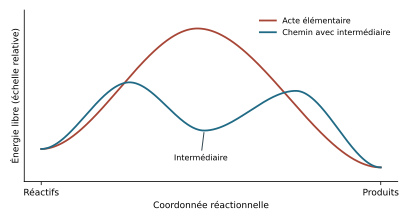
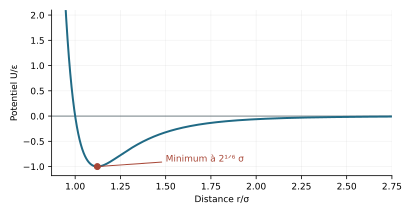
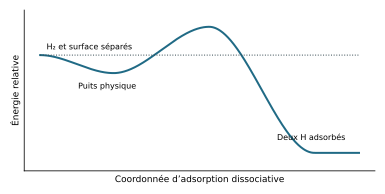
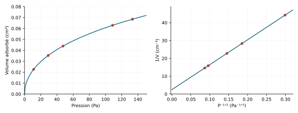
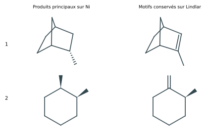
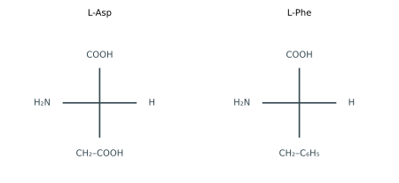

# ENS de Lyon — Second concours, Chimie 2015 · Corrigé brut

*Corrigé rédigé par IA, non officiel.*

**Rédaction (tour 1)** · GPT-6.2 Astra Ultra · vitesse non renseignée

Ces éditions traitent 57 des 59 questions. Les deux calculs de dimensionnement de gaz comprimé (C.I.4 et C.II.2) sont hors couverture. La stéréochimie de C.II.5 est donnée pour chacune des géométries initiales possibles. Les données de B.II sont ajustées numériquement. L’archive pour cet écrit de 2015 ne rattache pas de rapport de jury.

## A.I. Surface spécifique

### Question A.I.1 — Calculer la surface d’une sphère

La frontière d’un grain sphérique de rayon $r$ a pour aire $S_g=4\pi r^2$.

### Question A.I.2 — Passer du rayon à la masse

Le volume vaut $4\pi r^3/3$, donc la masse d’un grain homogène est $m_g=4\pi\rho r^3/3$.

### Question A.I.3 — Calculer la surface spécifique

$a_s=NS_g/(Nm_g)=3/(\rho r)$. Les contacts entre grains sont négligés. Avec $\rho$ en kg/m³ et $r$ en mètres, $a_s$ s’exprime en m²/kg.

### Question A.I.4 — Augmenter la surface disponible

La diminution du rayon des grains augmente la surface spécifique en $1/r$. Une porosité accessible peut aussi fournir une grande aire interne. Une grande surface est recherchée pour les supports de catalyseurs, les adsorbants et les matériaux filtrants, car les transformations ou les échanges s’effectuent à l’interface.

### Question A.I.5 — Tester le cas de la silice

$r=1,0\times10^{-4}$ m et $\rho=2,3\times10^3$ kg/m³, d’où $a_s=3/(2,3\times10^3\times10^{-4})\simeq13$ m²/kg, soit **0,013 m²/g**.

### Question A.I.6 — Interpréter les surfaces mesurées

La surface annoncée de 300–400 m²/g est environ 23 000–31 000 fois l’aire externe calculée. Des grains de même diamètre apparent peuvent être poreux ou formés par agrégation de particules beaucoup plus petites. Le gaz explore les parois de pores ouverts et une rugosité interne. Le modèle d’une sphère pleine et lisse sous-estime cette aire disponible.

## A.II. Cinétique chimique

### Question A.II.1 — Définir les ordres cinétiques

Si la loi prend la forme $v=k\prod_i[A_i]^{p_i}$, $p_i$ est l’ordre partiel par rapport à $A_i$ et $\sum_i p_i$ l’ordre global. Les ordres sont déterminés par la dépendance expérimentale de la vitesse. Ils peuvent être nuls, fractionnaires ou négatifs et ne se déduisent pas, en général, de la stœchiométrie globale.

### Question A.II.2 — Définir un acte élémentaire

Un acte élémentaire est un événement microscopique unique du mécanisme, qui relie directement les réactifs aux produits de l’étape par un état de transition, sans intermédiaire réactionnel pendant cet acte. Sa molécularité compte les entités réactives engagées.

### Question A.II.3 — Tracer le profil énergétique

L’énergie libre est portée en ordonnée, la coordonnée de réaction en abscisse. Le chemin d’un acte élémentaire présente un seul maximum entre les réactifs et les produits. La différence entre ce sommet et le niveau des réactifs donne la barrière d’activation directe. Les hauteurs choisies pour le schéma sont illustratives.

### Question A.II.4 — Appliquer la loi de vitesse d’un acte élémentaire

La loi de van ’t Hoff ou loi d’action de masse **cinétique** donne, pour le sens direct de $\sum_i\alpha_i A_i\to\sum_j\beta_j B_j$, $v=k\prod_i[A_i]^{\alpha_i}$ dans le modèle de solution idéale. Si le retour compte, la vitesse nette est la différence des deux vitesses élémentaires. Cette loi cinétique et l’égalité des activités à l’équilibre répondent à des questions distinctes.

### Question A.II.5 — Relier vitesse et disparition d’une espèce

À volume constant, pour un réactif $A_i$ consommé avec le coefficient $\alpha_i$, $-\mathrm d[A_i]/\mathrm dt=\alpha_i v=\alpha_i k\prod_j[A_j]^{\alpha_j}$. La vitesse de disparition est positive dans le sens direct.

### Question A.II.6 — Écrire l’équation d’un processus unimoléculaire

Pour cet acte élémentaire irréversible, $v=k[A]$ et $\mathrm d[A]/\mathrm dt=-k[A]$, avec $[A](0)=[A]_0$.

### Question A.II.7 — Intégrer l’équation différentielle

L’intégration à température constante donne $\ln([A]/[A]_0)=-kt$, soit $[A](t)=[A]_0 e^{-kt}$. Pour une cinétique d’ordre un, $k$ a la dimension d’une fréquence.

### Question A.II.8 — Trouver le temps de demi-réaction

$[A](t_{1/2})=[A]_0/2$ impose $e^{-kt_{1/2}}=1/2$. Ainsi $t_{1/2}=\ln2/k$, indépendant de la concentration initiale dans ce modèle.

### Question A.II.9 — Comparer les chemins avec et sans intermédiaire

Avec un intermédiaire, le trajet comporte deux sommets séparés par un minimum local. Le chemin catalysé accélère la réaction en proposant des barrières cinétiquement plus accessibles. Les niveaux des réactifs et des produits, donc le bilan thermodynamique global, restent les mêmes. Il faut mesurer chaque barrière par rapport à l’espèce qui la précède, et tenir compte des populations pour décider quelle étape contrôle la vitesse.

## B.I. Adsorption et équilibres

### Question B.I.1 — Écrire le potentiel de Lennard–Jones

$U(r)=A/r^{12}-B/r^6$, avec $A,B>0$ et $U(\infty)=0$. La forme équivalente $4\varepsilon[(\sigma/r)^{12}-(\sigma/r)^6]$ identifie une énergie $\varepsilon$ et une longueur $\sigma$.

### Question B.I.2 — Tracer le potentiel

Quand $r\to0$, $U\to+\infty$. À $r=\sigma$, $U=0$. La dérivée s’annule au minimum $r_m=2^{1/6}\sigma$ où $U=-\varepsilon$. Plus loin $U$ tend vers zéro par valeurs négatives. Le schéma emploie les variables réduites pour rendre ces positions immédiatement lisibles.

### Question B.I.3 — Situer l’adsorption physique

Le puits situé sous le niveau des espèces séparées représente la possibilité d’adsorption. À énergie totale insuffisante pour s’en échapper, une molécule demeure liée et peut osciller autour de $r_m$. Le minimum est la position d’équilibre mécanique stable du couple dans le modèle. Un équilibre thermodynamique à température finie est une distribution d’états et un équilibre dynamique avec la phase gazeuse.

### Question B.I.4 — Construire le coefficient d’accommodation

On prend un ensemble de molécules incidentes et sortantes et une surface maintenue à $T_s$. Le premier principe identifie la variation moyenne d’énergie des molécules à la chaleur échangée si l’on écarte tout autre travail ou changement chimique. Pour une énergie moyenne proportionnelle à la température sur l’intervalle, $C_a=(T_q-T_g)/(T_s-T_g)$, avec $T_s
e T_g$. Le rapport vaut zéro si $T_q=T_g$ et un si $T_q=T_s$. Le même rapport convient au refroidissement et au réchauffement.

### Question B.I.5 — Lire un profil d’adsorption dissociative

Le profil peut d’abord présenter un puits peu profond de physisorption de H₂, puis une barrière associée à la dissociation et à la réorganisation des liaisons. L’état à deux H adsorbés sur deux sites voisins de nickel se trouve dans un puits de chimisorption plus profond. La hauteur du sommet par rapport au gaz séparé dépend de la surface. La figure donne un exemple qualitatif et n’impose pas une valeur de cette barrière.

### Question B.I.6 — Augmenter la pression à température fixée

Une hausse de pression partielle accroît l’activité du gaz et le taux d’arrivée sur les sites vacants. L’équilibre se déplace vers l’état adsorbé, le recouvrement augmente jusqu’à approcher la saturation. À température fixée, la constante thermodynamique de l’équilibre demeure la même.

### Question B.I.7 — Augmenter la température à pression fixée

L’adsorption ordinaire est exothermique. La relation de van ’t Hoff $\mathrm d\ln K/\mathrm dT=\Delta H^\circ/(RT^2)$ donne une diminution de $K$ lorsque $T$ augmente. À pression partielle donnée, le recouvrement d’équilibre diminue. L’augmentation d’une vitesse élémentaire avec la température ne suffit pas à déterminer le déplacement d’équilibre.

### Question B.I.8 — Établir l’isotherme à un adsorbat

$r_a=k_a^A P_A(1-\theta_A)$ et $r_d=k_d^A\theta_A$. À l’équilibre $r_a=r_d$. En posant $K_A=k_a^A/k_d^A$, il vient $\theta_A/(1-\theta_A)=K_A P_A$, d’où $\theta_A=K_A P_A/(1+K_A P_A)$. Si la pression est introduite en Pa, $K_A$ dans cette écriture a l’unité Pa⁻¹.

### Question B.I.9 — Partager la surface entre plusieurs espèces

Pour une adsorption moléculaire à un site, $\theta_i=K_i P_i\theta_*$ et $\theta_*+\sum_i\theta_i=1$. Alors $\theta_*=1/(1+\sum_i K_iP_i)$ et $\theta_A=K_AP_A/(1+\sum_iK_iP_i)$. À $P_A$ fixe, la présence d’un compétiteur augmente le dénominateur et réduit le recouvrement de A.

## B.II. Mesurer une isotherme

### Question B.II.1 — Justifier la préparation de la référence de mesure

Le dégazage enlève des espèces déjà adsorbées, par exemple l’eau. Il établit une masse de référence et une surface initialement disponible et reproductible. Une adsorption préalable fausserait la capacité attribuée au gaz mesuré.

### Question B.II.2 — Isoler la pression de l’isotherme dissociative

$\sqrt{K_{H_2}P_{H_2}}=\theta_H/(1-\theta_H)$, d’où $P_{H_2}=\theta_H^2/[K_{H_2}(1-\theta_H)^2]$. La racine carrée correspond au fait qu’une molécule fournit deux atomes adsorbés. La formation de HD à partir d’isotopologues séparés appuie une dissociation et une recombinaison en surface.

### Question B.II.3 — Représenter l’isotherme mesurée

À 278 K, les cinq mesures montrent une croissance de 0,0226 à 0,0685 cm³ quand la pression passe de 11,2 à 133,3 Pa. La courbe est croissante et concave. L’isotherme de type I tend vers une capacité de monocouche $V_m$ à grande pression. Le dernier point mesuré reste très en dessous de la valeur de saturation extrapolée en B.II.6.

### Question B.II.4 — Relier recouvrement et volume adsorbé

Le volume de gaz adsorbé est proportionnel au nombre de sites occupés. Ainsi $\theta_H=V_{\rm ads}/V_m$ à conditions de référence identiques. Le facteur deux entre nombre d’atomes de surface et nombre de molécules H₂ est présent dans les deux volumes et se simplifie.

### Question B.II.5 — Linéariser le modèle

À partir de $V=V_m\sqrt{KP}/(1+\sqrt{KP})$, on obtient $1/V=(1/V_m)+(1/(V_m\sqrt K))(1/\sqrt P)$. Avec $x=P^{-1/2}$, $y=1/V$, la droite $y=ax+b$ donne $V_m=1/b$ et $K=(b/a)^2$. On peut aussi ajuster $\sqrt P/V$ en fonction de $\sqrt P$.

### Question B.II.6 — Ajuster les cinq mesures

La régression de $1/V$ sur $1/\sqrt P$ donne $a\simeq139,70$ Pa$^{1/2}$·cm⁻³ et $b\simeq2,497$ cm⁻³. Ainsi **$V_m\simeq0,400$ cm³ et $K_{H_2}\simeq3,19\times10^{-4}$ Pa⁻¹**. Le volume maximal mesuré ne représente qu’environ $0,0685/0,400=17\,\%$ de la capacité estimée, ce qui rend la saturation plus incertaine que la qualité visuelle de l’ajustement ne le suggère.

## C.I. Thermodynamique et vitesse

### Question C.I.1 — Calculer l’enthalpie libre standard

À 298 K, $\Delta_rH^\circ=2(-46,3)=-92,6$ kJ/mol de réaction. $\Delta_rS^\circ=2(192,3)-191,5-3(130,6)=-198,7$ J/(mol·K). D’où $\Delta_rG^\circ=\Delta_rH^\circ-T\Delta_rS^\circ\simeq-33,4$ kJ/mol de réaction, soit environ −16,7 kJ par mole d’ammoniac formée.

### Question C.I.2 — Distinguer possibilité et équilibre

À 298 K et pour $Q_r=1$, $\Delta_rG^\circ<0$ favorise le sens de formation de l’ammoniac et $K^\circ=\exp[-\Delta_rG^\circ/(RT)]\simeq7,0\times10^5$. Pour une composition quelconque, $\Delta_rG=RT\ln(Q_r/K^\circ)$. Le sens direct est spontané si $Q_r<K^\circ$ et l’équilibre impose $Q_r=K^\circ$.

### Question C.I.3 — Expliquer l’intérêt cinétique de la surface

Une transformation favorable peut rester extrêmement lente. En particulier la réorganisation et la dissociation de la liaison du diazote rencontrent une forte barrière d’activation. Une surface catalytique offre des étapes intermédiaires accessibles. Elle peut accélérer les réactions directe et inverse sans modifier la constante d’équilibre thermodynamique.

*Question C.I.4 hors couverture.*

### Question C.I.5 — Préciser la portée du modèle de Langmuir

Un modèle de type Langmuir est un premier cadre si l’on idéalise une surface homogène, des sites localisés et une monocouche sans interactions latérales. Le schéma comporte adsorption dissociative sur deux sites et compétition entre plusieurs espèces. Il impose donc un bilan de sites et des lois adaptées aux étapes élémentaires. L’isotherme moléculaire simple $KP/(1+KP)$ ne s’applique pas telle quelle à toutes les espèces. Hétérogénéité réelle des sites et corrélations entre voisins sont des limites du modèle.

### Question C.I.6 — Exprimer la vitesse nette

Si $r_a$ et $r_d$ désignent les deux flux unidirectionnels opposés pour cette étape, le flux net de réaction est $r=r_a-r_d$, avec les mêmes unités et une normalisation par la même surface. Le coefficient de N₂ vaut un dans l’équation-bilan et celui de NH₃ vaut deux. Le débit net de formation de NH₃ exprimé dans la même normalisation est donc $2r$.

### Question C.I.7 — Distinguer loi cinétique et relation d’équilibre

L’hypothèse d’étapes (3) à (7) rapides devant l’étape déterminante autorise un **quasi-équilibre** pour chacune. On peut alors relier leurs activités à leurs constantes d’équilibre. L’étape (2), siège d’un déséquilibre cinétique important pendant le fonctionnement, ne permet pas de remplacer son quotient réactionnel par sa constante. Elle peut néanmoins suivre une loi de vitesse élémentaire dans chaque sens. L’expression « loi d’action des masses » doit ici être comprise dans son sens thermodynamique d’égalité à l’équilibre.

## C.II. Chimie et stéréochimie des surfaces

### Question C.II.1 — Équilibrer l’hydrogénation du but-1-ène

Le bilan est $\mathrm{CH_2{=}CH{-}CH_2{-}CH_3+H_2\longrightarrow CH_3{-}CH_2{-}CH_2{-}CH_3}$. Les quatre carbones sont conservés et une molécule de dihydrogène s’ajoute par liaison double.

*Question C.II.2 hors couverture.*

### Question C.II.3 — Interpréter le mécanisme de surface

Dans le modèle de Langmuir–Hinshelwood, H₂ se dissocie en deux hydrogènes adsorbés. L’alcène interagit avec la surface par sa liaison π. Le transfert d’un premier hydrogène donne un intermédiaire alkyle lié à la surface, puis un second transfert conduit à l’alcane. La désorption libère les sites. Cette représentation est un bilan d’étapes microscopiques.

### Question C.II.4 — Compter les stéréoisomères possibles

Le produit de constitution est le 2-méthoxy-3-méthylpentane, $\mathrm{CH_3{-}CH(OCH_3){-}CH(CH_3){-}CH_2{-}CH_3}$. C2 et C3 sont stéréogènes. Les quatre configurations a priori sont (2R,3R), (2S,3S), (2R,3S) et (2S,3R). La molécule ne possède pas de symétrie interne donnant un composé méso.

### Question C.II.5 — Assigner les configurations conditionnellement à E/Z

En C2, les priorités CIP sont OMe > C3 > Me > H. En C3, elles sont C2 (voisin de O) > Et > Me > H. Pour l’alcène **E** (OMe et Et opposés), une addition syn sur la face avant ou arrière conduit à **(2R,3S)/(2S,3R)**. Pour l’alcène **Z** (OMe et Et du même côté), elle conduit à **(2R,3R)/(2S,3S)**. Dans un environnement achiral, les deux faces énantiotopiques donnent en principe les deux énantiomères de chaque paire. Le nom imprimé ne spécifie pas la géométrie de départ et ne détermine donc pas une seule paire.

### Question C.II.6 — Comparer les spectres infrarouges

La vibration C=C, attendue vers 1 620–1 680 cm⁻¹ avec une intensité variable, disparaît lors de la saturation. Les liaisons C–H saturées absorbent vers 2 850–2 960 cm⁻¹ dans les deux molécules, avec un motif modifié. La liaison C–O de l’éther subsiste. La double liaison du réactif est **tétrasubstituée**. Il n’y a pas de bande d’élongation =C–H à faire disparaître pour ce substrat précis.

### Question C.II.7 — Expliquer le principe de la spectroscopie IR

Une molécule absorbe un photon dont l’énergie correspond à l’écart entre deux niveaux vibrationnels permis. Un mode est actif en infrarouge si la vibration modifie le moment dipolaire. Le nombre d’onde dépend notamment de la constante de force de la liaison et de la masse réduite des atomes. Le spectre en absorbance ou en transmission révèle les vibrations caractéristiques des fonctions.

### Question C.II.8 — Expliquer l’addition syn

La liaison π maintient une face de l’alcène au contact du métal. Les deux hydrogènes transférés depuis la surface arrivent préférentiellement de ce même côté avant désorption, d’où l’addition syn. Un relief moléculaire ou un substituant encombrant peut rendre une face plus accessible que l’autre.

### Question C.II.9 — Distinguer l’arrêt à l’alcène

Dans le modèle de l’exercice, le catalyseur de Lindlar permet la réduction sélective d’un alcyne en alcène. L’addition syn conduit à l’alcène Z pour un alcyne interne lorsque les substituants de plus haute priorité sont les deux fragments carbonés. L’alcène formé ou présent initialement est beaucoup moins réactif sur cette surface.

### Question C.II.10 — Comparer les cinq substrats dessinés

Les produits de principe sont donnés dans l’ordre de la figure. Ph désigne le phényle. Pour les deux supports cycliques, la figure originale du corrigé donne en outre les formules de squelette.

| Substrat repéré sur la planche | Réduction complète des insaturations aliphatiques sur Ni | Sélectivité de Lindlar |
| --- | --- | --- |
| 1. Alcène bicyclique méthylé | 2-méthylbicyclo[2.2.1]heptane, addition sur la face la moins encombrée, à l’opposé du pont | Alcène bicyclique de départ |
| 2. Cycle à =CH₂ exocyclique et Me voisin | 1,2-diméthylcyclohexane, isomère cis favorisé par l’approche opposée au Me déjà présent | Composé méthyléné de départ |
| 3. Ph–C≡C–CH₃ | Ph–CH₂–CH₂–CH₃ | (Z)-Ph–CH=CH–CH₃ |
| 4. Ényne à double liaison E existante | CH₃–(CH₂)₄–CH₃ | CH₃–CH=CH–CH=CH–CH₃, géométries E,Z en parcourant le dessin de gauche à droite |
| 5. Ényne à double liaison Z existante | CH₃–(CH₂)₄–CH₃ | CH₃–CH=CH–CH=CH–CH₃, géométries Z,Z |

La seule lecture de ces schémas prédit les produits principaux et la stéréosélectivité attendue, sans fournir un rapport expérimental des diastéréoisomères cycliques.

## C.III. Peptides et support solide

### Question C.III.1 — Représenter L-aspartate et L-phénylalanine

Les formules sous forme non ionisée sont $\mathrm{HOOC{-}CH(NH_2){-}CH_2{-}COOH}$ pour Asp et $\mathrm{HOOC{-}CH(NH_2){-}CH_2{-}C_6H_5}$ pour Phe. En projection de Fischer, le carbone α est au croisement, NH₂ à gauche, H à droite, COOH en haut et la chaîne latérale correspondante en bas. Les traits horizontaux sortent vers l’observateur.

### Question C.III.2 — Assigner les deux centres α

Les priorités en Cα sont NH₂ > COOH > chaîne latérale > H pour les deux acides aminés. Dans les Fischer de la question précédente, les deux configurations sont **S**. La classification L est relative et l’identification S ici résulte de ces priorités.

### Question C.III.3 — Identifier les liaisons concurrentes

Sans activation, une mise en présence simple favorise surtout les équilibres acido-basiques. Si une condensation est rendue possible sans sélection des fonctions, on attend Asp–Phe ou Phe–Asp, des homocondensats Asp–Asp et Phe–Phe et, en poursuivant les réactions, des oligomères. Le carboxyle latéral d’Asp peut aussi donner une liaison β-aspartyle (isoaspartyle). L’ordre des acides aminés et le site d’acylation sont donc tous deux à contrôler.

### Question C.III.4 — Nommer la liaison peptidique

La fonction $\mathrm{-C(=O)-NH-}$ est une **amide**. Lorsqu’elle unit deux résidus d’acides aminés dans la chaîne, on l’appelle liaison peptidique.

### Question C.III.5 — Citer deux protections d’amine

On peut masquer une amine primaire sous forme de **phtalimide** ou de **sulfonamide** comme un dérivé tosylé. Ces protections remplacent la fonction libre par un motif moins nucléophile. Leur intérêt réel dépend de la possibilité de les retirer sélectivement en présence des autres fonctions.

### Question C.III.6 — Écrire les trois carbamates de glycine

Boc–Gly–OH s’écrit $(\mathrm{CH_3})_3\mathrm C{-}O{-}C(=O){-}NH{-}CH_2{-}COOH$. Cbz–Gly–OH s’écrit $\mathrm{C_6H_5{-}CH_2{-}O{-}C(=O){-}NH{-}CH_2{-}COOH}$. Fmoc–Gly–OH s’écrit (fluorén-9-yl)–CH₂–O–C(=O)–NH–CH₂–COOH. Si la fonction acide est elle-même protégée, le dernier COOH devient $\mathrm{COOR'}$, par exemple $\mathrm{COOCH_3}$ pour un ester méthylique. Le fluorényle comporte deux noyaux benzéniques reliés au sein d’un système tricyclique, tandis que le benzyle de Cbz n’en porte qu’un.

### Question C.III.7 — Expliquer l’orthogonalité

Des protections sont orthogonales si chaque fonction peut être dévoilée sélectivement en conservant l’autre protection et les liaisons qui doivent rester dans la molécule. Les groupes doivent être compatibles avec les étapes de formation de la liaison peptidique. Deux protections qui se retirent toujours ensemble ne sont pas orthogonales l’une à l’autre.

### Question C.III.8 — Attribuer les fonctions à protéger pour Asp–Phe–OMe

Le carboxyle α d’Asp doit former l’amide avec l’amine α de Phe. Une stratégie de fonctions est Fmoc–Asp(OtBu)–OH + H–Phe–OMe → Fmoc–Asp(OtBu)–Phe–OMe par couplage du carboxyle α disponible. La suppression sélective des protections N-Fmoc et de l’ester tert-butylique latéral restaure l’amine terminale et le carboxyle latéral d’Asp tout en conservant l’ester méthylique de Phe. Le produit est $\mathrm{H_2N{-}CH(CH_2COOH){-}CO{-}NH{-}CH(CH_2Ph){-}COOMe}$, avec les deux résidus L. Le carboxyle β d’Asp protégé écarte la liaison isoaspartyle.

### Question C.III.9 — Identifier le comonomère réticulant

Le **divinylbenzène** porte deux fonctions vinyliques. Leur polymérisation dans deux segments différents établit des ponts covalents interchaînes et rend le matériau réticulé.

### Question C.III.10 — Attribuer les deux autres monomères

Le styrène forme la majeure partie du squelette polystyrénique. Le para-chlorométhylstyrène copolymérise par son groupe vinyle et apporte des motifs aromatiques latéraux $\mathrm{-CH_2Cl}$. Ces derniers peuvent servir de points d’ancrage alors que la matrice reste insoluble.

### Question C.III.11 — Identifier la fonction liée à la résine

Le premier acide aminé est ancré par son **carboxyle α** au motif benzylique de la résine. La liaison est un ester de type $\mathrm{résine{-}CH_2{-}O{-}C(=O){-}CH(R){-}NH{-}P}$, où P représente une protection N. L’extrémité C-terminale est immobilisée et l’élongation utilise l’extrémité N.

### Question C.III.12 — Déduire l’ordre d’assemblage de Gly–Ala–Leu

On écrit la cible H–Gly–Ala–Leu–OH. Le résidu C-terminal **Leu** est d’abord fixé par son carboxyle à la résine, son amine étant protégée. Après libération de son amine, le carboxyle de l’**Ala** N-protégée forme la liaison Ala–Leu. La libération de l’amine de l’Ala permet ensuite la liaison du carboxyle de la **Gly** N-protégée. Finalement, la déprotection N et la séparation du support restituent H–Gly–Ala–Leu–OH. Les lavages entre les transformations éliminent les réactifs non attachés. L’ordre des résidus ajoutés est Leu, Ala, Gly.
