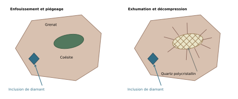
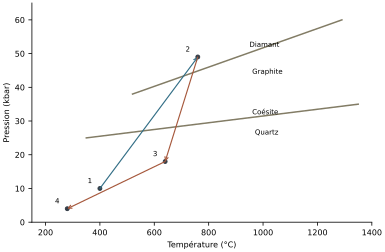
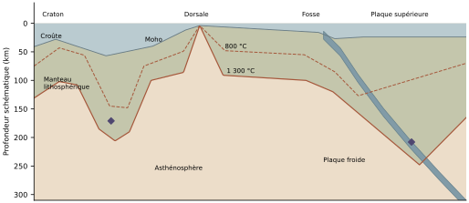
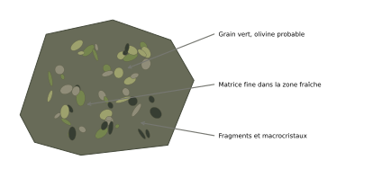
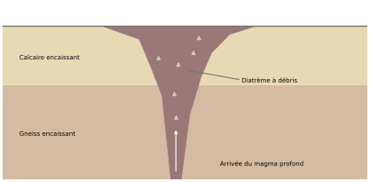
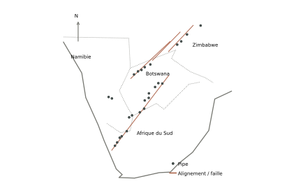
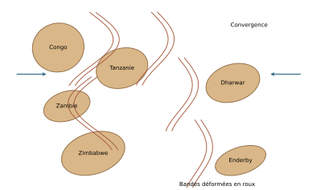

# ENS de Lyon, second concours 2015 — Géosciences · Corrigé guidé

*Corrigé rédigé par IA, non officiel. Signalez toute erreur.*

**Rédaction** · GPT-6.2 Astra Ultra · vitesse non renseignée

Commencer chaque document par une observation précise, donner ensuite le mécanisme qui l’explique et indiquer la part d’interprétation. Pression, température et vitesse de remontée jouent des rôles distincts.

## I.A — Évolution pression–température

### Question 1 — Deux structures pour une même composition

> [!INDICATION]
> Distinguer un changement de structure d’une réaction qui modifie la composition chimique.

#### Solution

Le graphite et le diamant sont deux polymorphes du carbone. Ils ont la même composition, mais des arrangements cristallins distincts et des volumes molaires différents. Les empilements de feuillets du graphite contrastent avec le réseau tridimensionnel tétraédrique du diamant. À température donnée une pression suffisamment élevée favorise la phase la plus dense. Quartz et coésite sont deux polymorphes de SiO₂, et andalousite, disthène et sillimanite trois polymorphes de Al₂SiO₅.

### Question 2 — Histoire du cristal isotrope

> [!INDICATION]
> Comparer C et D : l’un des minéraux de haute pression subsiste, l’autre n’est plus représenté que par la géométrie de ses produits et de ses fissures.

#### Solution

La plage sombre en lumière polarisée analysée et claire en lumière naturelle, entourée de phengite et de disthène, est compatible avec un **grenat** cubique. Le grenat a grandi dans la métapélite, en piégeant des inclusions minérales. Une inclusion de diamant en C impose qu’au moins une étape ait atteint le domaine de stabilité du diamant. Les petits grains de quartz organisés en ellipse en D, entourés de fractures radiales du grenat, s’interprètent comme la pseudomorphose d’une inclusion de coésite. À la remontée, la transformation en quartz de plus grand volume a exercé une pression sur l’hôte et l’a fissuré. Le diamant a pu persister métastablement. La croissance du grenat peut s’étendre sur une partie de l’enfouissement. La roche ne contraint pas un âge absolu ni un ordre précis entre toutes les inclusions.

### Question 3 — Un trajet pression–température admissible

> [!INDICATION]
> Un tracé admissible doit atteindre le côté diamant de la limite graphite–diamant, puis revenir dans le domaine quartz.

#### Solution

Un exemple de chemin en trois étapes part d’une métapélite à pression modérée, vers 350–450 °C et 8–12 kbar. Pendant l’enfouissement, la pression croît assez vite pour atteindre, vers 700–800 °C et 48–52 kbar, les domaines de la coésite et du diamant sur la figure 2. Le grenat peut alors préserver ces témoins. À l’exhumation, une décompression vers 15–20 kbar, puis un refroidissement vers la surface, font franchir à rebours la limite coésite–quartz. Le point du pic est un exemple compatible avec le diagramme et les témoins observés. Les clichés ne livrent pas de thermobarométrie unique.

### Question 4 — Enfouir une roche crustale à très haute pression

> [!INDICATION]
> Une métapélite vient de la croûte : il faut expliquer d’abord son enfouissement, puis sa réapparition en surface.

#### Solution

La plongée d’une marge continentale à la suite d’une lithosphère océanique en subduction peut entraîner des métasédiments à plus de 120 km. Leur retour parmi les roches de surface exige un mécanisme d’exhumation, facilité notamment par la flottabilité des matériaux continentaux et le découplage d’une partie de la plaque. Les ceintures alpines et himalayennes et la province de Dabie–Sulu en Chine fournissent des exemples de roches continentales UHP dans des zones de collision ou de convergence ancienne. Une simple variation de pression dans une chambre magmatique superficielle ne rendrait pas compte du diamant.

### Question 5 — Annoter la coupe lithosphérique

> [!INDICATION]
> Les isothermes ne sont pas des frontières de composition. Le Moho et la base de la lithosphère n’indiquent pas la même interface.

#### Solution

De gauche à droite figurent une croûte continentale épaissie localement sous le craton, une marge puis une croûte océanique mince, une dorsale encadrée de deux plaques océaniques, une fosse et une plaque plongeant vers la droite sous une plaque supérieure. Le Moho sépare la croûte du manteau. Le manteau lithosphérique rigide se situe entre le Moho et la base thermique de la lithosphère, voisine ici de l’isotherme 1 300 °C. L’asthénosphère se trouve dessous. L’isotherme 800 °C est plus superficielle. Les deux remontent sous la dorsale, s’enfoncent sous la racine cratonique et plongent avec la plaque froide.

### Question 6 — Les deux fenêtres de stabilité du diamant

> [!INDICATION]
> Superposer mentalement le géotherme local et la limite graphite–diamant au lieu d’adopter une profondeur identique partout.

#### Solution

Dans un géotherme cratonique froid, la limite graphite–diamant peut être franchie avant d’atteindre la base de la lithosphère. La partie inférieure de sa racine, typiquement vers 150–200 km dans cette coupe, constitue une première fenêtre dans le manteau. Une seconde se situe dans la croûte d’une plaque profondément subduite, froide à profondeur égale, et éventuellement son manteau lithosphérique adjacent. La croûte restée à la surface du continent est trop peu profonde. La dorsale et l’asthénosphère chaude des profondeurs représentées n’offrent pas ce couple pression–température. Une éventuelle stabilité thermodynamique ne garantit pas qu’il y ait du carbone disponible ni des diamants économiquement exploitables.

### Question 7 — Persistance à basse pression

> [!INDICATION]
> L’équilibre fixe le sens thermodynamique d’une réaction, la cinétique son délai.

#### Solution

À la surface, le graphite est thermodynamiquement favorisé, mais passer d’un réseau tétraédrique à un réseau en feuillets demande de rompre et de recréer des liaisons. La barrière d’activation et la lenteur de nucléation rendent la transformation très lente à basse température. Une remontée rapide, le refroidissement et la protection éventuelle dans un cristal hôte favorisent la conservation métastable. Une résidence longue à température élevée en présence d’un fluide réactif pourrait au contraire provoquer résorption, oxydation ou graphitisation.

## I.B — Les kimberlites

### Question 8 — Viscosité d’un magma

> [!INDICATION]
> Distinguer la viscosité du liquide seul de celle d’un mélange cristaux–liquide–gaz.

#### Solution

À composition donnée, une température élevée facilite les réarrangements du liquide et diminue sa viscosité. Un réseau silicaté très polymérisé, typique d’un liquide riche en silice, augmente généralement la viscosité. Les composants dissous tels que l’eau peuvent dépolymériser le liquide. La fraction et la forme des cristaux augmentent la viscosité apparente d’une suspension. Les bulles, la pression et la vitesse de déformation peuvent aussi modifier la rhéologie, selon les conditions. La figure 4 compare des ordres de grandeur à des températures distinctes, pas une expérience où une seule grandeur varierait.

### Question 9 — Décrire la kimberlite

> [!INDICATION]
> Attribuer des noms sur la base des agrandissements et utiliser le tableau pour caractériser la roche entière.

#### Solution

La photographie montre une matrice sombre à grain fin dans la zone fraîche de gauche et de nombreux gros grains ou fragments, dont des grains verts plus ou moins transparents dans l’agrandissement de droite. Ces derniers sont compatibles avec l’olivine, parfois altérée en serpentine. La texture est hétérométrique, macrocristalline à aspect localement bréchique. Sur la vue générale, annoter la pâte sombre, les gros grains d’olivine et les fragments englobés. Les grains transportés depuis le manteau peuvent être des xénocristaux. La photo seule ne permet pas d’appeler diamant un grain transparent quelconque.
Les deux colonnes de la figure 4B donnent 23,2–34,8 % de SiO₂ et 22,6–24,7 % de MgO, contre 47,1 % et 12,7 % pour le basalte comparé. Ce sont des roches magmatiques ultramafiques, très pauvres en silice, d’origine mantellique. Une pâte kimberlitique peut associer olivine, phlogopite, carbonates et oxydes. La perte au feu de 17,9–23,5 % signale l’importance de constituants volatils et de l’altération. Elle ne mesure pas seule la teneur initiale en CO₂ du magma.

### Question 10 — Du manteau au diatrème

> [!INDICATION]
> Distinguer la genèse profonde des diamants, la formation du liquide et l’âge de la mise en place de la cheminée.

#### Solution

Un faible degré de fusion d’un manteau enrichi en volatils en profondeur peut former un liquide kimberlitique pauvre en silice. Le sujet lui attribue une viscosité de l’ordre de 0,1 Pa·s à 1 000 °C, contre 10–100 Pa·s pour le basalte du tableau à la même température. Sa mobilité, sa flottabilité et l’ouverture de fractures favorisent une remontée rapide depuis environ 200 km. Le magma entraîne des fragments de manteau et des diamants beaucoup plus anciens que l’éruption.
La décompression et le dégazage, parfois amplifiés par une interaction avec les eaux de l’encaissant, favorisent fragmentation et excavation du conduit. La coupe 5B montre une cheminée qui s’élargit vers le haut dans les gneiss et calcaires encaissants avec des fragments inclus. En surface, le diatrème peut donner une structure circulaire et une exploitation en gradins comme en 5C. Un temps de transport court limite la résorption du diamant.

### Question 11 — Ce que localise la carte mondiale

> [!INDICATION]
> Rechercher à la fois une association spatiale positive et des contre-exemples à une relation automatique.

#### Solution

Les kimberlites diamantifères se concentrent dans ou à proximité de vieux noyaux continentaux, par exemple en Afrique australe, en Sibérie et au Canada. Il faut compter aussi les terrains archéens masqués par une couverture récente. Les points blancs démontrent que certaines kimberlites sont stériles et les symboles d’intérêt majeur restent peu nombreux. Sur les nombres fournis, 500/5 000 = 10 % sont diamantifères, 50/5 000 = 1 % fournissent les qualités retenues et 15/5 000 = 0,3 % seraient rentables. La carte dépend également de l’exposition, de la prospection et de la qualité des découvertes.

### Question 12 — Structure de l’Afrique australe

> [!INDICATION]
> Le socle archéen fournit un contexte thermique à grande échelle, les alignements de cheminées une information structurale plus locale.

#### Solution

Sur le fond de la figure 8, suivre les chapelets de points noirs parallèles aux failles, notamment le linéament du sud-ouest vers le nord-est, de l’Afrique du Sud au Botswana puis vers le Zimbabwe. Des alignements secondaires et des intersections suggèrent plusieurs voies structurales de remontée. Le socle ancien du Kaapvaal, le craton du Zimbabwe plus au nord-est et la ceinture du Limpopo entre eux donnent le contexte régional. Les limites de ces provinces ne sont pas toutes tracées sur ce document, et ne peuvent être déduites point par point des seuls pipes.
La région associe racines lithosphériques anciennes et froides, épisodes plus jeunes de magmatisme kimberlitique et fractures qui facilitent le transfert rapide vers la surface. Elle conjugue ainsi possibilités de formation, de conservation et de collecte des diamants, sans promettre un gisement à chaque intersection.

## II.B — Particularités des cratons archéens

### Question 13 — Racines cratoniques

> [!INDICATION]
> La légende de la figure donne une anomalie de temps, dont le signe est opposé à celui d’une anomalie de vitesse.

#### Solution

Un craton est un noyau continental ancien, resté relativement stable et peu déformé pendant de longues périodes. Son manteau lithosphérique est souvent appauvri par des fusions anciennes, sec, froid et mécaniquement résistant. Il peut former une racine de 150 à plus de 200 km. Une profondeur de 200 km pour environ 1 300 °C donne un gradient moyen de 6,5 °C/km à l’échelle de la lithosphère. Le gradient local varie avec la profondeur. La croûte à elle seule ne mesure pas 200 km.
Dans la figure 9, le bleu correspond à des **temps de trajet S plus courts** que la référence, donc à des vitesses plus élevées à trajet comparable. Les anomalies bleues sous les vieux noyaux sont compatibles avec des racines froides et rigides jusque dans l’intervalle sondé. La composition intervient aussi dans la vitesse et les limites d’une image tomographique ne définissent pas exactement la base thermique de chaque craton.

### Question 14 — Les blocs pendant l’assemblage du Gondwana

> [!INDICATION]
> Rechercher où se concentre la déformation autour des cratons, en laissant au schéma son statut de reconstruction.

#### Solution

Entre environ 800 et 550 Ma, des blocs continentaux ont convergé globalement d’est en ouest. Sur la reconstruction de la figure 10, les bandes déformées contournent les noyaux du Congo, de Tanzanie, de Zambie, du Zimbabwe et du Dharwar. Les domaines plus chauds et plus déformables, anciens bassins ou marges, ont accommodé la fermeture océanique et une partie du raccourcissement, des chevauchements et du cisaillement. Les noyaux plus résistants se déplacent et parfois pivotent en conservant davantage leurs structures internes. Les sutures panafricaines enregistrent l’assemblage. Une flèche de convergence de chaque côté et des hachures suivant les marges de ces blocs rendent ce contraste lisible. Les bandes bleues de la reconstruction sont les côtes **actuelles** reportées pour se repérer.

### Question 15 — Comparaison avec la collision Inde–Asie

> [!INDICATION]
> Comparer la répartition de la déformation et les types d’observations disponibles.

#### Solution

La convergence de la lithosphère indienne vers l’Eurasie après la fermeture d’une branche de la Téthys montre l’effet d’un avant-pays relativement rigide. L’Inde s’enfonce en partie sous l’Himalaya et le Tibet. Raccourcissement, chevauchements, épaississement crustal et décrochements accommodent la convergence autour du bloc et dans la plaque supérieure. Cela éclaire la localisation des ceintures déformées entre les noyaux du Gondwana. Les différences comptent : la collision Inde–Asie est toujours active, principalement nord–sud et étudiable par géodésie et sismicité, tandis que l’assemblage gondwanien a impliqué de nombreux blocs et s’observe aujourd’hui par des archives érodées et dispersées.

### Question 16 — Critères géologiques de prospection

> [!INDICATION]
> Passer d’un critère régional à un indice local, puis à une mesure de teneur.

#### Solution

Chercher d’abord une racine cratonique froide et épaisse, même sous couverture, puis des conduits kimberlitiques recoupant ce socle et des structures susceptibles d’avoir facilité la remontée. Les minéraux indicateurs résistants transportés dans les sédiments, par exemple certains grenats chromifères et ilménites magnésiennes, peuvent orienter vers une source primaire. Il faut tenir compte du sens de transport fluvial ou glaciaire et des concentrations secondaires en placers. Enfin échantillonner représentativement les roches et quantifier teneur, distribution des tailles et qualités. L’existence d’un pipe et d’un diamant isolé ne suffit pas à établir la rentabilité.

### Question 17 — Méthodes géophysiques

> [!INDICATION]
> Relier chaque instrument à la grandeur physique mesurée et expliciter la vérification nécessaire.

#### Solution

À l’échelle du craton, la sismologie et la tomographie renseignent sur la racine lithosphérique. À l’échelle d’un pipe, un levé magnétique peut détecter le contraste de susceptibilité et les oxydes du remplissage par rapport à l’encaissant. Une anomalie gravimétrique renseigne sur un contraste de densité dont le signe dépend du remplissage et de l’altération. Des méthodes électriques ou électromagnétiques identifient, lorsque le contraste le permet, une cheminée altérée plus conductrice que son encaissant. Croiser la forme, l’extension et la géologie de surface réduit les ambiguïtés. Sondages et échantillonnage vérifient la nature de la roche et la présence de diamants. Les méthodes géophysiques localisent surtout la roche hôte.

[Sujet officiel de l’ENS de Lyon](https://banques-ecoles.fr/cms/wp-content/uploads/2015/06/15_2clyon_sujet_st_def.pdf)
