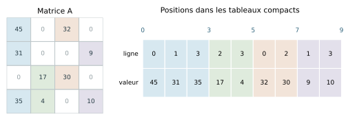
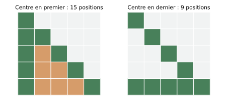

# ENS de Lyon · Second concours · Informatique 2015 · Corrigé guidé

*Corrigé rédigé par IA, non officiel. Signalez toute erreur.*

**Rédaction** · GPT-6.2 Astra Ultra · vitesse non renseignée · 25 novembre 2026

Dans les programmes Python, les indices commencent à zéro. Une matrice compacte est un triplet de tableaux `(p, ligne, valeur)`, où la colonne $j$ occupe les positions $h$ telles que $p[j]\le h<p[j+1]$. Les non-zéros d’un résultat désignent les positions susceptibles d’être non nulles pour au moins un choix de valeurs autorisé.

## Repères

Relier trois représentations au fil de l’épreuve. Le stockage par colonnes donne accès aux voisins sortants du graphe triangulaire. Les zéros structurels se déduisent de l’existence d’un chemin. Pour Cholesky, le parent d’une colonne est le numéro de ligne de son premier non-zéro strictement sous la diagonale.

## I · Stockage et opérations

### Question 1 · Du tableau dense aux triplets triés

**Indication.** Dans quel ordre parcourir la matrice pour que les triplets soient déjà triés ?

#### Solution

Parcourir les colonnes de gauche à droite, et chaque colonne de haut en bas. Ajouter les trois champs ensemble exactement quand la valeur est non nulle.

```python
def triplets(A):
    colonne, ligne, valeur = [], [], []
    n = len(A)
    for j in range(n):
        for i in range(n):
            if A[i][j] != 0:
                colonne.append(j)
                ligne.append(i)
                valeur.append(A[i][j])
    return colonne, ligne, valeur
```

Le parcours effectue $n^2$ tests et $3a$ ajouts pour $a=\operatorname{nnz}(A)$. Le temps est $\Theta(n^2+a)=\Theta(n^2)$ avec ajouts amortis, et la sortie prend $\Theta(a)$ cases. Une entrée dense arbitraire impose de regarder même les cases nulles.

### Question 2 · Interpréter un indice compact

**Indication.** Le décalage $l$ est interne à la colonne $k$, qui commence à l’indice donné par le pointeur.

#### Solution

Posons $h=\mathrm{colnnz}[k]+l$. Alors $\mathrm{valeur}[h]=A_{\mathrm{ligne}[h],k}$. C’est le $(l+1)$-ième coefficient non nul de la colonne $k$ par ordre croissant des lignes. La ligne effective n’est en général pas $l$. Dans l’exemple, pour $k=1$ et $l=1$, $h=4$, donc $A_{3,1}=4$.

### Question 3 · Construire les pointeurs de colonnes

**Indication.** Le nombre total de valeurs déjà écrites donne le début de la colonne suivante.

#### Solution


```python
def compacte(A):
    p, ligne, valeur = [0], [], []
    for j in range(len(A)):
        for i in range(len(A)):
            if A[i][j] != 0:
                ligne.append(i)
                valeur.append(A[i][j])
        p.append(len(ligne))
    return p, ligne, valeur
```

Après chaque colonne, écrire le nombre de valeurs accumulées, même si cette colonne était vide. L’invariant est $p[j]=\sum_{k<j}|A_k|$. Les bornes successives sont égales en cas de colonne vide. Le temps est $\Theta(n^2+n+a)$ et la représentation occupe $n+1+2a$ cases.



### Question 4 · Compter l’union des supports d’une somme

**Indication.** Fusionner les listes triées, puis vérifier le coût de localisation des colonnes vides lorsque $n$ dépasse le nombre de non-zéros.

#### Solution

Le support structurel de la somme est l’union des supports. Une position commune compte une seule fois, même si des valeurs particulières peuvent s’annuler.

```python
def compte_somme(A, B, colonnes):
    pa, ia, _ = A
    pb, ib, _ = B
    total = 0
    for j in colonnes:
        a, fin_a = pa[j], pa[j + 1]
        b, fin_b = pb[j], pb[j + 1]
        while a < fin_a and b < fin_b:
            total += 1
            if ia[a] == ib[b]:
                a, b = a + 1, b + 1
            elif ia[a] < ib[b]:
                a += 1
            else:
                b += 1
        total += (fin_a - a) + (fin_b - b)
    return total
```

À chaque tour, la plus petite ligne non traitée est comptée et toutes ses occurrences en tête sont consommées. Une liste restante ne contient que des lignes nouvelles. Avec `colonnes = range(n)`, le temps est $O(n+a+b)$ où $a=\mathrm{nnz}(A)$ et $b=\mathrm{nnz}(B)$, avec espace de travail constant. Si la liste ordonnée des colonnes effectivement non vides est fournie, ou entretenue à la construction, la même fonction prend $O(1+a+b)$ ; on peut aussi fusionner les deux listes de colonnes actives. Lorsque $n=O(a+b)$, le simple balayage convient.

**Limite de la borne demandée.** À partir des seuls trois tableaux compacts promis par l’énoncé et pour une matrice arbitrairement creuse, la borne $O(a+b)$ ne peut être garantie. Prendre $a=b=1$, avec les deux coefficients sur la ligne zéro, dans des colonnes inconnues $u$ et $v$. Le résultat vaut 1 si $u=v$, et 2 sinon. Les deux tableaux de pointeurs sont alors des fonctions en escalier à une seule marche. Chaque lecture d’un pointeur ne fournit qu’un bit. Deux entrées égales $(u,u)$ et $(v,v)$, avec $u\ne v$, ne peuvent avoir le même transcript de lectures, sinon l’entrée mixte $(u,v)$ suivrait ce transcript et serait mal classée. Il faut distinguer $n$ transcriptions dans le pire cas, soit au moins $\lceil\log_2 n\rceil$ lectures. Les deux tableaux d’une seule ligne et d’une seule valeur peuvent être identiques dans tous ces cas.

### Question 5 · Support structurel d’un produit

**Indication.** Rechercher un indice intermédiaire donnant un produit de deux entrées non nulles.

#### Solution

Le coefficient $C_{ij}$ vaut $\sum_k A_{ik}B_{kj}$. Si aucun $k\in B_j$ ne vérifie $i\in A_k$, tous les termes sont nuls. Sinon, donner par exemple la valeur $1$ à toutes les entrées autorisées rend la somme strictement positive. Ainsi $i\in C_j$ équivaut à l’existence de $k\in B_j$ tel que $i\in A_k$, d’où $C_j=\bigcup_{k\in B_j}A_k$.

### Question 6 · Compter le produit sans former la matrice

**Indication.** Utiliser le numéro de colonne comme marque de visite pour éviter de réinitialiser un tableau de taille $n$ à chaque colonne.

#### Solution


```python
def compte_produit(A, B):
    pa, ia, _ = A
    pb, ib, _ = B
    n = len(pa) - 1
    marque = [-1] * n
    total = 0
    for j in range(n):
        for t in range(pb[j], pb[j + 1]):
            k = ib[t]
            for h in range(pa[k], pa[k + 1]):
                i = ia[h]
                if marque[i] != j:
                    marque[i] = j
                    total += 1
    return total
```

Pour la colonne $j$, on parcourt exactement les listes $A_k$ de 5. Le premier passage sur une ligne produit une unité, les suivants la trouvent marquée. L’espace auxiliaire est $O(n)$. Notons $r_k(B)$ le nombre de non-zéros de la ligne $k$ de $B$. Le temps vaut

$$

O\left(n+b+T\right),\qquad T=\sum_k |A_k|\,r_k(B).

$$

On a $T\le n\min(a,b)$ et, en pire cas absolu, $T=n^3$ pour deux matrices pleines. Si chaque ligne de $A$ contient $s$ non-zéros et chaque colonne de $B$ en contient $t$, chaque case de sortie reçoit au plus $\min(s,t)$ contributions. Cela donne $T\le n^2\min(s,t)=n\min(a,b)$. Cette borne est atteignable en donnant à chaque ligne de $A$ et chaque colonne de $B$ les mêmes premiers indices intermédiaires, à concurrence de $s$ et $t$. Pour des répartitions arrondies, remplacer $s,t$ par les maximums de ligne et de colonne. La seule équité spécifiée n’impose donc pas $T\approx ab/n$. Cette dernière égalité découlerait, par exemple, d’une répartition uniforme des **colonnes de $A$** ou des **lignes de $B$**, qui portent sur l’indice de sommation $k$.

## II · Système triangulaire inférieur

### Question 7 · Substitution triangulaire par colonnes

**Indication.** Dans une colonne de $L$, la diagonale est le premier coefficient stocké.

#### Solution


```python
def resoudre(L, b):
    p, ligne, val = L
    x = list(b)
    for j in range(len(b)):
        x[j] /= val[p[j]]
        for h in range(p[j] + 1, p[j + 1]):
            x[ligne[h]] -= val[h] * x[j]
    return x
```

Lorsque $j$ est traité, $x_j$ contient $b_j-\sum_{k<j}L_{jk}x_k$. La diagonale est non nulle et vient en tête car les lignes sont triées. On divise puis on répercute le résultat seulement dans les lignes strictement inférieures stockées. Chaque entrée est visitée une fois, d’où $\Theta(n+\mathrm{nnz}(L))=\Theta(\mathrm{nnz}(L))$. Si seul le dernier coefficient de $b$ est non nul, tous les résultats sauf le dernier sont nuls. Avec l’indexation du sujet, c’est $b_{n-1}$ pour une taille $n$. L’algorithme visite pourtant toutes les colonnes. Un test sur $x_j=0$ évite des produits, mais conserve le balayage des $n$ positions.

### Question 8 · Condition structurelle pour la solution

**Indication.** Partir de l’équation de ligne et inclure le second membre.

#### Solution

La récurrence $x_i=(b_i-\sum_{j<i}L_{ij}x_j)/L_{ii}$ donne la condition structurelle suivante. On a $x_i\ne0$ si et seulement si $b_i\ne0$ ou s’il existe $j<i$ tel que $L_{ij}\ne0$ et $x_j\ne0$. En l’absence des deux causes, le coefficient est identiquement nul. Pour voir qu’une chaîne de dépendances peut effectivement contribuer, choisir des diagonales positives, des coefficients strictement inférieurs négatifs et des composantes non nulles de $b$ positives. Toutes les contributions s’ajoutent alors avec le même signe.

### Question 9 · Acyclicité des arcs stricts

**Indication.** Le numéro de sommet augmente le long de tout déplacement entre deux sommets distincts.

#### Solution

Un arc $j\to i$ exige $L_{ij}\ne0$, donc $i\ge j$. Si $i\ne j$, alors $i>j$. Aucun trajet passant par deux sommets distincts ne peut donc se refermer. La diagonale fournit bien des boucles si l’on conserve tous les arcs dans la définition de $G(L^T)$. On les omet dans le graphe de dépendances, comme sur la représentation du sujet. Au sens usuel du cycle non trivial de longueur au moins deux, le graphe est acyclique. Si l’on interprétait littéralement « suite d’arcs » comme une marche pouvant répéter deux fois une même boucle, on obtiendrait un contre-exemple à la formulation : c’est la raison de cette précision.

### Question 10 · Atteignabilité depuis le second membre

**Indication.** Inclure les sources elles-mêmes par des chemins de longueur zéro.

#### Solution

Par 8 et induction sur $i$, $x_i$ est structurellement non nul exactement lorsque $i$ est accessible à partir d’un indice non nul de $b$, par des arcs stricts de $G(L^T)$. Un parcours depuis toutes les sources suffit.

```python
def atteignables(L, b_ligne):
    p, ligne, _ = L
    vus = set(b_ligne)
    pile = list(vus)
    while pile:
        j = pile.pop()
        for h in range(p[j] + 1, p[j + 1]):
            i = ligne[h]
            if i not in vus:
                vus.add(i)
                pile.append(i)
    return vus
```

Un sommet découvert possède un chemin depuis une source. En examinant toutes ses arêtes sortantes, on finit par découvrir chaque sommet accessible. Avec des ensembles de hachage, le coût attendu est $O(|S|+\sum_{j\in S}|L_j|)$ pour $S$ l’ensemble atteint, et l’espace est $O(|S|)$. On peut aussi utiliser un tableau de marques de taille $n$ pour une borne déterministe avec un coût initial $O(n)$.

### Question 11 · Résoudre sur le support atteint

**Indication.** Associer à chaque indice conservé sa position dans le tableau de sortie.

#### Solution


```python
def resoudre_creux(L, b_ligne, b_valeur, x_ligne):
    p, ligne, val = L
    rang = {i: h for h, i in enumerate(x_ligne)}
    x_valeur = [0] * len(x_ligne)
    for i, a in zip(b_ligne, b_valeur):
        x_valeur[rang[i]] = a
    for h, j in enumerate(x_ligne):
        x_valeur[h] /= val[p[j]]
        for t in range(p[j] + 1, p[j + 1]):
            dest = rang[ligne[t]]
            x_valeur[dest] -= val[t] * x_valeur[h]
    return x_valeur
```

Chaque indice de `b_ligne` figure dans `x_ligne`. Chaque destination stricte d’une colonne atteinte y figure aussi par 10. Comme `x_ligne` est trié, la substitution respecte toutes les dépendances et renvoie les valeurs dans l’ordre prescrit, y compris un zéro dû à une compensation numérique. Pour $S=\mathrm{x\_ligne}$, temps attendu $O(|S|+|\mathrm{b\_ligne}|+\sum_{j\in S}|L_j|)$ et espace $O(|S|)$. Une recherche dichotomique dans `x_ligne` remplace la table de hachage avec un facteur $O(\log(2+|S|))$ déterministe par recherche.

## III · Décomposition de Cholesky

### Question 12 · Apparition d’un coefficient de Cholesky

**Indication.** Dans la formule de $L_{ij}$, chercher la contribution directe et les couples de coefficients ayant une colonne antérieure commune.

#### Solution

Pour $i>j$, la formule du sujet donne la récurrence symbolique

$$

 L_{ij}\ne0\iff A_{ij}\ne0\ \text{ou}\ \exists k<j,\ L_{ik}\ne0\ \text{et}\ L_{jk}\ne0.

$$

Le dénominateur $L_{jj}$ ne s’annule pas. Si toutes les contributions sont structurellement nulles, le résultat l’est aussi. Pour garantir que le motif prédit peut être réalisé, prendre tous les coefficients hors diagonale autorisés de $A$ négatifs et les diagonales assez grandes pour que $A$ soit symétrique définie positive (par dominance diagonale stricte). Inductivement les coefficients hors diagonale déjà produits sont négatifs aux positions prédites. Les termes soustraits sont donc positifs lorsqu’ils existent et renforcent tout coefficient direct négatif. Il n’y a aucune annulation dans cet exemple.

### Question 13 · Remplissage de l’étoile

**Indication.** L’élimination du sommet central en première position relie toutes ses feuilles.

#### Solution

La colonne 0 de $L$ est pleine. Pour toute paire $i>j>0$, les deux coefficients $L_{i0}$ et $L_{j0}$ sont non nuls. Par 12, toute la partie triangulaire inférieure est donc remplie, soit $5+4+3+2+1=15$ positions.

$$

\begin{pmatrix}
 X&0&0&0&0\\ X&X&0&0&0\\ X&X&X&0&0\\
 X&X&X&X&0\\ X&X&X&X&X
\end{pmatrix}.

$$

### Question 14 · Choisir l’ordre d’élimination

**Indication.** Placer d’abord les feuilles, qui n’ont qu’un voisin encore présent.

#### Solution

Prendre $(\sigma(0),\ldots,\sigma(4))=(1,2,3,4,0)$. Dans l’ordre permuté, le centre a l’indice $4$. Chaque colonne $0$ à $3$ possède sa diagonale et une seule entrée dessous, à la ligne 4. La dernière colonne est réduite à la diagonale. En effet éliminer une feuille ne relie aucune paire de voisins encore présents. On obtient $2+2+2+2+1=9$ positions, contre 15 auparavant.



### Question 15 · Du non-zéro à l’ancêtre

**Indication.** Tant que le parent de $j$ est plus petit que $i$, propager le non-zéro de la ligne $i$ à cette colonne parent.

#### Solution

La conclusion sur un ancêtre strict porte sur $L_{ij}\ne0$ avec $i>j$. Sur la diagonale, $i=j$ est le sommet lui-même. Posons $t=j$. Comme $L_{it}\ne0$, le parent $p$ de $t$ existe et vérifie $t<p\le i$. Si $p=i$, on a terminé. Si $p<i$, $L_{pt}$ et $L_{it}$ sont non nuls. Par 12 appliqué à $(i,p)$ et au témoin $t<p$, $L_{ip}\ne0$. Répéter avec $t=p$. La suite croît strictement et reste au plus $i$, donc finit par atteindre $i$. Cela fournit la chaîne de parents requise.

### Question 16 · Retrouver l’origine d’un coefficient rempli

**Indication.** Pour le sens direct, remonter à une colonne d’indice plus petit. Pour le retour, suivre les parents sans dépasser $j$.

#### Solution

Fixons $i$. Par récurrence croissante sur $j<i$, si $L_{ij}\ne0$ et $A_{ij}\ne0$, prendre $k=j$. Sinon, par 12, il existe $h<j$ avec $L_{ih}\ne0$ et $L_{jh}\ne0$. Par hypothèse de récurrence, un indice $k\le h$ vérifie $A_{ik}\ne0$ et $h$ est $k$ ou son ancêtre. Par 15, $j$ est un ancêtre de $h$, donc de $k$.

Réciproquement, si $A_{ik}\ne0$, alors $L_{ik}\ne0$ par 12. Le raisonnement de 15 propage cette propriété le long de tous les parents de $k$ jusqu’à $i$ inclus. Si $j$ est $k$ ou un de ses ancêtres avec $j<i$, il est rencontré **avant** $i$ sur cette chaîne strictement croissante. Donc $L_{ij}\ne0$.

### Question 17 · Compter les colonnes à partir des chemins de ligne

**Indication.** Les chemins issus d’une même ligne peuvent se rejoindre. Ne compter leur partie commune qu’une fois.

#### Solution

Pour chaque $k<i$ tel que $A_{ik}\ne0$, 16 donne tous les indices du chemin de $k$ vers $i$, en incluant $k$. Avec $i$ lui-même, l’union de ces chemins est exactement $L^i$. La symétrie de $A$ permet de lire les $k<i$ cherchés directement dans la colonne $i$ du format compact.

```python
def compte_colonnes(A, parent):
    p, ligne, _ = A
    n = len(parent)
    compte = [0] * n
    marque = [-1] * n
    for i in range(n):
        marque[i] = i
        compte[i] += 1
        for t in range(p[i], p[i + 1]):
            j = ligne[t]
            if j >= i:
                continue
            while marque[j] != i:
                marque[j] = i
                compte[j] += 1
                j = parent[j]
    return compte
```

Au traitement d’une ligne $i$, la marque $i$ indique un indice déjà compté pour cette ligne. Dès qu’un chemin atteint un indice marqué, toute sa suite jusqu’à $i$ a déjà été traitée. La diagonale marquée arrête aussi le premier chemin. Le temps est $O(n+\mathrm{nnz}(A)+\mathrm{nnz}(L))$, car toute nouvelle marque correspond à un unique non-zéro de $L$. L’espace auxiliaire est $O(n)$.

### Question 18 · Construire progressivement l’arbre d’élimination

**Indication.** Ajouter la ligne $i$ ne peut changer que les anciennes racines. Repérer les arbres touchés par les coefficients directs de cette ligne.

#### Solution

Notons $p_{i-1}$ les parents restreints aux sommets déjà introduits. Un parent déjà présent est inférieur à $i$ et reste le plus petit indice admissible. Seules les racines des anciens arbres peuvent obtenir $i$ pour parent. Pour chaque $k<i$ tel que $A_{ik}\ne0$, remonter depuis $k$ dans l’ancienne forêt. Tous les sommets de cette chaîne ont un non-zéro à la ligne $i$, par la propagation de 15. La racine rencontrée doit donc recevoir le parent $i$. Inversement, si une ancienne racine $t$ reçoit $i$, alors $L_{it}\ne0$. Par 16, une colonne originale $k$ de la ligne $i$ remonte à $t$ dans la forêt ancienne. Ainsi aucune autre racine ne change.

```python
def parents(A):
    p, ligne, _ = A
    n = len(p) - 1
    parent = [-1] * n
    for i in range(n):
        for t in range(p[i], p[i + 1]):
            j = ligne[t]
            if j >= i:
                continue
            while parent[j] != -1 and parent[j] != i:
                j = parent[j]
            if parent[j] == -1:
                parent[j] = i
    return parent
```

La nouvelle racine $i$ commence avec parent $-1$. Pendant le traitement, si une chaîne atteint un sommet dont le parent vaut déjà $i$, son arbre a déjà été attaché et on s’arrête. Par récurrence, on obtient $p_i$ à chaque ligne puis tous les parents demandés. Cette version simple utilise $O(n)$ cases hors entrée et $O(n+n\,\mathrm{nnz}(A))$ temps au pire. Une structure d’union-find séparée peut accélérer les recherches de racines ; le tableau de parents demandé doit conserver les arcs exacts de l’arbre.
