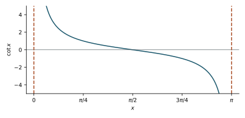

# ENS de Lyon · Second concours · Mathématiques 2015 · Corrigé guidé

*Corrigé rédigé par IA, non officiel. Signalez toute erreur.*

**Rédaction** · GPT-6.2 Astra Ultra · vitesse non renseignée

**Révision** · GPT-6.2 Astra Ultra · vitesse non renseignée · 26 novembre 2026

Le premier exercice classe des dés à faces équiprobables par leur polynôme générateur. Le second établit le développement de la cotangente en fractions simples grâce à une équation de duplication et à un argument de maximum.

## Exercice 1. Dés et polynômes générateurs

### Question 1.1

> [!INDICATION]
> Le coefficient compte des faces et une face a une probabilité un sixième.

#### Solution

Si $a_m$ faces portent $m$, alors $\mathbb P(X=m)=a_m/6$. Ainsi $Q_D(T)=6\sum_{m\ge1}\mathbb P(X=m)T^m$, somme finie. On a $Q_D(1)=6$ et $Q_D(0)=0$, car chaque inscription vaut au moins un.

### Question 1.2

> [!INDICATION]
> Distinguer les faces physiques, même si leurs numéros sont les mêmes.

#### Solution

On peut prendre comme univers $\{1,\ldots,6\}^2$ indexant les deux faces obtenues. Par équiprobabilité et indépendance, chaque couple a probabilité $1/36$ et l’ensemble des événements est l’ensemble des parties de cet univers. Si les inscriptions sont $d_i,e_j$, alors $S(i,j)=d_i+e_j$. Le produit $Q_DQ_E=\sum_{i,j}T^{d_i+e_j}$ a pour coefficient de $T^\ell$ le nombre de couples de somme $\ell$, soit $36\mathbb P(S=\ell)$.

### Question 1.3

> [!INDICATION]
> Factoriser la différence des carrés de $T^3$ et de 1, puis la différence et la somme de deux cubes.

#### Solution

La somme géométrique donne $(T-1)Q_U=T^7-T=T(T^6-1)$. Or $T^6-1=(T^3-1)(T^3+1)=(T-1)(T^2+T+1)(T+1)(T^2-T+1)$. Après simplification, $Q_U=T(T+1)(T^2+T+1)(T^2-T+1)$.

### Question 1.4

> [!INDICATION]
> Comparer les coefficients du plus haut degré des deux côtés.

#### Solution

L’égalité de lois et 1.2 donnent $P_1P_2=Q_U^2=T^2(T+1)^2(T^2+T+1)^2(T^2-T+1)^2$. Les coefficients dominants de $P_1,P_2$ sont des entiers strictement positifs dont le produit vaut un. Ils valent donc tous les deux un.

### Question 1.5

> [!INDICATION]
> Effectuer la division par le polynôme unitaire et regarder le reste en une racine non réelle.

#### Solution

La division par $T^2+T+1$ dans $\mathbb Z[T]$ est possible puisque le diviseur est unitaire. À chaque étape on retranche un multiple entier du diviseur. Le reste est $aT+b$ avec $a,b\in\mathbb Z$. Évaluer en $j$ donne $aj+b=0$ et $j\notin\mathbb R$, donc $a=b=0$. La divisibilité est établie avec quotient entier.

### Question 1.6

> [!INDICATION]
> Exploiter la factorisation irréductible et la multiplicité totale de zéro.

#### Solution

Les deux quadratiques ont pour discriminant $-3$ et sont irréductibles dans $\mathbb Q[T]$. Les quatre facteurs distincts de 1.3 y sont donc premiers. Par unicité de la factorisation, tout diviseur unitaire de $Q_U^2$ est produit de ces facteurs avec exposants de zéro à deux. Comme $P_1(0)=P_2(0)=0$ et que le produit a exactement un zéro double en zéro, chacun contient $T$ exactement une fois. Ainsi $P_1=T(T+1)^\alpha(T^2+T+1)^\beta(T^2-T+1)^\gamma$ avec les bornes annoncées.

### Question 1.7

> [!INDICATION]
> Utiliser le nombre de faces du dé.

#### Solution

En $T=1$, l’identité précédente donne $6=2^\alpha3^\beta$. La décomposition en facteurs premiers impose $\alpha=\beta=1$. Le quatrième facteur vaut un en ce point, ce qui laisse $\gamma$ libre.

### Question 1.8

> [!INDICATION]
> Examiner les trois valeurs de l’exposant restant, puis lire les coefficients comme des multiplicités.

#### Solution

Les exposants du dernier facteur dans $P_1,P_2$ sont $\gamma$ et $2-\gamma$. Le choix $\gamma=1$ redonne deux dés usuels égaux, exclu par l’énoncé. Les deux autres choix échangent les dés. Pour l’un, $T(T+1)(T^2+T+1)=T+2T^2+2T^3+T^4$. Pour l’autre, la multiplication par $(T^2-T+1)^2$ donne $T+T^3+T^4+T^5+T^6+T^8$. Les faces sont donc $(1,2,2,3,3,4)$ et $(1,3,4,5,6,8)$. Ces polynômes ont bien six termes comptés avec multiplicité et leur produit est $Q_U^2$. La paire est unique à échange des dés et permutation des faces près.

Pour les sommes $2,3,\ldots,12$, le décompte des 36 couples donne respectivement $1,2,3,4,5,6,5,4,3,2,1$. Par exemple la somme 7 provient des couples de valeurs $(1,6),(2,5),(3,4),(4,3)$, avec multiplicités $1,2,2,1$.

## Exercice 2. Cotangente et fractions simples

### Question 2.1

> [!INDICATION]
> Étudier le signe du dénominateur et dériver sur une branche.

#### Solution

La cotangente est définie sur $\mathbb R\setminus\pi\mathbb Z$. La parité de sinus et cosinus montre qu’elle est impaire. Leurs changements de signe simultanés par translation de $\pi$ donnent sa périodicité. Sur $]0,\pi[$, sa dérivée vaut $-1/\sin^2x<0$. Elle tend vers $+\infty$ en zéro à droite, s’annule en $\pi/2$ et tend vers $-\infty$ en $\pi$ à gauche.

### Question 2.2

> [!INDICATION]
> Appliquer les formules de décalage et d’angle double.

#### Solution

Partout où $\cos x\ne0$, les formules de décalage donnent $\cot(x+\pi/2)=-\tan x$. Pour $x\notin\pi\mathbb Z$, posons $u=x/2$. Alors $\cot u-\tan u=(\cos^2u-\sin^2u)/(\sin u\cos u)=2\cot(2u)$. Ainsi $\cot(x/2)+\cot((x+\pi)/2)=2\cot x$.

### Question 2.3

> [!INDICATION]
> Ajouter les deux nouveaux termes extrêmes.

#### Solution

Les pôles de $g_N$ forment l’ensemble des entiers de $-N$ à $N$. Ailleurs, $g_N-g_{N-1}=1/(x+N)+1/(x-N)=2x/(x^2-N^2)$, en posant $g_0(x)=1/x$.

### Question 2.4

> [!INDICATION]
> Sur un compact évitant les pôles, majorer seulement la queue de la série et traiter les premiers termes à part.

#### Solution

Le domaine commun est $\mathbb R\setminus\mathbb Z$. Le sujet imprime $\mathbb R\setminus\mathbb N$ en cette question, mais les entiers négatifs sont aussi des pôles dès que $N$ atteint leur valeur absolue. Sur $[a,b]\subset\mathbb R\setminus\mathbb Z$, posons $M=\max(|a|,|b|)$. Pour $n>2M$, $|2x/(x^2-n^2)|\le 8M/(3n^2)$. La série des différences converge normalement sur ce compact. En ajoutant $1/x$, on obtient une convergence uniforme vers $g$, donc la convergence en chaque réel non entier et la continuité de $g$ sur $\mathbb R\setminus\mathbb Z$.

### Question 2.5

> [!INDICATION]
> Décaler l’indice dans la somme symétrique et conserver les deux termes de bord.

#### Solution

On trouve $g_N(x+1)-g_N(x)=1/(x+N+1)-1/(x-N)\to0$. Ainsi $g(x+1)=g(x)$ pour tout $x\notin\mathbb Z$.

### Question 2.6

> [!INDICATION]
> Entrelacer les indices pairs et impairs des deux sommes transformées.

#### Solution

Les termes de $g_N(x/2)$ s’écrivent $2/(x+2n)$, ceux de $g_N((x+1)/2)$ s’écrivent $2/(x+2n+1)$. Les indices entiers ainsi obtenus vont une fois de $-2N$ à $2N+1$. Après soustraction de $2g_{2N}(x)$ il reste $2/(x+2N+1)$, donc $(a,b,c)=(2,2,1)$. En passant à la limite, $g(x/2)+g((x+1)/2)=2g(x)$.

### Question 2.7

> [!INDICATION]
> Relever les propriétés communes de la cotangente renormalisée et de la limite des sommes.

#### Solution

La fonction $f(x)=\pi\cot(\pi x)$ est impaire, continue hors des entiers, de période un, et vérifie l’équation de duplication de 2.6 par 2.2. Il en va de même pour $g$ : son imparité vient du changement $n\mapsto-n$ dans chaque $g_N$. Leur différence $h$ est donc continue sur $\mathbb R\setminus\mathbb Z$, impaire, de période un, et $h(x/2)+h((x+1)/2)=2h(x)$.

### Question 2.8

> [!INDICATION]
> Garder un terme au-delà de l’équivalent de la cotangente.

#### Solution

En posant $u=\pi x$, on a $\sin u=u-u^3/6+O(u^5)$ et $\cos u=1-u^2/2+O(u^4)$. La division donne $\cot u=1/u-u/3+O(u^3)$. Par suite $f(x)-1/x=-\pi^2x/3+O(x^3)\to0$.

### Question 2.9

> [!INDICATION]
> Pour la partie régulière de la série, uniformiser la majoration jusque sur zéro.

#### Solution

Si $0<|x|\le1/2$, alors $|g(x)-1/x|\le(8/3)|x|\sum_{n\ge1}n^{-2}\to0$. D’après 2.8, $h(x)\to0$. Sa périodicité donne la même limite de chaque côté de chaque entier. Poser $h(k)=0$ en ces points donne un prolongement continu. L’imparité, la périodicité et l’équation de duplication restent valables partout par continuité.

### Question 2.10

> [!INDICATION]
> Le maximum sur une période est atteint et la duplication exprime ce maximum comme une moyenne.

#### Solution

Le maximum de la fonction continue sur $[0,1]$ est atteint et, par périodicité, c’est le supremum global $m$. Si $h(x)=m$, les deux termes $h(x/2)$ et $h((x+1)/2)$ sont au plus $m$ et ont pour somme $2m$. Ils sont donc tous deux égaux à $m$.

### Question 2.11

> [!INDICATION]
> Itérer la division de l’abscisse par deux, puis utiliser l’imparité.

#### Solution

Prenons $x_0$ où le maximum est atteint. Par 2.10, $h(x_0/2^k)=m$ pour tout $k$. La continuité en zéro donne $m=h(0)=0$. Ainsi $h\le0$, et son imparité appliquée en $-x$ donne aussi $h(x)\ge0$. Donc $f=g$ et, pour $x\notin\mathbb Z$,
$$
\pi\cot(\pi x)=\frac1x+\sum_{n=1}^\infty\left(\frac1{x+n}+\frac1{x-n}\right).
$$
Le regroupement par indices opposés est celui dont la convergence a été établie en 2.4.
