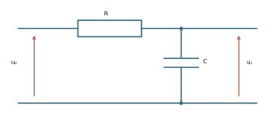
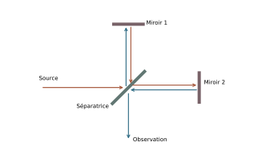
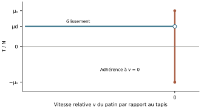
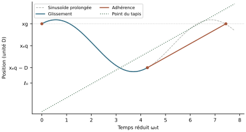
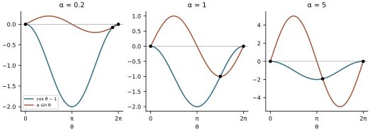
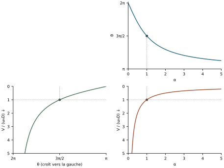
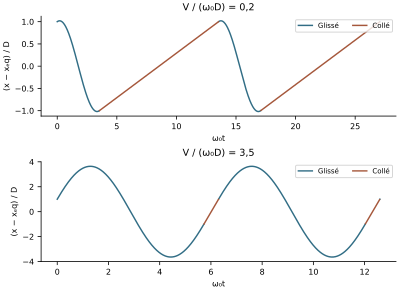
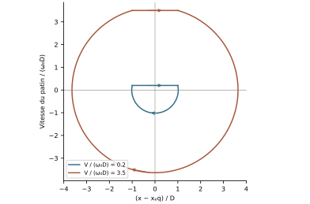
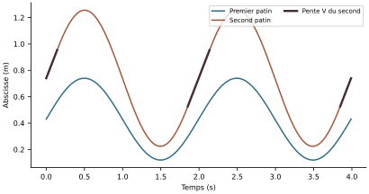

# ENS de Lyon, second concours 2015 — Physique · Corrigé brut

*Corrigé rédigé par IA, non officiel. Signalez toute erreur.*

**Rédaction** · GPT-6.2 Astra Ultra · vitesse non renseignée

## I — Questions de culture générale

### Question A1 — Vitesse de la lumière

Dans le vide, $c\simeq3{,}00\times10^8$ m/s.

### Question A2 — Conditions de Gauss

Les rayons sont paraxiaux : ils passent près de l’axe optique et forment de petits angles avec lui. On peut linéariser les fonctions trigonométriques.

### Question A3 — Filtre passe-bas

Mettre une résistance en série avec l’entrée, puis un condensateur vers la masse. Prendre la sortie aux bornes du condensateur. À vide, $H(j\omega)=1/(1+j\omega RC)$.

### Question A4 — Loi de Lenz

Le courant induit tend à s’opposer à la variation du flux qui lui donne naissance. La loi de Faraday s’écrit, avec les orientations compatibles, $e=-\mathrm d\Phi/\mathrm dt$.

### Question A5 — Unité de l’entropie

L’entropie s’exprime en joules par kelvin, $\mathrm{J\,K^{-1}}$.

### Question A6 — Interféromètre de Michelson

Une séparatrice à 45° partage le faisceau entre deux miroirs de bras perpendiculaires. Après réflexion les faisceaux se recombinent à la séparatrice vers la sortie d’observation.

### Question A7 — Équation de diffusion

Pour la température dans un solide homogène, sans source et de diffusivité thermique constante $D_T$, $\partial_tT=D_T\Delta T$.

### Question A8 — Relation de Bernoulli

Le long d’une ligne de courant d’un écoulement parfait, stationnaire, incompressible, soumis à la pesanteur seule comme force volumique, $p+\rho v^2/2+\rho gz=\mathrm{constante}$. Pour un écoulement irrotationnel la constante peut être commune au domaine connexe.

### Question A9 — Équation de Maxwell–Ampère

Dans le vide en présence éventuelle de sources, $\nabla\times\mathbf B=\mu_0\mathbf j+\mu_0\varepsilon_0\,\partial_t\mathbf E$.

### Question A10 — Équation d’onde du champ magnétique

Dans le vide sans sources, $\Delta\mathbf B-c^{-2}\partial_t^2\mathbf B=\mathbf0$.

## II — Mouvement collé-glissé

### Question B1 — Éviter le basculement

Utiliser un patin large dans le sens du mouvement, à centre de masse bas, et attacher le ressort horizontal près du plan de contact. La résultante des pressions normales doit pouvoir rester dans la base d’appui. Un guidage en translation est aussi possible s’il n’introduit pas d’effort horizontal significatif.

### Question B2 — Dimensions

$[\omega_0]=\mathrm{s^{-1}}$, puisque $k/m$ a pour dimension $\mathrm{s^{-2}}$. Les quantités $\delta_s=\mu_s g/\omega_0^2$ et $\delta_d=\mu_d g/\omega_0^2$ sont des longueurs.

### Question B3 — Lois de Coulomb

Prendre $x$ dans le sens du tapis et $z$ vertical vers le haut. L’action du tapis vaut $T\mathbf e_x+N\mathbf e_z$ avec $N=mg$ tant que le patin reste en appui. En adhérence, $v_g=\dot x-V_T=0$ et $|T|\le\mu_s N$. En glissement, $T=-\mu_d N\,\mathrm{sgn}(v_g)$. Dans le domaine donné, $v_g<0$ en glissement et donc $T=+\mu_d mg$.

### Question B4 — Coefficient et vitesse relative

Pour le rapport signé $T/N$, le graphe est horizontal à $+\mu_d$ lorsque $v_g<0$. À $v_g=0$, l’intervalle vertical va de $-\mu_s$ à $+\mu_s$ selon la force imposée. Si l’on représente le coefficient en valeur absolue, l’intervalle est $[0,\mu_s]$. Pour mémoire la branche positive de $v_g$ porterait $-\mu_d$ pour le rapport signé ; elle est exclue par le sujet.

### Question B5 — Démarrage sans glissement

À $t=0$, le ressort n’est pas tendu et le tapis a l’accélération $V/\tau_T$. Pour entraîner le patin, le tapis doit lui fournir $T=mV/\tau_T$. Il faut $V/\tau_T\le\mu_sg$ à cet instant. Une fois l’extension du ressort non nulle, il faut aussi assurer $|m\dot V_T+k(x-l_0)|\le\mu_smg$ pour rester collé.

### Question B6 — Début du glissement

En régime permanent collé, $\dot x=V$, $\ddot x=0$ et $T=k(x-l_0)$. Le seuil est atteint à $x_g=l_0+\mu_smg/k=l_0+\delta_s$. La vitesse reste égale à $V$ au départ du glissement.

### Question B7 — Équation du glissement

Le patin prend du retard sur le tapis. La force de frottement est constante vers $+x$ et vaut $\mu_dmg$. D’où $m\ddot x=-k(x-l_0)+\mu_dmg$ ou $\ddot x+\omega_0^2 x=\omega_0^2(l_0+\delta_d)$.

### Question B8a — Centre de l’oscillation glissée

Le bilan statique de l’équation du glissement donne $x_{\rm eq}=l_0+\delta_d$. C’est le centre du mouvement harmonique dans ce régime mécanique.

### Question B8b — Conditions initiales

Avec $X=x-x_{\rm eq}$ et l’origine choisie au seuil, $X(0)=\delta_s-\delta_d\equiv D$ et $\dot X(0)=V$. Ainsi $A=D$ et $B=V/\omega_0$, donc
$$x=x_{\rm eq}+D\cos(\omega_0t)+(V/\omega_0)\sin(\omega_0t).$$
On considère le cas usuel $D>0$.

### Question B9a — Position et droite du tapis

Le centre de la sinusoïde est $x_{\rm eq}=l_0+\delta_d$ et le départ $x_g=x_{\rm eq}+D$. Le point matériel du tapis demandé part de zéro et suit $x_T=Vt$. Sa droite est parallèle à la tangente de la courbe du patin à l’instant initial. Les ordonnées initiales des deux courbes sont différentes.

### Question B9b — Premier retour à l’adhérence

Après le démarrage de la phase glissée, chercher le premier instant $\tau>0$ de retour à $\dot X=V$. La tangente y est parallèle à la droite du tapis, sur la branche qui remonte après le minimum. Le point de retour est $x(\tau)=x_{\rm eq}-D=l_0+2\delta_d-\delta_s$. On peut le déduire de l’ellipse harmonique, ou de la formule de B10. À cette position la force statique requise vaut $k(2\delta_d-\delta_s)$ en valeur signée, de module au plus $k\delta_s$ pour $0\le\delta_d\le\delta_s$. L’adhérence est donc possible.

### Question B9c — Trajectoire collée

Pendant la phase collée le patin effectue une translation rectiligne uniforme. Dans le diagramme position–temps, la trajectoire devient une droite tangente à la sinusoïde au retour, $x=x_{\rm eq}-D+V(t-\tau)$.

### Question B9d — Décrochage suivant

Le frottement statique exigé croît avec l’extension jusqu’au prochain passage par $x_g=l_0+\delta_s$. Sur le graphe, prendre l’intersection de la droite collée avec l’horizontale $x=x_g$. La durée d’adhérence vaut $2D/V$ et la période mécanique complète $P=\tau+2D/V$.

### Question B10a — Équation du temps de retour

Dériver B8b et poser $\theta=\omega_0\tau$. L’égalité $\dot X(\tau)=V$ donne $V\cos\theta-\omega_0D\sin\theta=V$, d’où $\cos\theta-\alpha\sin\theta=1$ avec $\alpha=\omega_0D/V$.

### Question B10b — Intersections

La courbe $\cos\theta-1$ est non positive. Les intersections avec $\alpha\sin\theta$ incluent toujours les deux bornes 0 et $2\pi$. La racine physique intérieure arrive dans $(\pi,2\pi)$ et vérifie $\tan(\theta/2)=-\alpha$, d’où $\theta=2\pi-2\arctan\alpha$. Pour $\alpha=1$, elle vaut $3\pi/2$. Pour $\alpha\ll1$ elle se rapproche de $2\pi$ et pour $\alpha\gg1$ de $\pi$. Le retour à $2\pi$ que donnerait la sinusoïde prolongée est postérieur au premier recollement.

### Question B10c — Deux limites

Pour $\alpha\ll1$, $\theta=2\pi-2\alpha+O(\alpha^3)$. Pour $\alpha\gg1$, $\theta=\pi+2/\alpha+O(\alpha^{-3})$. Les limites dépendent du rapport entre l’excursion $D$ et la longueur $V/\omega_0$.

### Question B10d — Temps de glissement et vitesse

$\theta(\alpha)$ décroît de $2\pi$ vers $\pi$, tandis que $V/(\omega_0D)=1/\alpha$ décroît de l’infini vers zéro. Éliminer $\alpha$ donne $\theta(V)=\pi+2\arctan[V/(\omega_0D)]$ pour $V>0$. La durée réduite de glissement croît donc avec $V$, de $\pi$ à $2\pi$. Sur la construction en cadrans, une verticale à $\alpha$ fixé donne simultanément $\theta$ en haut et la vitesse positive portée vers le bas. Reporter cette paire dans le troisième cadran.

### Question B11 — Deux régimes dans le temps

Avec $V\ll\omega_0D$, $X$ durant le glissement est principalement $D\cos(\omega_0t)$. En près d’une demi-oscillation le patin revient de $x_{\rm eq}+D$ à $x_{\rm eq}-D$, puis il remonte lentement, en restant collé pendant $2D/V$. Le tracé sur deux périodes alterne retours rapides arrondis et longues rampes. Pour $V\gg\omega_0D$, la sinusoïde $(V/\omega_0)\sin(\omega_0t)$ domine, le glissement occupe presque $2\pi/\omega_0$ et le bref morceau rectiligne ferme le cycle. L’amplitude glissée vaut $\sqrt{D^2+(V/\omega_0)^2}$ dans le modèle idéal.

### Question B12 — Dissipation et entretien

Au contact, la puissance dissipée par frottement cinétique vaut $\mu_dmg(V-\dot x)$. En glissement permanent, intégrer sur la période $P=2\pi/\omega_0$ donne $E_\mu=\mu_dmgVP$, puisque $\int_0^P\dot x\,\mathrm dt=0$. Cette énergie est fournie par l’entraînement du tapis. Sur le patin seul, la force de frottement constante fait un travail net nul sur une oscillation fermée. L’oscillation n’est donc pas amortie dans ce modèle, même si le contact dissipe.

### Question B13a — Courbe dans l’espace des phases

Pendant l’adhérence, le point parcourt l’horizontale $\dot x=V$, de $x_{\rm eq}-D$ à $x_{\rm eq}+D$. Pendant le glissement il parcourt un arc de l’ellipse
$$ (x-x_{\rm eq})^2+(\dot x/\omega_0)^2=D^2+(V/\omega_0)^2.$$
La trajectoire garde seulement la branche $\dot x\le V$. Depuis l’extrémité droite du segment, le mouvement glissé suit l’arc dans le sens horaire.

### Question B13b — Faible et forte vitesse

À faible $V$, le segment est proche de l’axe $\dot x=0$ et l’arc constitue presque la moitié inférieure de l’ellipse. À forte $V$, le segment est près du sommet en vitesse et l’arc est presque l’ellipse entière. En coordonnées $(x-x_{\rm eq},\dot x/\omega_0)$ les ellipses sont des cercles dont le rayon dépend de $V$.

### Question B14a — Ressort du violon

La corde tendue et ancrée aux deux extrémités fournit la force de rappel transversale au point où l’archet la sollicite. L’archet entraîne puis libère alternativement la corde.

### Question B14b — Raideur de la corde

À faible déplacement transverse $y$, une corde tendue à la force $F_0$, sollicitée à des distances $a$ et $b$ de ses points fixes, fournit environ $-F_0(1/a+1/b)y$. Sa raideur effective dépend donc de la tension et de la géométrie, en particulier de la position de contact. La réponse réelle implique aussi les modes distribués de la corde.

### Question B14c — Force normale imposée

L’équivalent de $mg$ dans le seuil de frottement est la force normale avec laquelle le musicien presse les crins de l’archet sur la corde.

### Question B14d — Amplitude sonore

La vitesse d’archet et sa pression changent l’énergie fournie au cours des alternances adhérence–glissement. La distance au chevalet, la tension et l’état des crins modifient aussi le couplage. Pour augmenter le son il faut transmettre davantage d’énergie vibratoire à la caisse, en restant dans une plage d’attaque où la corde vibre régulièrement.

### Question B15a — Pourquoi la craie crisse

La pointe se bloque puis glisse. L’élasticité de la craie, de sa prise et du contact stocke et restitue de l’énergie. Les vibrations ainsi entretenues de la craie et du tableau rayonnent une onde acoustique. La géométrie du contact et la façon de tenir la craie sélectionnent les fréquences audibles.

### Question B15b — Raideur plausible

Pour une fréquence de crissement illustrative de 2 kHz et une masse modale de l’ordre de 1 g, $k_{\rm eff}\sim m_{\rm eff}(2\pi f)^2\simeq1{,}6\times10^5$ N/m. Une masse effective plus faible ou un mode de fréquence différente changerait cette estimation. Le sujet ne donne ni fréquence mesurée ni masse modale.

### Question B16 — Analogie avec un ressort vertical

Dans les deux cas, l’accélération comporte le rappel linéaire et une force constante. Le poids décale l’équilibre vertical de $mg/k$, le frottement cinétique horizontal de $\mu_dmg/k$. La pulsation $\sqrt{k/m}$ reste la même. Le poids est conservatif. Le frottement produit de la chaleur et dépendrait du sens du glissement si le patin dépassait le tapis. Le moteur fournit alors l’énergie dissipée.

## Deux patins couplés

### Question B17a — Premier patin

En glissement permanent vers la gauche par rapport au tapis, la résultante horizontale vaut $-k(x_1-l_0)+k(x_2-x_1-l_0)+\mu_dmg$. Les longueurs à vide s’éliminent dans cette somme. Ainsi $\ddot x_1+2\omega_0^2x_1=\omega_0^2(x_2+\delta_d)$.

### Question B17b — Second patin

Le second patin subit $-k(x_2-x_1-l_0)+\mu_dmg$. Son équation est $\ddot x_2+\omega_0^2x_2=\omega_0^2(x_1+l_0+\delta_d)$.

### Question B17c — Positions d’équilibre

Le second ressort reprend le frottement d’un patin, le premier celui des deux. Donc $x_{1,\rm eq}=l_0+2\delta_d$ et $x_{2,\rm eq}=2l_0+3\delta_d$. Leur différence est $l_0+\delta_d$.

### Question B18a — Système d’amplitudes

Après soustraction de l’équilibre, l’ansatz harmonique donne $(2-\lambda^2)A_1-A_2=0$ et $-A_1+(1-\lambda^2)A_2=0$.

### Question B18b — Deux pulsations

Le déterminant nul impose $\lambda^4-3\lambda^2+1=0$ et $\lambda^2=(3\pm\sqrt5)/2$. Les racines positives sont $\lambda_+=(\sqrt5+1)/2$ et $\lambda_-=(\sqrt5-1)/2$. Les pulsations dimensionnées sont $\omega_0\lambda_\pm$.

### Question B18c — Phase relative

$A_2/A_1=2-\lambda^2$. Pour le mode bas, ce rapport vaut $(1+\sqrt5)/2>0$ et les patins sont en phase. Pour le mode haut, il vaut $(1-\sqrt5)/2<0$ et les patins sont en opposition. Les modes propres réels ne sont pas en quadrature.

### Question B19a — Mesures sur le portrait de phase

Le segment horizontal supérieur de la grande boucle repère l’adhérence du second patin à $V\simeq1{,}5$ m/s. La petite boucle, centrée à gauche, appartient au patin proche du mur. Les centres des branches glissées se lisent vers $x_1\simeq0{,}43$ m et $x_2\simeq0{,}74$ m. En assimilant leurs centres géométriques aux positions d’équilibre du modèle glissé, $\delta_d\simeq2x_1-x_2\simeq0{,}12$ m et $l_0\simeq2x_2-3x_1\simeq0{,}19$ m. Avec $k/m=25$ s⁻², $\mu_d\simeq25\times0{,}12/9{,}81\simeq0{,}3$. Ce sont des estimations : la grande boucle présente un plat et n’est pas exactement l’ellipse d’un mode propre.

### Question B19b — Pulsation observée

La petite boucle est proche d’une ellipse de demi-largeur $A_1\simeq0{,}31$ m et de demi-hauteur $v_{\rm max}\simeq1{,}0$ m/s. Pour une oscillation presque sinusoïdale, $v_{\rm max}/A_1\simeq3{,}2$ rad/s. La période estimée est proche de 2 s.

### Question B19c — Comparaison aux modes propres

$\omega_0=5$ rad/s. Les valeurs glissées sont $\omega_-\simeq3{,}09$ rad/s et $\omega_+\simeq8{,}09$ rad/s. La mesure est compatible avec le mode lent, à la précision du graphe et compte tenu du bref intervalle d’adhérence du second patin.

### Question B20 — Les deux positions en fonction du temps

La petite boucle suggère pour $x_1$ une sinusoïde comprise entre environ 0,12 et 0,74 m. La grande boucle du second patin balaie environ 0,22 à 1,26 m. Les deux mouvements sont proches du mode lent en phase. On peut vérifier ce choix dans l’équation du premier patin resté glissé : $x_2=2x_1+\ddot x_1/\omega_0^2-\delta_d$. Pour une composante à la pulsation mesurée, le rapport des écarts est donc $2-(\omega/\omega_0)^2>0$. Prendre une période proche de 2 s, les deux maxima approximativement simultanés et un segment de pente $V$ dans la montée de $x_2$. La figure illustre l’allure demandée, sans prétendre restituer un déphasage exact à partir des deux seules projections de phase.

[Sujet officiel de l’ENS de Lyon](https://banques-ecoles.fr/cms/wp-content/uploads/2015/06/15_2clyon_sujet_phy.pdf)
