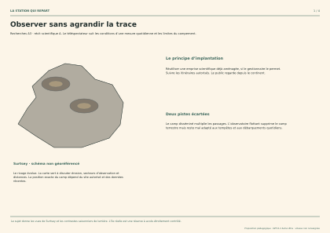
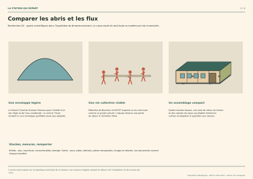
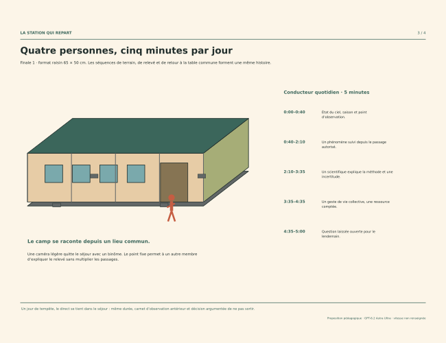
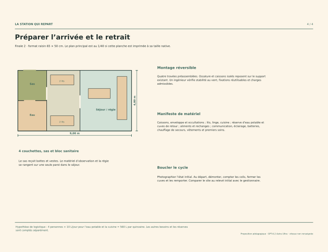

# ENS Paris-Saclay — Design d'espace 2015 · Corrigé brut

*Corrigé rédigé par IA, non officiel.*

**Rédaction** · GPT-6.2 Astra Ultra · vitesse non renseignée

La station qui repart est une proposition documentaire et spatiale pour la mission fictive de quatre personnes sur Surtsey. Les recherches occupent deux A3 de 420 × 297 mm. Les deux planches finales ont chacune le format raisin de 650 × 500 mm prescrit par la garde. Les échelles valent sur un original imprimé à 100 %.

## Planche 1 — Observer sans agrandir la trace

L’équipe étudie dans le scénario de l’épreuve l’émergence de la vie et le rapport entre habiter et observer pendant un an. L’UNESCO rappelle l’importance de conserver Surtsey pour l’étude de la succession naturelle. Notre projet situe quatre personnes sur une emprise scientifique déjà autorisée et desservie, dont l’usage et la résistance seraient vérifiés au préalable. Sans une telle emprise et cette autorisation, l’équipe réside à terre sur le continent et conserve uniquement les observations permises. Les diagrammes présentent l’hypothèse de concours. Aucune implantation nouvelle n’est attribuée à la réserve réelle.

## Planche 2 — Comparer les abris et les flux

L’enveloppe isolée réduit la chaleur à produire. Les lits ont occultation intégrale pendant les longues journées d’été et les espaces communs un éclairage réglable en hiver. L’accès du matériel est concentré. Le volume réservé aux déchets et aux eaux grises est aussi important que celui de l’approvisionnement. Le groupe n’introduit pas de culture extérieure. Les stocks et l’alimentation dépendent d’un ravitaillement planifié depuis le continent.

## Planche 3 — Quatre personnes, cinq minutes par jour

Le dispositif adopte le parti A, documentaire scientifique. Le passage quotidien de cinq minutes se fait en direct lorsque la liaison est disponible. En cas de coupure, l’équipe enregistre l’intervention horodatée et le diffuseur annonce le différé. Deux caméras légères, un pied stable, un micro, protections, batteries, éclairage sobre et liaison de mission suffisent au scénario. Le montage évite de révéler des emplacements sensibles. Les quatre postes d’équipe alternent observation, logistique, traitement des relevés et présentation. Un planning de repos demeure prioritaire.

## Planche 4 — Préparer l’arrivée et le retrait

L’enveloppe de 9 × 4,8 m offre 43,2 m² hors œuvre. La réserve de 560 L en quinze jours concerne l’eau potable et la cuisine, soit environ 560 kg. Des contenants séparés de service et de retour, un délai de sécurité et une alimentation de secours doivent être intégrés au plan de ravitaillement. Une réserve potable de 1 000 L correspondrait à 25 jours selon cette seule hypothèse. Les toilettes et eaux usées sont collectées en cuves fermées et renvoyées à terre. Une liaison météo, un accès de repli et un stock d’urgence sont indispensables à la faisabilité du scénario. À la fin, toutes les pièces sont inventoriées et chargées pour retour. Un état comparatif d’emprise termine la mission.

[Surtsey, Centre du patrimoine mondial de l’UNESCO](https://whc.unesco.org/en/list/1267/)

[Énoncé et annexes du concours](https://ens-paris-saclay.fr/sites/default/files/CONCOURS/ANNALES_1C/1C_Design/2015_Sujet_1A_Design_Espace.pdf)
