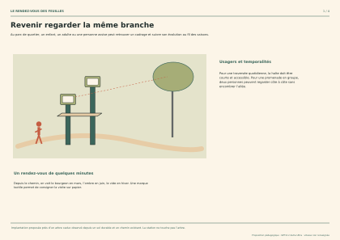
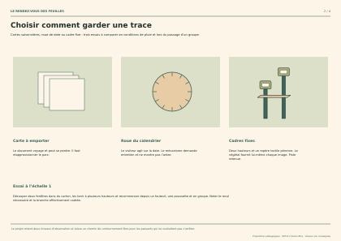
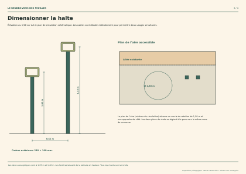
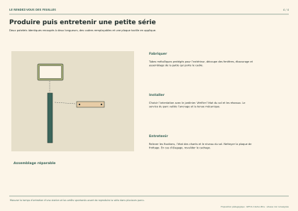

# ENS Paris-Saclay — Design de produit 2015 · Corrigé guidé

*Corrigé rédigé par IA, non officiel.*

**Rédaction** · GPT-6.2 Astra Ultra · vitesse non renseignée

Le rendez-vous des feuilles est une station de cadrage à deux hauteurs pour observer les transformations d’un arbre depuis une allée de parc. Le PDF institutionnel compte deux pages et se termine par la mention de fin. Le texte décrit des images de parcs indicatives qui ne sont pas reproduites dans ce fichier. La demande autorise explicitement à traiter une autre expérience. Les 4 planches numérotées et anonymes sont au format 420 × 297 mm. Les échelles indiquées valent pour une planche seule imprimée sur A3 à 100 %.

## Planche 1 — Revenir regarder la même branche

> [!INDICATION]
> Choisir une expérience assez précise pour que le parc n’ait pas à être entièrement rééquipé.

Le sujet associe promenade, pause, rythme, floraison et rencontre. Le projet rapproche deux temps incompatibles au premier abord, la traversée pressée et la croissance lente. On fixe un rendez-vous avec une même ramure et l’on peut partager la différence avec quelqu’un qui l’a vue une semaine plus tôt. Une seule station cible cette expérience. Le projet s’adresse à la fois à une personne assise, à une famille et à un groupe accompagné.

## Planche 2 — Choisir comment garder une trace

> [!INDICATION]
> Demander à deux personnes de regarder simultanément au lieu de tester la station à vide.

La carte seule demande du papier en permanence. La roue ajoute un organe mobile exposé au vandalisme et aux intempéries. Les cadres fixes offrent une lecture immédiate et leurs pièces peuvent être remplacées séparément. Il n’y a rien à tourner. Une plaque en relief de petite dimension identifie la station et le motif du lieu. Un visiteur peut la recopier au crayon sur sa propre feuille.

## Planche 3 — Dimensionner la halte

> [!INDICATION]
> Comparer la hauteur du centre du cadre et l’intervalle réel de positions d’œil donnant encore une vue.

Les cadres de 240 × 160 mm sont ouverts. Leur forme invite à se placer à une certaine distance sans imposer le contact avec le visage. Les centres sont distants de 610 mm. Un essai avec les usagers règle la direction et la distance réelle au sujet végétal. L’aire de halte reste hors de la largeur utile de l’allée. L’élévation est au 1/10. Le plan de circulation, sans échelle, donne la cote de manœuvre souhaitée.

## Planche 4 — Produire puis entretenir une petite série

> [!INDICATION]
> Examiner séparément ce qu’il faut renouveler après une saison et ce qui devrait rester en place plusieurs années.

Une petite série limite les frais d’outillage et permet d’ajuster le projet avant duplication. Les tubes reçoivent une finition résistante à l’extérieur. Les cadres et la plaque se démontent avec l’outillage du service municipal. Le coût total se ventile entre fabrication, traitement des chants, déplacement sur site, préparation du sol et visites d’entretien. La conformité mécanique de l’ancrage et la cohabitation avec les racines sont à valider pour chaque site.

[Sujet officiel de deux pages](https://ens-paris-saclay.fr/sites/default/files/CONCOURS/ANNALES_1C/1C_Design/2015_Sujet_1A_Design_Produit.pdf)
