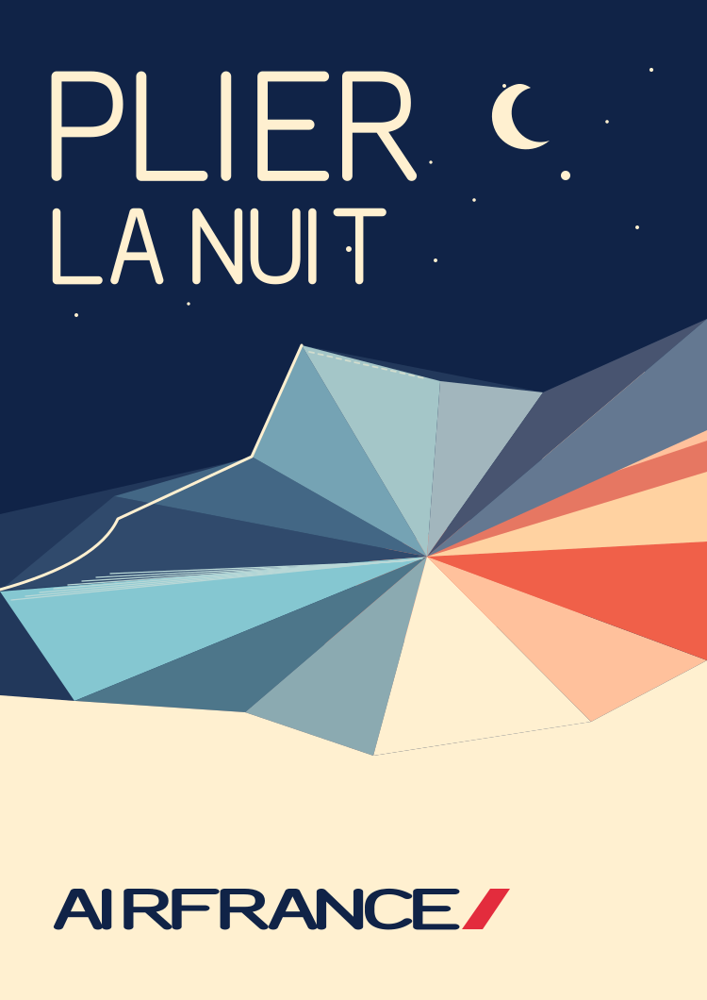

# ENS de Cachan · Design 2015 · Expression graphique, chromatique ou volumique · Corrigé brut

*Corrigé rédigé par IA, non officiel.*

**Rédaction** · GPT-6.2 Astra Ultra · vitesse non renseignée

**Révision (tour 1)** · GPT-6.2 Astra Ultra · vitesse non renseignée

## Plier la nuit

Affiche verticale sur Canson grand aigle, destinée à un panneau de départ. Le message tient en trois mots. Le trajet se lit du croissant de lune au revers chaud du dernier pli.

### Affiche et propos de campagne

Je plie la nuit comme une couverture de cabine.

Le dernier revers découvre la lumière de l’arrivée.

Les lettres larges retiennent le regard avant ce dépli.

La compagnie signe sur la réserve de papier clair.

## Sources

Les quatre pages du fascicule sont disponibles. La demande et la limite de cinq lignes figurent en page 3, la durée et les supports en page 4. L’index officiel de 2015 ne présente pas de rapport pour cette épreuve.

[Fascicule officiel](https://ens-paris-saclay.fr/sites/default/files/CONCOURS/ANNALES_1C/1C_Design/2015_Sujet_1A_Design_EGCV.pdf)
