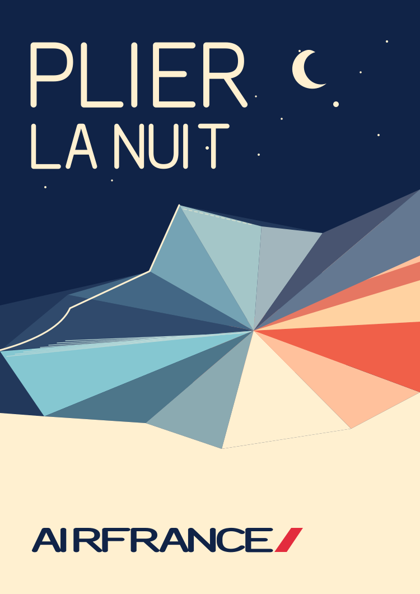
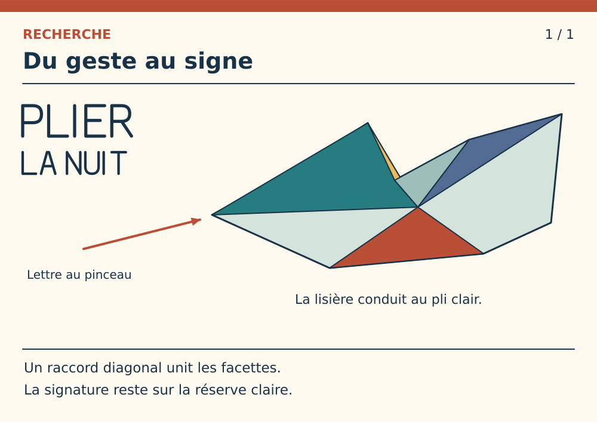

# ENS de Cachan · Design 2015 · Expression graphique, chromatique ou volumique · Corrigé guidé

*Corrigé rédigé par IA, non officiel.*

**Rédaction** · GPT-6.2 Astra Ultra · vitesse non renseignée

**Révision (tour 1)** · GPT-6.2 Astra Ultra · vitesse non renseignée

## Plier la nuit

Le sujet accorde six heures. Les cinq A3 d’esquisse servent à éprouver le contraste et la lecture à distance. La proposition finale prend place sur le Canson grand aigle. Le court texte peut être rendu sur la feuille de copie. Les compagnies et leurs uniformes sont visibles dans le fascicule. L’image et les caractères du message sont redessinés ici, comme le logotype, sans montage à partir des planches fournies.

### Affiche et propos de campagne

Comment faire tenir sur un seul mur une durée de voyage et un geste de service ? Partir d’un souvenir tactile, une couverture qu’une main a repliée en fin de traversée. Écarter la représentation attendue de l’avion ou du monument.

Les deux lignes de lettres ont été dessinées sur un squelette commun. Le premier verbe est large et horizontal. L’œil descend ensuite de la lune aux facettes de la couverture, dont les tons passent du bleu nocturne à l’orangé de l’aube. Une seule signature sur ivoire suffit. Relire la promesse en cachant successivement la marque et le slogan. La première opération teste l’autonomie de l’image, la seconde le rôle du verbe.

**Propos à joindre, quatre lignes**

Je plie la nuit comme une couverture de cabine.

Le dernier revers découvre la lumière de l’arrivée.

Les lettres larges retiennent le regard avant ce dépli.

La compagnie signe sur la réserve de papier clair.

### Refaire l’essai à petite échelle

Réduire l’étude à la taille d’une carte. Le pli principal doit encore orienter le regard avant que les détails de la couture soient discernables. Si la couverture se lit comme une simple montagne, conserver la lisière sur le bord de la première facette.

## Sources

Les quatre pages du fascicule sont disponibles. La demande et la limite de cinq lignes figurent en page 3, la durée et les supports en page 4. L’index officiel de 2015 ne présente pas de rapport pour cette épreuve.

[Fascicule officiel](https://ens-paris-saclay.fr/sites/default/files/CONCOURS/ANNALES_1C/1C_Design/2015_Sujet_1A_Design_EGCV.pdf)
