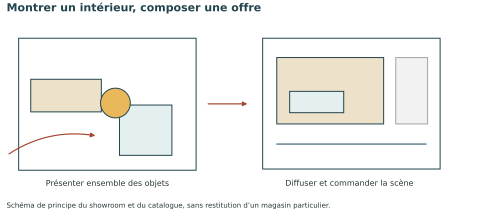

# L’exposition dans le circuit du design selon Hal Foster · Cachan 2015 · Corrigé brut

*Corrigé rédigé par IA, non officiel. Signalez toute erreur.*

**Rédaction** · GPT-6.2 Astra Ultra · vitesse non renseignée · 25 novembre 2026

**Révision** · GPT-6.2 Astra Ultra · vitesse non renseignée · 25 novembre 2026

**Révision (tour 2)** · GPT-6.2 Astra Ultra · vitesse non renseignée · 26 novembre 2026

École normale supérieure de Cachan · écrit de quatre heures · C15104.

Foster accorde un rôle décisif à l’exposition dans un « circuit sans fin de production et de consommation ». La dissertation demande d’analyser et de discuter ce diagnostic pour le programme « Graphisme et design, de la crise moderne aux diktats du marché », 1953–2000. Le texte de 2002 porte donc un regard rétrospectif sur la période. [Sujet officiel, p. 1](https://ens-paris-saclay.fr/sites/default/files/CONCOURS/ANNALES_1C/1C_Design/2015_Sujet_1A_Design_Histoire_art.pdf)

## Introduction

Une étagère peut être le support d’une exposition ou l’objet exposé. Dans un magasin de mobilier, elle peut jouer les deux rôles en même temps. Ce double usage éclaire le propos de Hal Foster. Quand les produits sont conçus pour des publics distingués par leurs goûts et par leurs pratiques, leur présentation aide à faire exister ces publics. Le consommateur doit pouvoir reconnaître, dans une scène déjà composée, l’usage ou l’identité qu’on lui propose. Par « post-fordiste », Foster désigne ici une production plus flexible et différenciée que celle qui a pris pour idéal la répétition de grandes séries identiques. La citation rétrospective de 2002 n’impose cependant pas de faire commencer toute différenciation commerciale à une date unique.

Le display donne-t-il seulement de la visibilité à une offre existante, ou détermine-t-il ce qu’il convient de produire et de désirer ? La distribution de masse, la spécialisation des marchés et le passage par les musées permettent de suivre trois façons différentes dont la présentation transforme le statut de l’objet.

## I. Dans le commerce de masse, exposer résout un problème de confiance et ouvre un répertoire de gestes

À Älmhult, en Suède, IKEA ouvre en 1953 une salle d’exposition dans une ancienne menuiserie. L’acheteur de meubles par correspondance peut désormais voir, toucher et comparer ce qu’il connaissait par la photographie, la description et le prix. Le magasin et le catalogue ne suppriment pas la nécessité d’un objet fiable. Ils organisent le passage entre deux régimes d’information. Le prospectus circule au domicile, où le client peut imaginer le meuble dans sa propre pièce. La visite au showroom permet de vérifier une échelle et de mettre à l’épreuve un premier choix.

La présentation de meubles ensemble ajoute toutefois quelque chose qu’une fiche isolée ne montre pas. Un rangement, une lampe et une table composent les relations d’un intérieur. Chacun devient l’accessoire potentiel des autres. Le client peut ne prendre qu’un seul élément, mais le prix unitaire, les harmonies et la disposition spatiale l’aident à imaginer un ensemble. Le catalogue remet ensuite en circulation une manière de vivre déjà organisée. Ce dispositif repose sur des références largement distribuées et compatibles entre elles. Il établit donc que la mise en scène commerciale précède en partie le développement des niches, et peut tout aussi bien servir une production standardisée.

Au premier regard, la flèche du schéma mène de la pièce au catalogue. Le lecteur peut aussi refaire mentalement le trajet en sens inverse. Il reconnaît dans son logement une configuration vue sur la page et découvre, par comparaison, la place « vide » d’une lampe. Le dispositif de présentation intervient alors avant même qu’une demande explicite soit formulée. Cette rétroaction donne un sens précis au « circuit » évoqué par Foster. Elle reste une possibilité, dont le choix d’un autre usage ou le refus d’acheter peuvent suspendre l’effet.

## II. Le produit différencié acquiert une valeur de signe par sa mise en scène

À Milan en 1981, les premiers objets de Memphis confrontent le monde du mobilier à des couleurs franches, des surfaces de stratifié et des géométries délibérément heurtées. La séparation de pièce Carlton d’Ettore Sottsass organise supports obliques, rayonnages horizontaux et casiers en une silhouette presque anthropomorphe. Elle peut diviser l’espace et recevoir des livres. Mais l’inclinaison des montants, les contrastes et le traitement décoratif font aussi de l’objet une présence frontale, lisible dans une photographie même en l’absence d’un utilisateur. Le stratifié, souvent associé aux aménagements ordinaires, acquiert dans cette combinaison une allure précieuse et provocante. La matière reste la même catégorie de matériau, son statut culturel change.

L’exposition collective, puis la circulation de ses images permettent à un groupe limité de meubles d’occuper une place très supérieure à son poids dans les intérieurs effectivement meublés. Dans ce cas, l’image entretient le désir de se distinguer du fonctionnalisme devenu convention. Un produit de niche gagne une influence générale par la presse et l’exposition. Le mobilier semble contester les codes du marché en même temps qu’il offre au marché une différence à valoriser. Le paradoxe décrit par Foster devient saisissable dans les formes de l’objet, dans les lieux où il paraît et dans l’écart entre ses acheteurs et son public.

## III. Un display peut aussi déplacer la question du prix vers celle de l’usage ou de la critique

En 1972, l’exposition Italy: The New Domestic Landscape du Museum of Modern Art de New York donne une place à des objets mais aussi à des environnements domestiques commandés pour l’occasion. L’intérieur soumis à l’observation peut désormais être hypothèse de travail. La *Total Furnishing Unit* de Joe Colombo, présentée en 1972 après sa mort avec la contribution d’Ignazia Favata, rassemble cuisine, rangement, couchage et salle d’eau dans un système de blocs. Le dispositif donne à comparer des distributions possibles de ces activités dans l’appartement. L’intérêt se déplace du siège ou du meuble isolé vers les relations entre cuisine, repos, intimité et mobilité. L’exposition a certes donné une visibilité internationale à la production italienne, mais cet effet ne suffit pas à épuiser les questions posées par les projets.

Le visiteur de musée dispose d’un temps et d’un usage différents de ceux de l’acheteur. La comparaison de plusieurs environnements peut rendre discutable le modèle de vie que la vitrine commerciale tend à présenter comme allant de soi. Réciproquement, l’institution peut transformer un projet critique en objet désirable et rare. Il serait donc trop simple d’opposer l’exposition marchande à l’exposition désintéressée. Il faut demander qui choisit les objets, ce qu’il est permis d’en faire et sous quelle forme ils pourront circuler après la visite.

Que devient cette tension à la fin du siècle ? En 1991, dans *You Can’t Lay Down Your Memory*, Tejo Remy rassemble des tiroirs de récupération sous une même sangle. Au lieu d’aligner des façades identiques, il rend visibles les vies antérieures de pièces dissemblables. Quiconque a bricolé un rangement peut y reconnaître une économie de récupération. Lorsque le MoMA présente le travail de Remy dans son exposition sur le design néerlandais en 1996, le visiteur peut également admirer et mémoriser une signature. Les différences qui attestent que ces tiroirs ont servi deviennent précisément ce qui rend la commode reconnaissable dans l’image. L’exposition donne une audience à la critique du meuble neuf et standard. Elle ouvre aussi un nouveau marché au goût de la récupération. On comprend alors comment le circuit décrit en 2002 peut intégrer un geste qui semblait d’abord l’interrompre. [Commode de Tejo Remy, MoMA](https://www.moma.org/collection/works/3578)

La critique de Foster éclaire finalement la conception et l’exposition comme moments d’un même processus. Elle gagne en précision lorsqu’on distingue la vérification d’un usage, la construction d’une identité commerciale et l’ouverture d’un débat. Le circuit peut se refermer sur un nouvel achat, mais l’appropriation domestique et la discussion publique peuvent aussi en modifier le cours.
