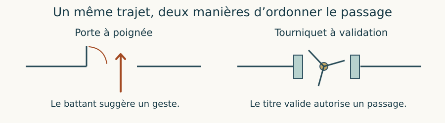

# Le design fabrique-t-il des dispositifs ? · 2015 · Corrigé brut

*Corrigé rédigé par IA, non officiel. Signalez toute erreur.*

**Rédaction** · GPT-6.2 Astra Ultra · vitesse non renseignée

## Introduction

Pour sortir d’un bâtiment, je pousse une barre horizontale. J’ai décidé de sortir, mais je n’ai inventé ni le geste, ni la direction dans laquelle s’ouvre l’issue. Cette part de conduite déjà dessinée dans l’objet donne une prise à la définition du dispositif proposée par Giorgio Agamben. Un dispositif a la capacité de saisir ou d’orienter des conduites. Le verbe « fabrique » soulève alors une difficulté. On commande à un designer une porte bien déterminée. Peut-on de la même manière lui commander l’ensemble des pouvoirs qui s’exerceront au passage de cette porte ? Si tout objet infléchit un geste, on risque de rendre le mot « dispositif » aussi large que le mot « objet ». Il faut chercher ce qui transforme une invitation matérielle en une règle de conduite, puis se demander qui peut modifier cette règle.

## I. La forme adresse déjà une demande au corps

Une plaque à plat peut recevoir la paume, une poignée en relief les doigts repliés. Le dessin rend un mouvement plus facile à découvrir qu’un autre. Don Norman analyse dans *The Design of Everyday Things* les portes dont l’indice visible conduit à tirer alors que le battant doit être poussé. L’erreur persiste même si le mécanisme fonctionne impeccablement. Le designer travaille donc sur une conduite possible, jusque dans les cas où sa proposition échoue. La porte distribue l’initiative entre l’usager qui veut passer et l’objet qui lui fait comprendre comment s’y prendre.

Le dessin des deux passages ci-dessous permet de faire varier un seul enjeu. La porte marquée « pousser » prescrit un geste à toute personne qui veut sortir. Le tourniquet de transport muni d’un lecteur de titres organise un ordre différent. Que le voyageur comprenne parfaitement le mouvement demandé n’entraîne pas qu’il pourra passer. Le premier cas engage une intelligibilité pratique, le second fait dépendre l’accès d’une autorisation. Agamben permet de poser les deux questions, mais le même mot ne doit pas nous épargner de mesurer cet écart.

## II. Une règle collective donne à la fabrication sa portée

Enlevons au tourniquet son règlement tarifaire, le système de titres et l’organisation qui exerce le contrôle. On conserve un mécanisme susceptible d’arrêter des corps. On perd la distinction qui faisait de l’un de ces corps un voyageur en règle. Le dispositif associe ainsi des éléments hétérogènes. Dans son entretien *Le jeu de Michel Foucault*, Foucault insiste sur les relations entre institutions, aménagements et discours. Le dessin industriel matérialise une décision politique ou commerciale. La règle de transport lui préexiste en partie, puis sa traduction en métal et en code la transforme. Un titre accepté pour une personne ne ménage, par sa seule validation, ni la place d’une poussette ni le temps nécessaire à un accompagnant.

On peut donc attribuer au designer une responsabilité précise. La largeur du passage, le retour visuel donné à l’utilisateur et la présence d’un portillon modifient les effets d’une règle, à tarification égale. On ne peut pourtant lui attribuer seul la fabrication du réseau de décisions. Un exploitant peut changer les conditions d’accès après la livraison de la machine. La question n’est plus seulement de savoir ce que l’auteur a voulu, mais qui dispose des moyens matériels d’interrompre, d’assouplir ou de généraliser la prescription.

## III. Dessiner peut aussi rendre une conduite révisable

En 1974, Enzo Mari propose dans *Autoprogettazione?* des plans de meubles que chacun peut construire avec des planches de section courante, des clous et un outillage simple. Le plan discipline fortement l’action. L’ordre des assemblages et les contreventements comptent si l’on veut que la table tienne. Pourtant, celui qui la fabrique voit comment les forces passent d’une traverse aux pieds. Il acquiert un moyen de discuter la longueur du plateau et de réparer une liaison. Le dispositif de fabrication produit une capacité d’intervention là où l’achat d’un meuble fermé sur sa propre construction aurait pu se réduire à un choix de finition.

Cette ouverture a des conditions sociales. Posséder du temps, un lieu de travail et quelque aisance avec les outils transforme la portée de la proposition. Le public de Mari ne coïncide donc pas automatiquement avec « tout le monde ». L’intérêt du cas tient à une différence repérable. Une consigne peut rester imposée de l’extérieur, ou permettre à celui qui l’exécute d’en comprendre et d’en modifier une partie. C’est dans cette distribution de la faculté de reprendre le dessin que se joue la portée politique du dispositif.

## Conclusion

Le design fabrique bien des supports matériels qui orientent et parfois contrôlent les conduites. Il ne suffit toutefois pas de sortir un objet de l’atelier pour avoir produit le dispositif entier. Celui-ci prend forme dans la relation entre la prescription, une règle collective et ce que les usagers peuvent en faire. Un designer agit sur cette relation dès qu’il rend repérables le choix qui a été fait et les possibilités de le rouvrir.
