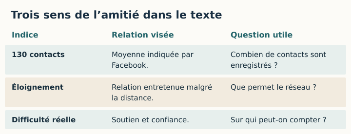

# ENS Rennes · D1 · Allemand 2015 — Corrigé brut

*Corrigé rédigé par IA, non officiel. Signalez toute erreur.*

**Rédaction** · GPT-6.2 Astra Ultra · vitesse non renseignée

Épreuve écrite de l’École normale supérieure de Rennes. D’après Fritz Wolf, VDI-Nachrichten, 28 octobre 2011.

## Version française

**Réseaux sociaux. Amis virtuels et véritables amis**

Il était une fois un père qui voulait vivre avec son temps et afficher sa présence sur Facebook. Il se connecta donc. Pour éviter de s’égarer d’emblée en terrain inconnu, il fit de son fils son tout premier ami. La réponse arriva aussitôt : « Mais qui êtes-vous ? » Ce premier essai sur Facebook avait tourné court.

Dans la vie, nous connaissons bien des sortes d’amis. Nous en rencontrons qui le seront pour la vie et nous en avons aussi de faux. Nous connaissons même des peuples amis, et la littérature compte de célèbres duos d’amis.

Facebook vient d’offrir à la société une nouvelle catégorie d’amis : ceux avec qui l’on communique. Bill Gates, le patron de Microsoft, aurait jeté l’éponge après dix mille demandes d’amitié. Selon Facebook, l’utilisateur ordinaire compte en moyenne cent trente amis. Que faire de tout ce monde ?

Les avantages de ces amitiés en ligne sautent aux yeux. Grâce au réseau, les timides entrent plus facilement en relation avec des gens qui partagent leurs centres d’intérêt. Quant à ceux qui ont déjà des amitiés solides, il leur est désormais plus facile de les entretenir, même à grande distance.

Les réseaux sociaux ont cependant leurs particularités. À la différence de ce qui se passe dans la vie courante, on ne peut y chercher et y trouver que des amis, jamais d’ennemis. On ne prend d’ailleurs pas toujours l’initiative de nouer connaissance, on reçoit fréquemment une demande d’amitié. Sans y prendre garde, on en arrive vite à se demander comment se débarrasser de ces amis fantômes qui s’accrochent. Parce qu’elle se noue vite et n’engage à rien, l’amitié virtuelle passe aussi pour superficielle.

Cet engouement pour les amitiés en ligne survient au moment où l’amitié prend une importance croissante dans une société où les liens familiaux traditionnels se défont. Mais que deviennent la confiance, la possibilité de compter les uns sur les autres et le soutien dans les moments difficiles ? Les vrais problèmes, il faudra les résoudre ailleurs que sur Facebook.

## Expression en allemand

Was halten Sie persönlich von sozialen Netzwerken im Internet? Environ 100 mots.

Soziale Netzwerke sind für mich besonders dann sinnvoll, wenn sie eine bestehende Freundschaft im Alltag lebendig halten. Nach einem Umzug kann ich meiner früheren Nachbarin ein Foto schicken oder erfahren, wann sie Zeit für ein Gespräch hat. Auch eine schüchterne Person findet über gemeinsame Interessen manchmal leichter Anschluss. Die Zahl der Kontakte sagt jedoch wenig darüber aus, auf wen man sich verlassen kann. Wenn eine Freundin mehrere Tage schweigt, hilft ihr vielleicht ein Anruf mehr als ein weiteres Bild. Deshalb benutze ich solche Netzwerke gern zur Verabredung und zum Austausch, lasse aber meine Freundschaften nicht allein von einer Plattform abhängen.

*100 mots, comptés par espaces.*

[Feuillet original, p. 2](https://www.ens-rennes.fr/medias/fichier/sujets-d1-langues-vivantes-2015_1459930616550-pdf#page=2) · [Rapport du jury, partie écrite](https://www.ens-rennes.fr/medias/fichier/allemand-e-crit-d1-rapport-jury-2015_1448641854309-pdf#page=1)
