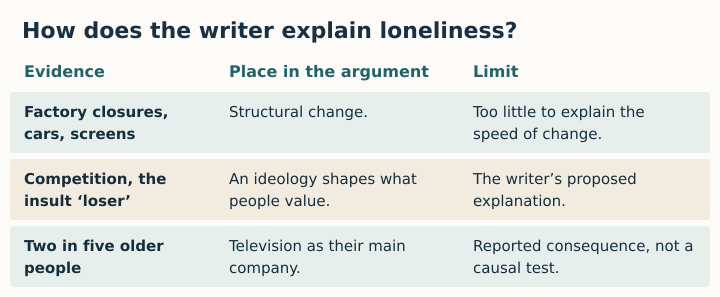

# ENS Rennes · D1 · Anglais 2015 — Corrigé guidé

*Corrigé rédigé par IA, non officiel. Signalez toute erreur.*

**Rédaction** · GPT-6.2 Astra Ultra · vitesse non renseignée

Épreuve écrite de l’École normale supérieure de Rennes. Adapté du Guardian, 14 octobre 2014.

## Version française

Quel changement manifeste dans la société distingue notre époque de celles qui l’ont précédée ? Pour moi, la réponse saute aux yeux. Nous sommes à l’ère de la solitude. L’époque dans laquelle nous entrons, où chacun vit à part, ne ressemble à aucune de celles qui l’ont précédée.

Oui, des usines ont fermé, on prend sa voiture au lieu du bus, on va sur YouTube au lieu d’aller au cinéma. Mais ces évolutions ne suffisent pas, à elles seules, à expliquer la rapidité avec laquelle notre société se défait. Ces changements structurels se sont accompagnés d’une idéologie qui nie la vie et qui, tout à la fois, nous impose l’isolement social et le célèbre. La guerre de chacun contre chacun, autrement dit la concurrence et l’individualisme, est la religion de notre temps. Elle trouve sa justification dans toute une mythologie de cavaliers solitaires, de travailleurs à leur compte, de gens qui prennent seuls les devants, de femmes et d’hommes qui se sont faits eux-mêmes et suivent leur chemin sans l’aide de personne. Pour les plus sociables des êtres vivants, incapables de s’épanouir sans amour, la société n’existerait donc pas : seul existerait un individualisme héroïque. Ce qui compte, c’est de gagner. Tout le reste relève des dommages collatéraux.

Nous avons modifié notre langage pour qu’il reflète ce changement. Notre injure la plus cinglante est « raté ». Nous ne parlons plus des gens. Maintenant, nous les appelons des individus.

La solitude a notamment pour conséquence tragique que l’on se tourne vers son téléviseur pour y trouver du réconfort. Deux personnes âgées sur cinq disent que ce dieu à l’œil unique leur tient, le plus souvent, lieu de compagnie.

## Expression en anglais

Do you agree with the article? Environ 100 mots.

I agree that treating success as an individual achievement can make loneliness harder to admit. Someone who has lost a job may avoid friends because asking for help feels like confessing failure. Yet travelling alone or watching a screen is weak evidence of isolation in itself. The same screen can bring a housebound parent into a family conversation. The more convincing question is whether people have anyone to call when that conversation ends. An accessible meeting place and time to spend together can matter more than the number of devices in a household. Competition explains part of the problem.

*99 mots, comptés par espaces.*

## Comment construire la réponse

**Entendre l’argument avant de traduire ses images.** La fermeture des usines, la voiture et YouTube fournissent des éléments d’explication que l’auteur juge insuffisants. Le passage suivant apporte le facteur idéologique. Traduire *enforces and celebrates* avec ses deux verbes permet de conserver la différence entre la pression subie et l’éloge de cette pression.

**Trouver le référent.** Dans le deuxième paragraphe, *the most social of creatures* désigne les êtres humains. La série des figures solitaires prépare l’ironie de la phrase sur la société. À la fin, *the one-eyed god* reprend le téléviseur, tandis que *principal company* désigne la présence qui accompagne quelqu’un. Ce sont deux personnes âgées sur cinq qui déclarent trouver là leur compagnie principale. Le chiffre ne mesure ni le temps de télévision ni la part des personnes âgées vivant seules.

**Prendre position.** Le rapport demande une réponse argumentée à l’article. La première scène du modèle teste l’hypothèse de l’auteur, la seconde montre pourquoi l’utilisation d’un écran est un indice équivoque. *In itself* limite le jugement, et la dernière phrase revient à l’explication par la concurrence.

[Feuillet original, p. 3](https://www.ens-rennes.fr/medias/fichier/sujets-d1-langues-vivantes-2015_1459930616550-pdf#page=3) · [Rapport du jury, partie écrite](https://www.ens-rennes.fr/medias/fichier/anglais-e-crit-d1-rapport-jury-2015_1448641891115-pdf#page=1)
