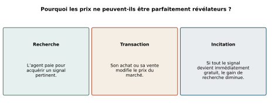
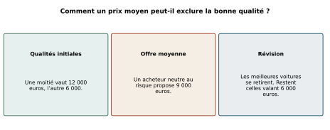

# ENS Rennes D1 — Composition d’ordre économique 2015 · Corrigé guidé

*Corrigé rédigé par IA, non officiel.*

**Rédaction** · GPT-6.2 Astra Ultra · vitesse non renseignée

## Information et marchés

### Introduction

> [!INDICATION]
> Identifier qui connaît la qualité et qui l’ignore.

Deux voitures d’occasion paraissent identiques sur un parking. Leur propriétaire connaît leur entretien, l’acheteur potentiel en distingue mal la qualité. Le prix pourra-t-il transmettre cette connaissance, ou la crainte d’une mauvaise affaire fera-t-elle disparaître les meilleures voitures ? Un marché met en relation des offres et des demandes à travers des règles, des prix et des contrats. Une information décrit une qualité, un état du monde, une action ou une rareté pertinente pour la décision. Elle peut être dispersée, coûteuse à obtenir ou inégalement répartie. Comment le marché utilise-t-il l’information disponible, et comment son fonctionnement se transforme-t-il lorsque les agents peuvent en chercher, en retenir ou en produire ?

### I. Les prix coordonnent des connaissances dispersées, mais leur contenu repose sur des conditions précises

#### A. Un prix relatif peut transmettre un signal utilisable sans connaissance exhaustive

> [!INDICATION]
> Distinguer l’information que transmet le prix de la cause du changement de prix.

Après une mauvaise récolte locale, un prix plus élevé signale que les usages d’un produit se font davantage concurrence. Certains acheteurs substituent un autre bien, d’autres fournisseurs acheminent leurs stocks. Chaque agent peut réviser sa décision sans connaître la météo de chaque parcelle. Hayek insiste en 1945 sur cette économie de connaissance : l’ajustement par les prix coordonne des informations locales dispersées. Dans un modèle concurrentiel, les dispositions marginales à payer et les coûts marginaux deviennent compatibles au prix d’équilibre.

Cela suppose que qualité, quantité et engagements soient intelligibles, que les agents puissent entrer sur le marché et qu’aucun acteur ne maîtrise seul le prix. Une hausse peut refléter une demande accrue, une production moindre ou une restriction stratégique. Un épargnant ne sait pas toujours si un prix financier résulte d’une nouvelle information sur les bénéfices ou d’un besoin temporaire de liquidité. Le prix informe sur la rareté relative rencontrée mais ne révèle pas automatiquement toutes ses causes. Lorsque des effets externes ne sont pas tarifés, il ne résume pas davantage le coût social.

#### B. La production d’information exige des incitations propres

> [!INDICATION]
> Comparer la valeur attendue de l’information au coût de l’obtenir.

Comparer des offres, faire expertiser un bien ou étudier les comptes d’une entreprise prend du temps et des ressources. L’agent arrête sa recherche quand le bénéfice marginal espéré d’une information supplémentaire ne couvre plus son coût. Deux magasins peuvent ainsi pratiquer des prix différents pour un bien comparable si vérifier toutes les offres est coûteux. Le rôle d’un intermédiaire ou d’un comparateur tient en partie à la réduction de ces coûts, avec une question supplémentaire sur ses propres intérêts.

Sur les marchés financiers, un opérateur informé peut tirer un revenu de ses transactions et contribuer à l’incorporation d’une nouvelle dans les prix. Si ces prix révélaient sans aucun coût tout ce qu’il a appris, ses concurrents pourraient s’épargner la dépense de recherche. Grossman et Stiglitz montrent ce paradoxe : les informations coûteuses exigent une rémunération attendue pour être produites. Une efficacité informationnelle doit donc préciser quelles données, à quel coût, dans quels délais et avec quels risques sont susceptibles d’être incorporées.

### II. Les asymétries peuvent faire disparaître des échanges et appellent des institutions crédibles

#### A. Qualité cachée et action cachée conduisent à des défaillances différentes

> [!INDICATION]
> Calculer la valeur moyenne offerte et vérifier quelles qualités restent à ce prix.

Dans le modèle d’Akerlof, la sélection adverse se produit avant le contrat. Supposons moitié de bonnes voitures, moitié de voitures médiocres. L’acheteur valorise les premières à 12 000 euros et les secondes à 6 000. Si le vendeur d’une bonne voiture exige au moins 10 000 euros, le prix moyen de 9 000, justifié par la composition initiale, le fait sortir. L’acheteur revoit alors sa prévision à 6 000 euros. Des échanges souhaitables en information complète disparaissent, puisque le gain potentiel sur une bonne voiture était de 2 000 euros.

L’aléa moral porte au contraire sur une action difficilement observable après la conclusion. Un assureur peut mal connaître les mesures de prévention effectivement prises par l’assuré. Une couverture intégrale modifie alors les incitations, même si chacun connaissait parfaitement le risque initial. Les deux difficultés peuvent coexister. Dans le crédit, relever le taux peut dégrader la composition des emprunteurs et encourager certains projets risqués. La banque peut préférer plafonner l’offre à un taux donné, ce qui explique pourquoi un marché n’est pas toujours équilibré par le seul mouvement de son prix.

#### B. Les réponses privées et publiques doivent rendre les informations vérifiables

> [!INDICATION]
> Vérifier quel type de vendeur pourrait imiter sans coût un signal prétendument crédible.

Un vendeur peut offrir une garantie qui lui coûte moins si sa voiture est en bon état. Un signal n’est séparateur que si les agents de faible qualité ne gagnent pas à l’imiter. Un assureur peut aussi proposer plusieurs contrats associant franchise et prime de manière à inciter les clients à révéler leurs préférences ou leur risque. La réputation soutient les transactions répétées, mais perd de sa force lorsque les acheteurs changent rapidement ou que l’évaluation est manipulable. Une certification peut ajouter une information indépendante à condition que son émetteur ne soit pas rémunéré pour délivrer systématiquement un avis favorable.

Les pouvoirs publics peuvent imposer des informations normalisées, vérifier leur exactitude ou protéger la confidentialité lorsque la révélation sert à discriminer. Le coût de compréhension compte autant que la quantité publiée. Un prix total affiché dans un format comparable peut être plus utile que des dizaines de caractéristiques non hiérarchisées. Les incitations à l’innovation et le caractère non rival de nombreuses connaissances posent enfin la question de leur financement et de leur accès. Le choix entre divulgation, responsabilité, certification et contrôle dépend du type d’asymétrie et de la possibilité d’observer les effets de la mesure.

### Conclusion

> [!INDICATION]
> Associer chaque défaillance à un instrument et à une condition de réussite.

Le marché économise de l’information en coordonnant par les prix, mais cette coordination s’appuie sur des signaux produits et des engagements crédibles. Identifier si l’information manque avant l’échange, après l’accord ou chez tous les agents permet d’expliquer pourquoi certains prix orientent efficacement les choix et pourquoi d’autres marchés nécessitent un mécanisme de vérification, d’assurance ou de révélation.

Le sujet de l’écrit est publié sur la page du concours. Cette page donne le rapport d’économie orale. Le rapport propre à la dissertation reste à retrouver.

[Sujet distribué](https://www.ens-rennes.fr/medias/fichier/sujet-d1-eco-2015_1459930564201-pdf)
