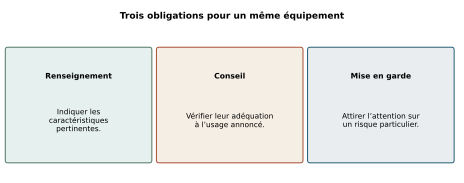

# ENS Rennes D1 — Droit civil 2015 · Corrigé guidé

*Corrigé rédigé par IA, non officiel.*

**Rédaction** · GPT-6.2 Astra Ultra · vitesse non renseignée

## L’information du cocontractant

### Introduction

> [!INDICATION]
> Commencer par la date et le droit applicable avant la réforme de 2016.

Un professionnel remet un document techniquement exact mais incompréhensible à un client dont il connaît le projet. A-t-il informé son cocontractant ? En droit de 2015, l’obligation de renseignement se construit à partir de textes spéciaux, du contrat et de solutions jurisprudentielles. L’article 1112-1 issu de la réforme de 2016 ne régit pas l’épreuve. Le droit doit concilier l’autonomie d’une partie qui se renseigne pour son propre compte avec la loyauté due à celle qui ignore légitimement un fait décisif. Il faut donc déterminer qui doit quoi, à quel moment et avec quelle sanction, depuis la formation du consentement jusqu’à l’exécution ou la fin du contrat.

### I. Le droit adapte l’information nécessaire aux connaissances et aux rôles des parties

#### A. L’information précontractuelle peut conditionner un consentement éclairé

> [!INDICATION]
> Séparer information factuelle, estimation de valeur et silence intentionnel.

En droit alors applicable, le consentement est vicié par une erreur portant sur la substance de la chose ou par le dol, aux conditions des anciens articles 1109, 1110 et 1116. Le silence intentionnel d’une partie sur une circonstance déterminante peut constituer une réticence dolosive. Pour rechercher un dol, il faut donc établir le fait tu, sa portée pour le consentement, sa connaissance et l’intention de tromper. Une ignorance excusable peut justifier une erreur sans que la mauvaise foi du cocontractant soit prouvée. Une simple préférence déçue ou une information sans influence sur l’accord ne suffit pas.

Chacun n’a toutefois pas à révéler tout ce qui rend l’opération avantageuse à ses yeux. Dans l’arrêt dit Baldus du 3 mai 2000, l’acheteur de photographies n’était pas tenu d’informer le vendeur de leur valeur. Distinguer l’estimation économique d’une qualité factuelle essentielle comme l’authenticité. La qualité de professionnel peut modifier ce que son partenaire est légitimement en droit d’attendre. Sur les marchés de consommation, l’article L. 111-1 du Code de la consommation dans sa rédaction de 2015 impose au professionnel, avant que le consommateur soit lié, une information lisible et compréhensible portant notamment sur les caractéristiques essentielles, le prix et le délai lorsque l’exécution n’est pas immédiate.

#### B. Renseigner, conseiller et mettre en garde répondent à des besoins différents

> [!INDICATION]
> Poser trois questions différentes sur un même équipement ou prêt.

Renseigner consiste par exemple à indiquer les dimensions d’une machine. Conseiller exige de confronter ses caractéristiques à l’usage annoncé et, selon les missions, de déconseiller une solution inadaptée. La mise en garde attire l’attention sur un risque concret. La distinction compte pour définir le comportement dû et le dommage : le client pouvait connaître le prix d’un crédit sans avoir été averti d’un risque d’endettement inadapté à ses capacités. En droit bancaire de la période, l’examen du devoir de mise en garde dépend notamment de la situation de l’emprunteur non averti et de l’existence d’un risque au regard de ses capacités financières.

La coopération du destinataire a son importance. Un artisan qui commande un dispositif pour une utilisation atypique doit donner au fournisseur les informations utiles qu’il est seul à détenir. À l’inverse, le professionnel tenu de conseil ne peut attendre passivement une précision que son expertise lui commande de demander. Le notaire qui éclaire les parties sur la portée d’un acte ou le vendeur spécialiste qui conseille un profane n’accomplissent pas la même mission. Il faut partir du rôle accepté, de la compétence réelle et de la disponibilité de l’information.

### II. L’exigence d’information se poursuit dans l’exécution et produit des sanctions distinctes

#### A. Le contrat peut organiser des informations utiles pendant toute la relation

> [!INDICATION]
> Relever le moment, le contenu et la possibilité de vérifier la transmission.

Les anciens articles 1134 et 1135 imposent l’exécution de bonne foi et étendent les obligations aux suites que l’équité, l’usage ou la loi donnent à la convention. Dans la fourniture d’un équipement, instructions de fonctionnement et avertissement sur un risque connu participent d’une exécution utile. Un contrat durable peut prévoir des comptes rendus ou l’annonce d’un obstacle qui bouleverse le calendrier. Les textes spéciaux peuvent encore imposer des informations périodiques, notamment au profit de certaines cautions. Le champ, le destinataire et la sanction de chacun de ces textes doivent être vérifiés.

Le moment compte autant que le contenu. Une notice remise après que le client a pris une décision irréversible ne répond pas au même besoin qu’une information transmise avant l’engagement. Une formalité écrite peut faciliter la preuve sans démontrer à elle seule que le contenu était adapté. Selon l’ancien article 1315 et les règles propres au devoir en cause, celui qui est légalement ou contractuellement tenu d’une obligation particulière d’information doit pouvoir établir qu’il l’a exécutée. La preuve du manquement, celle du dommage et celle du rôle causal de l’information répondent cependant à des questions différentes.

#### B. Le remède dépend du moment et de ce qu’une information exacte aurait changé

> [!INDICATION]
> Distinguer le vice déterminant et la perte d’une chance de refuser.

Au stade précontractuel, une faute peut engager la responsabilité extracontractuelle sous l’ancien article 1382, même si les conditions d’un dol ne sont pas réunies. Pour obtenir la nullité relative, il faut établir le vice déterminant du consentement. Si la partie aurait tout de même contracté mais dans de meilleures conditions, l’analyse du préjudice diffère de celle d’une personne qui aurait raisonnablement renoncé. Une perte de chance se mesure à la chance perdue et ne se confond pas avec l’intégralité de l’avantage espéré.

Pendant l’exécution, une omission contractuelle peut entraîner réparation sur le fondement de l’ancien article 1147. La résolution selon l’ancien article 1184 dépend de la gravité de l’inexécution et des conditions du remède. D’autres textes prévoient une sanction particulière, par exemple une déchéance d’intérêts pour certains manquements envers une caution. Lors de la fin du contrat, les obligations de notification ou de préavis garantissent enfin que le destinataire puisse anticiper les conséquences du départ. L’absence d’une information ne fait donc pas automatiquement disparaître toute la convention.

### Conclusion

> [!INDICATION]
> Préciser qui devait l’information, à quel titre et avec quel effet.

L’information du cocontractant protège l’autonomie dès lors qu’elle porte sur les éléments qu’il est légitime d’attendre d’autrui. Le régime devient intelligible si l’on distingue renseignement, conseil et mise en garde, période de formation et période d’exécution, puis vice du consentement et dommage causal. La sanction peut ainsi correspondre à ce qui a réellement manqué à la décision ou à l’exécution.

[Sujet distribué](https://www.ens-rennes.fr/medias/fichier/sujet-d1-droit-civil-2015_1459930583860-pdf) · [Rapport du jury](https://www.ens-rennes.fr/medias/fichier/droit-civil-d1-rapport-jury-2015_1453310923879-pdf)

[Code civil au 1er avril de la session](https://www.legifrance.gouv.fr/codes/texte_lc/LEGITEXT000006070721/2015-04-01/)

[Arrêt Baldus, 3 mai 2000](https://www.legifrance.gouv.fr/juri/id/JURITEXT000007043587) · [Code de la consommation à la session](https://www.legifrance.gouv.fr/codes/texte_lc/LEGITEXT000006069565/2015-04-01/)
