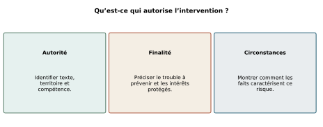
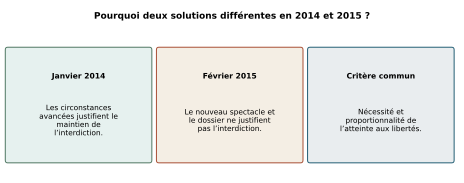

# ENS Rennes D1 — Droit public 2015 · Corrigé brut

*Corrigé rédigé par IA, non officiel.*

**Rédaction** · GPT-6.2 Astra Ultra · vitesse non renseignée

## Ordre public et police administrative

### Introduction

En janvier 2014 puis en février 2015, le juge des référés du Conseil d’État examine l’interdiction de spectacles du même artiste. Il aboutit à des solutions opposées. Ce rapprochement montre que l’ordre public n’est pas une justification que l’autorité pourrait invoquer une fois pour toutes. La police administrative vise à prévenir des troubles. Elle se distingue par son but de la police judiciaire tournée vers la recherche et la constatation d’infractions et de leurs auteurs. L’ordre public définit les intérêts protégés et la limite de l’intervention, laquelle doit demeurer conciliable avec les libertés. Comment justifier le pouvoir de prévention sans autoriser une interdiction générale fondée sur une inquiétude ou une désapprobation ?

### I. La protection de l’ordre public fonde un pouvoir de prévention à objet et compétence déterminés

#### A. Sécurité, tranquillité et salubrité donnent un contenu matériel à la prévention

La police municipale a pour objet d’assurer le bon ordre, la sûreté, la sécurité et la salubrité publiques selon l’article L. 2212-2 du Code général des collectivités territoriales. Cela comprend par exemple la circulation sur une voie, la tranquillité des riverains et les précautions à prendre face à un danger sanitaire. Ces finalités permettent une intervention avant la réalisation du dommage. Elles supposent néanmoins un risque suffisamment caractérisé et ne se confondent pas avec la sanction d’une faute déjà commise.

Une même opération peut changer de nature selon son objectif. Régler provisoirement l’accès à un lieu en raison de l’affluence relève normalement d’un but préventif. Une intervention destinée à rechercher le responsable d’une infraction déterminée relève de la police judiciaire, même si certains agents participent successivement aux deux missions. Les décisions Consorts Baud et Dame Noualek de 1951 illustrent le critère de finalité. La qualification influe sur le droit applicable et le juge compétent. Elle ne se déduit pas uniquement de l’uniforme de l’agent ou de la présence d’un trouble passé.

#### B. L’ordre public comporte des dimensions immatérielles et des limites de compétence

L’arrêt Société Les Films Lutetia du 18 décembre 1959 admet l’interdiction locale d’une représentation cinématographique dans les circonstances particulières de l’affaire, malgré le visa national. La moralité ne fournit pas pour autant une compétence générale pour imposer une préférence culturelle. Dans l’arrêt Commune de Morsang-sur-Orge du 27 octobre 1995, le Conseil d’État reconnaît le respect de la dignité de la personne humaine comme composante de l’ordre public, pouvant jouer même sans circonstances locales particulières. Le consentement de l’intéressé ne suffit pas à neutraliser cette exigence dans l’espèce jugée.

Le maire, le préfet et, à l’échelle nationale, l’autorité compétente disposent de pouvoirs distincts. L’articulation entre mesures générales de niveaux différents dépend notamment de circonstances locales et du caractère plus rigoureux de la mesure envisagée, comme l’illustre l’arrêt Commune de Néris-les-Bains de 1902. Les polices spéciales organisent toutefois des compétences et procédures propres, qui peuvent exclure l’intervention parallèle de la police générale. Identifier le texte, le territoire, la nature du risque et l’autorité compétente avant de discuter la proportionnalité.

### II. La mesure de police reste subordonnée aux libertés et au contrôle du juge

#### A. Une restriction doit être adaptée, nécessaire et proportionnée au risque établi

L’arrêt Benjamin du 19 mai 1933 impose à l’autorité de concilier ordre public et liberté de réunion. Une interdiction peut être illégale si une mesure moins restrictive permet de prévenir le trouble. Examiner l’importance et la probabilité du risque, les alternatives réellement disponibles, la durée et le périmètre de la mesure. Une activité légale ne peut être supprimée par commodité. À l’inverse, dans certaines conditions de péril grave, l’inaction de l’autorité peut également être contestée.

Le 9 janvier 2014, dans l’affaire Les Productions de la Plume, le juge des référés laisse produire effet à l’interdiction du spectacle en cause à Saint-Herblain, au regard des éléments propres au contenu annoncé, à la gravité des risques et notamment de l’atteinte à la dignité humaine. Le 6 février 2015, il confirme la suspension de l’interdiction prise à Cournon-d’Auvergne. Les circonstances de ce nouveau spectacle et les éléments avancés n’établissaient pas le risque grave exigé pour justifier une telle restriction. La réputation d’un artiste et une ordonnance antérieure ne dispensent pas de prouver le trouble dans la situation présente. La comparaison révèle une méthode commune malgré l’issue différente.

#### B. L’effectivité du contrôle suppose un recours utile et des garanties à la hauteur de l’atteinte

Le recours pour excès de pouvoir permet au juge administratif de vérifier compétence, fondement, réalité des faits, finalité et proportion de la décision. Lorsque la date du spectacle est imminente, un jugement des mois plus tard est insuffisant pour sauvegarder concrètement la liberté. Le référé-liberté de l’article L. 521-2 du Code de justice administrative exige l’urgence et une atteinte grave et manifestement illégale à une liberté fondamentale, et permet d’ordonner dans un bref délai les mesures nécessaires. La voie de droit et le degré de contrôle doivent être rapportés au litige.

Au printemps 2015, le projet de loi sur le renseignement est en discussion. Le rapport du jury invite à y voir un débat sur l’extension de finalités préventives et les risques pour la vie privée. À la date de la copie, il s’agit d’un projet. L’argument juridique porte sur la précision des finalités, les garanties de contrôle indépendant, le caractère proportionné des restrictions et l’accès au juge. La prévention ne devient pas illimitée au motif que le dommage redouté serait grave. Plus sa mise en œuvre est difficile à observer pour les intéressés, plus comptent les garanties institutionnelles et la possibilité d’un contrôle effectif.

### Conclusion

L’ordre public donne à la police administrative un objet légitime et circonscrit. La diversité des risques et des pouvoirs exige de vérifier chaque fondement de compétence. La liberté reste le point de départ du contrôle : une décision doit être justifiée par des faits actuels, une finalité admise et l’impossibilité de répondre convenablement par une mesure moins restrictive.

[Sujet distribué](https://www.ens-rennes.fr/medias/fichier/sujet-d1-epreuve-a-options-2015_1505898697484-pdf#page=2) · [Rapport du jury](https://www.ens-rennes.fr/medias/fichier/droit-public-d1-rapport-jury-2015_1448642442932-pdf)

[Constitution à la session](https://www.legifrance.gouv.fr/loda/id/JORFTEXT000000571356/2015-04-01/)

[Conseil d’État, 9 janvier 2014](https://www.conseil-etat.fr/fr/arianeweb/CE/decision/2014-01-09/374508) · [Conseil d’État, 6 février 2015](https://www.conseil-etat.fr/fr/arianeweb/CE/decision/2015-02-06/387726)
