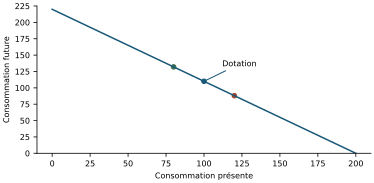
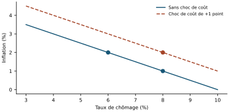
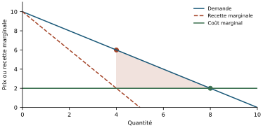

# ENS Rennes D1 — Économie (oral) 2015 · Corrigé guidé

*Corrigé rédigé par IA, non officiel.*

**Rédaction** · GPT-6.2 Astra Ultra · vitesse non renseignée

La feuille officielle contient 29 intitulés repris ci-dessous dans l’ordre du concours. Après trente minutes de préparation, le jury a observé 10 à 12 minutes d’exposé, puis 10 à 15 minutes de questions. La numérotation indique le rang de lecture sur la feuille. Les numéros 13 et 26 portent le même titre, « Les anticipations ». Les deux propositions en développent des applications différentes.

## Sujet 1 — Le modèle offre/demande globales (agrégées)

> [!INDICATION]
> Au tableau, nommer d’abord les axes et tracer deux équilibres comparatifs. Distinguer le niveau des prix et son taux de variation.

**I. Construire l’équilibre de court terme.** La demande agrégée donne les dépenses réelles compatibles avec le niveau des prix et le comportement de la politique monétaire. Dans une version à monnaie nominale donnée, une hausse des prix réduit les encaisses réelles et peut relever le taux qui équilibre le marché monétaire, ce qui freine l’investissement. L’offre agrégée de court terme est croissante si certains coûts nominaux ou prix s’ajustent lentement. L’intersection détermine production réelle et niveau général des prix, et les deux axes doivent être nommés.

**II. Identifier un choc par son origine et sa propagation.** Une augmentation autonome de la demande déplace sa courbe à droite : à court terme, production et prix peuvent augmenter ensemble. Une hausse du coût du pétrole déplace l’offre de court terme vers le haut : la production baisse alors que les prix montent. À mesure que salaires et anticipations s’ajustent, l’offre de court terme change ; le potentiel de long terme dépend des facteurs et de la productivité. Une relance répond différemment à une insuffisance de dépense et à une perte de capacité productive.

**Relance.** Une baisse de production permet-elle de choisir entre les deux chocs ?

Il faut aussi examiner les prix, les coûts et la chronologie. Une contraction de demande tend à faire baisser prix et production ensemble ; un choc d’offre défavorable les déplace ici dans des sens opposés.

## Sujet 2 — Les déterminants de l’inflation

> [!INDICATION]
> Ranger chaque argument selon l’impulsion initiale, la réaction de la production et la condition qui rend l’inflation persistante.

**I. Les tensions peuvent provenir des dépenses ou des coûts.** L’inflation est le rythme de hausse d’un indice général. Une demande croissant plus vite que l’offre disponible tend à pousser salaires et prix, surtout lorsque les capacités sont proches de la saturation. Une hausse importée des coûts, par exemple le pétrole, peut relever les prix alors même que l’activité ralentit. Le passage d’un choc de prix relatif à l’indice dépend du poids du bien et des effets indirects dans les coûts des autres producteurs.

**II. La persistance dépend des mécanismes de propagation.** L’indexation des salaires, les marges, les anticipations et la réaction de la banque centrale influencent les hausses ultérieures. Un relèvement unique de taxe peut relever le niveau de l’indice sans augmenter durablement son taux de croissance. À long terme, une expansion nominale persistante relativement aux capacités peut nourrir l’inflation ; l’égalité quantitative entre monnaie, vitesse, prix et production ne fixe pas seule le sens causal si la vitesse ou la production changent.

**Relance.** Si l’indice monte de 100 à 103 puis demeure à 103, quel est le taux de la seconde période ?

Il est nul. La hausse de niveau intervenue à la première période produit 3 % d’inflation cette période-là, puis aucun renchérissement supplémentaire dans cet exemple.

## Sujet 3 — Le modèle IS LM

> [!INDICATION]
> Résoudre les deux équations, puis remplacer la seconde par un taux fixé. Le contraste identifie la part de l’éviction liée au mode de conduite monétaire.

**I. Équilibrer deux marchés pour un même revenu et un même taux.** À prix fixes, IS relie les couples revenu-taux compatibles avec la dépense désirée égale à la production. Une hausse du taux réduit l’investissement sensible au coût du financement ; la courbe est décroissante. LM fixe l’égalité entre demande d’encaisses et offre réelle. Si le revenu augmente, la demande de liquidités de transaction augmente et le taux doit monter pour une offre réelle inchangée. L’intersection détermine le revenu et le taux de court terme.

**II. Comparer les politiques et les limites du modèle.** Supposons IS : $Y=160-10i$ et LM : $Y=80+10i$, avec $i$ exprimé en points de pourcentage. L’intersection vaut $Y=120$, $i=4$. Une relance portant l’ordonnée de IS à 180 donne $Y=130$ et $i=5$ ; la hausse de taux évince une partie de la demande privée. Une banque centrale qui fixe un taux, ou un voisinage de trappe à liquidité, modifie cette transmission. Prix rigides, économie fermée et absence de risque bancaire explicite limitent la portée du résultat.

**Relance.** Si la banque centrale maintient le taux à 4 après la relance de l’exemple, quel revenu IS implique-t-elle ?

Le revenu devient 180−40=140. La banque centrale doit adapter l’offre de liquidités pour que le marché monétaire soit compatible avec ce revenu au taux choisi.

## Sujet 4 — Le modèle Mundell Fleming

> [!INDICATION]
> Choisir une convention de change au début. Dire quelle devise la banque centrale achète et si des unités de monnaie nationale entrent en circulation.

**I. Ouvrir le modèle au commerce et aux flux de capitaux.** Dans la petite économie de Mundell-Fleming, les exportations nettes réagissent au revenu et au change ; sous parfaite mobilité des capitaux, sans prime ni variation de change anticipée, le taux intérieur est arrimé au taux mondial. Une dépense publique supplémentaire crée une pression initiale sur le taux. En change flottant, l’entrée de capitaux et l’appréciation réduisent les exportations nettes ; dans la version stricte, cette éviction annule l’effet final sur le revenu.

**II. Le régime de change détermine l’ajustement monétaire.** En change fixe, l’autorité achète des devises contre monnaie nationale pour contenir une appréciation, accroissant les liquidités si elle ne stérilise pas. La politique budgétaire peut alors être puissante, tandis qu’une expansion monétaire isolée qui pousse à la dépréciation est corrigée par l’intervention inverse. En flottement, une expansion monétaire peut au contraire déprécier la devise et soutenir les exportations nettes. L’horizon court, les prix rigides, la mobilité parfaite et l’absence de variation des primes sont décisifs.

**Relance.** Pourquoi le même raisonnement ne se transpose-t-il pas sans précaution à un pays qui emprunte avec une prime variable ?

Le taux intérieur peut dépendre du risque perçu et des anticipations de change. Un choc budgétaire peut modifier cette prime ; l’égalité mécanique au taux mondial ne fournit alors plus la fermeture du modèle.

## Sujet 5 — Les choix intertemporels de consommation

> [!INDICATION]
> Placer d’abord la dotation et nommer les axes en unités de consommation à deux dates distinctes.

**I. L’emprunt et l’épargne dissocient revenu et consommation à chaque date.** Avec deux périodes, des revenus de 100 puis 110, et un taux réel de 10 %, le budget est $c_1+c_2/1,1=200$. Consommer 80 aujourd’hui laisse 132 demain. Consommer 120 ramène la consommation future à 88. À un optimum intérieur, la pente d’indifférence en valeur absolue vaut 1,1. Un ménage patient accepte de déplacer davantage de consommation vers l’avenir à revenus comparables.

**II. La réponse aux revenus et aux taux dépend des contraintes.** Une hausse durable de revenu accroît davantage les ressources actualisées qu’une prime temporaire du même montant aujourd’hui. Un ménage empêché d’emprunter peut néanmoins consommer immédiatement la prime. Une hausse du taux augmente le prix en biens futurs de la consommation présente et le revenu financier de l’épargnant ; ces deux effets peuvent s’opposer pour sa consommation présente. Risque sur le revenu, épargne de précaution et retraites complètent le modèle à deux dates. Au tableau, actualiser aussi le panier (120,88) donne 120+88/1,1=200 : le surcroît présent a exactement le coût futur annoncé.

**Relance.** Une personne qui reste exactement à sa dotation (100,110) bénéficie-t-elle mécaniquement d’une hausse de taux ?

La dotation appartient toujours à la droite de budget, qui pivote autour de ce point. Le ménage peut réviser son choix ; il ne reçoit pas mécaniquement des intérêts sur une épargne initiale nulle.

## Sujet 6 — Le multiplicateur keynésien et l’effet d’éviction

> [!INDICATION]
> Calculer le multiplicateur avec fuites puis expliquer pourquoi un chiffre estimé dépend du moment et de l’instrument.

Un multiplicateur rapporte la variation d’une grandeur, par exemple le PIB, à une impulsion de politique économique en précisant l’horizon. Dans un modèle de demande à prix fixes, avec propension à consommer c, taux proportionnel de prélèvement t et propension marginale à importer m, le multiplicateur d’une dépense publique autonome est 1/[1−c(1−t)+m]. Avec c = 0,8, t = 0,25 et m = 0,1, il vaut 2. La commande initiale est une dépense directe. Une baisse d’impôt forfaitaire ne devient demande initiale qu’à hauteur de la fraction consommée.

Cette formule maintient investissement et conditions monétaires constants. Si la banque centrale réagit à l’inflation par une hausse de taux, une partie de la stimulation peut être compensée. À capacité inutilisée, avec taux contraints et ménages manquant de liquidités, l’effet réel peut être plus grand que près du plein emploi. Une politique monétaire a également des effets amplifiés par le crédit et les anticipations, mais il faut définir l’unité du choc, par exemple variation de PIB pour un point de taux. Une estimation empirique doit isoler une décision indépendante de la conjoncture, car les budgets se dégradent spontanément en récession. Une éviction peut également être réelle : des commandes publiques mobilisant une branche déjà saturée écartent certaines commandes privées, même sans variation durable du taux.

**Relance.** Pourquoi le rapport entre déficit et variation du PIB ne donne-t-il pas le multiplicateur ?

Le déficit contient des réactions automatiques au revenu, des intérêts et des mesures différentes. Il faut isoler l’impulsion et définir un scénario de comparaison.

## Sujet 7 — Les déséquilibres externes d’une économie

> [!INDICATION]
> Construire deux pays présentant le même déficit courant et des passifs de maturité et de monnaie différentes.

Un pays peut importer davantage qu’il n’exporte pour équiper une industrie productive ou pour alimenter une bulle immobilière. **I. Lire les soldes et les stocks.** Le compte courant rassemble échanges de biens et services, revenus primaires et transferts courants. Son solde correspond à l’écart entre épargne nationale et investissement, avec des conventions cohérentes de comptabilité nationale. Un déficit doit avoir une contrepartie financière. La position extérieure nette dépend aussi de la valorisation du patrimoine existant et du taux de change. Un déficit commercial seul ne suffit donc pas à diagnostiquer une insolvabilité.

**II. Apprécier la capacité d’ajustement.** Examiner l’usage des capitaux reçus, la maturité des passifs, leur monnaie et la capacité à dégager des revenus futurs. Des prêts courts en devises rendent un arrêt des financements particulièrement coûteux. Un excédent persistant peut refléter un vieillissement anticipé, une demande intérieure faible ou une politique pesant sur les partenaires. L’ajustement peut venir de la dépense, des prix relatifs ou de la productivité. À l’échelle mondiale, tous les pays ne peuvent simultanément accroître leur excédent par compression de la demande. L’identité entre excédent d’épargne sur investissement et solde courant sépare le constat comptable de l’hypothèse sur les comportements de dépense.

**Relance.** Un solde courant nul élimine-t-il les risques financiers extérieurs ?

De grosses dettes à court terme peuvent être compensées comptablement par des actifs à long terme. Le risque de refinancement subsiste malgré un solde net faible.

## Sujet 8 — Les imperfections du marché

> [!INDICATION]
> Associer chaque exemple à un prix absent, une information cachée ou un pouvoir de marché.

Le marché en concurrence parfaite sert de référence lorsque prix, information et droits permettent de comparer tous les coûts et avantages. Une imperfection désigne un écart à une hypothèse du modèle. Une défaillance au sens économique s’établit lorsqu’un mécanisme empêche une allocation efficace. Une petite différence de qualité entre produits n’implique pas mécaniquement qu’une intervention donnée améliorerait le bien-être. Il faut montrer le mécanisme, son ampleur et une alternative.

Le pollueur tient compte de son coût privé mais peut négliger le dommage aux riverains. Une taxe alignée sur le dommage marginal peut rapprocher ses choix de l’optimum si les émissions et le dommage sont mesurables. Dans l’assurance, une information cachée avant le contrat produit de la sélection adverse ; après le contrat, un effort caché produit de l’aléa moral. Une obligation d’assurance ou une franchise n’agit pas sur les deux de la même façon. Pour un bien public, additionner les disponibilités marginales à payer éclaire la quantité socialement souhaitable, mais chacun peut dissimuler sa préférence. La mise en œuvre publique a aussi des coûts d’information et de contrôle. Une installation qui pollue et un vendeur unique peuvent d’ailleurs produire des distorsions de sens opposés sur la quantité. Il faut les identifier avant de proposer un tarif.

**Relance.** Une inégalité de revenu constitue-t-elle au même sens une défaillance du marché ?

Elle peut justifier une politique distributive même si l’allocation est efficace au sens de Pareto. Il faut distinguer l’objectif d’équité et la correction d’une inefficacité.

## Sujet 9 — Les déterminants du chômage

> [!INDICATION]
> Tracer les flux entre emploi, chômage et inactivité. Expliquer les simplifications nécessaires pour passer ensuite au calcul à deux états.

**I. Le chômage combine mouvements conjoncturels et flux permanents.** Une baisse des débouchés peut rendre des licenciements rationnels pour les entreprises alors que des personnes accepteraient le salaire offert. Dans une expansion, nouvelles offres, entrées en activité et délais de recrutement coexistent. Le taux au sens du BIT se calcule sur la population active. Une baisse causée par des départs vers l’inactivité n’a donc pas la même signification qu’une multiplication des embauches.

**II. Les restructurations et l’appariement prolongent certaines recherches.** Une inadéquation entre lieux, compétences et offres peut maintenir ensemble postes vacants et chômeurs. Informations détenues par les entreprises, coûts de formation, salaire d’efficience et négociation peuvent maintenir un salaire différent d’une solution concurrentielle simple. Marchés locaux, durée de chômage et mobilité permettent de confronter ces hypothèses. L’outil pertinent dépend alors du déficit de demande ou de l’obstacle spécifique aux rencontres.

**Relance.** Si le taux mensuel de perte d’emploi est 1 % et celui de retour 19 %, quel chômage stationnaire obtient-on à population active fixe ?

À deux états, les entrées valent $0,01(1-u)$ et les sorties $0,19u$. L’égalité donne $u=0,01/0,20=5$ %. Une perturbation temporaire écarte le taux observé de cette valeur.

## Sujet 10 — Les nouveaux keynésiens

> [!INDICATION]
> Partir d’une firme qui ne peut réviser son prix ce mois-ci. Relier sa décision d’emploi à la production agrégée avant d’introduire la règle monétaire.

**I. Fonder la rigidité nominale sur des décisions décentralisées.** Une entreprise en concurrence imparfaite fixe un prix et peut supporter un coût à le modifier, ou ne recevoir que périodiquement l’occasion de le faire. Après une baisse de demande, certaines entreprises ajustent d’abord quantités et emploi. Les décisions de prix et l’anticipation des décisions des concurrents peuvent amplifier ces effets. Les nouveaux keynésiens étudient comment ces choix, même optimisateurs, produisent une demande agrégée qui influence la production à court terme.

**II. En déduire une politique conditionnelle.** Un modèle néo-keynésien relie souvent l’écart de production au taux réel et aux anticipations, l’inflation aux anticipations et aux coûts marginaux, puis ferme le système par une règle de politique monétaire. Une banque centrale crédible peut influencer les taux longs par l’annonce de ses actions futures. Face à un choc de coût, stabiliser intégralement l’activité et les prix peut imposer des objectifs incompatibles. La crédibilité ne supprime ni les erreurs de mesure du potentiel ni les inégalités de transmission des taux.

**Relance.** En quoi une rigidité réelle diffère-t-elle d’une rigidité nominale ?

La première concerne une variable relative ou réelle, par exemple un salaire réel maintenu pour des raisons d’incitation. La seconde concerne le rythme de révision d’un contrat en unités monétaires. Leurs interactions peuvent prolonger l’ajustement.

## Sujet 11 — Biens publics et défaillances de marché

> [!INDICATION]
> Faire varier la rivalité tout en gardant l’exclusion difficile.

Une ressource commune est rivale et difficilement excluable. Prendre de l’eau dans une nappe réduit ce qui reste disponible pour les autres usagers. Un bien public pur est non rival et non excluable. Un habitant supplémentaire bénéficie de l’alerte diffusée par une sirène sans en priver les autres. La difficulté commune est de faire apparaître la totalité des conséquences d’une décision individuelle. Ses effets sont différents. Une ressource commune risque d’être surexploitée tandis qu’un bien public risque d’être produit en quantité insuffisante.

Dans la nappe, chaque prélèvement procure un gain privé alors que l’épuisement réduit les possibilités collectives. Des règles de prélèvement, des droits d’usage et une surveillance acceptée par les membres peuvent préserver le stock. Pour l’alerte, chacun peut espérer que les autres financent le service et en profiter ensuite. Un financement obligatoire ou une organisation collective peut résoudre le problème. L’accès peut d’ailleurs changer avec la technique et les institutions, et la non-rivalité peut disparaître en présence de congestion. La bonne question est donc de savoir qui peut être exclu, à quel coût et à partir de quel niveau d’usage l’un prive l’autre. Dans un exemple de bien public, si deux habitants valorisent une unité supplémentaire à 4 et 3 euros alors qu’elle coûte 6 euros, le bénéfice collectif de 7 justifie cette unité même si aucun ne souhaite seul la financer.

**Relance.** Un lac public est-il un bien public pur ?

Son statut juridique n’en décide pas. La vue sur le lac peut être peu rivale, la pêche l’est puisque chaque poisson capturé manque aux autres.

## Sujet 12 — Le taux d’intérêt

> [!INDICATION]
> Nommer le débiteur, l’échéance et l’indice des prix avant de chiffrer un taux.

Un épargnant qui diffère un achat demande un rendement réel. Un ménage qui conserve une encaisse renonce au rendement nominal d’un titre. Ces deux arbitrages portent sur des taux distincts. **I. L’équilibre entre ressources présentes et futures.** Si l’entreprise investit jusqu’à égalité entre rendement marginal net et coût réel de financement, une baisse du taux rend de nouveaux projets rentables. Du côté des ménages, la substitution favorise l’épargne à taux plus élevé mais l’effet de revenu d’un créancier peut aller dans l’autre sens. Le taux réel d’équilibre dépend ainsi de la productivité, des préférences, du risque et de la démographie.

**II. La formation des taux effectivement observés.** À court terme la banque centrale pilote le prix des réserves. À plus longue échéance, le rendement d’un titre incorpore les taux courts attendus et une prime de terme. Un emprunteur fragile paie aussi une prime de défaut. Avec un taux nominal de 3 % et une inflation anticipée de 2 %, le taux réel anticipé vaut 1,03/1,02 − 1, soit environ 0,98 %. La monnaie et les anticipations influencent donc le coût réel, particulièrement lorsque prix et salaires s’ajustent lentement. Une décision monétaire n’impose pas un rendement uniforme à toutes les échéances. À titre de calcul, 5 % nominal et 2 % d’inflation anticipée donnent un taux réel de 1,05/1,02−1, soit environ 2,94 %, pour une durée et un risque comparables.

**Relance.** Le taux réel réalisé peut-il être négatif après un prêt consenti à 3 % ?

Oui. Avec une inflation réalisée de 5 %, le rendement réel du prêteur vaut 1,03/1,05 − 1, soit environ −1,90 %, quel qu’ait été son calcul initial.

## Sujet 13 — Les anticipations

> [!INDICATION]
> Proposer un calcul adaptatif puis un test de prédictibilité. Garder une date de prévision antérieure à la réalisation.

**I. Prévoir avec des informations datées.** Un ménage peut former une anticipation adaptative en corrigeant sa prévision d’inflation après l’erreur précédente. Si la prévision valait 2 %, la réalisation 4 % et que la moitié de l’erreur est incorporée, la nouvelle prévision vaut 3 %. Une anticipation rationnelle mobilise l’information disponible et le modèle supposé : une surprise reste possible, mais une composante systématiquement prévisible de l’erreur remet ce modèle en question.

**II. Les prévisions orientent des décisions dont les effets sont observables.** Pour un emprunt à 4 % nominal, une inflation attendue de 1 % donne un coût réel anticipé voisin de 3 % ; à 3 % d’inflation anticipée, il tombe vers 1 %. Un même contrat change donc d’attractivité sans modification du taux affiché. Pour tester une anticipation, une enquête datée ou un prix de marché doit être rattaché à son horizon et à sa disponibilité au moment du choix ; les prix de marché peuvent aussi incorporer une prime de risque.

**Relance.** Une erreur de prévision unique prouve-t-elle l’irrationalité ?

Une nouvelle inattendue, telle une forte variation du prix du pétrole, peut produire une erreur isolée. Il faudrait établir qu’une information déjà disponible permettait de prévoir systématiquement ces erreurs.

## Sujet 14 — La balance des paiements

> [!INDICATION]
> Distinguer le compte de capital et le compte financier dans la nomenclature retenue. Écrire le signe d’une dette nouvelle.

**I. La balance des paiements enregistre les transactions avec les non-résidents.** Le compte courant comprend biens, services, revenus primaires et secondaires. Le compte de capital inclut notamment les transferts en capital ; le compte financier enregistre acquisitions d’actifs et accroissements de passifs. Une exportation payée par un dépôt à l’étranger donne à la fois une recette courante et une acquisition d’actif extérieur. Il faut annoncer la convention de signe avant de traiter les écritures de contrepartie.

**II. Un solde courant est une information sur le financement, pas un jugement automatique.** Selon la présentation du sixième manuel du FMI, le solde du compte financier est l’acquisition nette d’actifs moins l’accroissement net de passifs. En négligeant erreurs et omissions, il égale la somme des soldes courant et de capital. Une capacité de financement peut accompagner des investissements étrangers rentables ou une demande intérieure faible. Une position extérieure nette peut aussi changer par valorisation sans transaction enregistrée sur la période.

**Relance.** Une importation de 100 réglée par l’accroissement d’une dette envers l’étranger crée-t-elle deux déficits indépendants ?

Elle donne un débit courant de 100 et, au compte financier ainsi défini, un accroissement des passifs de 100, donc un solde financier de −100. Ce sont les deux écritures de la même transaction.

## Sujet 15 — La politique budgétaire en économie fermée et en économie ouverte

> [!INDICATION]
> Annoncer à chaque calcul si le taux est fixe, où se place l’impôt et quel régime de change est retenu.

**I. En économie fermée, une dépense peut entraîner des revenus successifs.** À prix fixes, sans impôt proportionnel, investissement et taux donnés, une hausse de dépense publique de 10 avec une propension marginale à consommer de 0,75 augmente le revenu d’équilibre de 40. L’épargne absorbe progressivement les dépenses induites. Une réaction haussière des taux, une économie proche de ses capacités ou des anticipations différentes réduisent l’effet sur la production réelle. La nature et le financement de la dépense comptent.

**II. L’ouverture modifie les fuites et le régime d’ajustement.** Si les importations augmentent de 0,25 par unité de revenu, le même multiplicateur devient $1/(1-0,75+0,25)=2$. Dans Mundell-Fleming, sous mobilité parfaite des capitaux et taux mondial donné, un change flottant peut s’apprécier et évincer des exportations. Un change fixe engage au contraire la banque centrale à défendre la parité. Un État de la zone euro n’a pas d’instrument de change national ; ses partenaires peuvent bénéficier de retombées sur leurs exportations. Une relance coordonnée ne se calcule donc pas comme une relance isolée. La désignation « économie ouverte » ne détermine donc pas à elle seule le signe et la taille de la réponse : le change, les primes de risque et la réaction des partenaires doivent être spécifiés.

**Relance.** Dans le premier exemple ouvert, combien de demande fuit vers les importations ?

Le revenu augmente de 20 pour un choc de 10. Les importations augmentent de 5 et l’épargne privée de 5. Les deux fuites additionnées correspondent à la dépense initiale supplémentaire.

## Sujet 16 — La théorie du consommateur

> [!INDICATION]
> Vérifier le budget en euros et le taux de substitution en unités du second bien par unité du premier.

**I. Partir des préférences et de l’ensemble accessible.** Le consommateur classe des paniers et choisit le mieux classé dans sa contrainte de budget. Avec $U=xy$, deux prix de 2 et 1 et un revenu de 80, la tangence exige $y/x=2$ ; l’épuisement du budget donne $(20,40)$. Le taux marginal de substitution est un taux d’échange local, qui reste inchangé après une transformation strictement croissante de l’utilité. Les solutions en coin doivent être examinées si les biens sont substituables ou si l’optimum intérieur est impossible.

**II. Relier la décision à des demandes observables.** Une hausse du prix d’un bien rend ce bien relativement coûteux et réduit le pouvoir d’achat. Distinguer substitution et effet de revenu évite de prédire le signe d’un effet total à partir de la seule pente d’une indifférence. Agréger des demandes exige de connaître la répartition des budgets. Information limitée, contraintes de liquidité et habitudes peuvent conduire à compléter le modèle lorsque les comportements observés résistent à ses prédictions.

**Relance.** Doubler tous les prix et le revenu change-t-il ce panier ?

Le budget $4x+2y=160$ décrit les mêmes paniers que $2x+y=80$. Si les préférences restent identiques, le choix reste (20,40). C’est l’homogénéité de degré zéro de la demande en prix et revenu.

## Sujet 17 — Création monétaire et politique monétaire

> [!INDICATION]
> Tracer le bilan à l’octroi du prêt, puis le règlement entre deux banques.

Un prêt de 1 000 euros approuvé par une banque inscrit un actif de prêt et une dette de dépôt de 1 000 euros dans son bilan. **I. De l’octroi de crédit à la monnaie utilisable.** Le client peut transférer le dépôt à un vendeur qui possède un compte ailleurs. Sa banque doit alors régler la banque du vendeur en réserves et gérer son financement. Le remboursement du principal avec un dépôt détruit simultanément de la monnaie de dépôt et une créance. La décision initiale dépend de la solvabilité attendue, des fonds propres exigés, du coût des ressources et de la demande de crédit.

**II. Une transmission de la politique monétaire par les bilans.** Une baisse du taux directeur réduit normalement le coût marginal de financement et modifie la demande de prêts, les garanties et les prix d’actifs. Si les pertes entament les fonds propres ou si les entreprises renoncent à leurs projets, des réserves abondantes ne déclenchent pas à elles seules un crédit nouveau. Les garanties publiques et le refinancement peuvent agir sur des obstacles différents. La banque centrale pilote les conditions de règlement et de financement, tandis que les banques commerciales sélectionnent l’essentiel des prêts aux agents privés. Le remboursement du principal à partir du dépôt d’un emprunteur réduit à la fois le prêt à l’actif et une dette bancaire au passif ; cette étape complète la représentation de l’octroi.

**Relance.** Une banque doit-elle disposer de 1 000 euros de réserves supplémentaires avant chaque prêt de 1 000 euros ?

Le prêt crée immédiatement le dépôt. Les besoins de réserves et de financement apparaissent avec les paiements, les obligations réglementaires et la gestion du risque de liquidité.

## Sujet 18 — La concurrence pure et parfaite

> [!INDICATION]
> Énoncer d’abord la condition de production à court terme, puis celle d’entrée et de sortie à long terme.

Un modèle dont les hypothèses sont rarement réunies peut rester utile si son usage est bien défini. **I. Un repère de formation des prix et d’efficacité.** Atomicité, homogénéité, libre entrée, mobilité des facteurs et information caractérisent le cadre élémentaire. L’entreprise prend le prix et ajuste sa production à l’égalité du coût marginal et du prix lorsqu’il est préférable de produire. Avec marchés complets et absence d’externalité, un équilibre concurrentiel est Pareto-efficace. L’équité et l’existence effective d’un tel équilibre relèvent d’autres questions.

**II. Un outil de comparaison à mettre à l’épreuve.** Une marge élevée peut refléter un pouvoir de marché, des coûts fixes ou un risque. L’économiste examine l’entrée, les substituts, les coûts de changement et la réponse des volumes. Les plateformes combinent effets de réseau et prix éventuellement nuls sur une face. Leur évaluation demande un modèle adapté. Une politique de concurrence raisonne sur un contrefactuel documenté, qui peut différer du modèle parfait. Celui-ci permet de formuler des hypothèses sur la source d’un écart et les effets d’une intervention. Les cinq hypothèses usuellement exposées sont l’atomicité, l’homogénéité du produit, la libre entrée et sortie, la transparence et la mobilité des facteurs. Pour le raisonnement de prix, préciser laquelle est mobilisée.

**Relance.** Une entreprise déficitaire à court terme doit-elle toujours cesser immédiatement la production ?

À coûts fixes irrécupérables donnés, elle compare ses recettes aux coûts évitables. Elle peut produire temporairement même si ses recettes ne couvrent pas son coût total.

## Sujet 19 — La théorie du producteur

> [!INDICATION]
> Séparer trois décisions : choix des facteurs pour un objectif de production, quantité de profit maximal et participation au marché.

**I. Transformer des facteurs en produits au moindre coût.** Une technologie donne les combinaisons réalisables. Pour produire une quantité fixée, une firme choisit travail et capital selon leurs prix et leur productivité marginale. À un optimum intérieur, le rapport des productivités marginales égale le rapport des prix des facteurs. Le court terme comporte au moins un facteur fixe ; le coût marginal peut croître si la productivité marginale d’un facteur variable diminue. Les rendements d’échelle, eux, comparent des variations simultanées de tous les facteurs.

**II. Choisir ensuite combien produire.** En concurrence, la firme compare prix et coût marginal sur la branche croissante et vérifie si elle couvre ses coûts variables évitables. Avec $C(q)=16+q^2$ et un prix de 8, $Cm=2q$ donne $q=4$, recette 32 et coût total 32. Pour un prix de 6, elle produit 3 à court terme, reçoit 18, couvre son coût variable de 9 et ne perd que 7 au lieu du coût fixe de 16. À long terme, l’entrée, la sortie et l’ajustement de l’équipement déplacent l’offre du secteur.

**Relance.** Le coût fixe de 16 entre-t-il dans le calcul de $Cm$ ?

Il n’ajoute aucun coût à l’unité supplémentaire dans cette fonction. Il demeure essentiel pour mesurer le profit total et la décision de rester dans l’activité lorsque la dépense devient évitable.

## Sujet 20 — La théorie classique

> [!INDICATION]
> Comparer une perte durable de capacité et une baisse temporaire des achats à capacité inchangée.

Dans une représentation classique stylisée, les prix et salaires flexibles coordonnent les marchés et la production réelle dépend des facteurs et des techniques, tandis que la monnaie agit principalement sur les grandeurs nominales à long terme. Ce cadre donne un repère pour étudier rareté, incitations et allocation intertemporelle. Une réduction durable de la capacité énergétique peut, par exemple, limiter la production malgré une demande forte. Une expansion nominale ne recrée pas immédiatement cette ressource.

Le modèle est moins adapté pour expliquer l’ajustement immédiat lorsque salaires et prix sont fixés pour plusieurs périodes, que la finance est contrainte ou que tous les projets dépendent de ventes déprimées. Une baisse de la demande peut produire du chômage involontaire sans baisse rapide des prix. La question empirique est donc celle de l’horizon et des mécanismes dominants, pas celle d’une succession d’écoles définitivement périmées. Les modèles contemporains combinent souvent choix intertemporels et rigidités nominales. Ils retrouvent certains résultats classiques à prix flexibles tout en laissant une place à la stabilisation à court terme. Chez les auteurs classiques, Smith insiste aussi sur division du travail et étendue du marché, Ricardo sur la répartition et l’avantage comparatif. Ce patrimoine historique est plus large que le modèle macroéconomique qualifié de classique dans les manuels.

**Relance.** Que signifie la neutralité monétaire dans ce cadre ?

Une variation proportionnelle de la quantité nominale de monnaie et des prix peut laisser les grandeurs réelles inchangées à l’équilibre de long terme. Elle n’implique pas l’absence de tout effet transitoire.

## Sujet 21 — La fonction de consommation

> [!INDICATION]
> Comparer une prime exceptionnelle à une hausse de salaire jugée permanente.

La fonction keynésienne simple C = C₀ + cYd, avec 0 < c < 1, relie consommation et revenu disponible courant. Si c = 0,75 et si les autres paramètres restent fixes, un revenu supplémentaire de 100 augmente les achats de 75. Il s’agit d’une propension marginale. La propension moyenne C/Yd dépend en outre du terme autonome et peut différer fortement pour deux niveaux de revenu. Ce modèle est utile pour suivre la propagation d’un choc, surtout lorsque les ménages peuvent peu emprunter.

Les approches du revenu permanent et du cycle de vie font dépendre le choix de l’ensemble des ressources anticipées. Une prime isolée et une hausse durable du salaire ne produisent pas nécessairement la même dépense immédiate. Patrimoine, âge, incertitude, taux réel et accès au crédit modifient aussi l’arbitrage. Un ménage à court de liquidités peut consommer une part importante d’un transfert ponctuel, tandis qu’un ménage qui redoute de perdre son emploi accroît son épargne de précaution. À revenu disponible de 100 et consommation autonome de 10, la formule avec c=0,75 donne 85 de consommation. La propension moyenne 0,85 dépasse ici la propension marginale 0,75.

**Relance.** Un taux d’épargne élevé prouve-t-il que les ménages souhaitent moins consommer à long terme ?

Il peut refléter un revenu temporaire élevé ou une occasion de consommation empêchée. Il faut distinguer projets futurs, évolution de patrimoine et contraintes présentes.

## Sujet 22 — La répartition des revenus

> [!INDICATION]
> Placer d’un côté des catégories de facteurs et de l’autre des ménages pouvant toucher plusieurs revenus. Ajouter ensuite impôts et prestations.

**I. Distinguer les partages fonctionnel et personnel.** Le partage fonctionnel répartit le revenu issu de la production entre rémunération du travail, excédent et revenu mixte. Le revenu mixte des indépendants associe travail et capital. Une représentation concurrentielle rattache les rémunérations aux productivités marginales ; sous rendements constants et avec des hypothèses de différentiabilité, la somme des paiements marginaux peut épuiser le produit. Pouvoir de négociation, rentes, institutions et propriété des actifs modifient ce partage.

**II. Passer des facteurs aux ménages et au revenu disponible.** Un ménage peut percevoir plusieurs salaires, des loyers et des dividendes, puis acquitter des impôts et recevoir des transferts. La taille et la composition du foyer influencent le niveau de vie par unité de consommation. Pour comparer des distributions, on peut examiner médiane, déciles et courbe de Lorenz. Une croissance du revenu moyen peut coexister avec une stagnation de la médiane. Les transferts en nature et l’accès aux services complètent une mesure monétaire.

**Relance.** Deux distributions présentant la même part globale des salaires ont-elles le même degré d’inégalité ?

Les salaires peuvent être concentrés ou largement répartis, et la propriété du capital diffère d’une population à l’autre. La part fonctionnelle ne détermine donc pas la courbe de Lorenz des revenus des ménages.

## Sujet 23 — Les déterminants de la croissance

> [!INDICATION]
> Séparer la décomposition comptable des facteurs et les mécanismes institutionnels susceptibles de les expliquer.

Produire davantage peut signifier employer plus de ressources ou obtenir davantage de produit avec les mêmes ressources. **I. Décomposer la croissance observée.** Avec une fonction Cobb-Douglas et des hypothèses de mesure appropriées, la croissance du produit se décompose en contributions du capital et du travail pondérées par leurs élasticités, plus celle de la productivité globale des facteurs. Les heures, la qualification, la qualité du capital et l’utilisation des capacités modifient ce calcul. Le résidu de productivité incorpore aussi erreurs de mesure et facteurs omis.

**II. Expliquer les contributions et juger leur durée.** Épargne et investissement accumulent du capital mais son rendement marginal décroît dans le modèle de Solow. Éducation, recherche, diffusion technologique et qualité des institutions influencent durablement la productivité. Les connaissances produisent des externalités, tandis qu’une protection excessive contre la concurrence peut freiner la diffusion. L’adoption d’une technologie étrangère peut compter davantage que l’innovation à la frontière. Enfin la croissance du PIB ne suffit pas à mesurer distribution, dégradation des ressources naturelles ou bien-être. Pour illustrer le rattrapage, deux travailleurs dotés de quantités très différentes de capital peuvent tirer des gains différents de l’équipement supplémentaire, même à technologie identique.

**Relance.** Un résidu de productivité positif prouve-t-il que de nouvelles inventions sont apparues dans l’année ?

Il peut traduire une meilleure organisation, une utilisation accrue des capacités, un changement de composition ou une mesure imparfaite des facteurs.

## Sujet 24 — Equilibre et optimum en microéconomie

> [!INDICATION]
> Construire deux répartitions toutes deux efficaces mais très différentes pour la personne la moins dotée.

Une allocation est efficace au sens de Pareto lorsqu’il est impossible d’améliorer la situation d’au moins une personne sans dégrader celle d’une autre. Deux allocations très inégales peuvent satisfaire ce test. Distribuer toutes les ressources à une personne peut être efficace dans un exemple à un seul bien strictement apprécié par tous, puisque tout transfert lui retire quelque chose. Le critère indique ainsi des améliorations incontestées au regard des préférences, mais laisse non classées de nombreuses situations.

Le premier théorème du bien-être rattache, sous ses hypothèses, l’équilibre concurrentiel à cette efficacité. Le second précise sous des hypothèses supplémentaires, notamment de convexité, comment redistribution initiale et décentralisation par les prix pourraient être distinguées. En pratique, transferts forfaitaires parfaits, information suffisante et marchés couvrant toutes les conséquences d’un acte font souvent défaut. Juger le bien-être collectif requiert alors de nommer l’arbitrage distributif et de documenter l’effet des instruments. L’efficacité de Pareto fournit une frontière du possible, pas le choix social du point à atteindre. La coordination concurrentielle requiert notamment des agents preneurs de prix, des marchés pertinents complets et l’absence d’effets externes non tarifés. Une pollution omise dans le prix fait échouer l’inférence de l’équilibre vers l’optimum.

**Relance.** Une réforme dont les gagnants pourraient indemniser les perdants est-elle une amélioration de Pareto ?

Pas si l’indemnisation reste hypothétique et que certains perdent effectivement. La distinction entre gain total et compensation réalisée est décisive.

## Sujet 25 — La relation de Phillips

> [!INDICATION]
> Passer du cas $z=0$ à $z=1$ sur deux droites distinctes. Annoncer ce qui reste supposé constant entre les deux.

**I. Relier le marché du travail aux salaires, puis aux prix.** La relation de Phillips d’origine porte sur le chômage et la variation des salaires nominaux. Une relation portant sur les prix doit ajouter productivité et transmission des coûts. Dans l’expression $\pi=\pi^e-0,5(u-u^*)+z$, pour $\pi^e=2$, $u^*=6$, $z=0$ et $u=8$, l’inflation vaut 1 %, les taux étant en points. Si le chômage revient à 6 %, elle vaut 2 %. Ce déplacement se fait ici à paramètres constants.

**II. L’arbitrage est conditionnel à l’horizon et aux chocs.** La prise en compte des anticipations explique pourquoi une expansion répétée ne garantit pas un chômage durablement plus bas. Un renchérissement de l’énergie ou une hausse des anticipations déplace l’ordonnée à chômage donné. Les modèles néo-keynésiens relient notamment les décisions de prix à des coûts marginaux et des anticipations futures lorsqu’une partie des prix n’est pas ajustée immédiatement. Une pente faible dans des données agrégées peut aussi refléter une politique stabilisatrice ou une mauvaise mesure des tensions. La première publication de Phillips (1958) portait sur les variations de salaires nominaux au Royaume-Uni. La relation prix-chômage demande donc des hypothèses supplémentaires sur la formation des prix.

**Relance.** Dans l’exemple initial, une inflation de 2 % permet-elle de retrouver le chômage sans autre information ?

Avec $z=0$ et les autres paramètres fixés, oui, il vaut 6 %. Avec un choc $z=1$, une inflation de 2 % est également compatible avec 8 % de chômage. Il faut identifier le choc pour inverser la relation.

## Sujet 26 — Les anticipations

> [!INDICATION]
> Pour ce second tirage du même intitulé, prendre un exemple de coordination et comparer deux équilibres possibles au lieu de répéter les méthodes de prévision.

**I. Une anticipation partagée peut contribuer à sa réalisation.** Considérons une banque finançant des actifs longs à partir de dépôts exigibles. Tant que les ménages confiants ne retirent que leurs besoins ordinaires, la banque peut attendre l’échéance de ses actifs. Si chacun s’attend à des retraits massifs et craint d’être servi en dernier, il peut être rationnel de retirer immédiatement. Les ventes forcées détériorent la valeur des actifs et peuvent rendre la crainte fondée. Cette complémentarité stratégique se distingue d’une prévision purement passive.

**II. Une institution peut transformer ces anticipations.** Une garantie crédible des dépôts réduit le gain à courir au guichet, tandis qu’un prêteur en dernier ressort peut fournir de la liquidité contre garanties. Un actif réellement déprécié pose cependant une question de solvabilité qui ne se résout pas par un simple prêt temporaire. De même, une annonce monétaire peut modifier les prix financiers avant sa mise en œuvre si les agents lui accordent du crédit. Il faut donc identifier le mécanisme de coordination et la capacité de l’institution à tenir l’engagement.

**Relance.** Une ruée prouve-t-elle que les actifs étaient sans valeur avant les retraits ?

Des actifs rentables à échéance peuvent valoir moins lorsqu’ils sont liquidés immédiatement. Le retrait collectif peut donc créer une perte, mais l’analyse du bilan reste nécessaire pour distinguer illiquidité et insolvabilité initiale.

## Sujet 27 — Le pouvoir de marché

> [!INDICATION]
> Distinguer le prix, la marge sur coût marginal et le profit net après coûts fixes.

Le pouvoir de marché est la capacité de maintenir profitablement un prix au-dessus du coût marginal ou d’influer sur d’autres conditions d’échange. Il dépend de la sensibilité de la demande à la firme, des produits de substitution, des barrières à l’entrée et du pouvoir des acheteurs. Une grande part d’un marché mal défini n’est pas une preuve suffisante. Deux vendeurs peuvent se livrer une vive concurrence si leurs produits sont proches, ou maintenir de fortes marges si leurs clients changent difficilement de fournisseur.

Pour une entreprise qui choisit un prix uniforme avec une demande décroissante, la quantité optimale intérieure égalise recette marginale et coût marginal. La marge relative est d’autant plus grande, toutes choses égales par ailleurs, que la demande adressée à l’entreprise est moins élastique en valeur absolue. Le gain de la firme n’est pas à lui seul une perte pour la collectivité. Le dommage statique vient notamment des échanges mutuellement avantageux que le prix élevé empêche. Un droit exclusif peut aussi soutenir un investissement fixe. Le jugement dépend de la possibilité d’entrée, de la durée, de l’innovation et de la capacité d’exclusion. Avec demande inverse p=10−q et coût marginal égal à 2, la recette marginale vaut 10−2q ; le vendeur unique choisit 4 unités et le prix 6. Au prix concurrentiel de 2, la quantité serait 8.

**Relance.** Pourquoi le prix élevé d’un médicament ne prouve-t-il pas à lui seul une rente ?

Il faut connaître le coût marginal, les coûts fixes de recherche, les alternatives, les risques et la protection réglementaire. Ces données éclairent des questions différentes de rentabilité et de pouvoir de marché.

## Sujet 28 — L’équilibre sur le marché du travail

> [!INDICATION]
> Observer simultanément chômage et vacances avant de choisir entre relance, formation et modification des conditions d’emploi.

Les déséquilibres du marché du travail peuvent désigner demande globale insuffisante, inadéquation de compétences ou de localisation, difficultés de recrutement et emplois de durée ou de qualité insuffisantes. Ces faits coexistent. Un taux de chômage agrégé peut être élevé tandis que des employeurs déclarent des postes vacants. La courbe de Beveridge représente le rapport entre chômage et vacances. Un mouvement le long d’une relation stable peut refléter la conjoncture ; un déplacement vers davantage de chômage pour autant de vacances peut signaler une moindre efficacité d’appariement, sous réserve d’autres changements structurels.

Il faut observer durée du chômage, transitions vers l’emploi, taux d’activité et caractéristiques des offres. Une qualification rare appelle formation ou mobilité ; une offre avec horaires imprévisibles et faible rémunération peut rester vacante parce que les conditions ne compensent pas les coûts pour les candidats. Une politique de formation ne règle pas ce second problème. Inversement, subventionner tous les emplois dans un secteur sans débouché durable peut seulement déplacer le chômage dans le temps. Une politique efficace combine diagnostic local et situation macroéconomique, puis vérifie l’emploi net en tenant compte des effets d’aubaine et de substitution. Dans la représentation concurrentielle élémentaire, l’entreprise embauche jusqu’à l’égalité entre productivité marginale du travail et salaire réel ; le ménage arbitre consommation et loisir. Une intersection peut coexister avec des choix contraints que ce cadre ne décrit pas.

**Relance.** Quel indicateur distingue chômage élevé et forte exclusion de la population active ?

Le taux d’emploi rapporte les personnes occupées à la population correspondante. Le compléter par le taux d’activité et le sous-emploi évite d’interpréter tout recul du chômage comme une amélioration.

## Sujet 29 — Coûts et bénéfices de l’inflation.

> [!INDICATION]
> Séparer effets d’un taux correctement anticipé et effets d’une surprise sur un contrat nominal déjà signé.

**I. L’inflation imprévue redistribue et complique les décisions.** Une inflation supérieure à celle incorporée dans une dette nominale à taux fixe bénéficie au débiteur et réduit le rendement réel du prêteur. Les révisions fréquentes de prix, les distorsions fiscales et l’incertitude sur les prix relatifs peuvent engendrer des coûts. Les effets diffèrent selon l’indexation des contrats, les paniers consommés et la possibilité de protéger son épargne. Une inflation forte et variable complique davantage les contrats longs.

**II. Une inflation positive modérée peut faciliter certains ajustements.** Elle donne, en moyenne, plus de marge pour réduire les taux nominaux en récession et limite le risque de déflation par la dette. Si certains salaires nominaux résistent à la baisse, un salaire réel peut s’ajuster sans réduction nominale. Ces avantages dépendent du niveau, de la stabilité et de la crédibilité de l’objectif. Une inflation élevée volontaire pour alléger la dette peut rendre les engagements ultérieurs plus coûteux si les prêteurs exigent une prime.

**Relance.** Un prêt rapportant 4 % nominal a été consenti en anticipant 2 % d’inflation. Que donne une inflation réalisée de 5 % ?

Le rendement réel réalisé est $1,04/1,05-1$, soit environ −0,95 %, contre un rendement attendu initial proche de +1,96 %. Le prêteur perd relativement à la prévision.

[Feuille officielle des tirages](https://www.ens-rennes.fr/medias/fichier/sujets-d1-oral-economie-2015_1459930762941-pdf) · [Rapport officiel du jury](https://www.ens-rennes.fr/medias/fichier/economie-oral-d1-rapport-jury-2015_1448642434068-pdf)
