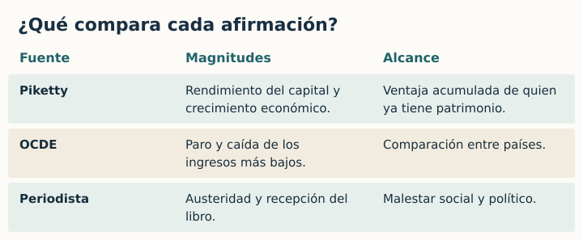

# ENS Rennes · D1 · Espagnol 2015 — Corrigé guidé

*Corrigé rédigé par IA, non officiel. Signalez toute erreur.*

**Rédaction** · GPT-6.2 Astra Ultra · vitesse non renseignée

Épreuve écrite de l’École normale supérieure de Rennes. Alicia González, El País, 9 janvier 2015.

## Version française

Piketty attribue le succès de son ouvrage au besoin de comprendre qu’éprouvent les citoyens, mais il y a autre chose. Son livre est devenu le symbole de l’angoisse et de la colère d’un monde qui peine encore à sortir de la pire crise économique depuis la Grande Dépression et où la montée des inégalités figure désormais parmi les priorités politiques. Car les inégalités sapent la confiance des citoyens dans un système qui les traite, estiment-ils, de façon injuste et qu’ils n’ont, dans ces conditions, aucun intérêt à maintenir en l’état. On commence à en observer les conséquences politiques en Europe. L’économiste assure que son travail est si simple que n’importe qui peut le lire, « même sans formation particulière en économie », précise-t-il. Pourtant, les formules qui émaillent de nombreux chapitres semblent indiquer le contraire.

D’après l’OCDE, c’est dans les pays où le chômage est le plus élevé que les revenus des plus pauvres ont le plus baissé.

Selon l’économiste français, tout au long de l’histoire, et plus encore ces dernières années, le rendement du capital a dépassé le taux de croissance de l’économie. Ceux qui disposaient au départ de ce capital, sous forme de biens immobiliers, d’héritages ou d’avoirs patrimoniaux, profitaient donc davantage de la croissance que ceux qui vivaient de leur travail. Cette relation mathématique, que la crise a mise au jour dans toute sa brutalité, a suscité la colère des classes moyennes. Durement frappées par les politiques d’austérité, les réductions de services et les hausses d’impôts, elles ont le sentiment de faire les frais de la crise. Dans la pratique, pourtant, les choses ne sont pas si simples. « Il est vrai que la situation de l’Europe n’est pas exactement la même que celle des États-Unis. »

## Expression en espagnol

Présenter Piketty, les grandes lignes de sa théorie et expliquer le succès de son livre en Espagne. Environ 100 mots.

Thomas Piketty es un economista francés que estudia la distribución de la riqueza a largo plazo. Según explica, si el capital rinde más de lo que crece la economía, quienes ya poseen bienes pueden aumentar su patrimonio más deprisa que quienes dependen de un salario. En España, esta explicación llegó a lectores que habían padecido el desempleo o los recortes de servicios públicos. Les ofrecía una manera de relacionar sus dificultades cotidianas con la concentración de la riqueza. Su éxito también revela una inquietud política: resulta difícil defender un sistema cuando se tiene la impresión de soportar sus pérdidas sin compartir sus beneficios.

*103 mots, comptés par espaces.*

## Comment construire la réponse

**Trouver les sujets et les points de vue.** Au premier paragraphe, ceux qui perdent confiance sont les citoyens. *Por el que se sienten injustamente tratados* rapporte leur perception du système. Plus loin, c’est la journaliste qui relève la difficulté des formules, après avoir laissé Piketty affirmer que son ouvrage est accessible.

**Lire le comparatif et le raccourci de presse.** Le rendement d’un patrimoine et le rythme de croissance de l’économie sont deux grandeurs différentes. L’article présente leur comparaison comme l’explication, chez Piketty, d’un avantage pour les détenteurs initiaux du capital. La phrase isolée de l’OCDE concerne une autre relation, celle qui associe chômage et baisse du revenu des plus pauvres. *Las paganas* désigne ici celles et ceux qui font les frais d’une situation.

**Traiter les deux demandes.** Présenter l’économiste et expliquer la comparaison en une phrase avant d’interpréter sa réception en Espagne. Un exemple social du passage, comme les coupes dans les services publics, éclaire la colère des lecteurs. Le texte réserve son dernier jugement en distinguant l’Europe des États-Unis.

[Feuillet original, p. 4](https://www.ens-rennes.fr/medias/fichier/sujets-d1-langues-vivantes-2015_1459930616550-pdf#page=4)
