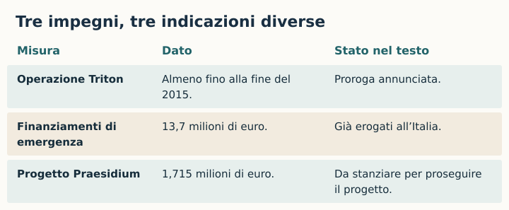

# ENS Rennes · D1 · Italien 2015 — Corrigé brut

*Corrigé rédigé par IA, non officiel. Signalez toute erreur.*

**Rédaction** · GPT-6.2 Astra Ultra · vitesse non renseignée

Épreuve écrite de l’École normale supérieure de Rennes. Commission européenne, communiqué du 19 février 2015.

## Version française

**La Commission européenne aux côtés de l’Italie face à la pression migratoire à Lampedusa**

La Commission européenne a annoncé aujourd’hui qu’elle renforçait son aide à l’Italie. En premier lieu, Triton, l’opération conjointe de Frontex, sera prolongée au moins jusqu’à la fin de 2015. En second lieu, la Commission a versé à l’Italie 13,7 millions d’euros de financements d’urgence en puisant dans le Fonds Asile, migration et intégration. […]

Une enveloppe supplémentaire de 1,715 million d’euros sera affectée à la poursuite du projet « Praesidium », mis en œuvre par les autorités italiennes […]. Il concerne essentiellement les procédures engagées à l’arrivée des migrants, spécialement en Sicile, notamment le premier accueil, les examens médicaux, l’information juridique et l’aide particulière aux demandeurs d’asile vulnérables et aux mineurs non accompagnés. Il vise également à suivre les conditions d’accueil dans les centres hébergeant les demandeurs d’asile, conditions mises à mal par l’afflux massif de personnes.

Le premier vice-président Frans Timmermans a déclaré : « Aussi longtemps que la guerre et l’instabilité régneront dans notre voisinage, des gens continueront de risquer leur vie pour atteindre les côtes européennes. Ce problème épineux n’admet aucune solution facile, mais il est clair que la réponse dépasse l’échelon national. La seule solution possible est européenne. Nous travaillons d’arrache-pied à une démarche globale, dans le cadre d’un nouvel agenda européen sur la migration qui doit être présenté d’ici à la fin de l’année. Entre-temps, nous avons entendu l’appel de l’Italie et nous y répondons par tous les moyens dont nous disposons. Nous sommes prêts à intervenir de manière constructive si l’Italie juge nécessaire d’accroître les ressources de l’opération Triton. »

## Expression en italien

Donner son point de vue sur la gestion des flux migratoires en Italie et plus généralement en Europe. Environ 100 mots.

A mio avviso, l’accoglienza deve cominciare dal soccorso in mare e continuare dopo lo sbarco. In Italia chi arriva dovrebbe poter incontrare un medico e un interprete prima di raccontare la propria storia. Un minore solo ha inoltre bisogno di un adulto che lo accompagni durante le procedure. Tuttavia, se tutte queste responsabilità ricadono sui comuni di frontiera, persino un buon centro rischia di non garantire condizioni dignitose. Gli altri paesi europei dovrebbero quindi contribuire con fondi stabili e offrire posti di accoglienza, tenendo conto dei legami familiari. La solidarietà si misura anche nella continuità degli impegni presi.

*98 mots, comptés par espaces.*

[Feuillet original, p. 5](https://www.ens-rennes.fr/medias/fichier/sujets-d1-langues-vivantes-2015_1459930616550-pdf#page=5) · [Rapport du jury, partie écrite](https://www.ens-rennes.fr/medias/fichier/italien-d1-rapport-jury-2015_1448641902648-pdf#page=1)
