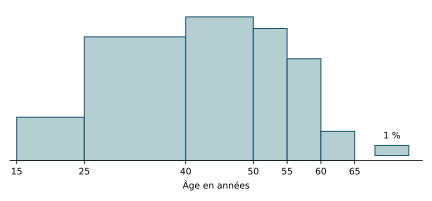
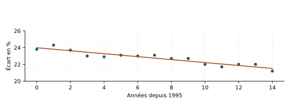
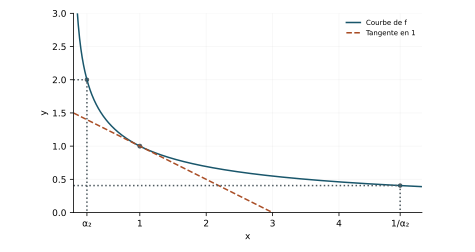

# ENS Rennes D1 — Mathématiques appliquées et statistiques 2015 · Corrigé brut

*Corrigé rédigé par IA, non officiel. Signalez toute erreur.*

**Rédaction** · GPT-6.2 Astra Ultra · vitesse non renseignée

**Révision (tour 1)** · GPT-6.2 Astra Ultra · vitesse non renseignée · 26 novembre 2026

Les trois exercices du cahier R 15-83 portent sur les données d’emploi et de salaires, la production d’une confiserie et les antécédents d’une fonction logarithmique. Les calculs statistiques utilisent les valeurs du tableau imprimé.

## Exercice 1. Emploi et salaires

### Question 1.1.a

La série est univariée. L’âge est quantitatif continu et regroupé en six classes d’amplitudes inégales. La deuxième colonne indique la fréquence de chaque classe.

### Question 1.1.b

Prenons une unité horizontale par an et une unité d’aire par point de pourcentage. Les hauteurs successives sont $8{,}6/10=0{,}860$, $36{,}8/15\simeq2{,}453$, $28{,}5/10=2{,}850$, $13{,}1/5=2{,}620$, $10{,}1/5=2{,}020$ et $2{,}9/5=0{,}580$. Le rectangle témoin a la même aire qu’un point de pourcentage.

### Question 1.1.c

La plus grande densité est $2{,}850$ sur $[40,50[$. Cette classe est l’unique classe modale.

### Question 1.1.d

Si $w_i$ et $p_i$ sont les deux pourcentages des colonnes de répartition et de temps partiel, le taux global en pourcentage est $\sum_i w_ip_i/100$. Avec $w=(8{,}6;36{,}8;28{,}5;13{,}1;10{,}1;2{,}9)$ et $p=(22{,}4;15{,}5;17{,}1;17{,}3;19{,}5;31{,}3)$, il vaut $17{,}647\,\%$.

### Question 1.1.e

Dans chaque classe, le taux masculin dépasse le taux féminin. Le taux d’ensemble est partout très proche du milieu des deux taux : la part des hommes dans la population de référence est donc proche de la moitié dans toutes les tranches. La faible différence de structure par âge ne renverse pas l’écart observé.

Pour vérifier cette dernière étape sans calculer les deux taux globaux, écrivons $H_i,F_i,E_i$ pour les taux de la ligne $i$. La part masculine $s_i=(E_i-F_i)/(H_i-F_i)$ est comprise entre $0{,}48$ et $0{,}50$ dans toutes les lignes, tandis que $H_i>1{,}10F_i$. Si $s$ est la part masculine totale, elle est dans les mêmes bornes. Le rapport du poids de la classe $i$ chez les hommes à son poids chez les femmes vaut $[s_i/(1-s_i)]/ [s/(1-s)]\ge0{,}48/0{,}52$. Son produit par $H_i/F_i$ dépasse donc $1$ dans chaque classe. La somme reste supérieure chez les hommes.

### Question 1.2.a

Pour les rangs $0$ à $14$, placer les ordonnées 23,8 · 24,3 · 23,7 · 23 · 22,9 · 23,1 · 23 · 23,1 · 22,7 · 22,7 · 22 · 21,7 · 22 · 22 · 21,2. L’unité graphique demandée est de 1 cm pour une année et de 1 cm pour deux points de pourcentage.

### Question 1.2.b

La moyenne $\bar d=\sum_i d_i/15\simeq22{,}747\,\%$ et la variance $V_d=\sum_i d_i^2/15-\bar d^2\simeq0{,}666$ point de pourcentage au carré.

### Question 1.2.c

Avec $\bar x=7$, $V_x=56/3$ et $C_{xd}=\sum x_id_i/15-\bar x\bar d=-3{,}3$, on obtient $r=C_{xd}/\sqrt{V_xV_d}\simeq-0{,}936$. L’écart décroît et un ajustement affine décrit raisonnablement la tendance sur la période.

### Question 1.2.d

La pente est $a=C_{xd}/V_x\simeq-0{,}176786$ et l’ordonnée à l’origine $b=\bar d-a\bar x\simeq23{,}984167$. On obtient $\widehat d=ax+b$, en points de pourcentage.

### Question 1.2.e

Pour 2015, $x=20$. Avec les coefficients non arrondis, la prévision est $20a+b\simeq20{,}448\,\%$.

### Question 1.2.f

L’égalité correspond à $ax+b=0$, soit $x\simeq135{,}668$. Le modèle atteint zéro vers **2131**. Cette extrapolation de plus de 120 ans au-delà de 2009 repose sur quinze observations et suppose le maintien de la pente sur toute cette durée. Elle n’est pas fiable comme prédiction de date.

### Question 1.3.a

On applique $u_i=\ln(t_i)$ au salaire moyen d’ensemble exprimé en milliers d’euros. Pour 1995, par exemple, $t_0=17{,}9$ donne $u_0=\ln(17{,}9)\simeq2{,}885$. Voici les quinze valeurs au millième.

| Rang | 0 | 1 | 2 | 3 | 4 | 5 | 6 | 7 |
|---|---|---|---|---|---|---|---|---|
| u | 2,885 | 2,896 | 2,912 | 2,929 | 2,950 | 2,970 | 2,996 | 3,016 |

| Rang | 8 | 9 | 10 | 11 | 12 | 13 | 14 |
|---|---|---|---|---|---|---|---|
| u | 3,035 | 3,059 | 3,086 | 3,105 | 3,135 | 3,165 | 3,178 |

### Question 1.3.b

On trouve $\bar u\simeq3{,}021114$, $V_u\simeq0{,}008960$, $C_{xu}\simeq0{,}407755$. Ainsi $r_{xu}\simeq0{,}997$, ce qui justifie un ajustement affine du logarithme sur la période observée.

### Question 1.3.c

Les coefficients de la droite $u=a'x+b'$ sont $a'=C_{xu}/V_x\simeq0{,}021844$ et $b'=\bar u-a'\bar x\simeq2{,}868206$.

### Question 1.3.d

Le modèle est $\widehat t(x)=e^{a'x+b'}\simeq17{,}6054\,e^{0{,}021844x}$ en milliers d’euros.

### Question 1.3.e

Le salaire annuel prévu pour 2015 est $e^{20a'+b'}\simeq27{,}251$ k€, soit environ $27\,251$ euros.

## Exercice 2. Confiserie, conditionnement et contrôle du poids

### Question 2.I.1

Par équiprobabilité, $P(A)=P(B)=1/2$. Les 20 sachets de chaque boîte étant équiprobables, $P(G\mid A)=2/20=1/10$ et $P(G\mid B)=3/20$.

### Question 2.I.2

La probabilité composée est $P(A\cap G)=P(A)P(G\mid A)=1/20=0{,}050$.

### Question 2.I.3

On obtient $P(B\cap G)=(1/2)(3/20)=3/40=0{,}075$.

### Question 2.I.4

$A,B$ sont incompatibles et forment un système complet. Ainsi $P(G)=P(A\cap G)+P(B\cap G)=1/8=0{,}125$.

### Question 2.I.5

On a $P(B\mid G)=P(B\cap G)/P(G)=(3/40)/(1/8)=3/5=0{,}600$.

Pour voir le conditionnement, prenons comme unité de comparaison 40 clients dans les proportions de l’énoncé. On attend deux gagnants issus de A et trois de B. Le dénominateur du rapport est donc cinq gagnants, ce qui redonne $3/5$.

### Question 2.I.6

En prenant les deux bonbons dans un ordre aléatoire, aucune position n’est favorisée. Ainsi $P(G_1\mid G)=P(G_2\mid G)=1/2$.

### Question 2.I.7

Comme $G_1\subset G$, $P(G_1)=P(G_1\mid G)P(G)=1/16\simeq0{,}063$. De même $P(G_2)=1/16$.

### Question 2.I.8

On a $G_2\cap\overline G_1=G_2$. Donc $P(G_2\mid\overline G_1)=(1/16)/(15/16)=1/15\simeq0{,}067$.

### Question 2.I.9

L’intersection est vide et $P(G_1\cap G_2)=0$, alors que $P(G_1)P(G_2)=1/256>0$. Les deux événements sont dépendants.

### Question 2.II.1

Dans le modèle où les anomalies des vingt sachets sont indépendantes et ont chacune probabilité $0{,}02$, $X\sim\mathcal B(20,0{,}02)$. On a $P(X=k)=\binom{20}{k}0{,}02^k0{,}98^{20-k}$ pour $0\le k\le20$.

### Question 2.II.2

L’espérance vaut $20(0{,}02)=0{,}400$ et la variance $20(0{,}02)(0{,}98)=0{,}392$.

### Question 2.II.3

La probabilité cherchée est $0{,}98^{20}+20(0{,}02)0{,}98^{19}\simeq0{,}940$.

### Question 2.II.4

Une boîte normale contient 40 bonbons et un défaut ajoute un bonbon de 15 g. Donc $Y=600+15X$, $\mathbb E(Y)=606$ g et $V(Y)=15^2V(X)=88{,}200\ \mathrm{g}^2$.

### Question 2.II.5

$Y\ge630$ équivaut à $X\ge2$. Par complément de la question 3, sa probabilité vaut environ $0{,}060$.

### Question 2.III.1

Il y a insuffisance si $N\ge4$. La loi de Poisson donne $P(N\ge4)=1-e^{-2}(1+2+2^2/2!+2^3/3!)\simeq0{,}143$.

### Question 2.III.2.a

Pour $Z=(M-15)/0{,}4\sim\mathcal N(0,1)$, $P(M>16)=1-\Phi(2{,}5)\simeq0{,}006$.

### Question 2.III.2.b

La probabilité de conservation est $P(-1{,}5\le Z\le1{,}5)=2\Phi(1{,}5)-1\simeq0{,}866$.

### Question 2.III.3

L’imprimé attribue la moyenne $5$ et l’écart-type $2$ à la durée log-normale $T$. Posons $\ln T\sim\mathcal N(\mu,\sigma^2)$. Les relations $\mathbb ET=e^{\mu+\sigma^2/2}=5$ et $V(T)=25(e^{\sigma^2}-1)=4$ donnent $\sigma^2=\ln(29/25)$ et $\mu=\ln5-\sigma^2/2$. Ainsi $P(T\ge5)=1-\Phi(\sigma/2)\simeq0{,}424$, inférieur à $0{,}90$. **L’objectif n’est pas atteint avec les moments de durée imprimés.**

Si l’on attribue par convention $5$ et $2$ à la moyenne et à l’écart-type de $\ln T$, on modifie la loi de la durée et on trouve $1-\Phi((\ln5-5)/2)\simeq0{,}955$. Cette seconde valeur explique pourquoi l’objet auquel on attribue les deux moments est décisif.

## Exercice 3. Étude de la fonction logarithmique

### Question 3.I.1

La fonction $g(x)=x-1-x\ln x$ est définie exactement sur $]0,\infty[$.

### Question 3.I.2

Les termes sont dérivables sur son domaine. On a $g'(x)=1-(1+\ln x)=-\ln x$.

### Question 3.I.3

Pour $0<x<1$, $g'>0$, puis $g'<0$ pour $x>1$. La fonction croît depuis $-1$ en $0^+$ jusqu’à $g(1)=0$, puis décroît vers $-\infty$ à l’infini.

| $x$ | $0^+$ | $(0,1)$ | $1$ | $(1,+\infty)$ | $+\infty$ |
| --- | --- | --- | --- | --- | --- |
| $g'(x)$ |  | $+$ | $0$ | $-$ |  |
| $g(x)$ | $-1$ | $\nearrow$ | $0$ | $\searrow$ | $-\infty$ |

### Question 3.I.4

Le maximum est zéro, atteint seulement en $1$. Ainsi $g(x)<0$ pour tout $x>0$ distinct de $1$.

### Question 3.II.1

L’expression $f(x)=\ln x/(x-1)$ a pour domaine $]0,1[\cup]1,\infty[$.

### Question 3.II.2

Sur les deux intervalles du domaine, $f$ est dérivable et $f'=[(x-1)/x-\ln x]/(x-1)^2=g(x)/[x(x-1)^2]$.

### Question 3.II.3

La dérivée est strictement négative sur chaque intervalle. Sur $]0,1[$, $f$ décroît de $+\infty$ vers $1$. Sur $]1,\infty[$, elle décroît de $1$ vers zéro. À ce stade $1$ est encore exclu du domaine.

| Intervalle | $f$ à gauche | Signe de $f'$ | Sens | $f$ à droite |
| --- | --- | --- | --- | --- |
| $(0,1)$ | $+\infty$ | $-$ | $\searrow$ | $1$ (limite) |
| $(1,+\infty)$ | $1$ (limite) | $-$ | $\searrow$ | $0$ |

### Question 3.III.1

Après prolongement, $f$ est strictement décroissante sur tout $]0,\infty[$. Elle tend vers $+\infty$ en zéro, passe par $f(1)=1$ et tend vers zéro en $+\infty$. La dérivée en $1$ est $-1/2$.

En posant $h=x-1$, on peut retrouver la pente donnée dans le sujet. L’égalité $\ln(1+h)=h-h^2/2+o(h^2)$ donne $f(1+h)=1-h/2+o(h)$. Le taux d’accroissement tend donc vers $-1/2$ des deux côtés.

| $x$ | $0^+$ | $(0,1)$ | $1$ | $(1,+\infty)$ | $+\infty$ |
| --- | --- | --- | --- | --- | --- |
| $f'(x)$ |  | $-$ | $-1/2$ | $-$ |  |
| $f(x)$ | $+\infty$ | $\searrow$ | $1$ | $\searrow$ | $0$ |

### Question 3.III.2

Avec $f(1)=1$ et $f'(1)=-1/2$, la tangente a pour équation $y=1-(x-1)/2=(3-x)/2$.

### Question 3.III.3

Avec un repère orthonormé (3 cm par unité sur la copie), tracer la droite passant par $(1,1)$ et $(3,0)$. La courbe décroît entre l’asymptote verticale $x=0$ et l’asymptote horizontale $y=0$, en passant par le point de contact.

### Question 3.III.4

Sur $]0,1[$, $f$ est continue strictement décroissante de $+\infty$ vers $1$. Le théorème de la bijection donne, pour chaque entier $n\ge2$, un unique $\alpha_n\in]0,1[$ tel que $f(\alpha_n)=n$.

### Question 3.III.5

Pour $x>0$, $x\ne1$, $f(1/x)=(-\ln x)/((1-x)/x)=x f(x)$. En $x=\alpha_n$, cela donne $f(1/\alpha_n)=n\alpha_n$.

### Question 3.III.6

L’intersection de l’horizontale $y=2$ avec la courbe se projette en $\alpha_2$ sur l’axe horizontal. Reporter deux fois cette longueur sur l’axe vertical donne la hauteur $2\alpha_2$. L’horizontale à cette hauteur rencontre la courbe en un point dont l’abscisse est $1/\alpha_2$ d’après 3.III.5 et l’injectivité de $f$. La construction figure sur le graphique précédent.

### Question 3.IV.1

Pour $x>1$, $H'(x)=1/(x-1)-1/x-g(x)/[x(x-1)^2]$. Le numérateur au dénominateur $x(x-1)^2$ est $(x-1)-g(x)=x\ln x$. Il reste $H'(x)=\ln x/(x-1)^2$.

### Question 3.IV.2

On a $H(3)=\ln2-\tfrac32\ln3$ et $H(2)=-2\ln2$. Donc $I=3\ln2-\tfrac32\ln3\simeq0{,}432$.
