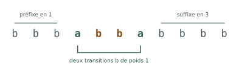
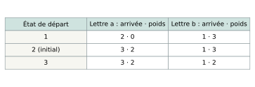
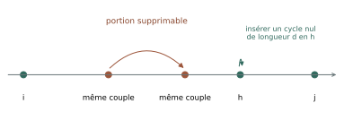

# ENS MP · Informatique-mathématiques 2015 · Corrigé brut

*Corrigé rédigé par IA, non officiel. Signalez toute erreur.*

**Rédaction** · GPT-6.2 Astra Ultra · vitesse non renseignée · 25 novembre 2026

**Langage choisi.** Python. Les indices du programme commencent à zéro. Un mot non accepté a pour poids $-\infty$. Les chemins vides ont poids zéro. Les opérations $\oplus$ et $\otimes$ désignent le maximum et le produit matriciel max-plus définis par le sujet.

## I · Automates pondérés

### Question 1 · Du langage pondéré à son support

**a.** Oublions tous les poids et conservons les états, les ensembles initiaux et finaux ainsi que les transitions étiquetées. Pour un mot de longueur $k$, il existe un nombre fini de chemins de longueur $k$. Son poids est réel exactement lorsqu’au moins un de ces chemins est acceptant. L’automate fini ainsi obtenu reconnaît le support.

**b.** Partons d’un automate fini reconnaissant $L$ et donnons le poids zéro à chaque transition. Un mot accepté a pour poids zéro et un mot refusé pour poids $-\infty$. La construction fonctionne aussi pour le mot vide, dont le poids est zéro exactement si un état est à la fois initial et final. Les états inutiles peuvent être retirés.

### Question 2 · Deux automates de comptage

**a.** Pour tout $u\in\{a,b\}^*$, le poids est la plus grande longueur $j$ d’un bloc $b^j$ **encadré** par deux $a$ consécutifs parmi les occurrences de $a$ dans le mot. À défaut on obtient zéro. Formellement on prend le maximum de $\{0\}\cup\{j\geq0:ab^ja\text{ est facteur de }u\}$. En effet, l’état 1 est initial et terminal et peut lire le mot entier à coût nul. Un autre chemin acceptant choisit une occurrence de $a$ pour aller de 1 à 2, lit les $b$ intermédiaires à coût unitaire, puis lit le prochain $a$ pour aller en 3, terminal. Les préfixe et suffixe extérieurs à ce facteur coûtent zéro. Par exemple $bbbabbabbbb$ a pour poids 2.

**b.** Prendre deux états disjoints, tous deux initiaux et terminaux. Sur le premier, poser une boucle $a$ de poids 1 et une boucle $b$ de poids 0. Sur le second, échanger les poids. Les deux chemins sur $u$ pèsent $|u|_a$ et $|u|_b$, d’où le maximum demandé.



### Question 3 · Reconnaître une borne uniforme

**a.** Si l’ensemble des chemins acceptants d’étiquette $u$ est non vide, il est fini. Son maximum est au plus $c$ exactement quand tous ses éléments sont au plus $c$. Si cet ensemble est vide, l’assertion universelle est vraie et le poids vaut $-\infty$.

**b.** Sous (i), les chemins acceptants sans cycle vérifient la borne d’après **a**. Si un cycle élémentaire avait un poids $w>0$, on atteindrait ce cycle depuis un état initial, on le parcourrait $r$ fois, puis on gagnerait un état final. Les poids auraient la forme $C+rw$, non bornée. D’où (ii). Réciproquement, dans un chemin acceptant, effacer un cycle élémentaire chaque fois qu’un sommet se répète, en prenant la première répétition dans le parcours restant. Les extrémités sont conservées et chaque suppression de poids non positif augmente ou conserve le poids. Le chemin sans cycle obtenu pèse au plus $c$, ce qui majore le chemin de départ. Son étiquette peut changer pendant les suppressions puisque la borne porte sur tous les mots.

## II · Poids des mots aléatoires

### Question 4 · Probabilité d’un mot

Pour un mot $u$ de longueur $k$, l’indépendance des indicatrices de la lettre $a$ donne

$$
\mathbb P(\{u\})=p^{|u|_a}q^{|u|_b},\qquad q=1-p .
$$

Les facteurs de puissance nulle valent 1, y compris aux extrémités $p=0$ et $p=1$. Dans la suite $X_k$ désigne le mot aléatoire tiré suivant cette loi.

### Question 5 · Poids aléatoire dans deux états disjoints

**a.** Posons $S=|X_k|_a$. Il est somme de $k$ indicatrices de Bernoulli indépendantes de paramètre $p$. Donc $\mathbb E S=kp$ et $\operatorname{Var}(S)=kpq$.

**b.** Pour $\beta>p$ et $t>0$, l’inégalité de Markov appliquée à $e^{tS}$ donne

$$
\mathbb P(S\geq\beta k)\leq [e^{-t\beta}(q+pe^t)]^k.
$$

Le terme entre crochets vaut 1 en $t=0$ et sa dérivée y vaut $p-\beta<0$. Un $t>0$ assez petit le rend égal à un $\delta_1\in(0,1)$. Pour $\gamma<p$, prendre $t<0$. L’événement $S\leq\gamma k$ implique $e^{tS}\geq e^{t\gamma k}$. La dérivée en zéro de $e^{-t\gamma}(q+pe^t)$ vaut $p-\gamma>0$, donc pour un $t<0$ assez proche de zéro on obtient $\delta_2\in(0,1)$. Ces bornes décroissent exponentiellement en $k$.

**c.** Sur l’état 1, le mot entier pèse $h_b|u|_b$, sur l’état 2 il pèse $h_a|u|_a$. Les deux états sont initiaux et terminaux. Le poids reconnu est $\max(h_a|u|_a,h_b|u|_b)$ pour tous les mots.

**d.** Posons $g(x)=\max(h_ax,h_b(1-x))$ et $H=\max(h_a,h_b)$. Chaque branche est $H$-lipschitzienne, leur maximum aussi. Le poids normalisé vaut $g(S/k)$. Par l’inégalité de Cauchy-Schwarz,

$$
\left|\frac{\mathbb E L_{A_1}(X_k)}k-\alpha\right|
\leq H\,\mathbb E|S/k-p|\leq H\sqrt{pq/k}\longrightarrow0,
\quad \alpha=g(p).
$$

La même majoration lipschitzienne permet d’appliquer **b** aux deux queues pour obtenir la concentration exponentielle autour de $k\alpha$ lorsque $H>0$. Si $H=0$, le poids est identiquement nul.

### Question 6 · Poids aléatoire dans l’automate à trois états

**a.** De n’importe quel état, $b$ mène en 1, et aucune transition $a$ ne mène en 1. Donc $\mathbb P(Y_i=1)=q$ pour tout $i\geq1$.

**b.** Le seul arc entrant en 2 est $1\xrightarrow{a}2$. Comme $Y_0=2$, au rang 1 on a $\mathbb P(Y_1=2)=0$ et $\mathbb P(Y_1=3)=p$. Dès $i\geq2$, l’état 2 correspond aux deux dernières lettres $ba$. Sa probabilité est $qp$, celle de 3 est $1-q-qp=p^2$.

**c.** Conditionnellement à l’état de départ 1, 2 ou 3, les poids moyens de la prochaine transition sont respectivement $3q$, $2p+3q$ et $2$. Le chemin est unique et chaque état est final, de sorte que les poids des préfixes s’obtiennent en sommant ces accroissements. Pour chaque transition de rang $i\geq3$, l’espérance vaut la même constante

$$
m=q(3q)+pq(2p+3q)+2p^2.
$$

Les deux premières transitions contribuent un terme borné indépendant de $k$. La limite de $\mathbb E[L_{A_2}(X_k)]/k$ vaut donc $m$. Pour $p=0$ on trouve 3 et pour $p=1$ on trouve 2, conformément aux boucles finales.



## III · Matrices et fermeture max-plus

### Question 7 · Calcul dans l’algèbre max-plus

On utilise $-\infty+x=-\infty$. **a.** Les deux parenthésages de la somme ont pour entrée $(i,j)$ le maximum de $B_{ij},C_{ij},D_{ij}$. **b.** Le maximum de deux nombres est symétrique, donc $B\oplus C=C\oplus B$.

**c.** Les deux parenthésages du produit ont pour entrée $(i,j)$

$$
\max_{s,t}(B_{is}+C_{st}+D_{tj}).
$$

Le maximum est fini en nombre de termes, y compris lorsque sa valeur est $-\infty$. Cela prouve l’associativité.

**d.** À gauche, l’entrée de $B\otimes(C\oplus D)$ vaut $\max_s\max(B_{is}+C_{sj},B_{is}+D_{sj})$. C’est le maximum des entrées correspondantes de $B\otimes C$ et $B\otimes D$. À droite, celle de $(C\oplus D)\otimes B$ vaut $\max_s\max(C_{is}+B_{sj},D_{is}+B_{sj})$. Les deux distributivités suivent.

**e.** Prendre $U_{ii}=0$ et $U_{ij}=-\infty$ pour $i\neq j$. Dans $B\otimes U$, seul l’indice intermédiaire $j$ peut contribuer, et dans $U\otimes B$ seul $i$ le peut. Les deux produits valent $B$.

### Question 8 · Puissance et longueur d’un chemin

Pour $k=0$, $U_{ij}$ est le poids du chemin vide de $i$ à lui-même si $i=j$, et $-\infty$ sinon. Si la propriété est vraie au rang $k$, un chemin de longueur $k+1$ de $i$ à $j$ commence par un arc $i\to t$ suivi d’un chemin de longueur $k$ de $t$ à $j$. Le maximum sur $t$ vaut $\max_t(M_{it}+(M^k)_{tj})=(M^{k+1})_{ij}$. Les termes sans arc ou sans suffixe possible valent $-\infty$. La récurrence prouve la formule.

### Question 9 · Calculer le poids d’un mot donné

**a.** Pour le mot vide, la matrice $U$ donne le résultat de la question 8. Si $u=av$, le maximum sur l’état $t$ atteint après la première lettre vaut $\max_t(M(a)_{pt}+M(v)_{tq})$. Par récurrence sur la longueur, il égale $M(u)_{pq}$ pour tout $p,q$.

**b.** Posons $s_i=0$ pour $i\in I$ et $s_i=-\infty$ sinon, avec $s$ vecteur ligne. De même $t_j=0$ pour $j\in F$ et $t_j=-\infty$ sinon, avec $t$ vecteur colonne. Alors $L_A(u)=s\otimes M(u)\otimes t$, car on prend le poids maximal sur les seules extrémités admissibles.

### Question 10 · Fermeture et détection des cycles positifs

**a.** Chaque entrée de $M=\bigoplus_a M(a)$ conserve la meilleure transition entre les deux sommets. Si tout cycle est de poids au plus zéro, un chemin peut être simplifié en supprimant ses cycles sans diminuer son poids. Un chemin simple a longueur au plus $n-1$. Ainsi $M^*=U\oplus M\oplus\cdots\oplus M^{n-1}$ et chaque entrée est réelle ou $-\infty$.

**b.** Le poids maximal sur tous les mots est $s\otimes M^*\otimes t$, atteint dès qu’existe un chemin acceptant, car chaque arc de poids fini dans $M$ dispose d’une lettre réalisant ce poids.

**c.** Initialiser $D^{(0)}=U\oplus M$. Pour $p=1,\ldots,n$, poser

$$
D^{(p)}_{ij}=\max(D^{(p-1)}_{ij},D^{(p-1)}_{ip}+D^{(p-1)}_{pj}).
$$

Après suppression des cycles, un meilleur chemin dont les intermédiaires sont dans $\{1,\ldots,p\}$ évite $p$ comme intermédiaire ou s’y découpe en deux chemins qui n’ont plus $p$ en position intermédiaire. Réciproquement la concaténation autorisée par le second terme est un chemin valide. Donc $D^{(n)}=M^*$. Le calcul coûte $O(n^3)$ en temps et deux matrices successives occupent $O(n^2)$ places.

**d.** Même sans l’hypothèse sur les cycles, exécuter les mêmes mises à jour avec deux matrices par étape. Si une diagonale strictement positive apparaît, renvoyer faux. Sinon tester $s\otimes D^{(n)}\otimes t\leq c$. Chaque valeur finie calculée est le poids d’un chemin réel. Réciproquement, en scindant un cycle élémentaire en son plus grand sommet intermédiaire, la récurrence prend en compte tous les cycles élémentaires, au moins comme minorants de la diagonale correspondante. Tout cycle positif contient un cycle élémentaire positif dans sa décomposition. Il est donc détecté, et l’utilité des états permet de le répéter dans un chemin acceptant. Sans cycle positif, **a–c** donnent le bon maximum. Le temps reste cubique.

Voici le test complet pour un automate dont tous les états sont utiles.

```python
def tous_les_poids_bornes(matrice, initiaux, finaux, seuil):
    """matrice[i][j] est le meilleur arc, ou moins l'infini."""
    n = len(matrice)
    d = [ligne.copy() for ligne in matrice]
    for i in range(n):
        d[i][i] = max(d[i][i], 0)
    if any(d[i][i] > 0 for i in range(n)):
        return False
    for p in range(n):
        d = [[max(d[i][j], d[i][p] + d[p][j])
              for j in range(n)] for i in range(n)]
        if any(d[i][i] > 0 for i in range(n)):
            return False
    return all(d[i][j] <= seuil for i in initiaux for j in finaux)
```

## IV · Croissance asymptotique

### Question 11 · Sur-solution et minoration de la valeur propre

**a.** Le produit par $M$ est croissant et commute à l’addition d’une constante réelle à toutes les coordonnées. De $M\otimes v\leq\lambda\otimes v$ on déduit par récurrence $M^k\otimes v\leq(k\lambda)\otimes v$. Choisissons $j$ tel que $v_j$ soit fini. Pour tout $i$, la forte connexité donne un chemin de $i$ à $j$ de longueur $k$ et de poids $w$ fini. Alors $k\lambda+v_i\geq (M^k\otimes v)_i\geq w+v_j> -\infty$. Toute coordonnée de $v$ est donc finie.

**b.** Le sommet $i$ d’un cycle de poids zéro et de longueur $d>0$ vérifie $(M^d)_{ii}\geq0$. Donc $d\lambda+v_i\geq (M^d)_{ii}+v_i\geq v_i$. Comme $v_i$ est fini, on obtient $\lambda\geq0$.

### Question 12 · Sous-solution et majoration de la valeur propre

**a.** Le maximum définissant $(M\otimes v)_i$ est atteint parmi les $n$ choix, même si tous valent $-\infty$. Un indice maximisant $j$ vérifie $\lambda+v_i\leq M_{ij}+v_j$. Lorsque $v_i$ est fini, $M_{ij}$ et $v_j$ le sont aussi.

**b.** Depuis une coordonnée finie, itérer ces choix. Dans une suite de $n+1$ sommets, un sommet se répète. Sur le cycle obtenu, les inégalités se somment et les coordonnées finies de $v$ se compensent. Pour une longueur $d>0$ et un poids $w$, on trouve $d\lambda\leq w\leq0$, donc $\lambda\leq0$.

### Question 13 · Construire un vecteur propre sur un cycle critique

Fixons $h\in I^*$ et $v_i=M^*_{ih}$. C’est une colonne à coordonnées finies par forte connexité, avec $v_h=0$. Le produit $(M\otimes v)_i$ est le meilleur poids d’un chemin **non vide** de $i$ à $h$. Pour $i\neq h$, tout chemin de ce type est déjà non vide. Pour $i=h$, un cycle de poids zéro réalise le même poids que le chemin vide. Ainsi $M\otimes v=v$, et 0 est valeur propre. Toute valeur propre doit être à la fois positive ou nulle par la question 11 et négative ou nulle par la question 12. L’ensemble demandé est $\{0\}$.

### Question 14 · Périodicité des puissances normalisées

**a.** Pour chaque $h\in I^*$, choisissons un cycle de poids nul passant par $h$, de longueur $d_h>0$. Prenons pour $d$ le ppcm de ces longueurs. En répétant le cycle, $(M^d)_{hh}\geq0$. Aucune marche fermée ne dépasse zéro par décomposition en cycles élémentaires. Donc $(M^d)_{hh}=0$ pour chaque $h$.

**b.** Fixons $i,j,h$. Considérons un chemin de longueur multiple de $d$ et le découpons en $h$. Dans chacune des deux parties, si un même couple (sommet, longueur parcourue modulo $d$) se répète, supprimons la portion intermédiaire. La longueur enlevée est multiple de $d$ et le poids enlevé est non positif. Chaque partie réduite a longueur inférieure à $nd$ puisque les couples sont au nombre de $nd$. Le chemin réduit passe toujours par $h$ et a une longueur multiple de $d$, inférieure à $2nd$. Il n’existe qu’un nombre fini de tels chemins courts. Si aucun n’existe, la valeur par $h$ reste $-\infty$. Sinon, retenons le meilleur poids $W$ parmi eux. Il majore tous les poids par $h$ aux longueurs multiples de $d$. Un chemin court de poids $W$ peut être prolongé en $h$ par autant de cycles nuls de longueur $d$ que souhaité. Donc à tous les multiples $kd\geq 2nd$, le meilleur poids par $h$ vaut exactement $W$. Cela prouve l’égalité demandée, même pour des poids réels.

**c.** Si aucune longueur multiple de $d$ ne joint $i$ à $j$, l’égalité vaut partout avec $-\infty$. Sinon, fixons un chemin d’une telle longueur. Par forte connexité, ajoutons à son départ $d$ copies d’un détour fermé passant par un sommet critique $h$. La longueur totale reste multiple de $d$. En $h$, l’insertion du cycle nul de longueur $d$ procure désormais, à tous les grands multiples de $d$, un chemin par $h$ de poids fixé $W_0$.

Étudions les chemins évitant $I^*$. S’il n’existe aucun cycle dans ce sous-graphe, ils ont longueur au plus $n-1$. Sinon ses cycles élémentaires, en nombre fini, sont de poids au plus $-\eta$ pour un $\eta>0$. En retirant des cycles élémentaires d’un chemin de longueur $L$, il reste au plus $n-1$ arcs et l’on retire au moins $(L-n+1)/n$ cycles. Si $C$ majore les poids des chemins simples, le poids de tout tel chemin est au plus $C-\eta(L-n+1)/n$, qui tend vers $-\infty$. Pour les grands multiples, les chemins qui évitent $I^*$ ne peuvent donc battre $W_0$. Le maximum de tous les chemins égale alors le maximum sur les chemins passant par un sommet critique.

**d.** Les couples $(i,j)$ et les sommets critiques sont en nombre fini. D’après **b–c**, il existe $m$ tel que $M^{(m+1)d}=M^{md}$, entrée par entrée. Pour tout $k\geq md$, multiplions cette égalité par $M^{k-md}$ pour obtenir $M^{k+d}=M^k$. La preuve n’exige aucune croissance stricte des suites de poids.



### Question 15 · Poids moyen maximal d’un cycle

**a.** La borne $k\leq n-1$ imprimée au bas du sujet exclut les cycles élémentaires de longueur $n$. Avec deux sommets, les seuls arcs $1\to2$ et $2\to1$ de poids 1 donnent un cycle de moyenne 1, tandis que les deux entrées diagonales de $M$ sont $-\infty$. La division par $k$ exige également $k>0$. La formule qui donne les conclusions **c–d** est

$$
\rho(M)=\max_{1\leq k\leq n}\frac{\max_i (M^k)_{ii}}{k}.
$$

En effet, toute marche fermée non vide se décompose en cycles élémentaires et sa moyenne en est une moyenne pondérée par leurs longueurs. Elle ne peut dépasser la plus grande moyenne d’un cycle élémentaire. Un cycle réalisant ce maximum a une longueur comprise entre 1 et $n$. L’expression imprimée, prise à la lettre avec $k\geq1$, ne voit que les marches fermées de longueur au plus $n-1$.

**b.** Pour $N=(-\lambda)\otimes M$, toute entrée finie est diminuée de $\lambda$, donc $(N\otimes v)_i=(M\otimes v)_i-\lambda$. Les équations $M\otimes v=\lambda\otimes v$ et $N\otimes v=v$ sont équivalentes pour le même vecteur non identiquement $-\infty$.

**c.** Avec la formule corrigée et au moins un cycle, posons $N=(-\rho(M))\otimes M$. Le poids d’un cycle de longueur $s$ et de poids $w$ devient $w-s\rho(M)\leq0$, et il vaut zéro pour un cycle de moyenne maximale. La question 13 donne 0 comme unique valeur propre de $N$. La translation des valeurs propres donne donc $\rho(M)$ comme unique valeur propre de $M$.

**d.** Par la question 14, $N^{k+d}=N^k$ pour tout $k$ assez grand. Chaque chemin de longueur $k$ a perdu exactement $k\rho(M)$, donc $N^k=(-k\rho(M))\otimes M^k$. D’où $M^{k+d}=(d\rho(M))\otimes M^k$ à partir du même rang.

### Question 16 · Matrice réductible et classe critique

Supposons que le graphe ait au moins un cycle. Normalisons par la moyenne maximale $\rho$ de la question 15 et choisissons un sommet $h$ sur un cycle devenu de poids zéro. La fermeture $N^*$ de $N=(-\rho)\otimes M$ est bien définie puisque aucun cycle n’est positif. Prenons $v_i=N^*_{ih}$. Si $i$ n’atteint pas $h$, $v_i=-\infty$ et aucun de ses successeurs par un arc fini n’atteint $h$. Ainsi $(N\otimes v)_i=-\infty$. Pour les autres indices, le raisonnement de la question 13 s’applique, y compris au sommet $h$ où un cycle remplace le chemin vide. Comme $v_h=0$, le vecteur est admissible et $M\otimes v=\rho\otimes v$.

Sans aucun cycle, la moyenne maximale est $-\infty$ et aucune valeur propre **réelle** n’existe. En effet $M^n$ est identiquement $-\infty$, ce qui contredit $M^n\otimes v=(n\lambda)\otimes v$ si $\lambda$ est réelle et $v$ a une coordonnée finie. Le libellé général requiert donc l’existence d’un cycle ou l’extension de la notion de valeur propre. Dans cette seconde convention, pour une source $h$ du graphe acyclique, prendre $v_h=0$ et $v_i=-\infty$ ailleurs donne $M\otimes v=(-\infty)\otimes v$.

### Question 17 · Vitesse maximale de croissance des préfixes

En présence d’un cycle, prenons pour $\lambda$ la moyenne maximale des cycles du graphe de toutes les transitions, avec les meilleures transitions sur chaque paire d’états. Tous les états sont utiles, donc un cycle qui réalise ce maximum est accessible depuis un état initial. Dans tout chemin de longueur $k$, soustrayons $\lambda$ à chaque poids d’arc puis effaçons les cycles, à présent non positifs. Le poids normalisé est majoré par une constante $C$ indépendante de $k$, maximum sur les chemins simples. Ainsi $L_A(u[k])\leq k\lambda+C$ pour tout mot infini et tout $k$. Sa limite supérieure normalisée est au plus $\lambda$, ce qui donne (i).

Prenons maintenant les lettres d’un chemin initial menant à un cycle optimal, puis répétons sans fin les lettres du cycle. Tous les états sont terminaux, donc le préfixe de chaque longueur est accepté par ce chemin précis. Sur $k$ lettres, son poids vaut $k\lambda+O(1)$, car les tours complets ont exactement la bonne moyenne et les portions initiales et finales ont longueur bornée. Ce minorant et le majorant précédent donnent la limite $\lambda$, d’où (ii).

Si le graphe est acyclique, tous les mots de longueur au moins $n$ ont poids $-\infty$. Sur un alphabet non vide, la valeur réalisable est alors $\lambda=-\infty$ dans les réels étendus. Si l’on impose une valeur réelle, l’existence d’un cycle est nécessaire.
