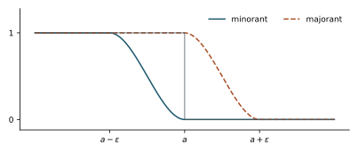

# ENS · MP · Mathématiques C 2015 · Corrigé guidé

*Corrigé rédigé par IA, non officiel. Signalez toute erreur.*

**Rédaction** · GPT-6.2 Astra Ultra · vitesse non renseignée

**Révision** · GPT-6.2 Astra Ultra · vitesse non renseignée · 26 novembre 2026

L’équation de Stein relie des espérances de fonctions tests à la loi gaussienne. Le problème l’utilise pour mesurer l’erreur d’approximation des sommes indépendantes bornées, puis obtient des bornes exponentielles pour leurs grandes déviations.

## I. Équation de Stein pour la gaussienne

### Question I.1a

> [!INDICATION]
> Ramener la dérivée du carré de l’intégrale à une intégrale sur un intervalle fixe.

#### Solution

Par le théorème fondamental, $A'(t)=2e^{-t^2}\int_0^t e^{-x^2}dx=2t\int_0^1 e^{-t^2(1+y^2)}dy$. Dans $B$, la dérivée de l’intégrande signé est $2t e^{-t^2(1+y^2)}$. Au voisinage d’un $t$ fixé, elle est continue et bornée uniformément pour $y\in[0,1]$. La dérivation sous l’intégrale donne donc $B'=A'$.

### Question I.1b

> [!INDICATION]
> Évaluer la constante aux deux extrémités du domaine.

#### Solution

À la limite en zéro, $A(0)=0$ et $B(0)=-\int_0^1(1+x^2)^{-1}dx=-\pi/4$. Ainsi $A-B=\pi/4$. À l’infini $|B(t)|\le(\pi/4)e^{-t^2}\to0$. Il vient $\int_0^\infty e^{-x^2}dx=\sqrt\pi/2$ par positivité. La parité et le changement d’échelle donnent $\int_{\mathbb R}G=1$.

### Question I.2

> [!INDICATION]
> Multiplier par un facteur intégrant dont la dérivée absorbe le terme linéaire.

#### Solution

On a $(e^{-x^2/2}\varphi)'=e^{-x^2/2}g(x)$. Les solutions sur toute la droite sont donc $\varphi(x)=e^{x^2/2}(c+\int_0^x e^{-y^2/2}g(y)\,dy)$, $c\in\mathbb R$. Chaque formule est de classe $C^1$ et vérifie l’équation.

### Question I.3

> [!INDICATION]
> Le centrage donne une intégrale totale nulle.

#### Solution

Posons $F=f-\langle f\rangle$. Alors $|F|\le2\|f\|_\infty$, donc les intégrales pondérées par $e^{-y^2/2}$ convergent absolument. Leur intégrale totale est nulle d’après I.1b. Ainsi l’intégrale de $-\infty$ à $x$ vaut l’opposé de celle de $x$ à $+\infty$. Puisque l’intégrande est continu, sa primitive est $C^1$. En multipliant la primitive par $e^{x^2/2}$ et en dérivant, on obtient $\varphi'-x\varphi=F$.

### Question I.4

> [!INDICATION]
> Pour chaque signe de x utiliser la queue gaussienne qui décroît vers l’extérieur.

#### Solution

L’identité $y^2=x^2+2x(y-x)+(y-x)^2$ donne l’inégalité exponentielle. Si $x\ge1$, la représentation par la queue droite donne $|\varphi(x)|\le2\|f\|_\infty\int_0^\infty e^{-xs}ds=2\|f\|_\infty/x$. Pour $x\le-1$, la queue gauche donne la même borne avec $|x|$. Donc $(1+|x|)|\varphi(x)|\le4\|f\|_\infty$ hors de $[-1,1]$. Pour $|x|\le1$, la queue du côté de $x$ a une intégrale au plus $\sqrt{\pi/2}$ avant multiplication par $e^{x^2/2}\le\sqrt e$. On obtient $(1+|x|)|\varphi(x)|\le2\sqrt{2\pi e}\|f\|_\infty$. Prenons $C_0=\max(4,2\sqrt{2\pi e})$. Par l’équation, $|\varphi'|\le(C_0+2)\|f\|_\infty$.

### Question I.5

> [!INDICATION]
> Différencier la représentation par translation pour les grandes valeurs positives, puis utiliser la symétrie.

#### Solution

Dans la queue droite, $y=x+s$ donne
$$
\varphi(x)=-\int_0^\infty e^{-s^2/2-sx}F(x+s)\,ds .
$$
Sur $|x|\le K$, l’intégrande dérivé est dominé par $e^{-s^2/2+Ks}(2s\|f\|_\infty+\|f'\|_\infty)$, intégrable en $s$. Pour $x\ge1$, on peut donc majorer $|\varphi'(x)|$ par $2\|f\|_\infty/x^2+\|f'\|_\infty/x$ en intégrant contre $e^{-xs}$. Pour $x\le-1$, appliquer cette estimation à $f(-\cdot)$, dont la solution centrée est $-\varphi(-\cdot)$ par I.3. Pour $|x|\le1$ utiliser I.4. On peut donc prendre $C_1\le 2(C_0+2)$ dans la majoration demandée.

### Question I.6

> [!INDICATION]
> Dériver l’équation après avoir vérifié la régularité de son membre de droite.

#### Solution

L’équation $\varphi'=x\varphi+f-\langle f\rangle$ a un membre droit $C^1$, donc $\varphi$ est $C^2$. On a $\varphi''=\varphi+x\varphi'+f'$. I.4 et I.5 donnent $\|\varphi''\|_\infty\le(C_0+C_1+1)(\|f\|_\infty+\|f'\|_\infty)$. Ainsi $C_2\le C_0+2(C_0+2)+1$ est une borne explicite.

## II. Caractérisation de la convergence vers la gaussienne

### Question II.1

> [!INDICATION]
> Tronquer d’abord l’intégration et justifier le passage aux deux extrémités.

#### Solution

Puisque $G'=-xG$, on intègre $(G\varphi)'$ sur $[-R,R]$. Les deux termes $G\varphi'$ et $xG\varphi$ sont absolument intégrables grâce aux deux bornes sur $\varphi',\varphi$ et aux moments gaussiens. Les termes de bord tendent vers zéro car $\varphi$ est bornée. Il reste $\int_{\mathbb R}G(\varphi'-x\varphi)=0$.

### Question II.2

> [!INDICATION]
> Utiliser comme fonction test la solution de l’équation dont le second membre est centré.

#### Solution

Pour $f$ continue bornée, I.3–4 donnent $h=\varphi$ de classe $C^1$, bornée et de dérivée bornée, telle que $h'-xh=f-\langle f\rangle$. Par l’hypothèse, $\int g_n(f-\langle f\rangle)\to0$. Comme $\int g_n=1$, c’est $\int g_n f\to\int G f$.

### Question II.3a

> [!INDICATION]
> Vérifier que la nouvelle fonction test est encore dans la classe autorisée.

#### Solution

Pour $h$ lisse à support compact, $H=h'-xh$ est lisse à support compact donc bornée. Par hypothèse $\int g_n H\to\int G H=0$, la dernière égalité venant de II.1.

### Question II.3b

> [!INDICATION]
> Contrôler les deux termes du reste par le deuxième moment, uniformément en n.

#### Solution

Notons $D=\sup_n\int x^2g_n(x)dx$ et $K=\sup_R\|\chi_R\|_\infty$. Hors de $[-R,R]$, $1\le x^2/R^2$ et $|x|\le x^2/R$. Ainsi
$$
\left|\int(1-\chi_R)g_n(h'-xh)\right|
\le(1+K)D(\|h'\|_\infty/R^2+\|h\|_\infty/R).
$$
Il suffit de choisir $R$ assez grand pour que cette borne soit au plus $\varepsilon$, simultanément pour tous les $n$.

### Question II.3c

> [!INDICATION]
> Pour R fixé utiliser l’hypothèse de convergence, puis augmenter R sous l’intégrale gaussienne.

#### Solution

Si $h$ est lisse, $\chi_R H$ avec $H=h'-xh$ est lisse bornée. Donc $\int g_n\chi_R H\to\int G\chi_R H$. Par II.1, $\int G H=0$. Comme $G$ a un second moment fini, la borne de II.3b appliquée à $G$ montre que $|\int G\chi_R H|\le\varepsilon$ pour $R$ assez grand.

### Question II.3d

> [!INDICATION]
> Approcher la fonction entière qui figure dans l’intégrale tronquée, en conservant un contrôle global.

#### Solution

Pour $h\in C^1$ avec $h,h'$ bornées, $F_R=\chi_R(h'-xh)$ est continue à support compact. Pour $R$ fixé, ses convolutions par des noyaux lisses positifs d’intégrale un et de petit support sont lisses bornées et convergent uniformément vers $F_R$, par uniforme continuité. La masse totale $\int g_n$ reste bornée pour $n$ assez grand, car la convergence supposée s’applique au test constant un. Les erreurs d’intégration sont donc majorées par la norme uniforme d’approximation fois une masse bornée, aussi bien sous $g_n$ que sous $G$. En passant d’abord à la limite en $n$, puis dans l’approximation, on obtient $\int g_nF_R\to\int GF_R$. La borne gaussienne de II.3c demeure valable par II.1 et donne le résultat.

### Question II.3e

> [!INDICATION]
> Choisir une troncature commune avant de faire tendre n vers l’infini.

#### Solution

Fixons $\varepsilon>0$. Prenons $R$ assez grand pour majorer par $\varepsilon$ le reste de II.3b uniformément en $n$ et le reste gaussien de II.3c. Par II.3d, l’intégrale tronquée tend vers une limite de module au plus $\varepsilon$. Donc $\limsup_n|\int g_n(h'-xh)|\le2\varepsilon$. La limite cherchée est nulle.

## III. Approximation normale des sommes indépendantes

### Question III.1

> [!INDICATION]
> Appliquer l’identité ponctuelle et vérifier l’intégrabilité.

#### Solution

Par I.3, $\varphi'(Z_n)-Z_n\varphi(Z_n)=f(Z_n)-\langle f\rangle$. Pour $n$ fixé, $|Z_n|\le M\sqrt n$ et les fonctions $f,\varphi,\varphi'$ sont bornées. On peut donc prendre l’espérance terme à terme.

### Question III.2

> [!INDICATION]
> Employer un reste de Taylor uniforme sur le segment entre les deux sommes.

#### Solution

Écrivons $u=Z_{n,i}$, $v=X_i/\sqrt n$. La formule de Taylor à l’ordre un avec $\varphi''$ bornée donne $|\varphi(u+v)-\varphi(u)-v\varphi'(u)|\le\|\varphi''\|_\infty v^2/2$. Multiplier par $|X_i|$ et utiliser I.6 donne le majorant $C_2|X_i|^3(\|f\|_\infty+\|f'\|_\infty)/(2n)$.

### Question III.3

> [!INDICATION]
> Détacher la variable retirée de la somme, puis utiliser son deuxième moment pour borner son troisième moment absolu.

#### Solution

Posons $N_f=\|f\|_\infty+\|f'\|_\infty$. L’indépendance donne $\mathbb E[X_i\varphi(Z_{n,i})]=0$ et $\mathbb E[X_i^2\varphi'(Z_{n,i})]=\mathbb E\varphi'(Z_{n,i})$ car $\mathbb E X_i^2=1$. On a aussi $\mathbb E|X_i|^3\le M\mathbb E X_i^2=M$. En prenant les espérances de III.2 et en sommant après division par $\sqrt n$, on trouve
$$
\left|\mathbb E[Z_n\varphi(Z_n)]-n^{-1}\sum_i\mathbb E\varphi'(Z_{n,i})\right|
\le C_2 M N_f/(2\sqrt n).
$$

### Question III.4

> [!INDICATION]
> Utiliser la constante de Lipschitz de la dérivée de la solution et le premier moment absolu.

#### Solution

Par I.6, $|\varphi'(Z_n)-\varphi'(Z_{n,i})|\le C_2N_f |X_i|/\sqrt n$. Or $\mathbb E|X_i|\le(\mathbb EX_i^2)^{1/2}=1$. Prendre l’espérance et moyenner sur $i$ donne la borne $C_2N_f/\sqrt n$ demandée.

### Question III.5

> [!INDICATION]
> Comparer les deux termes de Stein à la même moyenne de dérivées.

#### Solution

La combinaison de III.1, III.3 et III.4 avec l’inégalité triangulaire donne
$$
|\mathbb Ef(Z_n)-\langle f\rangle|\le C_2(1+M/2)N_f/\sqrt n .
$$

### Question III.6

> [!INDICATION]
> Équilibrer l’erreur de lissage et la norme de la dérivée du test.

#### Solution

Choisissons $p(t)=1$ pour $t\le0$, $p(t)=1-3t^2+2t^3$ sur $[0,1]$, $p(t)=0$ pour $t\ge1$. Cette fonction $C^1$ décroît et $\|p'\|_\infty\le3/2$. Les tests $p((x-a+\varepsilon)/\varepsilon)$ et $p((x-a)/\varepsilon)$ encadrent $\mathbf1_{x<a}$ et aussi $\mathbf1_{x\le a}$. Leur intégrale gaussienne diffère de $\int_{-\infty}^aG$ d’au plus $\varepsilon/\sqrt{2\pi}$, par la longueur de l’intervalle de transition. III.5 donne sur chaque test une erreur au plus $C_2(1+M/2)(1+3/(2\varepsilon))/\sqrt n$. Prendre $\varepsilon=n^{-1/4}$ donne la convergence et une erreur $O(n^{-1/4})$ uniforme en $a$.

## IV. Concentration exponentielle

### Question IV.1a

> [!INDICATION]
> Majorer la fonction convexe par sa corde sur l’intervalle de bornage.

#### Solution

Puisque $\mathbb E X_i^2=1$, on a $M\ge1$. Pour $|x|\le M$, la convexité donne $e^{tx}\le[(M+x)e^{tM}+(M-x)e^{-tM}]/(2M)$. En prenant l’espérance et en utilisant le centrage, il reste $\mathbb E e^{tX_i}\le(e^{tM}+e^{-tM})/2$.

### Question IV.1b

> [!INDICATION]
> Comparer les coefficients pairs des deux séries entières.

#### Solution

Pour $k\ge0$, $(2k)!\ge 2^k k!$ en ne gardant que les facteurs pairs. Par conséquent $\cosh u=\sum_{k\ge0}u^{2k}/(2k)!\le\sum_{k\ge0}u^{2k}/(2^kk!)=e^{u^2/2}$, d’où le résultat avec $u=tM$.

### Question IV.2

> [!INDICATION]
> Appliquer Markov au produit des exponentielles, puis minimiser la borne.

#### Solution

Pour $t>0$, indépendance et IV.1 donnent $\mathbb P(\sum_i X_i\ge n\delta)\le\exp(n(t^2M^2/2-t\delta))$. Le minimum est atteint en $t=\delta/M^2$, ce qui donne $\exp(-n\delta^2/(2M^2))$.

### Question IV.3

> [!INDICATION]
> Mettre les deux estimations à la même échelle avant de comparer.

#### Solution

À seuil fixe $a>0$ pour $Z_n$, III.6 donne la queue normale exacte à $O(n^{-1/4})$ près. IV.2 avec $\delta=a/\sqrt n$ ne donne que le majorant constant $e^{-a^2/(2M^2)}$. À seuil fixe $\delta>0$ pour la moyenne, le seuil sur $Z_n$ vaut $\delta\sqrt n$. III.6 uniforme donne la queue normale correspondante plus une erreur $O(n^{-1/4})$, tandis que IV.2 donne directement une décroissance exponentielle en $n$. Plus généralement, pour un seuil fixé de $n^{-\alpha}\sum X_i$, $\alpha>1/2$, l’exposant de IV.2 est proportionnel à $n^{2\alpha-1}$.

### Question IV.4a

> [!INDICATION]
> Prolonger au point zéro et utiliser une représentation intégrale du reste exponentiel.

#### Solution

Le prolongement en zéro vaut $1/2$. La formule de Taylor intégrale donne pour tout réel $u$,
$$
f(u)=\int_0^1(1-s)e^{su}\,ds .
$$
L’intégrande est croissant en $u$ pour chaque $s$, donc $f$ est croissante. Ainsi $|X|\le M$ implique $f(X)\le f(M)$.

### Question IV.4b

> [!INDICATION]
> Conserver la variance dans la majoration exponentielle puis optimiser le paramètre de Markov.

#### Solution

On a $e^{tX_i}=1+tX_i+t^2X_i^2 f(tX_i)$. D’après IV.4a, $f(tX_i)\le f(tM)$. Le centrage et la variance un donnent
$$
\mathbb E e^{tX_i}\le 1+\frac{e^{tM}-1-tM}{M^2}\le\exp\left(\frac{e^{tM}-1-tM}{M^2}\right).
$$
Markov et l’indépendance donnent une borne d’exposant $n[(e^{tM}-1-tM)/M^2-t\delta]$. Cette fonction convexe est minimale pour $t=\ln(1+M\delta)/M$, d’où $\exp[-n\Phi(M\delta)/M^2]$. La borne de Bennett conserve la variance un et peut améliorer IV.2. Les deux bornes sont valides et l’on peut retenir leur minimum : pour $M=1$, par exemple, $\Phi(\delta)<\delta^2/2$ pour $\delta>0$ puisque $\ln(1+\delta)<\delta$.

La fonction de l’énoncé est $\Phi(s)=(1+s)\ln(1+s)-s$. Par exemple, pour $M=2$ et $\delta=1/4$, Bennett donne l’exposant $-n\Phi(1/2)/4$, soit environ $-0{,}02705n$, tandis que IV.2 donne $-n/128$. Ici la borne de Bennett est donc strictement plus petite.
