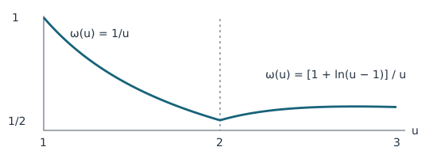
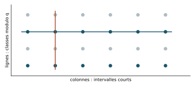

# ENS Ulm · MP · Mathématiques D 2015 · Corrigé guidé

*Corrigé rédigé par IA, non officiel. Signalez toute erreur.*

**Rédaction** · GPT-6.2 Astra Ultra · vitesse non renseignée

**Révision (tour 1)** · GPT-6.2 Astra Ultra · vitesse non renseignée · 26 novembre 2026

La discrépance mesure un déséquilibre dans des progressions arithmétiques. Les deux premières parties l’abordent par dénombrement et analyse de Fourier. La fonction de Buchstab intervient ensuite dans le décompte des entiers sans petits facteurs, qui fournit les moyennes par lignes et par colonnes de la matrice de Maier.

## I. Discrépance moyenne d’ensembles finis

### Question I.1a

> [!INDICATION]
> Associer à chaque élément son choix d’appartenance.

#### Solution

Chaque élément de $X$ peut être pris ou laissé indépendamment des autres. Il y a $2^d$ parties, y compris la partie vide.

### Question I.1b

> [!INDICATION]
> Dériver le binôme avant de poser la variable égale à un.

#### Solution

La première dérivée de $(1+t)^d=\sum_k\binom dk t^k$ en un donne $d2^{d-1}$. La seconde donne $d(d-1)2^{d-2}$. Ce sont les deux sommes demandées, également nulles lorsque l’ordre de dérivation dépasse le degré.

### Question I.1c

> [!INDICATION]
> Décomposer le carré de k en deux contributions déjà sommées.

#### Solution

Il y a $\binom dk$ parties de taille $k$. Les deux moyennes valent $d/2$ et, puisque $k^2=k(k-1)+k$, $d(d-1)/4+d/2=(d^2+d)/4$.

### Question I.1d

> [!INDICATION]
> Exprimer le déséquilibre par une variable de cardinal centrée.

#### Solution

On a $\Delta(X,Y)^2=(2|Y|-d)^2$. Sa moyenne est $(d^2+d)-4d(d/2)+d^2=d$ par I.1c.

### Question I.2a

> [!INDICATION]
> Écrire les termes de la classe avec un premier terme dans le système choisi.

#### Solution

La classe est $a,a+q,\ldots,a+q\lfloor(N-a)/q\rfloor$. Son cardinal vaut $1+\lfloor(N-a)/q\rfloor<1+N/q$ car $a>0$.

### Question I.2b

> [!INDICATION]
> Restreindre la partie variable à la classe avant de prendre sa moyenne.

#### Solution

Pour $S=S_{q,a}(N)$, chaque partie $Y\cap S$ possède exactement $2^{N-|S|}$ prolongements à $\{1,\ldots,N\}$. I.1d donne donc pour moyenne de $\Delta(S,Y)^2$ le cardinal $|S|$. À $q$ fixé les classes forment une partition, donc la moyenne de leur somme vaut exactement $N$. Après sommation en $q$, on obtient $Nt\le2Nt$.

### Question I.3

> [!INDICATION]
> Équilibrer la borne moyenne sur les petits modules et la borne de cardinal sur les grands.

#### Solution

Choisissons $t=\lfloor N^{1/3}\rfloor\ge1$. Il existe une partie $Y$ dont la somme des carrés de I.2b est au plus $Nt$, donc pour chaque $q\le t$ la discrépance est au plus $\sqrt{Nt}\le N^{2/3}$. Pour $q>t$, elle est au plus $|S_{q,a}(N)|<1+N/q\le1+N^{2/3}$. La même partie convient ainsi à toutes les classes, avec $C=2$. Pour les classes complètes de la question, un intervalle initial de longueur $\lfloor N/2\rfloor$ donne aussi directement un écart borné.

## II. Minoration de Roth par analyse harmonique

### Question II.1a

> [!INDICATION]
> Utiliser l’orthogonalité des exponentielles sur une période.

#### Solution

Le calcul $\int_0^1 e^{2\pi iht}dt=\mathbf1_{h=0}$ pour $h\in\mathbb Z$ isole le coefficient $c(n)$ dans la première intégrale. Développer la seconde en double somme fait apparaître la même intégrale pour $h=k-j$, ne laissant que $\sum_k|c(k)|^2$. Les sommes sont finies.

### Question II.1b

> [!INDICATION]
> Localiser le support de la convolution.

#### Solution

Si les supports sont $A,B$, seules les paires dans $A\times B$ contribuent. La somme définissant chaque terme est finie et son support est contenu dans l’ensemble fini $A+B$. Donc $c*d\in\mathcal E$.

### Question II.1c

> [!INDICATION]
> Regrouper le produit des deux sommes selon la somme des indices.

#### Solution

Le produit des deux polynômes trigonométriques est $\sum_{p,q}c(p)d(q)e^{2\pi i(p+q)x}$. Le coefficient d’indice $n$ est $(c*d)(n)$ par II.1b, donc $\widehat{c*d}=\widehat c\widehat d$.

### Question II.2

> [!INDICATION]
> Compter séparément les termes dans Y et dans son complément.

#### Solution

La somme vaut $r(1-\eta)+(N-r)(-\eta)=r-N\eta=0$.

### Question II.3

> [!INDICATION]
> Identifier les indices conservés dans la convolution en zéro.

#### Solution

On a $(\chi*c_{-E})(0)=\sum_n\chi(n)c_{-E}(-n)=\sum_{n\in E}\chi(n)$. Or $\chi=\mathbf1_Y-\eta\mathbf1_{[1,N]\cap\mathbb Z}$. La somme est donc le nombre signé $V(E)$.

### Question II.4a

> [!INDICATION]
> Ranger les parties fractionnaires sur un cercle et compter les espaces qui les séparent.

#### Solution

Ordonnons les $n$ parties fractionnaires sur le cercle de longueur un. Les $n$ écarts cycliques positifs ou nuls ont pour somme un, donc l’un est au plus $1/n$. Les indices distincts de ses extrémités et un entier corrigeant le passage éventuel par zéro donnent $|\alpha_i-\alpha_j-h|\le1/n$.

### Question II.4b

> [!INDICATION]
> Appliquer le résultat aux multiples consécutifs de la fréquence.

#### Solution

Considérons $0,\alpha,\ldots,Q\alpha$. II.4a donne deux indices dont la différence, en valeur absolue, est $q\in[1,Q]$ et un entier $h$ tels que $|q\alpha-h|\le1/(Q+1)\le1/Q$.

### Question II.4c

> [!INDICATION]
> Choisir une approximation donnant des phases toutes dans le même secteur étroit.

#### Solution

Appliquons II.4b avec $Q=8s$. Pour $|j|\le s$, on a $|2\pi j(q\alpha-h)|\le\pi/4$. Chaque terme de $\widehat c_q(\alpha)=\sum_{j=-s}^s e^{2\pi ijq\alpha}$ a donc une partie réelle au moins $1/\sqrt2$. Le module de la somme est au moins $(2s+1)/\sqrt2$, et $K=1$ convient.

### Question II.5a

> [!INDICATION]
> Passer au carré des normes des convolutions puis sommer les noyaux en fréquence.

#### Solution

Comme $E_q=-E_q$, $(\chi*c_q)(p)=V(E_{q,p})$. II.1 donne pour la somme de leurs carrés à $q$ fixé l’intégrale de $|\widehat\chi|^2|\widehat c_q|^2$. Par II.4c, à chaque fréquence, $\sum_{q\le8s}|\widehat c_q|^2\ge K^2s^2$. Enfin $\int_0^1|\widehat\chi|^2=\sum|\chi|^2=r(1-\eta)^2+(N-r)\eta^2=N\eta(1-\eta)$. C’est la borne annoncée.

### Question II.5b

> [!INDICATION]
> Choisir s pour que les translations pouvant rencontrer la fenêtre aient un nombre contrôlé.

#### Solution

Prenons $s=\lfloor\sqrt N\rfloor$, donc $\sqrt N/2\le s\le\sqrt N$. Pour un terme non nul, $1-sq\le p\le N+sq$, soit au plus $N+16s^2\le17N$ choix pour chaque $q\le8s$. Un carré est donc au moins $K^2\eta(1-\eta)Ns^2/(136sN)$. Sa racine est au moins $K\sqrt{\eta(1-\eta)}N^{1/4}/\sqrt{272}$. L’intersection $Z=E_{q,p}\cap[1,N]$ est une progression arithmétique et $V(E_{q,p})=|Y\cap Z|-\eta|Z|$. Pour $\eta=0$ ou $1$, n’importe quel singleton convient.

## III. Fonction de Buchstab et entiers sans petits facteurs premiers

### Question III.1a

> [!INDICATION]
> Construire la fonction de proche en proche sur des intervalles de longueur un.

#### Solution

Sur $[1,2]$, la définition est explicite. Si la fonction est connue et continue jusqu’à $k$, la formule intégrale définit ses valeurs jusqu’à $k+1$ par les valeurs déjà connues. Elle se raccorde à $2$ puisque l’intégrale y est nulle, puis aux entiers suivants par la même formule. Pour $u>2$, le théorème fondamental donne $(u\omega(u))'=\omega(u-1)$, continûment. La définition donne ainsi une unique fonction continue, de classe $C^1$ sur $]2,\infty[$.

Sur le premier intervalle construit, $2\le u\le3$, l’intégrande est encore $1/t$. Par conséquent
$$u\omega(u)=1+\int_1^{u-1}\frac{dt}{t}=1+\ln(u-1).$$
Cela donne $\omega(2)=1/2$ et $\omega(3)=(1+\ln2)/3$. La dérivée à droite en 2 vaut $1/4$ et celle à gauche vaut $-1/4$. La continuité en ce point est bien la régularité appropriée.

### Question III.1b

> [!INDICATION]
> Propager les bornes par la formule intégrale.

#### Solution

Les bornes $1/u\le\omega(u)\le1$ sont vraies sur $[1,2]$. Si elles sont vraies pour les valeurs de l’intégrande, on a $1\le u\omega(u)\le1+(u-2)=u-1\le u$. L’induction par tranches conclut. On a même $\omega\ge1/2$ car cette borne est vraie au départ et $1+(u-2)/2=u/2$.

### Question III.1c

> [!INDICATION]
> Écrire la dérivée en fonction de deux valeurs voisines.

#### Solution

Pour $u>3$, $u\omega'(u)=\omega(u-1)-\omega(u)=-\int_{u-1}^u\omega'(t)dt$, puisque l’intervalle reste dans la zone $C^1$.

### Question III.1d

> [!INDICATION]
> Gagner une puissance de décroissance à chaque emploi de l’équation retardée.

#### Solution

Par III.1a–b, $\omega'(u)=O(1/u)$. Si $\omega'(t)=O(t^{-h})$, III.1c donne $|\omega'(u)|\le C u^{-1}(u-1)^{-h}=O(u^{-h-1})$. Pour un $k$ donné, itérer jusqu’à $h=k+1$ donne $u^k\omega'(u)\to0$.

### Question III.1e

> [!INDICATION]
> Utiliser une puissance rendant la dérivée intégrable.

#### Solution

La borne $\omega'=O(u^{-2})$ implique l’intégrabilité absolue à l’infini. Par le théorème fondamental, $\omega(u)$ tend vers un réel $L$. D’après III.1b, $1/2\le L\le1$.

### Question III.1f

> [!INDICATION]
> Comparer les dérivées des deux membres et déterminer leur constante à l’infini.

#### Solution

Pour $w=\omega-L$, III.1d intégrée depuis $u$ donne $w(u)=O(u^{-k})$ pour tout $k>0$. Ainsi $uw(u)\to0$ et $w$ est intégrable à l’infini. Or $(uw(u))'=w(u-1)$, qui est aussi la dérivée de $-\int_{u-1}^\infty w(t)dt$. Les deux expressions ayant limite zéro, elles sont égales.

### Question III.1g

> [!INDICATION]
> Examiner les signes des deux membres de la dernière identité et exclure une queue constante.

#### Solution

Si $w\ge0$ à partir d’un rang, pour tout $u$ assez grand III.1f donne simultanément $uw(u)\ge0$ et $uw(u)\le0$. Donc $w=0$ sur une demi-droite. De $(u\omega)'=\omega(u-1)$ on remonte alors, intervalle par intervalle, jusqu’à ce que $\omega$ soit constante sur $]1,2[$, impossible pour $1/u$. Le raisonnement vaut aussi pour $w\le0$. Toute demi-droite contient donc des valeurs strictement de part et d’autre de $L$.

### Question III.2

> [!INDICATION]
> Comparer la somme cumulée à une intégrale puis au terme principal du théorème des nombres premiers.

#### Solution

Pour $t\ge3$, la décroissance donne $\sum_{2\le n\le t}1/\ln n=\int_2^t dv/\ln v+O(1)$. Une intégration par parties donne $t/\ln t+O(1+\int_2^t dv/\ln^2 v)=t/\ln t+O(t/\ln^2 t)$, en scindant la dernière intégrale à $\sqrt t$. Ainsi l’écart cumulé avec $\pi(t)$ est $O(t/\ln^2 t)$. Prendre la différence aux deux extrémités ajoute au plus un terme de bord borné (pour les entiers $\ge2$). Pour $2\le v\le b$, $v/\ln^2 v\le Cb/\ln^2 b$ car cette fonction croît après $e^2$ et a un minimum positif. Si $b<2$, les comptes sont nuls. On obtient la constante uniforme voulue, aussi pour le compte inclusif des premiers en $a$.

### Question III.3a

> [!INDICATION]
> Écrire la masse de chaque premier comme différence de deux valeurs de la fonction de comptage.

#### Solution

Posons $A=a^-+1$, $B=b^0$. En sommant $f(n)(\pi(n)-\pi(n-1))$ de $A$ à $B$ et en décalant le deuxième indice, on obtient $\sum_{n=A}^B\pi(n)(f(n)-f(n+1))-\pi(a^-)f(A)+\pi(B)f(B+1)$. Si l’intervalle entier est vide, $B=a^-$ et les deux termes de bord s’annulent.

### Question III.3b

> [!INDICATION]
> Appliquer la même sommation à la fonction cumulée des poids logarithmiques.

#### Solution

En posant $\psi(a^-)=\pi(a^-)$, on a $\psi(n)-\psi(n-1)=1/\ln n$ pour $A\le n\le B$. Le même décalage donne $\sum_{A}^B f(n)/\ln n=\sum_A^B\psi(n)(f(n)-f(n+1))-\pi(a^-)f(A)+\psi(B)f(B+1)$.

### Question III.3c

> [!INDICATION]
> Soustraire les deux identités et appliquer l’estimation uniforme aux sommes partielles.

#### Solution

Le bord inférieur est commun. Pour chaque $n\in[A,B]$, la version inclusive de III.2 donne $|\pi(n)-\psi(n)|\le K n/\ln^2 n$, en fixant d’emblée $K$ assez grand pour les deux conventions. La même estimation à l’extrémité réelle $b$ donne $|\pi(B)-\psi(B)|\le Kb/\ln^2 b$. L’inégalité triangulaire appliquée à la différence des sommes donne exactement les deux termes proposés, car $f(B+1)\ge0$.

### Question III.3d

> [!INDICATION]
> Isoler le premier terme puis comparer la queue à l’intégrale de la fonction décroissante.

#### Solution

La fonction $g(t)=1/(t\ln^k t)$ décroît pour $t>1$. Si $A=\lceil a\rceil$, la somme est majorée par $g(A)+\int_A^\infty g(t)dt\le 1/(a\ln^k a)+1/((k-1)\ln^{k-1}a)$. L’intégrale converge pour $k\ge2$, donc la série aussi.

### Question III.3e

> [!INDICATION]
> Employer le poids inversement proportionnel à n et au carré de son logarithme.

#### Solution

Pour $a\ge2$, appliquons III.3c à $f(t)=1/(t\ln^2t)$. Le bord supérieur est $O(1/\ln^4 b)$ et $|f(n+1)-f(n)|=O(1/(n^2\ln^2 n))$ par dérivation. Par III.3d avec $k=4$ la somme des erreurs est $O(1/\ln^3 a)$. La somme principale est majorée, avec $k=3$, par $1/(2\ln^2 a)+1/(a\ln^3 a)$. Cela donne la borne. Pour $1<a<2$, la somme est bornée par la queue complète à partir de deux et l’on augmente $K'$.

### Question III.4

> [!INDICATION]
> Partager à la racine carrée de la borne supérieure.

#### Solution

Pour $x\ge4$, les entiers jusqu’à $\sqrt x$ contribuent au plus $\sqrt x/\ln^2 2$ et ceux au-delà au plus $4x/\ln^2 x$. Le premier terme est aussi $O(x/\ln^2 x)$. Sur $1<x\le4$, la somme est bornée et $x/\ln^2x$ reste minoré par une constante positive.

### Question III.5

> [!INDICATION]
> Examiner si la borne inférieure des facteurs premiers est elle-même première.

#### Solution

Pour $\sqrt x<y<x$, les entiers comptés sont un et les premiers de $[y,x]$. Ainsi $\Phi(x,y)-\pi(x)+\pi(y)=1+\mathbf1_{y\text{ premier}}$. La borne imprimée par un est fausse, par exemple $x=7,y=3$. Le rapport la rectifie en **deux**. Lorsque $y=\sqrt x$, il peut en outre apparaître le seul carré $y^2$ si $y$ est premier. Dans tous les cas $\Phi(x,y)=\pi(x)-\pi(y)+O(1)$. Le théorème des nombres premiers donne $\pi(x)=x/\ln x+O(x/\ln^2 x)$ et $\pi(y)=O(y/\ln y)$ uniformément pour $y>1$ (traiter les petites valeurs directement). Cela donne la seconde borne.

Pour l’exemple strict $x=7,y=3$, les entiers comptés sont $1,3,5,7$. On a $\Phi(7,3)=4$, $\pi(7)=4$ et $\pi(3)=2$, ce qui donne exactement $2$. À la frontière $x=9,y=3$, le composé supplémentaire $9$ est admis et la même différence vaut $3$. Cette frontière intervient dans la majoration asymptotique qui suit.

### Question III.6

> [!INDICATION]
> Classer les entiers exclus lors du relèvement du seuil par leur plus petit facteur premier.

#### Solution

Les entiers comptés au seuil $y$ mais pas à $y'$ ont un unique plus petit facteur premier $p\in[y,y'[$. Ils s’écrivent $pm$ avec $m\le x/p$ et tous les facteurs de $m$ au moins égaux à $p$, et réciproquement. Leur nombre pour ce $p$ est $\Phi(x/p,p)$. Ajouter les entiers déjà comptés au seuil $y'$ donne l’identité, également lorsque la somme est vide.

### Question III.7a

> [!INDICATION]
> Changer de variable en passant du seuil t à son exposant logarithmique.

#### Solution

Posons $u=\ln x/\ln y$ et $v=\ln x/\ln t$. Ici $2<u\le3$. Comme $dv=-\ln x\,dt/(t\ln^2t)$, le membre gauche vaut $1+\int_2^u dv/(v-1)$. Sur cette tranche, $\omega(v-1)=1/(v-1)$. La définition de Buchstab donne donc $1+\int_2^u\omega(v-1)dv=u\omega(u)$.

### Question III.7b

> [!INDICATION]
> Partir du seuil racine de x, évaluer les quotients par III.5 et quantifier le remplacement de la somme première par une intégrale.

#### Solution

Écrivons $z=\sqrt x$, $u=\ln x/\ln y$, et raisonnons pour $y\ge 3$, le domaine restant étant borné ici puisque $y\ge x^{1/3}$. Par III.5,
$$
\Phi(x,z)=x/\ln x+O(x/\ln^2 x).
$$
Dans III.6, pour $y\le p<z$, l’entier $x/p$ n’est pas requis : III.5 vaut pour ce paramètre réel et $p\ge\sqrt{x/p}$. On obtient
$$
\Phi(x/p,p)=\frac{x}{p\ln(x/p)}
+O\left(\frac{x}{p\ln^2(x/p)}+\frac p{\ln p}\right).
$$
Sur $[x^{1/3},z]$, $\ln p$ et $\ln(x/p)$ sont comparables à $\ln x$. La somme des inverses des premiers de cette tranche est $O(1)$ par III.3e, en majorant $1/p$ par $(\ln z)^2/(p\ln^2p)$. De plus $\sum p/\ln p\ll z\pi(z)/\ln x\ll x/\ln^2x$. L’erreur cumulée est donc $O(x/\ln^2x)$.

Détaillons la conversion des sommes, qui servira aussi à la tranche suivante. Sur $[y,z]$ posons
$$
H(t)=\frac{\omega(\ln x/\ln t-1)}{t\ln t}.
$$
Ici $H(t)=1/(t\ln(x/t))$. Plus généralement $\omega$ est bornée, continue, dérivable par morceaux, et $v|\omega'(v)|$ est borné pour $v\ge1$ par III.1a–b (prendre les dérivées unilatérales en deux). On en tire $|H(t)|\ll1/(t\ln t)$ et $|H'(t)|\ll1/(t^2\ln t)$ uniformément : si $v=\ln x/\ln t-1\ge1$, alors $|v'|=(v+1)/(t\ln t)$. Prolongeons $H$ constamment juste au-delà de $z$ pour les termes de bord. III.3c et III.3d avec $k=3$ donnent
$$
\sum_{y\le p<z}H(p)=\sum_{y\le n<z}\frac{H(n)}{\ln n}+O(1/\ln^2 y).
$$
En effet, le bord supérieur est $O(1/\ln^3 z)$ et la somme des variations est dominée par $C\sum_{n\ge y}1/(n\ln^3 n)$. Les extrémités inclusives ou strictes modifient la somme d’au plus $O(1/(y\ln y))$. Comparer maintenant sur chaque intervalle unitaire la somme entière à l’intégrale de $H(t)/\ln t$. La dérivée est $O(1/(t^2\ln^2t))$ par morceaux, donc l’erreur totale, extrémités comprises, est $O(1/(y\ln^2 y))$.

Ainsi $\Phi(x,y)=x/\ln x+x\int_y^z H(t)dt/\ln t+O(x/\ln^2 y)$. La substitution de III.7a évalue le terme principal en $x\omega(u)/\ln y$. Cela donne une constante absolue $D_2$.

### Question III.7c

> [!INDICATION]
> Faire apparaître dans la récurrence un coefficient strictement inférieur à un devant la constante d’erreur.

#### Solution

Écrivons encore $z=\sqrt x$, $u=\ln x/\ln y$. Pour $1<y\le Y$ fixé, la borne grossière $\Phi(x,y)\le x$ et $\omega\le1$ donnent déjà une erreur au plus $x[\ln^2 Y+\ln Y]/\ln^2 y$. Il suffit donc de traiter $y\ge Y$ avec $Y\ge3$ grand. Raisonnons par tranches $n<u\le n+1$, $n\ge2$, celle de $n=2$ étant III.7b.

Appliquons III.6 avec $y'=z$. Pour les premiers $p\in[y,x^{1/3}[$, l’exposant du sous-problème est $v=\ln(x/p)/\ln p\le u-1\le n$ et $v>2$. L’induction donne $\Phi(x/p,p)=xH(p)+O_p$ avec $|O_p|\le Dx/(p\ln^2p)$, où $H$ est défini en III.7b. Pour les premiers $p\ge x^{1/3}$ le calcul direct de III.7b donne la même forme principale et une erreur cumulée $O(x/\ln^2 x)$. La conversion de la somme de $H$ en intégrale, prouvée en III.7b avec des constantes indépendantes de $u$, coûte $O(x/\ln^2y)$. Le terme principal vaut exactement
$$
\frac{x}{\ln x}\left(1+\int_2^u\omega(v-1)dv\right)=\frac{x}{\ln y}\omega(u).
$$
D’après III.3e, la somme des erreurs d’induction est au plus
$$
\frac{Dx}{\ln^2 y}\left(\tfrac12+K'/\ln y\right).
$$
Choisissons $Y$ assez grand pour que la parenthèse soit au plus $3/4$. Si $C$ désigne la constante absolue de toutes les autres erreurs, choisir $D\ge\max(D_2,4C,\ln^2Y+\ln Y)$ conserve la même constante $D$ à chaque rang. Cette contraction établit l’uniformité réclamée pour tous les exposants.

## IV. Matrice de Maier

### Question IV.1a

> [!INDICATION]
> Compter des périodes entières et une dernière période incomplète.

#### Solution

Pour $q=q(y)$, les entiers sans facteur premier $<y$ sont exactement les entiers premiers à $q$. Dans chaque période de $q$ entiers consécutifs il y en a $\varphi(q)$. Pour $y$ fixé, cela donne $\Phi(x,y)=x\varphi(q)/q+O(q)$, d’où l’équivalent demandé.

### Question IV.1b

> [!INDICATION]
> Faire tendre les deux paramètres successivement, à seuil fixé en premier.

#### Solution

Divisons la borne de III.7c par $x$ et faisons tendre $x$ vers l’infini avec $y$ fixé. Par IV.1a et III.1e,
$$
\left|\frac{\varphi(q(y))}{q(y)}\ln y-L\right|\le D/\ln y.
$$
Faire ensuite tendre $y$ vers l’infini donne la limite annoncée.

### Question IV.1c

> [!INDICATION]
> Appliquer la sommation par parties au logarithme des facteurs premiers.

#### Solution

On a $\ln q(y)=\sum_{p<y}\ln p$. Dans III.3c, prenons $a=2$, $b$ juste avant $y$ et $f(t)=\ln t$. Le bord est $O(y/\ln y)$, tandis que $|\ln(n+1)-\ln n|\le1/n$ et III.4 donnent une somme d’erreurs $O(y/\ln^2 y)$. La somme principale vaut $\sum_{2\le n<y}1=y+O(1)$. L’éventuelle convention au dernier premier coûte au plus $\ln y$. Donc $\ln q(y)\sim y$.

### Question IV.2a

> [!INDICATION]
> Éliminer les lignes dont l’indice partage un facteur avec le module.

#### Solution

Si $\gcd(i,q)>1$, un premier $p<y$ divise $i$ et toute la ligne $i+(m+j)q$. Ces termes sont plus grands que $q$, donc que $p$, et sont composés. Les indices restants sont exactement ceux comptés par $\Phi(n,y)$, ce qui borne le nombre de lignes non vides de premiers.

### Question IV.2b

> [!INDICATION]
> Lire chaque colonne comme un intervalle d’entiers consécutifs.

#### Solution

La colonne $j$ contient les entiers de $(m+j)q+1$ à $(m+j)q+n$. Leur nombre de premiers vaut $\pi((m+j)q+n)-\pi((m+j)q)$. Les colonnes sont disjointes puisque $n<q$. Leur somme est $N$.

### Question IV.2c

> [!INDICATION]
> Remplacer les deux moyennes par leurs définitions avant de simplifier.

#### Solution

Comme $N>0$, $M_s/M_a=\Phi(n,y)/m$. Multiplier par $\ln(mq)/n$ et $mq/(\varphi(q)\ln(mq))$ donne bien $\Phi(n,y)q/(n\varphi(q))$.

### Question IV.3

> [!INDICATION]
> Comparer les deux moyennes à leurs échelles exactes et suivre le facteur q dans la seconde normalisation.

#### Solution

Fixons $\alpha_0,\beta_0>0$. Par III.1g, choisissons $u>\max(2,\alpha_0)$ tel que $\omega(u)>L$, et un entier $\beta>\beta_0$. Faisons tendre $y$ vers l’infini, avec $q=q(y)$, $m=q^\beta$, $n=\lfloor(\ln(mq))^u\rfloor$. Ainsi $n<q$ pour $y$ assez grand. Par IV.1c, $\ln n/\ln y\to u$. En appliquant III.7c à $(n,y)$ et IV.1b, on trouve
$$
R_y=\frac{\Phi(n,y)}n\frac{q}{\varphi(q)}\longrightarrow \omega(u)/L>1.
$$
Posons $A_y=M_s\ln(mq)/n$ et $B_y=M_a\varphi(q)\ln(mq)/(mq)$. L’égalité IV.2c donne $A_y=R_yB_y$, y compris lorsque $N=0$, où les deux moyennes sont nulles. Prenons $1<\gamma<\sqrt{\omega(u)/L}$. Pour tout $y$ assez grand, on a soit $A_y>\gamma$, soit $B_y<1/\gamma$. Une des deux possibilités se produit pour une infinité de modules distincts.

Dans le premier cas, une colonne à partir de $x=(m+j)q$ contient plus de $\gamma n/\ln(mq)$ premiers. Or $\ln x/\ln(mq)\to1$ uniformément en $j$, et $n\le(\ln x)^u$. Pour tout $1<\lambda<\gamma$ et les modules assez grands, on obtient
$$
(\ln x)\big(\pi(x+(\ln x)^u)-\pi(x)\big)>\lambda(\ln x)^u.
$$
C’est la première branche avec $\alpha=u$.

Dans le second cas, en comptant aussi les lignes admissibles sans premier, l’une des $\Phi(n,y)$ lignes a moins de $\gamma^{-1}mq/(\varphi(q)\ln(mq))$ premiers. Ses $m=q^\beta$ termes sont premiers à $q$, espacés de $q$, et son premier terme $a_1=(m+1)q+i$ vérifie $q^\beta<a_1<2q^{\beta+1}$ pour les grands modules. Le seuil **effectivement obtenu** est
$$
\frac1\gamma\frac{q^{\beta+1}}{\varphi(q)\ln(q^{\beta+1})}.
$$
La page 8 imprime $q^\beta/(\lambda\varphi(q)\ln(q^\beta))$. Pour un même $\lambda$, ce dernier seuil est plus petit d’un facteur $\beta q/(\beta+1)$ et ne découle pas de IV.2c. Le calcul précédent établit la disjonction de la méthode de la matrice avec sa normalisation exacte.

Pour la **disjonction littérale**, le théorème de Maier sur les intervalles de longueur $(\ln x)^u$, $u>1$, établit indépendamment que le rapport de la première branche a une limite supérieure strictement supérieure à un. Prendre un $u>\max(1,\alpha_0)$ et $\lambda$ strictement entre un et cette limite supérieure donne la première branche imprimée. Passer d’un réel $x$ à sa partie entière n’altère le compte que d’un nombre borné de premiers, négligeable devant $(\ln x)^{u-1}$. Ce recours au théorème publié est supplémentaire aux résultats admis dans l’épreuve. [Helmut Maier, *Primes in short intervals*, Michigan Math. J. 32 (1985), 221–225](https://doi.org/10.1307/mmj/1029003189).

