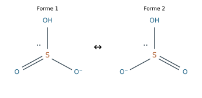
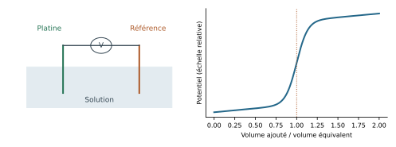
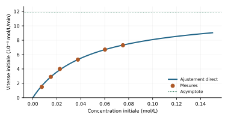
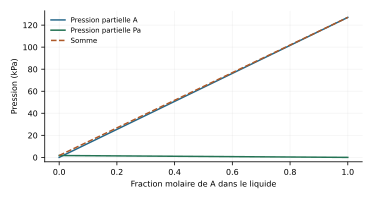
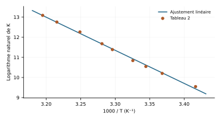
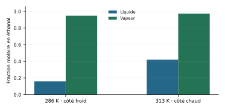
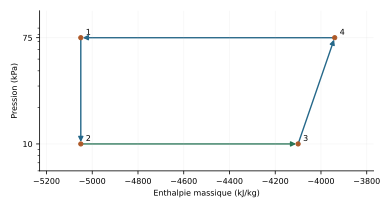
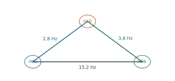

# ENS Ulm — PC, Chimie B 2015 · Corrigé guidé

*Corrigé rédigé par IA, non officiel.*

**Rédaction (tour 1)** · GPT-6.2 Astra Ultra · vitesse non renseignée

Les deux éditions corrigent entièrement 59 des 93 questions et traitent le diagnostic thermodynamique de 1.2.20. La partie 1 comprend les 28 questions de cinétique et 21 réponses complètes de thermodynamique sur 22. La partie 2 couvre 2.1.1 à 2.1.4, 2.2.5, 2.2.7, 2.2.8, 2.2.15, 2.3.8 et 2.3.9 sur la structure, les propriétés et l’analyse spectroscopique. Les 33 autres questions de la seconde partie sont indiquées hors couverture.

## 1.1 · Dosage et cinétique de dépolymérisation

### Question 1.1.1 — Deux phases et un transfert de matière

> [!INDICATION]
> Dans quelle phase se trouvent initialement l’échantillon organique et le titrant aqueux ?

#### Solution

Les deux liquides sont peu miscibles et les espèces doivent se rencontrer à leur interface. La dispersion transitoire en gouttelettes accroît l’aire interfaciale et accélère les échanges. Une évolution lente de la couleur pourrait autrement traduire le transport entre phases.

### Question 1.1.2 — Figer l’avancement du prélèvement

> [!INDICATION]
> Une prise d’essai représente un instant. Que deviendrait cet instant si la réaction se poursuivait pendant la mesure ?

#### Solution

Le refroidissement ralentit fortement la transformation à cause de la dépendance de la constante cinétique en température. Il réduit l’écart entre la composition au temps annoncé et celle effectivement analysée. Une trempe cinétique n’impose pas un nouvel équilibre instantané.

### Question 1.1.3 — Lewis de l’hydrogénosulfite

> [!INDICATION]
> Comptez les électrons de valence, placez le proton sur un oxygène et répartissez les charges formelles.

#### Solution

L’ion compte 26 électrons de valence. Une forme s’écrit $\mathrm{HO{-}S(=O){-}O^-}$, avec un doublet libre sur S. L’oxygène chargé porte trois doublets, ceux de OH et de S=O en portent deux. Les deux oxygènes sans proton échangent leurs rôles dans les formes mésomères. La charge globale est $-1$.

### Question 1.1.4 — Addition nucléophile sur le carbonyle

> [!INDICATION]
> Quel atome de l’ion porte le doublet qui donnera la liaison carbone–soufre observée dans le produit ?

#### Solution

Le doublet du soufre attaque le carbone électrophile de $\mathrm{CH_3CHO}$. Les électrons de la liaison $\pi$ rejoignent l’oxygène, donnant un centre tétraédrique de type alcoolate. Un transfert de proton de la partie hydrogénosulfite, direct ou relayé par le solvant, protonne cet oxygène. On obtient le 1-hydroxyéthanesulfonate $\mathrm{CH_3CH(OH)SO_3^-}$. La charge globale reste $-1$.

### Question 1.1.5 — Sulfite, sulfate et convention du potentiel

> [!INDICATION]
> Combinez le couple iodé et le couple soufré en précisant la demi-équation à laquelle se rapporte chaque potentiel standard.

#### Solution

À pH voisin de 7, le sulfate est sous forme $\mathrm{SO_4^{2-}}$ et l’hydrogénosulfite coexiste avec le sulfite. Pour le réactif nommé, le bilan est $\mathrm{HSO_3^-+I_2+H_2O\rightarrow SO_4^{2-}+2I^-+3H^+}$. Avec la convention acide $\mathrm{SO_4^{2-}+2H^++2e^-\rightleftharpoons SO_3^{2-}+H_2O}$, on obtient pour la réaction du sulfite $\log K_s=2[0,62-(-0,94)]/0,060=52$. L’hydrogénosulfite doit d’abord se dissocier, donc $\log K=52-7,20=44,8$.

La donnée de $-0,94$ V est imprimée sans demi-équation. Si elle se rapporte à la convention basique $\mathrm{SO_4^{2-}+H_2O+2e^-\rightleftharpoons SO_3^{2-}+2OH^-}$, il faut en plus introduire deux produits ioniques de l’eau. Avec $pK_e=14$, le même bilan acide donne alors $\log K=16,8$. Dans les deux lectures, l’oxydation est quantitative près de pH 7. Une constante conditionnelle à pH fixé incorpore en plus le facteur $a_{\rm H^+}^{-3}$.

### Question 1.1.6 — Libérer le sulfite du composé d’addition

> [!INDICATION]
> Comptez les hydrogènes et les charges en faisant apparaître également l’eau.

#### Solution

Le bilan est $\mathrm{CH_3CH(OH)SO_3^-+HCO_3^-\rightarrow CH_3CHO+SO_3^{2-}+CO_2+H_2O}$. La charge $-2$ se retrouve de part et d’autre. La déprotonation de la fonction alcool et la reformation du carbonyle conduisent à la rupture de la liaison C–S.

### Question 1.1.7 — Réactions parasites en milieu fortement basique

> [!INDICATION]
> Considérez séparément le titrant iodé et les hydrogènes en alpha du carbonyle.

#### Solution

En milieu très basique, le diiode se dismute en iodure et hypoiodite, puis éventuellement en iodate. Une partie du titrant ne mesurerait plus le sulfite. L’éthanal possède aussi des hydrogènes en alpha et peut subir une aldolisation basocatalysée. Le bilan analytique perdrait sa spécificité.

### Question 1.1.8 — Exploiter les volumes d’équivalence

> [!INDICATION]
> Chaque mole d’aldéhyde piégée libère une mole de sulfite mesurée au second dosage.

#### Solution

Une mole de sulfite consomme une mole de diiode. Pour une aliquote de 5,0 mL, la concentration vaut $c_A=0,050V_E/5,0$ avec les deux volumes exprimés en mL. À 15, 30 et 45 min on obtient respectivement **0,118**, **0,240** et **0,320 mol/L**. Ces résultats utilisent les volumes attribués au titrage de la fraction libérée.

### Question 1.1.9 — Déterminer directement la fraction fixée

> [!INDICATION]
> Que resterait-il à soustraire si seule la fraction d’hydrogénosulfite en excès était dosée ?

#### Solution

Le premier ajout consomme l’hydrogénosulfite libre. La dissociation de l’adduit rend ensuite accessible une quantité de sulfite égale à l’aldéhyde initialement piégé. Le second volume la mesure directement. Un dosage en retour exigerait de connaître précisément la quantité introduite et de soustraire deux valeurs voisines si l’échantillon contient peu d’aldéhyde.

### Question 1.1.10 — Détection potentiométrique de l’équivalence

> [!INDICATION]
> Quelle électrode détecte un potentiel d’oxydoréduction, et quelle autre fournit une référence constante ?

#### Solution

Une électrode indicatrice de platine et une électrode de référence (par exemple Ag/AgCl avec jonction adaptée) alimentent un voltmètre à forte impédance. On suit le potentiel en fonction du volume dans le dosage du sulfite. Le milieu est d’abord réducteur, le potentiel croît vivement à l’équivalence puis suit le couple du titrant en excès. Le point d’inflexion ou le maximum de pente fournit $V_E$. Un relevé suffisamment fin autour du saut donne un repère objectif et généralement plus reproductible qu’un virage visuel. La précision dépend aussi du pas de volume et de l’étalonnage volumétrique.

### Question 1.1.11 — Vitesse de disparition du trimère

> [!INDICATION]
> Comparez les coefficients du trimère et du monomère dans le bilan.

#### Solution

À volume fixe, $v_0=-\left(\mathrm d[\mathrm{Pa}]/\mathrm dt\right)_0$. Une molécule de trimère donne trois molécules d’éthanal, donc $v_0=\tfrac13(\mathrm d[\mathrm A]/\mathrm dt)_0$. Les deux dérivées ont des signes contraires lorsqu’elles sont écrites sans le signe de disparition.

### Question 1.1.12 — Pente initiale d’une courbe de formation

> [!INDICATION]
> Utilisez la série des losanges pleins à 0,0150 mol/L et une tangente à l’origine.

#### Solution

Pour la courbe considérée, la pente initiale de formation d’éthanal est de l’ordre de $0,00085$ à $0,0009$ mol/L/min. La division par trois donne environ $2,9\times10^{-4}$ mol/L/min de paraldéhyde, cohérent avec le tableau 1. Une sécante tardive sous-estimerait la pente initiale, car la courbe s’aplatit.

### Question 1.1.13 — Influence de la concentration initiale

> [!INDICATION]
> Comparez les pentes au départ et regardez si les séries les plus concentrées se séparent encore.

#### Solution

La vitesse initiale de disparition augmente lorsque la concentration en paraldéhyde augmente, fortement au début puis de moins en moins. Les courbes des solutions les plus concentrées se rapprochent et suggèrent une saturation. Il faut comparer des pentes initiales sur le même intervalle de temps.

### Question 1.1.14 — Saturation d’une surface

> [!INDICATION]
> Quelle fraction du solide participe immédiatement à une catalyse hétérogène ?

#### Solution

Le solide et la solution occupent deux phases. Les sites de surface sont en nombre fini. À faible concentration, une hausse de la concentration augmente leur occupation. À concentration élevée, presque tous sont occupés et la transformation d’un site occupé limite la vitesse.

### Question 1.1.15 — Action dans les deux sens

> [!INDICATION]
> Un catalyseur peut-il modifier la constante d’équilibre à température fixée ?

#### Solution

La voie catalysée abaisse la barrière d’activation pour les deux sens d’une transformation réversible. Le sulfate de nickel peut donc également accélérer l’oligomérisation. Les compositions initiales et le quotient de réaction déterminent le sens de l’évolution nette. L’équilibre thermodynamique reste celui de la même réaction.

## 1.1 · Occupation et nature des sites catalytiques

### Question 1.1.16 — Analogie avec un site enzymatique

> [!INDICATION]
> Identifiez l’objet qui se lie temporairement au substrat et qui est restitué après transformation.

#### Solution

À substrat abondant, les sites actifs des enzymes sont presque tous occupés. La vitesse approche alors le produit du nombre de sites par leur fréquence de traitement du substrat. Le site actif de l’enzyme, où se forme le complexe enzyme–substrat, joue le rôle du site catalytique de surface.

### Question 1.1.17 — Prééquilibre et convention de vitesse

> [!INDICATION]
> Faites un bilan de sites et distinguez la disparition d’un trimère de l’apparition de trois monomères.

#### Solution

En régime quasi stationnaire, après le transitoire de liaison, la vitesse de variation de l’intermédiaire est faible devant ses flux individuels d’entrée et de sortie. En prééquilibre rapide de liaison, $[\mathrm{PaC}]/([\mathrm{Pa}][\mathrm C])\simeq k_1/k_2$. La conservation $[\mathrm C]_0=[\mathrm C]+[\mathrm{PaC}]$ donne $[\mathrm{PaC}]\simeq[\mathrm C]_0[\mathrm{Pa}]_0/(K_{\rm cat}+[\mathrm{Pa}]_0)$ avec $K_{\rm cat}\simeq k_2/k_1$. Une formulation quasi stationnaire avec une étape de départ de constante $k_{\rm dep}$ donne plus généralement $K_{\rm cat}=(k_2+k_{\rm dep})/k_1$. Il s’agit d’une concentration, indépendante des concentrations initiales dans ce modèle.

Pour retrouver exactement le facteur $1/3$ de la formule imprimée, $k_3[\mathrm{PaC}]$ doit désigner la vitesse de **formation de A**. Alors $k_{\rm dep}=k_3/3$ et $v_{\max}=k_3[\mathrm C]_0/3$. Si $k_3$ désigne la fréquence d’événements élémentaires de disparition de PaC, comme le suggère la flèche, une conversion consomme un trimère et $v_{\max}=k_3[\mathrm C]_0$. Les deux conventions conduisent à la même loi de saturation après ajustement de $v_{\max}$.

### Question 1.1.18 — Ajuster les six vitesses

> [!INDICATION]
> Ajustez directement la vitesse mesurée à la loi hyperbolique et vérifiez les résidus dans ses unités.

#### Solution

Un ajustement par moindres carrés non pondérés des six vitesses du tableau à $v=Vx/(K+x)$ donne $K\simeq0,046$ mol/L et $V\simeq1,18\times10^{-3}$ mol/L/min. Par exemple, à 0,0376 mol/L il prévoit $5,31\times10^{-4}$ mol/L/min, pour $5,3\times10^{-4}$ mesuré. L’écart maximal vaut environ $1,6\times10^{-5}$ mol/L/min. Une linéarisation en doubles inverses donne des valeurs différentes parce qu’elle surpondère les faibles vitesses. Le modèle initial néglige l’appauvrissement en substrat, l’accumulation du produit et le flux inverse.

### Question 1.1.19 — Comparer les activités par site

> [!INDICATION]
> La quantité de sites est identique dans la comparaison. Quel rapport subsiste entre les constantes mesurées ?

#### Solution

Les constantes de l’étape catalytique diffèrent d’un facteur $2,5\times10^{-3}/10^{-4}=25$ en faveur du sulfate de nickel. À occupation et nombre de sites comparables, ce solide a l’activité par site la plus élevée. Pour la transformation acido-catalysée étudiée, cela suggère des sites acides plus efficaces. Une constante cinétique seule ne mesure pas une constante d’acidité.

### Question 1.1.20 — Choisir un milieu compatible avec le solide

> [!INDICATION]
> Que deviendrait la surface du sulfate si le support se dissolvait ?

#### Solution

Le sulfate de nickel est soluble dans l’eau. La dissolution détruirait la surface porteuse des sites dont on cherche à mesurer la densité. L’eau pourrait en outre s’adsorber et participer aux équilibres acido-basiques.

### Question 1.1.21 — Compter les sites titrables

> [!INDICATION]
> Reliez la quantité de base à l’équivalence au nombre de sites, puis rapportez-la à la masse du solide.

#### Solution

Pour un site de Brønsted $\mathrm{CH+B\rightarrow C^-+BH^+}$, ou pour un site accepteur de Lewis $\mathrm{C+B\rightarrow C\leftarrow B}$. Une molécule de base titre ici un site. À l’équivalence $n=0,10\times0,0120=1,20$ mmol. Sur 0,57 g, la densité de sites accessibles est d’environ **2,1 mmol/g**. C’est un dosage acido-basique de surface.

### Question 1.1.22 — Densité et force des sites

> [!INDICATION]
> Que signifient exactement les millimoles par gramme ?

#### Solution

Le sulfate de nickel présente environ 2,1 mmol/g de sites titrés contre 0,5 mmol/g pour la silice-alumine, soit environ 4,2 fois plus de sites accessibles par gramme. L’acidité totale titrable par masse et l’activité observée vont ici dans le même sens. La force individuelle d’un site et sa densité sont deux propriétés distinctes.

### Question 1.1.23 — Relier quantité de sites et fréquence de transformation

> [!INDICATION]
> Séparez l’expérience à nombre de sites égal et une comparaison à masse égale.

#### Solution

À nombre de sites et occupation identiques, la fréquence de transformation, représentée par $k_3$, règle l’activité. À masse de solide fixée, il faut encore multiplier par la densité de sites accessibles et leur fraction occupée. Une plus forte activité massique peut donc avoir deux origines.

### Question 1.1.24 — Taille des grains et surface exposée

> [!INDICATION]
> Comment évolue le rapport surface sur volume lorsque le rayon diminue ?

#### Solution

Pour des grains semblables et non agglomérés, la surface par unité de masse varie approximativement comme $1/r$. À masse et densité de sites de surface égales, les petits grains exposent plus de sites. Cet argument géométrique suppose leurs surfaces accessibles.

### Question 1.1.25 — Acidité de Lewis du nickel de surface

> [!INDICATION]
> Un centre métallique sous-coordonné peut-il recevoir un doublet de l’oxygène ?

#### Solution

Le site vacant de la figure correspond à un centre Ni(II) de coordination incomplète. Il accepte un doublet libre d’un oxygène du substrat. Cette liaison de coordination polarise la liaison voisine et stabilise des états plus polarisés. Le solide possède ainsi des sites acides de Lewis.

### Question 1.1.26 — Polariser l’eau adsorbée

> [!INDICATION]
> Comparez une molécule d’eau libre à une molécule reliée à un centre chargé.

#### Solution

La coordination de l’oxygène à Ni(II) retire de la densité électronique et polarise la liaison O–H de l’eau, facilitant le départ d’un proton. La formule idéale $\mathrm{SiO_2}$ ne comporte aucun hydrogène à céder. L’acidité d’une surface réelle vient notamment des silanols et, selon la surface, de centres accepteurs de doublet. La formule globale seule ne décrit pas ces sites.

### Question 1.1.27 — Occupation concurrente par l’eau

> [!INDICATION]
> Mettez en concurrence eau et substrat pour les mêmes positions vacantes.

#### Solution

Lorsque davantage de molécules d’eau occupent la surface, une proportion croissante des sites de coordination devient indisponible pour le substrat. La baisse d’activité est compatible avec cette compétition, même si l’eau coordonnée possède elle-même une acidité.

### Question 1.1.28 — Perdre des sites par restructuration

> [!INDICATION]
> Une modification de la structure ou de la surface spécifique change-t-elle le nombre de sites exposés ?

#### Solution

Un chauffage prolongé peut provoquer frittage ou recristallisation. Les grains grossissent, la surface spécifique chute et des défauts de coordination actifs disparaissent. Cela fournit une explication plausible de la baisse durable d’activité. Le seul constat expérimental ne détermine pas une structure précise du solide final.

## 1.2 · Thermodynamique des phases et de la réaction

### Question 1.2.1 — Quantité gazeuse à haute température

> [!INDICATION]
> Au bout de la branche haute, appliquez la loi du gaz parfait à la quantité d’aldéhyde formé.

#### Solution

La pression devient approximativement affine en température Celsius sur la figure 2. Lorsque la dépolymérisation est pratiquement totale, $pV=n_ART$ avec $n_A$ presque fixe. À 100 °C, on lit environ 50 kPa. Pour $V=50$ mL, $n_A\simeq(5,0\times10^4)(5,0\times10^{-5})/(8,314\times373)\simeq8,1\times10^{-4}$ mol. Le stock initial de trimère était environ $2,7\times10^{-4}$ mol. La contribution du catalyseur gazeux est négligée dans cette lecture.

### Question 1.2.2 — Déplacer l’équilibre avec la température

> [!INDICATION]
> Quel sens devient presque complet lorsque l’on atteint 100 °C ?

#### Solution

L’augmentation de température favorise l’éthanal et donc le sens de dépolymérisation. Une augmentation de $K$ avec $T$ correspond, par la relation de van ’t Hoff, à une enthalpie de réaction positive.

### Question 1.2.3 — Écart à la droite du gaz à quantité fixe

> [!INDICATION]
> Un trimère remplace combien de molécules d’aldéhyde dans la phase gazeuse ?

#### Solution

En diminuant la température, l’équilibre laisse davantage de trimère. Pour une même quantité totale de motifs conservés il y a alors moins de molécules et la pression passe sous la droite d’extrapolation du gaz entièrement dépolymérisé. Aux températures les plus basses du graphe, la présence de liquide signalée par le sujet contribue aussi à réduire la quantité gazeuse.

### Question 1.2.4 — Pression de référence du monomère

> [!INDICATION]
> Repérez le prolongement en pointillés de la branche haute.

#### Solution

Sur la figure, $p_A^\star(T)$ se lit à l’ordonnée de la branche haute prolongée en droite au-dessous de la zone où l’éthanal est seul. La courbe pleine est la pression totale réellement observée au même $T$. L’extrapolation graphique constitue une approximation.

### Question 1.2.5 — Rôle électronique du bore

> [!INDICATION]
> Le bore du catalyseur possède-t-il un doublet disponible ou une orbitale vacante ?

#### Solution

Le bore tricoordonné de $\mathrm{BF_3}$ possède une orbitale vacante et reçoit un doublet du substrat. C’est une acidité de Lewis. Dans le régime monophasé gazeux décrit ici, catalyseur et réactifs se trouvent dans la même phase, il s’agit d’une catalyse homogène.

### Question 1.2.6 — Constante extraite d’une faible différence de pressions

> [!INDICATION]
> Écrivez simultanément la pression totale et la conservation du nombre de motifs monomères.

#### Solution

Pour les gaz idéaux, $p=p_A+p_{\rm Pa}$ et $p_A^\star=p_A+3p_{\rm Pa}$. Donc $p_{\rm Pa}=(p_A^\star-p)/2$ et $p_A=(3p-p_A^\star)/2$. La constante sans dimension est $K_1^\circ=p_A^3/[p_{\rm Pa}(p^\circ)^2]$, soit $(3p-p_A^\star)^3/[4(p_A^\star-p)(p^\circ)^2]$.

À 40 °C la figure 2 donne environ 39,7 kPa sur la courbe pleine et 40,1 à 40,2 kPa sur son prolongement rectiligne. Avec $p^\circ=100$ kPa, on trouve un ordre de grandeur de **quelques dizaines** (environ 25 à 30). L’écart de pression est du même ordre que l’incertitude de lecture. La dernière valeur du tableau à 313 K, $4,83\times10^5$, ne peut pas être retrouvée de manière fiable à partir de ce dessin. Les calculs de van ’t Hoff ci-dessous utilisent expressément les nombres du tableau.

### Question 1.2.7 — Loi de Raoult du trimère

> [!INDICATION]
> La somme des fractions molaires de la phase liquide vaut un.

#### Solution

Pour une solution idéale, $p_{\rm Pa}=p_{{\rm Pa},\rm sat}\,x_{\rm Pa}^{\ell}=p_{{\rm Pa},\rm sat}(1-x_A^{\ell})$. La pression saturante est celle du trimère pur à la même température.

### Question 1.2.8 — Éliminer la composition liquide

> [!INDICATION]
> Introduisez deux symboles pour les pressions saturantes et résolvez le bilan de pression.

#### Solution

Posons $a=p_{A,\rm sat}$ et $b=p_{{\rm Pa},\rm sat}$. La loi de Dalton donne $p=b+(a-b)x_A^\ell$. D’où $p_A=a(p-b)/(a-b)$ et $p_{\rm Pa}=b(a-p)/(a-b)$. Pour $a
e b$ et dans le domaine biphasé, on obtient ainsi $K_1^\circ=a^3(p-b)^3/[b(a-p)(a-b)^2(p^\circ)^2]$. Les pressions doivent être dans une unité commune.

### Question 1.2.9 — Pressions saturantes croissantes

> [!INDICATION]
> Dérivez le logarithme de la pression par rapport à la température absolue.

#### Solution

Pour $\log_{10}p=A-B/T$, la dérivée vaut $B/T^2>0$. Les deux pressions augmentent donc avec la température. Dans le domaine étudié, l’éthanal est beaucoup plus volatil. À 300 K, les formules donnent environ 127 kPa pour A et 1,7 kPa pour Pa. Les deux logarithmes utilisent des pressions en kPa.

### Question 1.2.10 — Clapeyron et chaleur de vaporisation

> [!INDICATION]
> Négligez le volume molaire liquide devant celui du gaz et passez du logarithme décimal au logarithme naturel.

#### Solution

Avec un gaz parfait, $v_g-v_\ell\simeq RT/p$. Clapeyron donne $\mathrm d\ln p/\mathrm dT=\Delta_{\rm vap}H/(RT^2)$. Les pentes empiriques donnent $\Delta_{\rm vap}H=RB\ln10$, soit **25,7 kJ/mol** pour A et **41,5 kJ/mol** pour Pa. Les tables donnent respectivement 26,4 et 44,2 kJ/mol. Les écarts, voisins de 3 % et 6 %, sont compatibles avec les approximations et la portée limitée des lois empiriques.

### Question 1.2.11 — Enthalpie et entropie de réaction

> [!INDICATION]
> Ajustez tous les logarithmes des constantes du tableau 2 en fonction des inverses des températures.

#### Solution

Dans l’approximation d’Ellingham sur l’intervalle, $\Delta_rH^\circ$ et $\Delta_rS^\circ$ varient peu. Ainsi $\ln K=-\Delta_rH^\circ/(RT)+\Delta_rS^\circ/R$. La régression des neuf couples du tableau donne une pente d’environ $-1,646\times10^4$ K et une ordonnée à l’origine de 65,66. Donc $\Delta_rH^\circ\simeq+137$ kJ/mol et $\Delta_rS^\circ\simeq+546$ J/mol/K pour une mole de trimère. Le premier signe concorde avec le déplacement vers A au chauffage. Le second concorde avec la formation de trois molécules gazeuses à partir d’une.

### Question 1.2.12 — Température d’inversion standard

> [!INDICATION]
> De quel côté de zéro doit se situer l’énergie libre standard pour que K dépasse l’unité ?

#### Solution

Sous la même approximation et avec les constantes imprimées au tableau 2, $\Delta_rG^\circ=\Delta_rH^\circ-T\Delta_rS^\circ$ change de signe vers $137000/546\simeq251$ K. Pour $T$ supérieur, la réaction directe est favorable en conditions standard. Pour un mélange donné le sens réel dépend également du quotient réactionnel.

## 1.2 · Cycle frigorifique

### Question 1.2.13 — Effet de la vaporisation dans la branche froide

> [!INDICATION]
> Quel transfert thermique exige le passage de l’éthanal liquide à l’état gazeux ?

#### Solution

La vaporisation est endothermique. Elle s’ajoute à la chaleur absorbée par la dépolymérisation et accroît le prélèvement thermique sur la pièce froide par unité transformée. À travail de compression comparable, cet apport augmente l’effet frigorifique.

### Question 1.2.14 — Comparer les deux fractions molaires

> [!INDICATION]
> Lisez les deux panneaux en remarquant leurs échelles verticales différentes.

#### Solution

Les deux fractions molaires en éthanal augmentent avec la température, plus nettement dans le liquide. La vapeur est déjà très riche en A sur tout l’intervalle. La dépolymérisation endothermique est favorisée au chauffage et l’éthanal est le plus volatil, ce qui rend ces tendances cohérentes.

### Question 1.2.15 — Compositions des deux réacteurs

> [!INDICATION]
> Lisez les fractions liquides à gauche de la figure 4 et les fractions gazeuses à droite.

#### Solution

À 286 K on lit environ $x_A^\ell=0,16$ et $y_A\simeq0,95$. À 313 K on lit $x_A^\ell\simeq0,42$ et $y_A\simeq0,974$. Les fractions gazeuses en trimère sont donc environ 0,05 et 0,026. À 17 kPa la phase vapeur froide contient approximativement 16,2 kPa de A et 0,8 kPa de Pa. À 80 kPa la vapeur chaude contient approximativement 77,9 kPa de A et 2,1 kPa de Pa. Les petits compléments à un sont sensibles à la lecture.

### Question 1.2.16 — Placer le point de sortie du détendeur

> [!INDICATION]
> Dans le diagramme pression–enthalpie, quelle direction représente une détente isenthalpique ?

#### Solution

Le trajet 1 vers 2 est vertical vers la pression basse puisque $h_2=h_1$. Le point 2 appartient à l’horizontale du point 3, sous le point 1. La figure 5 emploie pour le froid 283 K dans sa légende, alors que le texte d’application donne 286 K. Le placement géométrique reste celui des points dessinés. Le liquide qui arrive conserve d’abord la composition du réacteur chaud, environ 0,42 en A, supérieure à la fraction d’équilibre froide, environ 0,16. À composition liquide comparée, il tend à consommer de l’éthanal pour reformer du trimère.

### Question 1.2.17 — Efficacité frigorifique sur le diagramme

> [!INDICATION]
> Identifiez les entrées et sorties du réacteur froid et du compresseur.

#### Solution

Le service rendu est $Q_F>0$, chaleur prise à la pièce froide, et le coût est le travail reçu par le compresseur $W>0$. En écoulement permanent, avec les hypothèses du sujet, $e=Q_F/W=(h_3-h_2)/(h_4-h_3)$. Sur la figure 5, $h_1=h_2\simeq-5050$, $h_3\simeq-4100$ et $h_4\simeq-3940$ kJ/kg. Il vient $Q_F\simeq950$ kJ/kg, $W\simeq160$ kJ/kg et **$e\simeq6$**. Une lecture à quelques dizaines de kJ/kg près affecte sensiblement le dénominateur.

### Question 1.2.18 — Borne de Carnot

> [!INDICATION]
> Utilisez la relation de Clausius pour une machine réversible entre les deux thermostats.

#### Solution

En cycle réversible $Q_F/T_1+Q_C/T_2=0$ avec $Q_C<0$ pour le fluide. Le premier principe donne $W=-(Q_F+Q_C)$. On obtient $e_{\rm rev}=T_1/(T_2-T_1)=286/(313-286)\simeq10,6$. La valeur graphique voisine de 6 est inférieure à cette borne. Il s’agit d’un coefficient frigorifique qui peut dépasser l’unité.

### Question 1.2.19 — Fonctionnement sous pression atmosphérique

> [!INDICATION]
> Comparez la courbe Pa/A à la pression atmosphérique dans la plage d’utilisation.

#### Solution

Les pressions Pa/A sont faibles et la branche froide fonctionne nettement sous la pression atmosphérique. Une fuite fait donc entrer de l’air et des gaz non condensables perturbent l’échange thermique. À débit massique donné, une faible densité de vapeur exige aussi un débit volumique de compression important.

### Question 1.2.20 — Compatibilité des compositions d’équilibre

> [!INDICATION]
> Comparez la composition du liquide quittant le réacteur chaud à celle du liquide attendu par le réacteur froid.

#### Solution

Le liquide renvoyé contient plus de A que le liquide froid d’équilibre. Sa relaxation chimique initiale tend vers le trimère, alors que le fonctionnement frigorifique décrit demande sa dépolymérisation. De même la vapeur quittant le froid contient un peu moins de A que la vapeur chaude d’équilibre. Un bon coefficient de performance calculé par bilans d’enthalpie ne suffit pas à assurer la compatibilité chimique des deux extrémités. La présente réponse couvre ce diagnostic. La modification opérationnelle du procédé reste hors couverture.

### Question 1.2.21 — Hydrater une zéolithe

> [!INDICATION]
> Une charpente aluminosilicatée porte des charges compensées par des cations. Comment interagissent-elles avec l’eau ?

#### Solution

Les molécules polaires d’eau interagissent avec les cations compensateurs par interaction ion–dipôle et peuvent former des liaisons hydrogène avec les oxygènes de la charpente et l’eau déjà adsorbée. L’adsorption stabilise et libère de la chaleur. La désorption exige de l’énergie et constitue l’étape endothermique.

### Question 1.2.22 — Application de l’affinité pour l’eau

> [!INDICATION]
> Cherchez un usage quotidien du tamis moléculaire qui exploite la capture sélective des petites molécules d’eau.

#### Solution

Un sachet ou une cartouche de tamis moléculaire maintient sec l’air d’une enceinte fermée en adsorbant la vapeur d’eau. Le même principe sert à limiter la condensation à l’intérieur d’un vitrage isolant.

## 2.1 · Structure de la 17-déoxyprovidencine

### Question 2.1.1 — Les trois groupes de trois protons

> [!INDICATION]
> Distinguez un méthyle sur oxygène, un méthyle d’acétyle et le méthyle d’un carbone saturé.

#### Solution

Les trois protons du méthoxy de l’ester donnent le singulet à **3,80 ppm**. Le méthyle de l’acétate porté par C13 est le signal à **2,08 ppm**. Le méthyle aliphatique lié à C8 est le singulet à **1,19 ppm**. Les positions relatives suivent le déblindage par l’oxygène puis par le carbonyle voisin.

### Question 2.1.2 — Doublet de doublets en C10

> [!INDICATION]
> Identifiez les deux hydrogènes géminés desquels H10 peut recevoir deux couplages vicinaux différents.

#### Solution

H10 se couple aux deux hydrogènes diastéréotopiques de C9 avec $J=2,8$ et 3,8 Hz. Deux couplages non équivalents à un spin $1/2$ expliquent le doublet de doublets à 4,77 ppm. Le couplage avec H11 est presque nul pour un angle dièdre voisin de 90°, conformément à une relation de Karplus.

### Question 2.1.3 — Les deux protons diastéréotopiques de C9

> [!INDICATION]
> Cherchez une paire qui partage la même grande constante géminée et qui porte les deux petites constantes de H10.

#### Solution

Les deux protons apparaissent à **2,46 ppm** ($J=2,8$ et 15,2 Hz) et **2,06 ppm** ($J=3,8$ et 15,2 Hz). Le couplage de 15,2 Hz est géminé entre les deux H9. Les deux autres sont vicinaux vers H10. Les protons occupent des environnements différents sur ce squelette chiral et apparaissent chacun comme un doublet de doublets.

### Question 2.1.4 — Centres et ordres de priorité CIP

> [!INDICATION]
> Commencez par les oxygènes directement liés, puis comparez les listes d’atomes jusqu’au premier point de différence.

#### Solution

La structure de la 17-déoxyprovidencine porte huit centres stéréogènes, C1, C2, C7, C8, C10, C11, C12 et C13. C17 porte deux hydrogènes dans le dérivé désoxy. Le dénombrement formel à centres indépendants donne $2^8=256$ configurations, sans symétrie méso. Il compte les configurations possibles du graphe et ne garantit pas que chacune soit isolable avec les contraintes de cycles.

En C11, l’ordre est O époxydique, C12, C10, H. C12 présente O,C,C contre O,C,H pour C10. Sur le dessin, H est vers l’avant et l’on inverse le sens apparent, soit **11S**. En C12 l’ordre est O époxydique, carbone carbonyle de la lactone (O,O,O), C11, C13. Pour les deux branches C11 et C13, le premier niveau est O,C,H, puis la branche vers C10 porte un oxygène supplémentaire par rapport à la branche vers C14. L’ordre dans l’espace donne **12S**. En C13, l’ordre est O de l’acétate, C12, C14, H. C12 porte des voisins O,C,C, avant C14, méthylène. Le résultat est **13R**.

*Question 2.1.5 hors couverture.*

*Question 2.1.6 hors couverture.*

*Question 2.1.7 hors couverture.*

*Question 2.1.8 hors couverture.*

*Question 2.1.9 hors couverture.*

## 2.2 · Propriétés des intermédiaires

*Question 2.2.1 hors couverture.*

*Question 2.2.2 hors couverture.*

*Question 2.2.3 hors couverture.*

*Question 2.2.4 hors couverture.*

### Question 2.2.5 — Délocalisation du cation triarylméthyle

> [!INDICATION]
> Suivez la conjugaison du carbone central avec les trois cycles puis avec les méthoxyles en para.

#### Solution

La rupture hétérolytique de la liaison C–Cl donne $[(4\text{-}\mathrm{MeOC_6H_4})_3\mathrm C]^+$ et le chlorure. Le centre carboné est approximativement trigonal et son orbitale vacante se conjugue avec les trois noyaux. Dans les formes limites, la charge se répartit en ortho et para et un méthoxyle en para peut la porter sur son oxygène par donation d’un doublet. Cette délocalisation explique la stabilisation de l’intermédiaire.

*Question 2.2.6 hors couverture.*

### Question 2.2.7 — Chimiosélectivité de l’oxydation

> [!INDICATION]
> Sur un même dessin, examinez le sort de l’aldéhyde en eau et celui des groupes protecteurs en milieu acide.

#### Solution

Une oxydation chromique aqueuse acide peut poursuivre l’oxydation d’un alcool primaire au-delà de l’aldéhyde via son hydrate, donnant l’acide carboxylique. Le milieu acide peut aussi rompre les éthers protecteurs, notamment l’éther de type triarylméthyle. Ces deux effets compromettent la conservation de la structure dessinée.

### Question 2.2.8 — Épimérie au voisinage du formyle

> [!INDICATION]
> L’oxydation change-t-elle d’abord la configuration au carbone du cycle qui porte le substituant ?

#### Solution

Dans [4′], le substituant formyle occupe la même face du cyclobutane que l’ancien groupe hydroxyméthyle de [4]. Son oxydation se déroule à l’extrémité de ce substituant. Dans [5], le formyle et le H du carbone porteur ont échangé de faces par rapport à [4′], tandis que les autres configurations demeurent celles du dessin. Les deux aldéhydes sont des épimères, donc des diastéréoisomères.

*Question 2.2.9 hors couverture.*

*Question 2.2.10 hors couverture.*

*Question 2.2.11 hors couverture.*

*Question 2.2.12 hors couverture.*

*Question 2.2.13 hors couverture.*

*Question 2.2.14 hors couverture.*

### Question 2.2.15 — Stabilisation du cycle furannique

> [!INDICATION]
> Comptez les électrons du système cyclique conjugué dans [8].

#### Solution

Le cycle furannique de [8] porte deux doubles liaisons et un des deux doublets de l’oxygène contribue au système conjugué. Il compte six électrons $\pi$, répond à la règle $4n+2$ pour $n=1$ et bénéficie d’une stabilisation aromatique. La forme [7″] antérieure ne présente pas la même conjugaison cyclique continue.

*Question 2.2.16 hors couverture.*

*Question 2.2.17 hors couverture.*

*Question 2.2.18 hors couverture.*

*Question 2.2.19 hors couverture.*

## 2.3 · Spectroscopie et identification

*Question 2.3.1 hors couverture.*

*Question 2.3.2 hors couverture.*

*Question 2.3.3 hors couverture.*

*Question 2.3.4 hors couverture.*

*Question 2.3.5 hors couverture.*

*Question 2.3.6 hors couverture.*

*Question 2.3.7 hors couverture.*

### Question 2.3.8 — Limite d’une seule RMN du proton

> [!INDICATION]
> Quel changement dans la formule brute ne crée aucun nouvel hydrogène non échangeable ?

#### Solution

Le passage de ROH à ROOH ajoute un oxygène mais conserve un seul proton échangeable. Ce proton peut être élargi, déplacé ou absent selon le solvant et les échanges. Le reste des protons conserve un environnement très voisin dans les deux candidats. La seule RMN du proton ne permettait donc pas d’identifier l’alcool sans ambiguïté.

### Question 2.3.9 — Distinguer deux formules moléculaires

> [!INDICATION]
> Cherchez une mesure sensible à la présence d’un atome d’oxygène supplémentaire.

#### Solution

Les deux candidats possèdent une liaison O–H dont la bande IR est large et dépend des liaisons hydrogène. L’étirement O–O du composé peroxydé peut être faible et masqué dans l’empreinte. L’IR seule est peu concluante ici. Une spectrométrie de masse à haute résolution, en comparant le même type d’ion moléculaire ou d’adduit intact, départage les deux formules par **15,995 Da** pour un oxygène supplémentaire.

*Question 2.3.10 hors couverture.*

*Question 2.3.11 hors couverture.*

*Question 2.3.12 hors couverture.*

*Question 2.3.13 hors couverture.*

*Question 2.3.14 hors couverture.*

*Question 2.3.15 hors couverture.*
