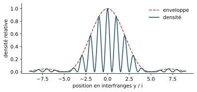
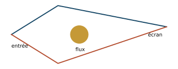
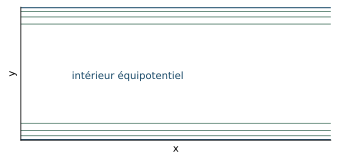
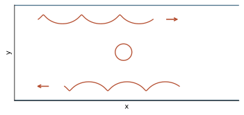
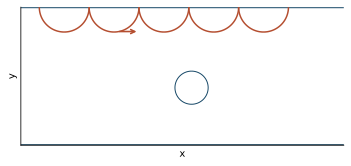
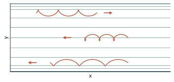
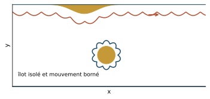
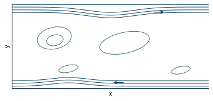
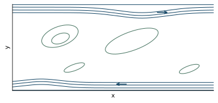
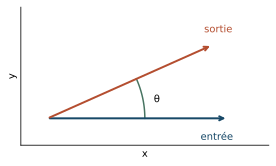

# ENS Ulm PC 2015 — Physique C · Corrigé guidé

*Corrigé rédigé par IA, non officiel. Signalez toute erreur.*

**Lecture du rapport du jury** · GPT-6.2 Astra Ultra · vitesse non renseignée

**Rédaction** · GPT-6.2 Astra Ultra · vitesse non renseignée

## Particules chargées dans un champ magnétique et effets quantiques

## Induction et impulsion

### Question 1 — Circulation du champ magnétique

**Indication.** Intégrer la forme locale sur une surface puis convertir le flux du rotationnel en circulation.

En régime stationnaire, l’équation de Maxwell–Ampère devient $\nabla\times\mathbf B=\mu_0\mathbf j$. Pour une surface orientée $S$, le théorème de Stokes donne $\oint_{\partial S}\mathbf B\cdot d\boldsymbol\ell=\mu_0\int_S\mathbf j\cdot d\mathbf S=\mu_0 I_{\rm enlacé}$. Le courant est algébrique, le sens positif du contour étant fixé par la normale à la surface.

### Question 2 — Symétries cylindriques

**Indication.** Pour une réflexion, distinguer la transformation d’un vecteur polaire de celle d’un vecteur axial.

Les spires du modèle infini forment une nappe de courant azimutale, invariante par rotation autour de $z$ et par translation selon $z$. Tout plan méridien est un plan d’antisymétrie du courant et tout plan transverse un plan de symétrie. Le champ magnétique, axial, appartient aux premiers et est normal aux seconds, donc $\mathbf B=B_z(r)\mathbf u_z$. La charge volumique et surfacique est nulle pour le solénoïde idéal neutre. Il n’y a pas de champ électrostatique propre. Lors de la variation du courant, le champ électrique induit, polaire, est normal au plan méridien, donc azimutal.

### Question 3 — Champ avant la coupure

**Indication.** Utiliser le champ d’un solénoïde long, puis passer à la limite de longueur infinie.

Avec le courant orienté comme sur le dessin, $\mathbf B=\mu_0 n I\,\mathbf u_z$ pour $r<R$ et $\mathbf B=0$ pour $r>R$. Le saut tangentiel vaut $\mu_0 nI$. Le champ électrique est nul des deux côtés dans ce régime permanent.

### Question 4 — Flux et induction

**Indication.** Fixer contour et normale avant de dériver le flux.

Sur un contour fixe, Stokes transforme $\int_S(\nabla\times\mathbf E)\cdot d\mathbf S$ en circulation. Or Maxwell–Faraday donne $\nabla\times\mathbf E=-\partial_t\mathbf B$. Ainsi $\oint_{\partial S}\mathbf E\cdot d\boldsymbol\ell=-d\Phi_B/dt$ avec $\Phi_B=\int_S\mathbf B\cdot d\mathbf S$. L’absence de monopôles rend le flux indépendant de la surface bordée par le contour.

### Question 5 — Mise en mouvement de la charge

**Indication.** Considérer un contour qui passe par la particule mais entoure le champ.

Le flux à travers un cercle entourant la bobine diminue pendant la coupure. Le champ électrique de circulation non nulle exerce alors la force $q\mathbf E$ même au point où le champ magnétique reste nul. L’impulsion est azimutale et change de sens avec $q$.

### Question 6 — Induction à l’extérieur

**Indication.** Dans le calcul du flux, limiter l’aire au disque où le champ existe.

Pour le cercle de rayon $r>R$ orienté selon $\mathbf u_\theta$, le flux vaut $\pi R^2 B(t)$. Comme $E_\theta$ est uniforme sur le cercle, $2\pi r E_\theta=-\pi R^2\dot B$, soit $\mathbf E=-R^2\dot B\,\mathbf u_\theta/(2r)$.

### Question 7 — Impulsion extérieure

**Indication.** Intégrer la dérivée temporelle du champ entre ses valeurs initiale et finale.

La durée de coupure est assez courte pour garder $r$ et la direction locale constants. L’intégrale temporelle de la force donne $\Delta\mathbf p=-qR^2[B(\mathrm{fin})-B(\mathrm{début})]\mathbf u_\theta/(2r)=qBR^2\mathbf u_\theta/(2r)$. Une fois la coupure achevée, la particule se déplace librement.

### Question 8 — Impulsion intérieure

**Indication.** Changer l’aire traversée par le flux et vérifier la continuité au rayon du solénoïde.

Pour $r<R$ le flux est $\pi r^2 B(t)$, donc $E_\theta=-r\dot B/2$. La force magnétique reste bornée durant la coupure brusque et son impulsion tend vers zéro avec la durée. Il reste $\mathbf g_{\rm em}=qBr\mathbf u_\theta/2$. Les deux expressions concordent sur $r=R$.

## Diffraction d’ondes de matière

### Question 9 — Densité stationnaire

**Indication.** Prendre le conjugué complexe avant de multiplier.

Pour $\omega$ réelle, $\psi^*\psi=\phi^*e^{i\omega t}\phi e^{-i\omega t}=|\phi|^2$. La phase temporelle tourne tandis que la densité de probabilité reste fixe.

### Question 10 — Dispersion d’une particule libre

**Indication.** Appliquer séparément les deux dérivées à l’exponentielle.

Sur $e^{i(\mathbf k\cdot\mathbf r-\omega t)}$, $\partial_t$ multiplie par $-i\omega$ et $\Delta$ par $-k^2$. L’équation de Schrödinger donne donc $\hbar\omega=\hbar^2k^2/(2m)$, soit $\omega=\hbar k^2/(2m)$.

### Question 11 — Vitesse et vecteur d’onde

**Indication.** Relier la variation de phase sur une longueur d’onde à la formule de de Broglie.

Une période spatiale correspond à $k\lambda_{\rm dB}=2\pi$. Avec $\lambda_{\rm dB}=h/(mv)$ il vient $\hbar k=mv$ et, la direction étant celle de la propagation, $\hbar\mathbf k=m\mathbf v$. Cela redonne $\mathbf v=\nabla_{\mathbf k}\omega$.

### Question 12 — Petits angles

**Indication.** Estimer séparément l’angle du premier minimum de diffraction et celui de la première frange.

La largeur angulaire du lobe principal d’une fente est de l’ordre de $\lambda_{\rm dB}/l$, tandis que les franges sont séparées de $\lambda_{\rm dB}/d$. On demande ces deux rapports petits et on observe dans la zone $|y|\ll L$. La grande dimension selon $z$ rend négligeable l’étalement dans cette direction.

### Question 13 — Équation de l’enveloppe

**Indication.** Dériver le produit deux fois selon la direction de propagation.

La partie spatiale satisfait $(\Delta+k^2)\phi=0$. En développant $\Delta(Ae^{ikx})=e^{ikx}(\Delta A+2ik\partial_xA-k^2A)$, on élimine les termes en $k^2A$. On obtient $2ik\partial_xA+\Delta A=0$, encore exact à ce stade.

### Question 14 — Dispersion paraxiale

**Indication.** Parmi les deux racines, conserver celle où l’enveloppe varie lentement en direction longitudinale.

En remplaçant $A$ par l’exponentielle donnée, on trouve $2kk_x+k_x^2+k_y^2+k_z^2=0$. La solution proche de zéro vaut $-k+\sqrt{k^2-k_y^2-k_z^2}$. Au premier ordre en $(k_y^2+k_z^2)/k^2$, $k_x\simeq-(k_y^2+k_z^2)/(2k)$.

### Question 15 — Condition à la sortie des fentes

**Indication.** Évaluer le développement en ondes planes dans le plan des ouvertures.

À $x=0^+$ le facteur $e^{ik_xx}$ vaut un. L’onde incidente étant unitaire, la valeur de l’enveloppe est donc $t(y)=\int_{-\infty}^\infty c(u)e^{iuy}\,du$. Le spectre en nombres d’onde transverses est fixé par la transmission de l’écran.

### Question 16 — Spectre angulaire des deux fentes

**Indication.** Intégrer sur une fenêtre centrée puis reporter les deux phases de translation.

Chaque fenêtre de largeur $l$ et centre $a$ contribue $e^{-iua}\int_{-l/2}^{l/2}e^{-ius}\,ds=l e^{-iua}\operatorname{sinc}(ul/2)$, avec $\operatorname{sinc}v=\sin(v)/v$. La somme pour $a=\pm d/2$ et le facteur d’inversion $1/(2\pi)$ donnent $c(u)=(l/\pi)\operatorname{sinc}(ul/2)\cos(ud/2)$. En particulier $c(0)=2l/(2\pi)$.

### Question 17 — Propagation en champ lointain

**Indication.** Développer le carré de la distance transverse après l’intégration gaussienne. Garder le terme croisé.

Insérons la transformée de $t(y')$ dans la propagation. L’intégrale en $u$ porte sur $e^{-iLu^2/(2k)+iu(y-y')}$ et vaut $e^{-i\pi/4}\sqrt{2\pi k/L}\,e^{ik(y-y')^2/(2L)}$. Dans cette phase on peut négliger $ky'^2/(2L)$ sur toute l’ouverture si $k(d+l)^2/(8L)\ll1$. Restent $e^{iky^2/(2L)}$ et la transformée de $t$ à $u=ky/L$. Ainsi $A=e^{-i\pi/4}\sqrt{2\pi k/L}\,e^{iky^2/(2L)}c(ky/L)$.

### Question 18 — Profil des franges

**Indication.** Tracer l’enveloppe à une fente puis moduler son amplitude par le facteur à deux fentes.

Au carré, la phase quadratique disparaît. Avec $n_0=n(0)$ et $i=\lambda_{\rm dB}L/d$, on trouve $n/n_0=\operatorname{sinc}^2(\pi l y/(di))\cos^2(\pi y/i)$, indépendamment de $z$. Pour $l=d/5$, l’enveloppe s’annule à $y/i=\pm5,\pm10,\ldots$ et la frange centrale est la plus intense.

### Question 19 — Interfrange

**Indication.** Chercher la période du carré du cosinus.

Le facteur $\cos^2(\pi dy/(\lambda_{\rm dB}L))$ se répète quand son argument augmente de $\pi$. L’interfrange géométrique vaut $i=\lambda_{\rm dB}L/d$.

### Question 20 — Longueur d’onde des neutrons

**Indication.** Convertir la vitesse et la masse en unités SI avant d’utiliser la relation de de Broglie.

Les valeurs du formulaire donnent $\lambda_{\rm dB}=7\times10^{-34}/(2\times10^{-27}\times200)=1{,}75\times10^{-9}\,\mathrm m$, soit environ $2\,\mathrm{nm}$ à un chiffre significatif. La longueur d’onde est très petite devant $22{,}5\,\mu\mathrm m$.

### Question 21 — Comparaison avec la figure de neutrons

**Indication.** Mesurer plusieurs intervalles entre maxima et diviser par leur nombre, en utilisant la barre horizontale du sujet.

Avec les valeurs du formulaire gardées jusqu’au bout, $i=1{,}75\,\mathrm{nm}\times5\,\mathrm m/(104\,\mu\mathrm m)\simeq84\,\mu\mathrm m$. Sur la figure, quatre intervalles centraux couvrent environ 2,8 à 3 fois la barre de $100\,\mu\mathrm m$, soit environ $70$ à $75\,\mu\mathrm m$ par intervalle. Les deux échelles sont comparables. La lecture et les constantes fournies ne permettent pas un accord au micromètre.

## Phase d’Aharonov et Bohm

### Question 22 — Phase géométrique

**Indication.** Développer les deux distances jusqu’au premier terme qui diffère.

Avec la convention orientée de (14), la différence des longueurs est $\sqrt{L^2+(y+d/2)^2}-\sqrt{L^2+(y-d/2)^2}$. Son développement à l’ordre quadratique en distance transverse vaut $dy/L$. Puisque $mv/\hbar=k$, les intégrales de l’impulsion mécanique donnent $\delta\varphi=kdy/L$. Permuter les deux chemins changerait le signe de toutes les différences de phase.

### Question 23 — Ordres constructifs

**Indication.** Soustraire les positions correspondant à deux entiers consécutifs.

De $kdy_m/L=2\pi m$ on tire $y_m=m\lambda_{\rm dB}L/d$. Deux ordres consécutifs sont séparés de $\lambda_{\rm dB}L/d$, comme dans le spectre à deux fentes.

### Question 24 — Solénoïde dans l’ombre

**Indication.** Comparer le diamètre à l’espace libre entre les bords internes des ouvertures.

Juste derrière l’écran, l’intervalle opaque central a pour largeur $d-l$. Un solénoïde centré doit avoir $2R<d-l$, avec une marge suffisante pour que l’étalement transverse des faisceaux avant son passage reste négligeable. Pour des fentes étroites et un solénoïde proche de l’écran, $R\ll d/2$ convient.

### Question 25 — Trajectoires classiques

**Indication.** Évaluer les champs là où passent les particules.

Les bras restent dans la région où $\mathbf B=0$ et le champ est indépendant du temps. La force de Lorentz est donc nulle sur chacun d’eux. À conditions initiales identiques, les trajectoires classiques restent les segments du problème sans champ.

### Question 26 — Phase magnétique

**Indication.** Ramener le parcours fermé à un cercle conservant le même sens et le même enroulement.

Le contour fermé formé en suivant un bras et en revenant par l’autre entoure le solénoïde une fois. Le raccord sur l’écran d’entrée a une contribution nulle dans la géométrie du sujet, ou provient d’un trajet incident commun. Dans la région extérieure $\mathbf g_{\rm em}=qBR^2\mathbf u_\theta/(2r)$ et sa circulation est invariante par déformation hors du flux. Le sens de (16) donne $\oint d\theta=-2\pi$, donc $\delta\varphi_{\rm AB}=-q\pi R^2B/\hbar$, indépendamment du point d’arrivée.

### Question 27 — Translation de la figure

**Indication.** Ajouter la phase indépendante de la position avant de chercher les nouveaux maxima.

La condition constructive devient $kdy/L-q\Phi/\hbar=2\pi m$ avec $\Phi=B\pi R^2$. Les franges se déplacent donc de $\Delta y=q\Phi L/(\hbar kd)$, soit une fraction $q\Phi/h$ d’interfrange. Leur espacement ne change pas. Dans le modèle à fentes de largeur finie, cette phase relative déplace la modulation à l’intérieur de l’enveloppe.

### Question 28 — Interféromètre annulaire

**Indication.** Identifier le séparateur de chemins et le point où les amplitudes sont recombinées.

Le premier contact partage l’onde électronique entre les deux branches de l’anneau, comme les ouvertures de Young. Les amplitudes se rejoignent au second contact. Leur phase relative modifie la transmission entre contacts et donc la résistance mesurée.

### Question 29 — Oscillations de la résistance

**Indication.** Passer de la périodicité en phase à celle en flux.

Pour un électron $|\delta\varphi_{\rm AB}|=eB S/\hbar$ en valeur absolue, où $S$ est l’aire de l’anneau. Chaque augmentation de phase de $2\pi$ reproduit la condition de maximum donnée. Comme le flux est linéaire en $B$, ces maxima sont régulièrement espacés en champ.

### Question 30 — Quantum de flux

**Indication.** Calculer la différence de flux nécessaire pour un tour de phase complet.

Deux maxima successifs vérifient $e\Delta B\,\pi R^2/\hbar=2\pi$. Par conséquent $\Delta B=h/(e\pi R^2)$ et le quantum de flux correspondant vaut $h/e$.

### Question 31 — Échelle de champ du circuit

**Indication.** Compter les oscillations sur une plage de champ assez large pour limiter l’erreur de lecture.

L’aire vaut $\pi(270\times10^{-9})^2=2{,}29\times10^{-13}\,\mathrm{m^2}$. Avec les données arrondies, $\Delta B\simeq0{,}015\,\mathrm T$, soit $0{,}02\,\mathrm T$ à un chiffre significatif. La figure montre environ onze intervalles entre 0 et $0{,}2\,\mathrm T$, donc $\sim0{,}018\,\mathrm T$, en accord à cette précision.

### Question 32 — Longueur thermique

**Indication.** Former d’abord une impulsion avec la masse et l’énergie thermique.

L’énergie thermique fixe une impulsion type $p_{\rm th}\sim\sqrt{m_e k_BT}$. On en déduit $l_{\rm th}=\hbar/\sqrt{m_e k_BT}$, à un facteur numérique près que l’analyse dimensionnelle ne fixe pas. Les valeurs données conduisent à environ $2\,\mathrm{nm}$ à $300\,\mathrm K$ et $3\times10^{-8}\,\mathrm m$ à $1\,\mathrm K$.

### Question 33 — Rôle du refroidissement

**Indication.** Comparer les longueurs estimées à la taille de l’anneau et expliquer ce qu’un détecteur moyenne.

Un signal d’interférence exige que la phase relative reste définie entre les deux contacts. À température ambiante, $l_{\rm th}$ est très petite devant le rayon de $270\,\mathrm{nm}$ et la moyenne thermique sur des phases différentes réduit le contraste. Refroidir accroît $l_{\rm th}\propto T^{-1/2}$ et réduit les processus inélastiques. Cette estimation dimensionnelle seule ne fixe pas la longueur réelle de cohérence de phase du matériau.

## Orbites cyclotron et quantification

### Question 34 — Force magnétique

**Indication.** Conserver le signe de la charge de l’électron.

La force de Lorentz se réduit à $\mathbf F=-e\mathbf v\times\mathbf B$. Elle est perpendiculaire à $\mathbf v$ et sa puissance est donc nulle. La norme de la vitesse reste constante.

### Question 35 — Trajectoire hélicoïdale

**Indication.** Commencer par les composantes de vitesse puis intégrer avec la position initiale imposée.

Pour $B>0$ posons $\omega_c=eB/m$. Les équations sont $\dot v_x=-\omega_c v_y$, $\dot v_y=\omega_c v_x$ et $\dot v_z=0$. Avec $u=v_x(0)$ et $w=v_z(0)$, leur intégration depuis l’origine donne $x=(u/\omega_c)\sin\omega_ct$, $y=(u/\omega_c)(1-\cos\omega_ct)$, $z=wt$. C’est une hélice d’axe parallèle au champ et de pas algébrique $2\pi w/\omega_c$.

### Question 36 — Rayon et fréquence

**Indication.** Éliminer le temps des équations paramétriques.

Dans le plan $z=0$, les équations précédentes vérifient $x^2+(y-u/\omega_c)^2=(u/\omega_c)^2$. Ainsi $R=m|u|/(eB)$ et $f_c=eB/(2\pi m)$. La fréquence ne dépend pas de la vitesse, contrairement au rayon.

### Question 37 — Longueur magnétique

**Indication.** Distinguer l’impulsion qui intervient dans la longueur d’onde de la quantité de mouvement mécanique.

En coordonnées autour du centre de l’orbite, le mouvement pour $B>0$ est dans le sens $\mathbf u_\theta$. Puisque $mv=eBR$, l’impulsion canonique vaut $p=mv-eBR/2=eBR/2$. La règle $2\pi Rp=(n+\gamma)h$ devient $\pi eBR_n^2=(n+\gamma)h$, d’où $R_n=\sqrt{2(n+\gamma)}\,l_B$ avec $l_B=\sqrt{\hbar/(eB)}$.

### Question 38 — Niveaux d’énergie

**Indication.** Réécrire l’énergie cinétique en fonction du rayon quantifié.

Le mouvement circulaire donne $v_n=\omega_c R_n$. Ainsi $E_n=m\omega_c^2(n+\gamma)l_B^2$. En remplaçant $l_B^2$ par $\hbar/(eB)$ et $eB$ par $m\omega_c$, il reste $E_n=(n+\gamma)\hbar\omega_c$. Deux niveaux successifs sont équidistants en énergie.

### Question 39 — Fréquence à un tesla

**Indication.** Ne pas confondre pulsation et fréquence en hertz.

Avec les nombres du formulaire, $f_c=2\times10^{-19}/(2\pi\times9\times10^{-31})\simeq3{,}5\times10^{10}\,\mathrm{Hz}$. L’ordre de grandeur est donc quelques dizaines de GHz, soit $4\times10^{10}\,\mathrm{Hz}$ à un chiffre significatif avec ces données.

### Question 40 — Échelle de température

**Indication.** Convertir l’écart énergétique en kelvins avec la constante de Boltzmann.

L’écart $\hbar\omega_c$ entre deux niveaux est à comparer à l’énergie thermique $k_BT$. L’égalité donne $T_0=\hbar eB/(mk_B)\simeq2\,\mathrm K$ à $1\,\mathrm T$ avec les constantes arrondies. Pour $T\ll T_0$, l’excitation thermique vers le niveau suivant est peu probable.

### Question 41 — Absorption résonante

**Indication.** Identifier l’énergie du photon avec la différence des deux premiers niveaux.

Au départ les électrons occupent le niveau $n=0$. L’onde peut fournir un quantum d’énergie $\hbar\omega$ et exciter $n=1$ si $\hbar\omega=E_1-E_0=\hbar\omega_c$. Cette égalité prévoit un maximum d’absorption à la pulsation cyclotron.

### Question 42 — Mesure de la résonance

**Indication.** Contrôler séparément la linéarité et la valeur de la pente.

Le point du laser $\lambda=96\,\mu\mathrm m$ correspond à $f=c/\lambda=3{,}1\times10^{12}\,\mathrm{Hz}$ pour $B\simeq8\,\mathrm T$. Les points de droite suivent une droite passant près de l’origine, comme $f\propto B$. Mais avec $m_e$ on prévoirait seulement quelques $10^{11}\,\mathrm{Hz}$ à $8\,\mathrm T$. La forme de la loi est vérifiée et sa pente exige un autre paramètre de masse.

### Question 43 — Masse effective

**Indication.** Le laser fournit une fréquence et la position du pic donne le champ à utiliser.

Le point résonant donne $m^*=eB/(2\pi f)=eB\lambda/(2\pi c)$. Avec les constantes du formulaire on obtient $8\times10^{-32}\,\mathrm{kg}$, environ $0{,}09\,m_e$. Avec la charge élémentaire plus précise, $m^*\simeq6{,}5\times10^{-32}\,\mathrm{kg}\simeq0{,}07\,m_e$. Cela concorde avec la pente expérimentale, environ $1{,}6\,\mathrm{meV/T}$, du graphe en énergie.

## Électrons du graphène

### Question 44 — Feuillets de graphite

**Indication.** Comparer les liaisons dans le plan avec la cohésion entre plans.

Dans un feuillet, chaque atome de carbone est lié à trois voisins par des liaisons covalentes, formant un réseau en nid d’abeilles. Les feuillets sont empilés, avec dans le graphite usuel un décalage d’une couche à la suivante. Les interactions interfeuillets, essentiellement de van der Waals, sont beaucoup plus faibles que les liaisons dans le plan. Le clivage peut ainsi isoler une monocouche de graphène.

### Question 45 — Dispersion de la lumière

**Indication.** Partir de l’équation d’onde de Maxwell dans le vide.

Dans le vide une onde électromagnétique obéit à $k^2=\omega^2/c^2$ et, pour la branche de pulsation positive, $\omega=c|\mathbf k|$. La pente de dispersion est constante.

### Question 46 — Énergie et impulsion du photon

**Indication.** Multiplier la relation de dispersion par la constante de Planck réduite.

Les relations de Planck–Einstein et de de Broglie s’écrivent $E=\hbar\omega$ et $\mathbf p=\hbar\mathbf k$. La dispersion lumineuse donne donc $E=c|\mathbf p|$.

### Question 47 — Branche électronique du graphène

**Indication.** Transposer la dispersion linéaire du photon à la vitesse propre au matériau.

Dans le modèle du sujet, la vitesse caractéristique est $\bar c$. Sur la branche positive, la dispersion sans masse s’écrit $E=\bar c\,p$, l’énergie étant comptée depuis le point de contact des bandes.

### Question 48 — Norme de la vitesse

**Indication.** Calculer la pente de la relation énergie–impulsion.

Pour $p>0$, la vitesse de groupe est $\nabla_{\mathbf p}E=\bar c\,\mathbf p/p$. Sa norme vaut toujours $\bar c$. Une augmentation de l’impulsion augmente donc l’énergie en gardant la même norme de vitesse.

### Question 49 — Rotation de la direction

**Indication.** Dériver le carré de l’impulsion, puis isoler l’équation du vecteur unitaire.

Puisque $\mathbf p$ et $\mathbf v$ sont parallèles, $d(p^2)/dt=-2e\mathbf p\cdot(\mathbf v\times\mathbf B)=0$. Avec $\mathbf p=p\mathbf u$, il reste $\dot{\mathbf u}=(e\bar c B/p)\mathbf u_z\times\mathbf u$. Dans le plan la direction tourne uniformément tandis que la vitesse a une norme constante. Son intégration décrit un cercle.

### Question 50 — Pulsation dépendant de l’énergie

**Indication.** Relier la vitesse tangentielle, le rayon et la vitesse angulaire.

En lisant le coefficient de rotation on trouve $\omega_c=e\bar c B/p=e\bar c^2 B/E$. La fréquence vaut cette quantité divisée par $2\pi$. Le rayon est $R=\bar c/\omega_c=p/(eB)=E/(eB\bar c)$.

### Question 51 — Niveaux du graphène

**Indication.** Insérer les rayons quantifiés dans la loi énergie–rayon propre au graphène.

La relation $E=eB\bar cR$ combinée à $R_n=\sqrt{2(n+\gamma)\hbar/(eB)}$ donne $E_n=\bar c\sqrt{2e\hbar B(n+\gamma)}$. À champ fixé, l’intervalle entre deux niveaux diminue lorsque $n$ augmente.

### Question 52 — Pics en spectroscopie tunnel

**Indication.** Interpréter la conductance différentielle comme une sonde des états disponibles à l’énergie choisie.

La tension déplace de $eV$ les énergies relatives dans les deux conducteurs. Lorsque la pointe sonde un niveau de Landau du graphène, la densité d’états accessibles augmente fortement. Le courant varie alors rapidement et $dI/dV$ présente un pic. L’origine de tension peut inclure un décalage commun à tous les pics.

### Question 53 — Décalage de quantification

**Indication.** Former la différence entre le niveau d’indice n et celui d’indice zéro avant de comparer les lois.

À un coefficient près, $V_n-V_0$ est proportionnel à $\sqrt B(\sqrt{n+\gamma}-\sqrt\gamma)$. Pour reproduire une même droite en $\sqrt{Bn}$ pour tous les indices, il faut $\gamma=0$. Un décalage constant de tension est déjà éliminé par la soustraction de $V_0$ et ne peut corriger la courbure pour $\gamma>0$.

## Transport de Hall

### Question 54 — Référentiel de dérive

**Indication.** Développer la force de Lorentz avec la vitesse décomposée en deux termes.

Posons $\mathbf v=\mathbf v'+\mathbf v_d$, avec $\mathbf v_d=\mathbf E\times\mathbf B/B^2$ constante. Puisque $\mathbf E\perp\mathbf B$, $(\mathbf E\times\mathbf B)\times\mathbf B=-B^2\mathbf E$. La somme $\mathbf E+\mathbf v_d\times\mathbf B$ est nulle et $m\dot{\mathbf v}'=q\mathbf v'\times\mathbf B$. Dans ce référentiel galiléen, seul subsiste le mouvement cyclotron.

### Question 55 — Champ lentement variable

**Indication.** Comparer l’échelle de variation du champ à la taille d’une orbite proche du niveau fondamental.

Si le champ change peu sur le diamètre de l’orbite occupée, on peut au premier ordre le remplacer par sa valeur au centre. Sur un tour le mouvement est donc une rotation superposée à une dérive locale $\mathbf E(\mathbf r)\times\mathbf B/B^2$. On réévalue cette vitesse à mesure que le centre se déplace.

### Question 56 — Équipotentielle suivie

**Indication.** Prendre le produit scalaire de la vitesse de dérive avec le gradient.

Avec $\mathbf E=-\nabla V$, le centre se déplace à $\mathbf v_d=\mathbf B\times\nabla V/B^2$. Ainsi $dV/dt=\nabla V\cdot\mathbf v_d=0$. Le centre guide suit une ligne de niveau de $V$ et l’électron tourne autour de ce centre.

### Question 57 — Carte du potentiel de bord

**Indication.** Une même valeur de y donne le même potentiel tout le long de l’échantillon.

Le potentiel $V_{\rm bord}(y)$ est indépendant de $x$. Ses courbes de niveau près des bords sont donc des droites $y=\mathrm{constante}$ parallèles à $x$, d’autant plus rapprochées à écart de potentiel fixé que $|V'|$ est grand. Tout l’intérieur plat appartient à la même équipotentielle. L’énergie potentielle d’un électron est $-eV$, d’où la barrière d’énergie aux deux extrémités.

### Question 58 — Sens de déplacement aux bords

**Indication.** Lire le signe de la pente du potentiel sur chacun des deux flancs.

La vitesse longitudinale vaut $v_{d,x}=-V'(y)/B$. Sur le bord inférieur du dessin $V'_{\rm bord}>0$, ce qui donne une dérive vers $-x$ pour $B>0$. Près du bord supérieur $V'_{\rm bord}<0$ et la dérive va vers $+x$. Les trajectoires restent dans une bande transverse de l’ordre de l’extension de l’orbite autour de leur centre.

### Question 59 — Bords et centre sans tension

**Indication.** Superposer une rotation locale à la translation du centre et garder la même orientation de rotation aux deux bords.

Au centre $\nabla V=0$ et l’électron décrit un cercle dont le centre est fixe. Près de chaque bord il effectue la même rotation cyclotron, avec un centre animé de la dérive trouvée en Q58. Les courbes présentent donc des boucles qui progressent vers la gauche en bas et vers la droite en haut.

### Question 60 — Réflexion sur une paroi raide

**Indication.** Réfléchir la vitesse au point d’impact, puis reconstruire le nouveau centre du cercle.

À chaque choc élastique la composante normale de la vitesse change de signe et la composante tangentielle est conservée. Entre deux impacts l’électron suit un arc cyclotron de rayon inchangé. Les arcs successifs se raccordent en trajectoire sautillante, vers $+x$ sur le bord supérieur montré et vers $-x$ sur le bord inférieur. L’orbite intérieure qui ne rencontre aucun bord reste un cercle fermé.

### Question 61 — Carte en présence d’une tension

**Indication.** Additionner les pentes des deux potentiels avant de décider du sens de dérive.

Pour une chute de potentiel uniforme dans le volume, $V=V_{\rm bord}+U_y(y/L_y-1/2)$. Les équipotentielles restent parallèles à $x$, désormais distinctes aussi au centre. Pour $U_y>0$, le centre des orbites du volume dérive vers $-x$ à $U_y/(BL_y)$ en valeur absolue. Aux bords raides les sens dominants restent ceux de Q58, la tension renforçant la dérive en bas et la réduisant en haut.

### Question 62 — Densité de courant

**Indication.** Compter la charge qui franchit un élément de section par unité de temps.

Une densité surfacique $n$ de porteurs de charge $-e$ porte, après moyenne sur un tour cyclotron, le courant surfacique $\mathbf j=-en\mathbf v_d$ en $\mathrm{A/m}$. La vitesse cyclotron relative a une moyenne nulle. La relation $\mathbf v_d=\mathbf B\times\nabla V/B^2$ suit de $\mathbf E=-\nabla V$.

### Question 63 — Intégration sur la largeur

**Indication.** Calculer la densité de remplissage avec la longueur magnétique, puis intégrer la composante normale à la coupe.

Une cellule de surface $2\pi l_B^2$ remplie par un électron donne $n=1/(2\pi l_B^2)=eB/h$. Le courant traversant la coupe vaut $I_x=\int_0^{L_y}j_x\,dy=-(e^2B/h)\int_0^{L_y}v_{d,x}\,dy$. Il n’y a pas de facteur d’épaisseur pour un courant déjà surfacique.

### Question 64 — Loi de Hall

**Indication.** Reconnaître une dérivée exacte dans l’intégrale transversale.

Comme $v_{d,x}=-(\partial_y V)/B$, $I_x=(e^2/h)[V(x,L_y)-V(x,0)]$. Les contributions identiques du potentiel de bord s’annulent, et les potentiels imposés diffèrent de $U_y$. On obtient $I_x=(e^2/h)U_y$, indépendamment de la répartition de la pente sur la largeur.

### Question 65 — Valeur de la conductance

**Indication.** Vérifier les unités en utilisant qu’un joule vaut un coulomb multiplié par un volt.

Pour $U_x=0$, $\sigma_{xy}=I_x/U_y=e^2/h$. Avec les nombres arrondis du sujet on trouve $5{,}7\times10^{-5}\,\mathrm S$ ; les constantes usuelles donnent $3{,}87\times10^{-5}\,\mathrm S$. L’écart vient surtout de la charge élémentaire arrondie, qui intervient au carré.

### Question 66 — Matrice antisymétrique

**Indication.** Appliquer d’abord une tension selon y seule pour lire la seconde colonne.

Avec $V$ indépendant de $x$, la dérive transverse est nulle, donc $I_y=0$ malgré $U_y\ne0$ et $\sigma_{yy}=0$. Les symétries fournies donnent alors $\sigma_{xx}=0$ et $\sigma_{yx}=-e^2/h$. Pour des tensions quelconques, $(I_x,I_y)=(e^2/h)(U_y,-U_x)$.

### Question 67 — Résistances longitudinales

**Indication.** Inverser toute la matrice à deux dimensions.

L’inversion de la relation précédente donne $(U_x,U_y)=(h/e^2)(-I_y,I_x)$. La diagonale de la matrice de résistance est donc nulle, $\rho_{xx}=\rho_{yy}=0$. Un courant longitudinal produit une tension transverse.

## Trajectoires en présence de désordre

### Question 68 — Îlots de diffusion

**Indication.** Comparer le périmètre fermé d’un îlot au bord qui relie les deux extrémités du conducteur.

Au bord supérieur, les collisions successives font avancer l’électron vers $+x$. Une protubérance détourne les arcs localement et le mouvement reprend en aval. Autour d’un îlot isolé du volume, les mêmes rebonds contournent son périmètre et maintiennent le centre à une distance de l’ordre du rayon cyclotron de l’îlot. Cette orbite reste donc localisée tandis que celle de bord peut parcourir l’échantillon.

### Question 69 — Identification des lignes de niveau

**Indication.** Suivre les courbes en continu, indépendamment de leur courbure locale.

Dans la carte fournie, les paquets de lignes allongées contre les deux bords horizontaux joignent la gauche à la droite. Ce sont les équipotentielles de bord. Les ovales de l’intérieur, parfois emboîtés autour d’un même extremum du potentiel, sont les équipotentielles des défauts de volume. Le dessin distingue ces deux familles en suivant chaque ligne jusqu’à sa fermeture ou sa sortie.

### Question 70 — Prolongement des trajectoires

**Indication.** Distinguer le petit mouvement cyclotron de la courbe parcourue par son centre.

On prolonge chacun des deux débuts rouges par une rotation cyclotron dont le centre reste sur sa ligne de niveau. En haut il avance le long de la ligne ouverte, vers $+x$ pour le champ donné. Dans le volume il fait le tour de l’ovale en gardant la direction tangente imposée par $\mathbf B\times\nabla V$, puis revient au voisinage du point initial. Les excursions de cette seconde trajectoire sont bornées.

### Question 71 — Faible polarisation et désordre

**Indication.** Faire varier continûment une carte de niveaux et regarder quelles courbes traversent toute la longueur.

En ajoutant la pente $U_y/L_y$ au potentiel, on incline le relief. Les lignes fermées autour des extrema isolés se déforment ou se décentrent, tandis que les lignes ouvertes près des bords persistent pour une perturbation assez faible. Sur le plateau décrit par le sujet, seules les trajectoires étendues qui relient les contacts transportent une charge nette entre eux. Un courant qui boucle autour d’un îlot ne contribue pas au courant transmis.

### Question 72 — Robustesse de la conductance

**Indication.** Reprendre l’intégrale à abscisse fixée en gardant les valeurs aux contacts.

Même lorsque $V$ dépend de $x$, à chaque coupe $v_{d,x}=-\partial_yV/B$. L’intégration de Q63 redonne exactement $I_x=(e^2/h)[V(x,L_y)-V(x,0)]$. Les contacts idéaux imposent cette différence égale à $U_y$, donc $\sigma_{xy}=e^2/h$ persiste. Le résultat utilise le remplissage et l’hypothèse de désordre lent explicitement conservés.

## Rotation de Faraday

### Question 73 — Polarisation propre droite

**Indication.** Multiplier la matrice de Hall par le vecteur de polarisation donné.

Sur le vecteur de composantes $(1,-i)$, la matrice de réponse donne $(\sigma_{xx}-i\sigma_{xy},-\sigma_{xy}-i\sigma_{xx})=(\sigma_{xx}-i\sigma_{xy})(1,-i)$. Le courant surfacique est donc colinéaire au champ complexe. En le distribuant sur l’épaisseur, $\mathbf j_{3D}=(\sigma_{xx}-i\sigma_{xy})\mathbf E/d$.

### Question 74 — Maxwell dans la lame

**Indication.** Conserver à la fois le courant de conduction et le courant de déplacement.

La neutralité locale et l’absence de monopôles donnent $\nabla\cdot\mathbf E=\nabla\cdot\mathbf B_{\rm onde}=0$. Les deux rotations vérifient $\nabla\times\mathbf E=-\partial_t\mathbf B_{\rm onde}$ et $\nabla\times\mathbf B_{\rm onde}=\mu_0(\sigma_{xx}-i\sigma_{xy})\mathbf E/d+c^{-2}\partial_t\mathbf E$. Le champ de biais statique est déjà pris en compte via les coefficients de Hall.

### Question 75 — Dispersion dans le milieu

**Indication.** Utiliser Faraday pour éliminer le champ magnétique de l’onde.

Avec $e^{i(kz-\omega t)}$, Faraday donne $\mathbf B_{\rm onde}=(k/\omega)\mathbf u_z\times\mathbf E$. Dans Maxwell–Ampère on a $\mathbf u_z\times(\mathbf u_z\times\mathbf E)=-\mathbf E$ car l’onde est transverse. On obtient $k^2=\omega^2/c^2+i\mu_0\omega(\sigma_{xx}-i\sigma_{xy})/d$, soit $(kc/\omega)^2=1+i(\sigma_{xx}-i\sigma_{xy})/(\omega\epsilon_0d)$. Les deux divergences sont satisfaites.

### Question 76 — Indice du mode droit

**Indication.** Développer la racine de la relation de dispersion sur la branche proche de l’unité.

Pour $|n_+-1|\ll1$, $n_+^2-1\simeq2(n_+-1)$. Avec $k_0=\omega/c$ et $Z_0=1/(c\epsilon_0)\simeq3{,}7\times10^2\,\Omega$, il vient $n_+=1+(i\sigma_{xx}+\sigma_{xy})Z_0/(2k_0d)$. Le signe positif de la partie imaginaire produit une décroissance pour une conductance dissipative positive.

### Question 77 — Indice du mode gauche

**Indication.** Changer le signe de i dans le vecteur propre avant de reprendre la dispersion.

Le vecteur $(1,i)$ est un autre vecteur propre, de valeur propre $\sigma_{xx}+i\sigma_{xy}$. En répétant l’élimination des champs puis le développement, $n_-=1+(i\sigma_{xx}-\sigma_{xy})Z_0/(2k_0d)$. Les deux modes ont la même atténuation et des phases différentes pour les coefficients réels considérés.

### Question 78 — Recombinaison en sortie

**Indication.** Factoriser la phase moyenne puis utiliser la demi-différence de phase des deux modes.

Écrivons $\mathbf u_x=(\boldsymbol\epsilon_++\boldsymbol\epsilon_-)/\sqrt2$. Après l’épaisseur $d$, chaque terme acquiert $e^{ik_0 n_\pm d}$. En factorisant $e^{ik_0d-\eta}$, les phases restantes sont $e^{\pm i\theta}$, où $\eta=Z_0\sigma_{xx}/2$ et $\theta=Z_0\sigma_{xy}/2$. La somme donne $\mathbf E(d)=E_0e^{i(k_0d-\omega t)}e^{-\eta}(\cos\theta\,\mathbf u_x+\sin\theta\,\mathbf u_y)$.

### Question 79 — État de polarisation

**Indication.** Vérifier si les composantes cartésiennes ont un déphasage relatif.

Les composantes $x$ et $y$ portent le même facteur temporel complexe et leur rapport est réel. Le champ réel oscille donc sur une droite faisant l’angle algébrique $\theta$ avec $x$. La transmission en amplitude dans ce modèle est $e^{-\eta}$ et en intensité $e^{-2\eta}$.

### Question 80 — Constante de structure fine

**Indication.** Remplacer la conductance par son quantum et écrire h en fonction de la constante réduite.

Sur le plateau, $\eta=0$ et $\theta=Z_0e^2/(2h)=e^2/(4\pi\epsilon_0\hbar c)=\alpha$ radians. L’angle prédit pour un niveau rempli est indépendant de l’épaisseur dans l’approximation faite.

### Question 81 — Lecture du plateau optique

**Indication.** Comparer l’angle au centre du plateau après conversion de radians en milliradians.

Près de $nh/(eB)=1$, la courbe de gauche est au plateau unité et les points optiques du centre sont vers $7{,}1$ à $7{,}4\,\mathrm{mrad}$. La prédiction $\alpha\simeq1/137\,\mathrm{rad}=7{,}30\,\mathrm{mrad}$ tombe dans cette zone. Les points aux extrémités s’écartent progressivement du niveau central. La comparaison fine requiert la valeur précise de $\alpha$ puisque les constantes du formulaire n’ont qu’un chiffre significatif.
