# ENS de Lyon — PC, Physique-chimie 2015 · Corrigé guidé

*Corrigé rédigé par IA, non officiel.*

**Rédaction (tour 1)** · GPT-6.2 Astra Ultra · vitesse non renseignée

**Couverture partielle.** Les 35 questions de physique et 40 questions de chimie sont traitées intégralement. C17 décrit la coupure de l’alcène en diacide. Ses conditions opératoires ne sont pas détaillées.

Le corrigé s’appuie sur le sujet officiel. Aucun rapport de jury propre à cet écrit n’a été identifié dans les catalogues consultés.

## Chimie. La fenchone du fenouil

### Question C1 — Deux familles d'huiles

> [!INDICATION]
> Comparez les constituants majoritaires et leur volatilité.

#### Solution

Une huile essentielle est un mélange de petites molécules odorantes et volatiles, souvent terpéniques. Une huile végétale ordinaire est constituée majoritairement de triglycérides, triesters du glycérol et d'acides gras, bien moins volatils.

### Question C2 — Historique de la chiralité

> [!INDICATION]
> Pensez à la séparation de cristaux images l'un de l'autre dans un miroir.

#### Solution

Louis Pasteur a séparé manuellement des cristaux de tartrate double de sodium et d'ammonium issus d'un mélange racémique. Les solutions des deux formes dévient la lumière polarisée en sens opposés. Ce sont des énantiomères.

### Question C3 — Rotation de la lumière polarisée

> [!INDICATION]
> Employez une référence de solvant et précisez le sens du signe.

#### Solution

Dans un polarimètre, on règle le zéro avec le solvant puis on mesure la rotation du plan de polarisation après la traversée d'une cuve contenant la solution, à longueur d'onde et température indiquées. La notation (d) signifie dextrogyre, $\alpha>0$. Le pouvoir rotatoire spécifique vaut $[\alpha]=\alpha/(lc)$ dans les unités de longueur de cuve et de concentration annoncées.

### Question C4 — Configuration des têtes de pont

> [!INDICATION]
> Numérotez le bicyclo[2.2.1]heptane en donnant au carbonyle le numéro 2.

#### Solution

Pour la (+)-fenchone dessinée, les centres sont **1S et 4R**. À C1 les priorités sont C2 (voisinage O,O,C), C7 (pont court), C6, puis CH₃. Pour départager C7 et C6, le chemin via C7 atteint C4, lié à deux autres carbones, avant le chemin via C6. À C4 les priorités sont C3 (C,C,C), C7, C5, puis H. Via C7 on atteint ici C1, plus substitué que C6 atteint via C5. L'orientation des triangles de priorité, en mettant le dernier groupe en arrière, donne les configurations ci-dessus. C3 porte deux méthyles identiques.

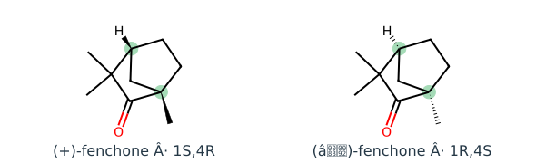

### Question C5 — Nombre de stéréoisomères accessibles

> [!INDICATION]
> Les deux ponts longs et le pont court relient les mêmes têtes de pont.

#### Solution

La géométrie du petit bicyclo[2.2.1]heptane lie la configuration des deux têtes. Inverser l'une seule demanderait un pont traversant la cage. Il existe deux formes permises, $(1S,4R)$ et $(1R,4S)$, images non superposables l'une de l'autre. Elles sont énantiomères.

### Question C6 — Principe de l'hydrodistillation

> [!INDICATION]
> Écrivez la pression de vapeur totale lorsque deux liquides non miscibles coexistent.

#### Solution

L'eau et les composés volatils de l'huile fournissent chacun leur pression partielle de vapeur. La somme peut atteindre la pression ambiante à une température inférieure à celle d'ébullition de chacun des deux corps purs. La vapeur mixte est condensée et l'huile se sépare de l'eau par décantation.

### Question C7 — Montage d'hydrodistillation

> [!INDICATION]
> Suivez la matière du ballon au récepteur et indiquez le trajet de l'eau de refroidissement.

#### Solution

Le schéma relie le ballon contenant l'eau et la matière végétale à une tête de distillation, puis à un réfrigérant descendant et à un récipient collecteur. L'eau de refroidissement entre au raccord inférieur et sort au raccord supérieur. Le récepteur recueille le distillat biphasique à pression atmosphérique.

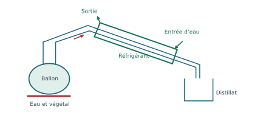

### Question C8 — Diagramme eau–fenchone

> [!INDICATION]
> Convertissez la fraction massique donnée en fraction massique d'eau.

#### Solution

Sur l'axe horizontal $w_{\rm eau}$, les corps purs bouillent à 193 °C en 0 et à environ 100 °C en 1. Le palier hétéroazéotropique à 96 °C relie les deux liquides purs, avec vapeur de composition $w_H=1-0{,}65=0{,}35$. Au-dessous du palier, deux liquides non miscibles coexistent pour $0<w<1$. Entre palier et courbe de rosée gauche se trouvent vapeur et fenchone liquide. Entre palier et courbe de rosée droite se trouvent vapeur et eau liquide. Au-dessus des deux branches, seule la vapeur subsiste. Sur le palier coexistent vapeur, eau liquide et fenchone liquide.

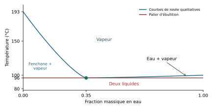

### Question C9 — Lecture d'une chromatographie sur silice

> [!INDICATION]
> Rapportez la hauteur des taches à celle du front d'éluant.

#### Solution

L'éluant entraîne les constituants sur la silice, où ils sont retenus différemment. En plaçant le dépôt à 0 et le front à 1, on situe deux taches majeures à 0,67 (fenchone) et 0,84 (trans-anéthol). Dans ces conditions la silice polaire retient davantage la fenchone, cohérent avec son carbonyle.

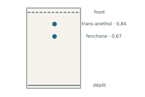

### Question C10 — Modifier la migration et séparer des énantiomères

> [!INDICATION]
> Sur silice, un éluant plus polaire concurrence davantage les molécules adsorbées.

#### Solution

Augmenter la part de cyclohexane, par exemple passer de 6:4 à 8:2 cyclohexane/acétate d'éthyle, diminue la force éluante et donc les $R_f$. La silice et cet éluant sont achiraux. Les deux énantiomères de la fenchone y donnent la même tache.

### Question C11 — Séparation de la fenchone de l'huile

> [!INDICATION]
> Choisissez une séparation préparative exploitant la différence de rétention observée.

#### Solution

Une chromatographie sur colonne de silice peut séparer la fenchone du trans-anéthol et d'autres constituants dont les polarités diffèrent. On repère les fractions renfermant la fenchone par comparaison avec un témoin en CCM. Une chromatographie en phase gazeuse convient également à l'analyse de ces matières volatiles, avec collecte si la colonne est préparative.

## Du méthacrylate à la cétone cyclique

### Question C12 — Origine du méthacrylate de méthyle

> [!INDICATION]
> Conservez les trois carbones du propanal et identifiez le carbone apporté par le méthanal.

#### Solution

Le propanal CH₃CH₂CHO et HCHO donnent d'abord le β-hydroxyaldéhyde HOCH₂CH(CH₃)CHO. La déshydratation conduit à A, la méthacroléine $\mathrm{CH_2=C(CH_3)CHO}$. L'oxydation de son aldéhyde donne B, l'acide méthacrylique $\mathrm{CH_2=C(CH_3)CO_2H}$. Son ester méthylique est le MMA $\mathrm{CH_2=C(CH_3)CO_2Me}$.

### Question C13 — Aldolisation et crotonisation

> [!INDICATION]
> Quel aldéhyde dispose d'un proton en α ?

#### Solution

La base prélève un H en α du propanal. Le carbone nucléophile de l'énolate attaque le carbone du méthanal, dont la liaison π se déplace sur O. La protonation de l'alcoolate donne HOCH₂CH(CH₃)CHO. Une déprotonation en α suivie de l'élimination du groupe hydroxyle (mécanisme E1cb) forme la double liaison conjuguée de la méthacroléine.

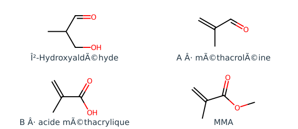

### Question C14 — Spectre du MMA

> [!INDICATION]
> Le méthoxy et le méthyle vinylique n'ont pas le même voisinage électronique.

#### Solution

Le singulet à 3,75 ppm (3 H) correspond à OCH₃, déblindé par O. Celui à 1,95 ppm (3 H) est le méthyle porté par le carbone vinylique. Aucun des deux n'a de voisin protoné en position vicinale conduisant à un couplage résolu. Les deux doublets à 5,56 et 6,10 ppm (1 H chacun) sont les H du CH₂ terminal, l'un cis et l'autre trans relativement à l'ester. Ils ne sont pas équivalents et se couplent à travers deux liaisons, avec $|{}^2J|=0{,}55$ Hz.

### Question C15 — Conformations du butadiène

> [!INDICATION]
> Considérez la rotation autour de la liaison simple centrale.

#### Solution

Les deux conformations conjuguées principales sont s-trans et s-cis. La forme s-trans est la plus stable car les extrémités sont plus éloignées. La conformation s-cis rapproche les carbones terminaux et est celle qui permet la cycloaddition suivante.

### Question C16 — Première construction cyclique

> [!INDICATION]
> Compte tenu du bilan des atomes, identifiez la cycloaddition entre un diène et un alcène.

#### Solution

La réaction de Diels–Alder forme le 1-méthylcyclohex-3-ène-1-carboxylate de méthyle. Dans un transfert concerté de six électrons π, chacune des extrémités du diène forme une liaison σ avec l'un des deux carbones de l'alcène du MMA et une nouvelle liaison π apparaît entre les deux carbones centraux du diène. Le cycle est à six chaînons.

### Question C17 — Passage au diacide

> [!INDICATION]
> Examinez chacun des deux carbones de l'alcène avant d'ouvrir le cycle.

#### Solution

Les deux carbones oléfiniques de 1 portent chacun un H. Une coupure oxydante de C=C jusqu'aux fonctions acides donne le diacide 2, $\mathrm{HOOC-CH_2-C(CH_3)(CO_2Me)-CH_2-CH_2-COOH}$. L'ester déjà porté par le carbone quaternaire subsiste. La réponse explicite la transformation et ses produits. Les conditions opératoires d'oxydation ne sont pas détaillées.

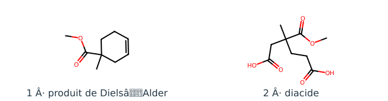

### Question C18 — Carbonate ou hydrogénocarbonate

> [!INDICATION]
> Le nom et la formule employés par le sujet ne désignent pas le même sel.

#### Solution

La formule écrite K₂CO₃ est celle du carbonate de potassium, soit deux K⁺ et CO₃²⁻. Dans une forme de Lewis, C porte une liaison C=O et deux liaisons C–O⁻. Les trois formes mésomères équivalentes donnent un anion plan trigonal $AX_3$, angles voisins de 120°. Le bicarbonate proprement dit est KHCO₃, K⁺ et HCO₃⁻, toujours plan trigonal au carbone (un OH fixé). Le diacide a deux protons carboxyliques. Cinq équivalents de l'une ou l'autre base sont un excès par rapport à ces deux acidités, ce qui favorise la présence des carboxylates.

### Question C19 — Formation du triester

> [!INDICATION]
> Identifiez l'extrémité nucléophile dans le carboxylate.

#### Solution

Les deux acides externes de 2 deviennent deux esters méthyliques. On obtient $\mathrm{MeOOC-CH_2-C(CH_3)(CO_2Me)-CH_2-CH_2-CO_2Me}$. Chaque carboxylate résulte d'une déprotonation. Un doublet de son oxygène attaque le carbone méthylique de l'électrophile et la liaison C–I se rompt vers I. C'est une substitution nucléophile bimoléculaire sur le méthyle, répétée aux deux extrémités.

### Question C20 — Contrôle par spectroscopie IR

> [!INDICATION]
> Quelle vibration donnerait la large enveloppe caractéristique d'un acide carboxylique ?

#### Solution

La disparition de la large bande O–H acide autour de 2500–3500 cm⁻¹ est compatible avec l'estérification des deux fonctions COOH. Les carbonyles restent présents. Cette seule absence confirme la disparition du groupe O–H dans les limites de détection et ne prouve pas à elle seule toute la structure du triester.

### Question C21 — Propriétés du DMF

> [!INDICATION]
> Distinguez polarité moléculaire et réponse collective du solvant.

#### Solution

Le moment dipolaire mesure la séparation des charges à l'échelle de la molécule. La permittivité relative mesure la diminution des interactions électrostatiques dans le milieu par rapport au vide. Le DMF est un solvant polaire aprotique. Sa permittivité favorise la séparation des ions, le carbonyle solvate les cations, et l'absence de H donneur fort laisse le carboxylate disponible pour la substitution.

### Question C22 — Énolates d'esters

> [!INDICATION]
> Comparez les ordres de grandeur des acidités sur une même échelle de référence.

#### Solution

On retient environ 16 pour le couple méthanol/méthanolate et environ 25 pour le proton en α d'un ester simple, valeurs indicatives dépendant du solvant. L'énolate n'est formé qu'en faible proportion par le méthanolate, mais peut être consommé par cyclisation. Un ester porteur d'un proton α peut aussi avoir une forme énolique minoritaire. L'eau peut protoner l'énolate, hydrolyser l'ester et modifier la base disponible. L'atmosphère inerte évite notamment les apports d'humidité et l'interception d'intermédiaires par l'air.

### Question C23 — Deux fermetures de Dieckmann

> [!INDICATION]
> Suivez alternativement les deux CH₂ situés en α des esters terminaux de 3.

#### Solution

Notons $G=\mathrm{C(CH_3)(CO_2Me)}$. La chaîne est $\mathrm{MeOOC-CH_2-G-CH_2-CH_2-CO_2Me}$. Chaque CH₂ α terminal peut devenir énolate et attaquer le carbonyle de l'autre extrémité. L'intermédiaire tétraédrique élimine MeO⁻, puis le β-cétoester est stabilisé par déprotonation et reprotoné au bilan. Les deux structures 4/5 sont les cycles $G{-}\mathrm{CH(CO_2Me)-CO-CH_2-CH_2}{-}G$ et $G{-}\mathrm{CH_2-CO-CH(CO_2Me)-CH_2}{-}G$, où le second G désigne le retour au même sommet. Ils sont régioisomères de constitution. La numérotation entre les deux n'est pas imposée par le seul schéma.

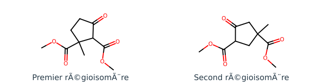

### Question C24 — Saponification des régioisomères

> [!INDICATION]
> Suivez le devenir de l'ester du sommet G et de celui placé en α de la cétone.

#### Solution

L'hydrolyse en milieu basique aqueux transforme chacun des deux CO₂Me d'un régioisomère en COO⁻. Dans un mécanisme général, HO⁻ attaque le carbonyle de l'ester, l'intermédiaire tétraédrique se referme avec départ du méthanolate et le transfert acido-basique final laisse le carboxylate. Les sels 6/7 sont donc les deux cycles de C23 avec CO₂⁻ à la place des deux CO₂Me. Leur acidification conduit aux diacides correspondants.

### Question C25 — Point de convergence des deux voies

> [!INDICATION]
> Identifiez quelle fonction acide est en β de la cétone.

#### Solution

Après acidification, les deux β-cétoacides perdent CO₂ et donnent le même énol, ou deux formes énoliques conduisant à la même cétone après tautomérie. La fonction CO₂H portée par $G$ demeure. 8 est l'acide 1-méthyl-3-oxocyclopentane-1-carboxylique. Une estérification de Fischer de l'acide par le méthanol, catalysée en milieu acide, fournit l'ester méthylique 9.

## Construction de la cage bicyclique

### Question C26 — Variation du degré d'oxydation du zinc

> [!INDICATION]
> Comptez les électrons au départ et dans le centre métallique du produit.

#### Solution

Lors d'une addition oxydante un métal s'insère dans une liaison et se lie aux deux fragments, avec augmentation formelle de son degré d'oxydation de deux unités dans ce cas. Zn neutre (Z=30) a la configuration $[\mathrm{Ar}]3d^{10}4s^2$. La perte formelle des deux électrons 4s fournit Zn(II), de configuration $3d^{10}$ stable.

### Question C27 — Addition sur la cétone 9

> [!INDICATION]
> Distinguez la fonction cétone du cycle et la fonction ester déjà présente.

#### Solution

Dans l'interprétation de Reformatsky, le fragment nucléophile équivaut à $^-\mathrm{CH_2CO_2Et}$. Son carbone attaque le carbonyle cétonique de 9, le doublet π passe sur O et l'alcoolate est protoné. Dans 10, le carbone 3 du cyclopentane porte ainsi **OH et CH₂CO₂Et**. Le sommet 1 porte toujours méthyle et CO₂Me.

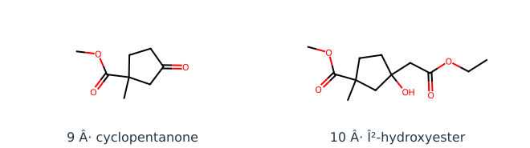

### Question C28 — Déshydratations concurrentes

> [!INDICATION]
> Inventoriez les trois carbones voisins qui portent au moins un hydrogène.

#### Solution

Une déshydratation de l'alcool tertiaire 10 peut créer chacune de trois doubles liaisons. Il existe deux alcènes endocycliques distincts, selon lequel des deux voisins du cycle perd H. Le troisième alcène est exocyclique et conjugué à l'ester, $\mathrm{cycle{=}CHCO_2Et}$ ; ses deux côtés cycliques sont différents, d'où deux géométries E/Z possibles. On compte donc trois connectivités, jusqu'à quatre alcènes en distinguant E/Z sans compter les configurations héritées. Une voie est la protonation de OH, le départ de l'eau, puis l'enlèvement d'un proton β et la formation de C=C. L'absence de bande OH et le bilan de perte d'eau sont cohérents.

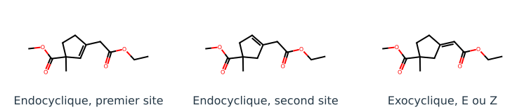

### Question C29 — Fermeture du pont de 13

> [!INDICATION]
> Retrouvez une condensation d'ester intramoléculaire suivie d'une décarboxylation.

#### Solution

Dans 12, l'énolate du CH₂ de la chaîne –CH₂CO₂Et attaque le carbonyle de l'ester méthylique fixé au carbone quaternaire. Le départ de méthanolate ferme le pont et forme un β-cétoester bicyclique. Hydrolyse de l'ester restant, acidification puis décarboxylation de l'acide β-cétonique fournissent la 1-méthylbicyclo[2.2.1]heptan-2-one 13. L'autre extrémité ester ne peut pas fournir cet énolate au carbone α quaternaire.

### Question C30 — Forces relatives des bases

> [!INDICATION]
> Classez les bases par acidité de leurs acides conjugués.

#### Solution

En valeurs conventionnelles indicatives, $pK_a(\mathrm{NH_4^+/NH_3})\simeq9{,}2$ et $pK_a(\mathrm{NH_3/NH_2^-})\simeq38$. Les références pour H₂O, MeOH et H₂ sont respectivement de l'ordre de 16, 16 et 35 sur les échelles usuelles de cours. Ainsi HO⁻ et MeO⁻ sont de force comparable, très au-dessous de H⁻ et NH₂⁻, avec NH₂⁻ généralement placé au-dessus de H⁻ dans ce classement. Les valeurs précises dépendent du milieu ; H⁻ et NH₂⁻ sont nivelés en milieu aqueux.

### Question C31 — Origine des deux méthyles en C3

> [!INDICATION]
> Repérez le seul côté de la cétone possédant un H en α.

#### Solution

La tête de pont C1 est quaternaire. En C3, le méthylène α de 13 est déprotoné, puis le carbone de l'énolate forme une liaison C–CH₃ par substitution sur le méthyle électrophile. Le CH ainsi formé possède encore un proton α. Une seconde succession déprotonation–méthylation donne le motif C3(CH₃)₂ de la fenchone.

### Question C32 — Séparation des deux fenchones

> [!INDICATION]
> Choisissez une méthode qui crée des interactions distinctes avec deux images spéculaires.

#### Solution

Une chromatographie préparative sur phase stationnaire chirale, par exemple de type cyclodextrine adaptée à un terpène volatil, peut résoudre les énantiomères. On contrôle les fractions sur phase chirale et par polarimétrie, la fraction lévogyre correspondant à la (l)-fenchone. Une phase achirale ne les distingue pas.

## Induction asymétrique et excès énantiomérique

### Question C33 — Induction asymétrique

> [!INDICATION]
> Identifiez le centre stéréogène produit par l'addition d'un groupe éthyle.

#### Solution

Le produit est Ph–CH(OH)–CH₂CH₃, le 1-phénylpropan-1-ol. Le carbone lié à OH porte quatre substituants différents. En milieu achiral les produits R et S sont en proportions égales. L'excès énantiomérique est $ee=|n_R-n_S|/(n_R+n_S)$. Un catalyseur chiral régénéré à la fin du cycle donne des voies diastéréoisomères d'énergies différentes et peut favoriser un énantiomère.

### Question C34 — Faces prochirales du benzaldéhyde

> [!INDICATION]
> Regardez le centre carbonylé trigonal depuis les deux côtés du plan.

#### Solution

Au carbone trigonal, les trois groupes ont l'ordre O > Ph > H. Vue d'une face, si O → Ph → H tourne dans le sens horaire, la face est Re. Dans l'autre vue la séquence est antihoraire, donc Si. Les faces sont énantiotopiques. Une addition qui introduit un quatrième groupe différent permet de les distinguer.

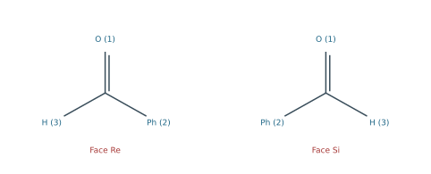

### Question C35 — Aminoalcools et configurations

> [!INDICATION]
> Comptez les carbones entre les deux fonctions et vérifiez les priorités dans une Fischer.

#### Solution

Un β-aminoalcool peut s'écrire $\mathrm{HO-CH(R)-CH(R')-NR''_2}$ et un γ-aminoalcool $\mathrm{HO-CH(R)-CH_2-CH(R')-NR''_2}$. Le ligand nommé est $\mathrm{Ph-CH(OH)-CH[N(CH_3)_2]-CH_3}$. En numérotant depuis le carbone benzylique porteur de OH, les configurations demandées sont 1S et 2R ; la formule stéréochimique figure ci-dessous.

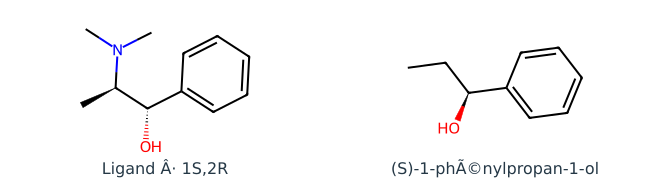

### Question C36 — Transfert d'éthyle et sens de l'induction

> [!INDICATION]
> Repérez les deux centres métalliques et le sens de l'attaque donné dans le schéma.

#### Solution

Dans (b), l'alcoolate O du ligand chélatant N,O reste lié à un premier Zn–Et et coordonne le second ZnEt₂. Dans (c), le carbonyle de PhCHO se coordonne au premier centre. Le trajet cyclique de l'état de transition est Zn₁–O(aldéhyde)–C(aldéhyde)–C(éthyle transféré)–Zn₂–O(ligand)–Zn₁. Le groupe éthyle et le carbone carbonylé forment leur liaison pendant que C=O devient C–O et que se rompt la liaison Zn₂–Et correspondante. (d) est l'alcoolate homochiral $\mathrm{PhCH(OZnEt)CH_2CH_3}$ associé au complexe du ligand après transfert. L'attaque par Si conduit au (S)-1-phénylpropan-1-ol après protonation. L'alcoolate de zinc du ligand retrouve un site disponible pour un nouveau cycle ; le ligand libre est récupérable par protonation lors du traitement final.

### Question C37 — Exploitation d'un excès énantiomérique

> [!INDICATION]
> Ne confondez pas le rendement du mélange avec la proportion de l'énantiomère majoritaire.

#### Solution

I donne 37 % d'ee en faveur de S contre 28 % en faveur de R pour II. I a donc la plus forte induction et un rendement total de 88 %, contre 80 % pour II malgré un temps plus court pour ce dernier. Avec I, la fraction S du produit vaut $(1+0{,}37)/2=0{,}685$. Par rapport à la quantité théorique d'alcool, cela représente $0{,}88\times0{,}685\simeq60\%$ de (S)-PhCH(OH)CH₂CH₃. Le rendement d'isolement rapporté pour le mélange est de 88 % ; aucun isolement séparé de S n'est décrit dans ce tableau.

### Question C38 — État de transition proposé avec I

> [!INDICATION]
> Conservez l'enchaînement à six centres puis imposez la face qui donne S.

#### Solution

L'aminoalcool I remplace le ligand N,O de C36. Son N et son O organisent les centres métalliques, l'O pontant les deux Zn. Le cycle Zn₁–O(CHO)–C(CHO)–C(Et)–Zn₂–O(I) se ferme avec Ph dirigé vers l'espace le moins encombré par la cage. La présentation de la face Si de PhCHO au groupe éthyle explique le majoritaire S. Le schéma donne un modèle stéréochimique compatible avec l'ee ; le tableau seul ne détermine pas la conformation exacte du complexe.

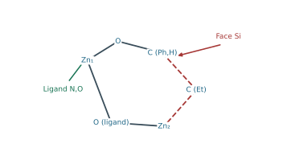

### Question C39 — Configuration du nouvel aminoalcool

> [!INDICATION]
> Suivez la face d'approche la moins encombrée sur la cage de la (l)-fenchone.

#### Solution

Au C2 carbonylé s'ajoute la chaîne –(CH₂)₃NMe₂. Après protonation, C2 porte OH et cette chaîne, la cage et les deux configurations de tête de pont étant conservées. La représentation analogue à I et II place la chaîne aminée devant et OH derrière dans la vue de la figure 4, par attaque du côté dégagé. Les priorités au nouveau centre sont OH, chemin vers C3 portant deux méthyles, chemin vers la tête C1, puis chaîne propyle. La représentation donne **2R**. La cage rigide et ses méthyles rendent les deux faces du carbonyle diastéréotopiques.

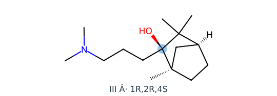

### Question C40 — Excès obtenu par polarimétrie

> [!INDICATION]
> Calculez le rapport des rotations spécifiques aux mêmes température, longueur d'onde et solvant.

#### Solution

La rotation du mélange a le même signe que celle du (S)-1-phénylpropan-1-ol pur. Le majoritaire est donc S ; $ee_S=37/47\simeq0{,}787$, soit environ 79 %. Les fractions correspondantes sont environ 89,4 % de S et 10,6 % de R. Le rendement chimique de 99 % est une grandeur distincte.

### Question C41 — Comparaison du troisième ligand

> [!INDICATION]
> Séparez conversion du substrat et différence d'énergie entre les deux voies stéréochimiques.

#### Solution

Le ligand III donne environ 79 % d'ee en faveur de S, au lieu de 37 % S pour I et 28 % R pour II, et un rendement total de 99 %. La longueur du bras reliant N et O et la substitution de l'amine modifient la géométrie de chélation et l'encombrement des deux faces accessibles au benzaldéhyde. Une différence énergétique accrue entre les deux états de transition est compatible avec ces données. Leur structure exacte ne découle pas de la seule polarimétrie.

## Physique. Atome de Thomson et potentiel effectif

### Question P1 — Champ de la sphère positive

> [!INDICATION]
> Appliquez le théorème de Gauss à une sphère concentrique de rayon r.

#### Solution

**a.** La distribution est invariante par toute rotation autour de O. Les plans contenant $OM$ sont plans de symétrie, donc $\vec E=E(r)\vec e_r$ pour $r>0$ et $\vec E(O)=0$. **b.** La charge enfermée est $e(r/R)^3$ pour $r<R$, puis $e$. Ainsi $E(r)=er/(4\pi\varepsilon_0R^3)$ à l'intérieur et $e/(4\pi\varepsilon_0r^2)$ à l'extérieur. Les deux expressions coïncident à la surface.

### Question P2 — Conservation et plan du mouvement

> [!INDICATION]
> Examinez le travail de la force puis son moment par rapport au centre.

#### Solution

**a.** Le champ électrostatique est stationnaire et dérive d'un potentiel, donc la force $-e\vec E$ est conservative. **b.** La force est radiale, d'où $\dot{\vec\sigma}=\overrightarrow{OM}\times\vec F=0$. **c.** Le moment cinétique constant est normal à $\vec r$ et $\vec v$. Le mouvement reste donc dans le plan passant par O et contenant la position initiale et la vitesse initiale. Si $\vec\sigma=0$, il est rectiligne radial.

### Question P3 — Potentiel électrostatique

> [!INDICATION]
> Fixez la constante à l'infini puis raccordez la solution intérieure à la surface.

#### Solution

**a.** Pour $r\le R$, $F=-q^2r/R^3$. Pour $r\ge R$, $F=-q^2/r^2$. **b.** De $F=-dE_p/dr$ et $E_p(\infty)=0$, on déduit $E_p=Hf(u)$ avec $f(u)=(u^2-3)/2$ pour $0\le u\le1$ et $f(u)=-1/u$ pour $u\ge1$. **c.** La courbe part de $-3/2$ à tangente horizontale en O, croît jusqu'à $-1$ en $u=1$ et tend par valeurs négatives vers zéro. Valeur et dérivée se raccordent en 1.

### Question P4 — Énergie effective et points de rebroussement

> [!INDICATION]
> Éliminez la vitesse angulaire grâce au moment cinétique.

#### Solution

**a–c.** Comme $m_e r^2\dot\theta=\sigma_0$, l'énergie cinétique vaut $m_e\dot r^2/2+A/u^2$, avec $A=\sigma_0^2/(2m_eR^2)$. L'énergie totale est $E=m_e\dot r^2/2+E_{p,\mathrm{eff}}$, où $E_{p,\mathrm{eff}}=Hf(u)+A/u^2$. **d.** Pour $A>0$, cette courbe diverge en zéro, possède un minimum et tend vers zéro par valeurs négatives à l'infini. Une horizontale $E$ délimite les rayons accessibles ($E\ge E_{p,\mathrm{eff}}$). Entre le minimum et zéro l'orbite est radialement bornée. Au minimum elle est circulaire, pour $E\ge0$ l'infini est accessible. Pour $A=0$, la barrière centrale disparaît. **e.** Le terme $A/u^2$ est de l'énergie cinétique angulaire, et dépend des conditions initiales. L'énergie effective sert au problème radial à moment cinétique fixé.

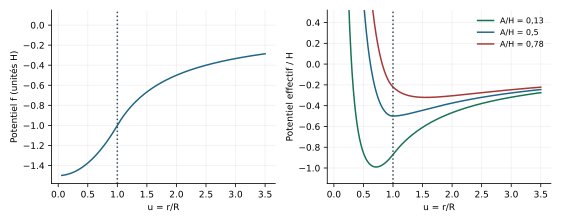

### Question P5 — Franchissement de la surface

> [!INDICATION]
> Situez le minimum du potentiel effectif vis-à-vis de $u=1$ et comparez l'énergie au seuil de surface.

#### Solution

Posons $a=A/H$. Le minimum est en $u_m=(2a)^{1/4}$ si $a\le1/2$ et en $u_m=2a$ si $a\ge1/2$. **a.** Pour $a>1/2$ toute trajectoire permise présente des points extérieurs, puisque le minimum est à l'extérieur et le potentiel décroît dans la sphère. Pour $a<1/2$, la trajectoire accède à $u>1$ lorsque $E>E_{p,\mathrm{eff}}(1)=A-H$. L'égalité correspond à un contact avec la surface. Pour $a=1/2$, l'orbite d'énergie minimale est exactement sur la surface. **b.** Le confinement, surface incluse, demande $a<1/2$ et $E_{\min}\le E\le A-H$, où $E_{\min}=H(\sqrt{2a}-3/2)$. À la valeur limite $a=1/2$, seule l'orbite circulaire de surface reste confinée.

## Trajectoires intérieures et extérieures

### Question P6 — Raideur du rappel interne

> [!INDICATION]
> Comparez la force exacte à celle d'un ressort isotrope.

#### Solution

Dans la sphère $\vec F=-(q^2/R^3)\vec r$. Il s'agit du rappel d'un ressort de longueur à vide nulle et de raideur $K=q^2/R^3\simeq2{,}3\times10^2\,\mathrm{N\,m^{-1}}$ pour $R=10^{-10}$ m.

### Question P7 — Équation du rayon

> [!INDICATION]
> Projetez la dynamique sur la direction radiale avant d'éliminer la vitesse angulaire.

#### Solution

L'accélération radiale vaut $\ddot r-r\dot\theta^2$. Avec $\omega^2=K/m_e$ et le moment cinétique conservé il vient $\ddot r+\omega^2r=\sigma_0^2/(m_e^2r^3)=2AR^2/(m_e r^3)$, pour $r>0$ dans la sphère.

### Question P8 — Mouvement rectiligne

> [!INDICATION]
> Reliez le paramètre A à la composante transverse de la vitesse initiale.

#### Solution

Pour $A=0$, le terme en $1/r^3$ disparaît. Il faut un moment cinétique initial nul, par exemple une vitesse parallèle au rayon, un départ au repos ou un départ du centre. Sur la droite de mouvement, la coordonnée signée décrit un oscillateur harmonique. Le rayon, qui est son module, reste positif de part et d'autre d'un passage en O.

### Question P9 — Équations cartésiennes

> [!INDICATION]
> Exploitez la proportionnalité vectorielle entre rappel et position.

#### Solution

La projection de $m_e\ddot{\vec r}=-K\vec r$ sur les deux axes du plan donne $\ddot x+\omega^2x=0$ et $\ddot y+\omega^2y=0$. La même pulsation figure dans les deux directions.

### Question P10 — Solutions dans le plan

> [!INDICATION]
> Construisez une solution harmonique pour chaque coordonnée.

#### Solution

On a $x=x_0\cos\omega t+(v_{x0}/\omega)\sin\omega t$ et $y=y_0\cos\omega t+(v_{y0}/\omega)\sin\omega t$. Les quatre constantes indépendantes sont les deux composantes de position et de vitesse à l'instant initial.

### Question P11 — Fréquence de l'oscillateur de Thomson

> [!INDICATION]
> Passez de la pulsation à la fréquence avant de discuter la couleur.

#### Solution

$\omega=\sqrt{q^2/(m_e R^3)}\simeq1{,}6\times10^{16}\,\mathrm{rad\,s^{-1}}$, soit $f_e=\omega/(2\pi)\simeq2{,}5\times10^{15}$ Hz. La longueur d'onde correspondante est d'environ 120 nm, dans l'ultraviolet. Ce modèle à fréquence interne unique ne reproduit pas la série de raies de l'hydrogène.

### Question P12 — Ellipse intérieure

> [!INDICATION]
> Éliminez le temps entre les deux composantes harmoniques.

#### Solution

**a.** $x=r_0\cos\omega t$, $y=(v_0/\omega)\sin\omega t$. **b.** L'électron décrit une ellipse de centre O et de demi-axes $r_0,|v_0|/\omega$ (avec dégénérescence rectiligne si l'un s'annule). **c.** Le rayon maximal vaut le plus grand des deux demi-axes, donc $r_0\le R$ et $|v_0|\le\omega R$. **d.** Le cercle non dégénéré demande $|v_0|=\omega r_0$.

### Question P13 — Raccord des deux types de trajectoires

> [!INDICATION]
> Au franchissement de la surface ni la position ni la vitesse ne sautent.

#### Solution

**a–b.** AB est un arc d'ellipse harmonique dont O est le centre. BC est un arc de conique képlérienne dont O est un foyer. L'arc montré ressort puis revient à la surface et possède un apocentre, ce qui en fait ici une ellipse. **c.** CD est de nouveau un arc d'ellipse centré en O. Après D, on poursuit dans le même sens, avec la même tangente, sur une ellipse extérieure de foyer O jusqu'à la prochaine entrée. Le motif intérieur-extérieur se répète avec rotation de la ligne des apsides. La figure de solution trace directement ces raccords.

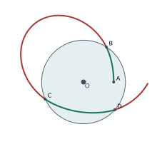

## Amortissement et rayonnement

### Question P14 — Hypothèse de quasi-circularité

> [!INDICATION]
> Comparez la perte de rayon pendant une révolution au rayon de l'orbite.

#### Solution

Le temps d'un tour vaut $2\pi/\omega$ à l'ordre considéré. Il faut $(2\pi/\omega)|\dot r|\ll r$. Cela implique que la vitesse radiale est très petite devant la vitesse tangentielle.

### Question P15 — Énergie de l'orbite quasi circulaire

> [!INDICATION]
> Utilisez le mouvement circulaire intérieur pour remplacer la vitesse tangentielle.

#### Solution

Au premier ordre du modèle adiabatique $v\simeq\omega r$ et $K=m_e\omega^2$. La somme de $m_e\omega^2r^2/2$ et du potentiel $Kr^2/2-3H/2$ est $E\simeq Kr^2-3H/2$.

### Question P16 — Loi de décroissance du rayon

> [!INDICATION]
> La puissance de frottement est négative et proportionnelle au carré de la vitesse.

#### Solution

On a $dE/dt=2Kr\dot r\simeq-m_ev^2/\tau\simeq-Kr^2/\tau$. En simplifiant par $2Kr$ on obtient $\dot r+r/(2\tau)=0$.

### Question P17 — Spirale amortie et largeur de raie

> [!INDICATION]
> Distinguez l'enveloppe d'amplitude, l'énergie oscillante et la largeur en fréquence.

#### Solution

**a.** La variation relative par tour est $\pi/(\omega\tau)\simeq2\times10^{-7}\ll1$. **b–c.** $r(t)=r(0)e^{-t/(2\tau)}$ et $\theta\simeq\omega t$, soit une spirale dont les spires sont très proches au début. **d.** L'excès d'énergie $E+3H/2$ décroît en $\tau$. Le facteur de qualité vaut $Q\simeq\omega\tau\sim 2\times10^7$. **e.** Le train d'onde est une sinusoïde amortie d'enveloppe $e^{-t/(2\tau)}$. L'intensité rayonnée décroît sur $\tau=1$ ns. Le spectre de puissance a un pic lorentzien autour de $f_e$, de largeur à mi-hauteur $\Delta f\simeq1/(2\pi\tau)\sim2\times10^8$ Hz. Une durée finie donne ainsi une raie de largeur finie et une durée de cohérence limitée.

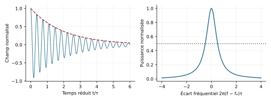

### Question P18 — État final du modèle

> [!INDICATION]
> Recherchez le minimum de l'énergie accessible après perte de toute énergie oscillante.

#### Solution

L'électron finit au repos au centre O de la boule positive, avec $E=-3H/2$. Le modèle amorti conduit à l'effondrement de l'orbite et ne décrit pas une orbite atomique stationnaire.

## Niveaux de Bohr

### Question P19 — Unités naturelles

> [!INDICATION]
> Traitez $q^2$ comme une seule grandeur de dimension énergie fois longueur.

#### Solution

Avec $[q^2]=ML^3T^{-2}$ et $[\hbar]=ML^2T^{-1}$, la combinaison $L_c=\hbar^2/(m_eq^2)$ est une longueur. La combinaison $T_c=m_eL_c^2/\hbar=\hbar^3/[m_e(q^2)^2]$ est un temps. Les unités de masse, longueur et temps peuvent donc être choisies comme $m_e,L_c,T_c$.

### Question P20 — Candidats à la quantification

> [!INDICATION]
> Comparez chacune des trois dimensions à celle de la constante de Planck.

#### Solution

$q^2/v$, $m_er v$ et $\sqrt{m_erq^2}$ ont toutes la dimension $ML^2T^{-1}$ d'une action. L'analyse dimensionnelle seule ne permet donc pas de les départager.

### Question P21 — Grandeur choisie par Bohr

> [!INDICATION]
> Cherchez la grandeur conservée pour tout mouvement dans un champ central.

#### Solution

Le moment cinétique $m_er v$ pour une orbite circulaire est le module de $\vec r\times m_e\vec v$. C'est une constante naturelle du mouvement dans un champ central, généralisation qui reste valable hors du cercle avec la vitesse transverse. Bohr impose $|\vec\sigma|=|n|\hbar$. Les trois expressions proposées coïncident numériquement sur une orbite coulombienne circulaire.

### Question P22 — Vitesse orbitale

> [!INDICATION]
> Égalisez attraction et force centripète.

#### Solution

$m_e v^2/r=q^2/r^2$ donne $v=\sqrt{q^2/(m_er)}$ pour le module de la vitesse.

### Question P23 — Rayons discrets

> [!INDICATION]
> Introduisez la vitesse précédente dans le quantum de moment cinétique.

#### Solution

$m_er v=\sqrt{m_erq^2}=|n|\hbar$ conduit à $r_n=n^2\hbar^2/(m_eq^2)=n^2L_c$, avec $|n|\ge1$. Le signe du moment angulaire décrit le sens du mouvement.

### Question P24 — Rayon fondamental

> [!INDICATION]
> Comparez la longueur de Bohr au rayon atomique utilisé pour la sphère.

#### Solution

$r_1=(1{,}05\times10^{-34})^2/[(9{,}11\times10^{-31})(2{,}31\times10^{-28})]\simeq5{,}2\times10^{-11}$ m, soit environ 0,53 Å. On retrouve une taille atomique et non une dimension nucléaire.

### Question P25 — Énergie des niveaux de Bohr

> [!INDICATION]
> Sur le cercle, l'énergie cinétique est la moitié de la valeur absolue de l'énergie potentielle.

#### Solution

**a.** $E_n=q^2/(2r_n)-q^2/r_n=-E^*/n^2$, avec $E^*=m_e(q^2)^2/(2\hbar^2)$. **b.** La constante vaut environ $2{,}2\times10^{-18}$ J ou 13,6 eV. C'est l'énergie à fournir à l'hydrogène fondamental pour atteindre le seuil d'ionisation d'énergie nulle.

## Transitions, largeurs de raie et couleurs

### Question P26 — Transitions entre trois niveaux

> [!INDICATION]
> La plus grande longueur d'onde correspond au plus petit écart d'énergie.

#### Solution

**a.** Les énergies $-13{,}6$, $-3{,}40$ et $-1{,}51$ eV correspondent à $n=1,2,3$. Les paires accessibles dans ce modèle sont 1–2, 1–3 et 2–3, dans les deux sens selon qu'il y a absorption ou émission. **b–c.** L'écart $2\to3$ est $E^*(1/4-1/9)\simeq1{,}89$ eV. Donc $\lambda_{23}=hc/(E_3-E_2)\simeq6{,}6\times10^{-7}$ m, soit la raie rouge Hα de Balmer.

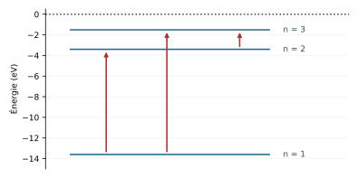

### Question P27 — Orbite après une impulsion radiale

> [!INDICATION]
> Examinez l'énergie et la direction de la vitesse juste après la perturbation.

#### Solution

L'ajout d'une petite vitesse radiale donne une vitesse qui n'est plus orthoradiale. L'énergie augmente de $m_e\alpha^2 v_n^2/2$ tout en restant négative si $|\alpha|<1$. La trajectoire est donc une ellipse képlérienne de foyer O et non un cercle. Le signe d'α indique le sens du mouvement radial initial.

### Question P28 — Quantification du moment angulaire

> [!INDICATION]
> Calculez la contribution de l'impulsion au produit vectoriel.

#### Solution

**a.** La variation est $\delta\vec\sigma=\vec r\times m_e\alpha v_n\vec e_r=0$. Le champ central la conserve ensuite. **b.** La règle reste $m_e r^2|\dot\theta|=|n|\hbar$ pour l'orbite perturbée. Employer la vitesse totale dans $m_erv$ au lieu de la vitesse tangentielle serait incorrect sur l'ellipse.

### Question P29 — Déplacement relatif d'un niveau

> [!INDICATION]
> Rapportez l'énergie acquise à l'énergie initiale négative.

#### Solution

$E'_n-E_n=m_e\alpha^2v_n^2/2=-\alpha^2 E_n$ sur le cercle initial. On obtient $(E'_n-E_n)/E_n=-\alpha^2$. L'énergie perturbée est moins négative.

### Question P30 — Étendue et distribution des longueurs d'onde

> [!INDICATION]
> Identifiez séparément les extrêmes des niveaux initial et final. Une distribution uniforme en α ne l'est pas en son carré.

#### Solution

**a.** Avec $\beta=\alpha_M^2$, chaque niveau $E_i<0$ s'étend de $E_i$ à $E_i(1-\beta)$ vers le haut. Le niveau inférieur a la plus grande étendue absolue. **b.** Pour $D=E_p-E_n>0$, les écarts extrêmes sont $D-\beta|E_n|$ et $D+\beta|E_p|$. Ainsi les bornes de longueur d'onde valent $hc/(D+\beta|E_p|)$ et $hc/(D-\beta|E_n|)$. Au premier ordre, la largeur totale relative est $|\delta\lambda|/\lambda=\beta(|E_n|+|E_p|)/D=\beta(E_n+E_p)/(E_n-E_p)$, avec $\beta=0{,}01$. **c.** Pour 2–3, la largeur relative vaut $0{,}01(9+4)/(9-4)=0{,}026$, soit environ 17 nm. **d–e.** Le spectre s'étale de part et d'autre de la raie non perturbée, davantage vers le rouge. Pour des perturbations indépendantes des deux niveaux, la densité est maximale autour de la valeur non perturbée et s'annule aux extrémités. En effet $x=\alpha^2$ a une densité proportionnelle à $1/\sqrt x$ sur $]0,\beta]$. La différence des déplacements d'énergie n'est pas uniforme et le passage de l'énergie à la longueur d'onde ajoute encore un changement de variable.

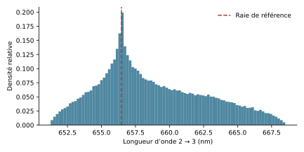

### Question P31 — Mesure d'un spectre d'absorption

> [!INDICATION]
> Comparez les intensités incidente et transmise en corrigeant la contribution de la cuve et du solvant.

#### Solution

Dans un spectrophotomètre, réaliser le blanc avec le solvant dans une cuve appropriée. Pour les mêmes longueurs d'onde, mesurer la lumière transmise $I(\lambda)$ par la solution par rapport à $I_0(\lambda)$ du blanc. Tracer $A=-\log_{10}(I/I_0)$ ou, pour reproduire l'ordonnée en fraction absorbée du sujet, $1-I/I_0$ en négligeant les pertes hors absorption.

### Question P32 — Domaine visible

> [!INDICATION]
> Ordonnez les couleurs de la plus courte à la plus longue longueur d'onde.

#### Solution

Le visible couvre environ 380–780 nm. L'ordre est violet, bleu, vert, jaune, orange, rouge. Les limites entre couleurs, et celles de la sensibilité de l'œil, sont progressives.

### Question P33 — Couleur des solutions a et b

> [!INDICATION]
> Superposez mentalement le domaine visible aux abscisses du premier graphe.

#### Solution

Les deux solutions absorbent fortement dans le bleu et dans le vert et transmettent surtout les grandes longueurs d'onde du visible, à partir d'environ 600 nm. Elles paraissent rouges à rouge-orangé. Le contraste entre (a) et (b) aux longueurs d'onde ultraviolettes influe très peu sur la couleur perçue.

### Question P34 — Couleur des solutions c et d

> [!INDICATION]
> Il faut interpréter la lumière qui traverse la solution sous éclairage blanc.

#### Solution

Les deux courbes absorbent fortement au-dessus d'environ 500 nm. Le bleu et le violet sont surtout transmis, avec une part de bleu-vert près de la coupure. Elles paraissent bleues. La solution (c) absorbe aussi une fraction appréciable de la lumière bleue et paraît plus sombre que (d) dans les mêmes conditions.

### Question P35 — Spectres qualitatifs de deux colorants

> [!INDICATION]
> Dessinez les creux d'absorption aux couleurs effectivement transmises.

#### Solution

**a.** Pour le vert de malachite concentré, prévoir une transmission préférentielle dans le vert, donc une fenêtre de faible absorption vers 500–560 nm, entre des absorptions plus fortes dans le violet-bleu et le rouge. **b.** Pour le cristal violet, prévoir une forte absorption dans le vert-jaune et une transmission résiduelle dans le violet-bleu et éventuellement le rouge. Ces silhouettes qualitatives ne fixent ni les positions exactes des maxima ni les intensités réelles.

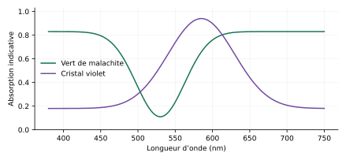
