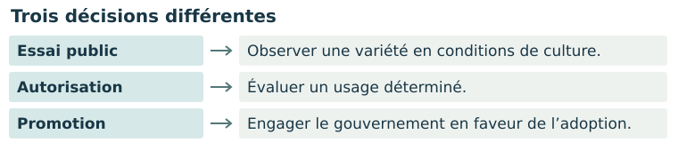
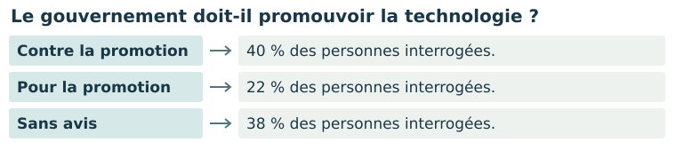
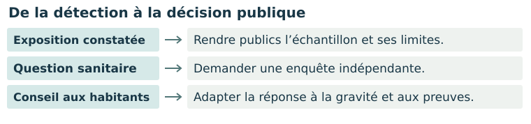

# X-ENS · MP-PC-PSI · Anglais 2015 — Corrigé brut

*Corrigé rédigé par IA, non officiel. Signalez toute erreur.*

**Rédaction** · GPT-6.2 Astra Ultra · vitesse non renseignée

Le cahier XEULCR prévoit quatre heures pour les deux parties. Aucun document autorisé. La partie A demande une synthèse en anglais de 600 à 675 mots, précédée d’un titre, qui croise les documents 1 à 4 dans leur contexte géographique, sans commentaire personnel. La partie B demande un texte d’opinion en anglais de 500 à 600 mots en réaction au document de la seconde partie. Les décomptes portent sur le corps du texte, hors titre.

## A. Synthèse de documents

**Who Gets to Decide What Grows in Britain?**

A potato which resists blight promises relief to growers who regularly spray their fields. Yet even a promising potato may never get as far as a British shop. Reports by James Morgan for the BBC and Karl Mathiesen for the Guardian examine the distance between scientific promise and commercial cultivation. Tracey Brown questions the way British and European policymakers understand precaution, while a YouGov poll measures British unease about official encouragement. At issue is what evidence could justify taking the next step, and who has the authority to decide what that step should be.

For scientists advising the British prime minister, the difficulty begins well before consumers can choose a product. Morgan reports that British applications for field trials fell from thirty-seven in 1995 to one in 2012. Trials allow researchers to find out whether an innovation delivers the benefits claimed for it outside a laboratory. Yet the expense and uncertainty of getting through the European system discourage precisely the investigations that could inform a decision. The proposed publicly funded programme would give promising strains a hearing even where a company sees no immediate prospect of recovering its costs. Mathiesen's example of BASF abandoning work for the European market illustrates how a hostile commercial climate can close an investigation independently of its scientific merits.

Whether foregoing an experiment amounts to playing safe depends on the comparison being made. Brown points out that a conventional potato crop may be sprayed against disease as many as twenty times a year. Keeping the existing crop therefore commits farmers to a practice with consequences of its own. The blight-resistant potato in Mathiesen's account gives that comparison a concrete object. Brown also recalls the gains associated with a conventionally bred variety of rice in India. Full advance knowledge of its effects would have been an impossible condition for its introduction. In both cases, asking what happens if the innovation is withheld changes the meaning of precaution without supplying a blanket guarantee of safety.

Disagreement persists because the parties are also evaluating different things. Scientists interviewed by Morgan distinguish individual plants and the traits they might acquire, from improved nutrition to reduced dependence on chemicals. Environmental campaigners interviewed by Mathiesen ask how a variety would fit into a farming system already dependent on relatively few crops and suppliers. A scientific assessment of one potato could answer a question about resistance to disease while leaving questions about soil, ownership or access to food unresolved. Conversely, a concern about the power of multinational companies can point in opposite policy directions. Campaigners see a danger in expanding their markets, whereas one researcher in Morgan's account argues that high regulatory costs already confer an advantage on firms wealthy enough to bear them.

British public opinion gives the government little encouragement to act as a salesman. In YouGov's February 2014 poll, forty per cent opposed government promotion of the technology, twenty-two per cent supported it and thirty-eight per cent did not know. The question concerns the government's role, so its results cannot establish how many people would refuse a particular food. The accompanying figures on attitudes over the preceding year also indicate how much room there is between enthusiasm and a newly formed objection. Public sponsorship of research and public endorsement of its eventual products make distinct claims on that uncertain constituency.

The dispute thus reaches from experimental plots to the distribution of power within agriculture. A case-by-case assessment can expose the costs of both action and delay. Winning consent for a public programme also requires an account of who chooses the cases, which benefits count and how far the findings commit anyone to growing or buying the crop.

*608 mots hors titre.*

## B. Texte d’opinion

**An Alarm Bell Is a Reason to Look**

I would want to hear about an unexpected finding in my town's drinking water while investigators were still checking it. I would also want to know whether I should do anything differently when I filled a glass. Those are quite different requests. Kara Moses is right to defend a campaign group's ability to bring a question to public attention. I think that freedom carries a duty which her argument leaves somewhat open. Whoever rings the bell should tell listeners exactly what it would take to establish that there is a fire.

Consider what the weedkiller survey can tell us. Campaigners arranged to have samples taken from 182 urban volunteers across Europe. Finding traces of glyphosate makes it reasonable to ask how exposure occurs. It tells us little about the proportion of all Europeans exposed, still less about anyone's chance of becoming ill. Volunteers who come forward may differ from people who never see the invitation. A headline connecting a familiar brand with an alarming health outcome can travel around the world while the qualifications stay in the report. A small group has limited funds, as Moses recognises, but it can afford a plain account of what its figures mean.

Waiting for publication in a scientific journal before anyone may speak would set a peculiar test of citizenship. A resident who notices dead fish can alert a river authority without first conducting a controlled study. In much the same way, an organisation can collect observations that fall outside a company's interests or a regulator's current priorities. Refusing even to discuss those observations leaves the decision about what deserves research to people who already command a research budget. Some of the most important public questions concern harms whose investigation offers little private return.

The difficult issue is what an authority should do next. Suppose our water authority receives a single unexpected reading. It could commission an independent check, publish the question being examined and give residents a date for a further statement. If subsequent evidence changes the advice, the public can trace that decision. A demand to close the water supply immediately would need a stronger basis, because closure itself has consequences. Equally, the cost of delaying inquiry belongs in the calculation when an effect might be serious. Responsibility lies in matching the response to the evidence and the stakes.

I part company with Moses on the comfort one might take from the campaigners' charitable motives. An organisation can honestly seek the public good and still select the result most likely to attract attention. A manufacturer can supply a result worth checking even though it stands to profit. I would ask both to disclose their funding, how participants were selected and which results would count against their interpretation. Journalists can report those answers beside the finding, and return to the story when independent evidence appears.

The public should be able to express concern long before certainty arrives. It should also be able to follow concern through investigation to a decision, including a decision to stop worrying. My test for an early warning is whether it makes that journey easier for the people who hear it.

*523 mots hors titre.*

Le sujet est conservé par la banque et l’ENS. Le rapport de cet écrit n’a pas été retrouvé dans les sources consultées.

[Sujet officiel](https://banques-ecoles.fr/cms/wp-content/uploads/2015/09/15_mp-pc_sujet_anglais_xeulcr.pdf) · [Sujet publié par l’ENS](https://www.ens.psl.eu/IMG/file/concours/2015/PC/sujets/sujet_mppc_ang2015.pdf)
