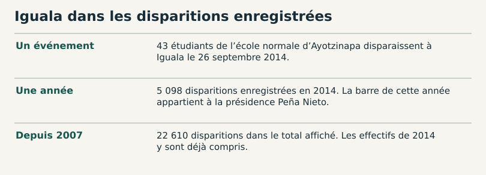

# X-ENS MP-PC-PSI — Espagnol 2015 · Corrigé brut

*Corrigé rédigé par IA, non officiel. Signalez toute erreur.*

**Rédaction** · GPT-6.2 Astra Ultra · vitesse non renseignée

Le cahier XEULCR des filières MP, PC et PSI prévoit quatre heures sans document. La partie A demande une synthèse en espagnol de 600 à 675 mots, précédée d’un titre et fondée sur les documents 1 à 4. La partie B est un texte d’opinion en espagnol de 500 à 600 mots qui répond au document 5. Le rapport propre à l’écrit d’espagnol de cette session n’a pas été retrouvé dans les archives consultées.

## A. Synthèse de documents

**Ayotzinapa y la crisis de confianza en el Estado mexicano**

La desaparición de cuarenta y tres estudiantes de magisterio de Ayotzinapa, en Iguala, en septiembre de 2014, obliga a examinar la distancia entre el proyecto de modernización de México y la seguridad de sus ciudadanos. Enrique Krauze se remonta a la historia de Guerrero en «México bárbaro», publicado en El País. Carlos Malamud, en «México frente a la violencia», de Infolatam, interroga las instituciones que deberían responder a lo ocurrido. José Gil Olmos, en cambio, anuncia desde el título de su artículo en Proceso, «Ayotzinapa, el declive de Peña», un juicio adverso sobre el presidente. La infografía de Actualidad RT sitúa a los normalistas entre miles de desaparecidos y permite apreciar la dimensión nacional de un suceso localizado.

Para Krauze, el contraste entre el Acapulco de sus vacaciones infantiles y la violencia que descubrió en 1960 ayuda a entender cómo los mexicanos pudieron desconocer durante tanto tiempo la historia de ese estado. Guerrero reúne recursos minerales y centros turísticos junto con una pobreza que afecta a siete de cada diez habitantes. A la inestabilidad política y la marginación se sumó el narcotráfico. La connivencia de algunos municipios con los grupos criminales transformó a las autoridades encargadas de proteger a la población en una fuente de peligro. Malamud también identifica la penetración del poder local como un mecanismo decisivo. La fragmentación de las organizaciones criminales y la competencia por el territorio agravan la violencia. A su vez, la debilidad de la justicia permite que esa relación perdure.

Lo sucedido trasciende Guerrero sin que todo el país pueda equipararse a ese estado. La infografía publicada el 11 de diciembre atribuye a 2014 más de cinco mil desapariciones y a los años transcurridos desde 2007 más de veintidós mil. Junto a los símbolos que representan a los cuarenta y tres estudiantes, los promedios diarios y semanales dan una escala temporal al número que ha suscitado la indignación. El mapa distribuye las cifras por territorios y señala las zonas de presencia de distintos grupos criminales. Las barras, ordenadas por presidencias, muestran que el cambio de gobierno de 2012 no puso fin al fenómeno. Para Malamud, el acceso al mercado estadounidense y la circulación de armas añaden una dimensión internacional al problema.

También se cruzan las responsabilidades de diferentes fuerzas políticas. Krauze interroga la pasividad del gobierno estatal y del poder federal, mientras que Malamud recuerda la afiliación del alcalde y del gobernador al PRD y pide una respuesta que comprometa al PRI, al PRD y al PAN. En octubre, este último autor veía todavía una oportunidad para Peña Nieto. Reconocía su tardanza inicial, pero valoraba las primeras detenciones y el envío de la Gendarmería. Defendía que la reforma policial fuera acompañada por cambios en la justicia penal. Krauze añade que ciertas ciudades han conseguido contener la violencia mediante la colaboración de la sociedad con las autoridades y advierte que la pobreza de Guerrero dificulta reproducir esa experiencia.

La valoración de Gil Olmos en noviembre resulta mucho más severa. Compara los elogios internacionales que recibió el presidente por sus reformas económicas con la espera de las familias y la demora de la intervención federal. El anuncio de un pacto de seguridad aparece en su análisis como una reacción a las protestas y a la presión exterior. La respuesta favorable de algunos medios a las reformas ya no basta para controlar la imagen del país. Si Krauze se resiste a identificar México entero con un narcoestado, coincide con los otros autores en vincular el porvenir de sus instituciones a su capacidad para proteger a la población. Lo que cambia de uno a otro es el crédito que aún conceden a los gobernantes para hacerlo.

## B. Texte d’opinion

Comparto con Rubén Aguilar Valenzuela la exigencia de que la desaparición de los normalistas de Ayotzinapa cambie la manera en que las autoridades mexicanas responden a las familias. También entiendo el deseo de que la indignación sobreviva al último titular. Sin embargo, el editorial quiere pasar muy deprisa de la explicación ofrecida por el procurador a una certeza sobre el destino de cada estudiante y, de ahí, a una tarea que atribuye a sus padres. Creo que un Estado que aspire a recuperar la confianza tiene obligaciones en ambos terrenos, incluso si las familias deciden no ocupar ningún espacio público.

La claridad con que se presenta una versión de los hechos permite discutirla y pedir precisiones. No sustituye las comprobaciones necesarias para sostenerla. Una confesión grabada puede aportar indicios sobre lugares, personas y momentos. Para que una familia sepa qué le ocurrió a su hijo, esos elementos deben contrastarse con pruebas independientes y poder ser examinados por quienes representan a las víctimas. Afirmar que la identificación será difícil no autoriza a convertir esa dificultad en una conclusión sobre cada persona. Exigir que continúe la investigación es una petición razonable aunque sus resultados tarden en llegar.

El autor reconoce que la conferencia responde mejor a las preguntas sobre lo sucedido que a la de por qué ocurrió. Su explicación, según la cual los responsables habrían perdido todo aprecio por la vida, expresa un juicio moral comprensible. Deja abierta, sin embargo, una pregunta política. ¿Qué permitió que quienes debían ofrecer seguridad pudieran faltar a su deber sin temor a que otra autoridad interviniera? Una investigación sobre las decisiones y omisiones concretas ayudaría a establecer responsabilidades individuales. También permitiría identificar los avisos que quedaron sin respuesta y las instituciones a las que un ciudadano podría recurrir si se viera de nuevo desprotegido.

Me parece especialmente injusto hacer recaer en los padres la misión de dar un sentido a la pérdida de sus hijos mediante la dirección de un movimiento. Si desean hablar, tienen derecho a que se los escuche sin desacreditarlos. Si prefieren preservar su intimidad, el deber de investigar permanece intacto. La solidaridad de otras familias, estudiantes, asociaciones y periodistas puede repartir el esfuerzo de mantener el asunto en la agenda pública. Ningún familiar debería tener que convertirse en portavoz nacional para conocer el estado de su expediente.

Aguilar acierta al pedir resultados verificables a los tres niveles de gobierno. Un pacto firmado ante las cámaras solo adquirirá valor cuando se pueda saber quién atiende una denuncia, en qué plazo informa y cómo se controla el trabajo de quienes investigan a sus propios compañeros. Publicar los avances sin exponer datos sensibles de los familiares y explicar por qué se descarta una hipótesis serían dos señales concretas. Además, esas explicaciones deberían estar al alcance de las familias que viven lejos de la capital y no pueden viajar para pedirlas en persona. La confianza que reclama el editorial tendrá más posibilidades de recuperarse si las autoridades admiten qué ignoran y ofrecen medios para averiguarlo. La memoria de los estudiantes exige perseverancia, también cuando las respuestas que se esperan no pueden ofrecerse en una conferencia de prensa.

[Cahier du concours](https://banques-ecoles.fr/cms/wp-content/uploads/2015/09/15_mp-pc_sujet_espagnol_xeulcr.pdf)
