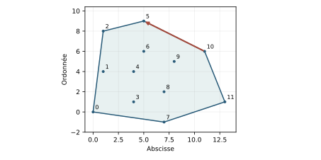
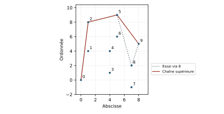

# X-ENS MP-PC · Informatique B 2015 · Corrigé guidé

*Corrigé rédigé par IA, non officiel. Signalez toute erreur.*

**Rédaction** · GPT-6.2 Astra Ultra · vitesse non renseignée · 25 novembre 2026

Langage choisi : Python. Le tableau possède deux lignes, abscisses puis ordonnées, et ses colonnes désignent les points. Les nuages ont au moins trois points et ne contiennent aucun triplet de points distincts alignés.

## Repères

Le paquet cadeau utilise une droite d’appui à partir du dernier sommet. Le balayage travaille avec deux chaînes et une interface de pile imposée. Dans les deux algorithmes, écrire les trois indices dans le même ordre que dans le déterminant avant d’en choisir le signe.

## I · Préliminaires

### Question 1 · Sélection du point le plus bas

**Indication.** Comparer les couples ordonnée puis abscisse en mémorisant un indice.

#### Solution

Après la lecture des colonnes jusqu'à l'indice $j$, `meilleur` est l'indice d'un point où le couple $(y,x)$ est minimal parmi ces colonnes. Partir de la colonne 0 autorise des coordonnées arbitrairement négatives. Dans le tableau du sujet, la valeur minimale de $y$ est $-1$, atteinte en $p_7=(7,-1)$.

```python
def plusBas(tab, n):
    meilleur = 0
    for j in range(1, n):
        if (tab[1][j], tab[0][j]) < (tab[1][meilleur], tab[0][meilleur]):
            meilleur = j
    return meilleur
```

### Question 2 · Deux orientations

**Indication.** Calculer le déterminant de deux vecteurs de même origine.

#### Solution

Pour $(p_0,p_3,p_4)$, les vecteurs sont $(4,1)$ et $(4,4)$, d'où $4\times4-1\times4=12$ et le résultat **+1**. Pour $(p_8,p_9,p_{10})$, les vecteurs sont $(1,3)$ et $(4,4)$, d'où $1\times4-3\times4=-8$ et le résultat **−1**.

### Question 3 · Prédicat géométrique

**Indication.** Traduire les trois signes possibles en trois valeurs de retour.

#### Solution

Le déterminant vaut deux fois l'aire algébrique. Son calcul sur les coordonnées entières évite les arrondis trigonométriques. Quand deux indices coïncident, les deux produits se compensent ou un vecteur est nul. La fonction renvoie alors bien zéro.

```python
def orient(tab, i, j, k):
    x, y = tab
    det = (x[j] - x[i]) * (y[k] - y[i]) - (y[j] - y[i]) * (x[k] - x[i])
    if det > 0:
        return 1
    if det < 0:
        return -1
    return 0
```

## II · Algorithme du paquet cadeau

### Question 4 · Ordre des directions depuis un sommet

**Indication.** Choisir une origine des angles qui laisse toutes les directions du nuage dans un intervalle plus court qu’un demi-tour.

#### Solution

Le point $p_i$ est **un sommet de l'enveloppe courante du paquet cadeau**, donc un sommet extrême du nuage. Les directions vers les autres points restent entre ses deux arêtes adjacentes dans un secteur d'angle strictement inférieur à $\pi$ (trois points distincts ne sont jamais alignés). Choisissons sur ce secteur une coordonnée angulaire croissante $\alpha_j$. Le signe de l'orientation de $(i,j,k)$ est celui de $\sin(\alpha_k-\alpha_j)$ et donc celui de $\alpha_k-\alpha_j$. La relation du sujet équivaut à $\alpha_j\ge\alpha_k$.

La réflexivité suit de $\alpha_j=\alpha_j$. Deux inégalités réciproques donnent des angles égaux, ce qui impose $j=k$ par la position générale. De $\alpha_j\ge\alpha_k\ge\alpha_l$ on tire $\alpha_j\ge\alpha_l$. Enfin deux angles réels sont toujours comparables. L'hypothèse que $p_i$ est sur l'enveloppe est indispensable à la transitivité de cette lecture angulaire.

### Question 5 · Prochain sommet de Jarvis

**Indication.** Initialiser le maximum sur un point différent du sommet courant.

#### Solution

Le candidat initial appartient à $P\setminus\{p_i\}$. Quand le déterminant est négatif, le point d'indice $j$ est plus grand dans l'ordre de la Q4 et remplace le candidat. Après chaque examen le candidat est donc maximal parmi les points retenus jusque-là. À la fin, tous les points sont à gauche de l'arête orientée de $i$ vers ce candidat. Au plus $n$ tests de coût constant sont effectués.

```python
def prochainPoint(tab, n, i):
    candidat = 0 if i != 0 else 1
    for j in range(n):
        if j != i and orient(tab, i, candidat, j) < 0:
            candidat = j
    return candidat
```

### Question 6 · Trace depuis le point 10

**Indication.** Suivre les colonnes dans l’ordre de la boucle et consigner le résultat de chaque véritable test.

#### Solution

Au départ le candidat est 0. Le tableau suit exactement la fonction précédente. L'indice 10 est ignoré par le premier test.

| Point examiné $j$ | 0 | 1 | 2 | 3 | 4 | 5 | 6 | 7 | 8 | 9 | 11 |
|---|---:|---:|---:|---:|---:|---:|---:|---:|---:|---:|---:|
| Orientation avec le candidat précédent | 0 | −1 | −1 | +1 | +1 | −1 | +1 | +1 | +1 | +1 | +1 |
| Candidat après le test | 0 | 1 | 2 | 2 | 2 | 5 | 5 | 5 | 5 | 5 | 5 |

Le successeur est $p_5$. En particulier, le point 11 examiné en dernier laisse le maximum inchangé.



### Question 7 · Construire le paquet cadeau

**Indication.** Prendre le point le plus bas comme premier sommet et tester le retour avant l’ajout.

#### Solution

Le point le plus bas, départagé par l'abscisse, est extrême. Chaque appel à `prochainPoint` choisit sa prochaine arête d'appui en orientation positive. Les sommets sont parcourus dans l'ordre du bord jusqu'au retour au point initial, qui n'est pas réinséré. Sur l'exemple, la liste est `[7, 11, 10, 5, 2, 0]`.

```python
def convJarvis(tab, n):
    depart = plusBas(tab, n)
    bord = [depart]
    sommet = prochainPoint(tab, n, depart)
    while sommet != depart:
        bord.append(sommet)
        sommet = prochainPoint(tab, n, sommet)
    return bord
```

### Question 8 · Coût en fonction de la taille du bord

**Indication.** Compter aussi l’appel qui constate le retour au départ.

#### Solution

La recherche initiale coûte $O(n)$. Pour $m$ sommets du bord, on recherche exactement $m$ successeurs, dont celui qui referme le cycle. Chaque recherche coûte $O(n)$, les ajouts en fin de liste coûtent $O(m)$ au total. Le temps total vaut donc $O(nm)$. Les $m$ indices de la réponse mis à part, le parcours ne garde qu'un nombre constant d'indices.

## III · Algorithme de balayage

### Question 9 · Tri garanti en temps quasi linéaire

**Indication.** Choisir une borne valable même dans le pire cas.

#### Solution

Le tri fusion compare les abscisses. À chacun des $O(\log n)$ niveaux, il fusionne au total $n$ éléments en temps $O(n)$, donc son temps maximal est $O(n\log n)$. Il conserve aussi l'ordre antérieur des égalités si la comparaison favorise la moitié gauche à égalité. L'ordre entre abscisses égales est libre dans cet énoncé.

### Question 10 · Mise à jour de la chaîne supérieure

**Indication.** Dépiler temporairement le dernier sommet pour consulter l’avant-dernier avec l’interface autorisée.

#### Solution

Soient $u$ le dernier indice et $v$ l'avant-dernier. La chaîne supérieure doit tourner dans le sens horaire en allant de gauche à droite. Il faut donc conserver $u$ lorsque $(i,u,v)$ a une orientation positive. On remet $u$ sur la pile si ce test réussit ou si sa suppression temporaire a vidé la pile. Dans l'autre cas il se trouve du côté intérieur et l'on poursuit les suppressions. On empile enfin $i$. Chaque itération élimine un sommet ou termine la boucle, d'où au plus $O(i+1)$ opérations, même lorsque presque toute la chaîne est éliminée.

```python
def majES(tab, es, i):
    while not isEmpty(es):
        dernier = pop(es)
        if isEmpty(es) or orient(tab, i, dernier, top(es)) > 0:
            push(dernier, es)
            break
    push(i, es)
```



### Question 11 · Mise à jour de la chaîne inférieure

**Indication.** Renverser uniquement le signe d’orientation qui permet de conserver un sommet.

#### Solution

Cette fois le virage de gauche à droite doit être positif, donc l'ordre inversé $(i,u,v)$ doit avoir une orientation négative. Le mécanisme de dépilement et la borne $O(i+1)$ sont les mêmes que pour la chaîne supérieure. Les trois indices effectivement comparés sont distincts et le cas d'une orientation nulle est exclu par la position générale.

```python
def majEI(tab, ei, i):
    while not isEmpty(ei):
        dernier = pop(ei)
        if isEmpty(ei) or orient(tab, i, dernier, top(ei)) < 0:
            push(dernier, ei)
            break
    push(i, ei)
```

### Question 12 · Assemblage des deux piles

**Indication.** Conserver la pile inférieure et lui ajouter uniquement les sommets intérieurs de la chaîne supérieure en ordre inverse.

#### Solution

Les fonctions `newStack`, `isEmpty`, `push`, `top` et `pop` sont celles fournies par le sujet. Le parcours se fait dans l'ordre des colonnes déjà triées en abscisse. Au terme du balayage, `inf` va de 0 à $n-1$ par le bas. Le premier dépilement de `sup` enlève $n-1$, puis les dépilements suivants parcourent le bord supérieur en sens inverse. L'indice 0, commun aux deux piles, est écarté à son tour. Ainsi le fond reste 0 et les indices se suivent dans le sens positif. Pour l'exemple on obtient, du fond au sommet, `0, 7, 11, 10, 5, 2`.

```python
def convGraham(tab, n):
    sup, inf = newStack(), newStack()
    for i in range(n):
        majES(tab, sup, i)
        majEI(tab, inf, i)
    pop(sup)
    while not isEmpty(sup):
        j = pop(sup)
        if j != 0:
            push(j, inf)
    return inf
```

### Question 13 · Coût amorti du balayage

**Indication.** Distinguer les suppressions définitives des dépilements temporaires suivis d’une remise au sommet.

#### Solution

Sur chacune des deux chaînes, chaque nouveau point est ajouté une seule fois comme nouveau sommet et ne peut être éliminé définitivement qu'une seule fois. Il y a donc au plus $n$ suppressions définitives par chaîne. Le dépilement temporaire suivi d'une remise a lieu au plus une fois par mise à jour, soit encore $O(n)$ opérations. Toutes les primitives de pile et tous les tests d'orientation ont un coût constant. Le balayage et l'assemblage des moitiés coûtent ensemble $O(n)$, avec $O(n)$ cases de pile. En ajoutant le tri initial, le temps total garanti de Graham–Andrew est $O(n\log n)$.
